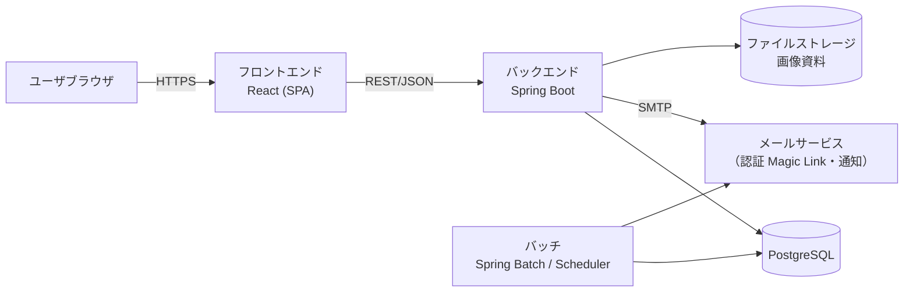
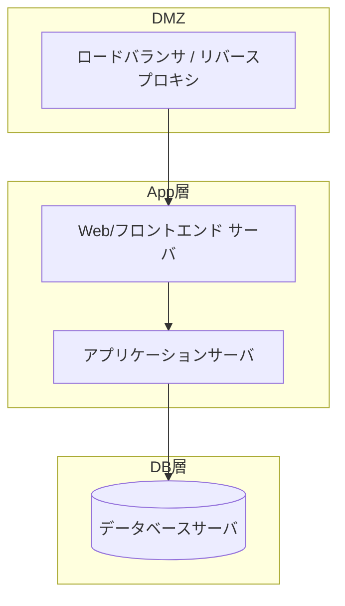

# 01 システム構成・方式設計

> システム全体のアーキテクチャ、技術スタック、配置・ネットワーク構成、環境一覧、共通方式方針を定める。
> 全体に関わる設計であるため、機能・画面設計より先に本書を確定させることを推奨する。

（文書ヘッダは `spec-00-doc-standard-ui.md` を参照）

---

## 1. システム全体構成図

<!-- rule: tech.frontend-architecture-spa -->

## 2. 技術スタック一覧

> 本表は**システム全体の技術スタックの唯一の情報源（SSOT）**である。各層の規約（frontend/spec-backend-coding-rule）および非機能要件 §6 は**本表を参照するのみとし、バージョンを重複して記載しない**。層ごとに具体的なバージョン番号を記入すること。

### 2.1 フロントエンド

<!-- rule: tech.frontend-library-versions -->
| 項目 | 技術 | バージョン | 備考 |
|------|------|------|------|
| ランタイム | Node.js（LTS） | 22.x | 開発・ビルド用。按需調整 |
| フレームワーク | React | 19.1.x | SPA / 関数コンポーネント + Hooks |
| ビルド | Vite | 7.x | 開発サーバのポートは 3000 に固定（vite.config） |
| 言語 | TypeScript（strict） | 5.9.x | `enum` 禁止・Union Type を使用 |
| ルーティング | React Router | 7.x | |
| UI コンポーネントライブラリ | Ant Design | 5.x | ConfigProvider によるテーマ・ロケール切替。按需調整 |
| スタイル | Ant Design テーマ + CSS Modules | — | |
| 状態管理 | Context + Hooks | — | 必要に応じて拡張 |
| HTTP クライアント | axios | 1.x | JWT 付与・`Result<T>` 展開・`ErrorResponse` 変換を共通化 |
| 国際化 | react-i18next（i18next） | react-i18next 15.x / i18next 25.x | ja / zh / en。按需調整 |
| 日付 | dayjs | 1.11.x | ロケールは i18n と同期 |
| 静的解析・整形 | ESLint / Prettier | ESLint 9.x / Prettier 3.x | 按需調整 |
| テスト | Vitest + Testing Library | Vitest 3.x / @testing-library/react 16.x | 按需調整 |
| パッケージ管理 | pnpm | 10.x | |

### 2.2 バックエンド

<!-- rule: tech.spring-boot-version -->
<!-- rule: tech.jdk-version -->
<!-- rule: tech.spring-cloud-version -->
<!-- rule: tech.persistence-mybatis-only -->
<!-- rule: tech.mybatis-version -->
<!-- rule: tech.mapstruct-version -->
<!-- rule: tech.pagehelper-version -->
<!-- rule: tech.jjwt-version -->
<!-- rule: tech.aws-sdk-version -->
<!-- rule: tech.poi-version -->
<!-- rule: tech.flyway-version -->
| 項目 | 技術 | バージョン | 備考 |
|------|------|------|------|
| フレームワーク | Spring Boot | 3.5.13 | 親 BOM（`spring-boot-starter-parent`） |
| 実行環境 | JDK | 21（LTS） | |
| マイクロサービス基盤 | Spring Cloud（API Gateway：WebFlux） | 2025.0.2 | Spring Cloud BOM |
| 永続化層 | MyBatis（`mybatis-spring-boot-starter`） | 3.0.4 | JPA は使用しない |
| オブジェクトマッピング | MapStruct | 1.6.3 | |
| ページング | PageHelper（`pagehelper-spring-boot-starter`） | 2.1.1 | |
| バリデーション | Bean Validation | BOM 管理 | |
| 認証 | JWT（jjwt）+ Spring Security | jjwt 0.13.0 / Spring Security は BOM 管理 | |
| キャッシュ・一時データ | Spring Data Redis（Lettuce） | BOM 管理 | |
| オブジェクトストレージ（クライアント） | AWS SDK for Java v2（`software.amazon.awssdk:s3`、BOM 管理） | 2.x | 本番は AWS S3。`endpoint` / `path-style` 設定によりローカル開発用 MinIO（S3 互換）へも接続可能 |
| API ドキュメント | springdoc-openapi | 2.8.9 | |
| 帳票出力 | Apache POI（`poi-ooxml`） | 5.4.1 | xlsx 出力用 |
| バッチ処理 | Spring Scheduler | BOM 管理 | 重い処理が必要な場合は Spring Batch へ拡張 |
| DB マイグレーション | Flyway（`flyway-core` + `flyway-database-postgresql`） | 11.7.2（BOM 管理） | |
| ビルド | Maven（マルチモジュール） | 3.9.x | |
| 単体テスト | JUnit 5 + Mockito + AssertJ | BOM 管理 | |
| 結合テスト | Testcontainers（PostgreSQL）/ spring-security-test | Testcontainers 1.21.x / spring-security-test は BOM 管理 | 按需調整 |

### 2.3 データベース・ミドルウェア

<!-- rule: tech.postgresql-version -->
| 項目 | 技術 | バージョン | 備考 |
|------|------|------|------|
| DB | PostgreSQL | 16 | JDBC ドライバは Spring Boot BOM 管理 |
| キャッシュ・一時データ | Redis | 7.x | 認証一時状態・失敗カウント・ロック用。業務データは永続化しない |
| DB 管理ツール | pgAdmin 4 | 最新安定版 | 開発環境用。按需調整 |
| オブジェクトストレージ（本番） | AWS S3 | — | 本番のファイル保存先。クライアントは AWS SDK for Java v2（2.x）。認証は ECS タスクロール等の既定資格情報チェーン |
| オブジェクトストレージ（ローカル開発） | MinIO（サーバ） | 最新安定版 | ローカル開発用（S3 互換）。本番とは無関係。既定の開発環境はローカルボリューム |

### 2.4 インフラ・デプロイ

<!-- rule: time.system-timezone-asia-tokyo -->
| 項目 | 技術 | バージョン | 備考 |
|------|------|------|------|
| コンテナ | Docker Engine / Docker Compose | 最新安定版（Compose v2） | 開発環境の DB・Redis・pgAdmin・Nginx を構成 |
| Web/リバースプロキシ | Nginx | 最新安定版（stable） | `/api/v1` をバックエンドへ、`/` をフロントエンドへ中継 |
| 文字コード | UTF-8 | — | |
| タイムゾーン | Asia/Tokyo | — | OS・アプリケーション・DB セッションの共通設定 |
| 多言語対応 | あり（ja / zh / en） | — | |

## 3. 配置・ネットワーク構成

| 項目 | 内容 |
|------|------|
| 配置方式 | 〇〇（コンテナ/VM/クラウド） |
| ドメイン・ポート | 〇〇 |
| 通信暗号化 | 全区間 HTTPS / TLS〇 |
| ファイアウォール・セグメント | 〇〇 |

## 4. 環境一覧

| 環境 | 用途 | ドメイン/アドレス | DB | 備考 |
|------|------|----------|----|------|
| 開発 | 開発・結合確認 | 〇〇 | 〇〇 | |
| テスト | テスト・UAT | 〇〇 | 〇〇 | |
| 本番 | 正式運用 | 〇〇 | 〇〇 | |

## 5. 外部サービス依存

| サービス | 用途 | 提供元 | インタフェース仕様書 | 関連 IF |
|------|------|--------|---------|---------|
| メールサービス | 通知・認証（Magic Link）・エスカレーション | 〇〇 | 〇〇 | IF-01 |
| ファイルストレージ | 画像資料の保存 | 〇〇 | 〇〇 | IF-02 |
| 〇〇 | | | | |

## 6. 共通方式方針

<!-- rule: mig.no-manual-prod-change -->
| 項目 | 方針 |
|------|------|
| 認証・セッション | 〇〇（例：JWT、有効期限・リフレッシュ方針） |
| 認可 | ロール + データ範囲（自部門/本人）による制御。詳細は `spec-03-auth-ui.md` を参照 |
| エラー処理 | 例外処理の統一・共通レスポンスエンベロープ（`spec-07-api-list` を参照） |
| ログ | 操作/エラー/アクセスログの方針 |
| ファイルストレージ | パス・命名・権限・保存期間 |
| 暗号化 | 機密項目の暗号化方式（詳細は `spec-06-db-physical` を参照） |
| DB 変更管理 | テーブル構造はマイグレーションスクリプト（Flyway）でバージョン管理し、本番 DB の手動変更を禁止する（詳細は `spec-06-db-physical` を参照） |
| 論理削除 | `deleted_at` に統一。業務上の一意列には部分ユニークインデックスを用いる（詳細は `spec-06-db-physical` を参照） |
| 国際化 | あり/なし。メッセージは外部化する（`spec-09-message-list-ui.md` を参照） |

### 記入要領

- 構成図では、まず「フロントエンド—バックエンド—DB—外部サービス—バッチ」の関係を明確に描き、詳細はプロジェクトに応じて補う。
- 技術スタックのバージョンは具体的な番号を記載し、環境構築や依存関係管理に備える。
- 共通方式には方針のみを記載し、詳細は各専門文書で展開して重複を避ける。
