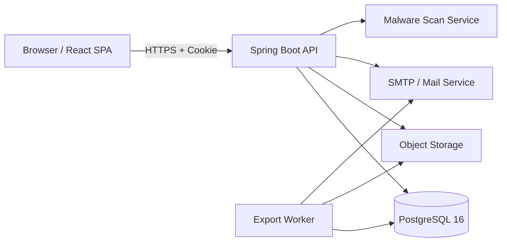

# 01 システムアーキテクチャ

<!-- rule: architecture.initial-stack -->

## 1. 構成

DDMSAA は販売管理の単一 Web アプリケーションとして初版を構成する。フロントエンドは React + TypeScript + Vite、バックエンドは Spring Boot + MyBatis、永続化は PostgreSQL 16 を使用する。

## 2. 責務

| 要素 | 責務 |
|---|---|
| React SPA | 画面表示、入力検証、CSRF トークン送信。権限判定の最終決定はしない |
| Spring Boot API | 認証、認可、業務ルール、注文計算、承認、監査、通知ジョブ投入 |
| PostgreSQL | 業務データ、セッションハッシュ、監査、通知・出力ジョブ状態 |
| Object Storage | 添付・PDF・CSV の暗号化保管 |
| Malware Scan | 添付を `PENDING` → `SAFE` / `REJECTED` にする |
| SMTP | 承認依頼、承認/差戻し、取消しのメール通知 |
| Export Worker | 10,000 件超の CSV を非同期で生成する |

## 3. 認証と境界

- `POST /api/auth/login` は `loginId` と `password` を受け、`DDMSAA_SESSION` を発行する。
- 認証サービスを別プロセスに分割しない。初版は API 内の Auth モジュールが責務を持つ。
- メールは通知専用である。メールリンク認証、JWT refresh token、部門別ロールは採用しない。
- 添付・出力物の取得は常に API の認可判定を経由し、ストレージ URL を恒久公開しない。

## 4. 可用性と運用

- API は無状態に近く構成し、セッション失効状態は DB で照合する。
- すべての状態変更をトランザクション化し、メール送信・ウイルススキャン・CSV 生成はコミット後のジョブとする。
- DB バックアップは日次、添付と出力物の保管期限は運用ジョブで管理する。
