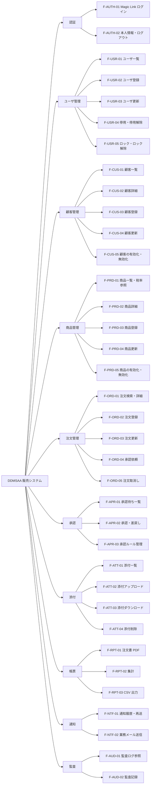

<!-- devtool:file-region id="document-header" -->
# 02 機能一覧・機能構成

> システムが提供する**機能の全体像**を定義する。要件定義の要件と、画面（SCR）・API・バッチ（BAT）・テーブル（TBL）を結ぶ**トレーサビリティの起点**。
> **帰属：システム全体で唯一 → `共通/`**。機能 ID（`F-`）は本書で採番し、他文書は参照のみとする。

（文書ヘッダは `spec-00-doc-standard-ui.md` を参照）

---

<!-- devtool:end-file-region -->
<!-- devtool:block id="basic.common.02-function-list-ui.s01" -->
## 1. 機能構成図

<!-- devtool:endblock -->
<!-- devtool:block id="basic.common.02-function-list-ui.s02" -->
## 2. 機能一覧

> 機能 ID の形式は `spec-00-doc-standard-ui.md` §3（`F-大分類-連番`）に従う。廃止した機能は行を残し、ステータスを「廃止」とする。
> 画面 ID は `spec-05-screen-list-ui.md`、API は `spec-07-api-list.yaml`、バッチは `spec-15-batch-design-ui.md`、帳票は `spec-14-report-design-ui.md` を正とする（帳票 ID は未採番）。

| 機能 ID | 大分類 | 機能名 | 概要 | 優先度 | 対象ロール | 要件 ID | 画面 | API | バッチ | 帳票 | ステータス |
|------|------|------|------|:---:|------|------|------|------|------|------|------|
| F-AUTH-01 | 認証 | Magic Link ログイン | ユーザ ID で Magic Link を要求・再送し、リンク検証で JWT を発行する | 高 | R-ADMIN、R-EMPLOYEE、R-CUSTOMER | FR-01 | SCR-01, SCR-21 | `loginInit`, `verifyMagicLink`, `resendMagicLink` | — | — | 新規 |
| F-AUTH-02 | 認証 | 本人情報・ログアウト | ログイン利用者の情報表示。ログアウトはクライアントでトークンを破棄 | 高 | R-ADMIN、R-EMPLOYEE、R-CUSTOMER | FR-01 | SCR-02 | `getMe` | — | — | 新規 |
| F-USR-01 | ユーザ管理 | ユーザ一覧 | ユーザの検索・一覧 | 高 | R-ADMIN | FR-02 | SCR-04 | `pageUsers` | — | — | 新規 |
| F-USR-02 | ユーザ管理 | ユーザ登録 | ロールに応じた ID（A/E/C）を採番し、連絡先メールを登録 | 高 | R-ADMIN | FR-02 | SCR-05 | `createUser` | — | — | 新規 |
| F-USR-03 | ユーザ管理 | ユーザ更新 | 表示名・メール・ロール・顧客紐付けの更新 | 高 | R-ADMIN | FR-02 | SCR-05 | `getUser`, `updateUser` | — | — | 新規 |
| F-USR-04 | ユーザ管理 | 停用・停用解除 | 利用者の停用と解除。停用後は新たにログインできない（発行済み JWT は最長 60 分有効） | 高 | R-ADMIN | FR-02 | SCR-04 | `disableUser`, `enableUser` | — | — | 新規 |
| F-USR-05 | ユーザ管理 | ロック・ロック解除 | `system_locks` による利用者ロック | 中 | R-ADMIN | FR-02 | SCR-04 | `lockUser`, `unlockUser` | — | — | 新規 |
| F-CUS-01 | 顧客管理 | 顧客一覧 | 顧客の検索。EMPLOYEE は担当顧客のみ | 高 | R-ADMIN、R-EMPLOYEE | FR-04 | SCR-06 | `pageCustomers` | — | — | 新規 |
| F-CUS-02 | 顧客管理 | 顧客詳細 | 顧客・連絡先・担当社員の参照。CUSTOMER は自社のみ | 高 | R-ADMIN、R-EMPLOYEE、R-CUSTOMER | FR-04 | SCR-07 | `getCustomer` | — | — | 新規 |
| F-CUS-03 | 顧客管理 | 顧客登録 | 顧客・連絡先・担当社員の登録 | 高 | R-ADMIN | FR-04 | SCR-08 | `createCustomer` | — | — | 新規 |
| F-CUS-04 | 顧客管理 | 顧客更新 | 顧客・連絡先・担当社員の更新 | 高 | R-ADMIN | FR-04 | SCR-08 | `updateCustomer` | — | — | 新規 |
| F-CUS-05 | 顧客管理 | 顧客の有効化・無効化 | 無効顧客は新規注文の対象外 | 中 | R-ADMIN | FR-04 | SCR-07 | `activateCustomer`, `deactivateCustomer` | — | — | 新規 |
| F-PRD-01 | 商品管理 | 商品一覧・税率参照 | 商品の検索、税率の参照 | 高 | R-ADMIN、R-EMPLOYEE | FR-03 | SCR-09, SCR-10, SCR-12 | `pageProducts`（SCR-09・SCR-12）, `listTaxRates`（SCR-10・SCR-12） | — | — | 新規 |
| F-PRD-02 | 商品管理 | 商品詳細 | 商品の参照（EMPLOYEE は参照のみ） | 中 | R-ADMIN、R-EMPLOYEE | FR-03 | SCR-10 | `getProduct` | — | — | 新規 |
| F-PRD-03 | 商品管理 | 商品登録 | 商品コード・名称・単価・税区分の登録 | 高 | R-ADMIN | FR-03 | SCR-10 | `createProduct` | — | — | 新規 |
| F-PRD-04 | 商品管理 | 商品更新 | 既存注文には影響しない | 高 | R-ADMIN | FR-03 | SCR-10 | `updateProduct` | — | — | 新規 |
| F-PRD-05 | 商品管理 | 商品の有効化・無効化 | 無効商品は新規注文で選択不可 | 中 | R-ADMIN | FR-03 | SCR-09 | `activateProduct`, `deactivateProduct` | — | — | 新規 |
| F-ORD-01 | 注文管理 | 注文検索・詳細 | データ範囲内の注文検索、明細・状態履歴・承認履歴の参照 | 高 | R-ADMIN、R-EMPLOYEE、R-CUSTOMER | FR-05, FR-08 | SCR-02, SCR-11, SCR-13 | `pageOrders`, `getOrder`, `listApprovalHistories` | — | — | 新規 |
| F-ORD-02 | 注文管理 | 注文登録 | 下書き注文の登録。金額・税額はサーバー再計算 | 高 | R-ADMIN、R-EMPLOYEE | FR-05 | SCR-12 | `createOrder` | — | — | 新規 |
| F-ORD-03 | 注文管理 | 注文更新 | DRAFT / RETURNED の注文の更新 | 高 | R-ADMIN、R-EMPLOYEE | FR-05 | SCR-12 | `updateOrder` | — | — | 新規 |
| F-ORD-04 | 注文管理 | 承認依頼 | 申請・再申請。承認ルールのスナップショットと通知投入 | 高 | R-ADMIN、R-EMPLOYEE | FR-05, FR-06 | SCR-12, SCR-13 | `submitOrder` | — | — | 新規 |
| F-ORD-05 | 注文管理 | 注文取消し | 理由付き取消し。APPROVED は ADMIN のみ | 高 | R-ADMIN、R-EMPLOYEE | FR-05 | SCR-11, SCR-13 | `cancelOrder` | — | — | 新規 |
| F-APR-01 | 承認 | 承認待ち一覧 | PENDING の承認依頼の一覧（有効な ADMIN 全員。自分の申請は承認不可と表示） | 高 | R-ADMIN | FR-06 | SCR-02, SCR-14 | `pageApprovalRequests` | — | — | 新規 |
| F-APR-02 | 承認 | 承認・差戻し | 申請者以外の有効な ADMIN による承認、理由付き差戻し（BR-APR-002） | 高 | R-ADMIN | FR-06 | SCR-13, SCR-14 | `approveApprovalRequest`, `returnApprovalRequest` | — | — | 新規 |
| F-APR-03 | 承認 | 承認ルール管理 | 承認経路の参照・登録・更新 | 中 | R-ADMIN | FR-06 | SCR-15 | `listApprovalRules`, `createApprovalRule`, `updateApprovalRule` | — | — | 新規 |
| F-ATT-01 | 添付 | 添付一覧 | 注文添付の一覧。CUSTOMER は公開かつ SAFE のみ | 高 | R-ADMIN、R-EMPLOYEE、R-CUSTOMER | FR-07 | SCR-13 | `listOrderAttachments` | — | — | 新規 |
| F-ATT-02 | 添付 | 添付アップロード | 形式・サイズ検証後 PENDING で保存しスキャンへ | 高 | R-ADMIN、R-EMPLOYEE | FR-07 | SCR-13 | `uploadOrderAttachment` | BAT-05（スキャン結果反映） | — | 新規 |
| F-ATT-03 | 添付 | 添付ダウンロード | SAFE のみ、再認可して配信 | 高 | R-ADMIN、R-EMPLOYEE、R-CUSTOMER | FR-07 | SCR-13 | `downloadAttachment` | — | — | 新規 |
| F-ATT-04 | 添付 | 添付削除 | 論理削除 | 中 | R-ADMIN、R-EMPLOYEE | FR-07 | SCR-13 | `deleteAttachment` | BAT-04（添付保持期限） | — | 新規 |
| F-RPT-01 | 帳票 | 注文書 PDF | A4 日本語レイアウトの注文書（APPROVED のみ） | 高 | R-ADMIN、R-EMPLOYEE、R-CUSTOMER | FR-09 | SCR-13 | `downloadOrderPdf` | — | （`spec-14` で採番） | 新規 |
| F-RPT-02 | 帳票 | 集計 | 月別・顧客別・商品別集計 | 中 | R-ADMIN、R-EMPLOYEE | FR-09 | SCR-16 | `getOrderSummary`, `getCustomerSummary`, `getProductSummary` | — | — | 新規 |
| F-RPT-03 | 帳票 | CSV 出力 | `orders_YYYYMMDD.csv`。すべて出力ジョブに記録。注文単位（1 行 = 1 注文）。10,000 件以下は同期生成、10,001 件以上は非同期生成。24 時間で失効。ADMIN は全員のジョブを参照 | 中 | R-ADMIN、R-EMPLOYEE | FR-09 | SCR-16 | `createExportJob`, `pageExportJobs`, `getExportJob`, `downloadExportJob` | BAT-02（CSV 非同期出力）、BAT-03（出力ファイル失効） | — | 新規 |
| F-NTF-01 | 通知 | 通知履歴・再送 | 業務メールの送信履歴と失敗通知の再送 | 中 | R-ADMIN | FR-10 | SCR-18 | `pageNotificationLogs`, `retryNotification` | — | — | 新規 |
| F-NTF-02 | 通知 | 業務メール送信 | 承認依頼・承認・差戻し・取消し・出力完了のメール送信（初回＋再試行 3 回。BR-NTF-002） | 高 | （システム処理） | FR-10 | — | — | BAT-01（通知送信） | — | 新規 |
| F-AUD-01 | 監査 | 監査ログ参照 | 監査ログの検索 | 中 | R-ADMIN | FR-08 | SCR-17 | `pageAuditLogs` | — | — | 新規 |
| F-AUD-02 | 監査 | 監査記録 | ログイン・権限拒否・状態変更・添付・帳票・出力の記録（横断） | 高 | （システム処理） | FR-08 | — | — | — | — | 新規 |

| 列 | 記入要領 |
|------|------|
| 優先度 | 高 / 中 / 低（リリース計画に使用） |
| 要件 ID | 要件定義書（`要件定義/requirements.md`）§3 の FR 番号 |
| 画面 / API / バッチ / 帳票 | 各一覧（`spec-05` / `spec-07` / `spec-15` / `spec-14`）の ID を参照する。ここで再定義しない |
| ステータス | 新規 / 変更 / 既存流用 / 廃止 |

<!-- devtool:endblock -->
<!-- devtool:block id="basic.common.02-function-list-ui.s03" -->
## 3. 機能 × ロール マトリクス

> 詳細な操作権限・データ範囲は `spec-03-auth-ui.md` を正とし、ここは機能単位の利用可否のみ示す。「—」はシステム処理。

| 機能 ID | R-ADMIN | R-EMPLOYEE | R-CUSTOMER |
|------|:---:|:---:|:---:|
| F-AUTH-01 | ○ | ○ | ○ |
| F-AUTH-02 | ○ | ○ | ○ |
| F-USR-01 | ○ | × | × |
| F-USR-02 | ○ | × | × |
| F-USR-03 | ○ | × | × |
| F-USR-04 | ○ | × | × |
| F-USR-05 | ○ | × | × |
| F-CUS-01 | ○ | ○ | × |
| F-CUS-02 | ○ | ○ | ○ |
| F-CUS-03 | ○ | × | × |
| F-CUS-04 | ○ | × | × |
| F-CUS-05 | ○ | × | × |
| F-PRD-01 | ○ | ○ | × |
| F-PRD-02 | ○ | ○ | × |
| F-PRD-03 | ○ | × | × |
| F-PRD-04 | ○ | × | × |
| F-PRD-05 | ○ | × | × |
| F-ORD-01 | ○ | ○ | ○ |
| F-ORD-02 | ○ | ○ | × |
| F-ORD-03 | ○ | ○ | × |
| F-ORD-04 | ○ | ○ | × |
| F-ORD-05 | ○ | ○ | × |
| F-APR-01 | ○ | × | × |
| F-APR-02 | ○ | × | × |
| F-APR-03 | ○ | × | × |
| F-ATT-01 | ○ | ○ | ○ |
| F-ATT-02 | ○ | ○ | × |
| F-ATT-03 | ○ | ○ | ○ |
| F-ATT-04 | ○ | ○ | × |
| F-RPT-01 | ○ | ○ | ○ |
| F-RPT-02 | ○ | ○ | × |
| F-RPT-03 | ○ | ○ | × |
| F-NTF-01 | ○ | × | × |
| F-NTF-02 | — | — | — |
| F-AUD-01 | ○ | × | × |
| F-AUD-02 | — | — | — |

<!-- devtool:endblock -->
<!-- devtool:block id="basic.common.02-function-list-ui.s04" -->
## 4. 機能 × テーブル CRUD 図

> C=登録 / R=参照 / U=更新 / D=削除（論理削除）。テーブル名は `spec-06-db-physical-ui.md` に従う。コードテーブル（`*_codes`）は全機能で R のため省略。
> 通知を投入する機能（F-ORD-04・F-ORD-05・F-APR-02）は、宛先（BR-NTF-003）の解決のため `users`・`user_contacts`（申請者・担当者・ADMIN）を R とし、顧客通知先がある F-ORD-05・F-APR-02 は `customer_contacts` も R とする。F-ORD-04 は有効な ADMIN の判定に `system_locks` を、申請時検証（BR-ORD-010）に `customers`・`customer_assignments`・`products`・`order_items` を R とする。

| 機能 ID | users | user_contacts | system_locks | customers | customer_contacts | customer_assignments | products | tax_rates | orders | order_items | order_status_histories | approval_rules | approval_requests | approval_histories | order_attachments | notification_logs | export_jobs | audit_logs |
|------|:---:|:---:|:---:|:---:|:---:|:---:|:---:|:---:|:---:|:---:|:---:|:---:|:---:|:---:|:---:|:---:|:---:|:---:|
| F-AUTH-01 | R | R | R | — | — | — | — | — | — | — | — | — | — | — | — | — | — | C |
| F-AUTH-02 | R | — | — | R | — | — | — | — | — | — | — | — | — | — | — | — | — | — |
| F-USR-01 | R | R | R | R | — | — | — | — | — | — | — | — | — | — | — | — | — | — |
| F-USR-02 | C | C | — | R | — | — | — | — | — | — | — | — | — | — | — | — | — | C |
| F-USR-03 | U | U | — | R | — | — | — | — | — | — | — | — | — | — | — | — | — | C |
| F-USR-04 | U | — | — | — | — | — | — | — | — | — | — | — | — | — | — | — | — | C |
| F-USR-05 | — | — | CU | — | — | — | — | — | — | — | — | — | — | — | — | — | — | C |
| F-CUS-01 | — | — | — | R | — | R | — | — | — | — | — | — | — | — | — | — | — | — |
| F-CUS-02 | R | — | — | R | R | R | — | — | — | — | — | — | — | — | — | — | — | — |
| F-CUS-03 | R | — | — | C | C | C | — | — | — | — | — | — | — | — | — | — | — | C |
| F-CUS-04 | R | — | — | U | CUD | CUD | — | — | — | — | — | — | — | — | — | — | — | C |
| F-CUS-05 | — | — | — | U | — | — | — | — | — | — | — | — | — | — | — | — | — | C |
| F-PRD-01 | — | — | — | — | — | — | R | R | — | — | — | — | — | — | — | — | — | — |
| F-PRD-02 | — | — | — | — | — | — | R | R | — | — | — | — | — | — | — | — | — | — |
| F-PRD-03 | — | — | — | — | — | — | C | — | — | — | — | — | — | — | — | — | — | C |
| F-PRD-04 | — | — | — | — | — | — | U | — | — | — | — | — | — | — | — | — | — | C |
| F-PRD-05 | — | — | — | — | — | — | U | — | — | — | — | — | — | — | — | — | — | C |
| F-ORD-01 | R | — | — | R | — | R | — | — | R | R | R | — | R | R | — | — | — | — |
| F-ORD-02 | — | — | — | R | — | R | R | R | C | C | C | — | — | — | — | — | — | C |
| F-ORD-03 | — | — | — | — | — | R | R | R | U | CUD | — | — | — | — | — | — | — | C |
| F-ORD-04 | R | R | R | R | — | R | R | — | U | R | C | R | C | — | — | C | — | C |
| F-ORD-05 | R | R | — | — | R | R | — | — | U | — | C | — | R | — | — | C | — | C |
| F-APR-01 | — | — | — | R | — | — | — | — | R | — | — | — | R | — | — | — | — | — |
| F-APR-02 | R | R | — | — | R | — | — | — | U | — | C | — | U | C | — | C | — | C |
| F-APR-03 | R | — | — | — | — | — | — | — | — | — | — | CRU | — | — | — | — | — | C |
| F-ATT-01 | — | — | — | — | — | — | — | — | R | — | — | — | — | — | R | — | — | — |
| F-ATT-02 | — | — | — | — | — | — | — | — | R | — | — | — | — | — | C | — | — | C |
| F-ATT-03 | — | — | — | — | — | — | — | — | R | — | — | — | — | — | R | — | — | C |
| F-ATT-04 | — | — | — | — | — | — | — | — | — | — | — | — | — | — | D | — | — | C |
| F-RPT-01 | — | — | — | R | — | — | — | — | R | R | — | — | — | — | — | — | — | C |
| F-RPT-02 | — | — | — | R | — | — | R | — | R | R | — | — | — | — | — | — | — | — |
| F-RPT-03 | R | — | — | R | — | R | — | — | R | — | — | — | — | — | — | C | CRU | C |
| F-NTF-01 | — | — | — | — | — | — | — | — | — | — | — | — | — | — | — | RU | — | C |
| F-NTF-02 | — | R | — | — | R | — | — | — | — | — | — | — | — | — | — | RU | — | — |
| F-AUD-01 | R | — | — | — | — | — | — | — | — | — | — | — | — | — | — | — | — | R |
| F-AUD-02 | — | — | — | — | — | — | — | — | — | — | — | — | — | — | — | — | — | C |

<!-- devtool:endblock -->
<!-- devtool:block id="basic.common.02-function-list-ui.s05" -->
## 5. 要件トレーサビリティ（要件 → 機能）

| 要件 ID | 要件概要 | 対応機能 ID | 対応状況 |
|------|------|------|------|
| FR-01 | ログイン | F-AUTH-01, F-AUTH-02 | 対応済 |
| FR-02 | ユーザー管理 | F-USR-01, F-USR-02, F-USR-03, F-USR-04, F-USR-05 | 対応済 |
| FR-03 | 商品管理 | F-PRD-01, F-PRD-02, F-PRD-03, F-PRD-04, F-PRD-05 | 対応済 |
| FR-04 | 顧客管理 | F-CUS-01, F-CUS-02, F-CUS-03, F-CUS-04, F-CUS-05 | 対応済 |
| FR-05 | 注文管理 | F-ORD-01, F-ORD-02, F-ORD-03, F-ORD-04, F-ORD-05 | 対応済 |
| FR-06 | 承認 | F-ORD-04, F-APR-01, F-APR-02, F-APR-03 | 対応済 |
| FR-07 | 添付 | F-ATT-01, F-ATT-02, F-ATT-03, F-ATT-04 | 対応済 |
| FR-08 | 検索/監査 | F-ORD-01, F-AUD-01, F-AUD-02 | 対応済 |
| FR-09 | 帳票/集計 | F-RPT-01, F-RPT-02, F-RPT-03 | 対応済 |
| FR-10 | 通知 | F-NTF-01, F-NTF-02 | 対応済 |

> 全要件に対応機能があり、要件に対応しない機能はない（F-AUD-02・F-NTF-02 は横断・システム処理）。

<!-- devtool:endblock -->
