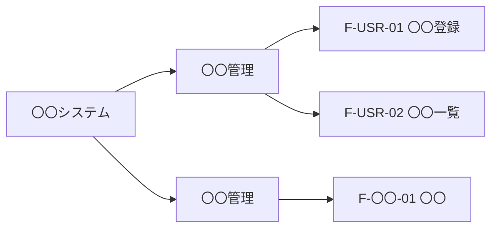

<!-- devtool:file-region id="document-header" -->
# 02 機能一覧・機能構成

> システムが提供する**機能の全体像**を定義する。要件定義の要件と、画面（SCR）・API・バッチ（BAT）・テーブル（TBL）を結ぶ**トレーサビリティの起点**。
> **帰属：システム全体で唯一 → `共通/`**。機能 ID（`F-`）は本書で採番し、他文書は参照のみとする。

（文書ヘッダは `spec-00-doc-standard-ui.md` を参照）

---

<!-- devtool:end-file-region -->
<!-- devtool:block id="basic.common.02-function-list-ui.s01" -->
## 1. 機能構成図

> 大分類 → 中分類 → 機能 の階層を示す。Mermaid で記述する。

<!-- devtool:endblock -->
<!-- devtool:block id="basic.common.02-function-list-ui.s02" -->
## 2. 機能一覧

> 機能 ID の形式は `spec-00-doc-standard-ui.md` §3（`F-大分類-連番`）に従う。廃止した機能は行を残し、ステータスを「廃止」とする。

| 機能 ID | 大分類 | 機能名 | 概要 | 優先度 | 対象ロール | 要件 ID | 画面 | API | バッチ | 帳票 | ステータス |
|------|------|------|------|:---:|------|------|------|------|------|------|------|
| F-USR-01 | 〇〇管理 | 〇〇登録 | 〇〇 | 高 | R-〇〇 | 〇〇（要件番号） | SCR-01 | `createUser` | — | — | 新規 |
| | | | | | | | | | | | |

| 列 | 記入要領 |
|------|------|
| 優先度 | 高 / 中 / 低（リリース計画に使用） |
| 要件 ID | 要件定義書の要件番号（形式は要件定義書の採番に従う。機能 ID の大分類（例：`F-REQ-`）と紛らわしい接頭辞は避ける）。**要件が機能に漏れなく対応していること**を確認する |
| 画面 / API / バッチ / 帳票 | 各一覧（`spec-05` / `spec-07` / `spec-15` / `spec-14`）の ID を参照する。ここで再定義しない |
| ステータス | 新規 / 変更 / 既存流用 / 廃止 |

<!-- devtool:endblock -->
<!-- devtool:block id="basic.common.02-function-list-ui.s03" -->
## 3. 機能 × ロール マトリクス

> 詳細な操作権限は `spec-03-auth-ui.md` を正とし、ここは機能単位の利用可否のみ示す。

| 機能 ID | R-〇〇 | R-〇〇 | R-〇〇 |
|------|:---:|:---:|:---:|
| F-USR-01 | ○ | × | × |

<!-- devtool:endblock -->
<!-- devtool:block id="basic.common.02-function-list-ui.s04" -->
## 4. 機能 × テーブル CRUD 図

> C=登録 / R=参照 / U=更新 / D=削除。影響範囲分析とテーブル設計漏れの検出に使用する。テーブル名は `spec-06-db-physical-ui.md` に従う。

| 機能 ID | TBL-〇〇 | TBL-〇〇 | TBL-〇〇 |
|------|:---:|:---:|:---:|
| F-USR-01 | C | R | — |

<!-- devtool:endblock -->
<!-- devtool:block id="basic.common.02-function-list-ui.s05" -->
## 5. 要件トレーサビリティ（要件 → 機能）

| 要件 ID | 要件概要 | 対応機能 ID | 対応状況 |
|------|------|------|------|
| 〇〇（要件番号） | 〇〇 | F-〇〇-01 | 対応済 / 対象外（理由） |

> 未対応の要件が残っていないこと、機能に対応する要件がない（要件外）ものがないことをレビューで確認する。

<!-- devtool:endblock -->
