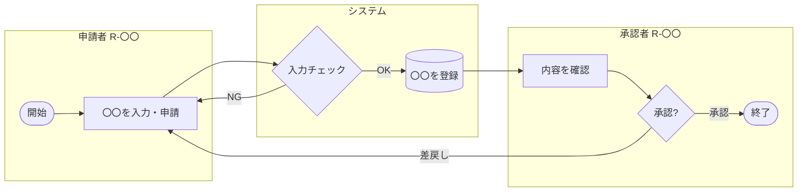
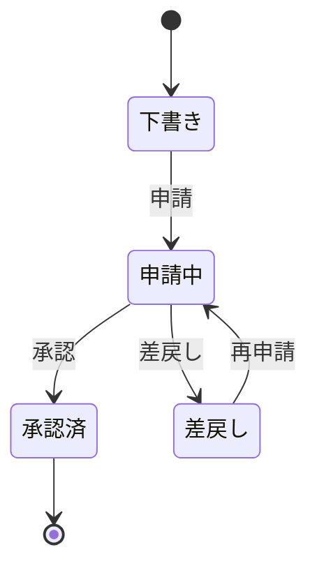

<!-- devtool:file-region id="document-header" -->
# 04 業務フロー設計

> 業務の流れ（誰が・いつ・何を行い、システムがどこで介在するか）を定義する。機能一覧（`spec-02`）の根拠となり、画面遷移（`spec-10`）・ステータス遷移の元になる。
> **帰属：システム全体で唯一 → `共通/`**。業務フロー ID は `BF-` で採番する。

（文書ヘッダは `spec-00-doc-standard-ui.md` を参照）

---

<!-- devtool:end-file-region -->
<!-- devtool:block id="basic.common.04-business-flow-ui.s01" -->
## 1. 業務フロー一覧

| フロー ID | フロー名 | 概要 | 関係ロール | 関連機能 ID | 頻度 |
|------|------|------|------|------|------|
| BF-01 | 〇〇申請フロー | 〇〇 | R-〇〇 / R-〇〇 | F-〇〇-01 〜 03 | 随時 / 日次 / 月次 |
| | | | | | |

<!-- devtool:endblock -->
<!-- devtool:block id="basic.common.04-business-flow-ui.s02" -->
## 2. 業務フロー図（フローごとに作成）

### BF-01 〇〇フロー

> スイムレーン（ロール・システム別）で記述する。Mermaid の `flowchart` を使い、サブグラフをレーンとする。

| ステップ | 担当 | 処理内容 | システム機能（F-） | 画面（SCR-） | 例外・分岐 |
|------|------|------|------|------|------|
| 1 | 〇〇 | 〇〇 | F-〇〇-01 | SCR-01 | — |

<!-- devtool:endblock -->
<!-- devtool:block id="basic.common.04-business-flow-ui.s03" -->
## 3. ステータス遷移設計（状態を持つ業務データごと）

<!-- rule: flow.status-transition-ssot -->
> **許可遷移・禁止遷移の正本は本節**。詳細設計は本節を参照して判定ロジックと UT（禁止遷移ごとの異常用例）を導出し、遷移を追加・変更する場合は先に本節を更新する。

### 3.1 〇〇ステータス

| 現ステータス | イベント | 実行ロール | 遷移後ステータス | 条件・副作用（通知・採番など） |
|------|------|------|------|------|
| 下書き | 申請 | R-〇〇 | 申請中 | 必須項目入力済み |

> ステータスのコード値は `開発規約/` の T07 列挙型で定義し、ここでは再定義しない。

<!-- devtool:endblock -->
<!-- devtool:block id="basic.common.04-business-flow-ui.s04" -->
## 4. 業務ルール・例外処理

| ルール ID | 内容 | 適用フロー | 違反時の扱い（messageId） |
|------|------|------|------|
| BR-01 | 〇〇 | BF-01 | E〇〇〇〇 |

<!-- devtool:endblock -->
