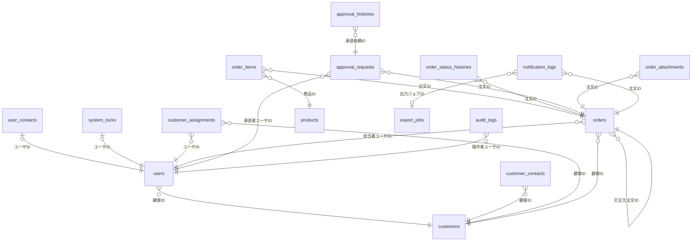

<!-- devtool:file-region id="document-header" -->
# 06 DB 物理設計

> 論理データモデルを物理テーブルに落とし込む：テーブル一覧、各テーブル定義、ER 図、インデックス、制約、マスタ。
> DBMS：PostgreSQL（バージョンは `基本設計/共通/spec-01-system-architecture-ui.md` §2.3 に従う）。

（文書ヘッダは `spec-00-doc-standard-ui.md` を参照）

---

<!-- devtool:end-file-region -->
<!-- devtool:block id="basic.common.06-db-physical-ui.s01" -->
## 1. テーブル一覧

> 物理定義の正本は `spec-06-db-physical.yaml`。本書は一覧・ER 図・説明であり、両者が食い違う場合は yaml を正とする。
> 主キー・採番・共通列・列挙の規約は `開発規約/spec-database-rule.md`（§4.1 / §4.1-SEQ / §4.1-CODE / §4.3）に従う。列挙値は `開発規約/spec-data-dictionary-project-temp.md` の T07 を正とする。

| テーブルID | 物理名 | 論理名 | 種別 | 主キー / 採番 | 概要 | 関連機能 |
|------|--------|--------|------|------|------|---------|
| TBL-users | users | ユーザ | 業務 | `user_id`（A/E/C+4桁） | 利用者。パスワードは保持しない（Magic Link 認証） | F-USR |
| TBL-user-contacts | user_contacts | ユーザ連絡先 | 業務 | `user_id`（共有主キー） | Magic Link・通知の送信先メール（users と 1:1）。論理削除なし | F-USR / F-AUTH |
| TBL-system-locks | system_locks | システムロック | 業務 | `user_id`（共有主キー） | ADMIN による利用者ロック（users と 1:0..1）。ログイン可否判定に使用。論理削除なし | F-USR / F-AUTH |
| TBL-customers | customers | 顧客 | マスタ | `id`（CS+8桁） | 顧客マスタ | F-CUS |
| TBL-customer-contacts | customer_contacts | 顧客連絡先 | 業務 | `id`（CC+8桁） | 顧客の連絡先・通知先 | F-CUS |
| TBL-customer-assignments | customer_assignments | 担当割当 | 業務 | `id`（AS+8桁） | EMPLOYEE と担当顧客の割当（属性を持つため業務エンティティとして扱う） | F-CUS |
| TBL-products | products | 商品 | マスタ | `id`（PR+8桁） | 商品マスタ | F-PRD |
| TBL-tax-rates | tax_rates | 税率 | マスタ | `tax_category`（自然キー） | 税区分ごとの税率（§4.1-NATURAL）。注文時に明細へ複写する | F-PRD / F-ORD |
| TBL-orders | orders | 注文 | 業務 | `id`（OD+8桁） | 注文ヘッダ。注文番号は id とする | F-ORD |
| TBL-order-items | order_items | 注文明細 | 業務 | `id`（OI+8桁） | 注文明細。商品・税率は注文時点で複写する | F-ORD |
| TBL-order-status-histories | order_status_histories | 注文状態履歴 | 履歴 | `id`（OH+8桁） | 注文状態の遷移履歴（追加専用）。変更者・日時は created_by / created_at | F-ORD |
| TBL-approval-rules | approval_rules | 承認ルール | マスタ | `id`（AR+8桁） | 承認経路。初版は 0〜上限なし・1 段・ADMIN の 1 行のみ（BR-APR-001）。承認者は特定しない（有効な ADMIN のうち申請者以外） | F-APR |
| TBL-approval-requests | approval_requests | 承認依頼 | 業務 | `id`（AQ+8桁） | 注文ごとの承認依頼と適用ルールのスナップショット。再申請ごとに新しい行を作る | F-APR |
| TBL-approval-histories | approval_histories | 承認履歴 | 履歴 | `id`（AH+8桁） | 承認・差戻しの操作履歴（追加専用）。操作者・日時は created_by / created_at | F-APR |
| TBL-order-attachments | order_attachments | 注文添付 | 業務 | `id`（AT+8桁） | 注文添付のメタデータ。ファイル本体はオブジェクトストレージ | F-ATT |
| TBL-notification-logs | notification_logs | 通知ログ | 業務 | `id`（NL+8桁） | 業務メール通知のアウトボックスと送信履歴（Magic Link は auth-service が送信し、ここには記録しない） | F-NTF |
| TBL-export-jobs | export_jobs | CSV 出力ジョブ | 業務 | `id`（EJ+8桁） | CSV 出力ジョブ（全件を記録。10,000 件以下は同期生成して READY、10,001 件以上は QUEUED で非同期生成。BR-RPT-002）。依頼者は created_by | F-RPT |
| TBL-audit-logs | audit_logs | 監査ログ | 業務 | `id`（AL+8桁） | 重要操作の監査ログ（追加専用。論理削除は運用上行わない） | F-AUD |
| TBL-*-codes | （13 表） | 列挙コード | マスタ | `{enum}_code`（T07 の属性コード） | T07 列挙ごとのコードテーブル（§2.2） | — |

> 種別：業務 / マスタ / 履歴 / 中間 / ビュー。
> 旧草案（UUID 主キー・文字列列挙・CHECK による値域・`user_sessions`・`password_hash`）は新基線の規約により廃止した。

<!-- devtool:endblock -->
<!-- devtool:block id="basic.common.06-db-physical-ui.s02" -->
## 2. テーブル定義

### 2.0 共通列

全テーブルに以下の共通列を付与する（各テーブルの表では省略）。`deleted_at` は履歴テーブルとコードテーブルでは持たない（§4.3 EXCEPTION。該当テーブルに明記）。

| 論理名 | 物理名 | 型 | NOT NULL | デフォルト | 備考 |
|---|---|---|:---:|---|---|
| 作成日時 | created_at | timestamptz | ○ | CURRENT_TIMESTAMP |  |
| 作成者 | created_by | varchar(10) | ○ | 'SYSTEM' |  |
| 更新日時 | updated_at | timestamptz | ○ | CURRENT_TIMESTAMP | トリガーで更新。楽観ロックの照合に用いる。API ではマイクロ秒 6 桁で返し、クライアントはそのまま返送する（`spec-07-api-list-ui.md` §1） |
| 更新者 | updated_by | varchar(10) | ○ | 'SYSTEM' |  |
| 削除日時 | deleted_at | timestamptz |  | NULL | 論理削除 |

### 2.1 業務・マスタテーブル

#### TBL-users ユーザ（物理名：`users`）

利用者。パスワードは保持しない（Magic Link 認証）

| No | 論理名 | 物理名 | 型(長さ) | PK | FK | NOT NULL | デフォルト | 備考 |
|----|--------|--------|--------|:--:|:--:|:--------:|------|------|
| 1 | ユーザID | user_id | varchar(10) | ○ |  | ○ |  | 業務キー。ロールに応じた prefix（A=ADMIN / E=EMPLOYEE / C=CUSTOMER）+4桁をアプリケーション層で採番。DEFAULT なし |
| 2 | 表示名 | user_name | varchar(100) |  |  | ○ |  |  |
| 3 | ロール | role | int |  | ○ | ○ |  | →user_role_codes.user_role_code。参照: ロール（T07-1：1=ADMIN, 2=EMPLOYEE, 3=CUSTOMER）。 |
| 4 | 状態 | status | int |  | ○ | ○ |  | →user_status_codes.user_status_code。参照: 利用者状態（T07-2：1=ACTIVE, 2=DISABLED）。 |
| 5 | 顧客ID | customer_id | varchar(10) |  | ○ |  |  | →customers.id。CUSTOMER は必須、ADMIN / EMPLOYEE は NULL（chk_users_customer_id） |

#### TBL-user-contacts ユーザ連絡先（物理名：`user_contacts`）

Magic Link・通知の送信先メール（users と 1:1）。users と同時に作成し、行は更新のみで削除しない。**論理削除なし**（1:1 子テーブル）

| No | 論理名 | 物理名 | 型(長さ) | PK | FK | NOT NULL | デフォルト | 備考 |
|----|--------|--------|--------|:--:|:--:|:--------:|------|------|
| 1 | ユーザID | user_id | varchar(10) | ○ | ○ | ○ |  | →users.user_id。共有主キー（§4.1-SHARED） |
| 2 | メールアドレス | email | varchar(255) |  |  | ○ |  | 全行で一意 |

#### TBL-system-locks システムロック（物理名：`system_locks`）

ADMIN による利用者ロック（users と 1:0..1）。ログイン可否判定に使用。解除は lock_started_at を NULL に更新し、行は削除しない。**論理削除なし**（1:0..1 子テーブル）

| No | 論理名 | 物理名 | 型(長さ) | PK | FK | NOT NULL | デフォルト | 備考 |
|----|--------|--------|--------|:--:|:--:|:--------:|------|------|
| 1 | ユーザID | user_id | varchar(10) | ○ | ○ | ○ |  | →users.user_id。共有主キー（§4.1-SHARED） |
| 2 | ロック開始日時 | lock_started_at | timestamptz |  |  |  |  | NULL=ロックなし。ロック操作時の現在時刻を設定する（未来時刻は設定しない） |
| 3 | ロック理由 | lock_reason | varchar(500) |  |  |  |  |  |

#### TBL-customers 顧客（物理名：`customers`）

顧客マスタ

| No | 論理名 | 物理名 | 型(長さ) | PK | FK | NOT NULL | デフォルト | 備考 |
|----|--------|--------|--------|:--:|:--:|:--------:|------|------|
| 1 | 顧客ID | id | varchar(10) | ○ |  | ○ | next_business_id('CS', 8) | CS+8桁を採番 |
| 2 | 顧客コード | customer_code | varchar(30) |  |  | ○ |  | 未削除行で一意 |
| 3 | 顧客名 | customer_name | varchar(200) |  |  | ○ |  |  |
| 4 | メールアドレス | email | varchar(255) |  |  |  |  |  |
| 5 | 電話番号 | phone_number | varchar(50) |  |  |  |  |  |
| 6 | 状態 | status | int |  | ○ | ○ |  | →customer_status_codes.customer_status_code。参照: 顧客状態（T07-3：1=ACTIVE, 2=INACTIVE）。 |

#### TBL-customer-contacts 顧客連絡先（物理名：`customer_contacts`）

顧客の連絡先・通知先

| No | 論理名 | 物理名 | 型(長さ) | PK | FK | NOT NULL | デフォルト | 備考 |
|----|--------|--------|--------|:--:|:--:|:--------:|------|------|
| 1 | 顧客連絡先ID | id | varchar(10) | ○ |  | ○ | next_business_id('CC', 8) | CC+8桁を採番 |
| 2 | 顧客ID | customer_id | varchar(10) |  | ○ | ○ |  | →customers.id。 |
| 3 | 連絡先名 | contact_name | varchar(100) |  |  | ○ |  |  |
| 4 | メールアドレス | email | varchar(255) |  |  | ○ |  |  |
| 5 | 通知先フラグ | is_notification_recipient | boolean |  |  | ○ | FALSE |  |
| 6 | 有効フラグ | is_active | boolean |  |  | ○ | TRUE |  |

#### TBL-customer-assignments 担当割当（物理名：`customer_assignments`）

EMPLOYEE と担当顧客の割当（属性を持つため業務エンティティとして扱う）

| No | 論理名 | 物理名 | 型(長さ) | PK | FK | NOT NULL | デフォルト | 備考 |
|----|--------|--------|--------|:--:|:--:|:--------:|------|------|
| 1 | 担当割当ID | id | varchar(10) | ○ |  | ○ | next_business_id('AS', 8) | AS+8桁を採番 |
| 2 | 顧客ID | customer_id | varchar(10) |  | ○ | ○ |  | →customers.id。 |
| 3 | ユーザID | user_id | varchar(10) |  | ○ | ○ |  | →users.user_id。担当 EMPLOYEE |
| 4 | 有効フラグ | is_active | boolean |  |  | ○ | TRUE | 解除は FALSE にする（論理削除しない）。同じ顧客・社員を再割当するときは同じ行を TRUE に戻し、割当日を当日にする |
| 5 | 割当日 | assigned_date | date |  |  | ○ | CURRENT_DATE |  |

#### TBL-products 商品（物理名：`products`）

商品マスタ

| No | 論理名 | 物理名 | 型(長さ) | PK | FK | NOT NULL | デフォルト | 備考 |
|----|--------|--------|--------|:--:|:--:|:--------:|------|------|
| 1 | 商品ID | id | varchar(10) | ○ |  | ○ | next_business_id('PR', 8) | PR+8桁を採番 |
| 2 | 商品コード | product_code | varchar(50) |  |  | ○ |  | 未削除行で一意 |
| 3 | 商品名 | product_name | varchar(200) |  |  | ○ |  |  |
| 4 | 商品カテゴリ | product_category | varchar(100) |  |  |  |  |  |
| 5 | 標準単価 | standard_unit_price | numeric(15,2) |  |  | ○ | 0 | 0 以上（chk_products_standard_unit_price） |
| 6 | 税区分 | tax_category | int |  | ○ | ○ |  | →tax_category_codes.tax_category_code。参照: 税区分（T07-5：1=STANDARD, 2=REDUCED, 3=EXEMPT）。 |
| 7 | 状態 | status | int |  | ○ | ○ |  | →product_status_codes.product_status_code。参照: 商品状態（T07-4：1=ACTIVE, 2=INACTIVE）。 |

#### TBL-tax-rates 税率（物理名：`tax_rates`）

税区分ごとの税率（§4.1-NATURAL）。注文時に明細へ複写する

| No | 論理名 | 物理名 | 型(長さ) | PK | FK | NOT NULL | デフォルト | 備考 |
|----|--------|--------|--------|:--:|:--:|:--------:|------|------|
| 1 | 税区分 | tax_category | int | ○ | ○ | ○ |  | →tax_category_codes.tax_category_code。参照: 税区分（T07-5：1=STANDARD, 2=REDUCED, 3=EXEMPT）。自然キー主キー |
| 2 | 税率 | tax_rate | numeric(5,2) |  |  | ○ | 0 | 0.00〜100.00（chk_tax_rates_tax_rate） |

#### TBL-orders 注文（物理名：`orders`）

注文ヘッダ。注文番号は id とする

| No | 論理名 | 物理名 | 型(長さ) | PK | FK | NOT NULL | デフォルト | 備考 |
|----|--------|--------|--------|:--:|:--:|:--------:|------|------|
| 1 | 注文ID（注文番号） | id | varchar(10) | ○ |  | ○ | next_business_id('OD', 8) | OD+8桁を採番 |
| 2 | 顧客ID | customer_id | varchar(10) |  | ○ | ○ |  | →customers.id。 |
| 3 | 担当者ユーザID | sales_user_id | varchar(10) |  | ○ | ○ |  | →users.user_id。注文顧客の担当 EMPLOYEE（BR-ORD-008） |
| 4 | 注文日 | order_date | date |  |  | ○ |  |  |
| 5 | 状態 | status | int |  | ○ | ○ |  | →order_status_codes.order_status_code。参照: 注文状態（T07-6：1=DRAFT, 2=PENDING_APPROVAL, 3=RETURNED, 4=APPROVED, 5=CANCELLED）。 |
| 6 | 小計 | subtotal_amount | numeric(15,2) |  |  | ○ | 0 | サーバー再計算値 |
| 7 | 税額 | tax_amount | numeric(15,2) |  |  | ○ | 0 | サーバー再計算値 |
| 8 | 合計 | total_amount | numeric(15,2) |  |  | ○ | 0 | サーバー再計算値 |
| 9 | 訂正元注文ID | revised_from_order_id | varchar(10) |  | ○ |  |  | →orders.id。取消済み（CANCELLED）・同一顧客の元注文。新規作成時のみ設定し、1 注文につき訂正は 1 回（uq_orders_revised_from_order_id、BR-ORD-009） |
| 10 | 取消し理由 | cancel_reason | varchar(500) |  |  |  |  | CANCELLED のとき必須（chk_orders_cancel_reason） |

#### TBL-order-items 注文明細（物理名：`order_items`）

注文明細。商品・税率は注文時点で複写する

| No | 論理名 | 物理名 | 型(長さ) | PK | FK | NOT NULL | デフォルト | 備考 |
|----|--------|--------|--------|:--:|:--:|:--------:|------|------|
| 1 | 注文明細ID | id | varchar(10) | ○ |  | ○ | next_business_id('OI', 8) | OI+8桁を採番 |
| 2 | 注文ID | order_id | varchar(10) |  | ○ | ○ |  | →orders.id。 |
| 3 | 行番号 | line_number | numeric |  |  | ○ | 0 |  |
| 4 | 商品ID | product_id | varchar(10) |  | ○ | ○ |  | →products.id。 |
| 5 | 商品コード（複写） | product_code | varchar(50) |  |  | ○ |  |  |
| 6 | 商品名（複写） | product_name | varchar(200) |  |  | ○ |  |  |
| 7 | 数量 | quantity | numeric(15,3) |  |  | ○ | 0 | 0 より大きい（chk_order_items_quantity） |
| 8 | 単価 | unit_price | numeric(15,2) |  |  | ○ | 0 | 商品の standard_unit_price の複写（保存・申請時。BR-PRD-002）。0 以上（chk_order_items_unit_price） |
| 9 | 税区分（複写） | tax_category | int |  | ○ | ○ |  | →tax_category_codes.tax_category_code。参照: 税区分（T07-5：1=STANDARD, 2=REDUCED, 3=EXEMPT）。 |
| 10 | 税率（複写） | tax_rate | numeric(5,2) |  |  | ○ | 0 |  |
| 11 | 明細金額 | line_amount | numeric(15,2) |  |  | ○ | 0 | quantity × unit_price |
| 12 | 明細税額 | tax_amount | numeric(15,2) |  |  | ○ | 0 | HALF_UP(line_amount × tax_rate / 100) |

#### TBL-order-status-histories 注文状態履歴（物理名：`order_status_histories`）

注文状態の遷移履歴（追加専用）。変更者・日時は created_by / created_at。**論理削除なし**（履歴テーブル）

| No | 論理名 | 物理名 | 型(長さ) | PK | FK | NOT NULL | デフォルト | 備考 |
|----|--------|--------|--------|:--:|:--:|:--------:|------|------|
| 1 | 注文状態履歴ID | id | varchar(10) | ○ |  | ○ | next_business_id('OH', 8) | OH+8桁を採番 |
| 2 | 注文ID | order_id | varchar(10) |  | ○ | ○ |  | →orders.id。 |
| 3 | 変更前状態 | from_status | int |  | ○ |  |  | →order_status_codes.order_status_code。参照: 注文状態（T07-6：1=DRAFT, 2=PENDING_APPROVAL, 3=RETURNED, 4=APPROVED, 5=CANCELLED）。新規作成時は NULL |
| 4 | 変更後状態 | to_status | int |  | ○ | ○ |  | →order_status_codes.order_status_code。参照: 注文状態（T07-6：1=DRAFT, 2=PENDING_APPROVAL, 3=RETURNED, 4=APPROVED, 5=CANCELLED）。 |
| 5 | 理由 | reason | varchar(500) |  |  |  |  | 取消し・差戻しの理由 |

#### TBL-approval-rules 承認ルール（物理名：`approval_rules`）

承認経路。初版は 0〜上限なし・1 段・ADMIN の 1 行のみ（BR-APR-001）。承認者は特定しない（有効な ADMIN のうち申請者以外）

| No | 論理名 | 物理名 | 型(長さ) | PK | FK | NOT NULL | デフォルト | 備考 |
|----|--------|--------|--------|:--:|:--:|:--------:|------|------|
| 1 | 承認ルールID | id | varchar(10) | ○ |  | ○ | next_business_id('AR', 8) | AR+8桁を採番 |
| 2 | 金額下限 | min_amount | numeric(15,2) |  |  | ○ | 0 |  |
| 3 | 金額上限 | max_amount | numeric(15,2) |  |  |  |  | NULL=上限なし |
| 4 | 承認段階 | approval_step | numeric |  |  | ○ | 1 |  |
| 5 | 承認者ロール | approver_role | int |  | ○ | ○ |  | →user_role_codes.user_role_code。参照: ロール（T07-1：1=ADMIN, 2=EMPLOYEE, 3=CUSTOMER）。初版は 1=ADMIN 固定（chk_approval_rules_approver_role） |
| 6 | 有効フラグ | is_active | boolean |  |  | ○ | TRUE |  |
| 7 | 適用開始日 | effective_from_date | date |  |  | ○ |  |  |
| 8 | 適用終了日 | effective_to_date | date |  |  |  |  |  |

#### TBL-approval-requests 承認依頼（物理名：`approval_requests`）

注文ごとの承認依頼と適用ルールのスナップショット。再申請ごとに新しい行を作る

| No | 論理名 | 物理名 | 型(長さ) | PK | FK | NOT NULL | デフォルト | 備考 |
|----|--------|--------|--------|:--:|:--:|:--------:|------|------|
| 1 | 承認依頼ID | id | varchar(10) | ○ |  | ○ | next_business_id('AQ', 8) | AQ+8桁を採番 |
| 2 | 注文ID | order_id | varchar(10) |  | ○ | ○ |  | →orders.id。 |
| 3 | 承認段階 | approval_step | numeric |  |  | ○ | 1 |  |
| 4 | 承認者ユーザID | approver_user_id | varchar(10) |  | ○ |  |  | →users.user_id。実際に承認・差戻しした ADMIN。申請時は NULL。申請者（created_by）とは異なる（BR-APR-002） |
| 5 | ルールスナップショット | rule_snapshot | jsonb |  |  | ○ |  | 申請時点の approval_rules の複写。申請者は created_by |
| 6 | 状態 | status | int |  | ○ | ○ |  | →approval_request_status_codes.approval_request_status_code。参照: 承認依頼状態（T07-7：1=PENDING, 2=APPROVED, 3=RETURNED）。 |
| 7 | 処理日時 | acted_at | timestamptz |  |  |  |  |  |

#### TBL-approval-histories 承認履歴（物理名：`approval_histories`）

承認・差戻しの操作履歴（追加専用）。操作者・日時は created_by / created_at。**論理削除なし**（履歴テーブル）

| No | 論理名 | 物理名 | 型(長さ) | PK | FK | NOT NULL | デフォルト | 備考 |
|----|--------|--------|--------|:--:|:--:|:--------:|------|------|
| 1 | 承認履歴ID | id | varchar(10) | ○ |  | ○ | next_business_id('AH', 8) | AH+8桁を採番 |
| 2 | 承認依頼ID | approval_request_id | varchar(10) |  | ○ | ○ |  | →approval_requests.id。 |
| 3 | 操作 | approval_action | int |  | ○ | ○ |  | →approval_action_codes.approval_action_code。参照: 承認操作（T07-8：1=APPROVE, 2=RETURN）。 |
| 4 | 理由 | reason | varchar(500) |  |  |  |  | 差戻し時は必須（1〜500 文字。chk_approval_histories_reason） |

#### TBL-order-attachments 注文添付（物理名：`order_attachments`）

注文添付のメタデータ。ファイル本体はオブジェクトストレージ

| No | 論理名 | 物理名 | 型(長さ) | PK | FK | NOT NULL | デフォルト | 備考 |
|----|--------|--------|--------|:--:|:--:|:--------:|------|------|
| 1 | 添付ID | id | varchar(10) | ○ |  | ○ | next_business_id('AT', 8) | AT+8桁を採番 |
| 2 | 注文ID | order_id | varchar(10) |  | ○ | ○ |  | →orders.id。 |
| 3 | 元ファイル名 | original_file_name | varchar(255) |  |  | ○ |  |  |
| 4 | 保存パス | storage_path | varchar(512) |  |  | ○ |  | オブジェクトストレージのキー。利用者へ返さない |
| 5 | コンテンツタイプ | content_type | varchar(100) |  |  | ○ |  |  |
| 6 | ファイルサイズ | file_size | numeric |  |  | ○ | 0 | バイト。1〜10485760（chk_order_attachments_file_size） |
| 7 | 公開範囲 | visibility | int |  | ○ | ○ |  | →attachment_visibility_codes.attachment_visibility_code。参照: 添付公開範囲（T07-9：1=INTERNAL, 2=CUSTOMER）。 |
| 8 | スキャン状態 | scan_status | int |  | ○ | ○ |  | →scan_status_codes.scan_status_code。参照: スキャン状態（T07-10：1=PENDING, 2=SAFE, 3=REJECTED）。 |
| 9 | ファイル削除日時 | storage_purged_at | timestamptz |  |  |  |  | ストレージ上のファイルを削除した日時（BAT-04）。NULL=未削除 |

#### TBL-export-jobs CSV 出力ジョブ（物理名：`export_jobs`）

CSV 出力ジョブ（全件を記録。10,000 件以下は同期生成して READY、10,001 件以上は QUEUED で非同期生成。BR-RPT-002）。依頼者は created_by

| No | 論理名 | 物理名 | 型(長さ) | PK | FK | NOT NULL | デフォルト | 備考 |
|----|--------|--------|--------|:--:|:--:|:--------:|------|------|
| 1 | 出力ジョブID | id | varchar(10) | ○ |  | ○ | next_business_id('EJ', 8) | EJ+8桁を採番 |
| 2 | 抽出条件 | filter_condition | jsonb |  |  | ○ |  |  |
| 3 | 状態 | status | int |  | ○ | ○ |  | →export_status_codes.export_status_code。参照: 出力状態（T07-13：1=QUEUED, 2=RUNNING, 3=READY, 4=FAILED, 5=EXPIRED）。 |
| 4 | 保存パス | storage_path | varchar(512) |  |  |  |  |  |
| 5 | 件数 | record_count | numeric |  |  | ○ | 0 |  |
| 6 | 有効期限 | expires_at | timestamptz |  |  |  |  | 完了から 24 時間。経過後は BAT-03 が EXPIRED にする |
| 7 | エラー内容 | error_message | text |  |  |  |  |  |
| 8 | 完了日時 | completed_at | timestamptz |  |  |  |  |  |
| 9 | ファイル削除日時 | storage_purged_at | timestamptz |  |  |  |  | ストレージ上のファイルを削除した日時（BAT-03）。NULL=未削除 |

#### TBL-notification-logs 通知ログ（物理名：`notification_logs`）

業務メール通知のアウトボックスと送信履歴（Magic Link は auth-service が送信し、ここには記録しない）

| No | 論理名 | 物理名 | 型(長さ) | PK | FK | NOT NULL | デフォルト | 備考 |
|----|--------|--------|--------|:--:|:--:|:--------:|------|------|
| 1 | 通知ID | id | varchar(10) | ○ |  | ○ | next_business_id('NL', 8) | NL+8桁を採番 |
| 2 | 通知イベント | notification_event | int |  | ○ | ○ |  | →notification_event_codes.notification_event_code。参照: 通知イベント（T07-11：1=ORDER_SUBMITTED, 2=ORDER_APPROVED, 3=ORDER_RETURNED, 4=ORDER_CANCELLED, 5=EXPORT_COMPLETED）。 |
| 3 | 注文ID | order_id | varchar(10) |  | ○ |  |  | →orders.id。 |
| 4 | 宛先メール | recipient_email | varchar(255) |  |  | ○ |  |  |
| 5 | 状態 | status | int |  | ○ | ○ |  | →notification_status_codes.notification_status_code。参照: 通知状態（T07-12：1=QUEUED, 2=SENDING, 3=SENT, 4=FAILED）。再試行待ちは QUEUED のまま、最終失敗だけ FAILED |
| 6 | 出力ジョブID | export_job_id | varchar(10) |  | ○ |  |  | →export_jobs.id。出力完了通知（EXPORT_COMPLETED）の対象ジョブ。それ以外は NULL |
| 7 | 試行回数 | attempt_count | numeric |  |  | ○ | 0 | 送信を試みた回数（初回を含む。最大 4 回＝初回＋再試行 3 回。手動再送で 0 に戻す。BR-NTF-002） |
| 8 | 次回送信日時 | next_attempt_at | timestamptz |  |  |  |  | 次回送信予定日時。QUEUED のとき送信ワーカーが `next_attempt_at <= 現在` の行を処理する（BR-NTF-002） |
| 9 | エラー内容 | error_message | text |  |  |  |  |  |
| 10 | 送信日時 | sent_at | timestamptz |  |  |  |  |  |

#### TBL-audit-logs 監査ログ（物理名：`audit_logs`）

重要操作の監査ログ（追加専用。論理削除は運用上行わない）

| No | 論理名 | 物理名 | 型(長さ) | PK | FK | NOT NULL | デフォルト | 備考 |
|----|--------|--------|--------|:--:|:--:|:--------:|------|------|
| 1 | 監査ログID | id | varchar(10) | ○ |  | ○ | next_business_id('AL', 8) | AL+8桁を採番 |
| 2 | 操作者ユーザID | actor_user_id | varchar(10) |  | ○ |  |  | →users.user_id。未認証の操作は NULL |
| 3 | 操作 | audit_action | varchar(100) |  |  | ○ |  |  |
| 4 | 対象種別 | target_type | varchar(100) |  |  | ○ |  |  |
| 5 | 対象ID | target_id | varchar(100) |  |  |  |  |  |
| 6 | トレースID | trace_id | varchar(100) |  |  |  |  |  |
| 7 | IP アドレス | ip_address | varchar(45) |  |  |  |  |  |
| 8 | 監査詳細 | audit_detail | jsonb |  |  |  |  | メール本文・ファイル本体・Magic Link token を含めない |

### 2.2 列挙コードテーブル（T07）

各表とも `{enum}_code`（INT・PK・T07 の属性コード）と `{enum}_name`（VARCHAR(50)・一意・API 値）を持ち、`deleted_at` を持たない。行は T07 と一致させ、Flyway の `R__` スクリプトで upsert する。

| テーブル | T07 | 値（コード=API 値） |
|---|---|---|
| `user_role_codes` | T07-1 ロール | 1=ADMIN / 2=EMPLOYEE / 3=CUSTOMER |
| `user_status_codes` | T07-2 利用者状態 | 1=ACTIVE / 2=DISABLED |
| `customer_status_codes` | T07-3 顧客状態 | 1=ACTIVE / 2=INACTIVE |
| `product_status_codes` | T07-4 商品状態 | 1=ACTIVE / 2=INACTIVE |
| `tax_category_codes` | T07-5 税区分 | 1=STANDARD / 2=REDUCED / 3=EXEMPT |
| `order_status_codes` | T07-6 注文状態 | 1=DRAFT / 2=PENDING_APPROVAL / 3=RETURNED / 4=APPROVED / 5=CANCELLED |
| `approval_request_status_codes` | T07-7 承認依頼状態 | 1=PENDING / 2=APPROVED / 3=RETURNED |
| `approval_action_codes` | T07-8 承認操作 | 1=APPROVE / 2=RETURN |
| `attachment_visibility_codes` | T07-9 添付公開範囲 | 1=INTERNAL / 2=CUSTOMER |
| `scan_status_codes` | T07-10 スキャン状態 | 1=PENDING / 2=SAFE / 3=REJECTED |
| `notification_event_codes` | T07-11 通知イベント | 1=ORDER_SUBMITTED / 2=ORDER_APPROVED / 3=ORDER_RETURNED / 4=ORDER_CANCELLED / 5=EXPORT_COMPLETED |
| `notification_status_codes` | T07-12 通知状態 | 1=QUEUED / 2=SENDING / 3=SENT / 4=FAILED |
| `export_status_codes` | T07-13 出力状態 | 1=QUEUED / 2=RUNNING / 3=READY / 4=FAILED / 5=EXPIRED |

> 暗号化・マスキング対象の列は現時点でない（電話番号は業務連絡用の顧客代表番号のみ保持）。

<!-- devtool:endblock -->
<!-- devtool:block id="basic.common.06-db-physical-ui.s03" -->
## 3. ER 図

> コードテーブル（`*_codes`）への参照は省略する。



<!-- devtool:endblock -->
<!-- devtool:block id="basic.common.06-db-physical-ui.s04" -->
## 4. インデックス設計

| テーブル | インデックス名 | 列 | 種別 | 目的 |
|----|--------|----|------|------|
| users | pk_users | user_id | 主キー | 主キー |
| users | idx_users_customer_id | customer_id | 一般 | 検索 |
| users | idx_users_role_status | role, status | 一般 | 検索 |
| users | idx_users_status | status | 一般 | 外部キー（§6.2） |
| user_contacts | pk_user_contacts | user_id | 主キー | 主キー |
| user_contacts | uq_user_contacts_email | email | ユニーク | 一意性 |
| system_locks | pk_system_locks | user_id | 主キー | 主キー |
| customers | pk_customers | id | 主キー | 主キー |
| customers | uq_customers_customer_code | customer_code | 部分ユニーク | 一意性（未削除行のみ） |
| customers | idx_customers_status | status | 一般 | 外部キー（§6.2） |
| customer_contacts | pk_customer_contacts | id | 主キー | 主キー |
| customer_contacts | idx_customer_contacts_customer_id_is_active | customer_id, is_active | 一般 | 検索 |
| customer_assignments | pk_customer_assignments | id | 主キー | 主キー |
| customer_assignments | uq_customer_assignments_customer_id_user_id | customer_id, user_id | 部分ユニーク | 一意性（未削除行のみ） |
| customer_assignments | idx_customer_assignments_user_id_is_active | user_id, is_active | 一般 | 検索 |
| products | pk_products | id | 主キー | 主キー |
| products | uq_products_product_code | product_code | 部分ユニーク | 一意性（未削除行のみ） |
| products | idx_products_tax_category | tax_category | 一般 | 外部キー（§6.2） |
| products | idx_products_status | status | 一般 | 外部キー（§6.2） |
| tax_rates | pk_tax_rates | tax_category | 主キー | 主キー |
| orders | pk_orders | id | 主キー | 主キー |
| orders | idx_orders_customer_id_order_date | customer_id, order_date | 一般 | 検索 |
| orders | idx_orders_sales_user_id_status | sales_user_id, status | 一般 | 検索 |
| orders | idx_orders_status_order_date | status, order_date | 一般 | 検索 |
| orders | uq_orders_revised_from_order_id | revised_from_order_id | 部分ユニーク | 一意性（訂正は 1 回。revised_from_order_id IS NOT NULL AND deleted_at IS NULL） |
| order_items | pk_order_items | id | 主キー | 主キー |
| order_items | uq_order_items_order_id_line_number | order_id, line_number | 部分ユニーク | 一意性（未削除行のみ） |
| order_items | idx_order_items_product_id | product_id | 一般 | 検索 |
| order_items | idx_order_items_tax_category | tax_category | 一般 | 外部キー（§6.2） |
| order_status_histories | pk_order_status_histories | id | 主キー | 主キー |
| order_status_histories | idx_order_status_histories_order_id_created_at | order_id, created_at | 一般 | 検索 |
| order_status_histories | idx_order_status_histories_from_status | from_status | 一般 | 外部キー（§6.2） |
| order_status_histories | idx_order_status_histories_to_status | to_status | 一般 | 外部キー（§6.2） |
| approval_rules | pk_approval_rules | id | 主キー | 主キー |
| approval_rules | idx_approval_rules_is_active_effective_from_date | is_active, effective_from_date | 一般 | 検索 |
| approval_rules | idx_approval_rules_approver_role | approver_role | 一般 | 外部キー（§6.2） |
| approval_requests | pk_approval_requests | id | 主キー | 主キー |
| approval_requests | idx_approval_requests_order_id_status | order_id, status | 一般 | 検索 |
| approval_requests | idx_approval_requests_approver_user_id_status | approver_user_id, status | 一般 | 検索 |
| approval_requests | idx_approval_requests_status | status | 一般 | 外部キー（§6.2） |
| approval_histories | pk_approval_histories | id | 主キー | 主キー |
| approval_histories | idx_approval_histories_approval_request_id | approval_request_id | 一般 | 検索 |
| approval_histories | idx_approval_histories_approval_action | approval_action | 一般 | 外部キー（§6.2） |
| order_attachments | pk_order_attachments | id | 主キー | 主キー |
| order_attachments | uq_order_attachments_storage_path | storage_path | 部分ユニーク | 一意性（未削除行のみ） |
| order_attachments | idx_order_attachments_order_id_visibility_scan_status | order_id, visibility, scan_status | 一般 | 検索 |
| order_attachments | idx_order_attachments_visibility | visibility | 一般 | 外部キー（§6.2） |
| order_attachments | idx_order_attachments_scan_status | scan_status | 一般 | 外部キー（§6.2） |
| notification_logs | pk_notification_logs | id | 主キー | 主キー |
| notification_logs | idx_notification_logs_status_created_at | status, created_at | 一般 | 検索 |
| notification_logs | idx_notification_logs_status_next_attempt_at | status, next_attempt_at | 一般 | 送信ワーカーの抽出 |
| notification_logs | idx_notification_logs_order_id | order_id | 一般 | 検索 |
| notification_logs | idx_notification_logs_export_job_id | export_job_id | 一般 | 外部キー（§6.2） |
| notification_logs | idx_notification_logs_notification_event | notification_event | 一般 | 外部キー（§6.2） |
| export_jobs | pk_export_jobs | id | 主キー | 主キー |
| export_jobs | idx_export_jobs_created_by_status | created_by, status | 一般 | 検索 |
| export_jobs | idx_export_jobs_status | status | 一般 | 外部キー（§6.2） |
| audit_logs | pk_audit_logs | id | 主キー | 主キー |
| audit_logs | idx_audit_logs_actor_user_id_created_at | actor_user_id, created_at | 一般 | 検索 |
| audit_logs | idx_audit_logs_target_type_target_id | target_type, target_id | 一般 | 検索 |
| `*_codes` | `pk_{enum}_codes` / `uq_{enum}_codes_{enum}_name` | 主キー / 名称 | 主キー / ユニーク | 各コードテーブル |

<!-- rule: db.soft-delete-partial-unique -->
> **論理削除とユニーク制約の方針**（`deleted_at` を持つすべてのテーブルに適用）
> 論理削除後も旧行は物理的に残るため、通常のユニーク制約では「同一メールの再利用」などの場面で挿入が競合する。
> そのため、一意性が必要な業務列（例：`customers.customer_code`、`products.product_code`）のユニーク制約には**部分ユニークインデックス**を用い、未削除行のみを対象とする。
> ```sql
> CREATE UNIQUE INDEX uq_customers_customer_code
>   ON customers (customer_code)
>   WHERE deleted_at IS NULL;
> ```
> - PostgreSQL は部分ユニークインデックスをネイティブにサポートする（推奨）。
> - MySQL は非サポートのため、生成列、または `(列, COALESCE(deleted_at,'1970-01-01'))` の複合ユニークインデックスで代替する。
> - 主キー系（例：`user_id`、`id`）は再利用時に新規採番されるため自然に重複せず、この影響を受けない。

<!-- devtool:endblock -->
<!-- devtool:block id="basic.common.06-db-physical-ui.s05" -->
## 5. 制約・リレーション

| テーブル | 制約名 | 種別 | 内容 |
|----|--------|------|------|
| users | fk_users_user_role_codes | 外部キー | role → user_role_codes.user_role_code |
| users | fk_users_user_status_codes | 外部キー | status → user_status_codes.user_status_code |
| users | fk_users_customers | 外部キー | customer_id → customers.id |
| users | chk_users_customer_id | チェック | (role = 3) = (customer_id IS NOT NULL) |
| user_contacts | fk_user_contacts_users | 外部キー | user_id → users.user_id |
| system_locks | fk_system_locks_users | 外部キー | user_id → users.user_id |
| customers | fk_customers_customer_status_codes | 外部キー | status → customer_status_codes.customer_status_code |
| customer_contacts | fk_customer_contacts_customers | 外部キー | customer_id → customers.id |
| customer_assignments | fk_customer_assignments_customers | 外部キー | customer_id → customers.id |
| customer_assignments | fk_customer_assignments_users | 外部キー | user_id → users.user_id |
| products | fk_products_tax_category_codes | 外部キー | tax_category → tax_category_codes.tax_category_code |
| products | fk_products_product_status_codes | 外部キー | status → product_status_codes.product_status_code |
| products | chk_products_standard_unit_price | チェック | standard_unit_price >= 0 |
| tax_rates | fk_tax_rates_tax_category_codes | 外部キー | tax_category → tax_category_codes.tax_category_code |
| tax_rates | chk_tax_rates_tax_rate | チェック | tax_rate BETWEEN 0 AND 100 |
| orders | fk_orders_customers | 外部キー | customer_id → customers.id |
| orders | fk_orders_users | 外部キー | sales_user_id → users.user_id |
| orders | fk_orders_order_status_codes | 外部キー | status → order_status_codes.order_status_code |
| orders | fk_orders_orders | 外部キー | revised_from_order_id → orders.id |
| orders | chk_orders_cancel_reason | チェック | status <> 5 OR cancel_reason IS NOT NULL |
| order_items | fk_order_items_orders | 外部キー | order_id → orders.id |
| order_items | fk_order_items_products | 外部キー | product_id → products.id |
| order_items | fk_order_items_tax_category_codes | 外部キー | tax_category → tax_category_codes.tax_category_code |
| order_items | chk_order_items_quantity | チェック | quantity > 0 |
| order_items | chk_order_items_unit_price | チェック | unit_price >= 0 |
| order_status_histories | fk_order_status_histories_orders | 外部キー | order_id → orders.id |
| order_status_histories | fk_order_status_histories_from_status | 外部キー | from_status → order_status_codes.order_status_code |
| order_status_histories | fk_order_status_histories_to_status | 外部キー | to_status → order_status_codes.order_status_code |
| approval_rules | fk_approval_rules_user_role_codes | 外部キー | approver_role → user_role_codes.user_role_code |
| approval_rules | chk_approval_rules_approver_role | チェック | approver_role = 1 |
| approval_rules | chk_approval_rules_max_amount | チェック | max_amount IS NULL OR max_amount >= min_amount |
| approval_rules | chk_approval_rules_effective_to_date | チェック | effective_to_date IS NULL OR effective_to_date >= effective_from_date |
| approval_requests | fk_approval_requests_orders | 外部キー | order_id → orders.id |
| approval_requests | fk_approval_requests_users | 外部キー | approver_user_id → users.user_id |
| approval_requests | fk_approval_requests_approval_request_status_codes | 外部キー | status → approval_request_status_codes.approval_request_status_code |
| approval_histories | fk_approval_histories_approval_requests | 外部キー | approval_request_id → approval_requests.id |
| approval_histories | fk_approval_histories_approval_action_codes | 外部キー | approval_action → approval_action_codes.approval_action_code |
| approval_histories | chk_approval_histories_reason | チェック | approval_action <> 2 OR reason IS NOT NULL |
| order_attachments | fk_order_attachments_orders | 外部キー | order_id → orders.id |
| order_attachments | fk_order_attachments_attachment_visibility_codes | 外部キー | visibility → attachment_visibility_codes.attachment_visibility_code |
| order_attachments | fk_order_attachments_scan_status_codes | 外部キー | scan_status → scan_status_codes.scan_status_code |
| order_attachments | chk_order_attachments_file_size | チェック | file_size > 0 AND file_size <= 10485760 |
| notification_logs | fk_notification_logs_notification_event_codes | 外部キー | notification_event → notification_event_codes.notification_event_code |
| notification_logs | fk_notification_logs_orders | 外部キー | order_id → orders.id |
| notification_logs | fk_notification_logs_export_jobs | 外部キー | export_job_id → export_jobs.id |
| notification_logs | fk_notification_logs_notification_status_codes | 外部キー | status → notification_status_codes.notification_status_code |
| export_jobs | fk_export_jobs_export_status_codes | 外部キー | status → export_status_codes.export_status_code |
| audit_logs | fk_audit_logs_users | 外部キー | actor_user_id → users.user_id |

> 同じ表を複数回参照する外部キーは `fk_{table}_{column}` とした（例：`fk_order_status_histories_from_status`）。
> 1 表から `users` を役割別に参照する列は `{役割}_user_id`（`sales_user_id`、`approver_user_id`、`actor_user_id`）とした。`開発規約/spec-database-rule.md` §4.2 の `{単数}_id` 規則の拡張であり、規約側への追記が必要（§8 TBD-DB-01）。

<!-- devtool:endblock -->
<!-- devtool:block id="basic.common.06-db-physical-ui.s06" -->
## 6. マスタ初期値

| テーブル | 説明 | 初期データの出典 |
|----|------|------------|
| `*_codes`（13 表） | 列挙コード | T07（`開発規約/spec-data-dictionary-project-temp.md`）。`R__` スクリプトで upsert |
| tax_rates | 税率 | STANDARD=10.00 / REDUCED=8.00 / EXEMPT=0.00 |
| approval_rules | 承認ルール | 初版 1 行：0〜上限なし・1 段・ADMIN・適用開始日 2026-01-01 |
| users / user_contacts | 初期管理者 | `A0001`（ADMIN）。メールアドレスは環境ごとに投入 |

<!-- devtool:endblock -->
<!-- devtool:block id="basic.common.06-db-physical-ui.s07" -->
## 7. データベース変更管理方針

| 項目 | 内容 |
|------|------|
| 変更管理ツール | Flyway（Spring Boot 標準） |
| 配置・命名規則・ベースライン・適用済みスクリプト・ロールバック・反復実行可能スクリプト | `開発規約/spec-flyway-migration-rule.md` に従う |

> テーブル構造の変更は必ずマイグレーションスクリプトで行い、**本番 DB の手動変更は禁止**とする。

## 8. 確認事項（TBD）

| # | 事項 |
|---|---|
| TBD-DB-01 | 役割別の `users` 参照列（`sales_user_id` 等）の命名を `spec-database-rule.md` §4.2 に追記するか |
| TBD-DB-02 | `spec-database-rule.md` §6.1/§2.4 の 30 文字制限を制約・インデックス名にも適用するか（適用する場合、`fk_order_status_histories_from_status` など複数の名前が超過する。テンプレート例 `uq_user_role_codes_user_role_name` も 33 文字） |
| TBD-DB-03 | `users` の採番桁数（A/E/C+4桁）はロールごとに最大 9,999 名。顧客利用者の想定数によっては桁数の見直しが必要 |
| ~~TBD-DB-04~~ | 解決済み：`schema-definition.yaml`・`spec-data-dictionary-mapping-ui.md`・`spec-13-data-dictionary-ui.md` を本書と同期した（2026-10-20） |

### 記入要領

- 論理モデルの各エンティティ → 最低1つの物理テーブル。1:1 は状況に応じて統合または分割してよい（機密情報を分割すると権限制御が容易になる）。
- 命名は snake_case に統一する。真偽値は `is_xxx`、日時は `xxx_at` とする。
- テーブル名は `開発規約/spec-naming-rule.md`、主キーの形式と採番は `開発規約/spec-database-rule.md` §4.1 に従う。
- 機密情報（個人番号・口座など）は暗号化方式を明記し、平文で保持しない。
- `deleted_at` を持つテーブルでは、一意性が必要な業務列に**部分ユニークインデックス**（未削除行のみを対象）を用いる。「インデックス設計」の論理削除方針を参照。
- テーブル構造の変更はマイグレーションスクリプト（Flyway）で管理する。「データベース変更管理方針」を参照。
<!-- devtool:endblock -->
