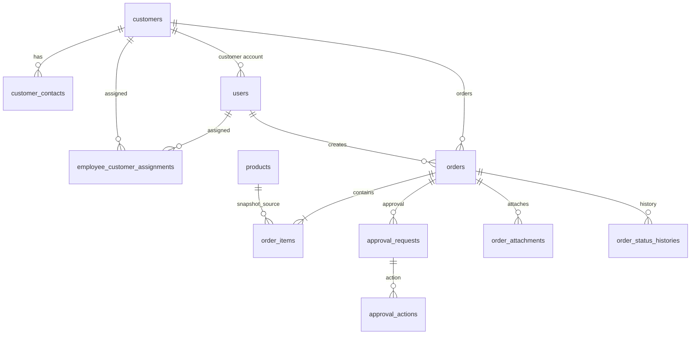

# 06 DB物理設計

> 本書は読みやすい索引である。列型・制約・初期データの唯一の正は [spec-06-db-physical.yaml](spec-06-db-physical.yaml) とする。

## 1. 方針

- DBMS は PostgreSQL 16、文字コード UTF-8、タイムゾーン Asia/Tokyo。
- 主キーは UUID。金額は `numeric(15,2)`、日時は `timestamptz`。
- パスワードは BCrypt ハッシュのみ保存する。平文、メールリンク認証用資格情報、部門による権限制御は採用しない。
- 論理削除対象は `deleted_at` を持つ。業務操作・状態変更は `audit_logs` と各履歴テーブルに記録する。

## 2. テーブル一覧

| 区分 | テーブル | 目的 |
|---|---|---|
| 共通 | `users`, `user_sessions`, `audit_logs` | 利用者、ログインセッション、監査 |
| 顧客 | `customers`, `customer_contacts`, `employee_customer_assignments` | 顧客、通知先、担当割当 |
| 商品 | `tax_categories`, `products` | 税区分・税率、商品 |
| 注文 | `orders`, `order_items`, `order_status_histories` | 注文、明細、状態履歴 |
| 承認 | `approval_rules`, `approval_requests`, `approval_actions` | 承認経路、依頼、操作履歴 |
| 添付/通知 | `order_attachments`, `notification_logs` | 注文添付、メール送信履歴 |
| 帳票 | `export_jobs` | 大量 CSV の非同期出力ジョブ |

## 3. 主要な関係

## 4. 初期データと不変条件

| 項目 | 初期値/規則 |
|---|---|
| ロール | `ADMIN`、`EMPLOYEE`、`CUSTOMER` |
| 税区分 | `STANDARD=10%`、`REDUCED=8%`、`EXEMPT=0%` |
| 承認経路 | 金額を問わず `ADMIN` 1 段承認 |
| 顧客利用者 | `users.customer_id` を必須とし、当該顧客のデータだけを参照できる |
| 担当社員 | `employee_customer_assignments` の有効な顧客だけを操作できる |
| 注文明細 | 商品名、商品コード、単価、税区分、税率を注文時点の値として保持する |
| 添付 | 1 ファイル 10 MiB 以下。`SAFE` 以外はダウンロード不可 |
| CSV | 10,000 件超は `export_jobs` で非同期処理し、成果物は 24 時間で失効 |

## 5. 運用上の注意

- スキーマ変更は Flyway migration でのみ行う。
- 承認済み注文は直接更新しない。取消し後、必要なら `revised_from_order_id` を指定した新規注文として作成する。
- 削除済みデータを含めない一意制約は PostgreSQL の部分一意インデックスで実装する。
