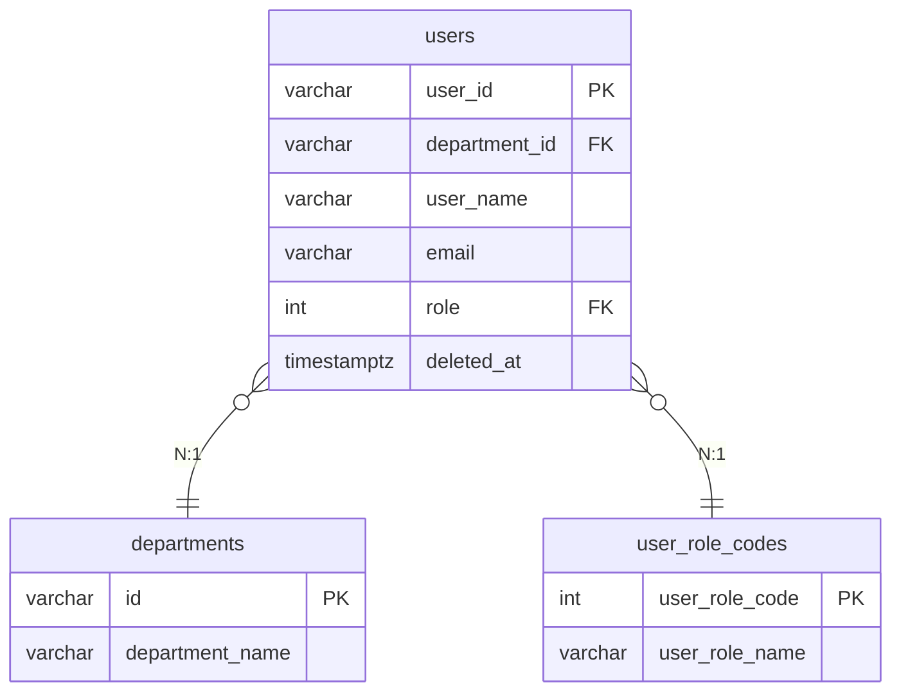

<!-- devtool:file-region id="document-header" -->
# 06 DB 物理設計

> 論理データモデルを物理テーブルに落とし込む：テーブル一覧、各テーブル定義、ER 図、インデックス、制約、マスタ。
> DBMS：PostgreSQL（バージョンは `基本設計/共通/spec-01-system-architecture-ui.md` §2.3 に従う）。

（文書ヘッダは `spec-00-doc-standard-ui.md` を参照）

---

<!-- devtool:end-file-region -->
<!-- devtool:block id="basic.common.06-db-physical-ui.s01" -->
## 1. テーブル一覧

| テーブルID | 物理名 | 論理名 | 種別 | 概要 | 関連機能 |
|------|--------|--------|------|------|---------|
| TBL-users | users | ユーザ | 業務 | ユーザの基本情報 | F-USR-* |
| TBL-departments | departments | 部門マスタ | マスタ | 部門定義 | F-DEPT-* |
| TBL-user-role-codes | user_role_codes | ロールコード | マスタ | ロール列挙（T07）のコード表 | — |
| {{ テーブルごとに展開 }} | | | | | |

> 種別：業務 / マスタ / 履歴 / 中間 / ビュー。

<!-- devtool:endblock -->
<!-- devtool:block id="basic.common.06-db-physical-ui.s02" -->
## 2. テーブル定義テンプレート（テーブルごとに複製する）

### TBL-users ユーザ（物理名：`users`）

| No | 論理名 | 物理名 | 型(長さ) | PK | FK | NOT NULL | デフォルト | 備考 |
|----|--------|--------|--------|:--:|:--:|:--------:|------|------|
| 1 | ユーザID | user_id | varchar(10) | ○ | | ○ | | 業務キー。アプリケーション層で採番（プレフィックス+4桁）|
| 2 | 部門ID | department_id | varchar(10) | | ○ | ○ | | →departments.id |
| 3 | ユーザ名 | user_name | varchar(100) | | | ○ | | |
| 4 | メールアドレス | email | varchar(255) | | | ○ | | 未削除行で一意（部分ユニークインデックス）|
| 5 | 電話番号 | phone_number | varchar(512) | | | | | 暗号化して保存（暗号文型）|
| 6 | ロール | role | int | | ○ | ○ | | →user_role_codes.user_role_code。コードは T07（例：1=ADMIN, 2=MANAGER, 3=USER） |
| 7 | 停止日 | disabled_date | date | | | | | |
| 8 | 作成日時 | created_at | timestamptz | | | ○ | CURRENT_TIMESTAMP | |
| 9 | 作成者 | created_by | varchar(10) | | | ○ | 'SYSTEM' | |
| 10 | 更新日時 | updated_at | timestamptz | | | ○ | CURRENT_TIMESTAMP | トリガーで更新 |
| 11 | 更新者 | updated_by | varchar(10) | | | ○ | 'SYSTEM' | |
| 12 | 削除日時 | deleted_at | timestamptz | | | | NULL | 論理削除 |

### TBL-user-role-codes ロールコード（物理名：`user_role_codes`）

| No | 論理名 | 物理名 | 型(長さ) | PK | FK | NOT NULL | デフォルト | 備考 |
|----|--------|--------|--------|:--:|:--:|:--------:|------|------|
| 1 | ロールコード | user_role_code | int | ○ | | ○ | | T07 の属性コード。採番しない |
| 2 | ロール名 | user_role_name | varchar(50) | | | ○ | | T07 の英語名（API 値）。一意 |
| 3 | 作成日時 | created_at | timestamptz | | | ○ | CURRENT_TIMESTAMP | |
| 4 | 作成者 | created_by | varchar(10) | | | ○ | 'SYSTEM' | |
| 5 | 更新日時 | updated_at | timestamptz | | | ○ | CURRENT_TIMESTAMP | トリガーで更新 |
| 6 | 更新者 | updated_by | varchar(10) | | | ○ | 'SYSTEM' | |

> コードテーブルは `deleted_at` を持たない。

> 暗号化・マスキング対象の項目は備考に明記する（暗号化の旨を記載）。共通列（created_at/updated_at/created_by/updated_by）は全テーブルで統一することを推奨する。

<!-- devtool:endblock -->
<!-- devtool:block id="basic.common.06-db-physical-ui.s03" -->
## 3. ER 図



<!-- devtool:endblock -->
<!-- devtool:block id="basic.common.06-db-physical-ui.s04" -->
## 4. インデックス設計

| テーブル | インデックス名 | 列 | 種別 | 目的 |
|----|--------|----|------|------|
| users | pk_users | user_id | 主キー | 業務キーの主キー |
| users | idx_users_department_id | department_id | 一般 | 部門別検索 |
| users | uq_users_email | email | 部分ユニーク | メールの一意性（未削除行のみ。下記の論理削除方針を参照） |
| departments | pk_departments | id | 主キー | 主キー |
| departments | uq_departments_department_name | department_name | 部分ユニーク | 部門名の一意性（未削除行のみ） |
| user_role_codes | pk_user_role_codes | user_role_code | 主キー | 主キー |
| user_role_codes | uq_user_role_codes_user_role_name | user_role_name | ユニーク | 名称の一意性 |
| {{ … }} | | | | |

<!-- rule: db.soft-delete-partial-unique -->
> **論理削除とユニーク制約の方針**（`deleted_at` を持つすべてのテーブルに適用）
> 論理削除後も旧行は物理的に残るため、通常のユニーク制約では「同一メールの再利用」などの場面で挿入が競合する。
> そのため、一意性が必要な業務列（例：`email`、`department_name`）のユニーク制約には**部分ユニークインデックス**を用い、未削除行のみを対象とする。
> ```sql
> CREATE UNIQUE INDEX uq_users_email
>   ON users (email)
>   WHERE deleted_at IS NULL;
> ```
> - PostgreSQL は部分ユニークインデックスをネイティブにサポートする（推奨）。
> - MySQL は非サポートのため、生成列、または `(列, COALESCE(deleted_at,'1970-01-01'))` の複合ユニークインデックスで代替する。
> - 主キー系（例：`user_id`、`id`）は再利用時に新規採番されるため自然に重複せず、この影響を受けない。

<!-- devtool:endblock -->
<!-- devtool:block id="basic.common.06-db-physical-ui.s05" -->
## 5. 制約・リレーション

| テーブル | 制約名 | 種別 | 内容 |
|----|--------|------|------|
| users | fk_users_departments | 外部キー | department_id → departments.id |
| users | fk_users_user_role_codes | 外部キー | role → user_role_codes.user_role_code |
| {{ … }} | | | |

<!-- devtool:endblock -->
<!-- devtool:block id="basic.common.06-db-physical-ui.s06" -->
## 6. マスタ初期値（任意）

| テーブル | 説明 | 初期データの出典 |
|----|------|------------|
| departments | 部門マスタ | 登録リスト/CSV |
| user_role_codes | ロールコード | T07 |
| {{ … }} | | |

<!-- devtool:endblock -->
<!-- devtool:block id="basic.common.06-db-physical-ui.s07" -->
## 7. データベース変更管理方針

| 項目 | 内容 |
|------|------|
| 変更管理ツール | Flyway（Spring Boot 標準） |
| 配置・命名規則・ベースライン・適用済みスクリプト・ロールバック・反復実行可能スクリプト | `開発規約/spec-flyway-migration-rule.md` に従う |

> テーブル構造の変更は必ずマイグレーションスクリプトで行い、**本番 DB の手動変更は禁止**とする。

### 記入要領

- 論理モデルの各エンティティ → 最低1つの物理テーブル。1:1 は状況に応じて統合または分割してよい（機密情報を分割すると権限制御が容易になる）。
- 命名は snake_case に統一する。真偽値は `is_xxx`、日時は `xxx_at` とする。
- テーブル名は `開発規約/spec-naming-rule.md`、主キーの形式と採番は `開発規約/spec-database-rule.md` §4.1 に従う。
- 機密情報（個人番号・口座など）は暗号化方式を明記し、平文で保持しない。
- `deleted_at` を持つテーブルでは、一意性が必要な業務列に**部分ユニークインデックス**（未削除行のみを対象）を用いる。「インデックス設計」の論理削除方針を参照。
- テーブル構造の変更はマイグレーションスクリプト（Flyway）で管理する。「データベース変更管理方針」を参照。
<!-- devtool:endblock -->
