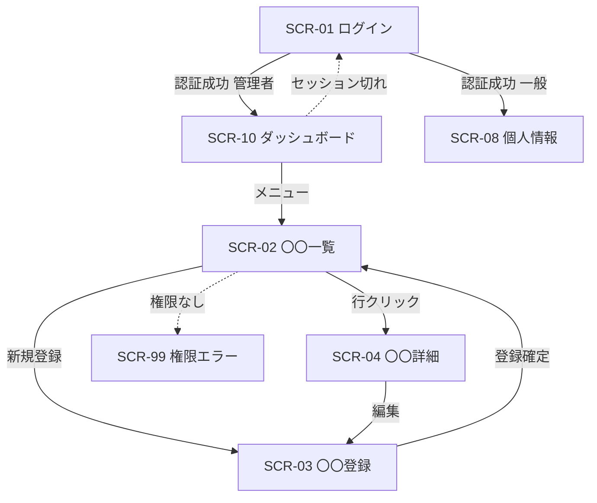

<!-- devtool:file-region id="document-header" -->
# 10 画面遷移図

> 画面間の遷移（どの画面から、どの操作で、どの画面へ、どの条件で移るか）を定義する。画面 ID は `spec-05-screen-list-ui.md` に従い、再定義しない。
> **帰属：システム全体で唯一 → `共通/`**。**画面遷移の正本は本書**。詳細設計（`spec-detail-temp.md` §2.1「画面遷移」）には、本書から当該機能の画面に関わる遷移を転記または参照し、食い違いを生じさせない（新たな遷移は先に本書へ追加する）。

（文書ヘッダは `spec-00-doc-standard-ui.md` を参照）

---

<!-- rule: screen.transition-ssot -->
<!-- devtool:end-file-region -->
<!-- devtool:block id="basic.common.10-screen-transition-ui.s01" -->
## 1. 全体画面遷移図

> Mermaid で記述する。ノードは `SCR-ID 画面名`、矢印ラベルは**操作/トリガ**。権限外遷移・エラー遷移は破線で示す。

<!-- devtool:endblock -->
<!-- devtool:block id="basic.common.10-screen-transition-ui.s02" -->
## 2. 画面遷移表

| 遷移元 | 操作・トリガ | 遷移先 | 条件 | 引き継ぎ情報（パラメータ） | 遷移方式 |
|------|------|------|------|------|------|
| SCR-01 | ログインボタン | SCR-10 | 認証成功かつロールが管理者 | — | 画面遷移 |
| SCR-02 | 行クリック | SCR-04 | — | `id`（パスパラメータ） | 画面遷移 |
| SCR-02 | 削除ボタン | （確認ダイアログ） | — | `id` | ポップアップ |

| 列 | 記入要領 |
|------|------|
| 条件 | ロール・ステータス・入力値による分岐を明記する |
| 引き継ぎ情報 | URL パス / クエリ / 画面状態（store）のどれで渡すかを示す |
| 遷移方式 | 画面遷移 / ポップアップ（モーダル） / 別タブ / リダイレクト |

<!-- devtool:endblock -->
<!-- devtool:block id="basic.common.10-screen-transition-ui.s03" -->
## 3. 共通遷移ルール

| 場面 | 遷移ルール |
|------|------|
| 認証後 | ロール別の既定ランディング（`spec-12` §7「認証後の遷移」に従う） |
| 未認証アクセス | ログイン画面へリダイレクトし、認証後に元の URL へ戻す（採用する場合） |
| 権限なし | 権限エラー画面または通知（`spec-12` §7 / `spec-03` に従う） |
| セッション切れ | ログイン画面へ遷移し、メッセージ（messageId）を表示する |
| 登録・更新完了 | 一覧へ戻り、完了メッセージ（I 区分）を Toast 表示する |
| ブラウザバック・未保存離脱 | 〇〇（例：未保存の入力がある場合は確認ダイアログを表示） |

<!-- devtool:endblock -->
<!-- devtool:block id="basic.common.10-screen-transition-ui.s04" -->
## 4. 業務フローとの対応

| 業務フロー ID（`spec-04`） | 経由する画面遷移 |
|------|------|
| BF-01 | SCR-02 → SCR-03 → SCR-02 |

<!-- devtool:endblock -->
