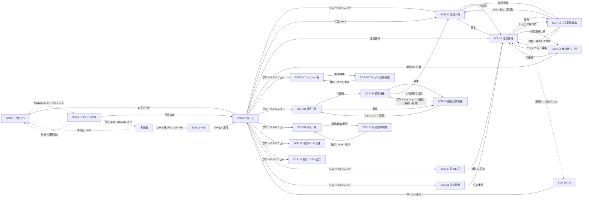
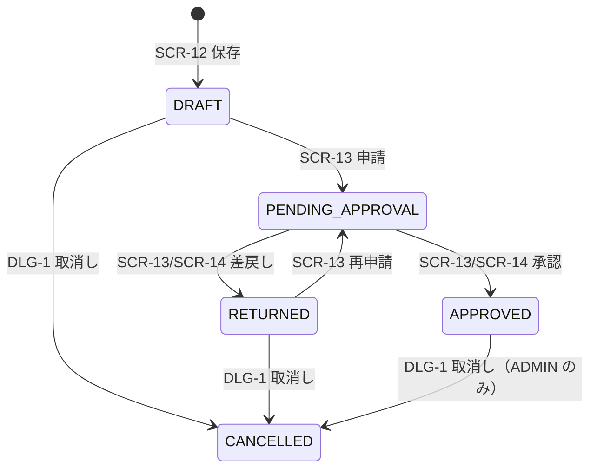

<!-- devtool:file-region id="document-header" -->
# 10 画面遷移図

> 画面間の遷移（どの画面から、どの操作で、どの画面へ、どの条件で移るか）を定義する。画面 ID は `spec-05-screen-list-ui.md` に従い、再定義しない。
> **帰属：システム全体で唯一 → `共通/`**。**画面遷移の正本は本書**。詳細設計（`spec-detail-temp.md` §2.1「画面遷移」）には、本書から当該機能の画面に関わる遷移を転記または参照し、食い違いを生じさせない（新たな遷移は先に本書へ追加する）。

（文書ヘッダは `spec-00-doc-standard-ui.md` を参照）

---

<!-- rule: screen.transition-ssot -->
<!-- devtool:end-file-region -->
<!-- devtool:block id="basic.common.10-screen-transition-ui.s01" -->
## 1. 全体画面遷移図

> Mermaid で記述する。ノードは `SCR-ID 画面名`、矢印ラベルは**操作/トリガ**。権限外遷移・エラー遷移は破線で示す。

> グローバルメニューからの遷移は SCR-02 起点で代表表示している。実際は全画面共通ヘッダの全メニューから、ロール別メニュー（`spec-05` §4）の画面へ遷移できる。「各画面」ノードは任意の画面を表す（エラー遷移・returnTo の戻り先）。

### 1.1 注文の状態と画面操作

<!-- devtool:endblock -->
<!-- devtool:block id="basic.common.10-screen-transition-ui.s02" -->
## 2. 画面遷移表

| 遷移元 | 操作・トリガ | 遷移先 | 条件 | 引き継ぎ情報（パラメータ） | 遷移方式 |
|------|------|------|------|------|------|
| SCR-02 | メニュー「注文」 | SCR-11 | — | — | 画面遷移 |
| SCR-02 | 承認待ち件数カード | SCR-14 | R-ADMIN のみ | — | 画面遷移 |
| SCR-02 | 下書き・差戻し件数カード / 承認済み件数カード | SCR-11 | 下書き・差戻しは R-ADMIN、R-EMPLOYEE。承認済みは全ロール | `statuses`（クエリ。状態フィルタ） | 画面遷移 |
| SCR-02 | 最近の注文 / 承認待ち上位の注文番号 | SCR-13 | 承認待ち上位は R-ADMIN のみ | `orderId`（パスパラメータ） | 画面遷移 |
| SCR-01 | 送信ボタン | （SCR-01 に留まり案内 `I0001`） | 常に同一応答 | — | — |
| メール | Magic Link のリンク | SCR-21 | — | `token`（クエリ） | 別タブ / 画面遷移 |
| SCR-21 | 自動検証 | SCR-02 | 認証成功（returnTo なし・60 分超過・ロール外） | JWT（メモリ等。TBD-U4） | リダイレクト |
| SCR-21 | 自動検証 | returnTo の画面 | 認証成功かつ `ddmsaa.returnTo` が保存から 60 分以内で、利用者のロールに許可されたパス（`spec-12` §7） | localStorage `ddmsaa.returnTo`（読込後に削除） | リダイレクト |
| SCR-21 | ログイン画面へ | SCR-01 | 認証失敗（`E0004`） | — | 画面遷移 |
| 全画面 | ユーザーメニュー「ログアウト」 | SCR-01 | JWT を破棄 | — | 画面遷移 |
| SCR-04 | 新規登録 / 行の編集 | SCR-05 | R-ADMIN | `userId`（編集時。パスパラメータ） | 画面遷移 |
| SCR-05 | 保存 / キャンセル | SCR-04 | — | — | 画面遷移 |
| SCR-06 | 行クリック | SCR-07 | — | `customerId`（パスパラメータ） | 画面遷移 |
| SCR-06 | 新規登録 | SCR-08 | R-ADMIN | — | 画面遷移 |
| SCR-07 | 編集 | SCR-08 | R-ADMIN | `customerId` | 画面遷移 |
| SCR-07 | この顧客の注文 | SCR-11 | — | `customerId`（クエリ） | 画面遷移 |
| SCR-08 | 保存 | SCR-07 | 保存成功（新規は採番された顧客） | `customerId` | 画面遷移 |
| SCR-08 | キャンセル | SCR-07 | 編集時（入力があれば `W0011` で確認） | `customerId` | 画面遷移 |
| SCR-08 | キャンセル | SCR-06 | 新規登録時（入力があれば `W0011` で確認） | — | 画面遷移 |
| SCR-09 | 新規登録 / 行選択 | SCR-10 | 新規は R-ADMIN。R-EMPLOYEE は参照のみ | `productId`（パスパラメータ） | 画面遷移 |
| SCR-10 | 保存 / キャンセル | SCR-09 | — | — | 画面遷移 |
| SCR-11 | 行クリック | SCR-13 | — | `orderId`（パスパラメータ） | 画面遷移 |
| SCR-11 | 新規登録 | SCR-12 | R-ADMIN、R-EMPLOYEE | — | 画面遷移 |
| SCR-11 | 取消し | SCR-13/DLG-1 | 取消し可能な状態かつ R-ADMIN / R-EMPLOYEE（担当） | `orderId` | ポップアップ |
| SCR-12 | 下書き保存 | SCR-13 | 保存成功 | `orderId` | 画面遷移 |
| SCR-12 | 保存して申請 | SCR-13 | 保存・申請とも成功 | `orderId` | 画面遷移 |
| SCR-12 | 保存して申請 | SCR-12（編集） | 保存成功・申請失敗（`E0054` 等） | `orderId` | 画面遷移 |
| SCR-12 | キャンセル | SCR-11 | 新規登録時（訂正モードを含む。入力があれば `W0011`） | — | 画面遷移 |
| SCR-12 | キャンセル | SCR-13 | 編集時（入力があれば `W0011`） | `orderId` | 画面遷移 |
| SCR-12 | 初期表示 | SCR-13 | 編集で開いた注文が DRAFT / RETURNED 以外（`E0006` を表示） | `orderId` | リダイレクト |
| SCR-13 | 編集 | SCR-12 | 状態が DRAFT / RETURNED | `orderId` | 画面遷移 |
| SCR-13 | 訂正して再作成 | SCR-12（訂正モード） | 状態が CANCELLED、R-ADMIN / R-EMPLOYEE（担当） | `revisedFromOrderId`（クエリ） | 画面遷移 |
| SCR-13 | 取消し / 承認 / 差戻し / 添付アップロード | SCR-13/DLG-1〜4 | 状態・ロールによる（SCR-13 の操作ボタン表を参照）。承認・差戻しは R-ADMIN（申請者以外） | `orderId` | ポップアップ |
| SCR-13 | 一覧へ戻る | SCR-11 | — | 検索条件（クエリを復元） | 画面遷移 |
| SCR-13 | 承認 / 差戻し完了 | SCR-14 | 承認待ち一覧から開いた場合 | — | 画面遷移 |
| SCR-14 | 行クリック | SCR-13 | — | `orderId` | 画面遷移 |
| SCR-14 | 承認 / 差戻し | SCR-13/DLG-2 / DLG-3 | R-ADMIN（申請者以外） | `approvalRequestId` | ポップアップ |
| SCR-15 | ルール登録 / 編集 | SCR-15/DLG-1 | R-ADMIN | `approvalRuleId`（編集時） | ポップアップ |
| SCR-18 | 注文番号クリック | SCR-13 | 注文番号あり | `orderId` | 画面遷移 |
| SCR-17 | 対象 ID クリック | SCR-13 | 対象が注文 | `orderId` | 画面遷移 |
| SCR-19 / SCR-20 | ホームへ戻る | SCR-02 | — | — | 画面遷移 |
| 全画面 | ルートガード（未認証） | SCR-01 | JWT なし。遷移先を `ddmsaa.returnTo` に保存（`spec-12` §7） | — | リダイレクト |
| 全画面 | ルートガード（ロール外） | SCR-19 | ルートが許可しないロールで直接 URL を指定 | — | リダイレクト |
| 全画面 | API が 401（`E0001` / `E0040` / `E0041`） | SCR-01 | JWT 期限切れ（60 分）・未指定・不正。JWT を破棄 | — | リダイレクト |
| 全画面 | API が 403（`E0002`） | SCR-19 | 権限なし | — | 画面遷移 |
| 全画面 | API が 404（`E0005`）/ 未定義パス / `E0042` | SCR-20 | 主リソースの未存在・範囲外（画面内の副リソースの 404 は遷移せずパネル内に表示。`spec-12` §3）。未認証は SCR-01 | — | 画面遷移 |

| 列 | 記入要領 |
|------|------|
| 条件 | ロール・ステータス・入力値による分岐を明記する |
| 引き継ぎ情報 | URL パス / クエリ / 画面状態（store）のどれで渡すかを示す |
| 遷移方式 | 画面遷移 / ポップアップ（モーダル） / 別タブ / リダイレクト |

<!-- devtool:endblock -->
<!-- devtool:block id="basic.common.10-screen-transition-ui.s03" -->
## 3. 共通遷移ルール

| 場面 | 遷移ルール |
|------|------|
| 認証後 | 全ロールの既定ランディングは SCR-02 ホーム（`spec-12` §7「認証後の遷移」） |
| 未認証アクセス | 遷移先パスを localStorage `ddmsaa.returnTo`（保存時刻付き）に保存して SCR-01 へリダイレクトし、Magic Link を別タブで開いた場合も SCR-21 が認証後にそのパスへ戻す（60 分以内・ロールに許可されたパスのみ。`spec-12` §7） |
| 権限なし | ロール外の画面はルートガードで SCR-19。API の `403` も SCR-19。範囲外は存在を開示しないため SCR-20（`404`）（`spec-12` §7 / `spec-03`） |
| セッション切れ | JWT 期限切れ（リフレッシュなし）で API が 401 を返したら、SCR-01 へ遷移し `E0001` を表示する。再ログインは Magic Link |
| エラー画面 | SCR-19 / SCR-20 はログイン済みの利用者にだけ表示する。未認証の場合は SCR-01 へ |
| 登録・更新完了 | 一覧または詳細へ戻り、完了メッセージ（I 区分）を Toast 表示する |
| ブラウザバック・未保存離脱 | 未保存の入力がある場合は確認ダイアログ（W0011）を表示する |

<!-- devtool:endblock -->
<!-- devtool:block id="basic.common.10-screen-transition-ui.s04" -->
## 4. 業務フローとの対応

> 業務フロー ID（BF-xx）は `spec-04-business-flow-ui.md` の確定後に採番・記入する（現在は新基線のテンプレート。TBD-TR-01）。暫定の対応は以下。

| 業務フロー（暫定） | 経由する画面遷移 |
|------|------|
| 注文の登録〜申請 | SCR-11 → SCR-12 → SCR-13 |
| 承認・差戻し | SCR-14 → SCR-13（DLG-2 / DLG-3）→ SCR-14 |
| 差戻し後の再申請 | SCR-13 → SCR-12 → SCR-13 |
| 承認済み注文の訂正 | SCR-13（取消し DLG-1）→ SCR-13 → SCR-12（訂正元を設定） |
| CSV 出力 | SCR-16 |

### 4.1 確認事項（TBD）

| # | 事項 |
|---|---|
| TBD-TR-01 | `spec-04` の BF-ID 確定後に上表を BF-ID へ置換する |

<!-- devtool:endblock -->
