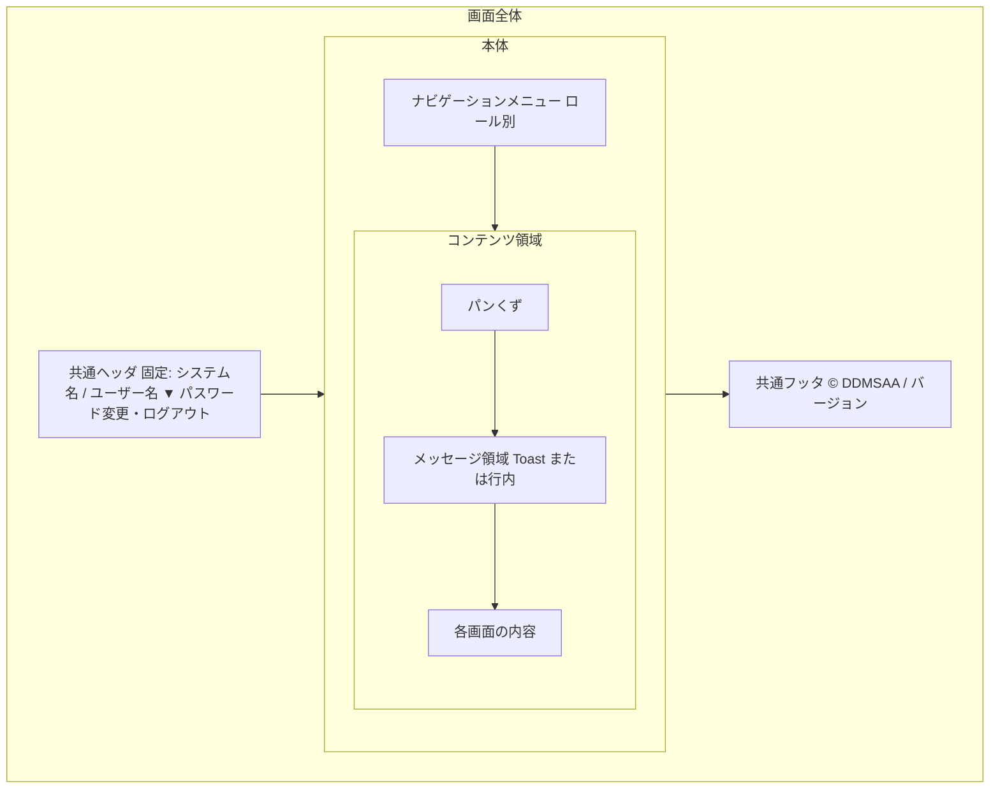

# 12 画面共通設計（共通UI方針）

> **全画面で共通の** UI 標準と方針を定義する：共通レイアウト・コンポーネント、メッセージ表示、入力チェック表示、画面状態、表示形式、ロール別表示、ダウンロード UX、状態色、レスポンシブ・ブラウザ・アクセシビリティ。
> **帰属：システム全体で唯一 → `共通/`**（ゴールデンルール）。各画面設計は**本方針に従い、重複定義しない**。
> 本方針は「どう表示し、どう操作させるかの統一ルール」のみを定め、個別画面は描かない（個別画面は `共通/spec-screen-list-ui.md` と各業務設計の `spec-<module>-screen-ui.md` を参照）。

（文書ヘッダは `spec-00-doc-standard-ui.md` を参照）

> 本版で、テンプレートのプレースホルダを `requirements.md`・`spec-03`・`spec-11` から導ける範囲で確定した。要件から導けないものは「提案」と明記し、§13 の確認事項に残す。

---

## 1. 画面全体構成・共通レイアウト

| 項目 | 方針 |
|------|------|
| レイアウトグリッド | 左固定ナビ（幅 220px 程度）＋可変幅コンテンツ領域。コンテンツ最大幅は 1440px（提案） |
| ヘッダ | 全画面で固定：システム名・ログインユーザー（表示名・ロール）・ユーザーメニュー（パスワード変更、ログアウト）。**ログイン画面（SCR-01）ではナビゲーションとユーザーメニューを表示しない** |
| ナビゲーションメニュー | **ロールごとに**異なる項目を表示する（§7・`spec-screen-list-ui.md` §3） |
| パンくず | コンテンツ領域の上部に現在位置を表示する。ホーム > 注文 > 注文詳細 の形 |
| ページタイトル | 画面名は `spec-screen-list-ui.md` の画面名と一致させる |

## 2. 共通コンポーネント一覧

> コンポーネントの**外観と操作の統一標準**（実装方法は `開発規約/spec-frontend-coding-rule.md` を参照。ここでは外観と挙動のみを定める）。UI ライブラリは Ant Design（`spec-01-system-architecture-ui.md`）。

| コンポーネント | 統一方針 |
|------|---------|
| ボタン | 主操作（保存・申請・検索）／副操作（キャンセル・戻る）／危険操作（取消し・無効化・削除・差戻し）でスタイルを区別する。危険操作は必ず確認ダイアログ（§3）を経由する |
| テーブル | 列見出し・ソート・ページング・空状態を統一する。行クリックで詳細へ進む。金額・数量は右寄せ |
| ページング | 既定 20 件/ページ。選択肢 10/20/50/100（提案） |
| フォーム | ラベルは項目の上。必須マークは `*`。エラーは項目の下（§4） |
| モーダル/ダイアログ | 確認とフォームポップアップの統一スタイル。Esc とキャンセルボタンで閉じる。実行中は二重送信を防ぐ |
| 検索・フィルタ領域 | 一覧上部に配置。「検索」「リセット」の位置を統一。条件は URL クエリに保持し、詳細から戻ったときに復元する |
| 状態バッジ | 注文状態・スキャン状態・ジョブ状態などはバッジで表示し、§9 の配色に従う |

## 3. メッセージ表示方針（`spec-09-message-list` を参照し、文言は再記載しない）

> バックエンドは `messageId`(+`messageArgs`) のみを返し、フロントエンドが `spec-09-message-list.yaml` に従って文言を解決して表示する。**文言のハードコードは禁止**。

| 区分 | messageId プレフィックス | 表示方式 | 説明 |
|------|:-----:|---------|------|
| 情報 INFO | `I` | Toast（自動消去） | 操作成功など（例：`I0003` ログイン成功） |
| 警告/確認 WARNING | `W` | **確認ダイアログ**（OK/キャンセル）またはハイライト | 取消し・無効化・削除・破棄など不可逆な操作の前に確認する（例：`W0010` 削除確認） |
| エラー ERROR | `E` | 行内（項目単位）/ Toast / ダイアログ | 入力チェックエラーは該当箇所の近くに表示し、システムエラー（`E0012`・`E0013`）はダイアログを用いる |

| 項目 | 方針 |
|------|------|
| 確認ダイアログ | 危険/不可逆な操作は実行前に必ず表示する（W 区分の messageId に対応） |
| messageArgs | `{0},{1}` のプレースホルダに従って置換する（例：`I0010` の登録 ID） |
| Toast 表示時間 | 情報 3 秒。手動で閉じることも可能（提案）。エラー Toast は自動消去しない |
| HTTP とメッセージの対応 | `401`/`E0001` → SCR-01 へ。`403`/`E0002` → SCR-19。`404`/`E0005` → SCR-20。`409`/`E0006` → 再読込を促す行内表示。`E0012`/`E0013` → ダイアログ |

## 4. 入力・チェック表示方針

> クライアント側のチェックは**バックエンドと整合させる**（操作性のためのものであり、バックエンドの代替ではない。`spec-frontend-coding-rule.md` を参照）。

| 項目 | 方針 |
|------|------|
| 必須マーク | ラベルの後に `*` |
| チェックタイミング | 項目からフォーカスが外れたとき、および送信時の両方 |
| エラー表示 | 項目の下に行内でエラー文言を表示（messageId で解決。例：`E0030`〜`E0034`）。送信時は最初のエラー項目へスクロール |
| 送信制御 | チェック未通過のときは送信しない。送信中は送信ボタンを無効化（二重送信防止）。サーバーのエラー（`E0008`）は該当項目に割り付けて表示する |
| 離脱確認 | 入力があるまま画面を離れるときは `W0011`（入力内容を破棄）で確認する |
| 金額の参考表示 | 画面で計算した金額は参考表示とし、送信しない。保存後はサーバーが再計算した値を表示する（`requirements.md` §5.1） |

## 5. 画面状態の標準

> 各画面は以下の状態について統一した表現を持つこと。「正常時」だけを描いてはならない。

| 状態 | 統一表現 |
|------|---------|
| 読込中 | スケルトン表示を既定とする。ボタン操作中は当該ボタンにスピナー |
| エラー | エラー表示 + 再試行の導線（messageId で解決） |
| データなし | 空状態のプレースホルダ文言（例：「該当データなし」） |
| 権限なし | 入口（メニュー・ボタン）を表示しない（§7）。権限外アクセスは SCR-19/SCR-20 へ統一的に遷移する |
| 競合 | 状態・version の競合（`409`）は `E0006` を表示し、最新の内容を再読込する |

## 6. 表示形式方針

> データを「ユーザにどう見せるか」の統一ルール（保存/伝送形式は `06`/`07`/`データ辞書` を参照）。

<!-- rule: time.display-common-util -->
| 種類 | 表示形式 | 説明 |
|------|---------|------|
| 日付 | `YYYY-MM-DD` | 一覧・詳細・入力で統一 |
| 日時/タイムゾーン | **バックエンドの `+09:00` 付き ISO 8601 文字列 → 表示層の共通ユーティリティで統一書式化**（`YYYY-MM-DD HH:mm`、日本時間） | **各コンポーネント内での独自のタイムゾーン変換は禁止**。共通ユーティリティ関数を用いる |
| 数値/件数 | 3 桁区切り（`1,234`） | 数量は小数 3 桁まで（末尾の 0 は省略しない） |
| 金額 | 3 桁区切り＋「円」（例：`12,345 円`）。小数の表示桁は TBD-S2 | 税額・小計・合計も同形式。通貨は円のみ（外貨は初版で扱わない） |
| 列挙 | バックエンドが文字列コード（例：`APPROVED`）を返す → フロントエンドが統一マッピングで**日本語名**（例：「承認済み」）を表示する。JOIN はしない | マッピング元は `07 API` の列挙/データ辞書 T07 と整合させる |
| マスク項目 | サーバー側でマスク済みの値をそのまま表示する | 本システムの現行項目にマスク対象はない |

### 6.1 列挙の日本語表示（提案）

| 列挙 | コード → 表示名 |
|---|---|
| 注文状態（order_status） | DRAFT=下書き / PENDING_APPROVAL=承認待ち / RETURNED=差戻し / APPROVED=承認済み / CANCELLED=取消済み |
| ロール（role_code） | ADMIN=管理者 / EMPLOYEE=営業担当 / CUSTOMER=顧客 |
| ユーザー状態（user_status） | ACTIVE=有効 / DISABLED=無効 / LOCKED=ロック中 |
| 添付公開範囲（attachment_visibility） | INTERNAL=社内 / CUSTOMER=顧客公開 |
| スキャン状態（scan_status） | PENDING=確認中 / SAFE=安全 / REJECTED=拒否 |
| 通知状態（notification_status） | QUEUED=待機中 / SENDING=送信中 / SENT=送信済み / FAILED=失敗 |
| 出力状態（export_status） | QUEUED=待機中 / RUNNING=生成中 / READY=ダウンロード可 / FAILED=失敗 / EXPIRED=期限切れ |
| 税区分（tax_category_code） | STANDARD=標準（10%） / REDUCED=軽減（8%） / EXEMPT=非課税（0%） |

## 7. ロール別表示制御方針（`spec-03-auth-ui` を参照）

| 項目 | 方針 |
|------|------|
| 原則 | **表示制御 ≠ セキュリティ制御**：非表示は操作性のためのみであり、データ範囲/項目権限はバックエンドで強制する |
| メニュー/ボタン | ロール（ADMIN / EMPLOYEE / CUSTOMER）に応じて表示または非表示にする。CUSTOMER には作成・更新・取消し・承認・添付操作・CSV のボタンを表示しない。EMPLOYEE は担当顧客だけを選択できるようにする（`spec-frontend-coding-rule.md` と整合） |
| 認証後の遷移 | 全ロールの既定ランディングは SCR-02 ホーム。ログイン前に開こうとした画面があればそこへ戻す |
| メニュー定義 | `spec-screen-list-ui.md` §3 を正とする |
| 項目 | 画面ごとの出し分けは各 `spec-<module>-screen-ui.md` のロール別表で定める |

## 8. ファイルダウンロード UX

| 項目 | 方針 |
|------|------|
| ダウンロード方式 | クリック→API 経由で取得→ブラウザでダウンロード。**ストレージの URL を画面へ埋め込まない**。非同期ジョブは進捗（待機中/生成中）と完了を通知する |
| 単一/複数ファイル | 単数のみ（ZIP は初版で扱わない） |
| ファイル命名 | 注文 PDF：`order_<注文番号>.pdf`、CSV：`<対象>_YYYYMMDD.csv`（TBD-S3）。`07 API`・帳票設計と一致させる |
| 無効な状態 | スキャン未完了（PENDING）・拒否（REJECTED）の添付、期限切れの出力物はボタンを無効化し理由を表示する |
| 失敗時の処理 | 失敗時は messageId を表示し、無言で終わらせない |

## 9. 状態色・強調表示

| 用途 | 方針 |
|------|------|
| 注文状態の色 | 下書き＝灰、承認待ち＝橙、差戻し＝赤紫、承認済み＝緑、取消済み＝濃灰（色だけに頼らず、必ずテキストを併記する） |
| スキャン状態 | 確認中＝灰、安全＝緑、拒否＝赤 |
| 通知・出力ジョブ | 待機中/生成中＝青、成功＝緑、失敗＝赤、期限切れ＝灰 |
| 強調/ハイライト | 承認待ちが一定件数ある場合のホームのカード強調（閾値は提案：1 件以上でバッジ表示） |
| 危険操作 | 赤系の警告色（取消し・差戻し・無効化・削除） |

> 配色の具体値（カラーコード）は UI ライブラリのテーマ定義に従う（実装規約）。

## 10. 多言語・文字・タイムゾーン

| 項目 | 方針 |
|------|------|
| 言語 | UI は日本語（`requirements.md` §6）。メッセージ文言は `messageId` により外部化し、カタログは日/中/英の 3 言語を持つ（`spec-09-message-list.yaml`・`.zh`・`.en`）。初版の画面ラベルは日本語のみ（TBD-S1） |
| 文字コード | UTF-8 |
| タイムゾーン | Asia/Tokyo（`spec-11-non-functional-ui.md` §3）。表示層で統一（§6 を参照） |

## 11. レスポンシブ・対応ブラウザ・解像度

| 項目 | 方針 |
|------|------|
| レスポンシブ | PC 向けレイアウトのみ（スマートフォン・タブレットは対象外）。ナビゲーションは固定表示 |
| 対応ブラウザ | PC の Chrome / Edge 最新版（`requirements.md` §6） |
| 最小解像度 | 1280×720（提案） |

## 12. アクセシビリティ基準

| 項目 | 方針 |
|------|------|
| キーボード操作 | 主要な操作（検索・保存・ダイアログの OK/キャンセル）をキーボードで完結できる。ログインは Enter で送信 |
| コントラスト・文字サイズ | WCAG 2.1 AA 相当のコントラスト（提案）。状態は色とテキストの両方で表す |
| フォーム | label の関連付け・エラーの可読性。エラーは項目に関連付けて読み上げ可能にする |

## 13. 確認事項（TBD）

| # | 事項 | 説明 |
|---|------|------|
| TBD-S1 | 画面ラベルの多言語 | 初版は日本語のみ（本書）。中・英の画面ラベルを提供するかは未決（メッセージカタログは 3 言語を持つ） |
| TBD-S2 | 金額の小数 | DB は `numeric(15,2)` だが、要件に小数の円の扱いがない。表示を整数円に限るか、小数 2 桁まで表示するかが未決 |
| TBD-S3 | 出力ファイル名の規則 | PDF・CSV のファイル名規則が要件・07 にない。本書は提案値 |
| TBD-S4 | 本書の「提案」項目 | ページング件数、Toast 時間、最大幅、最小解像度、コントラスト基準などは要件に記載がないため、レビューで確定する |

### 記入要領

- 本書は**全画面共通の方針**であり、`共通/` に置く。各画面設計では参照のみとし、重複記載しない。
- メッセージは一律 `09` の messageId を参照し、**文言を再記載しない**（各画面設計と同じ原則）。
- ロール表示は `spec-03-auth-ui` に従い、**表示≠セキュリティ**（境界はバックエンド）であることに留意する。
