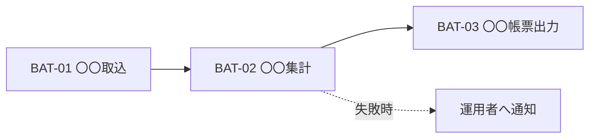

<!-- devtool:file-region id="document-header" -->
# 15 バッチ設計

> 定期・非同期で実行される処理（バッチ／ジョブ）の一覧、実行スケジュール、依存関係、エラー・再実行方針を定義する。1 本ごとの処理詳細は詳細設計（`spec-detail-temp.md` §3「バッチ詳細設計」）に記述する。
> **帰属：システム全体で唯一 → `共通/`**。バッチ ID は `BAT-99` で採番する（`spec-00-doc-standard-ui.md` §3）。

（文書ヘッダは `spec-00-doc-standard-ui.md` を参照）

---

<!-- devtool:end-file-region -->
<!-- devtool:block id="basic.common.15-batch-design-ui.s01" -->
## 1. バッチ一覧

| バッチ ID | バッチ名 | 概要 | 関連機能 ID | 起動方式 | 実行タイミング | 想定処理件数 | 想定処理時間 | 入力 | 出力 |
|------|------|------|------|------|------|------|------|------|------|
| BAT-01 | 〇〇集計 | 〇〇 | F-〇〇-01 | スケジュール | 毎日 02:00 | 〇〇 件 | 〇〇 分 | TBL-〇〇 | TBL-〇〇 / RPT-〇〇 |
| BAT-02 | 〇〇取込 | 〇〇 | F-〇〇-02 | 手動 / API | 随時 | 〇〇 件 | 〇〇 分 | IF-01 | TBL-〇〇 |

> 起動方式：スケジュール（cron 等） / 手動 / API 起動 / イベント起動。

<!-- devtool:endblock -->
<!-- devtool:block id="basic.common.15-batch-design-ui.s02" -->
## 2. ジョブフロー（実行順序・依存関係）

| 項目 | 内容 |
|------|------|
| 先行ジョブ | 〇〇（完了を待ってから開始する） |
| 排他制御 | 同一バッチの多重起動を禁止（ロック方式：〇〇） |
| 営業日判定 | 営業日のみ実行 / 毎日実行（`spec-00` の営業日定義に従う） |

<!-- devtool:endblock -->
<!-- devtool:block id="basic.common.15-batch-design-ui.s03" -->
## 3. 共通方針

| 項目 | 方針 |
|------|------|
| 実行基盤 | 〇〇（例：Spring Scheduler / Quartz / cron + コンテナ。`spec-01-system-architecture-ui.md` に従う） |
| トランザクション | 〇〇 件ごとにコミット / 全体で 1 トランザクション |
| エラー処理 | 1 件エラー時：スキップして継続 / 即停止。エラー内容を〇〇に記録する |
| リトライ・再実行 | 自動リトライ 〇〇 回（間隔 〇〇）。再実行は**冪等**であること。手動再実行手順は運用設計に従う |
| ログ・監視 | 開始・終了・件数・エラー件数を出力。失敗時は〇〇へ通知（`spec-11-non-functional-ui.md` に従う） |
| タイムアウト | 〇〇 分 |
| 実行ユーザ・権限 | システムユーザ `〇〇`。監査ログの操作者表記：〇〇 |

<!-- devtool:endblock -->
<!-- devtool:block id="basic.common.15-batch-design-ui.s04" -->
## 4. バッチ別概要設計（バッチごとに作成）

### BAT-01 〇〇集計

| 項目 | 内容 |
|------|------|
| 目的 | 〇〇 |
| 処理概要 | 1. 〇〇を抽出 → 2. 〇〇を計算 → 3. 〇〇へ更新 |
| 入力 | `TBL-〇〇`（抽出条件：〇〇） |
| 出力 | `TBL-〇〇`（C/U）、メッセージ・ログ |
| 異常時の影響 | 〇〇（例：翌朝の画面表示が前日値のままとなる） |
| 異常時の対応 | 〇〇（例：運用者が原因対処後に手動再実行） |

<!-- devtool:endblock -->
