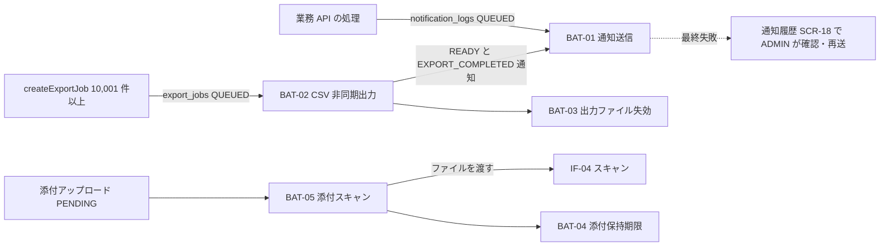

<!-- devtool:file-region id="document-header" -->
# 15 バッチ設計

> 定期・非同期で実行される処理（バッチ／ジョブ）の一覧、実行スケジュール、依存関係、エラー・再実行方針を定義する。1 本ごとの処理詳細は詳細設計（`spec-detail-temp.md` §3「バッチ詳細設計」）に記述する。
> **帰属：システム全体で唯一 → `共通/`**。バッチ ID は `BAT-99` で採番する（`spec-00-doc-standard-ui.md` §3）。
> 業務ルールは `spec-08-business-rule-list.md`、テーブルは `spec-06-db-physical.yaml` を正とする。

（文書ヘッダは `spec-00-doc-standard-ui.md` を参照）

---

<!-- devtool:end-file-region -->
<!-- devtool:block id="basic.common.15-batch-design-ui.s01" -->
## 1. バッチ一覧

| バッチ ID | バッチ名 | 概要 | 関連機能 ID | 起動方式 | 実行タイミング | 想定処理件数 | 想定処理時間 | 入力 | 出力 |
|------|------|------|------|------|------|------|------|------|------|
| BAT-01 | 通知送信 | QUEUED の業務通知をメール送信し、失敗は再試行を予約する（BR-NTF-002） | F-NTF-01、F-ORD-04、F-APR-02、F-ORD-05、F-RPT-03 | スケジュール | 1 分ごと | 1 回 100 件まで | 1 分以内 | TBL-notification-logs | TBL-notification-logs（U）、IF-01 |
| BAT-02 | CSV 非同期出力 | QUEUED の出力ジョブ（10,001 件以上）の CSV を生成する（BR-RPT-002） | F-RPT-03 | スケジュール | 1 分ごと | 1 回 1 ジョブ | 1 ジョブ 10 分以内 | TBL-export-jobs、TBL-orders | TBL-export-jobs（U）、TBL-notification-logs（C）、IF-02 |
| BAT-03 | 出力ファイル失効 | 有効期限を過ぎた出力ジョブを EXPIRED にし、ファイルを削除する（BR-RPT-002） | F-RPT-03 | スケジュール | 1 時間ごと | 数十件 | 5 分以内 | TBL-export-jobs | TBL-export-jobs（U）、IF-02（削除） |
| BAT-04 | 添付保持期限 | アップロードから 365 日を過ぎた添付を論理削除し、ストレージのファイルを削除する（BR-FIL-006） | F-ATT-04 | スケジュール | 毎日 03:00 | 数百件 | 30 分以内 | TBL-order-attachments | TBL-order-attachments（U）、IF-02（削除） |
| BAT-05 | 添付スキャン | PENDING の添付をウイルススキャンし、SAFE / REJECTED にする（BR-FIL-003） | F-ATT-02 | スケジュール | 1 分ごと | 1 回 20 件まで | 1 分以内 | TBL-order-attachments、IF-02、IF-04 | TBL-order-attachments（U）、TBL-audit-logs（C） |

> 起動方式：スケジュール（Spring Scheduler）。
> 削除済み添付（利用者の削除）のファイル削除も BAT-04 が行う（`deleted_at IS NOT NULL AND storage_purged_at IS NULL`）。

<!-- devtool:endblock -->
<!-- devtool:block id="basic.common.15-batch-design-ui.s02" -->
## 2. ジョブフロー（実行順序・依存関係）

| 項目 | 内容 |
|------|------|
| 先行ジョブ | なし（各バッチは独立して起動する。BAT-01 は BAT-02 が作成した通知も同じ周期で処理する） |
| 排他制御 | 同一バッチの多重起動を禁止する。対象行は `SELECT … FOR UPDATE SKIP LOCKED` で取得し、複数インスタンスでも同じ行を二重処理しない |
| 営業日判定 | 毎日実行（営業日判定なし） |

<!-- devtool:endblock -->
<!-- devtool:block id="basic.common.15-batch-design-ui.s03" -->
## 3. 共通方針

| 項目 | 方針 |
|------|------|
| 実行基盤 | business-service-core 内の Spring Scheduler（`spec-01-system-architecture-ui.md` §2） |
| トランザクション | 1 件（1 通知・1 ジョブ・1 添付）ごとにコミットする |
| エラー処理 | 1 件のエラーは記録してスキップし、次の件を処理する。エラー内容は対象行の `error_message` とアプリケーションログに記録する |
| リトライ・再実行 | 通知は BR-NTF-002 の再試行（最大 4 回）。CSV 出力の失敗は FAILED とし自動再試行しない（利用者が条件を再指定して新規依頼）。BAT-03・BAT-04 は次回起動で未処理分を再処理する。すべて**冪等**とする |
| ログ・監視 | 開始・終了・処理件数・エラー件数を INFO ログに出す。通知の最終失敗・CSV の失敗は WARN ログとし、監視で検知する（`spec-11-non-functional-ui.md`） |
| タイムアウト | BAT-02 は 1 ジョブ 10 分で打ち切り FAILED（`E0050`）とする。その他は 10 分 |
| 実行ユーザ・権限 | システムユーザ `SYSTEM`。`created_by` / `updated_by` と監査ログの操作者は `SYSTEM`（`actor_user_id` は NULL） |

<!-- devtool:endblock -->
<!-- devtool:block id="basic.common.15-batch-design-ui.s04" -->
## 4. バッチ別概要設計（バッチごとに作成）

### BAT-01 通知送信

| 項目 | 内容 |
|------|------|
| 目的 | 業務通知（申請・承認・差戻し・取消し・出力完了）をメール送信する（BR-NTF-001〜003） |
| 処理概要 | 1. `status=QUEUED AND next_attempt_at <= 現在` を古い順に最大 100 件取得 → 2. SENDING に更新 → 3. IF-01 で送信 → 4. 成功は SENT・`sent_at` 設定、失敗は `attempt_count` を加算し、4 回未満なら QUEUED・`next_attempt_at`=1 分／5 分／15 分後、4 回目なら FAILED |
| 入力 | `TBL-notification-logs`（`idx_ntf_logs_status_next_try`） |
| 出力 | `TBL-notification-logs`（U）、メール |
| 異常時の影響 | 通知が遅れる。業務データ（注文状態）には影響しない |
| 異常時の対応 | FAILED は ADMIN が SCR-18 で確認し、原因対処後に `retryNotification` で再送する |

### BAT-02 CSV 非同期出力

| 項目 | 内容 |
|------|------|
| 目的 | 10,001 件以上の CSV を非同期で生成する（BR-RPT-002） |
| 処理概要 | 1. QUEUED のジョブを 1 件取得し RUNNING に更新 → 2. `filter_condition`（依頼者のデータ範囲を合成済み）で注文を抽出 → 3. UTF-8 BOM の CSV をストレージへ保存 → 4. READY・`record_count`・`completed_at`・`expires_at`=完了 +24 時間を設定 → 5. 依頼者宛の EXPORT_COMPLETED 通知（`export_job_id` 付き）を QUEUED で作成 |
| 入力 | `TBL-export-jobs`、`TBL-orders`、`TBL-customers`、`TBL-users` |
| 出力 | `TBL-export-jobs`（U）、`TBL-notification-logs`（C）、ストレージ（IF-02） |
| 異常時の影響 | 依頼者が CSV を取得できない |
| 異常時の対応 | FAILED（`error_message` 記録、画面は `E0050`）。依頼者が条件を見直して再依頼する。RUNNING のまま 10 分を超えたジョブは次回起動時に FAILED にする |

### BAT-03 出力ファイル失効

| 項目 | 内容 |
|------|------|
| 目的 | 出力成果物を 24 時間で失効させる（BR-RPT-002） |
| 処理概要 | 1. `status=READY AND expires_at <= 現在` を EXPIRED に更新 → 2. `storage_purged_at IS NULL` かつ EXPIRED / FAILED のファイルをストレージから削除し `storage_purged_at` を設定 |
| 入力 | `TBL-export-jobs` |
| 出力 | `TBL-export-jobs`（U）、ストレージ削除（IF-02） |
| 異常時の影響 | 期限切れファイルが残る（ダウンロードは API が `expires_at` で拒否するため利用者には影響しない） |
| 異常時の対応 | 次回起動で再処理する |

### BAT-04 添付保持期限

| 項目 | 内容 |
|------|------|
| 目的 | 添付をアップロードから 365 日で削除する（BR-FIL-006） |
| 処理概要 | 1. `deleted_at IS NULL AND created_at <= 現在 - 365 日` を論理削除（`deleted_at` 設定）し、監査（`ATTACHMENT_DELETE`、操作者 SYSTEM）を記録 → 2. `deleted_at IS NOT NULL AND storage_purged_at IS NULL` のファイルをストレージから削除し `storage_purged_at` を設定 |
| 入力 | `TBL-order-attachments` |
| 出力 | `TBL-order-attachments`（U）、`TBL-audit-logs`（C）、ストレージ削除（IF-02） |
| 異常時の影響 | 保持期限を過ぎたファイルが残る |
| 異常時の対応 | 次回起動で再処理する |

### BAT-05 添付スキャン

| 項目 | 内容 |
|------|------|
| 目的 | ウイルススキャン完了まで添付を配信しない（BR-FIL-003） |
| 処理概要 | 1. `scan_status=PENDING AND deleted_at IS NULL` を古い順に最大 20 件、`FOR UPDATE SKIP LOCKED` で取得 → 2. IF-02 から取り出して `VirusScanService.scan` に渡す → 3. SAFE は `scan_status=SAFE`、REJECTED は `REJECTED` に更新（1 件ずつコミット）。REJECTED は監査ログ（`ATTACHMENT_SCAN_REJECTED`）に記録 → 4. スキャナ不達・タイムアウトは更新せず PENDING のまま（次回に再試行） |
| 入力 | `TBL-order-attachments`、IF-02（ファイル本体） |
| 出力 | `TBL-order-attachments`（U）、`TBL-audit-logs`（C） |
| 異常時の影響 | 添付が PENDING のままダウンロードできない |
| 異常時の対応 | 24 時間を超えて PENDING の添付は WARN ログで検知し、運用者がスキャナの状態を確認する（`spec-18-operation-design-ui.md`）。`app.scan.type=none`（開発用）では即 SAFE になる（warn ログ） |

<!-- devtool:endblock -->
