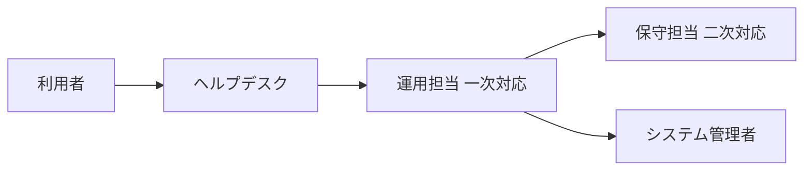
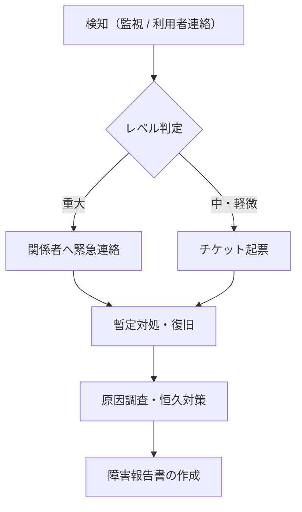

<!-- devtool:file-region id="document-header" -->
# 18 運用設計

> システムを稼働後に**誰が・いつ・何をして運用するか**を定義する。非機能要件 `spec-11-non-functional-ui.md` §1「可用性」・§3「運用・監視」の要求値を、運用体制・定常作業・監視・障害対応・バックアップ／リストアの手順方針に落とし込む。
> **帰属：システム全体で唯一 → `共通/`**。要求値（稼働率・保持期間など）は `spec-11` を正とし、本書では再定義しない。バッチの実行スケジュールは `spec-15-batch-design-ui.md`、環境構成は `spec-01-system-architecture-ui.md` §3・§4 を参照する。

（文書ヘッダは `spec-00-doc-standard-ui.md` を参照）

---

<!-- devtool:end-file-region -->
<!-- devtool:block id="basic.common.18-operation-design-ui.s01" -->
## 1. 運用体制

| 役割 | 担当（組織 / 担当者） | 責務 | 対応時間帯 |
|------|------|------|------|
| システム管理者 | 〇〇 | ユーザ・マスタ管理、設定変更 | 平日 9:00–18:00 |
| 運用担当 | 〇〇 | 定常作業、監視、一次対応 | 〇〇 |
| 保守担当（開発ベンダ） | 〇〇 | 障害の二次対応、改修 | 〇〇 |
| 問い合わせ窓口（ヘルプデスク） | 〇〇 | 利用者からの問い合わせ受付 | 〇〇 |

<!-- devtool:endblock -->
<!-- devtool:block id="basic.common.18-operation-design-ui.s02" -->
## 2. 運用スケジュール・定常作業

| 作業 ID | 作業名 | 頻度・時刻 | 担当 | 内容 | 関連 |
|------|------|------|------|------|------|
| OPS-01 | バッチ実行結果確認 | 毎営業日 9:00 | 運用担当 | 夜間バッチの正常終了を確認 | `spec-15` BAT-〇〇 |
| OPS-02 | ユーザ登録・削除 | 随時 | システム管理者 | 入退社に伴うアカウント管理 | SCR-〇〇 |
| OPS-03 | ログ・ディスク容量確認 | 毎週 | 運用担当 | 保持期間超過分の削除確認 | `spec-11` §3 |
| OPS-04 | 計画停止・メンテナンス | 月 1 回 | 保守担当 | パッチ適用など | `spec-11` §1 |

<!-- devtool:endblock -->
<!-- devtool:block id="basic.common.18-operation-design-ui.s03" -->
## 3. 監視設計

| 監視対象 | 監視項目 | 閾値 | 検知時の通知先・方法 | 一次対応 |
|------|------|------|------|------|
| サーバ / コンテナ | 死活 | 応答なし 〇 分 | 運用担当へメール / チャット | 再起動手順に従う |
| サーバ / コンテナ | CPU・メモリ・ディスク使用率 | 〇〇% 超過 〇 分継続 | 〇〇 | 〇〇 |
| アプリケーション | エラーログ（ERROR レベル） | 〇 件 / 〇 分 | 〇〇 | 〇〇 |
| バッチ | 異常終了・実行時間超過 | 異常終了 / 〇 分超過 | 〇〇 | `spec-15` の再実行方針に従う |
| DB | 接続数・応答時間 | 〇〇 | 〇〇 | 〇〇 |
| 外部連携 | メール送信失敗など（`spec-08`） | 〇 件連続失敗 | 〇〇 | 〇〇 |

> 監視ツール：〇〇。ログの種類・保持期間の要求値は `spec-11` §3 に従う。

<!-- devtool:endblock -->
<!-- devtool:block id="basic.common.18-operation-design-ui.s04" -->
## 4. 障害対応

### 4.1 障害レベル定義

| レベル | 定義 | 初動目標 | 復旧目標 | 報告先 |
|------|------|------|------|------|
| 重大 | システム全体が利用不可 / データ破損 | 〇 分以内 | 〇 時間以内（`spec-11` の RTO） | 〇〇 |
| 中 | 一部機能が利用不可、代替手段あり | 〇 時間以内 | 〇 営業日以内 | 〇〇 |
| 軽微 | 業務影響なし（表示崩れなど） | 〇 営業日以内 | 次回リリース | 〇〇 |

### 4.2 障害対応フロー

<!-- devtool:endblock -->
<!-- devtool:block id="basic.common.18-operation-design-ui.s05" -->
## 5. バックアップ・リストア

| 対象 | 方式 | 取得タイミング | 保持世代・期間 | 保管先 | リストア手順の概要 |
|------|------|------|------|------|------|
| DB | フル / 増分 / PITR | 毎日 〇:〇〇 | 〇 世代（`spec-11` §1 に従う） | 〇〇 | 〇〇 |
| ファイルストレージ | 〇〇 | 〇〇 | 〇〇 | 〇〇 | 〇〇 |
| 設定ファイル・シークレット | 〇〇 | 変更時 | 〇〇 | 〇〇 | 〇〇 |

> リストア訓練：〇〇（例：年 1 回、テスト環境で RPO/RTO を満たすことを確認する）。

<!-- devtool:endblock -->
<!-- devtool:block id="basic.common.18-operation-design-ui.s06" -->
## 6. リリース・変更管理

| 項目 | 方針 |
|------|------|
| リリース手順 | 〇〇（例：テスト環境で確認後、計画停止枠で本番反映） |
| DB 構造変更 | Flyway による（`データベース/spec-db-migration-ui.md`）。本番 DB の手動変更は禁止（`spec-01` §6） |
| 承認 | 〇〇（例：変更申請 → 運用責任者の承認 → 実施） |
| 切り戻し | 〇〇（例：直前バージョンのイメージで再デプロイ） |

<!-- devtool:endblock -->
<!-- devtool:block id="basic.common.18-operation-design-ui.s07" -->
## 7. マスタ・ユーザ管理運用

| 対象 | 管理者 | 方法 | 頻度 |
|------|------|------|------|
| ユーザアカウント | システム管理者 | 管理画面（SCR-〇〇） | 随時 |
| 〇〇マスタ | 〇〇 | 管理画面（SCR-〇〇） / Flyway `R__` | 〇〇 |

> `spec-11` §3「マスタ保守は管理画面から実施し、コード改修を不要とする」に従う。

<!-- devtool:endblock -->
