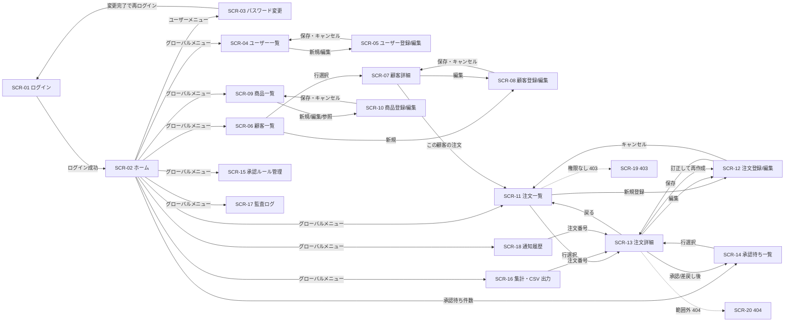
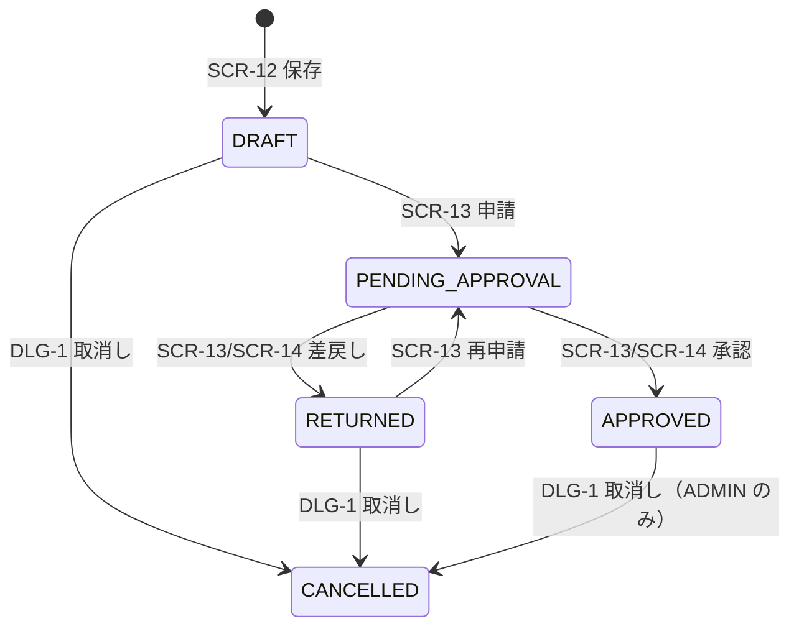

# 画面一覧・画面遷移

> DDMSAA の全画面の一覧（SCR-ID・パス・利用ロール・利用 API）と画面遷移を定義する。
> 画面の ID（`SCR-`）は本書が正本であり、`spec-02-function-list-ui.md`・業務設計・詳細設計は本書の ID を参照する。
> 個別画面のレイアウトと項目定義は各業務設計の `spec-<module>-screen-ui.md`、全画面共通の UI 方針は `spec-12-screen-common-ui.md` に従い、本書では重複定義しない。

## 文書情報

| 項目 | 内容 |
|---|---|
| システム名 | DDMSAA 販売システム |
| 文書名 | 画面一覧・画面遷移 |
| 版数 | V0.1 |
| ステータス | 草案 |
| 作成日 | 2026-10-20 |
| 上流の根拠 | `requirements.md` §2・§3、`spec-02-function-list-ui.md`、`spec-03-auth-ui.md`、`spec-07-api-list.yaml` |

### 改訂履歴

| 版数 | 改訂日 | 改訂内容 |
|---|---|---|
| V0.1 | 2026-10-20 | 初版（画面一覧 20 画面、画面遷移図） |

---

## 1. 凡例

| 記号 | 意味 |
|---|---|
| ○ / × | 表示・利用可 / 不可（`spec-00-doc-standard-ui.md` §4） |
| 自社 / 担当 | CUSTOMER は自社データのみ、EMPLOYEE は担当顧客のデータのみ（`spec-03-auth-ui.md` §2） |
| `SCR-nn/DLG-m` | 画面 `SCR-nn` の内部ダイアログ。独立した SCR-ID は採番しない（本書限りの表記） |
| 表示制御 | 表示・非表示は操作性のためであり、認可の境界は API（`spec-03-auth-ui.md` §4） |

## 2. 画面一覧

| SCR-ID | 画面名 | パス | ADMIN | EMPLOYEE | CUSTOMER | モジュール | 主な operationId |
|---|---|---|:---:|:---:|:---:|---|---|
| SCR-01 | ログイン | `/login` | ○ | ○ | ○ | M-user | `login` |
| SCR-02 | ホーム | `/` | ○ | ○ | ○ | M-user | `getMe`, `listPendingApprovals`, `listOrders` |
| SCR-03 | パスワード変更 | `/account/password` | ○ | ○ | ○ | M-user | `changePassword` |
| SCR-04 | ユーザー一覧 | `/users` | ○ | × | × | M-user | `listUsers` |
| SCR-05 | ユーザー登録/編集 | `/users/new`, `/users/:userId/edit` | ○ | × | × | M-user | `createUser`, `updateUser`, `listCustomers` |
| SCR-06 | 顧客一覧 | `/customers` | ○ | 担当 | × | M-customer | `listCustomers` |
| SCR-07 | 顧客詳細 | `/customers/:customerId` | ○ | 担当 | 自社 | M-customer | `getCustomer`, `updateCustomerStatus` |
| SCR-08 | 顧客登録/編集 | `/customers/new`, `/customers/:customerId/edit` | ○ | × | × | M-customer | `createCustomer`, `updateCustomer` |
| SCR-09 | 商品一覧 | `/products` | ○ | ○ | × | M-product | `listProducts`, `updateProductStatus` |
| SCR-10 | 商品登録/編集 | `/products/new`, `/products/:productId/edit` | ○ | 参照のみ | × | M-product | `createProduct`, `getProduct`, `updateProduct` |
| SCR-11 | 注文一覧 | `/orders` | ○ | 担当 | 自社 | M-order | `listOrders` |
| SCR-12 | 注文登録/編集 | `/orders/new`, `/orders/:orderId/edit` | ○ | 担当 | × | M-order | `createOrder`, `getOrder`, `updateOrder`, `listCustomers`, `listProducts` |
| SCR-13 | 注文詳細 | `/orders/:orderId` | ○ | 担当 | 自社 | M-order / M-approval / M-attachment | `getOrder`, `getApprovalHistory`, `listOrderAttachments`, `submitOrder`, `cancelOrder`, `approveOrder`, `returnOrder`, `uploadOrderAttachment`, `downloadAttachment`, `deleteAttachment`, `downloadOrderDocument` |
| SCR-14 | 承認待ち一覧 | `/approvals` | ○ | × | × | M-approval | `listPendingApprovals`, `approveOrder`, `returnOrder` |
| SCR-15 | 承認ルール管理 | `/approval-rules` | ○ | × | × | M-approval | `listApprovalRules`, `createApprovalRule`, `updateApprovalRule` |
| SCR-16 | 集計・CSV 出力 | `/reports` | ○ | 担当 | × | M-report | `getOrderSummary`, `getCustomerReport`, `getProductReport`, `createOrderExport`, `getExportJob`, `downloadExport` |
| SCR-17 | 監査ログ | `/audit-logs` | ○ | × | × | M-user | `listAuditLogs` |
| SCR-18 | 通知履歴 | `/notifications` | ○ | × | × | M-user | `listNotifications`, `retryNotification` |
| SCR-19 | 権限エラー（403） | `/403` | ○ | ○ | ○ | 共通 | — |
| SCR-20 | 未存在エラー（404） | `/404`（未定義パスの受け皿） | ○ | ○ | ○ | 共通 | — |

> 添付（M-attachment）は独立画面を持たず、SCR-13 の「添付」パネルとダイアログで提供する。
> `SCR-13` は 1 画面で状態・ロールに応じて操作ボタンを出し分ける（§4）。

### 2.1 内部ダイアログ

| ID | 親画面 | 内容 | 操作ロール | operationId |
|---|---|---|---|---|
| SCR-13/DLG-1 | SCR-13、SCR-11 | 注文取消し（理由入力） | ADMIN、担当 EMPLOYEE | `cancelOrder` |
| SCR-13/DLG-2 | SCR-13、SCR-14 | 承認確認 | ADMIN | `approveOrder` |
| SCR-13/DLG-3 | SCR-13、SCR-14 | 差戻し（理由 1〜500 文字必須） | ADMIN | `returnOrder` |
| SCR-13/DLG-4 | SCR-13 | 添付アップロード（公開範囲指定） | ADMIN、担当 EMPLOYEE | `uploadOrderAttachment` |
| SCR-15/DLG-1 | SCR-15 | 承認ルール登録/編集 | ADMIN | `createApprovalRule`, `updateApprovalRule` |

## 3. メニューとランディング

| ロール | 既定ランディング | メニュー項目（上から順） |
|---|---|---|
| ADMIN | SCR-02 ホーム | ホーム / 注文 / 承認待ち / 顧客 / 商品 / 集計・CSV / ユーザー / 承認ルール / 監査ログ / 通知履歴 |
| EMPLOYEE | SCR-02 ホーム | ホーム / 注文 / 顧客 / 商品 / 集計・CSV |
| CUSTOMER | SCR-02 ホーム | ホーム / 注文 / 自社情報（SCR-07 自社） |

- ヘッダ右上のユーザーメニューに「パスワード変更（SCR-03）」「ログアウト」を置く。
- 権限のないメニュー項目は表示しない。URL を直接指定した場合は API が `403`/`404` を返し、画面は SCR-19/SCR-20 へ遷移する（`spec-03-auth-ui.md` §4）。
- 未認証でログイン必須の画面を開いた場合、および `E0001`（セッション失効）では SCR-01 へ遷移する。

## 4. 画面遷移図

### 4.1 全体遷移

> 凡例：実線は通常遷移、破線は異常遷移。グローバルメニューからの遷移は SCR-02 起点で代表表示しており、実際は全画面共通ヘッダの全メニューからどの画面へも遷移できる（§3 のロール別メニューに従う）。

### 4.2 注文の状態と画面操作

## 5. 要件・機能とのトレース

| 要件 ID | 機能 | 画面 |
|---|---|---|
| FR-01 | ログイン | SCR-01, SCR-02, SCR-03 |
| FR-02 | ユーザー管理 | SCR-04, SCR-05 |
| FR-03 | 商品管理 | SCR-09, SCR-10 |
| FR-04 | 顧客管理 | SCR-06, SCR-07, SCR-08 |
| FR-05 | 注文管理 | SCR-11, SCR-12, SCR-13 |
| FR-06 | 承認 | SCR-13, SCR-14, SCR-15 |
| FR-07 | 添付 | SCR-13（添付パネル・DLG-4） |
| FR-08 | 検索/監査 | SCR-11, SCR-17 |
| FR-09 | 帳票/集計 | SCR-13（PDF）, SCR-16 |
| FR-10 | 通知 | SCR-18（送信履歴・再送）。メール本文は `spec-08-external-interface-ui.md` |

## 6. 確認事項

### 6.1 解決済み（07・09 に反映）

| # | 事項 | 解決 |
|---|---|---|
| TBD-01 | パスワード変更 API | `changePassword`（`POST /me/password`）を 07 に追加 |
| TBD-02 | 連絡先・担当社員の API | `createCustomer`/`updateCustomer`/`getCustomer` に含める方式とし、07 の summary に明記（専用 API は設けない） |
| TBD-04 | 承認依頼 ID | `getOrder` が承認待ちのとき現在の `approvalRequestId` を返す前提を 07 に明記 |
| TBD-06 | 新規メッセージ ID | `I0020`〜`I0031`・`W0020`〜`W0026`・`E0050` を 09（ja/zh/en）に採番し、各画面設計へ反映 |

### 6.2 未決（レビューで確定）

| # | 事項 | 内容 | 影響 |
|---|---|---|---|
| TBD-03 | 検索パラメータとレスポンススキーマ | 07 は `listOrders` などの検索条件・一覧/詳細のスキーマが未定義。画面項目は 06 の列名から導出しており、07 のスキーマ追加後に同期が必要 | 全画面 |
| TBD-05 | ホームの集計表示 | 専用 API を設けず `listPendingApprovals`/`listOrders` の総件数で代替する（仮置き） | SCR-02 |
| TBD-07 | PDF 出力の対象状態 | 07 は「承認済み注文の PDF」。本書は APPROVED のみで設計（仮置き） | SCR-13 |

> 画面ごとの未決事項は各 `spec-<module>-screen-ui.md` 末尾の TBD、全画面共通の未決は `spec-12-screen-common-ui.md` §13 に記載する。
