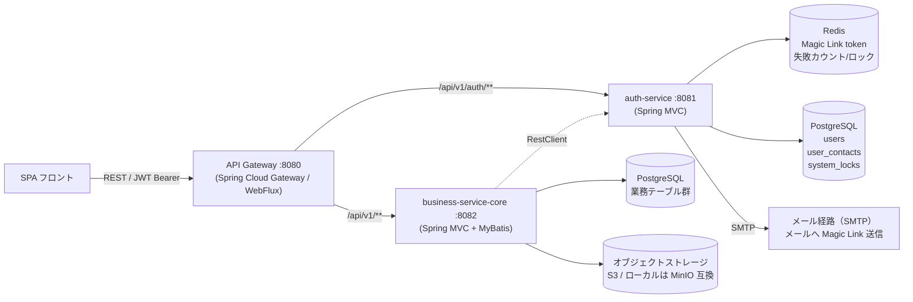

# 基盤基本設計 — アーキテクチャ（バックエンド共通基盤）

> 本ドキュメントは以下から生成された：
> - テンプレート: 基盤テンプレート/spec-backend-foundation-temp.md
> - バインディング: 基盤テンプレート/spec-java-springboot-mybatis-temp.yaml

> 本書は `spec-backend-foundation-temp.md` を本プロジェクト向けに具体化した**プラットフォーム基盤の基本設計（ハブ）**。全体アーキテクチャ・横断規約・API 設計規約・技術スタック・設定・決定論方式を確定する。
> 各サービス/層の詳細は track 別ドキュメントへ（[§11 ドキュメント構成](#11-ドキュメント構成基盤設計の地図)）。**具体業務（ドメインモデル・業務フロー・業務テーブル）は対象外**（各機能の詳細設計 / 業務 DDL に委ねる）。

## ドキュメント情報

| 項目 | 内容 |
|------|------|
| システム名称 | DDMSAA |
| ドキュメント名称 | 基盤基本設計 — アーキテクチャ（プラットフォーム基盤） |
| 上位ドキュメント | `spec-backend-foundation-temp.md`（共通テンプレート） |
| ドキュメントバージョン | V1.1 |
| ステータス | V1.0 を基にプロジェクト固有情報を反映・再生成 |
| 作成日 | 2026-06-30 |

---

## §1 スコープと依拠ドキュメント

### §1.1 目的と範囲

SPA + マイクロサービス + Spring Boot + MyBatis バックエンド基盤の**プロジェクトレベル実装設計**を提供する：アーキテクチャ・サービス境界・認証方式・共通コンポーネント・技術スタック・設定を固定し、基盤コードを本設計から自動生成可能とする。

**対象**：API Gateway、認証基盤、業務サービスの共通骨格、Common / Infrastructure モジュール、横断的関心事（例外・ログ/トレース・マスキング・応答ラップ・メッセージ目録・キャッシュ・ファイルストレージ）、技術スタックバージョンアンカー、設定規約。

**対象外**：具体業務のドメインモデル・業務フロー・業務テーブル DDL・各画面/API の業務ロジック（各機能の詳細設計と業務 DDL 参照）。

### §1.2 依拠する上位規約（横断）

| ドキュメント | 役割 | 関係 |
| --- | --- | --- |
| `spec-naming-rule.md` | 全層の命名規約（case / 層間変換 / 三原則 / 略語ホワイトリスト） | **命名は強制遵守** |
| `spec-database-rule.md` | DB 命名・主キー・監査列・型マッピング・インデックス・トリガー | **DB 設計は強制遵守** |
| `spec-data-dictionary-rule.md` + `データベース/spec-data-dictionary-mapping-ui.md` | 基礎型定義・列定義・列挙（T07）・層間フィールド対照 | **フィールド/型/列挙に従う** |

> **API インタフェース設計ルール**（リソース命名・HTTP メソッド・ステータスコード・ページング/ソート/フィルタ・フィールド書式・認証・エラー構造）は**本書 §3 / §4 で自定義し唯一の源とする**。外部 API 規約には依存しない。

### §1.3 横断 SSOT 一覧

| SSOT | パス | 担う情報 |
| --- | --- | --- |
| API 一覧（OpenAPI 3.0） | `共通/spec-07-api-list.yaml` | 全エンドポイント・operationId・schema（components.schemas 含む） |
| DB スキーマ | `データベース/schema/schema-definition.yaml` | テーブル定義・列・型・論理削除・インデックス |
| メッセージ目録 | `共通/spec-09-message-list.yaml` | 全 messageId・文言・カテゴリ |
| 設定キー台帳 | `基本設計/基盤/インタフェース仕様/spec-project-structure.yaml`（`env_vars` + `application.yml` spec） | 全 app.* キー・型・単位・既定値・環境変数 |
| 命名規約 | `spec-naming-rule.md` | 全層命名規則 |
| データ辞書 | `データベース/spec-data-dictionary-mapping-ui.md` | フィールド・列挙値マッピング |

---

## §2 システム全体アーキテクチャ

### §2.1 アーキテクチャ全体図



### §2.2 コンポーネント一覧

| モジュール名 | 種別 | ポート | 責務 | スタック |
| --- | --- | --- | --- | --- |
| `api-gateway` | 実行 jar | **8080** | JWT 検証/認可（**発行しない**）、ルーティングと透過転送、CORS/セキュリティヘッダ/エラー書式の統一、公開エンドポイント管理 | Spring Cloud Gateway（WebFlux / リアクティブ） |
| `auth-service` | 実行 jar | **8081** | パスワードレス Magic Link 認証、JWT 発行（access token のみ）、Redis 失敗カウント/ロック管理 | Spring MVC（Servlet） |
| `business-service-core` | 実行 jar | **8082** | ドメイン業務 API、業務フロー、トランザクション、DB アクセス、三層権限 | Spring MVC + MyBatis |
| `common` | plain jar | — | 例外処理、応答ラップ（`Result`/`PageResult`/`ErrorResponse`）、ログ/トレース/マスキング、メッセージ目録機構 | Java 21 |
| `infrastructure` | plain jar | — | DB 接続（HikariCP）、Redis クライアント（Lettuce）、JWT ツール（jjwt）、S3 クライアント、RestClient ファクトリ、Flyway マイグレーション | Java 21 |
| `openapi` | 契約ソース | — | OpenAPI 3.0 ソースファイル（機読 SSOT / 契約の権威） | — |

### §2.3 ランタイム境界

| 境界 | 内容 |
| --- | --- |
| Gateway = リアクティブ | Spring Cloud Gateway は WebFlux（ノンブロッキング）で動作。JDBC 呼び出し・同期ブロッキング IO は**一切行わない**。JWT 検証は JwtUtil を用いた純粋なメモリ内処理のみ。 |
| 業務/認証 = Servlet | `auth-service` および `business-service-core` は Spring MVC（Servlet / ブロッキング）。MyBatis/HikariCP との親和性が高く、トランザクション宣言が単純。 |
| 分離の理由 | 境界制御（認可/ルーティング/整形）はリアクティブで高スループットが必要；業務ロジック/DB アクセスは Servlet の同期モデルが保守性に優れる。 |
| 永続化の正 | **PostgreSQL**。Redis は一時データのみ（認証一時状態/失敗カウント/ロック）、業務データを永続化しない。 |
| サービス間通信 | Spring `RestClient`（同期 REST）、サービスディスカバリなし、接続先 URL は `app.services.<name>.base-url` で注入。 |

### §2.4 モジュールパッケージ構成

```
ddmsaa-backend/
  api-gateway/            # Spring Cloud Gateway（WebFlux）、ポート 8080
  auth-service/           # パスワードレス認証 + JWT 発行（Spring MVC）、ポート 8081
  business-service-core/  # 業務サービス（Spring MVC + MyBatis）、ポート 8082
  business-service-*/     # その他ドメインサービス（ドメイン単位で任意追加）
  common/                 # plain jar：例外/応答/ログ・トレース/マスキング/メッセージ
  infrastructure/         # plain jar：DB/Redis/JWT/S3/RestClient/Flyway/設定
```

> 依存方向は単方向：実行サービス → `infrastructure` → `common`；`common` はいかなるサービスにも依存しない。
> モジュール FQCN prefix：`com.example.ddmsaa.{gateway|auth|core|common|infrastructure}`。
> モジュール構成・依存セット・ビルドプラグインの機読正本は `基本設計/基盤/インタフェース仕様/spec-project-structure.yaml`。

---

## §3 API 設計規約（本基盤が唯一の源）

下表の「一般 REST 慣例」は比較参考のみで拘束源ではない；本プロジェクトは「本プロジェクト規約」列に従う。

| 項目 | 一般 REST 慣例（参考） | 本プロジェクト規約 | 理由 |
| --- | --- | --- | --- |
| エラー応答の識別 | `code`（UPPER_SNAKE、例 `NOT_FOUND`） | `messageId`（`共通/spec-09-message-list.yaml`）；HTTP ステータスは例外型で固定マッピング | フロント/バックの表示文言を統一管理・多言語対応 |
| 成功応答 | リソースを直接返却 | `Result<T>` / `PageResult<T>` で統一ラップ | 統一応答規約（traceId/messageId を含む） |
| 成功ステータスコード | 作成 `201` / 削除 `204` | `200` に統一（作成/削除も Result body を返す） | Result ラップと整合 |
| 業務エラーのステータスコード | `422` | `409`（業務例外） | プロジェクト規約 |
| ページング応答 | リソース配列 | `PageResult` ラップ（クエリパラメータ `pageNum`/`pageSize`） | Result ラップと整合 |
| 認証トークン | AccessToken + RefreshToken + `/auth/refresh` | **AccessToken のみ**（refresh 不採用、期限切れは再ログイン）、**パスワードレス（Magic Link のみ）** | プロジェクト認証設計（`spec-02-auth-service-ui.md`） |
| 主キー/ID の対外公開 | UUID v4 | **業務採番**（ユーザーIDを直接対外。方式は `開発規約/spec-database-rule.md` §4.1 に従う） | DBQ-08 決定済み |

**その他の API ルール（本基盤で統一定義）：**

- リソースパス・ベースパス・命名は `開発規約/spec-naming-rule.md` および `基本設計/共通/spec-07-api-list-ui.md` に従う（動詞禁止、業務操作は `/{id}/{action}` のみ）。
- CRUD：GET / POST / PUT / PATCH / DELETE；複雑操作は明示的なアクションパス `/approve`、`/reject`、`/cancel`。
- ページングは `pageNum`/`pageSize`（既定値・上限は `共通/spec-07-api-list-ui.md` に従う）。
- ソート `sort={field}:{asc|desc}`（複数フィールドはパラメータ反復）。
- フィルタ：フィールド名を直接使用、日付範囲 `{field}After`/`{field}Before`、あいまい `{field}Like`、複数値はパラメータ反復（カンマ区切り禁止）。
- 一括：`POST /resources/batch-get`・`batch-{action}`、リクエストボディ `{"ids":[...]}`（`batch-get` は緩いマッチで `200`、その他の一括は `204`、空 `ids` は `400`）。
- 共通 Header：`X-Request-Id`（入力）→ MDC `traceId` → `X-Trace-Id`（応答）；UUID no-hyphen 自動生成（詳細は §4）；`Accept-Language: ja`（既定）；`429` 時 `Retry-After`。
- パスパラメータ ID の命名は camelCase（型は業務コード）、ネスト深度 ≤2 層。
- フィールド書式（日時・金額・列挙値・camelCase）は `開発規約/spec-data-dictionary-rule.md` と `開発規約/spec-naming-rule.md` に従う。DB snake_case ↔ Java camelCase は MyBatis の `map-underscore-to-camel-case: true` で自動変換する。

### §3.1 OpenAPI（契約優先）

- **契約優先（contract-first）**：各マイクロサービスはまず OpenAPI 3.0 ソースファイルを契約の権威として作成；DTO は schema に整合していればよい（**手書き可、OpenAPI Generator 等のツールは任意・必須ではない**）；フィールド型と制約は JSON Schema で統一定義。
- **機読 SSOT**：API エンドポイントと schema の機読正本は `共通/spec-07-api-list.yaml`（OpenAPI 3.0、`components.schemas` を含む）；本書では schema を重複しない。`operationId` は API の権威識別子（グローバル一意、camelCase）。
- **共通コンポーネント定義**：`Result` / `PageResult` / `ErrorResponse` / セキュリティ方式 `bearerAuth` / 共通パラメータ `pageNum`・`pageSize`・`sort` は `components` で定義し `$ref` で再利用。
- **DTO 方針**：DTO は Java `record`（不変値オブジェクト）で実装、アクセサは `fieldName()` 形式（`getXxx()` は作らない）。`ErrorResponse` のみ可変 class（後述 §5 バインディング参照）。
- **生成手順**：OpenAPI ソース（schema 整合の DTO、手書きまたはツール生成）→ MapStruct で Entity ↔ DTO → MyBatis Mapper で永続化実装 → コントローラを `operationId` にバインド。
- 命名は `spec-naming-rule.md`、フィールド/列挙はデータ辞書、API 設計は本書 §3 に従う。

---

## §4 SPA 接続

### §4.1 認証ヘッダ

- フロントは `Authorization: Bearer <JWT accessToken>` で API を呼び出す。
- JWT：HS256、`expiration-seconds=3600`、`sub=ユーザーID`、`claim role=ENUM文字列`（値の例：`ADMIN`。ロールはプロジェクトで定義する）。
- アクセストークンのみ発行（refresh token 不採用、期限切れは再ログイン）。

### §4.2 CORS

- CORS とプリフライトリクエストをサポート；許可オリジンはフロントドメインのホワイトリストで管理（`CorsWebFilter` @Bean、Gateway 層で統一処理）。
- 設定は `app.*` 名前空間に統一（詳細は `基本設計/基盤/インタフェース仕様/spec-project-structure.yaml` 参照）。

### §4.3 統一エラー応答

`ErrorResponse`（可変 class、`getXxx()` アクセサ）の構造：

| フィールド | 説明 |
| --- | --- |
| `messageId` | エラー識別/表示キー（`共通/spec-09-message-list.yaml`） |
| `messageArgs` | `{0},{1}` プレースホルダ置換値（任意） |
| `message` | サーバ既定文言/ログ用フォールバック |
| `timestamp` | ISO 8601（`+09:00`） |
| `path` | リクエストパス |
| `traceId` | MDC traceId（`X-Request-Id` ベース、UUID no-hyphen）|
| `details` | 入力検証時のフィールド単位理由（任意、`FieldError` record の配列） |

HTTP ステータスおよび messageId の既定値は、例外型ごとの固定マッピングに従う（`開発規約/spec-backend-coding-rule.md` §4。Gateway 発生分は `基本設計/基盤/spec-01-api-gateway-ui.md` §6）。

### §4.4 トレース ID 貫通

- 入力 `X-Request-Id` ヘッダが存在すれば採用、なければ UUID no-hyphen を自動生成。
- リクエストコンテキスト（`MDC`）へ `traceId` として格納；ログインユーザがいれば `userId` も格納。
- 応答ヘッダ `X-Trace-Id` で返す；リクエスト終了時に必ずクリア。
- Gateway（`GlobalFilter` / WebFlux）と MVC サービス（`OncePerRequestFilter`）でそれぞれ実装（バインディング参照）。
- `Result` / `ErrorResponse` の `traceId` はコンテキスト（MDC）から取得し空値を防ぐ。

### §4.5 ファイルアップロード/ダウンロード

- アップロードは `multipart/form-data`；MIME タイプとサイズを検証（ホワイトリスト）。
- ダウンロードは `Content-Disposition` / `Content-Type` をサポート；バイナリストリームは `Result` ラップを経由せず直接書き出し。
- 業務要件に応じて署名付き URL（S3 presigned URL）をサポート。

---

## §5 技術スタック（バインディング適用済み）

Spring Boot バージョンをアンカーとし、spring-* は親 BOM で管理、BOM 外ライブラリは明示ロック。

### §5.1 バージョン表

技術スタックとバージョンは `基本設計/共通/spec-01-system-architecture-ui.md` §2.2 / §2.3 に従う。

### §5.2 依存セット

| モジュール | 主要 artifact（compile スコープ） | 備考 |
| --- | --- | --- |
| `api-gateway` | `spring-cloud-starter-gateway-server-webflux`、`spring-boot-starter-webflux`、`jjwt-api/impl/jackson`、`common`、`infrastructure` | 旧 `spring-cloud-starter-gateway` は Spring Cloud 2025.x で廃止 |
| `auth-service` | `spring-boot-starter-web`、`spring-boot-starter-security`、`spring-boot-starter-data-redis`、`mybatis-spring-boot-starter`、`jjwt-api/impl/jackson`、`common`、`infrastructure` | users / user_contacts / system_locks READ ONLY |
| `business-service-core` | `spring-boot-starter-web`、`spring-boot-starter-security`、`spring-boot-starter-data-redis`、`mybatis-spring-boot-starter`、`pagehelper-spring-boot-starter`、`mapstruct`、`software.amazon.awssdk:s3`、`common`、`infrastructure` | — |
| `common` | 外部依存最小限（SLF4J API、Jakarta Validation API 等） | plain jar、`spring-boot-maven-plugin` なし |
| `infrastructure` | `spring-boot-starter-data-redis`、`flyway-core`、`flyway-database-postgresql`、`jjwt-*`、`software.amazon.awssdk:s3`、`common` | plain jar |

> 依存セット（モジュール別 artifact+scope）の機読正本は `基本設計/基盤/インタフェース仕様/spec-project-structure.yaml`。

### §5.3 バインディング適用クラス対応

| テンプレート抽象概念 | Java/Spring 具体クラス | 備考 |
| --- | --- | --- |
| グローバル例外ハンドラ（MVC） | `@RestControllerAdvice GlobalExceptionHandler` | — |
| グローバル例外ハンドラ（Gateway） | `ErrorWebExceptionHandler`（WebFlux） | — |
| リクエストフィルタ（MVC） | `OncePerRequestFilter`（extends） | traceId 貫通 |
| リクエストフィルタ（Gateway） | `GlobalFilter`（implements、WebFlux） | `Ordered.HIGHEST_PRECEDENCE` |
| セキュリティ設定（MVC） | `@EnableWebSecurity @EnableMethodSecurity SecurityFilterChain` | — |
| セキュリティ設定（Gateway） | `@EnableWebFluxSecurity SecurityWebFilterChain` | — |
| メソッドレベル認可 | `@PreAuthorize("hasRole('ROLE_NAME')")` | `@EnableMethodSecurity` 要 |
| セッション方針 | `SessionCreationPolicy.STATELESS` | — |
| CORS（MVC） | `CorsConfigurationSource @Bean` | — |
| CORS（Gateway） | `CorsWebFilter @Bean` | — |
| スレッドコンテキスト | `ThreadLocal<T>` | `UserContext` で実装 |
| MDC ログ | `MDC`（SLF4J Mapped Diagnostic Context） | `%X{traceId:--} %X{userId:--}` |
| ログ設定ファイル | `logback-spring.xml` | — |
| リアクティブ型 | `Mono<T>` / `doFinally` | Gateway のみ |
| トランザクション | `@Transactional`（ServiceImpl メソッド単位） | — |
| 監査列補充 | `MetaObjectHandler`（MyBatis プラグイン、`UserContext` から `created_by`/`updated_by` 補充） | no-op フック、業務がオーバーライド |
| 主キー生成 | 業務採番（`開発規約/spec-database-rule.md` §4.1 に従う） | — |
| サービス間通信 | `Spring RestClient`（`RestClientFactory` 経由） | — |
| 暗号化ツール | `FieldEncryptor`（AES-GCM ツール） | IV=12byte、tag=128bit、出力=`Base64(iv||cipher)` |
| マスキング | `DataMaskUtil`（桁マスクツール）、`MaskingService`（no-op フック署名） | 業務がオーバーライド |

---

## §6 設定規約

### §6.1 app.* 名前空間の方針

- 全業務設定キーは **`app.*` 名前空間に統一**（`security.*` 等の別系統を設けない）。
- 機密値（シークレット/パスワード/キー）は**環境変数で注入**（ソースリポジトリに含めない）。
- 設定キー名は **kebab-case**、秒単位のキーは `-seconds` サフィックスに統一（分単位キー禁止）。
- **設定キー・既定値の正本は `基本設計/基盤/インタフェース仕様/spec-project-structure.yaml`**（`env_vars` + `application.yml` spec）。本 §6 の yaml は戦略の例示であり、機読 spec と食い違う場合は **spec を優先**する。

### §6.2 設定例示（戦略・構造の確認用）

```yaml
server:
  shutdown: graceful              # グレースフルシャットダウン（各実行サービス共通）

spring:
  application:
    name: platform-service        # 各サービスで上書き（api-gateway / auth-service / business-service-core）
  lifecycle:
    timeout-per-shutdown-phase: 30s   # graceful 停止の猶予（既定 30s）
  datasource:
    url: ${SPRING_DATASOURCE_URL}
    username: ${SPRING_DATASOURCE_USERNAME}
    password: ${SPRING_DATASOURCE_PASSWORD}
    hikari:
      maximum-pool-size: 30
      minimum-idle: 5
      connection-timeout: 10000
      idle-timeout: 300000
      max-lifetime: 1800000
      connection-test-query: SELECT 1
  data:
    redis:
      host: ${SPRING_REDIS_HOST:localhost}
      port: ${SPRING_REDIS_PORT:6379}
      password: ${SPRING_REDIS_PASSWORD:}
      database: 0

app:
  jwt:
    secret: ${JWT_SECRET}              # 必須・環境変数
    issuer: ddmsaa
    expiration-seconds: 3600           # access token のみ；refresh なし、期限切れは再ログイン
  auth:
    max-login-failure-count: 5         # 失敗カウント上限（Redis キー: auth:login:fail:{識別子}）
    login-lockout-seconds: 1800        # ロック時間 / Redis TTL（=30分）
    magic-link:
      ttl-seconds: 3600                # Magic Link 有効期限（=60分）
  services:                            # サービス間接続先（サービスディスカバリなし、設定注入）
    auth:
      base-url: ${SVC_AUTH_URL:http://localhost:8081}
    core:
      base-url: ${SVC_CORE_URL:http://localhost:8082}
  file:
    storage-type: s3
    s3:
      region: ${S3_REGION:ap-northeast-1}
      bucket: ${S3_BUCKET}
      prefix: ${S3_PREFIX:}                       # 任意
      endpoint: ${S3_ENDPOINT:}                   # 任意（ローカル開発の MinIO 接続時のみ）
      path-style: ${S3_PATH_STYLE:false}          # 任意（ローカル開発の MinIO 接続時は true）
      presign-ttl-seconds: ${S3_PRESIGN_TTL_SECONDS:300}
      # 資格情報は設定に持たない（既定資格情報チェーン：ECS タスクロール等）
  export:
    file-expiry-days: 7
  crypto:
    aes-key: ${AES_KEY}               # 必須・環境変数（Base64 エンコード済み）
```

> ポート：`api-gateway` 8080 / `auth-service` 8081 / `business-service-core` 8082。
> 文字コードは UTF-8 に統一；タイムゾーンはシステムタイムゾーン（`共通/spec-01-system-architecture-ui.md`）に統一（DB `TIMESTAMPTZ`、API の日時表記は `共通/spec-07-api-list-ui.md` に従う）。
> DB 接続詳細（ポート・schema・grants・SSL・初期化順序）は `データベース` を実装正本とする。
> **全設定キーの正本は §10.5「設定レジストリ」および `基本設計/基盤/インタフェース仕様/spec-project-structure.yaml` を参照**。

### §6.3 グレースフルシャットダウン設定

- 各実行サービス（`api-gateway`・`auth-service`・`business-service-core`）は `server.shutdown=graceful` を有効化。
- `spring.lifecycle.timeout-per-shutdown-phase=30s`（既定 30s、必要に応じ調整）。
- 共有 jar モジュール（`common` / `infrastructure`）は独立プロセスを持たないため対象外。

---

## §7 監視とヘルスチェック

### §7.1 ヘルスチェックエンドポイント

- Spring Boot Actuator を使用；主要エンドポイント `/actuator/health`。
- `/actuator/health` は公開エンドポイント（Gateway の permit-all リストに含む）。
- 公開エンドポイント全体：`/api/v1/auth/**` + `/actuator/health`。

### §7.2 監視指標

| 指標 | 説明 |
| --- | --- |
| リクエスト数 | サービス別・エンドポイント別 |
| 応答時間 | P50 / P95 / P99 |
| DB 接続 | HikariCP アクティブ接続数・待機数 |
| Redis 接続 | Lettuce 接続状態 |
| エラー率 | 4xx / 5xx 比率 |

### §7.3 アラート条件

- DB 接続失敗（HikariCP 接続タイムアウト連続発生）
- エラー率異常（5xx が閾値超過）
- サービス不可（`/actuator/health` が DOWN を返す）
- Redis 接続失敗（Magic Link / 失敗カウント機能が停止するリスク）

---

## §8 グレースフルシャットダウン

### §8.1 SIGTERM フロー

```
SIGTERM 受信
  └─ 新規リクエスト受付停止（Gateway / MVC とも）
       └─ 処理中リクエストの完了待ち（timeout-per-shutdown-phase まで）
            ├─ トランザクション完了後に退出
            ├─ Redis 操作完了後に退出
            └─ タイムアウト到達 → 強制終了
```

### §8.2 コンテナ猶予時間

- コンテナオーケストレーション（Kubernetes `terminationGracePeriodSeconds` / Docker `stopGracePeriod`）は `timeout-per-shutdown-phase` **以上**に設定し、強制終了による在途リクエスト切断を避ける。
- Gateway（WebFlux）と MVC サービスはいずれも `server.shutdown=graceful` をサポート。

---

## §9 設計成果物とコード生成境界

### §9.1 生成可能/業務域の境界

| 基盤生成（横断機構/ツール/フック署名） | 業務実装（ドメイン固有内容） |
| --- | --- |
| `Result` / `PageResult` / `ErrorResponse`（record/class）、`@RestControllerAdvice GlobalExceptionHandler`（例外カテゴリ→HTTP 固定マッピング） | 各エンドポイントの成功 `messageId` と業務例外の送出箇所 |
| `MessageCatalog`（目録ロード / 妥当性検証機構）、`messages.yaml` ロード機構 | 具体的な `messageId` エントリ（`共通/spec-09-message-list.yaml` に属する） |
| `JwtUtil` / JWT 認証 `GlobalFilter`（Gateway）/ `SecurityFilterChain`（MVC）/ `UserContext`（ThreadLocal）、`AuthStateStore`（Redis 操作） | ロール定義、権限マトリクス、ログイン可否の業務判定（停用判定・ロック判定） |
| `TraceIdFilter`（§4.4）、`FileStorageService`（S3 実装）、`RestClientFactory`（HTTP クライアント） | ファイル業務ルール、サービス間呼び出しのオーケストレーション |
| `FieldEncryptor`（AES-GCM ツール）、`DataMaskUtil`（桁マスクツール）、`MaskingService`（**no-op フック署名**） | 暗号化列の一覧、**フィールドマスクマトリクス**（ロール×フィールド、業務 DTO 内で実装） |
| `MetaObjectHandler`（MyBatis プラグイン雛形、`UserContext` から `created_by`/`updated_by` 補充） | Entity / Mapper / CRUD、**行レベルフィルタ条件**（データ範囲） |

> 原則：基盤は「機構/ツール/フック署名/雛形」のみ提供し、ドメインフィールドや業務ルールは含まない；*no-op*/雛形付きのものは業務側が必要に応じてオーバーライド実装する。

### §9.2 認証生成制約（パスワードレス固定）

**DDMSAA は §9.5 モード② (Magic Link パスワードレス) のみ採用**。以下の生成禁止事項を厳守する：

- **SMS / BCrypt / `username`+`password` / `password NOT NULL` 列 / refresh token を一切生成しない。**
- auth-service の認証データソース：`users` / `user_contacts`（`email`）/ `system_locks` の 3 テーブル READ ONLY。
- Magic Link：`SecureRandom` 32byte → Base64URL 無パディング、GETDEL で一回使い切り、TTL=3600s。
- 列挙攻撃対策：`loginInit` は常に `I0001` を返す（存在・停用・ロック区別しない）。

### §9.3 三層権限の生成対象

| 層 | 機構 | 基盤/業務 |
| --- | --- | --- |
| ①機能レベル | `@PreAuthorize` | 基盤（メソッドセキュリティ有効化 + フック署名） |
| ②データ範囲 | `UserContext` から SQL フィルタ | 業務（行レベルフィルタ条件は業務 Mapper に実装） |
| ③フィールド | `FieldEncryptor` + `MaskingService` | 基盤（ツール）+ 業務（フィールドマスクマトリクス） |

---

## §10 決定論的生成（テンプレート §10 をプロジェクトに適用）

> `spec-backend-foundation-temp.md` §10「決定論的生成の原則」を本基盤へ具体化する。
> 目的：**固定入力が同じなら、基本設計から下ろして生成される成果物（ファイル集合・内容）も同一**となること（決定論）。成果物を*列挙*せず、設計から*導出*する。

### §10.1 中核原則

- **列挙でなく導出**：各層の成果物集合を「これを作る」と列挙しない。**（上位層 + 横断規約 + 機読 SSOT）に導出規則を適用した結果**として一意に定める。成果物リストは*答え合わせ表*であり、置かない。
- **単一 SSOT**：同一事項の正本は 1 箇所のみ（API = OpenAPI、DB = schema 定義、メッセージ = 目録、**設定キー台帳 = `spec-project-structure.yaml`**）。上位層は下位の正本を複製せず**参照**する。
- **層ごとの導出契約**：各生成遷移は〈固定入力/導出規則/検証門〉を明示する。
- **UT 先行**：T1/T2 テストを先に確定し、`インタフェース仕様/` の型宣言 spec はテストを green にする形で導出する。

### §10.2 固定入力一覧（大前提・正本）

| 入力記号 | 入力 | 役割（何を決めるか） | 正本 |
| --- | --- | --- | --- |
| R1-入力 | 横断規約 | 命名・層構成・生成順・DB 規約 | `spec-naming-rule.md` / `spec-database-rule.md` |
| R2-入力 | API | エンドポイント・operationId・schema | `共通/spec-07-api-list.yaml` |
| R3-入力 | DB スキーマ | テーブル・列・型・論理削除 | `データベース/schema/schema-definition.yaml` |
| R4-入力 | メッセージ | messageId 一覧 | `共通/spec-09-message-list.yaml` |
| R5-入力 | 設定キー台帳 | 全設定キー・型・単位・既定値・環境変数 | `基本設計/基盤/インタフェース仕様/spec-project-structure.yaml`（`env_vars` + application.yml spec） |
| R6-入力 | バインディング | 言語/FW/バージョン/クラス写像 | `基盤テンプレート/spec-java-springboot-mybatis-temp.yaml` |

**ファイル導出規則（R1-R6）**：

| # | 入力要素 | 生成物（FQCN/パスは命名規約で機械決定） |
| --- | --- | --- |
| R1 | モジュール表（§2.4）の各行 | 1 Maven module（`<module>/pom.xml`）。ルートは packaging=pom の親 POM |
| R2 | コンポーネント表（各 track doc）の各行 | spec-naming-rule が定める FQCN に 1 型（IF+実装の分割は責務に従う） |
| R3 | 各実行モジュール | 1 `*Application` + 1 `application.yml` + 1 `SecurityConfig` + 1 `logback-spring.xml` |
| R4 | `spec-07-api-list.yaml` の各 path | path プレフィックスで担当サービス決定 → Controller。`operationId`=メソッド名、schema → DTO（record） |
| R5 | Service/Controller が参照するテーブル | 1 Mapper IF + 同名 XML（`開発規約/spec-backend-coding-rule.md` §6 に従う） |
| R6 | 改行/文字コード規約・メッセージ機構 | 改行・文字コードは `開発規約/spec-backend-coding-rule.md` §12 に従い、メッセージ目録は `common` に 1 つだけ配置 |

### §10.3 テスト分類（T1-T4）

| 区分 | 対象 | テスト |
| --- | :--- | :---: |
| T1 | 自前ロジック/状態/プロトコル判定を持ちモック可能な型（Service 実装・自前 Filter・`ExceptionHandler`・Util・暗号・Catalog・Controller・JWT・ThreadLocal・例外型） | **必須** |
| T2 | 計算を持つ応答ラッパ（`Result` / `PageResult` / `ErrorResponse`） | **必須** |
| T3 | 計算を持たない受動データ型（DTO record / View / `FieldError` / IF / no-op フック） | 不要 |
| T4 | `@Configuration`・`*Application`・外部ミドルウェア委譲アダプタ（S3/RestClient/Mail） | 不要 |

テスト規約：
- **1 対象型 = 1 テストクラス**（`<対象>Test`、複数型を束ねない）。
- `@ExtendWith(MockitoExtension.class)`、`@DisplayName` は日本語。
- データは固定値（乱数禁止、JWT 鍵は `Base64(new byte[32])`）。
- WebFlux テストは `MockServerWebExchange` + `reactor-test`。

### §10.4 検証門（G-*）

| 門 | 内容 |
| --- | --- |
| G-生成範囲 | 生成物が R1-R6/T1-T4 で入力から**導出可能**（リスト照合ではなく導出可能性の検査） |
| G-署名 | クラス署名・アノテーション・Bean 種別が `インタフェース仕様/` spec に一致 |
| G-API | パス/メソッド/operationId が `共通/spec-07-api-list.yaml` に一致 |
| G-設定 | 設定キー・既定値・単位が `基本設計/基盤/インタフェース仕様/spec-project-structure.yaml` に一致 |
| G-SQL | SQL・論理削除条件・判定境界（auth-service の loginable 判定）に一致 |
| G-msg | 使用 messageId が `共通/spec-09-message-list.yaml` に存在 |
| G-ビルド | POM 座標・継承・依存セット・LF リソース glob が `spec-project-structure.yaml` に一致 |
| G-改行 | 全生成物がファイル規約（`開発規約/spec-backend-coding-rule.md` §12）に適合 |
| G-javadoc | Javadoc は日本語。方針(B)：Javadoc 本文は spec の `javadoc` フィールドを逐語使用（決定論対象 scope B）。生成器は文言を創作せず、フィールドのない要素には付けない |
| G-機密 | 機微値はハードコードせず環境変数注入 |
| G-認証モード | BCrypt/パスワード列/refresh token/SMS コードが生成物に存在しないこと |

**決定論の実用ライン**：「**コンパイル+構造一致**」。方針(B)により Javadoc 本文・POM メタデータも spec に pin され決定論対象（scope B）。残る scope A（対象外）は整形・行折返し・空白のみ。

### §10.5 設定レジストリ（app.* キー全一覧・SSOT）

> 設定キー・既定値の正本は `基本設計/基盤/インタフェース仕様/spec-project-structure.yaml`（`env_vars` + `インタフェース仕様/spec-09-resource-file.yaml` の application.yml spec）。以下は名前空間の構造インデックス。

| キー名前空間 | 説明 | 環境変数 |
| --- | --- | --- |
| `app.jwt.secret` | JWT 署名キー | `JWT_SECRET`（必須） |
| `app.jwt.issuer` | JWT issuer | — （既定: `ddmsaa`） |
| `app.jwt.expiration-seconds` | Access token 有効期限（秒） | — （既定: 3600） |
| `app.auth.max-login-failure-count` | ログイン失敗上限 | — （既定: 5） |
| `app.auth.login-lockout-seconds` | ロック時間 / Redis TTL（秒） | — （既定: 1800） |
| `app.auth.magic-link.ttl-seconds` | Magic Link 有効期限（秒） | — （既定: 3600） |
| `app.services.auth.base-url` | auth-service 接続先 URL | `SVC_AUTH_URL` |
| `app.services.core.base-url` | business-service-core 接続先 URL | `SVC_CORE_URL` |
| `app.file.storage-type` | ストレージ種別（`local` 既定 / `s3`） | `FILE_STORAGE_TYPE`（既定: local） |
| `app.file.local.base-dir` | ローカルストレージ保存先（storage-type=local 時） | `FILE_LOCAL_BASE_DIR`（既定: `${java.io.tmpdir}/ddmsaa-files`） |
| `app.file.s3.region` | S3 リージョン | `S3_REGION`（既定: ap-northeast-1） |
| `app.file.s3.bucket` | S3 バケット名 | `S3_BUCKET`（既定: `ddmsaa`） |
| `app.file.s3.prefix` | オブジェクトキー接頭辞（任意） | `S3_PREFIX` |
| `app.file.s3.endpoint` | S3 互換エンドポイント（任意。ローカル開発の MinIO 接続時のみ） | `S3_ENDPOINT` |
| `app.file.s3.path-style` | パススタイルアクセス（任意、既定 false。ローカル開発の MinIO 接続時は true） | `S3_PATH_STYLE`（既定: false） |
| `app.file.s3.presign-ttl-seconds` | 署名付き URL の標準有効期間（秒） | `S3_PRESIGN_TTL_SECONDS`（既定: 300） |

> 資格情報（アクセスキー）はアプリ設定に持たない。AWS 上では既定資格情報チェーン（ECS タスクロール / インスタンスロール等）を使用する。ローカル開発で MinIO に接続する場合のみ、SDK 標準の環境変数 `AWS_ACCESS_KEY_ID` / `AWS_SECRET_ACCESS_KEY` を設定する（本番では設定しない）。
| `app.export.file-expiry-days` | エクスポートファイル保持日数 | — （既定: 7） |
| `app.crypto.aes-key` | AES-GCM 暗号化キー（Base64 エンコード済み） | `AES_KEY`（必須） |
| `app.services.connect-timeout-seconds` | サービス間接続タイムアウト（秒） | — （既定: 5） |
| `app.services.read-timeout-seconds` | サービス間読み取りタイムアウト（秒） | — （既定: 30） |
| `app.auth.magic-link.base-url` | Magic Link 検証ベース URL | — （既定: `http://localhost:3000/auth/verify`） |
| `app.auth.mail-from` | Magic Link 送信元アドレス | — （既定: `no-reply@ddmsaa.local`） |
| `app.cors.allowed-origins` | CORS 許可オリジン | `CORS_ALLOWED_ORIGINS`（既定: `http://localhost:3000`） |

> Redis 接続（`spring.data.redis.*`）・DB 接続（`spring.datasource.*`）・Hikari プール（`spring.datasource.hikari.*`）・メール（`spring.mail.*`、auth-service）はフレームワーク固有キーであり `app.*` 名前空間外。詳細は §6.2 およびバインディング `config_bindings` 参照。

---

## §11 ドキュメント構成（基盤設計の地図）

### §11.1 基本設計（本トラック）と詳細設計の関係

```
基本設計（本トラック）
  ├── spec-00-architecture-ui.md（本書）
  │     全体アーキテクチャ・横断規約・API設計規約・技術スタック・設定・監視・graceful・生成境界・決定論
  ├── spec-01-api-gateway-ui.md
  │     Gateway ルーティング・JWT GlobalFilter・CORS・セキュリティヘッダ・エラー整形・traceId
  ├── spec-02-auth-service-ui.md
  │     パスワードレス Magic Link 認証フロー・JWT 発行・Redis 一時状態・ログイン可否境界
  ├── spec-03-business-service-ui.md
  │     業務サービス層構成・統一応答・例外送出・MyBatis・トランザクション・三層権限
  └── spec-04-common-component-ui.md
        common / infrastructure 横断コンポーネント

詳細設計（機読 spec）
  ├── 基本設計/基盤/インタフェース仕様/spec-project-structure.yaml
  │     モジュール/依存/設定台帳/Javadoc/コード規約（SSOT）
  ├── 基本設計/基盤/インタフェース仕様/
  │     クラス契約+コード本体（実装 spec）
  └── （削除済み: 01_UTSpec）
        T1/T2 テスト spec（UT 先行）
```

### §11.2 ドキュメント一覧

| 層 | ドキュメント | 内容 |
| --- | --- | --- |
| 基本設計（本 track） | **00 本書（アーキテクチャ）** | 全体アーキテクチャ・横断規約・API 設計規約・技術スタック・設定・監視・graceful・生成境界・決定論方式 |
| 基本設計 | `spec-01-api-gateway-ui.md` | Gateway ルーティング・JWT GlobalFilter・CORS・セキュリティヘッダ・エラー整形・traceId |
| 基本設計 | `spec-02-auth-service-ui.md` | パスワードレス Magic Link 認証フロー・JWT 発行・Redis 一時状態・ログイン可否境界 |
| 基本設計 | `spec-03-business-service-ui.md` | 業務サービス層構成・統一応答・例外送出・MyBatis・トランザクション・三層権限 |
| 基本設計 | `spec-04-common-component-ui.md` | common / infrastructure 横断コンポーネント |
| 基本設計（テンプレート） | `基盤テンプレート/spec-backend-foundation-temp.md` | プロジェクト横断の共通テンプレート（本書の上位） |
| 詳細設計（機読 spec） | `基本設計/基盤/インタフェース仕様/spec-project-structure.yaml` | モジュール/依存/設定台帳/Javadoc/コード規約 |
| 詳細設計（機読 spec） | `基本設計/基盤/インタフェース仕様/` | クラス契約+コード本体（実装 spec） |
| 詳細設計（機読 spec） | `（削除済み: 01_UTSpec）` | T1/T2 テスト spec（UT 先行） |
| 横断規約 | `spec-naming-rule.md` | 全層命名規約 |
| 横断規約 | `共通/spec-07-api-list.yaml` | API エンドポイント・schema（機読 SSOT） |
| 横断規約 | `共通/spec-09-message-list.yaml` | messageId 目録（機読 SSOT） |
| 横断規約 | `データベース/schema/schema-definition.yaml` | DB スキーマ（機読 SSOT） |
| 横断規約 | `データベース/spec-data-dictionary-mapping-ui.md` | データ辞書・列挙値マッピング |

---

## 改訂履歴

| バージョン | 日付 | 改訂内容 |
| --- | --- | --- |
| V1.0 | 2026-06-22 | `基盤基本設計.md`（V1.3、一枚物）を track 別に分割し本書を新設。横断章（目的/範囲・全体アーキテクチャ・API 設計規約・SPA・技術スタック・設定規約・監視・graceful・生成境界・決定論§10）を集約。 |
| V1.1 | 2026-06-30 | プロジェクト固有情報（認証モード・ポート・主キー戦略・ロール定義・JWT・Magic Link・Redis・FQCN prefix・暗号化・ログ貫通・三層権限・停用/ロック判定等）を全セクションに反映。冒頭に生成元明記。§1.3 横断 SSOT 一覧を追加。§2.2-§2.4 を具体化。§4.4 トレース ID 貫通・§9.2 認証生成制約・§9.3 三層権限を追加。§10.5 設定レジストリ全 app.* キー列挙。 |
