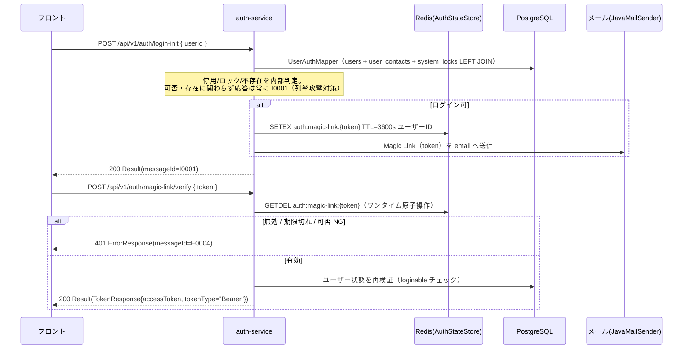

<!-- devtool:file-region id="document-header" -->
# 基盤基本設計 — auth-service（パスワードレス Magic Link）

<!-- 生成元 -->
<!-- テンプレート : 基盤テンプレート/spec-backend-foundation-temp.md -->
<!-- バインディング: 基盤テンプレート/spec-java-springboot-mybatis-temp.yaml -->
<!-- 生成日       : 2026-06-30 -->
<!-- 生成モデル   : claude-opus-4-8 -->

> 上位：[`spec-00-architecture-ui.md`](spec-00-architecture-ui.md)。
<!-- rule: auth.passwordless-magic-link-only -->
> **認証はパスワードレスに固定（メール Magic Link のみ・テンプレート §9.5 モード②）**：1 回使用で失効、有効期限 60 分（TTL=3600s）、再送回数上限なし。**SMS / パスワード / BCrypt / `password` 列 / refresh token は使用しない**。ポート `8081`。
> 具体コードは機読 spec [`インタフェース仕様/spec-01-auth.yaml`](インタフェース仕様/spec-01-auth.yaml)。

<!-- devtool:end-file-region -->
<!-- devtool:block id="basic.foundation.springboot.02-auth-service-ui.s01" -->
## ドキュメント情報

| 項目 | 内容 |
|------|------|
| ドキュメント名称 | 基盤基本設計 — auth-service |
| 上位ドキュメント | `spec-00-architecture-ui.md` |
| ドキュメントバージョン | V1.1 |
| 作成日 | 2026-06-22 |
| 最終更新日 | 2026-06-30 |

---

<!-- devtool:endblock -->
<!-- devtool:block id="basic.foundation.springboot.02-auth-service-ui.s02" -->
## §1 認証方式概要

本サービスはテンプレート §9.5 **モード②（パスワードレス Magic Link）** のみを採用する。パスワード認証（モード①）は一切実装しない。

| 項目 | 内容 |
|------|------|
| ログイン資格情報 | `ユーザーID`（業務キー）+ メール **Magic Link**（1 回使用で失効、TTL=3600s、再送回数上限なし） |
| 認証データソース（READ ONLY） | `users` / `user_contacts`（`email`）/ `system_locks` の 3 テーブル（業務 DDL 定義、auth-service は消費のみ） |
| 監査（INSERT ONLY） | ログイン系の監査を `audit_logs` に追記する（`LOGIN_REQUESTED` / `LOGIN_SUCCEEDED` / `LOGIN_FAILED`。`共通/spec-08-business-rule-list.md` BR-AUD-001、§6.4） |
| セッショントークン | **JWT access token のみ**（refresh token 不採用）；期限切れは再ログイン（`login-init` 再実行） |
| 一時状態 | Magic Link token（ワンタイム資格情報）だけを **Redis** に保存（TTL 設定可）；業務テーブルには永続化しない |
| 失敗/ロック | **ログイン失敗回数によるロックは行わない**（パスワード試行が存在しないため。§6.5）。ロックは業務ロック（`system_locks`）のみで、ADMIN が設定・解除し、ログイン時に検証する |

**外部 SSOT 参照：**

| 参照先 | 用途 |
|--------|------|
| `共通/spec-07-api-list.yaml` | エンドポイント / リクエスト・応答 schema（機読 SSOT） |
| `共通/spec-09-message-list.yaml` | messageId 目録 |
| `データベース/schema/schema-definition.yaml` | DB schema 定義 |
| `spec-naming-rule.md` | 命名規約（強制遵守） |
| `データベース/spec-data-dictionary-mapping-ui.md` | フィールド・列挙値マッピング |

---

<!-- devtool:endblock -->
<!-- devtool:block id="basic.foundation.springboot.02-auth-service-ui.s03" -->
## §2 ロール定義

DDMSAA のロールは次の 3 種で固定する（`開発規約/spec-data-dictionary-project-temp.md` T07-1、`共通/spec-03-auth-ui.md`）。

| 区分 | ADMIN | EMPLOYEE | CUSTOMER |
|------|----------|--------------------|----------|
| DB 値（`users.role` INT） | `1` | `2` | `3` |
| アプリ / API / JWT claim | `ADMIN` | `EMPLOYEE` | `CUSTOMER` |

- DB 列 `users.role` は **INT**、アプリ層・API 応答・JWT `role` claim はすべて **ENUM 文字列**を使用する。
- `users.role` は NOT NULL かつ FK のため NULL は発生しない。上記以外の値を読み取った場合は既定ロールに置き換えず、ログイン不可（`loginInit` は送信なしで `I0001`、`verifyMagicLink` は 401 `E0004`）とし、error ログを出力する。
- INT → ENUM 変換は `ServiceImpl` 内で実施する（詳細は §6.2 参照）。
- `@PreAuthorize` ロールチェックは ENUM 文字列で行う（例：`@PreAuthorize("hasRole('ADMIN')")`）。

---

<!-- devtool:endblock -->
<!-- devtool:block id="basic.foundation.springboot.02-auth-service-ui.s04" -->
## §3 JWT 発行と検証の責務分担表

| 層 | 責務 | 実装コンポーネント |
|----|------|--------------------|
| **auth-service** | JWT 発行（`loginInit` → `verifyMagicLink` → `issue`） | `infrastructure.JwtUtil.issue(userId, role)` |
| **API Gateway** | JWT Bearer 検証のみ（署名 / `exp` / `issuer`）、発行しない | `GlobalFilter`（WebFlux、`spec-01-api-gateway-ui.md` 参照） |
| **business-service** | Claims 再検証可；`@PreAuthorize` によるロールチェック | `@EnableMethodSecurity` + `@PreAuthorize` |

<!-- rule: auth.jwt-access-token-claims -->
- JWT 仕様：`sub`=ユーザーID（`users.user_id`）、claim `role`=ENUM 文字列、`iss` / `exp`（`app.jwt.expiration-seconds=3600`）。
- アルゴリズム：**HS256**（`JWT_SECRET` は環境変数）、ライブラリ：jjwt 0.13.0。
- `/api/v1/auth/**` は Gateway が auth-service へ透過（検証スキップ）する（詳細は `spec-01-api-gateway-ui.md` §4 参照）。

---

<!-- devtool:endblock -->
<!-- devtool:block id="basic.foundation.springboot.02-auth-service-ui.s05" -->
## §4 公開エンドポイント（permit-all）

<!-- rule: auth.public-endpoints -->
以下のパスは認証不要（permit-all）とし、JWT 検証をスキップする。

| パス | 対象サービス | 備考 |
|------|-------------|------|
| `/api/v1/auth/**` | auth-service | `loginInit` / `verifyMagicLink` / `resendMagicLink` を含む全体 |
| `/actuator/health` | auth-service | ヘルスチェック |

- Gateway の `permit-all` は上記をすべて通す（JWT 検証フィルタをスキップ）。
- auth-service の `SecurityConfig` も同一集合を `permitAll` に設定する。
- それ以外のエンドポイントは既定で認証必須（`Authorization: Bearer <token>`）。

---

<!-- devtool:endblock -->
<!-- devtool:block id="basic.foundation.springboot.02-auth-service-ui.s06" -->
## §5 セキュリティ設定（バインディング適用済み）

バインディング：`@EnableWebSecurity @EnableMethodSecurity SecurityFilterChain`

```
SecurityConfig（auth-service / business-service-core 共通 MVC 実装）
  ├── @EnableWebSecurity
  ├── @EnableMethodSecurity
  ├── SessionCreationPolicy.STATELESS（セッション無効）
  ├── CSRF 無効（純 API シナリオ）
  ├── CORS：フロントドメインのホワイトリスト対応（CorsConfigurationSource @Bean）
  ├── addFilterBefore(JwtAuthenticationFilter, UsernamePasswordAuthenticationFilter)
  ├── permitAll：/api/v1/auth/**、/actuator/**
  └── その他：authenticated（既定）
```

- `JwtAuthenticationFilter`（`OncePerRequestFilter` を継承）：`shouldNotFilter` で permit-all パスをスキップする。
- `JwtAuthenticationFilter` は `infrastructure` モジュールに配置し、auth-service と business-service-core が共有する。

### 設定閾値（`app.*` 名前空間）

| 設定キー | 既定値 | 単位 | 備考 |
|----------|--------|------|------|
| `app.auth.magic-link.ttl-seconds` | `3600` | 秒 | Magic Link TTL |
| `app.jwt.expiration-seconds` | `3600` | 秒 | JWT access token 有効期限 |
| `app.jwt.secret` | `${JWT_SECRET}` | — | 必須・環境変数 |
| `app.jwt.issuer` | `${JWT_ISSUER:ddmsaa}` | — | JWT `iss` claim |
| `app.crypto.aes-key` | `${AES_KEY}` | — | AES-GCM 暗号化キー（環境変数） |

> 設定キー・既定値の正本は機読 spec [`インタフェース仕様/spec-project-structure.yaml`](インタフェース仕様/spec-project-structure.yaml)。

---

<!-- devtool:endblock -->
<!-- devtool:block id="basic.foundation.springboot.02-auth-service-ui.s07" -->
## §6 認証エンドポイント詳細

公開エンドポイント（`/api/v1/auth/**`）。リクエスト / 応答 schema の正本は `共通/spec-07-api-list.yaml`（OpenAPI 3.0）を参照。`TokenResponse` は `{accessToken, tokenType}` のみ（refresh token なし）。

### エンドポイント一覧

| operationId | HTTP メソッド | 完全パス | 概要 | 正常応答 |
|-------------|--------------|---------|------|---------|
| `loginInit` | POST | `/api/v1/auth/login-init` | ユーザーID → ログイン可否検査 → Magic Link 生成 → メール送信 | `200 Result<Void>(messageId=I0001)` |
| `verifyMagicLink` | POST | `/api/v1/auth/magic-link/verify` | token 検証（GETDEL）→ ユーザー状態再検証 → JWT 発行 | `200 Result<TokenResponse>(data={accessToken, tokenType="Bearer"})` |
| `resendMagicLink` | POST | `/api/v1/auth/magic-link/resend` | 旧 token 失効・新 token 生成（入力 `{userId}`、`loginInit` を再実行） | `200 Result<Void>(messageId=I0001)` |

### シーケンス図



---

### §6.1 ログイン可否判定（loginable）— 詳細

<!-- rule: auth.loginable-boundary -->
| 条件 | 不可となる境界 |
|------|---------------|
| 停用 | `users.status = 2`（DISABLED） |
| ロック | `system_locks.lock_started_at IS NOT NULL` かつ `lock_started_at <= now`（開始時刻到来でロック中） |
| 存在しない / 論理削除 | `UserAuthView` 照会結果が `null`（`deleted_at IS NOT NULL` 等） |

**列挙攻撃対策（3 条件は区別不能）**：

- `loginInit` は 3 条件いずれに該当しても token を生成せず、メールも送信しないが、**応答は常に `I0001`**（`200 OK`）。フロントは存在 / 停用 / ロックを区別できない。
- `verifyMagicLink` では、GETDEL で取得したユーザーIDで状態再検証を行い、不可の場合は `AuthException("E0004")`（`401`）を送出する。
- 比較は `LocalDate.now()` / `OffsetDateTime.now()`（DB は TIMESTAMPTZ）で実施。

---

### §6.2 Token & JWT 発行（バインディング適用済み）

**Magic Link Token 生成：**

- `SecureRandom` 32byte → `Base64.getUrlEncoder().withoutPadding()` でエンコード。
- **メール本文の URL 中にのみ格納**。API 応答・ログへの出力は禁止。
- メール送信は `ObjectProvider<JavaMailSender>` で遅延解決；未構成時は warn ログのみでスキップ（token をログ出力しない）。

**JWT 発行（access token only、refresh なし）：**

- `sub`=ユーザーID（`users.user_id`）。
- claim `role`=ENUM 文字列（`users.role` INT を ServiceImpl 内でマッピング）：`1→ADMIN`、`2→EMPLOYEE`、`3→CUSTOMER`。それ以外の値は JWT を発行せず 401 `E0004`（§2）。
- `iss` / `exp`（`app.jwt.expiration-seconds=3600`）、アルゴリズム：HS256。
- 発行は `infrastructure.JwtUtil.issue(userId, role)` 経由。

**verify 成功フロー：**

1. `AuthStateStore.consumeMagicLinkToken(token)` → GETDEL（原子操作、ワンタイム）
2. 取得したユーザーIDで `loginable` を再検証（Magic Link 発行後の停用 / ロック防止）
3. 検証通過後、JWT を発行して `TokenResponse` を返す。
4. 期限切れ処理はクライアントが `login-init` を再実行（refresh フローなし）。

---

### §6.3 Redis 一時状態（AuthStateStore）

| キー | 値 | TTL | 特記 |
|------|----|-----|------|
| `auth:magic-link:{token}` | ユーザーID（`user_id`） | `app.auth.magic-link.ttl-seconds`（既定 3600s） | `GETDEL` 原子操作でワンタイム消費；再送時は旧 key を DEL して新規作成 |
| `auth:magic-link:user:{ユーザーID}` | 最新の token（逆引き） | 同上 | 再送時に旧 token を特定して失効させるための索引。消費時に削除する（2026-10-21 追加） |

- 期限切れは Redis TTL が自動クリーンアップ、バッチ処理不要。
- `AuthStateStore` は `infrastructure` モジュールに配置（`StringRedisTemplate` / Lettuce 使用）。
- **業務テーブルへの永続化は禁止**（一時状態は Redis のみ）。

---

### §6.4 認証データソース（業務 DDL 読み取り専用）

auth-service は以下の 3 テーブルを **READ ONLY** で参照し、`audit_logs` だけに **INSERT** する（UPDATE / DELETE 権限は付与しない）。テーブル定義の正本は `データベース/schema/schema-definition.yaml`。

| テーブル | 主要カラム | 用途 |
|---------|-----------|------|
| `users` | `user_id` VARCHAR(10) PK、`role` INT、`status` INT（1=ACTIVE / 2=DISABLED）、`deleted_at` TIMESTAMPTZ | ユーザー識別・ロールマッピング・停用判定 |
| `user_contacts` | `user_id` FK、`email` VARCHAR | Magic Link 送信先メールアドレス |
| `system_locks` | `user_id` FK、`lock_started_at` TIMESTAMPTZ | システムロック状態判定 |
| `audit_logs`（INSERT のみ） | `actor_user_id`、`audit_action`、`target_type`、`target_id`、`trace_id`、`ip_address` | ログイン監査。`loginInit` は `LOGIN_REQUESTED`、verify 成功は `LOGIN_SUCCEEDED`（actor=本人）、Magic Link 無効・期限切れ・ログイン不可は `LOGIN_FAILED`。`target_type=USER`、`target_id` は入力されたユーザー ID（10 文字に切り詰め）。存在しない ID も記録し `actor_user_id` は NULL。token は記録しない |

**データアクセス実装：**

- `UserAuthMapper`：MyBatis Mapper インターフェース（`com.example.ddmsaa.auth` パッケージ）。
- `UserAuthView`：上記 3 テーブルの LEFT JOIN 結果を保持するクエリ結果 DTO（`users` のみ `deleted_at IS NULL` を条件に含む。`user_contacts`・`system_locks` は論理削除しないため `deleted_at` なし）。
- auth-service は業務テーブルを**定義しない**（DDL を持たない）。
- 詳細は `データベース/schema/schema-definition.yaml` および `データベース/spec-data-dictionary-mapping-ui.md` 参照。

---

### §6.5 例外・メッセージマッピング表

| シナリオ | HTTP ステータス | messageId | 送出元 |
|---------|:--------------:|-----------|--------|
| `loginInit` 正常（存在・停用・ロック問わず） | 200 | `I0001` | `loginInit` 応答 |
| `resendMagicLink` 正常 | 200 | `I0001` | `resendMagicLink` 応答 |
| Magic Link 無効 / 期限切れ / 可否 NG | 401 | `E0004` | `verifyMagicLink` → `AuthException` |
| セッション（JWT）期限切れ（業務サービス側） | 401 | `E0001` | business-service `JwtAuthenticationFilter` |
| 入力検証エラー（`@Valid` 違反等） | 400 | `E0008` | `MethodArgumentNotValidException` |

- **Magic Link（パスワードレス）フローは「ログイン失敗回数によるロック（429）」を使用しない**（パスワード試行が存在しないため）。`AuthStateStore` の失敗カウント API は汎用 infra として残置するが、本サービスからは呼び出さない（`spec-01-auth.yaml` behavior_contracts 参照）。よって `E0005` は「リソース未存在（404）」専用とし、auth-service では 429 を送出しない。429（レート制限）は基盤の汎用予約カテゴリ（テンプレ §4.3.1・`spec-04-common-component-ui.md` §3.1）。
- messageId 目録の正本は `共通/spec-09-message-list.yaml`。
- HTTP ステータスは例外カテゴリから固定マッピング（テンプレート §4.3.1 / バインディング `exception_bindings`）。

---

### §6.6 生成禁止事項

以下の要素はいかなる場合も生成・実装してはならない。

| 禁止対象 | 理由 |
|---------|------|
| `password` 列 / フィールド | パスワードレス（モード②）のため不要 |
| BCrypt / `PasswordEncoder` | パスワードハッシュ不使用 |
| `username` + `password` ログインエンドポイント | モード①実装の混入禁止 |
| `/auth/refresh` エンドポイント | access token のみ、refresh フローなし |
| refresh token（DB / Redis 問わず） | 同上 |
| SMS 認証エンドポイント | Magic Link のみ採用 |
| 一時状態（Magic Link token）の業務テーブル永続化 | Redis（TTL）のみ使用 |
| ログイン失敗回数のカウント・失敗ロック | DDMSAA では行わない（BR-AUTH-005） |

**モジュール制約：**

- パッケージ接頭辞：`com.example.ddmsaa.auth`。
- 基盤依存：`common`（`Result` / `AuthException` / `ErrorResponse`）+ `infrastructure`（`JwtUtil` / `AuthStateStore` / `JwtAuthenticationFilter`）。
- `infrastructure` 内の暗号化ユーティリティ（AES-GCM、IV=12byte、tag=128bit、出力=`Base64(iv||cipher)`、key=`app.crypto.aes-key`）は auth-service 認証フロー内では使用しない（業務フィールド暗号化は business-service で使用）。

---

<!-- devtool:endblock -->
<!-- devtool:block id="basic.foundation.springboot.02-auth-service-ui.s08" -->
## 改訂履歴

| バージョン | 日付 | 改訂内容 |
|-----------|------|---------|
| V1.0 | 2026-06-22 | `基盤基本設計.md` §3 / §3.6（認証）を独立ドキュメント化。方式概要・ロール・発行/検証分担・permit-all・SecurityConfig・エンドポイント表/シーケンス図・loginable 境界・token/JWT・Redis キー表・データ源・禁止事項を集約。具体コードは機読 spec へ誘導。 |
| V1.1 | 2026-06-30 | 生成元メタ情報追加。§番号体系を指示仕様に統一（§1〜§6.6）。外部 SSOT 参照表を §1 に明示。§6.1 列挙攻撃対策の詳細補強。§6.3 Redis 特記事項追加（再送時 DEL / 業務テーブル永続化禁止の明記）。§6.5 例外マッピングにロック 429/E0005 行を追加。§6.6 生成禁止事項を表形式に整理・暗号化モジュール制約を補記。 |
| V1.2 | 2026-10-20 | §1「失敗/ロック」と §6.3 の失敗カウントの記述を §6.5 に合わせて修正（Magic Link ではログイン失敗回数によるロックを行わない。ロックは `system_locks` のみ） |
| V1.3 | 2026-10-20 | §2 のロールを DDMSAA の ADMIN / EMPLOYEE / CUSTOMER に確定し、不正値の既定ロールを廃止。失敗カウントの Redis キー・設定値を削除。停用判定列（`users.status`）を明記。ログイン監査のため `audit_logs` への INSERT を追加（BR-AUD-001） |
<!-- devtool:endblock -->
