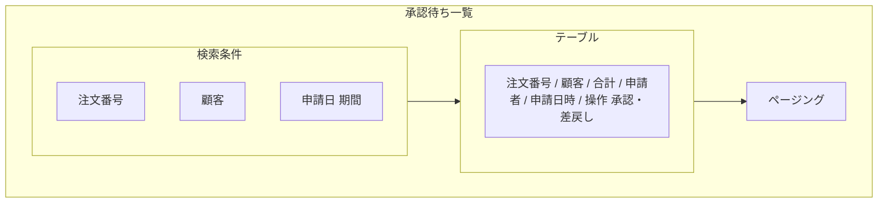
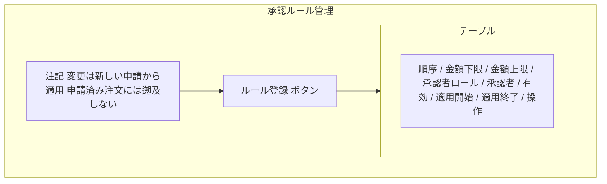

# 画面基本設計 — 承認管理

> 対象画面：SCR-14 承認待ち一覧 / SCR-15 承認ルール管理
> 承認・差戻しの個別操作ダイアログ（SCR-13/DLG-2・DLG-3）は `../order/spec-order-screen-ui.md` §3 に定義し、本書は SCR-14 から同じダイアログを呼ぶ。
> 画面 ID・パス・ロールの正本は `共通/spec-screen-list-ui.md`、共通 UI は `共通/spec-12-screen-common-ui.md`。業務ルールは `spec-approval-business-ui.md`、権限は `共通/spec-03-auth-ui.md`。

## 1. SCR-14 承認待ち一覧

| 項目 | 内容 |
|---|---|
| パス | `/approvals` |
| 利用ロール | ADMIN（割り当てられた承認のみ表示される想定。TBD-A1） |
| 利用 API | `listPendingApprovals`、`approveOrder`、`returnOrder` |
| 遷移 | 注文番号 → SCR-13 |

| 区分 | 項目 | 内容 |
|---|---|---|
| 検索条件 | 注文番号、顧客、申請日 | |
| 一覧列 | 注文番号、顧客名、合計金額、申請者、申請日時 | 既定の並び：申請日時の古い順 |
| 行操作 | 承認 | 確認ダイアログ（SCR-13/DLG-2）→ `approveOrder` |
| 行操作 | 差戻し | 理由入力ダイアログ（SCR-13/DLG-3）→ `returnOrder` |

- 承認・差戻しの実行後は一覧を再読込する。他の ADMIN が先に処理した場合は `E0006` を表示して一覧を更新する。
- 承認者本人以外の承認依頼は表示も操作もさせない（API で強制。`spec-approval-business-ui.md` §3）。

## 2. SCR-15 承認ルール管理

| 項目 | 内容 |
|---|---|
| パス | `/approval-rules` |
| 利用ロール | ADMIN |
| 利用 API | `listApprovalRules`、`createApprovalRule`、`updateApprovalRule` |

| 区分 | 項目 | 内容 |
|---|---|---|
| 一覧列 | 順序、金額下限、金額上限（なしは「上限なし」）、承認者ロール、承認者、有効、適用開始日、適用終了日 | 既定の並び：順序昇順 |
| 行操作 | 編集 | SCR-15/DLG-1 を開く |

**ルール登録/編集（SCR-15/DLG-1）**

| 項目 | 部品 | 必須 | 制約 |
|---|---|:---:|---|
| 金額下限 | 数値 | ○ | 0 以上 |
| 金額上限 | 数値 | — | 空欄は上限なし。下限以上 |
| 順序 | 数値 | ○ | 1 以上の整数 |
| 承認者ロール | 選択 | ○ | 既定 ADMIN（初版は ADMIN のみ） |
| 承認者 | 選択 | — | 有効な ADMIN。空欄はロール全体 |
| 有効 | チェック | ○ | |
| 適用開始日 | 日付 | ○ | |
| 適用終了日 | 日付 | — | 開始日以降 |

- 画面に常時「変更は新しい申請にだけ適用され、申請済みの注文には影響しない」旨を注記する（`I0031`）。
- 初版は金額にかかわらず ADMIN の 1 段承認（`requirements.md` §5.2）。金額帯・多段の入力欄は構造上用意するが、初版の運用は 1 行（0〜上限なし・順序 1）のみ（TBD-A2）。

| 操作 | 処理 | メッセージ |
|---|---|---|
| 登録 | `createApprovalRule` | 成功 `I0010`、入力誤り `E0008`/`E0030`〜`E0034` |
| 更新 | `updateApprovalRule` | 成功 `I0011` |
| 金額帯・期間の重複 | 保存時に API が検証 | `E0007` 相当（TBD-A3） |

## 3. 確認事項（TBD）

| # | 事項 |
|---|---|
| TBD-A1 | `listPendingApprovals` が「自分に割り当てられた承認」だけを返すのか、全 ADMIN 分を返すのか（要件は承認者本人だけが操作可と定めるため、前者を想定） |
| TBD-A2 | 初版で金額帯・多段の入力を画面に出すか（要件は初版で多段・金額別経路を実装しないとする。本書は入力欄を出すが運用は 1 行と仮定。出さない場合は SCR-15 を参照のみにする） |
| TBD-A3 | 金額帯・期間が重なるルールの登録を禁止するか、順序で優先するか |
