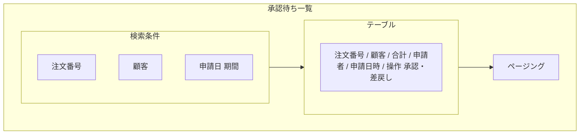
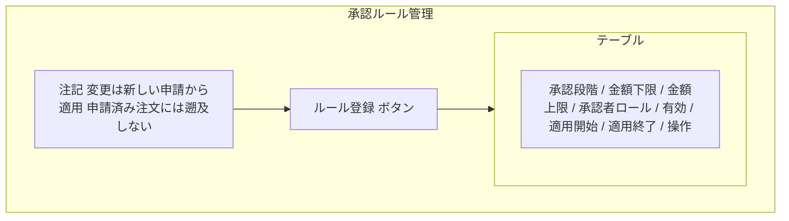

# 画面基本設計 — 承認管理

> 対象画面：SCR-14 承認待ち一覧 / SCR-15 承認ルール管理
> 承認・差戻しの個別操作ダイアログ（SCR-13/DLG-2・DLG-3）は `../order/spec-order-screen-ui.md` §3 に定義し、本書は SCR-14 から同じダイアログを呼ぶ。
> 画面 ID・パス・ロールの正本は `共通/spec-05-screen-list-ui.md`、遷移は `共通/spec-10-screen-transition-ui.md`、共通 UI は `共通/spec-12-screen-common-ui.md`。業務ルールは `spec-approval-business-ui.md`、権限は `共通/spec-03-auth-ui.md`。

## 1. SCR-14 承認待ち一覧

| 項目 | 内容 |
|---|---|
| パス | `/approvals` |
| 利用ロール | ADMIN（PENDING の承認依頼がすべて返る。`pageApprovalRequests`。行ごとの `canApprove` で操作可否を判定） |
| 利用 API | `pageApprovalRequests`、`approveApprovalRequest`、`returnApprovalRequest`、顧客の選択肢 `pageCustomers` |
| 遷移 | 注文番号 → SCR-13 |

| 区分 | 項目 | 内容 |
|---|---|---|
| 検索条件 | 注文番号、顧客（選択式。`pageCustomers`）、申請日 | |
| 一覧列 | 注文番号、顧客名、合計金額、申請者、申請日時 | 並び：申請日時昇順（古い順。API の固定順。列見出しソートなし。spec-12 §2） |
| 行操作 | 承認 | `canApprove=true` の行だけ有効。確認ダイアログ（SCR-13/DLG-2。`W0021`）→ `approveApprovalRequest` → `I0022` |
| 行操作 | 差戻し | `canApprove=true` の行だけ有効。理由入力ダイアログ（SCR-13/DLG-3）→ 確認（`W0028`）→ `returnApprovalRequest` → `I0023` |
| 行表示 | 自分の申請 | `canApprove=false` の行は「自分の申請」と表示し、承認・差戻しボタンを無効にする |

- 承認・差戻しの実行後は一覧を再読込する。他の ADMIN が先に処理した場合は `E0006` を表示して一覧を更新する（BR-APR-005）。
- 申請者本人の承認・差戻しは API が `E0056` で拒否する（BR-APR-002）。画面は `canApprove` でボタンを無効にするだけで、判定は API に任せる。

## 2. SCR-15 承認ルール管理

| 項目 | 内容 |
|---|---|
| パス | `/approval-rules` |
| 利用ロール | ADMIN |
| 利用 API | `listApprovalRules`、`createApprovalRule`、`updateApprovalRule` |

| 区分 | 項目 | 内容 |
|---|---|---|
| 一覧列 | 承認段階、金額下限、金額上限（なしは「上限なし」）、承認者ロール、有効、適用開始日、適用終了日 | 並び：適用開始日降順（新しい順。API の固定順。列見出しソートなし） |
| 行操作 | 編集 | SCR-15/DLG-1 を開く |

**ルール登録/編集（SCR-15/DLG-1）**

| 項目 | 部品 | 必須 | 制約 |
|---|---|:---:|---|
| 金額下限 | 数値 | ○ | 0 以上 |
| 金額上限 | 数値 | — | 空欄は上限なし。下限以上 |
| 承認段階 | 表示 | — | 初版は 1 固定（入力不可。BR-APR-001） |
| 承認者ロール | 表示 | — | 初版は ADMIN 固定（入力不可。BR-APR-001） |
| 有効 | チェック | ○ | |
| 適用開始日 | 日付 | ○ | |
| 適用終了日 | 日付 | — | 開始日以降 |

- 画面に常時「変更は新しい申請にだけ適用され、申請済みの注文には影響しない」旨を注記する（`I0031`）。
- 初版は金額にかかわらず ADMIN の 1 段承認（`requirements.md` §5.2、BR-APR-001）。承認段階と承認者ロールは表示だけとし、API も ADMIN・1 以外を `E0008` で拒否する。承認者個人は指定しない（申請者以外の有効な ADMIN が承認する。BR-APR-002）。

| 操作 | 処理 | メッセージ |
|---|---|---|
| 登録 | `createApprovalRule` | 成功 `I0010`、入力誤り `E0008`/`E0030`〜`E0034` |
| 更新 | `updateApprovalRule`（`updatedAt` で楽観ロック） | 成功 `I0011`、競合 `E0051` |
| 金額帯・期間の重複 | 保存時に API が検証 | `E0007` 相当（TBD-A3） |

## 3. 確認事項（TBD）

| # | 事項 |
|---|---|
| TBD-A3 | 金額帯・期間が重なるルールの登録を禁止するか、順序で優先するか |

> 解決済み：TBD-A2（多段・金額帯の入力）は「承認段階・承認者ロールは固定表示、承認者個人は指定しない」に決定（BR-APR-001 / BR-APR-002）。
