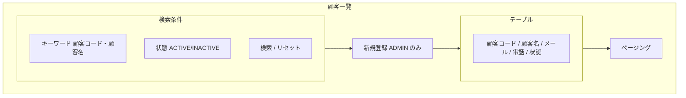
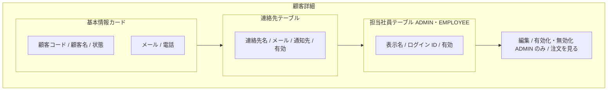
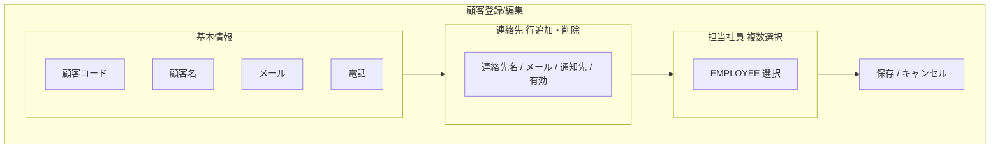

# 画面基本設計 — 顧客管理

> 対象画面：SCR-06 顧客一覧 / SCR-07 顧客詳細 / SCR-08 顧客登録/編集
> 画面 ID・パス・ロールの正本は `共通/spec-screen-list-ui.md`、共通 UI は `共通/spec-12-screen-common-ui.md`。業務ルールは `spec-customer-business-ui.md`、権限は `共通/spec-03-auth-ui.md`。

## 1. SCR-06 顧客一覧

| 項目 | 内容 |
|---|---|
| パス | `/customers` |
| 利用ロール | ADMIN（全顧客）、EMPLOYEE（担当顧客のみ） |
| 利用 API | `listCustomers` |
| 遷移 | 行選択 → SCR-07 / 新規（ADMIN）→ SCR-08 |

| 区分 | 項目 | 内容 |
|---|---|---|
| 検索条件 | キーワード | 顧客コード・顧客名の部分一致 |
| 検索条件 | 状態 | 有効 / 無効（`customers.status`。コード値は T07 に従う） |
| 一覧列 | 顧客コード、顧客名、メール、電話、状態 | 既定の並び：顧客コード昇順 |

- EMPLOYEE には「新規登録」を表示しない。担当外顧客は API が返さないため一覧に出ない。

## 2. SCR-07 顧客詳細

| 項目 | 内容 |
|---|---|
| パス | `/customers/:customerId` |
| 利用ロール | ADMIN、EMPLOYEE（担当のみ）、CUSTOMER（自社のみ。メニュー「自社情報」） |
| 利用 API | `getCustomer`、`updateCustomerStatus`（ADMIN） |
| 遷移 | 編集（ADMIN）→ SCR-08 / 「この顧客の注文」→ SCR-11（顧客条件付き） |

| 領域 | 項目 | ADMIN | EMPLOYEE | CUSTOMER |
|---|---|:---:|:---:|:---:|
| 基本情報 | 顧客コード、顧客名、状態、メール、電話 | ○ | ○ | ○ |
| 連絡先 | 連絡先名、メール、通知先区分、有効 | ○ | ○ | ○（自社の通知先） |
| 担当社員 | 担当 EMPLOYEE の一覧 | ○ | ○ | × |
| 操作 | 編集、有効化/無効化 | ○ | × | × |
| 操作 | この顧客の注文を見る | ○ | ○ | ○ |

| 操作 | 処理 | メッセージ |
|---|---|---|
| 無効化 | 確認ダイアログ（新規注文の対象外になることを告知）→ `updateCustomerStatus` | 確認 `W0025`、成功 `I0011` |
| 有効化 | `updateCustomerStatus` | 成功 `I0011` |

- 連絡先・担当社員は `getCustomer` のレスポンスに含まれ、`createCustomer`/`updateCustomer` で全件置換する（07 に明記済み）。

## 3. SCR-08 顧客登録/編集

| 項目 | 内容 |
|---|---|
| パス | `/customers/new`、`/customers/:customerId/edit` |
| 利用ロール | ADMIN |
| 利用 API | `createCustomer`、`getCustomer`（編集時の初期表示）、`updateCustomer` |

| 項目 | 部品 | 必須 | 制約 | 備考 |
|---|---|:---:|---|---|
| 顧客コード | テキスト | ○ | 最大 30、重複不可 | 編集時は変更不可 |
| 顧客名 | テキスト | ○ | 最大 200 | |
| メール | テキスト | — | 最大 255、形式 | |
| 電話 | テキスト | — | 最大 50 | |
| 連絡先 | 行リスト | — | 連絡先名（必須・最大 100）、メール（必須・最大 255・形式）、通知先（チェック）、有効 | 通知先が 1 件もない場合の扱いは TBD-C1 |
| 担当社員 | 複数選択 | — | 有効な EMPLOYEE のみ | 割当は `employee_customer_assignments` |

| 操作 | 処理 | メッセージ |
|---|---|---|
| 保存（新規） | `createCustomer` | 成功 `I0010`、顧客コード重複 `E0007`、入力誤り `E0008`/`E0030`〜`E0034` |
| 保存（編集） | `updateCustomer`（楽観ロック不要。version なし） | 成功 `I0011` |
| キャンセル | 入力があれば確認 | `W0011` |

## 4. 確認事項（TBD）

| # | 事項 |
|---|---|
| TBD-C1 | 通知先連絡先が 0 件の顧客の注文通知の扱い（送信先なしで通知ログのみ FAILED とするか、保存時に 1 件以上を必須とするか） |
| TBD-C2 | 顧客の状態コード値（`customers.status` の ACTIVE ほか）が T07 に定義されているか要確認 |
