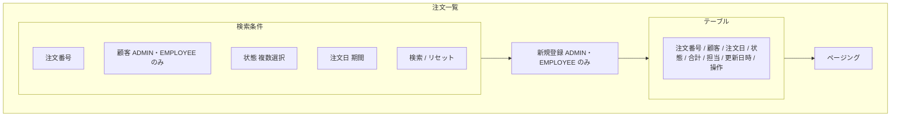
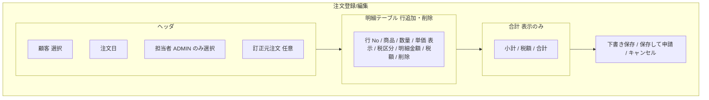
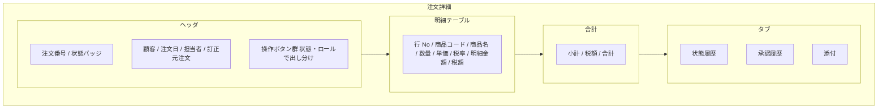
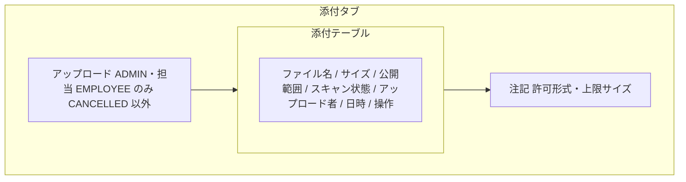

# 画面基本設計 — 注文管理（添付・承認操作を含む）

> 対象画面：SCR-11 注文一覧 / SCR-12 注文登録/編集 / SCR-13 注文詳細（添付パネル・承認操作・取消しダイアログを含む）
> 画面 ID・パス・ロールの正本は `共通/spec-05-screen-list-ui.md`、遷移は `共通/spec-10-screen-transition-ui.md`、共通 UI は `共通/spec-12-screen-common-ui.md`。業務ルールは `spec-order-business-ui.md`（状態・金額）、`../approval/spec-approval-business-ui.md`、`../attachment/spec-attachment-business-ui.md`、権限は `共通/spec-03-auth-ui.md`。

## 1. SCR-11 注文一覧

| 項目 | 内容 |
|---|---|
| パス | `/orders` |
| 利用ロール | ADMIN（全件）、EMPLOYEE（担当顧客）、CUSTOMER（自社） |
| 利用 API | `pageOrders`、`cancelOrder`（行操作）、顧客の選択肢 `pageCustomers`（ADMIN・EMPLOYEE） |
| 遷移 | 行選択 → SCR-13 / 新規登録（ADMIN・EMPLOYEE）→ SCR-12 |

| 区分 | 項目 | 内容 |
|---|---|---|
| 検索条件 | 注文番号 | 前方一致 |
| 検索条件 | 顧客 | 選択式（`pageCustomers`）。CUSTOMER は非表示（自社固定） |
| 検索条件 | 状態 | DRAFT / PENDING_APPROVAL / RETURNED / APPROVED / CANCELLED の複数選択。表示は日本語名・状態色 |
| 検索条件 | 注文日 | 開始日・終了日 |
| 一覧列 | 注文番号、顧客名、注文日、状態、合計金額（税込。円・桁区切り）、担当者、更新日時 | 既定の並び：更新日時降順。**列見出しクリックでソートできる**（`pageOrders` の `sort`=`{field}:{asc\|desc}`。本システムで列見出しソートを提供するのは本画面だけ。spec-12 §2）。ソート条件も URL クエリに保持する |
| 行操作 | 詳細 | SCR-13 へ |
| 行操作 | 取消し | ADMIN・担当 EMPLOYEE、取消し可能状態のとき SCR-13/DLG-1 を開く |

- 画面からの検索は、データ範囲に関係なく API が範囲を強制する。URL に範囲外の顧客を指定しても結果は 0 件になる（BR-AUTH-006）。
- 検索条件は URL クエリに保持し、SCR-13 から戻ったときに復元する。

## 2. SCR-12 注文登録/編集

| 項目 | 内容 |
|---|---|
| パス | `/orders/new`、`/orders/:orderId/edit` |
| 利用ロール | ADMIN、EMPLOYEE（担当顧客のみ選択可）。CUSTOMER は利用不可 |
| 利用 API | `createOrder`、`getOrder`、`updateOrder`、`submitOrder`、顧客の選択肢 `pageCustomers`（`status=ACTIVE`。EMPLOYEE は担当顧客のみ返る）、商品の選択肢 `pageProducts`（`status=ACTIVE`。EMPLOYEE はサーバー側で ACTIVE に固定）、担当者の選択肢 `getCustomer` の `assignedEmployees`（ADMIN のみ。顧客の担当社員）、税率表示 `listTaxRates`、訂正元の読込 `getOrder`（訂正モード） |
| 編集可能な状態 | DRAFT、RETURNED のみ（それ以外で開いた場合は SCR-13 へ戻し `E0006`） |
| モード | 新規 / 編集 / 訂正（SCR-13「訂正して再作成」から `revisedFromOrderId` 付きで開く新規。§2.1） |

| 区分 | 項目 | 部品 | 必須 | 制約・備考 |
|---|---|---|:---:|---|
| ヘッダ | 顧客 | 選択 | ○ | 有効な顧客のみ。EMPLOYEE は担当顧客のみ。編集時は変更不可（API も更新時の変更を受け付けない） |
| ヘッダ | 注文日 | 日付 | ○ | 既定は当日 |
| ヘッダ | 担当者 | 選択/表示 | ADMIN は ○ | ADMIN は顧客の有効な担当 EMPLOYEE から選択（顧客選択後に候補を表示。編集時は DRAFT / RETURNED で変更可）。EMPLOYEE は本人を表示のみ（BR-ORD-008） |
| ヘッダ | 訂正元注文 | 表示 | — | SCR-13 の「訂正して再作成」から開いたときだけ自動設定（`revisedFromOrderId`。表示のみで変更不可）。新規作成時のみ送信し、編集では変更不可（BR-ORD-009）。§2.1 |
| 明細 | 商品 | 選択 | ○ | 有効商品のみ。選択時に標準単価・税区分を表示。既存明細（訂正モードで複写した明細を含む）の無効商品は複写済みの名称に「無効」を付けて表示し、申請前に削除を促す（BR-PRD-003） |
| 明細 | 数量 | 数値 | ○ | 0 より大きい。小数 3 桁まで（`quantity`） |
| 明細 | 単価 | 表示 | — | 商品の標準単価（変更不可。API に送信しない。BR-PRD-002）。保存・申請のたびにサーバーが最新の標準単価で置き換える |
| 明細 | 税区分・税率 | 表示 | — | 商品から複写。税率の表示は `listTaxRates`（STANDARD 10% / REDUCED 8% / EXEMPT 0%） |
| 明細 | 明細金額・税額 | 表示 | — | 参考表示（数量×単価、HALF_UP）。**サーバーが再計算した値が正**で、保存後に画面へ反映する |
| 合計 | 小計・税額・合計 | 表示 | — | 参考表示。画面の値は送信しない |

- 明細は 1 行以上が必須（`E0030`）。同一商品の重複行は許可する（TBD-O3）。
- 合計の再計算はクライアントでも行うが、送信しない。保存・申請の結果で返るサーバー値で置き換える（`requirements.md` §5.1）。
- 楽観ロック：編集時は `getOrder` の `updatedAt` を文字列のまま保持し、`updateOrder`・`submitOrder`・`cancelOrder` に送る。`createOrder` / `updateOrder` の応答（OrderVO）の `updatedAt` で保持値を置き換える。競合は `409`（`E0051`）で、最新を再読込する旨を表示する。

| 操作 | 処理 | メッセージ |
|---|---|---|
| 下書き保存（新規） | `createOrder` → 成功後 SCR-13 | 成功 `I0010`（注文番号を {0}）。入力誤り `E0008`/`E0030`〜`E0034` |
| 下書き保存（編集） | `updateOrder` | 成功 `I0011` |
| 保存して申請 | 確認ダイアログ（`W0020`）→ `createOrder` / `updateOrder` → 応答の `id` と `updatedAt` で `submitOrder` | 成功：`I0020`。保存は成功し申請だけ失敗した場合（`E0054` 等）は、保存済みの注文を SCR-12（編集）で表示したままエラーを示す |
| キャンセル | 入力があれば確認 → SCR-11（新規）/ SCR-13（編集） | `W0011` |
| 競合（409） | 再読込を促す | 楽観ロック `E0051`、状態不可 `E0006` |
| 申請時検証（409） | 無効な顧客・商品・担当外を示し、該当明細の修正を促す | `E0054` |

### 2.1 訂正モード（「訂正して再作成」）

SCR-13 で CANCELLED の注文の「訂正して再作成」から、`/orders/new?revisedFromOrderId=<元の注文 ID>` で開く。新規作成として扱い、元の注文は変更しない（BR-ORD-005 / BR-ORD-009）。

| 項目 | 初期値 |
|---|---|
| 顧客 | 元の注文の顧客（変更不可。BR-ORD-009 の同一顧客） |
| 担当者 | 元の注文の担当者（ADMIN は変更可。EMPLOYEE は本人。BR-ORD-008） |
| 明細 | 元の注文の商品と数量を複写する。単価・税区分・税率は複写せず、保存時にサーバーが現在の商品マスタから複写し直す（BR-PRD-002） |
| 注文日 | 当日 |
| 訂正元注文 | 元の注文 ID（`revisedFromOrderId`。表示のみ） |

- 元の注文の明細に無効商品がある場合は、複写した名称に「無効」を付けて表示し、削除を促す。訂正モードは新規作成のため、無効商品を含めたまま送信すると新規追加として `409`/`E0054` になる（BR-PRD-003 / BR-ORD-010）。申請（保存して申請を含む）の前に削除する。
- 元の注文の顧客が無効になっている場合、作成は `409`/`E0054` となる（BR-CUS-002）。
- 元の注文が既に訂正済み・CANCELLED 以外の場合、作成は `409`/`E0006` となる（BR-ORD-009）。
- キャンセルは新規と同じく、入力があれば `W0011` を確認して SCR-11 へ戻る。

## 3. SCR-13 注文詳細

| 項目 | 内容 |
|---|---|
| パス | `/orders/:orderId` |
| 利用ロール | ADMIN、EMPLOYEE（担当）、CUSTOMER（自社。閲覧のみ） |
| 利用 API | `getOrder`、`listApprovalHistories`、`listOrderAttachments`、`submitOrder`、`cancelOrder`、`approveApprovalRequest`、`returnApprovalRequest`、`uploadOrderAttachment`、`downloadAttachment`、`deleteAttachment`、`downloadOrderPdf` |

### 3.1 表示項目

| 領域 | 項目 | ADMIN | EMPLOYEE | CUSTOMER |
|---|---|:---:|:---:|:---:|
| ヘッダ | 注文番号、状態、顧客、注文日、担当者、訂正元注文 | ○ | ○ | ○ |
| ヘッダ | 取消し理由（取消済みのとき） | ○ | ○ | ×（BR-APR-006） |
| 明細 | 商品コード・名称・数量・単価・税率・明細金額・税額（注文時スナップショット） | ○ | ○ | ○ |
| 合計 | 小計・税額・合計 | ○ | ○ | ○ |
| 状態履歴 | 変更日時・変更前後の状態・理由・変更者 | ○ | ○ | 変更日時・状態のみ（理由・変更者は API が null。BR-APR-006） |
| 承認履歴 | 処理者・結果（承認/差戻し）・理由・日時 | ○ | ○ | 結果・日時のみ（処理者・理由は API が null。BR-APR-006） |
| 添付 | §3.3 | ○ | ○（担当） | ○（公開・SAFE のみ） |

### 3.2 操作ボタン（状態 × ロール）

> 表示制御のみ。最終的な可否は API が判定する（`spec-order-business-ui.md` §3）。

| ボタン | 表示条件（状態） | ADMIN | EMPLOYEE（担当） | CUSTOMER | operationId |
|---|---|:---:|:---:|:---:|---|
| 編集 | DRAFT / RETURNED | ○ | ○ | × | → SCR-12 |
| 申請（再申請） | DRAFT / RETURNED | ○ | ○ | × | `submitOrder` |
| 承認 | PENDING_APPROVAL | ○（`canApprove=true` のとき。申請者本人は不可） | × | × | `approveApprovalRequest`（`currentApprovalRequestId`） |
| 差戻し | PENDING_APPROVAL | ○（`canApprove=true` のとき。申請者本人は不可） | × | × | `returnApprovalRequest`（`currentApprovalRequestId`） |
| 取消し | DRAFT / RETURNED | ○ | ○ | × | `cancelOrder` |
| 取消し | APPROVED | ○ | ×（API は `403`/`E0002`） | × | `cancelOrder` |
| 訂正して再作成 | CANCELLED | ○ | ○ | × | → SCR-12（訂正モード。§2.1） |
| PDF 出力 | APPROVED | ○ | ○ | ○ | `downloadOrderPdf` |
| 一覧へ戻る | 常時 | ○ | ○ | ○ | → SCR-11 |

- PENDING_APPROVAL の注文には編集・取消しを表示しない（`../approval/spec-approval-business-ui.md` §3）。
- 自分が申請した PENDING_APPROVAL の注文（`canApprove=false`）は、承認・差戻しボタンを出さず「他の管理者の承認待ち」と表示する。
- CANCELLED では編集・申請・取消しを出さない。

| 操作 | ダイアログ | 処理と結果 |
|---|---|---|
| 申請 | 確認ダイアログ（`W0020`） | `submitOrder` → 状態が PENDING_APPROVAL に。成功 `I0020` |
| 取消し（DLG-1） | 理由入力（必須・最大 500）＋確認（`W0022`） | `cancelOrder` → 成功 `I0021`。取消し後にメール通知が送られる旨を注記 |
| 承認（DLG-2） | 確認（`W0021`） | `approveApprovalRequest` → 成功 `I0022` |
| 差戻し（DLG-3） | 理由入力（必須・1〜500 文字）→ 確認（`W0028`） | `returnApprovalRequest` → 成功 `I0023`。理由未入力は `E0030`、500 超は `E0032`（理由が通ってから確認を表示）。SCR-14 から開いた場合も同じ |
| 状態競合 | — | `409`：楽観ロック `E0051`、状態不可 `E0006`、自己承認 `E0056`。メッセージを表示し、画面を再読込して最新状態を表示する |

### 3.3 添付パネル（F-ATT-01〜04）

| 項目 | 内容 |
|---|---|
| 一覧列 | ファイル名、サイズ（KB/MB）、公開範囲（社内 / 顧客公開）、スキャン状態（確認中 / 安全 / 拒否）、アップロード者、日時 |
| ダウンロード | スキャン状態が SAFE のときのみ有効（PENDING は「確認中」で無効、REJECTED は無効）。API を経由し、ストレージ URL を画面へ埋め込まない |
| 削除 | ADMIN・担当 EMPLOYEE。CANCELLED 以外の注文。確認ダイアログ（`W0010`）→ `deleteAttachment` → `I0012` |
| CUSTOMER | 公開範囲が CUSTOMER かつ SAFE の添付だけが一覧に出る。アップロード・削除ボタンは出さない |
| 注記 | 許可形式：PDF、DOCX、XLSX、CSV、PNG、JPG/JPEG。1 ファイル 10 MiB、注文合計 50 MiB まで（削除済み・拒否のファイルは合計に含めない） |
| CANCELLED の注文 | アップロード・削除ボタンを出さない（ダウンロードは可。BR-FIL-001） |

**添付アップロード（DLG-4）**

| 項目 | 部品 | 必須 | 制約 |
|---|---|:---:|---|
| ファイル | ファイル選択 | ○ | 拡張子・サイズをクライアントで事前確認（形式 `E0009`、空ファイル `E0053`、1 ファイル超過 `E0010`）。注文合計の超過はサーバーが `413`/`E0052` で返す |
| 公開範囲 | 選択 | ○ | INTERNAL（社内）/ CUSTOMER（顧客公開）。既定は INTERNAL |

- アップロード成功は受付完了（`200`。`scanStatus=PENDING`）であり、直後は「確認中」でダウンロードできない旨を表示する（`I0024`）。スキャン完了は画面の再読込（または手動更新）で反映する。
- 更新方法（自動ポーリングの有無）は TBD-O5。

## 4. 画面状態（spec-12 §5 に従う追加条件）

| 状態 | 表示 |
|---|---|
| 読込中 | 明細・履歴・添付をそれぞれスケルトン表示 |
| データなし | 明細 0 件は異常（`E0012` 相当）。履歴・添付 0 件は「なし」を表示 |
| 範囲外・未存在 | 注文本体（`getOrder`）が `404` の場合は SCR-20。画面内の副リソース（添付一覧・添付ダウンロード・承認履歴など）の `404` は画面を移動せず、該当パネル内に `E0005` を表示する（spec-12 §3） |

## 5. 確認事項（TBD）

| # | 事項 |
|---|---|
| TBD-O3 | 同一商品の明細重複を許可するか（本書は許可と仮定） |
| TBD-O5 | 添付のスキャン状態の更新を、画面の手動更新だけとするか、一定間隔の自動更新を行うか |

> 解決済み：TBD-O1（編集時の顧客変更）は不可（`spec-07-api-list.yaml` OrderSaveDTO）。TBD-O2（単価の変更）は不可・商品の標準単価を複写（BR-PRD-002）。TBD-O4（顧客への履歴の理由）は非表示（BR-APR-006）。
