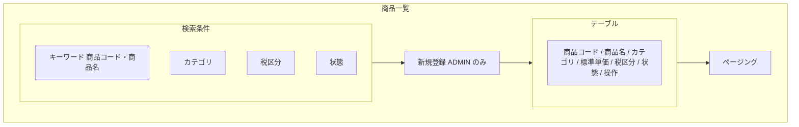
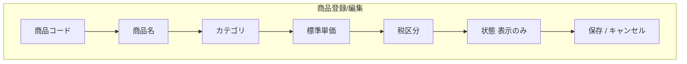

# 画面基本設計 — 商品管理

> 対象画面：SCR-09 商品一覧 / SCR-10 商品登録/編集
> 画面 ID・パス・ロールの正本は `共通/spec-05-screen-list-ui.md`、遷移は `共通/spec-10-screen-transition-ui.md`、共通 UI は `共通/spec-12-screen-common-ui.md`。業務ルールは `spec-product-business-ui.md`、権限は `共通/spec-03-auth-ui.md`。

## 1. SCR-09 商品一覧

| 項目 | 内容 |
|---|---|
| パス | `/products` |
| 利用ロール | ADMIN、EMPLOYEE（参照のみ） |
| 利用 API | `pageProducts`、`activateProduct` / `deactivateProduct`（ADMIN） |
| 遷移 | 行選択 → SCR-10 / 新規（ADMIN）→ SCR-10 |

| 区分 | 項目 | 内容 |
|---|---|---|
| 検索条件 | キーワード | 商品コード・商品名の部分一致 |
| 検索条件 | カテゴリ、税区分、状態 | 税区分は STANDARD(10%) / REDUCED(8%) / EXEMPT(0%)。表示は日本語名 |
| 一覧列 | 商品コード、商品名、カテゴリ、標準単価（円・桁区切り）、税区分、状態 | 並び：商品コード昇順（API の固定順。列見出しソートなし。spec-12 §2） |
| 行操作 | 有効化/無効化（ADMIN のみ） | 無効化は確認（`W0026`）→ `deactivateProduct` → `I0035`。有効化は `activateProduct` → `I0034` |

- EMPLOYEE には「新規登録」と状態切替を表示しない。
- 無効商品は注文登録の商品選択に出ない（SCR-12）。

## 2. SCR-10 商品登録/編集

| 項目 | 内容 |
|---|---|
| パス | `/products/new`、`/products/:productId/edit` |
| 利用ロール | ADMIN（登録・編集）、EMPLOYEE（参照のみ。全項目を読み取り専用で表示し、保存ボタンを出さない） |
| 利用 API | `createProduct`、`getProduct`、`updateProduct`、税区分の選択肢と税率表示 `listTaxRates` |

| 項目 | 部品 | 必須 | 制約 | 備考 |
|---|---|:---:|---|---|
| 商品コード | テキスト | ○ | 最大 50、重複不可 | 編集時は変更不可 |
| 商品名 | テキスト | ○ | 最大 200 | |
| カテゴリ | テキスト | — | 最大 100 | |
| 標準単価 | 数値 | ○ | 0 以上、整数 13 桁・小数 2 桁（`numeric(15,2)`） | 円 |
| 税区分 | 選択 | ○ | STANDARD / REDUCED / EXEMPT | 選択肢と税率（10% / 8% / 0%。表示のみ）は `listTaxRates` から取得 |
| 状態 | 表示 | — | 有効 / 無効 | 変更は SCR-09 の行操作（有効化/無効化）で行う |

| 操作 | 処理 | メッセージ |
|---|---|---|
| 保存（新規） | `createProduct` | 成功 `I0010`、商品コード重複 `E0007`、入力誤り `E0008`/`E0030`〜`E0034` |
| 保存（編集） | `updateProduct`（`updatedAt` で楽観ロック） | 成功 `I0011`、競合 `E0051` |
| キャンセル | 入力があれば確認 | `W0011` |

- 画面に「既存注文は変更されない」旨の注記を表示する（業務設計 §3：注文明細は商品情報を複写する）。文言は `I0030`。

## 3. 確認事項（TBD）

| # | 事項 |
|---|---|
| TBD-P1 | カテゴリを自由入力とするか、マスタ化して選択式にするか（本書は自由入力と仮定） |
| TBD-P2 | 標準単価の変更履歴を表示するか（初版は表示しない） |
