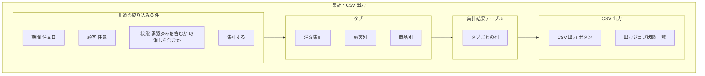

# 画面基本設計 — 帳票・集計

> 対象画面：SCR-16 集計・CSV 出力（注文 PDF の出力ボタンは SCR-13。`../order/spec-order-screen-ui.md` §3.2）
> 画面 ID・パス・ロールの正本は `共通/spec-05-screen-list-ui.md`、遷移は `共通/spec-10-screen-transition-ui.md`、共通 UI は `共通/spec-12-screen-common-ui.md`。業務ルールは `spec-report-business-ui.md`、権限は `共通/spec-03-auth-ui.md`。

## 1. SCR-16 集計・CSV 出力

| 項目 | 内容 |
|---|---|
| パス | `/reports` |
| 利用ロール | ADMIN（全件）、EMPLOYEE（担当顧客）。CUSTOMER は利用不可（メニューに出さない） |
| 利用 API | `getOrderSummary`、`getCustomerSummary`、`getProductSummary`、`createExportJob`、`pageExportJobs`、`getExportJob`、`downloadExportJob`、顧客の選択肢 `pageCustomers`（EMPLOYEE は担当顧客のみ返る） |
| 遷移 | なし（集計結果に注文番号は含まれないため、SCR-13 への遷移は設けない） |

### 1.1 絞り込み条件

| 項目 | 部品 | 内容 |
|---|---|---|
| 期間 | 日付範囲 | 注文日。必須（上限期間は TBD-R1） |
| 顧客 | 選択 | 任意。ADMIN は全顧客、EMPLOYEE は担当顧客から選択（`pageCustomers`） |
| 状態 | 複数選択 | 集計に含める注文状態を明示する。**既定は承認済みのみ**（TBD-R2）。条件は結果画面にも表示する（`spec-report-business-ui.md` §3） |

### 1.2 集計結果

| タブ | 列 | API |
|---|---|---|
| 注文集計 | 期間単位の件数・小計・税額・合計 | `getOrderSummary` |
| 顧客別 | 顧客コード・顧客名・件数・合計 | `getCustomerSummary` |
| 商品別 | 商品コード・商品名・数量・金額 | `getProductSummary` |

- 集計はデータ範囲（EMPLOYEE は担当顧客）を API が強制する。画面は絞り込み条件とともに適用範囲「全件 / 担当顧客」を表示する。
- 集計列は `OrderSummaryReportVO` / `CustomerSummaryReportVO` / `ProductSummaryReportVO`（`spec-07-api-list.yaml`）に従う。

### 1.3 CSV 出力

| 項目 | 内容 |
|---|---|
| 出力ボタン | 現在の共通の絞り込み条件（期間・顧客・状態。§1.1）で `createExportJob`（ExportJobCreateDTO：`orderDateFrom`・`orderDateTo`・`customerId`・`statuses`）を呼ぶ。集計タブの選択には依存しない |
| 出力対象 | **注文単位**（1 行 = 1 注文）。絞り込み条件に合う、データ範囲内の注文 |
| 列 | 注文番号、注文日、顧客コード、顧客名、状態、担当者、小計、税額、合計（この順） |
| 件数 | 出力する注文の件数（`recordCount`）。同期生成・非同期生成の判定もこの件数で行う |
| 同期生成/非同期生成 | `createExportJob` は常にジョブを返す。10,000 件以下は同期生成され `status=READY`（そのままダウンロード可）、10,001 件以上は `status=QUEUED` で非同期生成（`requirements.md` §5.4、BR-RPT-002） |
| 形式 | UTF-8 BOM。ファイル名は `orders_YYYYMMDD.csv`（YYYYMMDD は生成日。日本時間） |

**出力ジョブ状態（本画面下部）**

| 列 | 内容 |
|---|---|
| 依頼日時、依頼者（ADMIN のみ表示）、条件の要約、件数（注文件数）、状態 | 状態：待機中（QUEUED）/ 生成中（RUNNING）/ ダウンロード可（READY）/ 失敗（FAILED）/ 期限切れ（EXPIRED）。並びは依頼日時降順（API の固定順。列見出しソートなし。spec-12 §2） |
| 有効期限 | 完了から 24 時間。期限切れは操作無効 |
| 操作 | READY のとき「ダウンロード」（`downloadExportJob`）。FAILED はエラー内容を表示（再実行は条件を再指定して新規依頼） |

- 一覧は `pageExportJobs`。ADMIN は全員分（依頼者のユーザー ID を入力して絞り込み可。`requestedBy`、完全一致）、EMPLOYEE は自分の分だけが返り、絞り込み欄は表示しない（BR-RPT-003）。
- 非同期生成のジョブの状態は `getExportJob` を一定間隔で確認して更新する（間隔は TBD-R4）。完了時は Toast で通知する（`I0028`）。メール通知（出力完了）は `spec-08-external-interface-ui.md` に従う。
- ダウンロードは API が再認可する。失敗時は messageId を表示し、無言で終わらせない（spec-12 §8）。

| 操作 | 処理 | メッセージ |
|---|---|---|
| 集計する | 3 つの集計 API を呼ぶ（表示中タブのみ） | 条件誤り `E0008`/`E0030` |
| ジョブ失敗（FAILED） | エラー内容を表示 | `E0050` |
| CSV 出力（同期生成：READY） | ダウンロード可を表示 | `I0028` |
| CSV 出力（非同期生成：QUEUED） | ジョブ受付 | `I0027` |
| 非同期生成の完了 | Toast | `I0028` |

## 2. 確認事項（TBD）

| # | 事項 |
|---|---|
| TBD-R1 | 集計期間の上限（例：最大 12 か月）を設けるか |
| TBD-R2 | 集計の既定の状態条件（本書は承認済みのみ。取消し・差戻しを含めるかは利用者選択） |
| TBD-R3 | **解決済み**：CSV は注文単位、列順は §1.3、ファイル名は `orders_YYYYMMDD.csv` |
| TBD-R4 | ジョブ状態の自動更新間隔（例：5 秒 → 最大 30 秒の間隔）と最大待機時間 |
