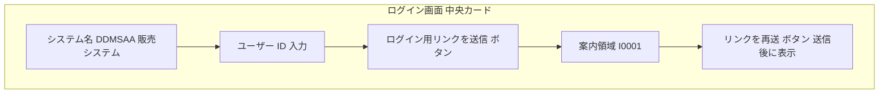
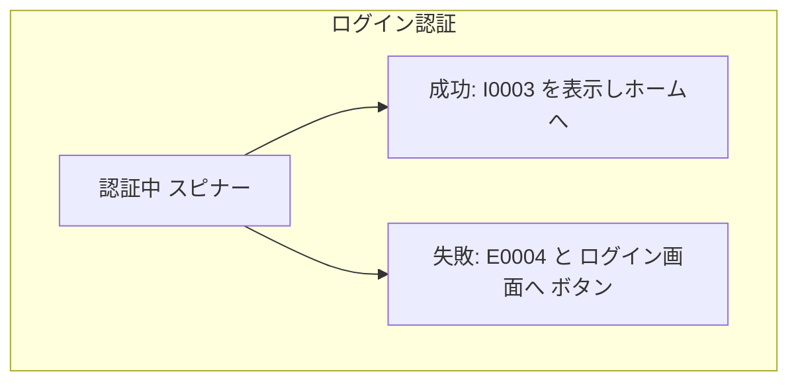
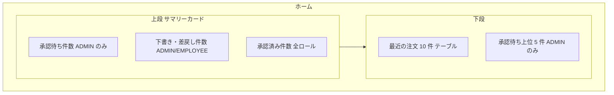
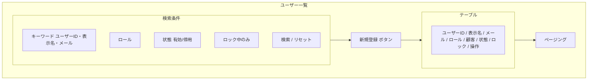
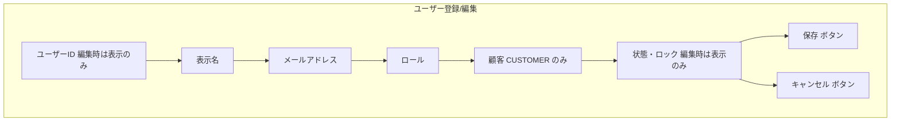
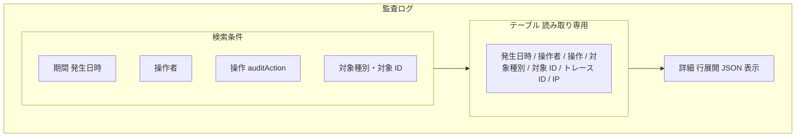
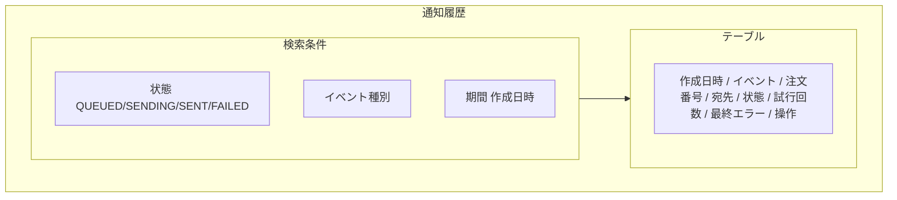
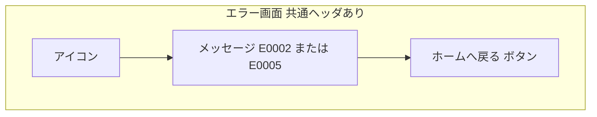

# 画面基本設計 — ユーザー・認証・運用

> 対象画面：SCR-01 ログイン / SCR-21 ログイン認証（Magic Link） / SCR-02 ホーム / SCR-04 ユーザー一覧 / SCR-05 ユーザー登録/編集 / SCR-17 監査ログ / SCR-18 通知履歴 / SCR-19 権限エラー / SCR-20 未存在エラー（SCR-03 パスワード変更は廃止）
> 画面 ID・パス・ロールの正本は `共通/spec-05-screen-list-ui.md`、遷移は `共通/spec-10-screen-transition-ui.md`、共通 UI は `共通/spec-12-screen-common-ui.md`、メッセージ文言は `共通/spec-09-message-list.yaml`。本書は画面ごとのレイアウトと項目だけを定め、文言・API 項目を再定義しない。

## 1. 共通事項

- 業務ルールは `spec-user-business-ui.md`、権限は `共通/spec-03-auth-ui.md`、認証方式は `基盤/spec-02-auth-service-ui.md` に従う。
- 一覧は `PageResult` 形式のページング（`pageNum`/`pageSize`）を使う。列見出しによるソートは提供せず、API の既定順で表示する（spec-12 §2）。
- 各ルートは許可ロールを宣言し、未ログインは returnTo を保存して SCR-01、ロール外は SCR-19 へ遷移させる（spec-12 §7 ルートガード。表示制御のみで最終判定は API）。
- 日時は日本時間で表示する（spec-12 §6）。
- 認証後の API 呼び出しは `Authorization: Bearer <JWT>` を付与する。JWT の期限切れ（`E0001`）・未指定／不正（Gateway の `E0040`／`E0041`）は JWT を破棄して SCR-01 へ遷移させる（spec-12 §3）。ログアウトはブラウザ側で JWT を破棄して SCR-01 へ遷移する（API 呼び出しなし）。

## 2. SCR-01 ログイン

| 項目 | 内容 |
|---|---|
| パス | `/login`（未認証で利用。共通ヘッダ・ナビゲーションは表示しない） |
| 利用ロール | 全ロール |
| 利用 API | `loginInit`、`resendMagicLink` |
| 遷移 | 送信後も本画面に留まり、案内を表示する。メールのリンクから SCR-21 へ |

| 項目 | 部品 | 必須 | 制約 | 備考 |
|---|---|:---:|---|---|
| ユーザー ID | テキスト | ○ | 最大 10 文字（例：`E0001`） | `users.user_id` |

| 操作 | 処理 | 結果の表示 |
|---|---|---|
| リンクを送信 | `loginInit` | 常に `I0001` を表示（利用者の存在・停用・ロックに関わらず同一。区別して表示しない） |
| リンクを再送 | `resendMagicLink` | `I0001`。再送回数の上限なし |
| Enter キー | 送信と同じ | — |

- パスワード入力欄はない。入力誤り（空欄）は `E0030`。
- セッション（JWT）失効で本画面に戻った場合は、`E0001` を表示する。
- 未ログインで他の画面から本画面へリダイレクトされる場合、リダイレクト前にフロントエンドが遷移先のパス（クエリを含む）と保存時刻を localStorage キー `ddmsaa.returnTo` に保存する（Magic Link は別タブで開かれるため、タブをまたいで引き継ぐ。spec-12 §7）。本画面を直接開いた場合は保存しない。

## 3. SCR-21 ログイン認証（Magic Link）

| 項目 | 内容 |
|---|---|
| パス | `/auth/verify?token=...`（メールのリンク先。未認証で利用） |
| 利用ロール | 全ロール |
| 利用 API | `verifyMagicLink`、`getMe` |
| 遷移 | 成功 → SCR-02（有効な `ddmsaa.returnTo` があればその画面へ）。失敗 → 本画面にエラーを表示し SCR-01 への導線 |

| 処理 | 内容 |
|---|---|
| 初期表示 | URL のトークンで `verifyMagicLink` を自動実行する。トークンは実行後すぐ URL から消去する（履歴に残さない） |
| 成功 | JWT を保持し（保存場所は TBD-U4）、`getMe` で利用者情報を取得して `I0003` を表示する。続いて localStorage の `ddmsaa.returnTo` を読み、保存から 60 分以内かつ `getMe` のロールに許可されたパスならその画面へ、それ以外（未保存・60 分超過・ロール外）は SCR-02 へ遷移する。読み込んだ `ddmsaa.returnTo` はいずれの場合も削除する |
| 失敗 | 無効・期限切れ（60 分）・使用済み・停用/ロックは区別せず `E0004` を表示 |

## 4. SCR-03 パスワード変更（廃止）

パスワードレス認証（Magic Link）の採用により廃止。ID は再利用しない（`spec-00-doc-standard-ui.md` §3）。

## 5. SCR-02 ホーム

| 項目 | 内容 |
|---|---|
| パス | `/` |
| 利用ロール | 全ロール（表示内容がロールで異なる） |
| 利用 API | `getMe`, `pageApprovalRequests`（ADMIN）, `pageOrders` |

| 領域 | 内容 | ADMIN | EMPLOYEE | CUSTOMER | 備考 |
|---|---|:---:|:---:|:---:|---|
| 承認待ち件数 | `pageApprovalRequests` の総件数。クリックで SCR-14 | ○ | × | × | |
| 下書き・差戻し件数 | `pageOrders`（状態条件）の総件数。クリックで SCR-11（状態フィルタ付き） | ○ | ○ | × | 担当範囲に限定（API で強制） |
| 承認済み件数 | 同上（`APPROVED`） | ○ | ○ | ○ | CUSTOMER は自社範囲 |
| 最近の注文 | 更新日時降順 10 件。注文番号→SCR-13 | ○ | ○ | ○ | 項目：注文番号・顧客・日付・状態・合計 |
| 承認待ち上位 | 申請日時の古い順 5 件。注文番号→SCR-13 | ○ | × | × | |

- 件数は専用 API を設けず既存 API の総件数で代替する（`共通/spec-05-screen-list-ui.md` TBD-SCR-04）。
- 状態色は spec-12 §9 に従う。

## 6. SCR-04 ユーザー一覧

| 項目 | 内容 |
|---|---|
| パス | `/users` |
| 利用ロール | ADMIN |
| 利用 API | `pageUsers`、`disableUser`、`enableUser`、`lockUser`、`unlockUser` |
| 遷移 | 新規 → SCR-05（新規）/ 行の編集 → SCR-05（編集） |

| 区分 | 項目 | 内容 |
|---|---|---|
| 検索条件 | キーワード | ユーザー ID・表示名・メールの部分一致 |
| 検索条件 | ロール | ADMIN / EMPLOYEE / CUSTOMER（T07-1） |
| 検索条件 | 状態 | ACTIVE / DISABLED（T07-2） |
| 検索条件 | ロック中のみ | `isLocked=true` |
| 一覧列 | ユーザー ID、表示名、メール、ロール、顧客（CUSTOMER のみ顧客名）、状態、ロック（ロック中は開始日時。ロック理由 `lockReason` はロック列のツールチップ又は行展開で表示し、理由なしは表示しない） | 並び：ユーザー ID 昇順（API の固定順。列見出しソートなし） |
| 行操作 | 編集 | SCR-05 へ |
| 行操作 | 停用 / 停用解除 | 停用は確認（`W0023`）→ `disableUser` → `I0032`。解除は `enableUser` → `I0033` |
| 行操作 | ロック / ロック解除 | ロックは理由入力（任意・500 文字以内）と確認（`W0027`）→ `lockUser` → `I0025`。解除は `unlockUser` → `I0029` |

- 自分自身の行には停用・ロックを表示しない（API も 409 `E0006` で拒否）。最後の有効な ADMIN の停用・ロックは API が 409 `E0055` で拒否する（BR-USR-005）。

## 7. SCR-05 ユーザー登録/編集

| 項目 | 内容 |
|---|---|
| パス | `/users/new`、`/users/:userId/edit` |
| 利用ロール | ADMIN |
| 利用 API | 登録 `createUser`、取得 `getUser`、更新 `updateUser`、顧客の選択肢 `pageCustomers`（`status=ACTIVE`） |

| 項目 | 部品 | 必須 | 制約 | 備考 |
|---|---|:---:|---|---|
| ユーザー ID | 表示 | — | — | 登録時にロールに応じて自動採番（A/E/C+4 桁）。入力しない |
| 表示名 | テキスト | ○ | 最大 100 | |
| メールアドレス | テキスト | ○ | 最大 255、形式、重複不可 | Magic Link の送信先（`user_contacts.email`） |
| ロール | 選択 | ○ | ADMIN / EMPLOYEE / CUSTOMER | 変更してもユーザー ID は変わらない。編集時は ADMIN ⇔ EMPLOYEE だけ選択でき、CUSTOMER は変更不可。自分自身のロールは変更不可（BR-USR-004 / 005） |
| 顧客 | 選択（有効顧客） | CUSTOMER のとき ○ | CUSTOMER 以外は非表示・送信しない | `users.customer_id` |
| 状態・ロック | 表示 | — | — | 状態、ロック中は開始日時（`lockStartedAt`）とロック理由（`lockReason`。読み取り専用、理由なしは「—」）。変更は SCR-04 の行操作で行う |

| 操作 | 処理 | メッセージ |
|---|---|---|
| 保存（新規） | `createUser` | 成功 `I0010`（{0}=採番されたユーザー ID）、メール重複 `E0007`、入力誤り `E0008`/`E0030`〜`E0034` |
| 保存（編集） | `updateUser`（`updatedAt` で楽観ロック） | 成功 `I0011`、競合 `E0051`。ロール変更の制限 `E0008`、自分自身・担当残り `E0006`、最後の ADMIN `E0055` |
| キャンセル | 入力があれば確認 | `W0011` |

## 8. SCR-17 監査ログ

| 項目 | 内容 |
|---|---|
| パス | `/audit-logs` |
| 利用ロール | ADMIN |
| 利用 API | `pageAuditLogs` |

- 読み取り専用。編集・削除操作を表示しない。
- 検索条件の「操作者」はユーザー ID の入力（`actorUserId`、完全一致）。「操作」「対象種別」は `spec-08-business-rule-list.md` BR-AUD-001 の値から選択する。
- 並びは発生日時の降順（API の固定順。列見出しソートなし）。
- 詳細（`auditDetail`）は行展開で整形表示する。メール本文・ファイル本体・Magic Link トークンは含まれない（`spec-06-db-physical.yaml` `audit_logs.audit_detail`）。
- 対象 ID が注文のとき、SCR-13 へのリンクを張る。

## 9. SCR-18 通知履歴

| 項目 | 内容 |
|---|---|
| パス | `/notification-logs` |
| 利用ロール | ADMIN |
| 利用 API | `pageNotificationLogs`、`retryNotification` |

| 行操作 | 表示条件 | 処理 |
|---|---|---|
| 再送 | 状態が FAILED | 確認（`W0024`）後 `retryNotification` → `I0026`。受付後は再読込 |
| 注文を開く | 注文番号あり | SCR-13 へ |

- 並びは作成日時の降順（API の固定順。列見出しソートなし）。
- 宛先メールアドレスは画面に表示してよい（ADMIN のみ）。メール本文は表示しない。Magic Link メールは auth-service が送信するため本画面には出ない。

## 10. SCR-19 権限エラー（403）/ SCR-20 未存在エラー（404）

| 画面 | 表示メッセージ | 発生条件 |
|---|---|---|
| SCR-19 | `E0002` | API が `403` を返したとき、およびロール外の画面の URL を直接開いたとき（ルートガード） |
| SCR-20 | `E0005` | 画面の主リソースで API が `404`（`E0005` / Gateway の `E0042`）を返したとき、および未定義パスにアクセスしたとき |

- 範囲外（他社注文など）は存在を開示しないため `404` として扱う（`spec-03-auth-ui.md` §4）。
- 画面内の副リソース（添付・承認履歴など）の `404` は本画面へ遷移せず、そのパネル内に `E0005` を表示する（spec-12 §3）。
- 本画面は認証済みの利用者にだけ表示する。未認証で到達した場合（未定義パスを含む）は returnTo を保存して SCR-01 へ遷移する。
- 「ホームへ戻る」で SCR-02 へ。

## 11. 確認事項（TBD）

| # | 事項 |
|---|---|
| TBD-U4 | JWT のブラウザ内の保存場所（メモリのみ／sessionStorage）。メモリのみの場合、再読込でログインが必要になる |

> 解決済み：TBD-U5（監査ログの対象種別・操作名）は `共通/spec-08-business-rule-list.md` BR-AUD-001 の一覧を検索条件の選択肢とする。

> 旧版の TBD-U1（パスワード強度）・TBD-U2（ログイン ID 編集）・TBD-U3（LOCKED 解除）は、パスワードレス化・ユーザー ID の自動採番・ADMIN によるロック解除（`unlockUser`）で解消した。
