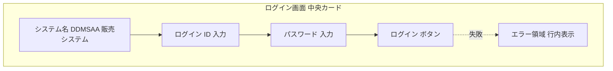
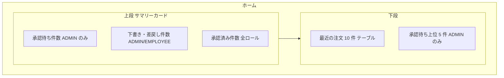
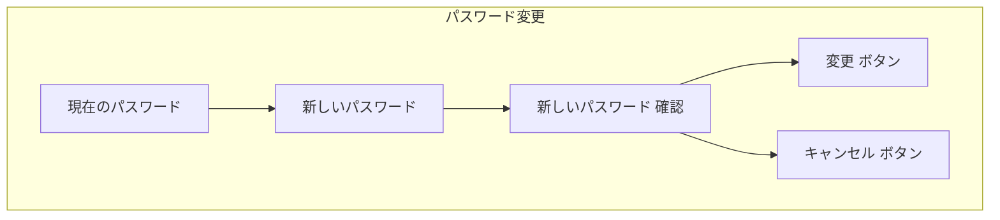
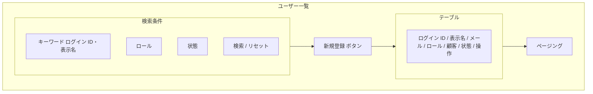
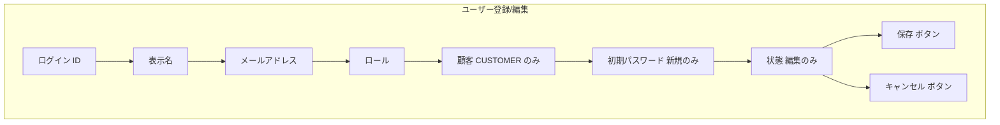
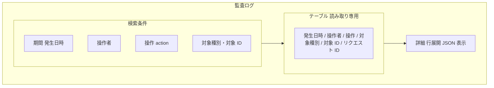
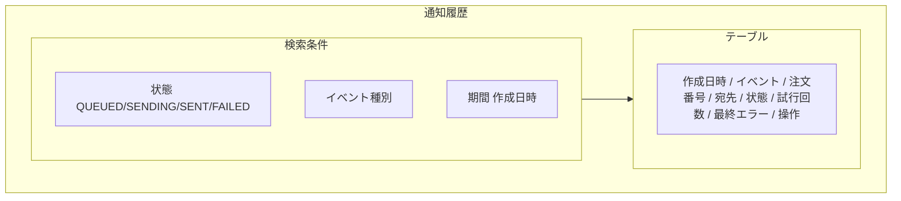
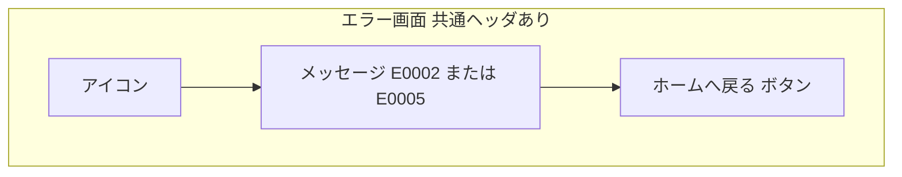

# 画面基本設計 — ユーザー・認証・運用

> 対象画面：SCR-01 ログイン / SCR-02 ホーム / SCR-03 パスワード変更 / SCR-04 ユーザー一覧 / SCR-05 ユーザー登録/編集 / SCR-17 監査ログ / SCR-18 通知履歴 / SCR-19 権限エラー / SCR-20 未存在エラー
> 画面 ID・パス・ロールの正本は `共通/spec-screen-list-ui.md`、共通 UI は `共通/spec-12-screen-common-ui.md`、メッセージ文言は `共通/spec-09-message-list.yaml`。本書は画面ごとのレイアウトと項目だけを定め、文言・API 項目を再定義しない。

## 1. 共通事項

- 業務ルールは `spec-user-business-ui.md`、権限は `共通/spec-03-auth-ui.md` に従う。
- 一覧は `PageResult` 形式のページングを使う（既定件数は spec-12 §2）。
- 日時は日本時間で表示する（spec-12 §6）。

## 2. SCR-01 ログイン

| 項目 | 内容 |
|---|---|
| パス | `/login`（未認証でも利用可。共通ヘッダ・ナビゲーションは表示しない） |
| 利用ロール | 全ロール |
| 利用 API | `login` |
| 遷移 | 成功 → SCR-02（ログイン前に開こうとした画面があればそこへ戻す） |

| 項目 | 部品 | 必須 | 制約 | 備考 |
|---|---|:---:|---|---|
| ログイン ID | テキスト | ○ | 最大 100 文字 | `login_id` |
| パスワード | パスワード | ○ | — | 入力値を保持・ログ出力しない |

| 操作 | 処理 | 結果の表示 |
|---|---|---|
| ログイン | `login` を呼ぶ | 成功：`I0003`（Toast）後に SCR-02。失敗：`E0020`（行内）。ロック・不存在も同一表示（存在を開示しない） |
| Enter キー | ログインと同じ | — |

- 失敗が 5 回連続でロック（30 分）。ロック中も画面表示は `E0020` と同じ（`spec-03-auth-ui.md` §1）。
- セッション失効（`E0001`）で本画面に戻る場合は、`E0001` を行内に表示する。

## 3. SCR-02 ホーム

| 項目 | 内容 |
|---|---|
| パス | `/` |
| 利用ロール | 全ロール（表示内容がロールで異なる） |
| 利用 API | `getMe`, `listPendingApprovals`（ADMIN）, `listOrders` |

| 領域 | 内容 | ADMIN | EMPLOYEE | CUSTOMER | 備考 |
|---|---|:---:|:---:|:---:|---|
| 承認待ち件数 | `listPendingApprovals` の総件数。クリックで SCR-14 | ○ | × | × | |
| 下書き・差戻し件数 | `listOrders`（状態条件）の総件数。クリックで SCR-11（状態フィルタ付き） | ○ | ○ | × | 担当範囲に限定（API で強制） |
| 承認済み件数 | 同上（`APPROVED`） | ○ | ○ | ○ | CUSTOMER は自社範囲 |
| 最近の注文 | 更新日時降順 10 件。注文番号→SCR-13 | ○ | ○ | ○ | 項目：注文番号・顧客・日付・状態・合計 |
| 承認待ち上位 | 申請日時の古い順 5 件。注文番号→SCR-13 | ○ | × | × | |

- 件数は専用 API を設けず既存 API の総件数で代替する（TBD-05）。
- 状態色は spec-12 §9 に従う。

## 4. SCR-03 パスワード変更

| 項目 | 内容 |
|---|---|
| パス | `/account/password` |
| 利用ロール | 全ロール（本人のみ） |
| 利用 API | `changePassword` |

| 項目 | 部品 | 必須 | 制約 |
|---|---|:---:|---|
| 現在のパスワード | パスワード | ○ | — |
| 新しいパスワード | パスワード | ○ | パスワード強度規則は未決（TBD-U1） |
| 新しいパスワード（確認） | パスワード | ○ | 新しいパスワードと一致 |

- 変更成功時、セッションを失効させて SCR-01 へ遷移する（`spec-03-auth-ui.md` §1）。
- 平文のパスワードを画面・URL・ログに残さない。

## 5. SCR-04 ユーザー一覧

| 項目 | 内容 |
|---|---|
| パス | `/users` |
| 利用ロール | ADMIN |
| 利用 API | `listUsers` |
| 遷移 | 新規 → SCR-05（新規）/ 行の編集 → SCR-05（編集） |

| 区分 | 項目 | 内容 |
|---|---|---|
| 検索条件 | キーワード | ログイン ID・表示名・メールの部分一致 |
| 検索条件 | ロール | ADMIN / EMPLOYEE / CUSTOMER（`role_code`） |
| 検索条件 | 状態 | ACTIVE / DISABLED / LOCKED（`user_status`） |
| 一覧列 | ログイン ID、表示名、メール、ロール、顧客（CUSTOMER のみ顧客名）、状態、最終更新 | 既定の並び：ログイン ID 昇順 |
| 行操作 | 編集 | SCR-05 へ |

## 6. SCR-05 ユーザー登録/編集

| 項目 | 内容 |
|---|---|
| パス | `/users/new`、`/users/:userId/edit` |
| 利用ロール | ADMIN |
| 利用 API | 登録 `createUser`、更新 `updateUser`、顧客選択 `listCustomers` |

| 項目 | 部品 | 必須 | 制約 | 備考 |
|---|---|:---:|---|---|
| ログイン ID | テキスト | ○ | 最大 100、重複不可 | 編集時は変更不可（TBD-U2） |
| 表示名 | テキスト | ○ | 最大 100 | |
| メールアドレス | テキスト | ○ | 最大 255、形式、重複不可 | |
| ロール | 選択 | ○ | ADMIN / EMPLOYEE / CUSTOMER | |
| 顧客 | 選択（有効顧客） | CUSTOMER のとき ○ | CUSTOMER 以外は非表示・送信しない | `users.customer_id` |
| 初期パスワード | パスワード | 新規 ○ | 強度規則は TBD-U1 | 編集画面には表示しない。BCrypt ハッシュのみ保存 |
| 状態 | 選択 | 編集 ○ | ACTIVE / DISABLED | LOCKED は表示のみ（ロック解除の方法は TBD-U3） |

| 操作 | 処理 | メッセージ |
|---|---|---|
| 保存（新規） | `createUser` | 成功 `I0010`、重複 `E0007`、入力誤り `E0008`/`E0030`〜`E0034` |
| 保存（編集） | `updateUser` | 成功 `I0011` |
| 状態を DISABLED に変更 | 保存前に確認ダイアログ（有効セッションが失効することを告知） | 確認 `W0023` |
| キャンセル | 入力があれば確認 | `W0011` |

## 7. SCR-17 監査ログ

| 項目 | 内容 |
|---|---|
| パス | `/audit-logs` |
| 利用ロール | ADMIN |
| 利用 API | `listAuditLogs` |

- 読み取り専用。編集・削除操作を表示しない。
- 詳細（`detail`）は行展開で整形表示し、パスワード・ファイル本体は含まれない（`spec-06-db-physical.yaml` `audit_logs.detail`）。
- 対象 ID が注文のとき、SCR-13 へのリンクを張る。

## 8. SCR-18 通知履歴

| 項目 | 内容 |
|---|---|
| パス | `/notifications` |
| 利用ロール | ADMIN |
| 利用 API | `listNotifications`、`retryNotification` |

| 行操作 | 表示条件 | 処理 |
|---|---|---|
| 再送 | 状態が FAILED | 確認ダイアログ後 `retryNotification`。受付後は再読込 |
| 注文を開く | 注文番号あり | SCR-13 へ |

- 宛先メールアドレスは画面に表示してよい（ADMIN のみ）。メール本文は表示しない。

## 9. SCR-19 権限エラー（403）/ SCR-20 未存在エラー（404）

| 画面 | 表示メッセージ | 発生条件 |
|---|---|---|
| SCR-19 | `E0002` | API が `403` を返したとき |
| SCR-20 | `E0005` | API が `404` を返したとき、および未定義パスにアクセスしたとき |

- 範囲外（他社注文など）は存在を開示しないため `404` として扱う（`spec-03-auth-ui.md` §4）。
- 本画面は認証済みの利用者にだけ表示する。未認証は SCR-01。

## 10. 確認事項（TBD）

| # | 事項 |
|---|---|
| TBD-U1 | パスワード強度規則（最小長・文字種）が要件・非機能にない |
| TBD-U2 | ログイン ID を編集可能にするか（本書は変更不可と仮定） |
| TBD-U3 | LOCKED（ログイン連続失敗）の ADMIN による手動解除機能を持つか（`updateUser` の状態変更で解除する案） |
