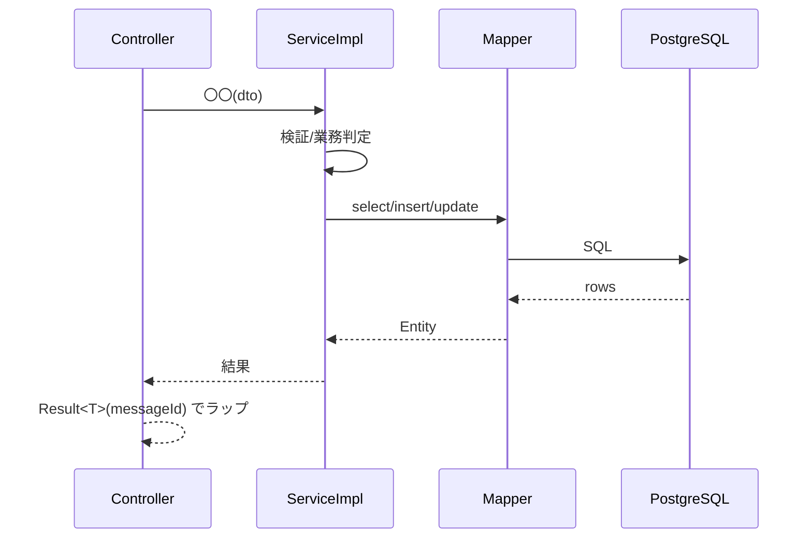

<!-- devtool:file-region id="document-header" -->
# 〇〇〇〇 詳細設計

> 詳細設計（内部設計）。**機能ごとに本ファイルをコピーして記入し**、`詳細設計/<機能名>/spec-<feature>-detail-sd.md` として保存する。
> 本ファイルは単一情報源（SSOT）を参照するのみで、項目/列挙値/メッセージを再定義しない（`詳細設計テンプレート/README.md` §2 参照）。

<!-- devtool:end-file-region -->
<!-- devtool:block id="detail.detail-temp.s01" -->
## 文書情報

| 項目 | 内容 |
|------|------|
| システム名称 | 〇〇システム |
| 文書名称 | 〇〇〇〇 詳細設計 |
| 文書バージョン | V0.1 |
| ステータス | 草案 |
| 作成者 | TBD |
| 作成日 | YYYY-MM-DD |
| レビュー担当 | TBD |

<!-- devtool:endblock -->
<!-- devtool:block id="detail.detail-temp.s02" -->
## 改訂履歴

| バージョン | 改訂日 | 改訂者 | 改訂内容 |
|------|--------|--------|---------|
| V0.1 | YYYY-MM-DD | 〇〇 | 初版 |

---

<!-- devtool:endblock -->
<!-- devtool:block id="detail.detail-temp.s03" -->
## 0. 対象と根拠

| 項目 | 内容 |
|------|------|
| 関連機能 | F-〇〇-01〜0N |
| 関連画面 | SCR-0N〜（帰属/参照を明記） |
| 関連 API | `<operationId>`〜（spec-07-api-list.yaml 参照。API の唯一の正式識別子） |
| 関連バッチ | BAT-0N |
| 関連テーブル | TBL-〇〇（spec-06-db-physical.yaml 参照） |
| 上流根拠 | 当該機能の基本設計（`基本設計/共通/` の関連文書）；`要件定義.md` 〇.〇節 |

### 0.1 コード生成時のロード一覧（AI コンテキスト組み立て）

> 本機能 のコード生成時に AI へ渡すファイル一覧（README §5 を本機能 向けに絞り込んだ版）。

```
- 本ファイル（当該機能の詳細設計）
- 基本設計/共通/spec-06-db-physical.yaml      ← TBL-〇〇 など本機能 のテーブルのみ
- 基本設計/共通/spec-07-api-list.yaml          ← 本機能 の operationId 部分のみ
- 基本設計/共通/spec-09-message-list.yaml      ← 本機能 で使用する messageId のみ
- 基本設計/共通/spec-03-auth-ui.md
- 開発規約/spec-naming-rule.md / spec-database-rule.md / spec-data-dictionary-project-temp.md
- 開発規約/spec-backend-coding-rule.md / spec-frontend-coding-rule.md（コード生成に必須）
- 基本設計/基盤/spec-00-architecture-ui.md（アーキテクチャ/Result/例外）
```

### 0.2 マイクロサービス帰属

| 項目 | 内容 |
|------|------|
| 所属サービス | backend |
| パッケージ接頭辞 | `com.〇〇.service.〇〇` |
| 基盤依存 | common（例外/Result/マスキング）、infrastructure（DB/Redis/ストレージ） |

---

<!-- devtool:endblock -->
<!-- devtool:block id="detail.detail-temp.s04" -->
## 1. バックエンド詳細設計

### 1.1 クラス一覧

> 本機能 に関わる全クラス。命名は `spec-naming-rule.md` に従う（Entity は単数形 PascalCase、API パスは複数形 kebab-case 等）。

| 層 | クラス名 | パッケージ | 責務 | 対応 |
|----|------|----|------|------|
| Controller | `〇〇Controller` | `…controller` | REST 受付、Service 呼び出し | `<operationId>` |
| Service（インタフェース） | `〇〇Service` | `…service` | 業務ロジックの契約 | F-〇〇 |
| Service（実装） | `〇〇ServiceImpl` | `…service.impl` | 業務ロジック実装・トランザクション境界 | F-〇〇 |
| Mapper | `〇〇Mapper` | `…mapper` | MyBatis DAO | TBL-〇〇 |
| Entity | `〇〇` | `…entity` | テーブルマッピング | TBL-〇〇 |
| DTO | `〇〇CreateDto` 等 | `…dto` | 入力/出力（OpenAPI スキーマに準拠） | spec-07-api-list.yaml |
| 変換 | `〇〇Mapper`(MapStruct) | `…convert` | Entity↔DTO | — |

### 1.2 API 別詳細設計

> API ごとに 1 節。見出しは operationId で識別する。以下は `例` であり、正式には本機能 の API ごとに展開する。

#### `<operationId>` 〇〇〇〇（`METHOD /path`）

| 項目 | 内容 |
|------|------|
| operationId | `〇〇`（camelCase の動詞。spec-07-api-list.yaml と一致させる。命名は `spec-naming-rule.md` 準拠） |
| 対応機能 | F-〇〇-0N |
| ロール・権限 | `@PreAuthorize("hasRole('〇〇')")`（spec-03-auth-ui.md 参照） |
| リクエストスキーマ | `〇〇DTO`（OpenAPI） |
| レスポンス | `Result<〇〇>` / `Result<Void>` |

**シーケンス**



**入力検証**

| 項目 | ルール | 違反時 messageId | HTTP |
|------|------|--------------|------|
| `〇〇` | 必須/形式/長さ（OpenAPI 制約に準拠） | `E00NN` | 400 |

**処理ロジック**（番号付き手順。AI はこれに基づきメソッド本体を生成する）

```
1. 〇〇
2. 〇〇（重要アルゴリズム：採番/論理削除/状態遷移判定など。条件と分岐を明記）
3. 〇〇
```

**トランザクション**

| 項目 | 内容 |
|------|------|
| 範囲 | `@Transactional` を `〇〇ServiceImpl.〇〇()` に付与 |
| 関連テーブル | TBL-〇〇（書込）、TBL-〇〇（読取） |
| ロールバック条件 | いずれかの手順で `BusinessException` をスローした場合は全体をロールバック |

**DB アクセス**

| Mapper メソッド | 操作 | 対象テーブル.カラム | 主要条件 |
|------------|------|----------|---------|
| `〇〇()` | SELECT/INSERT/UPDATE | `テーブル.カラム`（spec-06-db-physical.yaml 参照） | 論理削除：`deleted_at IS NULL`；その他 |

**利用する共通コンポーネント**

| コンポーネント | 用途 |
|------|------|
| `MaskingService`/`暗号化` | 〇〇（例：my_number / account_number を暗号化して保存） |
| `FileStorageService` | 〇〇（ファイルを扱う場合） |
| メール外部インタフェース | 〇〇（認証 Magic Link・通知。spec-08-external-interface-ui 参照） |

**例外 → messageId → HTTP**（HTTP は例外型ごとの固定集合にマッピングする。`基盤テンプレート/spec-backend-foundation-temp.md` §4.3.1 参照）

| シナリオ | 例外 | messageId | HTTP |
|------|------|-----------|------|
| 検証失敗 | `MethodArgumentNotValidException` | `E00NN` | 400 |
| 権限不足 | `AccessDeniedException` | `E0002` | 403 |
| リソース不存在 | `EntityNotFoundException` | `E0005` | 404 |
| 状態不正 | `BusinessException` | `E0006` | 409 |

**正常レスポンス**

| 項目 | 内容 |
|------|------|
| 戻り値 | `Result<〇〇>`（成功時 messageId は `I00NN` 等。args が必要な場合は `messageArgs` を指定） |

> ↑ 上記の API 節は 1 API 分の完全な骨格であり、API ごとにコピーして記入する。

### 1.3 Entity / DTO / VO マッピング

| Entity 項目 | DTO 項目 | 変換 | 命名変更の登録 |
|------------|---------|------|------------|
| `〇〇`（camelCase ← snake_case カラム） | `〇〇` | MapStruct 直接マッピング/フォーマット | 意味単位が変わる場合はデータ辞書 Principle 3 に登録 |

> 暗号化/マスキング対象項目の出力方向の扱い（例：`accountNumber` は出力時に `****4567` とマスク）をここで明記する。

---

<!-- devtool:endblock -->
<!-- devtool:block id="detail.detail-temp.s05" -->
## 2. フロントエンド詳細設計

### 2.1 画面別コンポーネント分解

> SCR ごとに 1 節。コンポーネントの接尾辞（Page/Form/Table/Modal/Card）は spec-naming-rule §2.2 に従い、ファイル名は kebab-case とする。

#### SCR-0N 〇〇画面

**コンポーネントツリー**

```
〇〇Page (src/pages/〇〇/〇〇-page.tsx)
├── 〇〇Table   (src/components/〇〇/〇〇-table.tsx)
├── 〇〇Form    (src/components/〇〇/〇〇-form.tsx)
└── 〇〇Modal   (src/components/〇〇/〇〇-modal.tsx)
```

**状態・データ**

| 状態 | 型 | 取得元 API | 説明 |
|------|------|---------|------|
| `〇〇` | `〇〇`（Union Type、enum 禁止） | `<operationId>` | 〇〇 |

**イベント → API 対応**

| イベント | operationId | 入力 | 成功時処理 | 失敗時処理 |
|------|--------|------|---------|---------|
| 〇〇クリック | `<operationId>` | `〇〇DTO` | 再読込/遷移/Toast(messageId) | ErrorResponse.messageId を表示 |

**クライアント検証**（バックエンド検証と整合させる。UX 向けであり、バックエンド検証の代替ではない）

| 項目 | ルール | 表示 messageId |
|------|------|--------------|
| `〇〇` | 必須/形式 | `E00NN` |

**ロール別表示制御**（spec-03-auth-ui.md 参照）

| 要素 | 管理者(ADMIN・例) | マネージャ(MANAGER・例) | 一般(USER・例) |
|------|:-------:|:----------:|:--------:|
| `〇〇ボタン` | ○ | × | × |

**メッセージ表示**

| タイミング | messageId | 取得元 |
|------|-----------|------|
| 〇〇成功時 | `I00NN` | messages.yaml（フロントエンドが ID から文言を解決） |

**画面遷移**（正本は `基本設計/共通/spec-10-screen-transition-ui.md`。本機能の画面に関わる遷移のみ転記し、食い違わせないこと）

| 遷移元 | 遷移先 | トリガー |
|------|----|------|
| SCR-0N | SCR-0M | 〇〇 |

---

<!-- devtool:endblock -->
<!-- devtool:block id="detail.detail-temp.s06" -->
## 3. バッチ詳細設計

> BAT ごとに 1 節。バッチがない場合は「本機能 にバッチなし」と記載する。

#### BAT-0N 〇〇〇〇

| 項目 | 内容 |
|------|------|
| スケジュール | 毎日 00:00（cron `0 0 0 * * *`）/ 起動条件 |
| 処理概要 | 〇〇 |
| 関連テーブル | TBL-〇〇 |

**処理フロー**

```
1. 〇〇（対象の抽出）
2. 〇〇（処理。営業日/祝日などの判定を明記）
3. 〇〇（更新/通知）
```

| 項目 | 内容 |
|------|------|
| 冪等性 | 重複実行しても副作用が生じないことの担保方法 |
| 異常・リトライ | 1 件の失敗で中断するか；リトライ方針；アラート messageId |
| 通知 | 送信メール/messageId（ある場合） |

---

<!-- devtool:endblock -->
<!-- devtool:block id="detail.detail-temp.s07" -->
## 4. 横断設計（本機能 固有）

| 項目 | 内容 |
|------|------|
| 権限実装 | 各 API の `@PreAuthorize` 式一覧；データ範囲（例：部門長は自部門のみ）の実現方式 |
| 暗号化・マスキング | 本機能 に関わる暗号化カラム（my_number/account_number）とマスキング出力ルール |
| トランザクション・整合性 | テーブル間/サービス間の整合性（例：「レコード変更 = 旧レコードの無効化 + 新規登録」の原子性） |
| 同時実行・ロック | 楽観ロック/悲観ロック（ある場合）。例：updated_at によるバージョン判定 |

---

<!-- devtool:endblock -->
<!-- devtool:block id="detail.detail-temp.s08" -->
## 5. トレーサビリティマトリクス（UT / コードへの接続）

> 本機能 の「要件→設計→コード→テスト」のトレーサビリティ。**UT-ID 列は §5.1 の UT 用例一覧の UT-ID 集合を記入し、空欄・「待 UT」としない。**

| F-ID | SCR | API（operationId） | TBL | messageId | バックエンドクラス | フロントエンドコンポーネント | UT-ID（§5.1） |
|------|-----|-----|-----|-----------|--------|---------|-------|
| F-〇〇-0N | SCR-0N | `<operationId>` | TBL-〇〇 | I00NN/E00NN | `〇〇ServiceImpl` | `〇〇Page` | UT-<FEATURE>-001〜003 |

### 5.1 UT 用例一覧

> テストコード生成（テスト生成工程）の**唯一の入力**。本節に列挙された UT-ID の集合がそのまま単体テストの用例集合となり、テスト工程で用例を追加・発明しない。§1.2 の処理手順・例外、状態遷移（正本：`基本設計/共通/spec-04-business-flow-ui.md` §3）、§4 のマスキング規則から**機械的に導出**する（新たな設計判断を持ち込まない）。導出の過程で §1.2 の例外分岐やマスキングマトリクスが未定と判明した場合は、本節に期待値を創作せず、設計側の TBD として差し戻す。
> テスト階層・命名・ディレクトリは `開発規約/spec-test-rule.md` に従う。フロントエンドの単体テスト項目は `単体テスト/フロントエンド/` の単体テスト仕様書で管理する。

**UT-ID 採番規則**：`UT-<FEATURE>-NNN`

- `<FEATURE>`：機能 slug（`spec-<feature>-detail-sd.md` の `<feature>`）の英大文字・ハイフン区切り表記。
- `NNN`：機能内の 3 桁連番（001 始まり）。UT-ID は全体で一意とし、テストメソッドの `@DisplayName("UT-<FEATURE>-NNN <条件→期待>")` の先頭に必ず付与する。

| UT-ID | 推奨層 | 被テスト（operationId / メソッド） | 種別 | 前提条件 | 入力要点 | 期待結果（messageId / HTTP 状態 / 状態遷移 / マスク項目） | 追跡 |
|-------|:------:|------------------|------|---------|---------|------------------------|------|
| UT-<FEATURE>-001 | L1 | `<operationId>` / `〇〇ServiceImpl.〇〇()` | 正常 | 〇〇が存在する | 〇〇 | 成功 `I00NN` | F-〇〇-0N / §1.2 手順 1〜3 |
| UT-<FEATURE>-002 | L2 | `<operationId>` | 権限 | 権限不足のロール | 〇〇 | 403 / `E0002` | F-〇〇-0N / §4 権限実装 |

> ↑ 上記 2 行は記入例であり、正式な記入時は削除する。

**列定義**

| 列 | 内容 |
|------|------|
| 推奨層 | `L1`（純ロジック・Mock）／`L2`（Web スライス：ルーティング・検証・権限・包絡）／`L3`（端到端・実 DB・暗号化）。テスト工程での微調整を許容する経路指示 |
| 種別 | 正常／異常／権限／検証／境界 のいずれか |
| 期待結果 | **SSOT の参照のみ**：messageId ← `spec-09-message-list.yaml`、HTTP 状態 ← 例外型ごとの固定マッピング、マスク項目 ← `spec-03-auth-ui.md` のマトリクス。自前で定義しない |
| 追跡 | 根拠となる F-ID と §1.2 の処理手順番号（または `spec-04` §3 の遷移 / §4 の項目） |

**カバレッジ規約**（満たさない場合は本節未完了）

1. 各 operationId につき正常系を 1 件以上。
2. §1.2 に列挙した例外分岐（messageId → 例外）ごとに 1 件。
3. `@PreAuthorize` の各ロールの**拒否**ごとに 1 件。
4. 主要な Bean Validation 境界（必須欠落・不正列挙値 → 400）を 1 件以上。
5. 暗号化カラムのラウンドトリップ、および §4 / `spec-03-auth-ui.md` のマスキングマトリクスの**ロールごと**に各 1 件。
6. 状態遷移の**禁止遷移**ごとに 1 件の異常用例。

---

<!-- devtool:endblock -->
<!-- devtool:block id="detail.detail-temp.s09" -->
## 6. 生成指示（AI 主導実行用）

**コード生成順序**（依存されるものを先に）

```
バックエンド: Entity → Mapper(インタフェース+XML) → DTO → 変換(MapStruct) → ServiceImpl → Controller
フロントエンド: 型(type) → API client → 子コンポーネント(Form/Table/Modal) → Page → ルーティング
```

**生成後の検証ゲート**（機械的に検査可能。目視に頼らない）

| チェック | 照合先 SSOT |
|------|----------|
| カラム名/型が存在し一致しているか | spec-06-db-physical.yaml |
| エンドポイント/項目/列挙値が一致しているか | spec-07-api-list.yaml |
| messageId が存在するか | spec-09-message-list.yaml / messages.yaml |
| 命名（ケース/単複/略語/意味単位） | spec-naming-rule.md + データ辞書 |
| パッケージ構成/Result/例外マッピング | `基盤テンプレート/spec-backend-foundation-temp.md` |

**出力先**

| 成果物 | 配置先 |
|------|------|
| バックエンドコード | `backend/src/main/java/com/〇〇/service/〇〇/…` |
| MyBatis XML | `…/src/main/resources/mapper/〇〇Mapper.xml` |
| フロントエンドコード | `frontend/src/{pages,components,types,api}/〇〇/…` |
| UT コード | §5.1 を入力として UT 工程で生成（配置は `開発規約/spec-test-rule.md` に従う） |

### 6.1 codegen 就緒ゲート（D1〜D11）

> 詳細設計を記入し終えた時点で自己検査する。1 つでも不合格なら修正してから引き渡す。ずれの原因が上流（基本設計・SSOT）にある場合は上流の修正を依頼し、詳細設計側で取り繕わない。

| ゲート | 検査内容 | 照合先 |
|------|------|--------|
| D1 §0 完全性 | 関連する表／operationId／messageId／SCR／所属サービスが漏れなく列挙され、機械的に解析できる | 本ファイル §0 |
| D2 表・主キー | 関連する各表が存在し、主キー・外部キー型が主キー規約に一致する（外部キー型は親表の主キーと同一） | `spec-06-db-physical.yaml` + `spec-database-rule.md` |
| D3 API | 各 operationId の path／method／リクエスト・レスポンス項目・列挙値が一致する。包絡に traceId を含む | `spec-07-api-list.yaml` |
| D4 メッセージ | 使用する各 messageId が存在し、意味が一致する | `spec-09-message-list.yaml` |
| D5 命名・モジュール | クラス名／カラム名／コンポーネント接尾辞が規約に従い、クラスの所属サービス・パッケージが正しい | `spec-naming-rule.md` + 各層 coding-rule + `基本設計/基盤/spec-00-architecture-ui.md` |
| D6 権限 | 各 API に `@PreAuthorize` とデータ範囲が定義され、項目マスキングがマトリクスに一致する | `spec-03-auth-ui.md` |
| D7 共通コンポーネント | 参照する共通コンポーネントのクラス・パッケージ・メソッドシグネチャが実在し一致する（架空の API を前提にしない）。設計書と実コードが分岐する場合は報告する | 基盤コード + `基本設計/基盤/spec-04-common-component-ui.md` |
| D8 廃止事項 | 廃止済みの表記・方式（旧 `API-0NN` 識別子、旧メッセージ ID 形式、旧主キー方式など）を含まない | 基本設計の方針・各規約 |
| D9 追跡 | §5 の各行で F → SCR → operationId → TBL → messageId → クラス → コンポーネントの連鎖が完結し、UT-ID 列が §5.1 にリンクしている | 本ファイル §5 |
| D10 改行・文字コード | 文書中のコード／リソースの約束がファイル規約（改行・文字コード）に適合する | `spec-backend-coding-rule.md` |
| D11 UT 用例完全性 | §5.1 が上記カバレッジ規約を満たし、各期待値が SSOT の参照のみで、UT-ID に欠落・重複がない | 本ファイル §1.2 / §4 + `基本設計/共通/spec-04-business-flow-ui.md` §3 + `spec-09-message-list.yaml` + `spec-03-auth-ui.md` |
<!-- devtool:endblock -->
