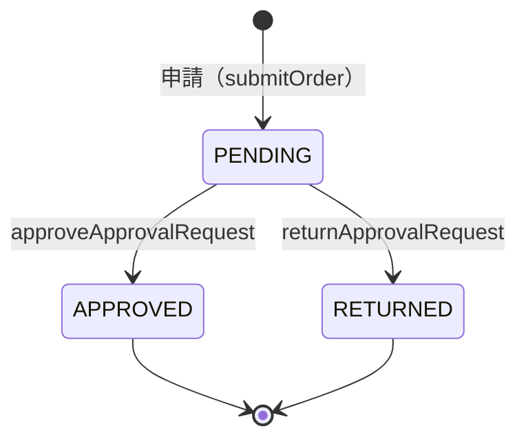
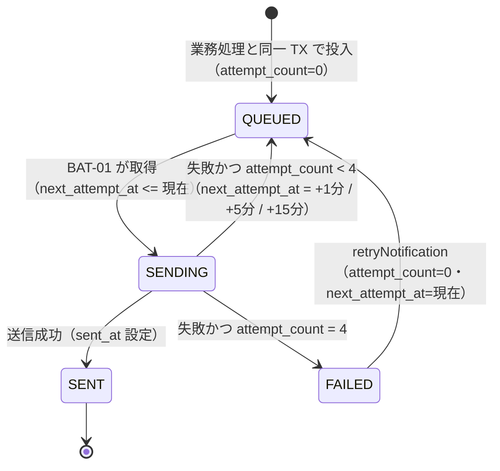
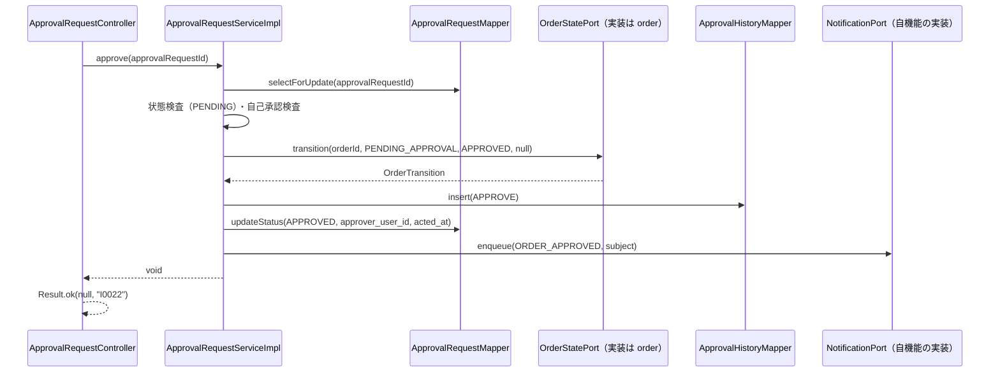
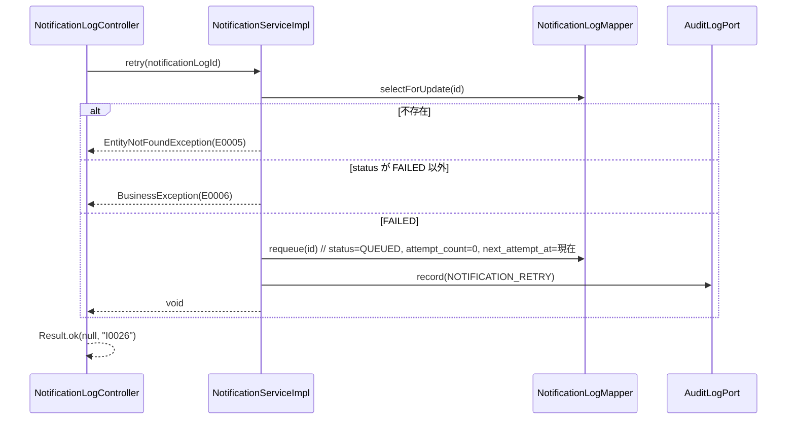

<!-- devtool:file-region id="document-header" -->
# 承認・通知 詳細設計

> 詳細設計（内部設計）。`詳細設計/spec-detail-temp.md` の構成に従う。本書は単一情報源（SSOT）を参照するのみで、項目・列挙値・メッセージを再定義しない。
> 業務ルールの番号・内容は `基本設計/共通/spec-08-business-rule-list.md` を正とし、本書は実装手順（承認依頼の作成・承認・差戻し・承認ルール管理・通知の投入と送信・通知履歴）と画面（SCR-14/15/18）を定める。
> 機能（feature）をまたぐ呼び出しは `com.example.ddmsaa.core.shared.port` のポート（interface）で行う。**ポートの正式定義は `詳細設計/業務/order/spec-order-detail-sd.md` §1.1.1 が唯一の正**であり、本書は「本機能が実装するポート（`ApprovalRequestPort`・`NotificationPort`）」と「使うポート（`OrderStatePort`・`OrderAccessPort`・`AuditLogPort`〔`record`・`recordDenied`〕・`CustomerLookupPort`〔`findNotificationEmails`〕）」の使い方だけを定める（整表を重複して持たない）。
> SCR-18 通知履歴は画面設計が `基本設計/業務設計/user/spec-user-screen-ui.md` §9 にあるが、API（`pageNotificationLogs`・`retryNotification`）が本機能に属するため本書で扱う。

<!-- devtool:end-file-region -->
<!-- devtool:block id="detail.approval.detail-sd.s01" -->
## 文書情報

| 項目 | 内容 |
|------|------|
| システム名称 | DDMSAA 販売システム |
| 文書名称 | 承認・通知 詳細設計 |
| 文書バージョン | V1.0 |
| ステータス | 草案 |
| 作成者 | TBD |
| 作成日 | 2026-10-21 |
| レビュー担当 | TBD |

<!-- devtool:endblock -->
<!-- devtool:block id="detail.approval.detail-sd.s02" -->
## 改訂履歴

| バージョン | 改訂日 | 改訂者 | 改訂内容 |
|------|--------|--------|---------|
| V0.1 | 2026-10-20 | — | 簡易版（データ・API・処理・テスト・BR） |
| V1.0 | 2026-10-21 | — | `spec-detail-temp.md` の構成へ展開（§0〜§6.1）。テスト表を §5.1 へ移し UT-ID を `UT-APR-NNN`（3 桁）に統一。通知の状態遷移・宛先解決・BAT-01 を詳細化 |
| V1.1 | 2026-10-21 | — | 統一修訂：(1) Service 層の 400 `E0008` を `InvalidRequestException` に統一（承認ルールの `approverRole`／`approvalStep`／金額・期間の整合、一覧の日付区間逆転。TBD-APR-11 の 400 部分を閉じる）。(2) 機能間呼び出しをポート化（order §1.1.1）：`ApprovalRequestPort`・`NotificationPort` を実装、`OrderStatePort`・`OrderAccessPort`・`AuditLogPort` を利用。承認・差戻しの処理順を「`approval_requests` 行ロック → 状態・自己承認の検査 → `OrderStatePort.transition` → 承認履歴・依頼更新 → 通知」に改訂（ロック順序は先 `approval_requests`、後 `orders`）。`listApprovalHistories` の実装を本機能に移管（order からの移動。UT-APR-058〜060）。TBD-APR-01・02・04・05 を閉じる。UT-APR-058 以降を追加 |
| V1.2 | 2026-10-21 | — | 第 2 次統一修訂：(1) 列挙の置き場所を `Role`＝`common.enums`、他の T07 列挙（`ApprovalRequestStatus`・`ApprovalAction`・`NotificationEvent`・`NotificationStatus` ほか）＝`core.shared.enums` に統一。(2) 要求形式不正（不正な列挙値・JSON 不正・必須パラメータ欠落）を 400 `E0008` に統一（TBD-APR-11 を閉じる）。(3) `ApprovalRequestPort.findPending` を実装（`order` の `getOrder` が使用）。(4) `NotificationPort` は宛先のメールが解決できない場合に例外を投げず、その宛先を挿入せず warn ログを出す。(5) `listApprovalHistories` のクライアントを `approval-api.ts` に置く。(6) スケジューラ有効化は `core.shared.config.SchedulingConfig`（TBD-APR-06 を閉じる）。(7) `PERMISSION_DENIED` の記録（`AuditLogPort.recordDenied`）の参照を明記。UT-APR-067〜071 を追加 |

---

<!-- devtool:endblock -->
<!-- devtool:block id="detail.approval.detail-sd.s03" -->
## 0. 対象と根拠

| 項目 | 内容 |
|------|------|
| 関連機能 | F-APR-01、F-APR-02、F-APR-03、F-NTF-01、F-NTF-02（承認依頼の作成は F-ORD-04 の `submitOrder` が `ApprovalRequestPort.openRequest` で呼ぶ内部処理として §1.2.9 に定める。通知の投入は `NotificationPort.enqueue` として §1.2.10 に定める） |
| 関連画面 | SCR-14（承認待ち一覧）、SCR-15（承認ルール管理）、SCR-18（通知履歴）。SCR-13/DLG-2・DLG-3（承認・差戻しダイアログ）は SCR-13（`order`）に属し、SCR-14 からも同じ部品を使う（§2.1）。SCR-02 の承認待ちカードは `pageApprovalRequests` を利用する（`user` の詳細設計） |
| 関連 API | `pageApprovalRequests`、`approveApprovalRequest`、`returnApprovalRequest`、`listApprovalRules`、`createApprovalRule`、`updateApprovalRule`、`pageNotificationLogs`、`retryNotification`（`spec-07-api-list.yaml`）。`listApprovalHistories`（07 では `tags: orders`・F-ORD-01 だが**実装は本機能**。§1.2.11）。参照のみ：`submitOrder`・`cancelOrder`（`ApprovalRequestPort`・`NotificationPort` の呼び出し元。`order`） |
| 関連バッチ | BAT-01 通知送信（`spec-15-batch-design-ui.md`） |
| 関連テーブル | TBL-approval-rules、TBL-approval-requests、TBL-approval-histories、TBL-notification-logs、TBL-audit-logs（書込）。TBL-orders、TBL-order-status-histories（承認・差戻しで更新されるが、更新は `order` が実装する `OrderStatePort.transition` が行い、本機能は直接書かない。承認待ち一覧では `orders` を読取）、TBL-customers、TBL-users、TBL-user-contacts、TBL-system-locks（読取。承認待ち一覧・宛先解決。顧客の通知先メールは `CustomerLookupPort.findNotificationEmails` 経由で、`customer_contacts` は直接読まない）（`spec-06-db-physical.yaml`） |
| 業務ルール | BR-APR-001〜006、BR-NTF-001〜003、BR-ORD-006、BR-ORD-011、BR-AUTH-003、BR-AUTH-006、BR-AUD-001 |
| 外部インタフェース | IF-01 メール送信（BAT-01）、メールテンプレート MAIL-02〜06（`spec-08-external-interface-ui.md`） |
| 上流根拠 | `要件定義/requirements.md` §5.2、FR-06、FR-10；`基本設計/業務設計/approval/spec-approval-business-ui.md`、`spec-approval-screen-ui.md`；`基本設計/業務設計/user/spec-user-screen-ui.md` §9；`基本設計/共通/spec-03-auth-ui.md` |

### 0.1 コード生成時のロード一覧（AI コンテキスト組み立て）

```
- 本ファイル
- 基本設計/共通/spec-06-db-physical.yaml      ← TBL-approval-rules / approval-requests / approval-histories / notification-logs / audit-logs、読取：orders / order-status-histories / customers / users / user-contacts / system-locks（customer_contacts は `CustomerLookupPort` 経由）
- 基本設計/共通/spec-07-api-list.yaml          ← 上記 operationId と ApprovalRequestVO / ApprovalReturnDTO / ApprovalHistoryVO / ApprovalRuleVO / ApprovalRuleSaveDTO / NotificationLogVO / ApprovalRequestStatus / ApprovalAction / NotificationEvent / NotificationStatus
- 基本設計/共通/spec-09-message-list.yaml      ← I0010 I0011 I0022 I0023 I0026 I0031 W0021 W0024 W0028 E0001 E0002 E0005 E0006 E0008 E0012 E0030 E0032 E0033 E0051 E0056
- 基本設計/共通/spec-08-business-rule-list.md  ← BR-APR / BR-NTF / BR-AUD / BR-ORD-006・011 / BR-AUTH-003・006
- 基本設計/共通/spec-03-auth-ui.md、spec-05 / spec-10 / spec-12、spec-15-batch-design-ui.md、spec-08-external-interface-ui.md
- 基本設計/業務設計/approval/spec-approval-business-ui.md、spec-approval-screen-ui.md、user/spec-user-screen-ui.md §9
- 基本設計/データベース/spec-data-dictionary-mapping-ui.md（§4.12〜4.14、4.16、4.20）
- 基本設計/基盤/インタフェース仕様/spec-10-business-core.yaml・spec-07-infrastructure.yaml・spec-03-exception-handler.yaml・spec-project-structure.yaml
- 開発規約/spec-naming-rule.md / spec-database-rule.md / spec-data-dictionary-project-temp.md（T07-7 承認依頼状態、T07-8 承認操作、T07-11 通知イベント、T07-12 通知状態）
- 開発規約/spec-backend-coding-rule.md / spec-frontend-coding-rule.md / spec-test-rule.md
- 詳細設計/業務/order/spec-order-detail-sd.md（**§1.1.1 ポート正式定義**。`OrderStatePort`・`OrderAccessPort` の実装側、`ApprovalRequestPort`・`NotificationPort` の呼び出し元）、詳細設計/業務/user/spec-user-detail-sd.md（`AuditLogPort` の実装・列挙の TBD）
```

### 0.2 マイクロサービス帰属

| 項目 | 内容 |
|------|------|
| 所属サービス | `business-service-core`（API・バッチとも。承認・通知の API は auth-service に置かない。Magic Link メールは auth-service が送信し、本機能の `notification_logs` には記録しない。BR-NTF-001） |
| パッケージ接頭辞 | `com.example.ddmsaa.core.approval`（`controller` / `service` / `service.impl` / `mapper` / `entity` / `dto` / `convert`。バッチは `…core.approval.batch`。置き場は TBD-APR-06） |
| 基盤依存 | common（`Result`・`PageResult`・`BusinessException`・`EntityNotFoundException`・`InvalidRequestException`）、infrastructure（`UserContext`・`MetaObjectHandler`・DB）。メール送信は `JavaMailSender`（`spring-boot-starter-mail` は core の依存に含まれる。設定キー `spring.mail.*`（`MAIL_*`）・`app.mail.from`（`MAIL_FROM`））。スケジューラは `com.example.ddmsaa.core.shared.config.SchedulingConfig`（`@Configuration @EnableScheduling`。全 feature で 1 つ。本機能は定義しない）。列挙は `com.example.ddmsaa.core.shared.enums`、`Role` は `com.example.ddmsaa.common.enums`。他機能とは `…core.shared.port` のポート経由のみ（実装：`ApprovalRequestPort`・`NotificationPort`。利用：`OrderStatePort`・`OrderAccessPort`・`AuditLogPort`。order §1.1.1。`ApprovalRequestPort` は `openRequest` と `findPending` の 2 メソッド） |
| DB アクセス権限 | 全表の CRUD（business-service-core） |

---

<!-- devtool:endblock -->
<!-- devtool:block id="detail.approval.detail-sd.s04" -->
## 1. バックエンド詳細設計

### 1.1 クラス一覧

| 層 | クラス名 | パッケージ | 責務 | 対応 |
|----|------|----|------|------|
| Controller | `ApprovalRequestController` | `com.example.ddmsaa.core.approval.controller` | `/api/v1/approval-requests/**` の受付（`@PreAuthorize("hasRole('ADMIN')")`） | `pageApprovalRequests`、`approveApprovalRequest`、`returnApprovalRequest` |
| Controller | `ApprovalHistoryController` | 同上 | `GET /api/v1/orders/{orderId}/approval-histories` の受付（パスは `/orders` で始まるが、データ所有者である本機能に置く。`@PreAuthorize("hasAnyRole('ADMIN','EMPLOYEE','CUSTOMER')")`） | `listApprovalHistories` |
| Controller | `ApprovalRuleController` | 同上 | `/api/v1/approval-rules/**` の受付 | `listApprovalRules`、`createApprovalRule`、`updateApprovalRule` |
| Controller | `NotificationLogController` | 同上 | `/api/v1/notification-logs/**` の受付 | `pageNotificationLogs`、`retryNotification` |
| Service | `ApprovalRequestService` / `ApprovalRequestServiceImpl` | `…approval.service` / `…service.impl` | 承認待ち一覧、承認・差戻し（行ロック・状態検査・`OrderStatePort` 呼び出し・承認履歴・依頼更新・通知の投入） | F-APR-01、F-APR-02 |
| Service（ポート実装） | `ApprovalRequestPortImpl` | `…approval.service.impl`（`implements com.example.ddmsaa.core.shared.port.ApprovalRequestPort`） | `openRequest`：承認ルールの選定・`rule_snapshot` の保存・`approval_requests` の INSERT（`submitOrder` のトランザクションに参加。`MANDATORY`）。`findPending`：注文の PENDING の承認依頼を `Optional<PendingApproval>` で返す読取専用処理（`getOrder` が使う）。§1.2.9 | F-ORD-04（呼び出し元）、F-ORD-01（`getOrder`）、F-APR-02 |
| Service | `ApprovalHistoryService` / `ApprovalHistoryServiceImpl` | `…approval.service` / `…service.impl` | 注文単位の承認履歴の取得（可視性は `OrderAccessPort.requireVisible`）、CUSTOMER 向けの項目 null 化（BR-APR-006）。§1.2.11 | F-ORD-01（`listApprovalHistories`） |
| Service | `ApprovalRuleService` / `ApprovalRuleServiceImpl` | 同上 | 承認ルールの参照・登録・更新、申請時の適用ルール選定 | F-APR-03 |
| Service | `NotificationService` / `NotificationServiceImpl` | 同上 | 通知履歴の検索、手動再送 | F-NTF-01 |
| Service（ポート実装） | `NotificationPortImpl` | `…approval.service.impl`（`implements NotificationPort`。通知の所有者） | `enqueue`：宛先解決（`NotificationRecipientResolver`）と `notification_logs` への QUEUED の INSERT。`order`（申請・取消し）・`approval`（承認・差戻し。自身の Service から同一 TX で呼ぶ）・`report`（BAT-02 完了）が呼ぶ。`MANDATORY`。§1.2.10 | F-NTF-02 |
| Component | `NotificationRecipientResolver` | `…approval.service.impl` | BR-NTF-003 の宛先解決（イベント別の宛先集合を求め、同一メールアドレスを 1 件にまとめる） | F-NTF-02 |
| Service | `NotificationDispatchService` / `NotificationDispatchServiceImpl` | 同上 | BAT-01 の 1 件ごとのトランザクション（取得して `SENDING` にする、結果の反映）。バッチ本体からプロキシ経由で呼ぶため別クラスにする | BAT-01 |
| Component | `NotificationMailSender` | 同上 | `JavaMailSender` による送信と MAIL-02〜06 の件名・本文生成（TBD-APR-07） | BAT-01 |
| Batch | `NotificationSendJob` | `…approval.batch` | `@Scheduled` で 1 分ごとに起動し、1 回最大 100 件を処理する（トランザクションを持たない） | BAT-01 |
| Mapper | `ApprovalRequestMapper` | `…approval.mapper` | approval_requests の検索・登録・行ロック・状態更新 | TBL-approval-requests |
| Mapper | `ApprovalHistoryMapper` | 同上 | approval_histories の INSERT と注文単位の取得（`listApprovalHistories`） | TBL-approval-histories |
| Mapper | `ApprovalRuleMapper` | 同上 | approval_rules の CRUD と適用ルールの選定 | TBL-approval-rules |
| Mapper | `NotificationLogMapper` | 同上 | notification_logs の検索・INSERT・行ロック・状態更新・バッチ用の取得 | TBL-notification-logs |
| Mapper | `NotificationRecipientMapper` | 同上 | 宛先解決の読取専用クエリ（有効な ADMIN、申請者、担当者のメール、最新の申請者）。顧客通知先のメールは `CustomerLookupPort.findNotificationEmails`（`customer` 実装）を呼び、`customer_contacts` を直接読まない | TBL-users 他 |
| Entity | `ApprovalRule`、`ApprovalRequest`、`ApprovalHistory`、`NotificationLog` | `…approval.entity` | テーブルマッピング | 各 TBL |
| DTO | `ApprovalRequestVo`（`ApprovalRequestVO`）、`ApprovalReturnDto`（`ApprovalReturnDTO`）、`ApprovalHistoryVo`（`ApprovalHistoryVO`）、`ApprovalRuleVo`（`ApprovalRuleVO`）、`ApprovalRuleSaveDto`（`ApprovalRuleSaveDTO`）、`NotificationLogVo`（`NotificationLogVO`）、`ApprovalRequestSearchCondition`、`NotificationLogSearchCondition` | `…approval.dto` | 項目は `spec-07-api-list.yaml` の schema に準拠 | — |
| 列挙 | `ApprovalRequestStatus`（T07-7）、`ApprovalAction`（T07-8）、`NotificationEvent`（T07-11）、`NotificationStatus`（T07-12） | `com.example.ddmsaa.core.shared.enums`（`spec-backend-coding-rule.md` §2。`NotificationEvent` は `NotificationPort` のシグネチャに現れる。値型 `PendingApproval`・`NotificationSubject` は `…core.shared.port`） | `int code` + `fromCode`（`assets/enum.java.tmpl`）。`Role`（T07-1）は `com.example.ddmsaa.common.enums` | — |
| 変換 | `ApprovalRequestConverter`、`ApprovalHistoryConverter`、`ApprovalRuleConverter`、`NotificationLogConverter` | `…approval.convert` | Entity ↔ DTO（MapStruct） | — |

> 注文の状態更新・注文状態履歴の保存・注文行ロック・`ORDER_APPROVE`／`ORDER_RETURN` 監査は `OrderStatePort.transition`（実装は `order`）に任せ、本機能は `OrderMapper` 等を直接参照しない。承認履歴の可視性判定は `OrderAccessPort.requireVisible`。それ以外の監査（`APPROVAL_RULE_*`・`NOTIFICATION_RETRY`）は `AuditLogPort.record`（実装は `user`）。いずれも order §1.1.1。

#### 状態遷移（正本：`spec-10-screen-transition-ui.md` §1 の注文状態、`spec-08-business-rule-list.md` BR-APR-005・BR-NTF-002）

> `spec-04-business-flow-ui.md` §3 はテンプレートのままで実際の遷移が記入されていない（回報参照）。本書は上記の正本から遷移を導出する。

**承認依頼（`approval_requests.status`、T07-7）**



| 現状態 | 操作 | 遷移後 | 注文状態（連動） | 禁止 |
|------|------|------|------|------|
| PENDING | 承認 | APPROVED | PENDING_APPROVAL → APPROVED | — |
| PENDING | 差戻し | RETURNED | PENDING_APPROVAL → RETURNED | — |
| APPROVED / RETURNED | 承認・差戻し | （変更なし） | （変更なし） | 409 `E0006`（BR-APR-005） |

再申請（RETURNED の注文）は依頼を更新せず新しい `approval_requests` 行を作る（§1.2.9）。

**通知（`notification_logs.status`、T07-12。`attempt_count` は初回を含む試行回数、最大 4）**



| 失敗後の `attempt_count` | 次の状態 | `next_attempt_at` |
|:---:|------|------|
| 1 | QUEUED | 失敗時刻 + 1 分 |
| 2 | QUEUED | 失敗時刻 + 5 分 |
| 3 | QUEUED | 失敗時刻 + 15 分 |
| 4 | FAILED | 変更しない |

禁止遷移：`QUEUED` / `SENDING` / `SENT` に対する `retryNotification` は 409 `E0006`（BR-NTF-002）。

### 1.2 API 別詳細設計

> すべての API で、成功は HTTP 200 + `Result`、権限不足は 403 `E0002`、未認証・JWT 期限切れは 401 `E0001`（Gateway 起因は `E0040`・`E0041`）。`@PreAuthorize` は `x-roles` に一致させる（本機能の API はすべて `hasRole('ADMIN')`）。HTTP は `spec-backend-coding-rule.md` §4 の固定集合に従う。

#### 1.2.1 `pageApprovalRequests` 承認待ち一覧（`GET /api/v1/approval-requests`）

| 項目 | 内容 |
|------|------|
| operationId | `pageApprovalRequests` |
| 対応機能 | F-APR-01 |
| ロール・権限 | `@PreAuthorize("hasRole('ADMIN')")`。PENDING の承認依頼はすべて返す（データ範囲は全件。行ごとに `canApprove` を返す） |
| リクエスト | クエリ `pageNum`（既定 1）、`pageSize`（既定 20・最大 100）、`orderId`、`customerId`、`requestedDateFrom`、`requestedDateTo`（date） |
| レスポンス | `Result<PageResult<ApprovalRequestVO>>`（申請日時の古い順の固定順） |

**入力検証**

| 項目 | ルール | 違反時 messageId | HTTP |
|------|------|--------------|------|
| `pageNum` / `pageSize` | `pageNum` ≥ 1、`pageSize` 1〜100 | `E0008` | 400 |
| `requestedDateFrom` / `requestedDateTo` | date 形式（Bean Validation） | `E0008` | 400 |
| `requestedDateFrom` / `requestedDateTo` | 両方指定で from ≤ to。from > to は Service で `InvalidRequestException`（決定済み） | `E0008` | 400 |

**処理ロジック**

```
1. ApprovalRequestSearchCondition を組み立てる。ログイン者 ID は UserContext.getUserId()
2. 期間は日本時間の日付範囲：created_at >= from 00:00:00 かつ created_at < (to の翌日 00:00:00)。from > to は Service が InvalidRequestException（400 E0008。field = requestedDateFrom）で拒否する
3. PageHelper.startPage(pageNum, pageSize) → ApprovalRequestMapper.search
   - 条件：approval_requests.status = PENDING、deleted_at IS NULL、orders.deleted_at IS NULL、orderId（完全一致）、orders.customer_id = customerId（完全一致）、期間
   - 固定順：approval_requests.created_at ASC, approval_requests.id ASC
4. canApprove は行ごとに「ログイン者が ADMIN（@PreAuthorize で保証）かつ status=PENDING かつ approval_requests.created_by <> ログイン者」で求める（辞書 §4.20。BR-APR-002）。一覧は PENDING のみなので申請者本人の行だけが false
5. requestedByName は users.user_name（created_by で結合）、customerName は customers.customer_name、totalAmount は orders.total_amount
6. PageResult.of(records, total, pageNum, pageSize) を Result.ok で返す
```

**トランザクション**：`@Transactional(readOnly = true)`（`ApprovalRequestServiceImpl.pageApprovalRequests()`）。関連テーブル：TBL-approval-requests・TBL-orders・TBL-customers・TBL-users（読取）。ロールバック条件なし。

**DB アクセス**

| Mapper メソッド | 操作 | 対象テーブル.カラム | 主要条件 |
|------------|------|----------|---------|
| `ApprovalRequestMapper.search` | SELECT | `approval_requests.id/order_id/approval_step/status/created_by/created_at`、`orders.customer_id/total_amount`、`customers.customer_name`、`users.user_name` | `approval_requests.status = 1 AND approval_requests.deleted_at IS NULL`（`idx_approval_requests_status`）、`orders.deleted_at IS NULL` |

**利用する共通コンポーネント**：`PageHelper`／`PageResult`、`UserContext`。

**例外 → messageId → HTTP**

| シナリオ | 例外 | messageId | HTTP |
|------|------|-----------|------|
| 検証失敗（形式・範囲。クエリパラメータ） | `MethodArgumentNotValidException` / `ConstraintViolationException`（Bean Validation） | `E0008` | 400 |
| 要求形式不正（不正な列挙値・JSON 不正・必須パラメータ欠落・型不一致） | `MethodArgumentTypeMismatchException`／`HttpMessageNotReadableException`／`MissingServletRequestParameterException` | `E0008` | 400 |
| 日付区間の逆転（from > to） | `InvalidRequestException` | `E0008` | 400 |
| 権限不足 | `AccessDeniedException` | `E0002` | 403 |

**正常レスポンス**：`Result<PageResult<ApprovalRequestVO>>`（messageId なし）。

#### 1.2.2 `approveApprovalRequest` 承認（`POST /api/v1/approval-requests/{approvalRequestId}/approve`）

| 項目 | 内容 |
|------|------|
| operationId | `approveApprovalRequest` |
| 対応機能 | F-APR-02 |
| ロール・権限 | `@PreAuthorize("hasRole('ADMIN')")` かつ申請者本人でないこと（BR-APR-002。判定は Service） |
| リクエストスキーマ | パスパラメータ `approvalRequestId`（`AQ`+8 桁）。リクエストボディなし（`updatedAt` は受け取らない。決定済み：行ロック＋状態確認で競合は `E0006`） |
| レスポンス | `Result<Void>`（`messageId=I0022`） |

**シーケンス**



**入力検証**

| 項目 | ルール | 違反時 messageId | HTTP |
|------|------|--------------|------|
| `approvalRequestId` | パスパラメータ（形式検査はせず、不存在は 404 に集約） | `E0005` | 404 |

**処理ロジック**（1 つのトランザクション。**ロック順序は先に `approval_requests`、後に `orders`**。order §1.1.1）

```
1. approval_requests を id で SELECT ... FOR UPDATE（deleted_at IS NULL）。不存在は EntityNotFoundException("E0005")（404）。order_id・created_by・status を得る
2. 承認依頼の status が PENDING でなければ BusinessException("E0006")（409）。先に別の ADMIN が処理した場合を含む（BR-APR-005）
3. 操作者（UserContext.getUserId()）= approval_requests.created_by なら BusinessException("E0056")（409。BR-APR-002）
4. OrderStatePort.transition(order_id, PENDING_APPROVAL, APPROVED, null) を呼ぶ。order 側が注文行を FOR UPDATE でロックし、状態が PENDING_APPROVAL か確認（違えば 409 E0006、注文が不存在・論理削除済みなら 404 E0005）、orders.status を更新し、order_status_histories を INSERT し、ORDER_APPROVE 監査を記録する（本機能は注文テーブル・監査を直接書かない）。戻り値 OrderTransition から customerId・salesUserId を得る
5. approval_histories に INSERT（approval_request_id、approval_action=APPROVE、reason=NULL。操作者は created_by（MetaObjectHandler）、日時は created_at（DB の既定値）に自動設定）
6. approval_requests を UPDATE：status=APPROVED、approver_user_id=操作者、acted_at=現在時刻（UPDATE … WHERE id=? AND status=PENDING。更新行数 0 は E0006）
7. NotificationPort.enqueue(ORDER_APPROVED, NotificationSubject.forOrder(注文番号, customerId, salesUserId, 申請者＝approval_requests.created_by, PENDING_APPROVAL)) を同一トランザクションで呼ぶ。宛先は §1.2.10（BR-NTF-003）。手順 2 の状態検査により 1 つの承認依頼につき 1 回だけ到達するため通知は二重にならない
8. Result.ok(null, "I0022") を返す
```

> 責任分担：承認依頼の状態・`approval_histories`・通知は本機能、注文の状態・状態履歴・`ORDER_APPROVE` 監査は `OrderStatePort`（`order`）。承認・差戻しは `updatedAt` を受け取らず、競合は手順 1 の行ロックと手順 2・4 の状態確認で `E0006` となる（BR-ORD-006。決定済み）。`submitOrder` は先に `orders` をロックし `approval_requests` は新規 INSERT するだけなので、本処理と逆向きに待ち合う行がなくデッドロックしない。

**トランザクション**

| 項目 | 内容 |
|------|------|
| 範囲 | `@Transactional` を `ApprovalRequestServiceImpl.approve()` に付与（`OrderStatePort`・`NotificationPort` は同じトランザクションに参加。メールの送信は行わない。送信は BAT-01） |
| 関連テーブル | TBL-approval-requests・TBL-approval-histories・TBL-notification-logs（書込）、TBL-orders・TBL-order-status-histories・TBL-audit-logs（`OrderStatePort` 実装側＝`order` が書込）、TBL-users・TBL-user-contacts（読取。宛先解決。顧客通知先は `CustomerLookupPort` 経由） |
| ロールバック条件 | いずれかの手順で `BusinessException`・`EntityNotFoundException` をスローした場合（ポート実装が投げた例外を含む）、又は DB 例外の場合は全体をロールバック（注文の状態更新・状態履歴・監査も含めて元に戻る） |

**DB アクセス**

| Mapper メソッド / ポート | 操作 | 対象テーブル.カラム | 主要条件 |
|------------|------|----------|---------|
| `ApprovalRequestMapper.selectForUpdate` | SELECT ... FOR UPDATE | `approval_requests.*` | `id = #{id} AND deleted_at IS NULL` |
| `OrderStatePort.transition`（実装は order） | （ポート） | `orders.status`、`order_status_histories`、`audit_logs` | order §1.1.1。注文行の `FOR UPDATE` は order 側 |
| `ApprovalHistoryMapper.insert` | INSERT | `approval_histories`（id は `next_business_id('AH', 8)`） | — |
| `ApprovalRequestMapper.updateStatus` | UPDATE | `approval_requests.status/approver_user_id/acted_at` | `id = #{id} AND status = 1` |
| `NotificationPort.enqueue`（自機能の実装 `NotificationPortImpl`） | INSERT | `notification_logs`（id は `next_business_id('NL', 8)`） | §1.2.10 |

**利用する共通コンポーネント**

| コンポーネント | 用途 |
|------|------|
| `UserContext` | 操作者（`getUserId()`）の取得。`created_by` / `updated_by` は `MetaObjectHandler` が自動設定する（Service で手設定しない） |
| `OrderStatePort` | 注文の状態更新・状態履歴・`ORDER_APPROVE`／`ORDER_RETURN` 監査（order §1.1.1） |
| `NotificationPort` | 通知の投入（同一トランザクション。自機能の実装を interface 経由で呼ぶ） |

**例外 → messageId → HTTP**

| シナリオ | 例外 | messageId | HTTP |
|------|------|-----------|------|
| 権限不足 | `AccessDeniedException` | `E0002` | 403 |
| 承認依頼・注文が不存在 | `EntityNotFoundException`（注文の不存在は `OrderStatePort` が投げる） | `E0005` | 404 |
| 依頼が PENDING でない・注文が PENDING_APPROVAL でない（`OrderStatePort`）・先に処理済み | `BusinessException` | `E0006` | 409 |
| 申請者本人 | `BusinessException` | `E0056` | 409 |

**正常レスポンス**：`Result<Void>`、`messageId=I0022`。

#### 1.2.3 `returnApprovalRequest` 差戻し（`POST /api/v1/approval-requests/{approvalRequestId}/return`）

| 項目 | 内容 |
|------|------|
| operationId | `returnApprovalRequest` |
| 対応機能 | F-APR-02 |
| ロール・権限 | `@PreAuthorize("hasRole('ADMIN')")` かつ申請者本人でないこと（BR-APR-002） |
| リクエストスキーマ | `ApprovalReturnDTO`（`reason` 必須・1〜500 文字） |
| レスポンス | `Result<Void>`（`messageId=I0023`） |

**入力検証**

| 項目 | ルール | 違反時 messageId | HTTP |
|------|------|--------------|------|
| `reason` | 必須（null 不可）・1〜500 文字（`@NotNull @Size(min = 1, max = 500)`。BR-APR-003。前後空白の除去はしない） | `E0008`（`details[]` に項目） | 400 |

**処理ロジック**：`approveApprovalRequest`（§1.2.2）の手順 1〜3 と同じ検査（`E0005` → `E0006` → `E0056` の順。先に `approval_requests` を行ロック）の後、次を行う。入力検証（400）は Controller の Bean Validation で先に行われる。

```
4. OrderStatePort.transition(order_id, PENDING_APPROVAL, RETURNED, 入力の reason) を呼ぶ（order 側が注文行ロック・状態確認・orders.status 更新・order_status_histories（from=PENDING_APPROVAL、to=RETURNED、reason=入力値）の INSERT・ORDER_RETURN 監査を行う）
5. approval_histories に INSERT（approval_action=RETURN、reason=入力値。chk_approval_histories_reason により RETURN は reason が必須）
6. approval_requests を UPDATE：status=RETURNED、approver_user_id=操作者、acted_at=現在時刻（WHERE id=? AND status=PENDING。0 行は E0006）
7. NotificationPort.enqueue(ORDER_RETURNED, NotificationSubject.forOrder(注文番号, customerId, salesUserId, 申請者＝approval_requests.created_by, PENDING_APPROVAL)) を同一トランザクションで呼ぶ（宛先は申請者・担当者。顧客には通知しない）
8. Result.ok(null, "I0023") を返す
```

**シーケンス**：`approveApprovalRequest` と同じ構造（履歴の `approval_action`、`OrderStatePort` の遷移先・`reason`、通知イベントだけが異なる）。

**トランザクション・DB アクセス・共通コンポーネント**：`approveApprovalRequest` と同じ（`ApprovalRequestServiceImpl.returnRequest()` に `@Transactional`）。

**例外 → messageId → HTTP**

| シナリオ | 例外 | messageId | HTTP |
|------|------|-----------|------|
| 理由が欠落・空・501 文字以上 | `MethodArgumentNotValidException` | `E0008` | 400 |
| 要求形式不正（不正な列挙値・JSON 不正・必須パラメータ欠落・型不一致） | `MethodArgumentTypeMismatchException`／`HttpMessageNotReadableException`／`MissingServletRequestParameterException` | `E0008` | 400 |
| 権限不足 | `AccessDeniedException` | `E0002` | 403 |
| 承認依頼・注文が不存在 | `EntityNotFoundException` | `E0005` | 404 |
| 処理済み・注文が PENDING_APPROVAL でない（`OrderStatePort`） | `BusinessException` | `E0006` | 409 |
| 申請者本人 | `BusinessException` | `E0056` | 409 |

**正常レスポンス**：`Result<Void>`、`messageId=I0023`。

#### 1.2.4 `listApprovalRules` 承認ルール一覧（`GET /api/v1/approval-rules`）

| 項目 | 内容 |
|------|------|
| operationId | `listApprovalRules` |
| 対応機能 | F-APR-03 |
| ロール・権限 | `@PreAuthorize("hasRole('ADMIN')")` |
| レスポンス | `Result<List<ApprovalRuleVO>>`（適用開始日の新しい順の固定順。ページングなし） |

**処理ロジック**

```
1. ApprovalRuleMapper.selectAll（deleted_at IS NULL。is_active の真偽を問わず全件）を effective_from_date DESC, id DESC で取得する
2. ApprovalRuleConverter で ApprovalRuleVO にする（approverRole は Role.fromCode、approvalStep は Integer。updatedAt はマイクロ秒 6 桁の文字列）
3. Result.ok(list) を返す
```

**トランザクション**：`@Transactional(readOnly = true)`。**DB アクセス**：`ApprovalRuleMapper.selectAll`（SELECT。`approval_rules.*`、`idx_apr_rules_active_eff_from`）。**例外**：権限不足 `E0002` / 403。

#### 1.2.5 `createApprovalRule` 承認ルール登録（`POST /api/v1/approval-rules`）

| 項目 | 内容 |
|------|------|
| operationId | `createApprovalRule` |
| 対応機能 | F-APR-03 |
| ロール・権限 | `@PreAuthorize("hasRole('ADMIN')")` |
| リクエストスキーマ | `ApprovalRuleSaveDTO`（`minAmount`・`approvalStep`・`approverRole`・`isActive`・`effectiveFromDate` 必須、`maxAmount`・`effectiveToDate` 任意、`updatedAt` は登録では使わない） |
| レスポンス | `Result<String>`（採番した承認ルール ID。`messageId=I0010`、`messageArgs=[id]`） |

**入力検証**

| 項目 | ルール | 違反時 messageId | HTTP |
|------|------|--------------|------|
| `minAmount` | 必須・0 以上・整数部 13 桁以内・小数 2 桁以内（`numeric(15,2)`） | `E0008` | 400 |
| `maxAmount` | 任意（null は上限なし）。桁数は同上（Bean Validation）。指定時は `minAmount` 以上（DB は `chk_approval_rules_max_amount`）。逆転は Service で `InvalidRequestException` | `E0008` | 400 |
| `approvalStep` | 必須。1 のみ許可（BR-APR-001）。1 以外は Service で `InvalidRequestException` | `E0008` | 400 |
| `approverRole` | 必須。ADMIN のみ許可（BR-APR-001。DB は `chk_apr_rules_approver_role`）。EMPLOYEE・CUSTOMER は Service で `InvalidRequestException`。列挙として不正な値（未知の値）は要求形式不正として 400 `E0008` | `E0008` | 400 |
| `isActive` | 必須 | `E0008` | 400 |
| `effectiveFromDate` | 必須・date 形式 | `E0008` | 400 |
| `effectiveToDate` | 任意。date 形式（Bean Validation）。指定時は `effectiveFromDate` 以降（DB は `chk_apr_rules_eff_to_date`）。逆転は Service で `InvalidRequestException` | `E0008` | 400 |
| 金額帯・期間の重複 | 重複を禁止するか優先順で扱うかが未決（TBD-APR-03 / 画面設計の TBD-A3）。決定までは検証しない | （未定） | （未定） |

**処理ロジック**

```
1. 入力検証：必須・桁・形式・minAmount ≥ 0 は Controller の Bean Validation（`MethodArgumentNotValidException`）。続けて Service が業務整合を検査し、違反は `InvalidRequestException`（400 `E0008`、`details[]` に項目。`BusinessException`〔409 固定〕は使わない）：approverRole = ADMIN、approvalStep = 1、maxAmount >= minAmount（指定時）、effectiveToDate >= effectiveFromDate（指定時）。複数違反は `details[]` に全項目を載せる（`InvalidRequestException(List<FieldError>)`）
2. approval_rules を INSERT（id は DB の next_business_id('AR', 8)。approver_role は ADMIN の code=1、approval_step=1。created_by / updated_by は MetaObjectHandler が設定）
3. AuditLogPort.record("APPROVAL_RULE_CREATE", "APPROVAL_RULE", 採番 ID, detail) を呼ぶ（BR-AUD-001。audit_logs の INSERT は user 側）
4. Result.ok(id, "I0010", id) を返す（申請済みの承認依頼には影響しない。変更は新しい申請にだけ適用される。画面は I0031 を常時注記する）
```

**トランザクション**：`@Transactional`（`ApprovalRuleServiceImpl.createRule()`）。書込：approval_rules（`audit_logs` は `AuditLogPort` 実装側が同一 TX で書込）。ロールバック条件：いずれかで例外が発生した場合。

**DB アクセス**：`ApprovalRuleMapper.insert`（INSERT。`approval_rules`）、`AuditLogPort.record`（ポート。実装は user。`audit_logs`）。

**例外 → messageId → HTTP**

| シナリオ | 例外 | messageId | HTTP |
|------|------|-----------|------|
| 検証失敗（必須・桁・形式・minAmount < 0） | `MethodArgumentNotValidException` | `E0008` | 400 |
| 要求形式不正（不正な列挙値・JSON 不正・必須パラメータ欠落・型不一致） | `MethodArgumentTypeMismatchException`／`HttpMessageNotReadableException`／`MissingServletRequestParameterException` | `E0008` | 400 |
| 業務整合の不備（ロール・段階・金額帯・期間の逆転） | `InvalidRequestException` | `E0008` | 400 |
| 権限不足 | `AccessDeniedException` | `E0002` | 403 |

**正常レスポンス**：`Result<String>`、`I0010`（`{0}`＝承認ルール ID）。

#### 1.2.6 `updateApprovalRule` 承認ルール更新（`PUT /api/v1/approval-rules/{approvalRuleId}`）

| 項目 | 内容 |
|------|------|
| operationId | `updateApprovalRule` |
| 対応機能 | F-APR-03 |
| ロール・権限 | `@PreAuthorize("hasRole('ADMIN')")` |
| リクエストスキーマ | `ApprovalRuleSaveDTO`（登録と同じ。更新では `updatedAt` が必須。07 の schema では `required` に含まれないため、更新用の検証グループで検査する。TBD-APR-12） |
| レスポンス | `Result<Void>`（`messageId=I0011`） |

**入力検証**：`createApprovalRule` と同じ。加えて `updatedAt` 必須・日時形式（欠落は `E0008` / 400）。

**処理ロジック**

```
1. approval_rules を id で取得（deleted_at IS NULL）。不存在は EntityNotFoundException("E0005")（404）
2. 登録と同じ検証：必須・桁・形式（更新用の検証グループで `updatedAt` 必須を加える）は Controller の Bean Validation で済んでいる（違反は 400 `E0008`）。業務整合（approverRole = ADMIN、approvalStep = 1、金額帯・期間の逆転）は Service が `InvalidRequestException`（400 `E0008`）で拒否する
3. 楽観ロック：UPDATE … WHERE id=? AND updated_at=#{expectedUpdatedAt} AND deleted_at IS NULL。更新行数 0 は BusinessException("E0051")（409。BR-ORD-006）
4. 申請済みの approval_requests には触れない（rule_snapshot は変更しない。遡及しない。BR-APR-001）
5. AuditLogPort.record("APPROVAL_RULE_UPDATE", "APPROVAL_RULE", ルール ID, detail) を呼ぶ
6. Result.ok(null, "I0011") を返す（最新の updatedAt が必要な場合、画面は listApprovalRules で再取得する）
```

**トランザクション**：`@Transactional`（`ApprovalRuleServiceImpl.updateRule()`）。書込：approval_rules（`audit_logs` は `AuditLogPort` 実装側が同一 TX で書込）。

**DB アクセス**：`ApprovalRuleMapper.selectById`、`ApprovalRuleMapper.updateWithLock`、`AuditLogPort.record`（ポート。実装は user）。

**例外 → messageId → HTTP**

| シナリオ | 例外 | messageId | HTTP |
|------|------|-----------|------|
| 検証失敗（必須・桁・形式・`updatedAt` 欠落） | `MethodArgumentNotValidException` | `E0008` | 400 |
| 要求形式不正（不正な列挙値・JSON 不正・必須パラメータ欠落・型不一致） | `MethodArgumentTypeMismatchException`／`HttpMessageNotReadableException`／`MissingServletRequestParameterException` | `E0008` | 400 |
| 業務整合の不備（ロール・段階・金額帯・期間の逆転） | `InvalidRequestException` | `E0008` | 400 |
| 権限不足 | `AccessDeniedException` | `E0002` | 403 |
| 不存在 | `EntityNotFoundException` | `E0005` | 404 |
| 楽観ロック不一致 | `BusinessException` | `E0051` | 409 |

**正常レスポンス**：`Result<Void>`、`I0011`。

#### 1.2.7 `pageNotificationLogs` 通知履歴（`GET /api/v1/notification-logs`）

| 項目 | 内容 |
|------|------|
| operationId | `pageNotificationLogs` |
| 対応機能 | F-NTF-01 |
| ロール・権限 | `@PreAuthorize("hasRole('ADMIN')")`（宛先メールは ADMIN のみ。`spec-03-auth-ui.md` §3） |
| リクエスト | クエリ `pageNum`（既定 1）、`pageSize`（既定 20・最大 100）、`status`（`NotificationStatus`）、`notificationEvent`（`NotificationEvent`）、`createdDateFrom`・`createdDateTo`（date） |
| レスポンス | `Result<PageResult<NotificationLogVO>>`（作成日時の新しい順の固定順） |

**入力検証**

| 項目 | ルール | 違反時 messageId | HTTP |
|------|------|--------------|------|
| `pageNum` / `pageSize` | `pageNum` ≥ 1、`pageSize` 1〜100 | `E0008` | 400 |
| `status` / `notificationEvent` | 列挙値（不正な値は要求形式不正として 400 `E0008`） | `E0008` | 400 |
| `createdDateFrom` / `createdDateTo` | date 形式（Bean Validation）。from ≤ to（from > to は Service で `InvalidRequestException`。決定済み） | `E0008` | 400 |

**処理ロジック**

```
1. NotificationLogSearchCondition を組み立てる（期間は日本時間の日付範囲：created_at >= from 00:00:00 かつ < to の翌日 00:00:00）
2. PageHelper.startPage → NotificationLogMapper.search（deleted_at IS NULL。固定順 created_at DESC, id DESC）
3. NotificationLogConverter で NotificationLogVO にする（status・notificationEvent は列挙へ変換。nextAttemptAt は QUEUED のとき以外も保持値をそのまま返す）
4. PageResult.of を Result.ok で返す。メール本文は保持しないため返さない（宛先メールは返す）
```

**トランザクション**：`@Transactional(readOnly = true)`。**DB アクセス**：`NotificationLogMapper.search`（SELECT。`notification_logs.*`。`idx_ntf_logs_status_created`）。

**例外**：要求形式不正（不正な `status`・`notificationEvent`、日付形式、型不一致。`MethodArgumentTypeMismatchException` 等）`E0008` / 400、検証失敗 `E0008` / 400（Bean Validation は `MethodArgumentNotValidException`／`ConstraintViolationException`、日付区間の逆転は `InvalidRequestException`）、権限不足 `E0002` / 403。**正常レスポンス**：`Result<PageResult<NotificationLogVO>>`（messageId なし）。

#### 1.2.8 `retryNotification` 失敗通知の再送（`POST /api/v1/notification-logs/{notificationLogId}/retry`）

| 項目 | 内容 |
|------|------|
| operationId | `retryNotification` |
| 対応機能 | F-NTF-01 |
| ロール・権限 | `@PreAuthorize("hasRole('ADMIN')")` |
| リクエストスキーマ | パスパラメータ `notificationLogId`（`NL`+8 桁）。ボディなし |
| レスポンス | `Result<Void>`（`messageId=I0026`。「受付」であり送信完了ではない） |

**シーケンス**



**処理ロジック**

```
1. notification_logs を id で SELECT ... FOR UPDATE（deleted_at IS NULL）。不存在は EntityNotFoundException("E0005")（404）
2. status が FAILED でなければ BusinessException("E0006")（409。QUEUED・SENDING・SENT は再送の対象外。BR-NTF-002）
3. UPDATE：status=QUEUED、attempt_count=0、next_attempt_at=現在時刻。error_message・sent_at・宛先・イベントは変更しない（履歴確認のため）
4. AuditLogPort.record("NOTIFICATION_RETRY", "NOTIFICATION", 通知 ID, detail) を呼ぶ
5. Result.ok(null, "I0026") を返す。実際の送信は BAT-01 が次の周期以降に行う
```

**トランザクション**：`@Transactional`（`NotificationServiceImpl.retry()`）。書込：notification_logs（`audit_logs` は `AuditLogPort` 実装側が同一 TX で書込）。

**DB アクセス**

| Mapper メソッド | 操作 | 対象テーブル.カラム | 主要条件 |
|------------|------|----------|---------|
| `NotificationLogMapper.selectForUpdate` | SELECT ... FOR UPDATE | `notification_logs.*` | `id = #{id} AND deleted_at IS NULL` |
| `NotificationLogMapper.requeue` | UPDATE | `notification_logs.status/attempt_count/next_attempt_at` | `id = #{id} AND status = 4` |
| `AuditLogPort.record` | （ポート。実装は user） | `audit_logs` | — |

**例外 → messageId → HTTP**

| シナリオ | 例外 | messageId | HTTP |
|------|------|-----------|------|
| 権限不足 | `AccessDeniedException` | `E0002` | 403 |
| 不存在 | `EntityNotFoundException` | `E0005` | 404 |
| FAILED 以外 | `BusinessException` | `E0006` | 409 |

**正常レスポンス**：`Result<Void>`、`I0026`。

#### 1.2.9 （内部・ポート実装）承認依頼の作成 `ApprovalRequestPort.openRequest`（`submitOrder` から呼ばれる）

> operationId を持たない内部メソッド。`ApprovalRequestPort`（`…core.shared.port`。定義は order §1.1.1）を本機能の `ApprovalRequestPortImpl` が実装する。呼び出し元 `OrderServiceImpl.submitOrder` が `@Transactional` を持ち、本メソッドは同じトランザクションに参加する（`MANDATORY`。TX がなければ例外）。注文側の申請時検証（BR-ORD-010）・状態更新・状態履歴・`ORDER_SUBMIT` 監査・通知の投入は呼び出し元（`spec-order-detail-sd.md` §1.2 `submitOrder`）の責務で、本メソッドは承認依頼の作成だけを行う。

| 項目 | 内容 |
|------|------|
| 対応機能 | F-ORD-04（呼び出し元）／ F-APR-02 |
| シグネチャ | `Optional<PendingApproval> findPending(String orderId)`（読取専用。後述）、`void openRequest(String orderId, String submittedBy, BigDecimal totalAmount)`（`totalAmount` は `submitOrder` が再計算した合計金額。`submittedBy` は申請者＝`UserContext.getUserId()`。戻り値なし） |

**処理ロジック**

```
1. ApprovalRuleMapper.selectApplicable で、申請日（日本時間の当日）時点で有効なルールを選ぶ：is_active = TRUE、effective_from_date <= 申請日、effective_to_date IS NULL OR >= 申請日、金額帯 min_amount <= totalAmount かつ（max_amount IS NULL OR totalAmount が max_amount の範囲内）。複数該当時の優先順位・金額帯の上限境界の包含は未決（TBD-APR-03）
2. 該当がなければ BusinessException("E0006")（409）。呼び出し元のトランザクション全体がロールバックされる（注文の状態も変わらない）
3. 選んだルールを JSON（id、minAmount、maxAmount、approvalStep、approverRole、isActive、effectiveFromDate、effectiveToDate）にして rule_snapshot（jsonb）へ保存し、approval_requests を INSERT：order_id=orderId、approval_step=1、approver_user_id=NULL、status=PENDING、created_by=submittedBy（申請者）。承認者は特定しない（BR-APR-002）
4. 再申請（RETURNED → 申請）でも既存行を更新せず、毎回新しい approval_requests 行を作る（過去の依頼・履歴を不変に保つ）
```

> 通知 `ORDER_SUBMITTED` の投入（宛先：有効な ADMIN 全員から申請者を除く）は本メソッドではなく呼び出し元が `NotificationPort.enqueue` で同一トランザクションに行う。有効な ADMIN が申請者 1 名だけの場合は宛先が 0 件になり通知行は作られない（その注文は承認できない。BR-APR-002。運用で別の ADMIN を用意する）。ロック順序：呼び出し元は先に `orders` を `FOR UPDATE` 済みで、本メソッドは `approval_requests` を新規 INSERT するだけ（承認・差戻しの「`approval_requests` → `orders`」と逆向きに待ち合う行がない）。

**`findPending(orderId)`**（`getOrder` が `currentApprovalRequestId`・`canApprove` を求めるために呼ぶ。`order` は `canApprove` を自分で計算する）：`approval_requests` から `order_id = orderId AND status = PENDING AND deleted_at IS NULL` の最新 1 件（`created_at DESC, id DESC`）を `PendingApproval(approvalRequestId, createdBy)` にして返す。なければ `Optional.empty()`。トランザクションは `readOnly`（呼び出し側があればそれに参加）。例外は投げない。DB アクセス：`ApprovalRequestMapper.selectPendingByOrderId`（SELECT。`idx_approval_requests_status`）。

**`openRequest` の DB アクセス**：`ApprovalRuleMapper.selectApplicable`（SELECT）、`ApprovalRequestMapper.insert`（INSERT。id は `next_business_id('AQ', 8)`）。**例外**：該当ルールなし `E0006` / 409。

#### 1.2.10 （内部・ポート実装）通知の投入 `NotificationPort.enqueue` と宛先解決（BR-NTF-001〜003）

> operationId を持たない内部メソッド。`NotificationPort`（定義は order §1.1.1）を本機能（通知の所有者）の `NotificationPortImpl` が実装する。`OrderServiceImpl`（申請・取消し）、`ApprovalRequestServiceImpl`（承認・差戻し。自機能の Service から interface 経由で同一 TX 内に呼ぶ）、`report` 機能（BAT-02 の出力完了）が、業務処理と同じトランザクション内で呼ぶ（`MANDATORY`）。メールの送信は行わない（送信は BAT-01）。

| 項目 | 内容 |
|------|------|
| シグネチャ | `void enqueue(NotificationEvent event, NotificationSubject subject)`。`NotificationEvent`・`NotificationSubject`（`orderId`・`customerId`・`salesUserId`・`applicantUserId`・`fromStatus`・`exportJobId`。`forOrder(…)`／`forExport(exportJobId)`）は `…core.shared.port`（order §1.1.1 の値型）。`NotificationEvent` は `core.shared.enums` |

**処理ロジック**

```
1. NotificationRecipientResolver.resolve(event, subject) でイベント別の宛先メールの集合を求める（下表）。subject.applicantUserId が null の場合（cancelOrder）は、subject.orderId の最新の approval_requests（deleted_at IS NULL）の created_by を申請者とする（なければ申請者宛は作らない）
2. メールアドレスが同一のものを 1 件にまとめる（BR-NTF-003。比較の正規化は TBD-APR-09）
3. 宛先ごとに notification_logs を INSERT：notification_event、order_id（EXPORT_COMPLETED は NULL 可）、export_job_id、recipient_email、status=QUEUED、attempt_count=0、next_attempt_at=現在時刻。宛先のメールアドレスが解決できない場合（`user_contacts` 未登録、顧客の通知先なし等）は**例外を投げず**、その宛先は挿入せず、warn ログ（通知イベント・注文番号・宛先の種別。メールアドレス・個人情報は出さない）を出して残りの宛先を処理する（呼び出し元のトランザクションを巻き込まない）
4. 宛先が 0 件なら何も作らない（エラーにしない）
```

**宛先解決**（BR-NTF-003 を正とする）

| イベント | 宛先 | 取得元 |
|------|------|------|
| ORDER_SUBMITTED（申請・再申請） | 有効な ADMIN 全員（申請者を除く） | `users.role = 1 AND users.status = ACTIVE AND users.deleted_at IS NULL`、かつ `system_locks.lock_started_at IS NULL`（ロックなし）、`user_id <> subject.applicantUserId`、メールは `user_contacts.email` |
| ORDER_APPROVED | 申請者、担当者、顧客通知先 | 申請者 = `subject.applicantUserId`（`approval_requests.created_by`）、担当者 = `subject.salesUserId`（メールは `user_contacts.email`）、顧客通知先 = `CustomerLookupPort.findNotificationEmails(subject.customerId)`（`customer` 実装。有効かつ通知先指定（`is_active = TRUE AND is_notification_recipient = TRUE`）・未削除の連絡先のメールを重複なしで返す。本部品は `customer_contacts` を直接読まない） |
| ORDER_RETURNED | 申請者、担当者（顧客には通知しない） | 同上（顧客通知先は含めない） |
| ORDER_CANCELLED | 申請者、担当者（未申請の DRAFT は担当者のみ）。`subject.fromStatus = APPROVED` の取消しは顧客通知先（`CustomerLookupPort.findNotificationEmails(subject.customerId)`）を加える | 投入元は `order`（`cancelOrder`）。解決ロジックは本部品を共用する。申請者は手順 1 のとおり最新の承認依頼から求める |
| EXPORT_COMPLETED | 出力ジョブの依頼者（非同期生成のときだけ） | `export_jobs.created_by`（`subject.exportJobId`）→ `user_contacts.email`。投入元は `report`（BAT-02） |

**DB アクセス**：`NotificationRecipientMapper`（`findActiveAdminEmails`、`findUserEmail`、`findLatestApplicant`）、`CustomerLookupPort.findNotificationEmails`（ポート。実装は customer）、`NotificationLogMapper.insert`。宛先解決は注文テーブルを読まず、`subject` が運ぶ `customerId`・`salesUserId` を使う。**例外**：なし（INSERT の DB 例外は呼び出し元をロールバックする）。

#### 1.2.11 `listApprovalHistories` 承認履歴（`GET /api/v1/orders/{orderId}/approval-histories`）

> 07 では `tags: orders`・`x-function-id: F-ORD-01` だが、データ（`approval_histories`）と BR-APR-006 は本機能に属するため、**Controller・Service・Mapper・`ApprovalHistoryVo` をすべて本機能に置く**（`order` の詳細設計は参照のみ。決定済み）。注文の可視性は `OrderAccessPort.requireVisible`（実装は `order`）で判定し、本機能は `OrderMapper` を参照しない。

| 項目 | 内容 |
|------|------|
| operationId | `listApprovalHistories` |
| 対応機能 | F-ORD-01 |
| ロール・権限 | `@PreAuthorize("hasAnyRole('ADMIN','EMPLOYEE','CUSTOMER')")`。注文のデータ範囲（BR-AUTH-003）は `OrderAccessPort.requireVisible` が判定する |
| リクエスト | パス `orderId` |
| レスポンス | `Result<List<ApprovalHistoryVO>>`（`approvalRequestId`・`approvalAction`・`reason`・`actedBy`・`actedByName`・`actedAt`。`actedAt` の昇順） |

**処理ロジック**

```
1. OrderAccessPort.requireVisible(orderId) を呼ぶ。範囲外・不存在は EntityNotFoundException("E0005")（404。BR-AUTH-006。存在を開示しない。範囲外〔存在するが範囲外〕のときは `OrderAccessPort` が `E0005` の前に `AuditLogPort.recordDenied("ORDER", orderId)` で `PERMISSION_DENIED` を記録する。order §1.1.1）
2. approval_histories を approval_requests（order_id = 注文）に結合して取得（created_at 昇順、同値は id 昇順）。actedBy = created_by、actedByName = users.user_name、actedAt = created_at
3. ログイン者のロール（UserContext.getRole()）が CUSTOMER なら、actedBy・actedByName・reason を null にする（BR-APR-006。ApprovalHistoryConverter／MaskingService.maskByRole で一括処理し、Controller で個別に処理しない。方式は order の TBD-ORD-03 と同じ）。操作種別 approvalAction と日時 actedAt は返す
4. 履歴がなければ空配列を返す
```

**トランザクション**：`@Transactional(readOnly = true)`（`ApprovalHistoryServiceImpl.listApprovalHistories()`）。関連テーブル：TBL-approval-histories・TBL-approval-requests・TBL-users（読取）。ロールバック条件なし。

**DB アクセス**

| Mapper メソッド / ポート | 操作 | 対象テーブル.カラム | 主要条件 |
|------------|------|----------|---------|
| `OrderAccessPort.requireVisible`（実装は order） | （ポート） | `orders`（可視性判定） | order §1.1.1 |
| `ApprovalHistoryMapper.selectByOrderId` | SELECT | `approval_histories.*`、`approval_requests.order_id`、`users.user_name` | `approval_requests.order_id = #{orderId} AND approval_requests.deleted_at IS NULL`。`approval_histories` に `deleted_at` はない。並びは `created_at, id` |

**例外 → messageId → HTTP**

| シナリオ | 例外 | messageId | HTTP |
|------|------|-----------|------|
| 範囲外・不存在 | `EntityNotFoundException`（`OrderAccessPort` が投げる） | `E0005` | 404 |

**正常レスポンス**：`Result<List<ApprovalHistoryVO>>`（messageId なし）。

### 1.3 Entity / DTO / VO マッピング

| Entity 項目 | DTO 項目 | 変換 | 命名変更の登録 |
|------------|---------|------|------------|
| `ApprovalRequest.id` | `ApprovalRequestVO.id` | 直接 | なし |
| `ApprovalRequest.orderId` | `orderId` | 直接 | なし |
| `orders.total_amount`（結合） | `totalAmount` | 結合結果を設定 | 派生項目（辞書 §4.20） |
| `customers.customer_name`（結合） | `customerName` | 結合結果を設定 | 派生項目（辞書 §4.20） |
| `ApprovalRequest.createdBy` / `users.userName`（結合） | `requestedBy` / `requestedByName` | 名称変更 | 登録済み（辞書 §4.20 `requestedBy / requestedAt`） |
| `ApprovalRequest.createdAt` | `requestedAt` | 名称変更 | 登録済み（辞書 §4.20） |
| `ApprovalRequest.status`（Integer） | `status`（`ApprovalRequestStatus`） | `fromCode` / `getCode` | なし |
| （導出） | `canApprove` | ログイン者 ≠ `createdBy` かつ status=PENDING（ADMIN 専用 API） | 登録済み（辞書 §4.20 `canApprove`） |
| `ApprovalHistory.approvalAction`（Integer） | `approvalAction`（`ApprovalAction`） | `fromCode` | なし |
| `ApprovalHistory.createdBy` / `createdAt` | `actedBy` / `actedAt`（`actedByName` は結合） | 名称変更。CUSTOMER は `actedBy`・`actedByName`・`reason` を null（BR-APR-006） | 登録済み（辞書 §4.20 `actedBy / actedAt`） |
| `ApprovalRule.approverRole`（Integer） | `approverRole`（`Role`） | `Role.fromCode` / `getCode` | なし |
| `ApprovalRule.approvalStep`（numeric） | `approvalStep`（Integer） | 直接 | なし |
| `ApprovalRule.updatedAt` | `ApprovalRuleVO.updatedAt` | マイクロ秒 6 桁の文字列。クライアントはそのまま返送する | なし |
| `NotificationLog.notificationEvent` / `status`（Integer） | `notificationEvent`（`NotificationEvent`）/ `status`（`NotificationStatus`） | `fromCode` | なし |
| `NotificationLog.attemptCount` / `nextAttemptAt` / `errorMessage` / `sentAt` / `createdAt` / `exportJobId` / `orderId` / `recipientEmail` | 同名 | 直接 | なし |

> 暗号化・マスキング対象の項目はない。通知の宛先メール（`recipientEmail`）と `errorMessage` は ADMIN 専用 API にのみ含める（`spec-03-auth-ui.md` §3）。`ApprovalHistoryVO` の操作者・理由のみ CUSTOMER 向けに null 化する（§1.2.11）。

---

<!-- devtool:endblock -->
<!-- devtool:block id="detail.approval.detail-sd.s05" -->
## 2. フロントエンド詳細設計

### 2.1 画面別コンポーネント分解

> 画面ファイルは `frontend/src/pages/approval/`、コンポーネントは `frontend/src/components/approval/`、型は `frontend/src/types/approval.ts`、API クライアントは `frontend/src/api/approval-api.ts`（関数名＝operationId。`pageNotificationLogs`・`retryNotification`・**`listApprovalHistories`**（実装が本機能にあるため。SCR-13 の承認履歴タブが呼ぶ。型 `ApprovalHistoryVo` も `types/approval.ts`）も同じファイルに置く）。共通の HTTP 層・i18n・ルートガードは `spec-frontend-coding-rule.md` と `spec-12-screen-common-ui.md` に従う。型の列挙は Union Type（`enum` 禁止）、`updatedAt` は文字列のまま保持する（coding-rule §6）。画面のユニットテストは `単体テスト/フロントエンド/` の仕様書で管理する。

#### SCR-14 承認待ち一覧（`/approvals`）

**コンポーネントツリー**

```
ApprovalListPage (src/pages/approval/approval-list-page.tsx)
├── ApprovalSearchForm      (src/components/approval/approval-search-form.tsx)       注文番号・顧客（選択）・申請日期間
├── ApprovalTable           (src/components/approval/approval-table.tsx)             行操作（承認・差戻し）。canApprove=false は「自分の申請」
├── ApprovalConfirmModal    (src/components/approval/approval-confirm-modal.tsx)     SCR-13/DLG-2（W0021）。SCR-13 でも使用する共用部品
└── ApprovalReturnModal     (src/components/approval/approval-return-modal.tsx)      SCR-13/DLG-3（理由入力 → W0028）。SCR-13 でも使用する共用部品
```

**状態・データ**

| 状態 | 型 | 取得元 API | 説明 |
|------|------|---------|------|
| `query` | `{ orderId, customerId, requestedDateFrom, requestedDateTo, pageNum, pageSize }` | — | URL クエリに保持し、詳細から戻ったときに復元する |
| `page` | `PageResult<ApprovalRequestVo>` | `pageApprovalRequests` | API の固定順（申請日時の古い順）。列見出しソートなし |
| `customers` | `CustomerSummaryVo[]` | `pageCustomers` | 顧客選択肢 |
| `target` | `ApprovalRequestVo \| null` | — | ダイアログ対象の行 |

**イベント → API 対応**

| イベント | operationId | 入力 | 成功時処理 | 失敗時処理 |
|------|--------|------|---------|---------|
| 初期表示・検索・ページ移動 | `pageApprovalRequests`、`pageCustomers`（初回） | `query` | 一覧更新 | `ErrorResponse.messageId` を表示 |
| 承認（確認 `W0021` 後） | `approveApprovalRequest` | `approvalRequestId` | `I0022` を表示し一覧を再読込 | `E0006`（他の ADMIN が処理済み）→ メッセージを表示して一覧を再読込。`E0056` → 操作箇所に表示。`E0005` → 表示して再読込 |
| 差戻し（理由入力 → 確認 `W0028` 後） | `returnApprovalRequest` | `ApprovalReturnDTO` | `I0023` を表示し一覧を再読込 | 同上 |
| 注文番号クリック | — | `orderId` | SCR-13 へ遷移 | — |

**クライアント検証**（バックエンド検証と整合させる。UX 向けであり、バックエンド検証の代替ではない）

| 項目 | ルール | 表示 messageId |
|------|------|--------------|
| 差戻し理由 | 必須 | `E0030`（`{0}`＝理由） |
| 差戻し理由 | 最大 500 文字（理由が通ってから確認 `W0028` を表示） | `E0032`（`{0}`＝理由、`{1}`＝500） |
| 申請日（期間） | from ≤ to | `E0008` 相当をクライアントで抑止 |

**ロール別表示制御**（`spec-03-auth-ui.md`）

| 要素 | ADMIN | EMPLOYEE | CUSTOMER |
|------|:-------:|:----------:|:--------:|
| SCR-14 全体（ルートガード。他ロールは SCR-19） | ○ | × | × |
| 承認・差戻しボタン | ○（`canApprove=true` の行のみ有効） | × | × |
| 「自分の申請」表示（承認・差戻しボタン無効） | ○（`canApprove=false` の行） | × | × |

> 判定は API が行い（`E0056`）、画面は `canApprove` でボタンを無効にするだけである。

**メッセージ表示**

| タイミング | messageId | 取得元 |
|------|-----------|------|
| 承認の確認 | `W0021` | messages（フロントエンドが ID から文言を解決） |
| 差戻しの確認 | `W0028` | 同上 |
| 承認成功 | `I0022` | 同上 |
| 差戻し成功 | `I0023` | 同上 |
| 他の ADMIN が処理済み | `E0006` | 同上 |
| 自己承認・自己差戻し | `E0056` | 同上 |

**画面遷移**（正本 `spec-10-screen-transition-ui.md`）

| 遷移元 | 遷移先 | トリガー |
|------|----|------|
| SCR-02 | SCR-14 | 承認待ち件数カード（ADMIN のみ） |
| SCR-14 | SCR-13 | 注文番号（行）クリック（`orderId`） |
| SCR-14 | SCR-13/DLG-2・DLG-3 | 承認・差戻しボタン（`approvalRequestId`。ポップアップ） |
| SCR-13 | SCR-14 | 承認・差戻し完了（承認待ち一覧から開いた場合） |

#### SCR-15 承認ルール管理（`/approval-rules`）

**コンポーネントツリー**

```
ApprovalRuleListPage (src/pages/approval/approval-rule-list-page.tsx)
├── ApprovalRuleTable     (src/components/approval/approval-rule-table.tsx)       一覧（適用開始日降順の固定順）。行操作：編集
└── ApprovalRuleModal     (src/components/approval/approval-rule-modal.tsx)       SCR-15/DLG-1 ルール登録/編集
```

**状態・データ**

| 状態 | 型 | 取得元 API | 説明 |
|------|------|---------|------|
| `rules` | `ApprovalRuleVo[]` | `listApprovalRules` | ページングなし。上限なしは「上限なし」と表示 |
| `form` | `ApprovalRuleFormValues` | — | `minAmount`・`maxAmount`・`isActive`・`effectiveFromDate`・`effectiveToDate`。`approvalStep=1`・`approverRole='ADMIN'` は固定値（表示のみ・入力不可。BR-APR-001）で送信時に付与。`updatedAt` は文字列のまま保持 |

**イベント → API 対応**

| イベント | operationId | 入力 | 成功時処理 | 失敗時処理 |
|------|--------|------|---------|---------|
| 初期表示 | `listApprovalRules` | — | 一覧表示。常時注記 `I0031` を表示 | メッセージ表示 |
| 登録（保存） | `createApprovalRule` | `ApprovalRuleSaveDTO` | `I0010`（`{0}`＝ID）→ 一覧再読込 | `E0008`（項目に割り付け）。金額帯・期間の重複は TBD-A3 |
| 更新（保存） | `updateApprovalRule` | `ApprovalRuleSaveDTO`（`updatedAt` 同送） | `I0011` → 一覧再読込 | `E0051`（再読込を促す）・`E0008`・`E0005` |
| キャンセル | — | — | 入力があれば `W0011` で確認 → ダイアログを閉じる | — |

**クライアント検証**

| 項目 | ルール | 表示 messageId |
|------|------|--------------|
| 金額下限 | 必須・0 以上 | `E0030`／`E0033`（`{1}`＝0） |
| 金額上限 | 空欄は上限なし。入力時は金額下限以上 | `E0033`（`{0}`＝金額上限、`{1}`＝金額下限） |
| 有効 | 必須 | `E0030` |
| 適用開始日 | 必須 | `E0030` |
| 適用終了日 | 空欄可。入力時は適用開始日以降 | `E0033`（`{0}`＝適用終了日、`{1}`＝適用開始日） |

**ロール別表示制御**：ADMIN のみ（ルートガードで SCR-19）。EMPLOYEE・CUSTOMER は画面・メニューとも非表示。

**メッセージ表示**：成功 `I0010`・`I0011`、常設注記 `I0031`、確認 `W0011`、競合 `E0051`。

**画面遷移**：SCR-15 → SCR-15/DLG-1（ルール登録/編集ボタン。ポップアップ。`approvalRuleId` は編集時）。

#### SCR-18 通知履歴（`/notification-logs`）

**コンポーネントツリー**

```
NotificationLogListPage (src/pages/approval/notification-log-list-page.tsx)
├── NotificationLogSearchForm (src/components/approval/notification-log-search-form.tsx)   状態・イベント種別・期間（作成日時）
└── NotificationLogTable      (src/components/approval/notification-log-table.tsx)         作成日時・イベント・注文番号・宛先・状態・試行回数・最終エラー・操作
```

**状態・データ**

| 状態 | 型 | 取得元 API | 説明 |
|------|------|---------|------|
| `query` | `{ status, notificationEvent, createdDateFrom, createdDateTo, pageNum, pageSize }` | — | URL クエリに保持 |
| `page` | `PageResult<NotificationLogVo>` | `pageNotificationLogs` | 作成日時の降順の固定順。列見出しソートなし |

**イベント → API 対応**

| イベント | operationId | 入力 | 成功時処理 | 失敗時処理 |
|------|--------|------|---------|---------|
| 初期表示・検索・ページ移動 | `pageNotificationLogs` | `query` | 一覧更新 | メッセージ表示 |
| 再送（`status=FAILED` の行。確認 `W0024` 後） | `retryNotification` | `notificationLogId` | `I0026`（受付）→ 再読込 | `E0006`（状態が変わっていた）→ 表示して再読込。`E0005` → 表示して再読込 |
| 注文番号クリック | — | `orderId`（注文番号がある行） | SCR-13 へ遷移 | — |

**クライアント検証**：期間の from ≤ to（`E0008` 相当をクライアントでも抑止）。

**ロール別表示制御**

| 要素 | ADMIN | EMPLOYEE | CUSTOMER |
|------|:-------:|:----------:|:--------:|
| SCR-18 全体（ルートガード） | ○ | × | × |
| 宛先メールアドレス・最終エラー | ○ | × | × |
| 再送ボタン（`status=FAILED` のみ表示） | ○ | × | × |

**メッセージ表示**：確認 `W0024`、成功 `I0026`、競合 `E0006`。メール本文は表示しない。Magic Link メールは auth-service が送信するため本画面には出ない。

**画面遷移**：SCR-18 → SCR-13（注文番号クリック。`orderId`）。

---

<!-- devtool:endblock -->
<!-- devtool:block id="detail.approval.detail-sd.s06" -->
## 3. バッチ詳細設計

#### BAT-01 通知送信

| 項目 | 内容 |
|------|------|
| スケジュール | 1 分ごと（`NotificationSendJob` の `@Scheduled`。前回の完了を待って次を起動し、同一インスタンスでの多重起動を禁止する。起動は `com.example.ddmsaa.core.shared.config.SchedulingConfig`（`@Configuration @EnableScheduling`。全 feature 共用の 1 クラス）による `@Scheduled`、クラスは `…core.approval.batch`）。営業日判定なし |
| 処理概要 | `status=QUEUED AND next_attempt_at <= 現在` の通知を古い順に 1 回最大 100 件、メール送信（IF-01）する。失敗は BR-NTF-002 に従って再試行を予約する |
| 関連テーブル | TBL-notification-logs（U）。メール本文生成のため TBL-orders・TBL-customers・TBL-approval-histories・TBL-export-jobs を読取（TBD-APR-07） |
| 実行ユーザ | システムユーザ `SYSTEM`（`UserContext` が空のため `MetaObjectHandler` が `created_by` / `updated_by` に `SYSTEM` を設定）。監査ログは記録しない（BR-AUD-001 に通知送信の対象がない） |

**処理フロー**

```
NotificationSendJob.run()（トランザクションなし）
  count = 0
  while count < 100:
    1. [TX-1] NotificationDispatchService.claimNext()
         SELECT id FROM notification_logs
          WHERE status = 1(QUEUED) AND next_attempt_at <= 現在 AND deleted_at IS NULL
          ORDER BY next_attempt_at, created_at, id
          LIMIT 1 FOR UPDATE SKIP LOCKED
         該当なしならループ終了。あれば status=2(SENDING) に UPDATE してコミット
    2. NotificationMailSender.send(通知)  // トランザクション外。IF-01（JavaMailSender）
    3. [TX-2] 結果の反映
         成功：status=3(SENT)、sent_at=現在、error_message=NULL
         失敗：attempt_count = attempt_count + 1、error_message=例外の概要（クラス名とメッセージ。メール本文・認証情報を含めない）
               attempt_count < 4 → status=1(QUEUED)、next_attempt_at = 失敗時刻 + [1 分, 5 分, 15 分][attempt_count - 1]
               attempt_count = 4 → status=4(FAILED)（next_attempt_at は変更しない）。WARN ログ（通知 ID・イベント・宛先）を出力
    4. 1 件の処理で想定外の例外（TX-2 の失敗を含む）が出ても、その件を ERROR ログに記録して次の件へ進む（1 件の失敗で中断しない）
    count++
  開始・終了・処理件数・成功件数・失敗件数を INFO ログに出す
```

| 項目 | 内容 |
|------|------|
| 冪等性 | 取得時に `SENDING` へ更新してコミットするため、`SELECT … FOR UPDATE SKIP LOCKED` により複数インスタンスでも同じ行を二重に送らない（`spec-15-batch-design-ui.md` §2）。`SENT` と `FAILED` は対象外のため、再実行しても再送されない。`FAILED` への手動再送だけが `retryNotification` で `QUEUED` に戻す |
| 異常・リトライ | 送信失敗は初回＋再試行 3 回の最大 4 回（BR-NTF-002）。1 件の失敗で次の件の処理を止めない。最終失敗（FAILED）は WARN ログで監視に載せ、ADMIN が SCR-18 で確認して `retryNotification` で再送する。送信中にプロセスが落ちた行が `SENDING` のまま残る場合の復旧方法は未定（TBD-APR-08） |
| 通知 | 送信するメール：ORDER_SUBMITTED = MAIL-02、ORDER_APPROVED = MAIL-03、ORDER_RETURNED = MAIL-04、ORDER_CANCELLED = MAIL-05、EXPORT_COMPLETED = MAIL-06（`spec-08-external-interface-ui.md` §3）。MAIL-04 の差戻し理由は `approval_histories`（最新の RETURN）から取得する。MAIL-05 の顧客宛には取消し理由を載せない（BR-APR-006）。ADMIN 向けのアラート messageId はなく、画面（SCR-18）で状態を確認する |

---

<!-- devtool:endblock -->
<!-- devtool:block id="detail.approval.detail-sd.s07" -->
## 4. 横断設計（本機能 固有）

| 項目 | 内容 |
|------|------|
| 権限実装 | `pageApprovalRequests`・`approveApprovalRequest`・`returnApprovalRequest`・`listApprovalRules`・`createApprovalRule`・`updateApprovalRule`・`pageNotificationLogs`・`retryNotification`＝すべて `@PreAuthorize("hasRole('ADMIN')")`。`listApprovalHistories`＝`hasAnyRole('ADMIN','EMPLOYEE','CUSTOMER')`（`spec-07-api-list.yaml` の `x-roles` と一致）。EMPLOYEE・CUSTOMER は 403 `E0002`（`listApprovalHistories` は全ロール許可で、注文の可視性は `OrderAccessPort.requireVisible`）。データ範囲は ADMIN 専用 API のため行絞り込みなし。承認・差戻しはこれに加えて「申請者（`approval_requests.created_by`）以外」を Service で判定する（BR-APR-002。`E0056`）。操作者の「有効な ADMIN」判定は JWT のみで行い、リクエストごとの状態照会はしない（BR-AUTH-005。停用・ロック直後でも JWT の有効期間内は操作できる。確認は TBD-APR-10）。宛先としての「有効な ADMIN」は DB で判定する（§1.2.10） |
| 暗号化・マスキング | 暗号化カラムなし。`ApprovalHistoryVO` の操作者・理由は CUSTOMER に null（BR-APR-006。§1.2.11）。通知の宛先メール・エラー内容は ADMIN 専用 API だけが返す。メール本文は保存しない。Magic Link token・JWT・メール本文を audit_logs・notification_logs・ログに出さない（BR-AUD-001） |
| トランザクション・整合性 | 承認・差戻し＝承認依頼更新＋承認履歴＋通知の投入（本機能）と、注文状態更新＋注文状態履歴＋監査（`OrderStatePort.transition` が同じトランザクションに参加して保存）を同一トランザクション（BR-ORD-011、BR-NTF-001）。通知は QUEUED で業務処理と同一 TX に投入し、メール送信は BAT-01 がコミット後に非同期で行う（coding-rule §7。ロールバック後の誤送信を避ける）。承認依頼の作成（`ApprovalRequestPort.openRequest`）は `submitOrder` のトランザクションに参加する。BAT-01 は 1 件ごとに TX を分け、メール送信は TX の外で行う |
| 同時実行・ロック | 承認・差戻し：**先に `approval_requests` 行、後に `orders` 行**（`OrderStatePort.transition` 内）の順に `SELECT … FOR UPDATE` し、後続の操作は状態検査で `E0006`（BR-APR-005）。`submitOrder` は先に `orders` をロックし、承認依頼は新規 INSERT するだけなので、逆向きの待ち合いがなくデッドロックしない（order §1.1.1）。承認ルール更新：`updated_at` による楽観ロック（`E0051`）。通知の手動再送：行ロック＋ FAILED 検査。BAT-01：`SKIP LOCKED` で行単位に排他。承認・差戻しの楽観ロック（`updatedAt`）は 07 に項目がなく適用しない（決定済み：行ロック＋状態確認で `E0006`。BR-ORD-006 もそのとおり） |
| 監査 | 操作名は BR-AUD-001：`ORDER_APPROVE`・`ORDER_RETURN`（target `ORDER`）、`APPROVAL_RULE_CREATE`・`APPROVAL_RULE_UPDATE`（target `APPROVAL_RULE`）、`NOTIFICATION_RETRY`（target `NOTIFICATION`）。業務データの更新と同一トランザクションで記録する。`ORDER_APPROVE`・`ORDER_RETURN` は `OrderStatePort.transition`（`order`）が、`APPROVAL_RULE_*`・`NOTIFICATION_RETRY` は本機能が `AuditLogPort.record`（実装は `user`）で記録する。`PERMISSION_DENIED`：403 は core の `PermissionDeniedAuditListener` が、範囲外の単件 404（`listApprovalHistories`）は `OrderAccessPort` が `AuditLogPort.recordDenied`（`REQUIRES_NEW`）で記録する（`spec-backend-coding-rule.md` §8。`PermissionDeniedAuditListener` は `core.user.listener`。決定済み。本機能の API はいずれも ADMIN 専用か `OrderAccessPort` 経由のため、本機能は直接記録しない） |
| 時刻・日付 | 期間条件は日本時間の日付範囲。承認ルールの適用日判定は申請時点の日本時間の当日。`updatedAt` はマイクロ秒 6 桁の文字列で入出力する |
| 例外の対応づけ | 400 `E0008`：DTO の必須・長さ・形式は `MethodArgumentNotValidException`（Bean Validation）、**Service の業務判定（承認ルールの `approverRole`／`approvalStep`／金額帯・期間の整合、一覧の日付区間の逆転）は `InvalidRequestException`**（`spec-backend-coding-rule.md` §4、`spec-03-exception-handler.yaml`）。409（`E0006`・`E0051`・`E0056`）は `BusinessException`。要求形式不正（不正な列挙値〔クエリ・ボディ〕・JSON 不正・必須パラメータ欠落・型不一致）は `MethodArgumentTypeMismatchException`／`HttpMessageNotReadableException`／`MissingServletRequestParameterException` を RequestBinding が 400 `E0008`（`details[]`。解析器のメッセージは返さない）にする（決定済み）。 |

### 確認事項（TBD）

| # | 事項 |
|---|---|
| TBD-APR-02 | **【既決】** 承認・差戻しの楽観ロック：07 の `approveApprovalRequest`・`returnApprovalRequest` は `updatedAt` を受け取らないため、行ロック（`approval_requests` → `orders`）＋状態確認で実装し、競合は 409 `E0006`（`E0051` は返さない）。`spec-08-business-rule-list.md` BR-ORD-006 もこの内容に修正済み。`spec-order-screen-ui.md` §3.2 の `E0051` 列挙の見直しは上流側の調整 |
| TBD-APR-03 | 承認ルールの選定規則。複数のルールが該当した場合の優先順位、金額帯の上限境界（`max_amount` と合計が等しい場合を含むか）、金額帯・期間が重なるルールの登録可否（画面設計 TBD-A3。登録時に `E0007` 相当を返すかは未決）。初版は 1 行のみのため影響は小さいが、`createApprovalRule`・`updateApprovalRule` の検証と `selectApplicable` に影響する |
| TBD-APR-07 | メール本文の生成方式。`notification_logs` は件名・本文を保持しない。MAIL-02〜06（`spec-08-external-interface-ui.md` §3）の件名・本文を送信時に DB（注文・顧客・承認履歴・出力ジョブ）から組み立てる方針とするが、テンプレートエンジン（依存関係にない）・多言語・再試行時にデータが変わった場合の扱いは未決 |
| TBD-APR-08 | `attempt_count` と `SENDING` の扱い。BR-NTF-002 は「失敗時に加算」、06 は「試みた回数（初回を含む）」で、成功時に加算するかが曖昧（本書は失敗時のみ加算。成功時の値はテストで検証しない）。BAT-01 の異常終了で `SENDING` のまま残った行の復旧（一定時間後に `QUEUED` へ戻す等）が `spec-15-batch-design-ui.md` に定義がない |
| TBD-APR-09 | 宛先の扱い。(a) 同一メールアドレス判定の正規化（大文字小文字・前後空白）、(b) 申請者・担当者が停用・ロック中の場合に宛先から除くか（BR-NTF-003 は ADMIN にだけ「有効」を求めている） |
| TBD-APR-10 | 承認操作者の有効性。BR-APR-002・BR-AUTH-005 により操作者は JWT のみで判定され、停用・ロックされた ADMIN が JWT の期間内に承認できる。「有効な ADMIN のうち申請者以外」との整合（承認時に DB で操作者の状態を確認するか）を確認する |
| TBD-APR-11 | **【既決】** 400 `E0008`：Service 層の業務判定は `InvalidRequestException`、要求形式不正（不正な列挙値・JSON 不正・必須パラメータ欠落）は 400 `E0008`（RequestBinding。500 にならない）。残る点なし |
| TBD-APR-12 | `ApprovalRuleSaveDTO.updatedAt` が 07 の schema で `required` でない（説明文は「更新時は必須」）。登録と更新で同じ schema を共用しているため、更新時の必須検査は Bean Validation の検証グループで行う（欠落は 400 `E0008`）。schema を分ける案もある |
| TBD-A3 | 金額帯・期間の重複の扱い（`spec-approval-screen-ui.md` §3。TBD-APR-03 と同じ） |

> 既決（確認事項から除外）：TBD-APR-01（`listApprovalHistories` は本機能が実装。§1.2.11）、TBD-APR-02（行ロック＋状態確認で `E0006`。上表に既決として残す）、TBD-APR-04（注文側の更新部品 → `OrderStatePort`／`OrderAccessPort`。order §1.1.1）、TBD-APR-05（`NotificationService` の位置 → `NotificationPort`／`NotificationPortImpl` を本機能に置く）、TBD-APR-06（BAT-01 の実装基盤 → core の `spring-boot-starter-mail`、`SchedulingConfig`、設定キー `spring.mail.*`・`app.mail.from`、バッチ類は `core.approval.batch`）、TBD-USR-02（`Role`＝`common.enums`、他の T07 列挙＝`core.shared.enums`）。欠番は再利用しない。

---

<!-- devtool:endblock -->
<!-- devtool:block id="detail.approval.detail-sd.s08" -->
## 5. トレーサビリティマトリクス（UT / コードへの接続）

| F-ID | SCR | API（operationId） | TBL | messageId | バックエンドクラス | フロントエンドコンポーネント | UT-ID（§5.1） |
|------|-----|-----|-----|-----------|--------|---------|-------|
| F-APR-01 | SCR-14（SCR-02 は参照） | `pageApprovalRequests` | TBL-approval-requests、orders、customers、users | E0002／E0008 | `ApprovalRequestServiceImpl.pageApprovalRequests` | `ApprovalListPage`、`ApprovalSearchForm`、`ApprovalTable` | UT-APR-001〜005、068 |
| F-APR-02 | SCR-13/DLG-2、SCR-14 | `approveApprovalRequest` | TBL-approval-requests、approval-histories、orders、order-status-histories、notification-logs、audit-logs | I0022／E0002／E0005／E0006／E0056 | `ApprovalRequestServiceImpl.approve` | `ApprovalTable`、`ApprovalConfirmModal` | UT-APR-006〜012、061、063、064 |
| F-APR-02 | SCR-13/DLG-3、SCR-14 | `returnApprovalRequest` | 同上 | I0023／E0002／E0005／E0006／E0008／E0056 | `ApprovalRequestServiceImpl.returnRequest` | `ApprovalTable`、`ApprovalReturnModal` | UT-APR-013〜018、062、063、068 |
| F-ORD-04／F-APR-02（内部・ポート実装） | —（`submitOrder` から） | （内部）`ApprovalRequestPort.openRequest` | TBL-approval-requests、approval-rules | E0006 | `ApprovalRequestPortImpl.openRequest` | — | UT-APR-019〜022 |
| F-ORD-01（`getOrder` から・ポート実装） | —（`getOrder` から） | （内部）`ApprovalRequestPort.findPending` | TBL-approval-requests | — | `ApprovalRequestPortImpl.findPending`、`ApprovalRequestMapper.selectPendingByOrderId` | — | UT-APR-067 |
| F-ORD-01（実装は本機能） | SCR-13 | `listApprovalHistories` | TBL-approval-histories、approval-requests、users | E0005 | `ApprovalHistoryController`、`ApprovalHistoryServiceImpl.listApprovalHistories`、`ApprovalHistoryMapper.selectByOrderId`（可視性は `OrderAccessPort.requireVisible`） | （SCR-13 承認履歴タブ。`order` の詳細設計 §2） | UT-APR-023、024、058〜060 |
| F-APR-03 | SCR-15 | `listApprovalRules` | TBL-approval-rules | E0002 | `ApprovalRuleServiceImpl.listRules` | `ApprovalRuleListPage`、`ApprovalRuleTable` | UT-APR-025、034 |
| F-APR-03 | SCR-15/DLG-1 | `createApprovalRule` | TBL-approval-rules、audit-logs | I0010／E0002／E0008 | `ApprovalRuleServiceImpl.createRule` | `ApprovalRuleModal` | UT-APR-026〜030、034、068 |
| F-APR-03 | SCR-15/DLG-1 | `updateApprovalRule` | 同上 | I0011／E0002／E0005／E0008／E0051 | `ApprovalRuleServiceImpl.updateRule` | `ApprovalRuleModal` | UT-APR-031〜035、068 |
| F-NTF-02 | —（業務処理から投入） | （内部）`NotificationPort.enqueue` | TBL-notification-logs、users、user-contacts、approval-requests（最新の申請者の解決）。顧客通知先は `CustomerLookupPort` | — | `NotificationPortImpl.enqueue`、`NotificationRecipientResolver` | — | UT-APR-036〜040、065、066、069、071 |
| F-NTF-02 | —（BAT-01） | （バッチ）通知送信 | TBL-notification-logs | — | `NotificationSendJob`、`NotificationDispatchServiceImpl`、`NotificationMailSender` | — | UT-APR-041〜048、070 |
| F-NTF-01 | SCR-18 | `pageNotificationLogs` | TBL-notification-logs | E0002／E0008 | `NotificationServiceImpl.pageNotificationLogs` | `NotificationLogListPage`、`NotificationLogSearchForm`、`NotificationLogTable` | UT-APR-049〜051、068 |
| F-NTF-01 | SCR-18 | `retryNotification` | TBL-notification-logs、audit-logs | I0026／E0002／E0005／E0006 | `NotificationServiceImpl.retry` | `NotificationLogTable` | UT-APR-052〜057 |

### 5.1 UT 用例一覧

> テストコード生成の**唯一の入力**。ポート（`OrderStatePort`・`OrderAccessPort`・`AuditLogPort`）の実装は `order`・`user` の UT（UT-ORD-086〜095 ほか）が検証し、本書の L1 用例ではそれらをモックにする。期待結果は SSOT の参照のみ（messageId＝`spec-09-message-list.yaml`、HTTP＝`spec-backend-coding-rule.md` §4、ロール＝`spec-03-auth-ui.md`、状態遷移＝§1.1 の遷移表（`spec-10` §1・BR-APR-005・BR-NTF-002 から導出））。テスト階層・命名・ディレクトリは `開発規約/spec-test-rule.md` に従う。フロントエンドの単体テストは `単体テスト/フロントエンド/` で管理する。

**UT-ID 採番規則**：`UT-APR-NNN`（`APR`＝approval の機能略称。3 桁連番）。`@DisplayName("UT-APR-NNN <条件→期待>")` を先頭に付与する。V1.1 で `order` から `listApprovalHistories` の用例を移した：UT-APR-058＝旧 UT-ORD-078、059＝旧 UT-ORD-079、060＝旧 UT-ORD-080（内容は保持。被テストクラスだけ `ApprovalHistoryServiceImpl` に変更）。ポート契約の用例を 061〜066 として追加した。第 2 次修訂で 067〜071 を追加した（`findPending`・要求形式不正・宛先解決不能の縮退・スケジューラ）。

| UT-ID | 推奨層 | 被テスト | 種別 | 前提条件 | 入力要点 | 期待結果 | 追跡 |
|-------|:------:|---------|------|---------|---------|---------|------|
| UT-APR-001 | L2 | `pageApprovalRequests` | 正常 | ADMIN の JWT、PENDING が複数 | `pageNum=1`、`pageSize=20` | 200 `PageResult<ApprovalRequestVO>`、申請日時の古い順 | F-APR-01 / §1.2.1 手順 3 |
| UT-APR-002 | L1 | `pageApprovalRequests` / `ApprovalRequestServiceImpl.pageApprovalRequests` | 境界 | ログイン者 A が申請した PENDING と他者申請の PENDING | A でログイン | A の申請行は `canApprove=false`、他者の行は `true`。PENDING 以外（APPROVED・RETURNED）は含まれない | BR-APR-002 / 手順 4 |
| UT-APR-003 | L1 | `pageApprovalRequests` | 正常 | 複数の注文・顧客・申請日 | `orderId`・`customerId`・期間で絞り込み | 条件に一致する行のみ。期間は日本時間の日付範囲（to の当日を含む） | 手順 2・3 |
| UT-APR-004 | L2 | `pageApprovalRequests` | 権限 | EMPLOYEE／CUSTOMER の JWT | — | 403 `E0002` | `spec-03` §2 |
| UT-APR-005 | L2 | `pageApprovalRequests` | 検証 | ADMIN の JWT | `pageSize=101`（Bean Validation）、`requestedDateFrom` が `requestedDateTo` より後（Service の `InvalidRequestException`） | 400 `E0008`（どちらも） | 入力検証 |
| UT-APR-006 | L1 | `approveApprovalRequest` / `ApprovalRequestServiceImpl.approve` | 正常 | PENDING の依頼（申請者 A）、ADMIN B が操作 | B が承認 | 200 `I0022`、依頼 APPROVED（`approver_user_id`＝B、`acted_at` 設定）、approval_histories に APPROVE 1 件、`OrderStatePort.transition(…, PENDING_APPROVAL, APPROVED, null)` が呼ばれて注文 APPROVED・状態履歴（PENDING_APPROVAL→APPROVED）・`ORDER_APPROVE` 監査が保存され（実 DB の場合）、ORDER_APPROVED 通知が QUEUED で投入 | F-APR-02 / 手順 1〜7、BR-APR-004 |
| UT-APR-007 | L1 | `approveApprovalRequest` | 異常 | 申請者本人（ADMIN）が操作 | 自分の依頼を承認 | 409 `E0056`、データ変更なし（履歴・通知とも不変。`OrderStatePort` は呼ばれない） | BR-APR-002 / 手順 3 |
| UT-APR-008 | L1 | `approveApprovalRequest` | 異常（禁止遷移） | 依頼が APPROVED／RETURNED（処理済み） | 再度承認 | 409 `E0006`（履歴は増えない。`OrderStatePort` は呼ばれない） | BR-APR-005 / 手順 2 |
| UT-APR-009 | L1 | `approveApprovalRequest` | 異常（禁止遷移） | 依頼は PENDING。`OrderStatePort.transition` が 409 `E0006` を投げる（注文が PENDING_APPROVAL でない。取消し等。`order` の UT-ORD-088 と対応） | 承認 | 409 `E0006`。`approval_histories`・依頼の更新・通知は残らない（TX 全体がロールバック） | 手順 4 |
| UT-APR-010 | L1 | `approveApprovalRequest` | 異常 | 存在しない `approvalRequestId` | 承認 | 404 `E0005`（`OrderStatePort` は呼ばれない） | 手順 1 |
| UT-APR-011 | L3 | `approveApprovalRequest` | 境界 | 実 DB、ADMIN 2 名、同一依頼 | 2 名が同時に承認 | 一方は 200 `I0022`、他方は 409 `E0006`。approval_histories は 1 件、通知は重複しない | BR-APR-005 / 行ロック（先に `approval_requests`） |
| UT-APR-012 | L2 | `approveApprovalRequest` | 権限 | EMPLOYEE／CUSTOMER の JWT | — | 403 `E0002` | `spec-03` §2 |
| UT-APR-013 | L1 | `returnApprovalRequest` / `ApprovalRequestServiceImpl.returnRequest` | 正常 | PENDING の依頼、申請者以外の ADMIN | 理由 1 文字以上 | 200 `I0023`、依頼 RETURNED（`approver_user_id` 設定）、approval_histories に RETURN と理由、`OrderStatePort.transition(…, PENDING_APPROVAL, RETURNED, 理由)` により注文 RETURNED・状態履歴に理由・`ORDER_RETURN` 監査が保存され（実 DB の場合）、ORDER_RETURNED 通知（顧客通知先なし） | F-APR-02 / §1.2.3 手順 4〜7 |
| UT-APR-014 | L2 | `returnApprovalRequest` | 検証 | ADMIN の JWT | 理由が空文字・欠落 | 400 `E0008` | BR-APR-003 |
| UT-APR-015 | L2 | `returnApprovalRequest` | 境界 | ADMIN の JWT | 理由 501 文字（500 文字は正常） | 501 文字は 400 `E0008`、500 文字は 200 `I0023` | BR-APR-003 |
| UT-APR-016 | L1 | `returnApprovalRequest` | 異常 | 申請者本人が操作 | 自分の依頼を差戻し | 409 `E0056`、データ変更なし | BR-APR-002 |
| UT-APR-017 | L1 | `returnApprovalRequest` | 異常（禁止遷移） | 依頼が APPROVED／RETURNED | 再度差戻し | 409 `E0006` | BR-APR-005 |
| UT-APR-018 | L2 | `returnApprovalRequest` | 権限 | EMPLOYEE／CUSTOMER の JWT | — | 403 `E0002` | `spec-03` §2 |
| UT-APR-019 | L1 | `ApprovalRequestPortImpl.openRequest`（`submitOrder` から） | 正常 | 有効な 1 段ルール。呼び出し側 TX 内 | `openRequest(orderId, submittedBy, totalAmount)` | ADMIN 1 段の承認依頼（`approval_step=1`、`approver_user_id=NULL`、`status=PENDING`、`created_by`＝`submittedBy`）が作られ、金額帯の判定に `totalAmount` が使われる。注文の状態は本メソッドでは変更しない | F-APR-02 / §1.2.9 手順 1〜3、BR-APR-001 |
| UT-APR-020 | L1 | `openRequest` | 正常 | RETURNED の注文 | 再申請 | 既存依頼は変更されず、新しい `approval_requests` 行（AQ+8 桁）が作られる | §1.2.9 手順 4 |
| UT-APR-021 | L1 | `openRequest` | 異常 | 申請日時点で有効・該当するルールがない | 申請 | 409 `E0006`、承認依頼は作られない（呼び出し元の TX 全体がロールバックされ注文状態も変わらない） | §1.2.9 手順 2 |
| UT-APR-022 | L1 | `openRequest`／`updateApprovalRule` | 境界 | 申請済み（PENDING）の依頼がある | 申請後にルールの金額帯・有効を変更 | 既存依頼の `rule_snapshot` は不変（申請時点の複写のまま）。変更後の新しい申請だけ新ルールを使う | BR-APR-001 |
| UT-APR-023 | L1 | `listApprovalHistories` / `ApprovalHistoryServiceImpl.listApprovalHistories`（`OrderAccessPort` はモック） | 正常 | 承認・差戻しの履歴がある注文 | CUSTOMER（自社）／ADMIN・EMPLOYEE が取得 | CUSTOMER は `actedBy`・`actedByName`・`reason` が null で `approvalAction`・`actedAt` あり。ADMIN・EMPLOYEE は全項目あり | BR-APR-006 / §1.2.11 手順 3 |
| UT-APR-024 | L1 | `listApprovalHistories` | 異常 | `OrderAccessPort.requireVisible` が 404 `E0005` を投げる（範囲外の注文：他社・担当外） | 取得 | 404 `E0005` が伝播し、`ApprovalHistoryMapper` は呼ばれない | BR-AUTH-006 / §1.2.11 手順 1 |
| UT-APR-025 | L2 | `listApprovalRules` | 正常 | ADMIN の JWT、複数ルール | — | 200 `List<ApprovalRuleVO>`、適用開始日の新しい順 | F-APR-03 |
| UT-APR-026 | L1 | `createApprovalRule` / `ApprovalRuleServiceImpl.createRule` | 正常 | ADMIN | `approvalStep=1`・`approverRole=ADMIN`・金額・期間が正しい | 200 `I0010`（`{0}`＝`AR`+8 桁）、`APPROVAL_RULE_CREATE` 監査 | F-APR-03 / §1.2.5 手順 2・3 |
| UT-APR-027 | L1 | `createApprovalRule` | 検証 | ADMIN | `approverRole=EMPLOYEE`（又は CUSTOMER） | `InvalidRequestException`（400 `E0008`）、ルールは作られない | BR-APR-001 |
| UT-APR-028 | L1 | `createApprovalRule` | 検証 | ADMIN | `approvalStep=2` | `InvalidRequestException`（400 `E0008`） | BR-APR-001 |
| UT-APR-029 | L2 | `createApprovalRule` | 検証 | ADMIN | `maxAmount` < `minAmount`、`minAmount` が負 | 400 `E0008`（`maxAmount` < `minAmount` は Service の `InvalidRequestException`、`minAmount` が負は Bean Validation。DB は `chk_approval_rules_max_amount`） | §1.2.5 入力検証 |
| UT-APR-030 | L2 | `createApprovalRule` | 検証・境界 | ADMIN | `effectiveToDate` < `effectiveFromDate`（同日は正常、`maxAmount` 空は上限なしで正常） | 前者は `InvalidRequestException`（400 `E0008`）、境界の同日・上限なしは 200 `I0010` | `chk_apr_rules_eff_to_date` |
| UT-APR-031 | L1 | `updateApprovalRule` / `ApprovalRuleServiceImpl.updateRule` | 正常 | ADMIN、既存ルール | 正しい `updatedAt` と変更値 | 200 `I0011`、`updated_at` 更新、`APPROVAL_RULE_UPDATE` 監査 | F-APR-03 / §1.2.6 手順 3〜5 |
| UT-APR-032 | L1 | `updateApprovalRule` | 異常 | 取得後に別更新済み | 古い `updatedAt` | 409 `E0051` | BR-ORD-006 / 手順 3 |
| UT-APR-033 | L1 | `updateApprovalRule` | 異常 | ADMIN | 存在しない `approvalRuleId` | 404 `E0005` | 手順 1 |
| UT-APR-034 | L2 | `listApprovalRules`／`createApprovalRule`／`updateApprovalRule` | 権限 | EMPLOYEE／CUSTOMER の JWT | — | 403 `E0002` | `spec-03` §2 |
| UT-APR-035 | L2 | `updateApprovalRule` | 検証 | ADMIN | `updatedAt` 欠落（Bean Validation の更新用グループ）、`approverRole` が ADMIN 以外（Service の `InvalidRequestException`） | 400 `E0008`（どちらも） | BR-APR-001、TBD-APR-12 |
| UT-APR-036 | L1 | `NotificationPortImpl.enqueue`（ORDER_APPROVED） | 正常 | 申請者・担当者が別メール。`CustomerLookupPort.findNotificationEmails(customerId)` が顧客通知先メール 1 件を返す（モック） | 承認 | 3 件の QUEUED（`attempt_count=0`、`next_attempt_at`＝現在）。顧客通知先は `findNotificationEmails` の戻り値だけを使い、`customer_contacts` を直接読まない | BR-NTF-003 |
| UT-APR-037 | L1 | `NotificationPortImpl.enqueue` | 境界 | 申請者と担当者が同一メール（又は顧客通知先と同一） | 承認 | 同一メールアドレスには 1 件だけ（重複排除） | BR-NTF-003 |
| UT-APR-038 | L1 | `NotificationPortImpl.enqueue`（ORDER_SUBMITTED） | 正常 | 有効な ADMIN 3 名（うち 1 名が申請者）、停用中・ロック中の ADMIN 各 1 名 | 申請 | 申請者・停用・ロック中を除く有効な ADMIN 宛のみ作られる。有効な ADMIN が申請者 1 名だけなら 0 件（エラーにしない） | BR-NTF-003、BR-APR-002 |
| UT-APR-039 | L1 | `NotificationPortImpl.enqueue`（ORDER_RETURNED） | 正常 | 顧客通知先あり | 差戻し | 申請者・担当者のみ（顧客通知先には作られない） | BR-NTF-003 |
| UT-APR-040 | L1 | `NotificationPortImpl.enqueue`（ORDER_CANCELLED／EXPORT_COMPLETED） | 正常 | DRAFT・APPROVED の取消し／非同期 CSV | 投入 | DRAFT は担当者のみ、APPROVED の取消しは申請者・担当者・顧客通知先、EXPORT_COMPLETED は依頼者のみ（`export_job_id` を設定） | BR-NTF-001、BR-NTF-003 |
| UT-APR-041 | L1 | `NotificationDispatchServiceImpl` / `NotificationSendJob`（BAT-01） | 正常 | QUEUED（`next_attempt_at` ≦ 現在） | 送信成功 | status=SENT、`sent_at` 設定 | F-NTF-02 / §3 手順 3 |
| UT-APR-042 | L1 | BAT-01 | 境界 | 初回送信が失敗 | 失敗 1 回目 | QUEUED のまま、`attempt_count=1`、`next_attempt_at`＝失敗時刻 + 1 分、`error_message` 設定 | BR-NTF-002 |
| UT-APR-043 | L1 | BAT-01 | 境界 | 失敗 2 回目・3 回目 | 連続失敗 | 2 回目：QUEUED・`attempt_count=2`・+5 分。3 回目：QUEUED・`attempt_count=3`・+15 分 | BR-NTF-002 |
| UT-APR-044 | L1 | BAT-01 | 異常 | 4 回目の失敗（`attempt_count` が 3 から 4 へ） | 送信失敗 | status=FAILED、`attempt_count=4`、WARN ログ。自動での次回送信はない | BR-NTF-002 |
| UT-APR-045 | L1 | BAT-01 | 境界 | `next_attempt_at` が未来の QUEUED、SENDING・SENT・FAILED、QUEUED が 101 件以上 | 1 回起動 | 未来分・QUEUED 以外は対象外。1 回の起動で最大 100 件、古い順に処理する | 手順（取得条件）、`spec-15` §4 |
| UT-APR-046 | L1 | BAT-01 | 異常 | 1 件目の送信・結果反映で想定外の例外 | 起動 | その件を ERROR ログに記録し、2 件目以降の処理を続ける（中断しない） | `spec-15` §3 エラー処理 |
| UT-APR-047 | L3 | BAT-01 | 境界 | 実 DB、QUEUED 複数、2 つのワーカー | 同時に起動 | `SKIP LOCKED` により同じ行を二重に送信しない（各行 1 回） | `spec-15` §2 排他制御 |
| UT-APR-048 | L1 | BAT-01 | 正常 | 失敗で QUEUED に戻った通知（`next_attempt_at` 到来） | 再起動 | 再度 SENDING → 結果を反映（成功なら SENT、`attempt_count` は失敗分のまま） | BR-NTF-002 |
| UT-APR-049 | L2 | `pageNotificationLogs` | 正常 | ADMIN の JWT、複数の通知 | `status`・`notificationEvent`・期間で絞り込み | 200、作成日時の新しい順、条件に一致する行のみ | F-NTF-01 / §1.2.7 |
| UT-APR-050 | L2 | `pageNotificationLogs` | 権限 | EMPLOYEE／CUSTOMER の JWT | — | 403 `E0002` | `spec-03` §2 |
| UT-APR-051 | L2 | `pageNotificationLogs` | 検証 | ADMIN の JWT | `pageSize=101`（Bean Validation）、`createdDateFrom` が `createdDateTo` より後（Service の `InvalidRequestException`）、不正な `status`（要求形式不正＝`MethodArgumentTypeMismatchException`） | 400 `E0008`（いずれも。500 にならない） | 入力検証 |
| UT-APR-052 | L1 | `retryNotification` / `NotificationServiceImpl.retry` | 正常 | FAILED（`attempt_count=4`） | 再送 | 200 `I0026`、status=QUEUED、`attempt_count=0`、`next_attempt_at`＝現在、`NOTIFICATION_RETRY` 監査 | F-NTF-01 / §1.2.8 手順 3・4、BR-NTF-002 |
| UT-APR-053 | L1 | `retryNotification` | 異常（禁止遷移） | status=QUEUED | 再送 | 409 `E0006`、状態・`attempt_count` 不変 | BR-NTF-002 / 手順 2 |
| UT-APR-054 | L1 | `retryNotification` | 異常（禁止遷移） | status=SENDING | 再送 | 409 `E0006` | BR-NTF-002 |
| UT-APR-055 | L1 | `retryNotification` | 異常（禁止遷移） | status=SENT | 再送 | 409 `E0006` | BR-NTF-002 |
| UT-APR-056 | L1 | `retryNotification` | 異常 | 存在しない `notificationLogId` | 再送 | 404 `E0005` | 手順 1 |
| UT-APR-057 | L2 | `retryNotification` | 権限 | EMPLOYEE／CUSTOMER の JWT | — | 403 `E0002` | `spec-03` §2 |
| UT-APR-058 | L1 | `listApprovalHistories` / `ApprovalHistoryServiceImpl.listApprovalHistories`（旧 UT-ORD-078。`OrderAccessPort` は範囲内を返すモック） | 正常 | ADMIN／EMPLOYEE（担当）。差戻し・再申請・承認の履歴がある注文 | 範囲内の `orderId` | 200。履歴が時系列昇順で、`approvalAction`・`reason`・`actedBy`・`actedByName`・`actedAt` を含む。履歴 0 件は空配列 | F-ORD-01 / §1.2.11 手順 1〜4 |
| UT-APR-059 | L1 | `listApprovalHistories`（旧 UT-ORD-079） | 境界 | CUSTOMER。自社の注文 | 自社の `orderId` | `reason`・`actedBy`・`actedByName` が null。`approvalAction`・`actedAt` は返る | BR-APR-006 / §1.2.11 手順 3 |
| UT-APR-060 | L1 | `listApprovalHistories`（旧 UT-ORD-080。可視性は `OrderAccessPort`） | 異常 | EMPLOYEE（担当外）／CUSTOMER（他社）／存在しない注文（`OrderAccessPort.requireVisible` が 404 を投げる。実 DB の L3 では実際の範囲判定） | その `orderId` | 404 `E0005` | BR-AUTH-006 / §1.2.11 手順 1 |
| UT-APR-061 | L1 | `approveApprovalRequest` / `ApprovalRequestServiceImpl.approve`（`OrderStatePort`・`NotificationPort` はモック） | 正常 | PENDING の依頼（申請者 A）、ADMIN B が操作 | B が承認 | 呼び出し順が「`approval_requests` を行ロック → 状態・自己承認の検査 → `OrderStatePort.transition(orderId, PENDING_APPROVAL, APPROVED, null)` → `approval_histories` INSERT → `approval_requests` UPDATE → `NotificationPort.enqueue(ORDER_APPROVED, subject)`」の順。`subject` は `OrderTransition` の `customerId`・`salesUserId`、`applicantUserId`＝A、`orderId` を持つ。`approval` は `OrderMapper` を呼ばず `AuditLogPort` も呼ばない（`ORDER_APPROVE` は `OrderStatePort` 側） | §1.2.2 手順 1〜7 / order §1.1.1 |
| UT-APR-062 | L1 | `returnApprovalRequest` / `ApprovalRequestServiceImpl.returnRequest`（ポートはモック） | 正常 | PENDING の依頼、申請者以外の ADMIN | 理由 1 文字以上 | `OrderStatePort.transition(orderId, PENDING_APPROVAL, RETURNED, 理由)` が理由つきで呼ばれ、`approval_histories`（RETURN と理由）・依頼 RETURNED・`NotificationPort.enqueue(ORDER_RETURNED, subject)` の順に進む | §1.2.3 手順 4〜7 / order §1.1.1 |
| UT-APR-063 | L1 | `approveApprovalRequest`／`returnApprovalRequest` | 異常 | `OrderStatePort.transition` が 409 `E0006`（注文が PENDING_APPROVAL でない）／404 `E0005`（注文が不存在）を投げる | 承認・差戻し | 例外がそのまま伝播（409 `E0006`／404 `E0005`）。`approval_histories` の INSERT・依頼の更新・`NotificationPort.enqueue` は行われない（TX 全体がロールバック） | §1.2.2 手順 4 / order §1.1.1 |
| UT-APR-064 | L3 | `approveApprovalRequest` | 境界 | 実 DB。PENDING_APPROVAL の注文と PENDING の依頼 | 承認（`approval_requests` → `orders` のロック順）と、同じ注文への `cancelOrder`／`submitOrder`（`orders` ロック）を同時実行 | デッドロックなし。承認は 200 `I0022`、`cancelOrder`・`submitOrder` は 409 `E0006`。承認依頼・`approval_histories`・注文状態・状態履歴・監査・通知が不整合なく 1 回分だけ残る（`order` の UT-ORD-095 と同一シナリオの approval 側検証） | §1.2.2 / order §1.1.1 ロック順序 / BR-APR-005 |
| UT-APR-065 | L1 | `NotificationPortImpl.enqueue`（ORDER_CANCELLED。`subject.applicantUserId` が null） | 正常 | 最新の承認依頼（申請者 A）がある RETURNED の注文／承認依頼が一度もない DRAFT の注文。`subject.salesUserId`＝担当者 | 取消し（`fromStatus`＝RETURNED／DRAFT） | 前者は申請者 A と担当者宛、後者は担当者のみ（顧客通知先は含めない） | BR-NTF-003 / §1.2.10 手順 1 |
| UT-APR-066 | L1 | `NotificationPortImpl.enqueue`（ORDER_CANCELLED） | 境界 | `subject.fromStatus` が APPROVED／DRAFT・RETURNED。`CustomerLookupPort.findNotificationEmails` が顧客通知先メールを返す（モック） | 取消し | APPROVED からの取消しだけ顧客通知先を加える（DRAFT・RETURNED では `findNotificationEmails` を呼ばない）。`subject.customerId` で呼び、注文テーブル・`customer_contacts` は読まない | BR-NTF-003 / §1.2.10 |
| UT-APR-067 | L1 | `ApprovalRequestPortImpl.findPending` / `ApprovalRequestMapper.selectPendingByOrderId` | 正常・境界 | ①PENDING の依頼がある注文 ②APPROVED／RETURNED の依頼しかない注文 ③依頼がない注文 | `findPending(orderId)` | ①`PendingApproval(approvalRequestId, createdBy)`（最新 1 件） ②③`Optional.empty()`。例外は投げない | §1.2.9 / order §1.1.1 |
| UT-APR-068 | L2 | `pageApprovalRequests`／`pageNotificationLogs`／`returnApprovalRequest`／`createApprovalRule`／`updateApprovalRule` | 検証 | ADMIN の JWT | `status=XXX`・`notificationEvent=XXX`、日付形式不正、JSON 構文不正・ボディなし、`approverRole` が未知の値 | 400 `E0008`（`details[]`。解析器のメッセージを返さない。500 にならない） | 要求形式不正（`spec-03-exception-handler.yaml` RequestBinding） |
| UT-APR-069 | L1 | `NotificationPortImpl.enqueue` | 異常（縮退） | ORDER_APPROVED。申請者の `user_contacts` が未登録、担当者・顧客通知先（`findNotificationEmails` が返す）は解決できる | 承認 | 例外を投げない。申請者宛は挿入されず warn ログが出る（個人情報を含まない）。担当者・顧客通知先宛は QUEUED で挿入される。呼び出し側トランザクションはロールバックされない | BR-NTF-003 / §1.2.10 手順 3 |
| UT-APR-070 | L2 | `SchedulingConfig` / `NotificationSendJob` | 正常 | アプリケーションコンテキスト起動 | — | `core.shared.config.SchedulingConfig`（`@EnableScheduling`）が 1 つだけ存在し、`NotificationSendJob` の `@Scheduled`（1 分周期）が登録される | §3 BAT-01 |
| UT-APR-071 | L1 | `NotificationPortImpl.enqueue`（ORDER_APPROVED／ORDER_CANCELLED） | 境界 | `CustomerLookupPort.findNotificationEmails` が空リスト（通知先なし）、申請者・担当者は解決できる | 承認／APPROVED からの取消し | 例外を投げず、顧客宛は作られない。申請者・担当者宛だけが QUEUED で挿入される（`customer_contacts` は直接読まない） | BR-NTF-003 / §1.2.10 |

**カバレッジ確認**：各 operationId の正常系（001・006・013・025・026・031・049・052・058）、内部メソッドと BAT-01 の正常系（019・020・036・038・041・048）、例外分岐（`E0005`＝010・024・033・056・060・063、`E0006`＝008・009・017・021・053〜055・063、`E0008`＝005・014・015・027〜030・035・051（Service の `InvalidRequestException` は 005・027〜030・035・051）、`E0051`＝032、`E0056`＝007・016）、`@PreAuthorize` の拒否（004・012・018・034・050・057）、検証境界（005・014・015・029・030・051）、要求形式不正（051・068）、ポート契約（019〜021・036〜040・061〜067・069）、禁止遷移（008・009・017・053〜055）、BR-APR-001〜006（001＝BR-APR-001 の経路は 019・022・027・028、BR-APR-002＝002・007・016・038、BR-APR-003＝014・015、BR-APR-004＝006、BR-APR-005＝008・011・017、BR-APR-006＝023・059）、BR-NTF-001〜003（036〜040・042〜044・052）。暗号化・マスキング対象の項目はない（CUSTOMER 向けの履歴 null 化は 023・059）。

---

<!-- devtool:endblock -->
<!-- devtool:block id="detail.approval.detail-sd.s09" -->
## 6. 生成指示（AI 主導実行用）

**コード生成順序**（依存されるものを先に）

```
バックエンド: ポート interface・値型（`…core.shared.port`。order §1.1.1。最初に生成。`PendingApproval`・`NotificationSubject` を含む。`SchedulingConfig` は `core.shared.config` に 1 つ） → 列挙（`core.shared.enums`：ApprovalRequestStatus/ApprovalAction/NotificationEvent/NotificationStatus。生成済みを使う） → Entity → Mapper(インタフェース+XML) → DTO → Converter(MapStruct) → NotificationRecipientResolver / NotificationMailSender → ServiceImpl（NotificationPortImpl・NotificationServiceImpl → ApprovalRuleServiceImpl → ApprovalRequestPortImpl → ApprovalRequestServiceImpl → ApprovalHistoryServiceImpl → NotificationDispatchServiceImpl） → Controller（ApprovalRequestController・ApprovalHistoryController・ApprovalRuleController・NotificationLogController） → NotificationSendJob
フロントエンド: 型(approval.ts) → API client(approval-api.ts) → 子コンポーネント(SearchForm/Table/Modal) → Page → routes.tsx
```

**出力先**

| 成果物 | 配置先 |
|------|------|
| バックエンドコード | `ddmsaa-backend/business-service-core/src/main/java/com/example/ddmsaa/core/approval/…`（バッチは `…/approval/batch/`） |
| MyBatis XML | `ddmsaa-backend/business-service-core/src/main/resources/mapper/ApprovalRequestMapper.xml` 他（`ApprovalHistoryMapper`・`ApprovalRuleMapper`・`NotificationLogMapper`・`NotificationRecipientMapper`） |
| フロントエンドコード | `frontend/src/{pages,components}/approval/…`、`frontend/src/types/approval.ts`、`frontend/src/api/approval-api.ts` |
| UT コード | §5.1 を入力に UT 工程で生成（`開発規約/spec-test-rule.md`。L1／L2 は `src/test/java` の同一パッケージ、L3 は `IT`） |

### 6.1 codegen 就緒ゲート（D1〜D11）自己検査

| ゲート | 結果 | 備考 |
|------|:----:|------|
| D1 §0 完全性 | 合格 | 機能・画面・API（`listApprovalHistories` を含む 9 operationId）・バッチ・テーブル・BR・外部 IF・実装／利用ポートを列挙 |
| D2 表・主キー | 合格 | `approval_rules`（AR+8 桁）、`approval_requests`（AQ+8 桁）、`approval_histories`（AH+8 桁。履歴で論理削除なし）、`notification_logs`（NL+8 桁）。`spec-06-db-physical.yaml` と照合要（`approval_rules` の制約定義が yaml 内で重複していることを回報） |
| D3 API | 合格 | 9 operationId（`listApprovalHistories` を含む）を `spec-07-api-list.yaml` と照合済み。`approve`・`return` の `updatedAt` なしは決定済み（TBD-APR-02）、`ApprovalRuleSaveDTO.updatedAt` は TBD-APR-12 |
| D4 メッセージ | 合格 | 使用する messageId はすべて `spec-09-message-list.yaml` に存在（`I0010`・`I0011`・`I0022`・`I0023`・`I0026`・`I0031`・`W0011`・`W0021`・`W0024`・`W0028`・`E0001`・`E0002`・`E0005`・`E0006`・`E0008`・`E0030`・`E0032`・`E0033`・`E0051`・`E0056`） |
| D5 命名・モジュール | 合格 | business-service-core、`com.example.ddmsaa.core.approval`。通知部品は `NotificationPortImpl`（本機能）で決定。バッチは `…core.approval.batch` |
| D6 権限 | 合格 | 全 API に `hasRole('ADMIN')` を定義。操作者の有効性は TBD-APR-10 |
| D7 共通コンポーネント | 要確認 | 機能間呼び出しは order §1.1.1 のポートで確定（`OrderStatePort`・`OrderAccessPort`・`AuditLogPort` を利用、`ApprovalRequestPort`・`NotificationPort` を実装）。`InvalidRequestException` で Service 層の 400 を、要求形式不正は 400 `E0008` で確定。`ApprovalRequestPort.findPending` を実装。メール・スケジューラは core の依存と `SchedulingConfig` で確定。残る要確認：なし（個別の TBD を除く） |
| D8 廃止事項 | 合格 | 旧 `API-0NN` 識別子、承認者個人の指定、多段承認、金額別経路、代理承認を含まない |
| D9 追跡 | 合格 | §5 の各行で F → SCR → operationId → TBL → messageId → クラス → コンポーネントが連鎖し、UT-ID は §5.1 にリンク |
| D10 改行・文字コード | 合格 | UTF-8・LF（`spec-generation-rule.md` §2） |
| D11 UT 用例完全性 | 要確認 | §5.1 のカバレッジを満たす。`spec-04-business-flow-ui.md` §3 がテンプレートのままのため状態遷移は `spec-10` §1・BR から導出（回報）。TBD-APR-08（`attempt_count` 成功時）は期待値に含めていない |
<!-- devtool:endblock -->
