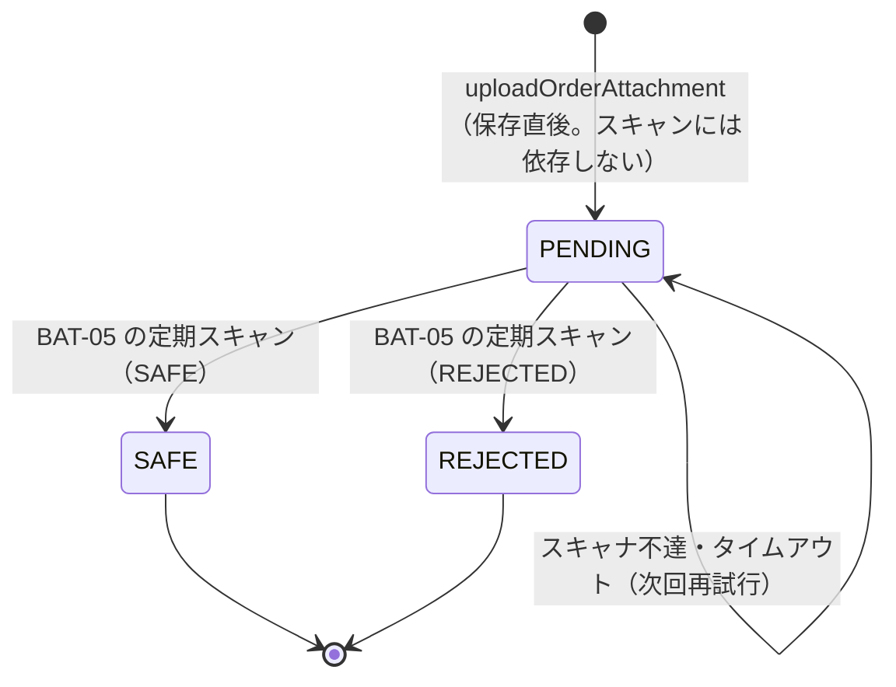
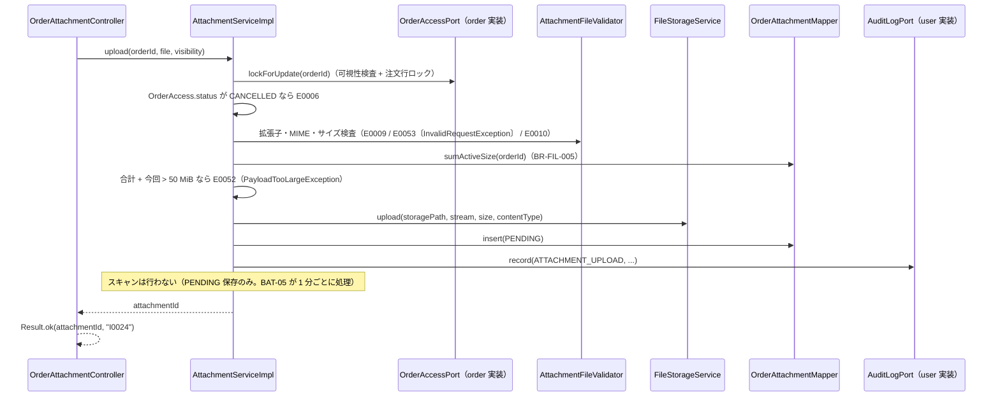
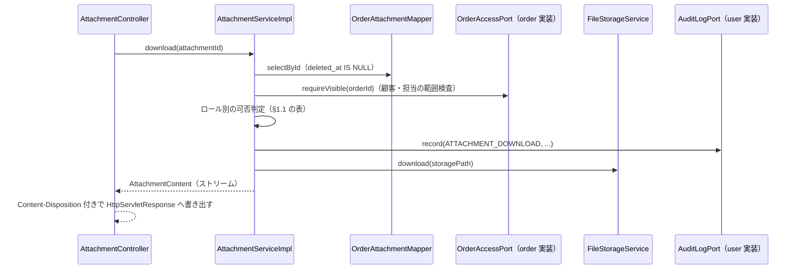

<!-- devtool:file-region id="document-header" -->
# 注文添付 詳細設計

> 詳細設計（内部設計）。`詳細設計/spec-detail-temp.md` の構成に従う。本書は単一情報源（SSOT）を参照するのみで、項目・列挙値・メッセージを再定義しない。
> 業務ルールの番号・内容は `基本設計/共通/spec-08-business-rule-list.md` を正とし、本書は実装手順（添付の一覧・アップロード・ダウンロード・削除、BAT-05 の定期ウイルススキャン、保持期限の清掃）を定める。
> 添付は独立画面を持たず、注文詳細（SCR-13）の添付パネルとアップロードダイアログ（SCR-13/DLG-4）で提供する（`基本設計/業務設計/order/spec-order-screen-ui.md` §3.3）。SCR-13 本体は `order` 機能に属し、本書は添付パネル（`AttachmentPanel`）の部品設計を定める。

<!-- devtool:end-file-region -->
<!-- devtool:block id="detail.attachment.detail-sd.s01" -->
## 文書情報

| 項目 | 内容 |
|------|------|
| システム名称 | DDMSAA 販売システム |
| 文書名称 | 注文添付 詳細設計 |
| 文書バージョン | V1.0 |
| ステータス | 草案 |
| 作成者 | TBD |
| 作成日 | 2026-10-21 |
| レビュー担当 | TBD |

<!-- devtool:endblock -->
<!-- devtool:block id="detail.attachment.detail-sd.s02" -->
## 改訂履歴

| バージョン | 改訂日 | 改訂者 | 改訂内容 |
|------|--------|--------|---------|
| V0.1 | 2026-10-20 | — | 簡易版（データ・API・処理・テスト・BR） |
| V1.0 | 2026-10-21 | — | `spec-detail-temp.md` の構成へ展開（§0〜§6.1）。テスト表を §5.1 へ移し UT-ID を `UT-FIL-NNN`（3 桁）に統一。BAT-04・BAT-05 とストレージ整合の詳細を追加 |
| V1.1 | 2026-10-21 | — | 統一修訂：Service 判定の 400（空ファイル `E0053`）を `InvalidRequestException` に変更（TBD-FIL-06 の E0053 部分を決定）。注文の範囲判定・行ロックを `OrderAccessPort`、監査記録を `AuditLogPort` に置換（TBD-FIL-03 解決。ポート定義は order 詳細設計 §1.1.1）。UT-FIL-049 を追加 |
| V1.2 | 2026-10-21 | — | 第 2 回統一修訂：(1) スキャンを BAT-05（1 分ごとの定期処理。`VirusScanService`）に一本化し、アップロード API はスキャンに依存せず `PENDING` 保存のみとした（`ScanRequestPublisher`・結果受信・コミット後依頼を廃止。TBD-FIL-01 解決）。(2) MIME 検出を Apache Tika `tika-core` の `Tika.detect(InputStream, 文件名)` と拡張子→許可 MIME 集合の表で確定（TBD-FIL-02 解決）。(3) 請求形式不正（`file` パート欠落・不正な列挙値）を 400 `E0008`（`RequestBinding`）に確定。(4) `PERMISSION_DENIED` を `AuditLogPort.recordDenied` で記録（403 は `PermissionDeniedAuditListener`、範囲外 404 は Port／本機能）。(5) スケジューラ基盤を `SchedulingConfig` に確定（TBD-FIL-07 解決）。(6) 列挙の置き場を `core.shared.enums` に確定。UT-FIL-040〜043 を BAT-05 の定期処理に改訂、UT-FIL-050〜053 を追加 |

---

<!-- devtool:endblock -->
<!-- devtool:block id="detail.attachment.detail-sd.s03" -->
## 0. 対象と根拠

| 項目 | 内容 |
|------|------|
| 関連機能 | F-ATT-01〜04 |
| 関連画面 | 独立画面なし。SCR-13（注文詳細）の添付パネル（F-ATT-01〜04）と SCR-13/DLG-4（添付アップロード）。SCR-13 本体の帰属は `order`（`詳細設計/業務/order/spec-order-detail-sd.md`）。CUSTOMER は SCR-13 の添付パネルで公開かつ SAFE のみ参照する |
| 関連 API | `listOrderAttachments`、`uploadOrderAttachment`、`downloadAttachment`、`deleteAttachment`（`spec-07-api-list.yaml`） |
| 関連バッチ | BAT-04 添付保持期限、BAT-05 添付スキャン（1 分ごとの定期処理。`spec-15-batch-design-ui.md`） |
| 関連テーブル | TBL-order-attachments、TBL-audit-logs（書込）、TBL-orders（`OrderAccessPort` 経由の可視性判定・行ロック・状態参照。SQL は order 側の実装）、TBL-users（アップロード者名）（`spec-06-db-physical.yaml`） |
| 業務ルール | BR-FIL-001〜006、BR-AUTH-003、BR-AUTH-006、BR-AUD-001 |
| 外部インタフェース | IF-02 オブジェクトストレージ（`FileStorageService`）、IF-04 ウイルススキャン（`VirusScanService`。BAT-05 のみが呼ぶ。`spec-08-external-interface-ui.md`） |
| 上流根拠 | `要件定義/requirements.md` §5.3、FR-07；`基本設計/業務設計/attachment/spec-attachment-business-ui.md`；`基本設計/業務設計/order/spec-order-screen-ui.md` §3.3；`基本設計/共通/spec-03-auth-ui.md` |

### 0.1 コード生成時のロード一覧（AI コンテキスト組み立て）

```
- 本ファイル
- 基本設計/共通/spec-06-db-physical.yaml      ← TBL-order-attachments / audit-logs、読取：orders / customers / customer-assignments / users
- 基本設計/共通/spec-07-api-list.yaml          ← 上記 operationId と AttachmentVO / AttachmentVisibility / ScanStatus（PayloadTooLarge 応答含む）
- 基本設計/共通/spec-09-message-list.yaml      ← I0012 I0024 W0010 E0001 E0002 E0005 E0006 E0008 E0009 E0010 E0012 E0030 E0032 E0052 E0053
- 基本設計/共通/spec-08-business-rule-list.md  ← BR-FIL / BR-AUTH-003・006 / BR-AUD-001
- 基本設計/共通/spec-03-auth-ui.md、spec-05 / spec-10 / spec-12（§3 メッセージ、§8 ダウンロード UX）、spec-15-batch-design-ui.md、spec-08-external-interface-ui.md
- 基本設計/業務設計/attachment/spec-attachment-business-ui.md、order/spec-order-screen-ui.md §3.3
- 基本設計/データベース/spec-data-dictionary-mapping-ui.md（§4.15、4.20）
- 基本設計/基盤/インタフェース仕様/spec-07-infrastructure.yaml（FileStorageService、§7.1 VirusScanService）・spec-03-exception-handler.yaml（PayloadTooLargeException・InvalidRequestException・RequestBinding）・spec-09-resource-file.yaml（`app.scan.*`）・spec-10-business-core.yaml・spec-project-structure.yaml（`tika-core`、`SchedulingConfig`）
- 開発規約/spec-naming-rule.md / spec-database-rule.md / spec-data-dictionary-project-temp.md（T07-9 添付公開範囲、T07-10 スキャン状態）
- 開発規約/spec-backend-coding-rule.md / spec-frontend-coding-rule.md / spec-test-rule.md
- 詳細設計/業務/order/spec-order-detail-sd.md（§1.1.1 跨モジュール ポート：`OrderAccessPort`・`AuditLogPort`・`DataScopePort` の定義）、詳細設計/業務/user/spec-user-detail-sd.md（`AuditLogPort` の実装）
```

### 0.2 マイクロサービス帰属

| 項目 | 内容 |
|------|------|
| 所属サービス | `business-service-core`（API・バッチとも） |
| パッケージ接頭辞 | `com.example.ddmsaa.core.attachment`（`controller` / `service` / `service.impl` / `mapper` / `entity` / `dto` / `convert`。バッチは `…core.attachment.batch`。スケジューリング有効化は共通の `com.example.ddmsaa.core.shared.config.SchedulingConfig`（`@Configuration @EnableScheduling`。全 feature 共用）に依存し、本機能では定義しない） |
| 基盤依存 | common（`Result`・`BusinessException`・`EntityNotFoundException`・`InvalidRequestException`・`PayloadTooLargeException`）、infrastructure（`FileStorageService`・`VirusScanService`〔`ClamdVirusScanService`／`NoopVirusScanService`。`app.scan.type` で切替〕・`UserContext`・`MetaObjectHandler`・DB）、外部ライブラリ `tika-core`（MIME 検出） |
| 他機能への依存（ポート） | 中立パッケージ `com.example.ddmsaa.core.shared.port` の `OrderAccessPort`（order が実装。`requireVisible`／`lockForUpdate`）と `AuditLogPort`（user の `AuditLogServiceImpl` が実装。`record`／`recordDenied` の 2 メソッド）を利用する。定義は order 詳細設計 §1.1.1 を参照。本機能が実装するポートはない。`order` の Service／Mapper は直接参照しない（`spec-backend-coding-rule.md` §2） |
| DB アクセス権限 | 全表の CRUD（business-service-core） |

---

<!-- devtool:endblock -->
<!-- devtool:block id="detail.attachment.detail-sd.s04" -->
## 1. バックエンド詳細設計

### 1.1 クラス一覧

| 層 | クラス名 | パッケージ | 責務 | 対応 |
|----|------|----|------|------|
| Controller | `OrderAttachmentController` | `com.example.ddmsaa.core.attachment.controller` | `/api/v1/orders/{orderId}/attachments`（一覧・アップロード）の受付。アップロードは `multipart/form-data`（`file`・`visibility`） | `listOrderAttachments`、`uploadOrderAttachment` |
| Controller | `AttachmentController` | 同上 | `/api/v1/attachments/{attachmentId}`（ダウンロード・削除）の受付。ダウンロードは `Result` で包まず `HttpServletResponse` へ直接書き出す（coding-rule §3） | `downloadAttachment`、`deleteAttachment` |
| Service | `AttachmentService` / `AttachmentServiceImpl` | `…attachment.service` / `…service.impl` | 一覧・アップロード・ダウンロード（ストリームの取得）・削除、範囲判定・状態検査・容量検査・トランザクション境界 | F-ATT-01〜04 |
| Component | `AttachmentFileValidator` | `…attachment.service.impl` | 拡張子と Tika 検出 MIME の許可組合せ（§1.2.2 の表）、サイズ（0 バイト／1 ファイル 10 MiB）の検査 | F-ATT-02 |
| Service | `AttachmentScanService` / `AttachmentScanServiceImpl` | `…attachment.service` / `…service.impl` | PENDING の添付の取得（`FOR UPDATE SKIP LOCKED`）・ストレージからの取り出し・`VirusScanService.scan`・SAFE／REJECTED の反映（1 件 1 トランザクション）・24 時間超 PENDING の検知（BAT-05） | BAT-05 |
| Service | `AttachmentRetentionService` / `AttachmentRetentionServiceImpl` | 同上 | 保持期限超過の論理削除、削除済み添付の物理削除の記録（BAT-04。1 件ごとのトランザクション） | BAT-04 |
| Batch | `AttachmentScanJob` | `…attachment.batch` | `@Scheduled` で 1 分ごとに起動する BAT-05 の本体（`AttachmentScanService` を呼ぶだけ。トランザクションなし） | BAT-05 |
| Batch | `AttachmentRetentionJob` | `…attachment.batch` | `@Scheduled` で毎日 03:00 に起動する BAT-04 の本体（トランザクションなし） | BAT-04 |
| Mapper | `OrderAttachmentMapper` | `…attachment.mapper` | order_attachments の検索・合計容量の集計・INSERT・論理削除・スキャン対象（PENDING）の取得と状態更新・24 時間超 PENDING の件数・保持期限対象の取得 | TBL-order-attachments |
| Entity | `OrderAttachment` | `…attachment.entity` | テーブルマッピング | TBL-order-attachments |
| DTO | `AttachmentVo`（`AttachmentVO`）、`AttachmentContent`（ダウンロード用の内部 DTO：ファイル名・コンテンツタイプ・サイズ・`InputStream`。API スキーマではない） | `…attachment.dto` | `AttachmentVo` は `spec-07-api-list.yaml` の schema に準拠 | — |
| 列挙 | `AttachmentVisibility`（T07-9）、`ScanStatus`（T07-10）（本機能は参照のみ） | `com.example.ddmsaa.core.shared.enums`（`Role` は `com.example.ddmsaa.common.enums`） | `int code` + `fromCode`（`assets/enum.java.tmpl`）。置き場は `spec-backend-coding-rule.md` §2。feature 配下には置かない | — |
| 変換 | `AttachmentConverter` | `…attachment.convert` | Entity ↔ DTO（MapStruct） | — |

> 注文の可視性判定（データ範囲）・行ロック・状態参照は `OrderAccessPort`（`requireVisible`／`lockForUpdate`。戻り値は読取専用の `OrderAccess{id, customerId, salesUserId, status}`）を利用し、監査ログの記録は `AuditLogPort.record` を利用する。いずれも order 詳細設計 §1.1.1 を参照（TBD-FIL-03 は解決済み）。`order` の Service／Mapper は直接参照しない。`PERMISSION_DENIED` の記録は `AuditLogPort.recordDenied(targetType, targetId)`（`REQUIRES_NEW`）で、403 は core の `PermissionDeniedAuditListener` が、範囲外の 404 は範囲判定を行う `OrderAccessPort`（注文）と本機能（添付の公開範囲。§1.2.3）が呼ぶ。ストレージは `infrastructure` の `FileStorageService`（実装は `LocalFileStorageService`／`S3FileStorageService`。`app.file.storage-type` で切替）。ウイルススキャンは `infrastructure.scan.VirusScanService`（BAT-05 のみが利用）。

#### 状態の整理（正本：BR-FIL-003・BR-FIL-004・BR-FIL-006、`spec-15-batch-design-ui.md` BAT-04・05）

**スキャン状態（`order_attachments.scan_status`、T07-10）**



| 現状態 | イベント | 遷移後 | 禁止 |
|------|------|------|------|
| PENDING | BAT-05 のスキャン結果 | SAFE／REJECTED | — |
| PENDING | BAT-05 でスキャナ不達・タイムアウト・ストレージ取得失敗 | PENDING のまま | 更新しない。次回起動で再試行 |
| SAFE／REJECTED | BAT-05 | （対象外。取得条件が `scan_status=PENDING` のため再スキャンされない） | 状態を書き換えない（BR-FIL-003、`spec-15` BAT-05） |
| （全状態） | 利用者による変更 | — | 利用者・API が `scan_status` を変更する経路はない |

**ダウンロード可否（`downloadAttachment`）**

| ロール | 条件 | 結果 |
|------|------|------|
| ADMIN | 全注文の添付。`SAFE` | 配信 |
| ADMIN | `PENDING`／`REJECTED` | 409 `E0006` |
| EMPLOYEE | 担当顧客の注文の添付（範囲外は 404 `E0005`）。`SAFE` | 配信 |
| EMPLOYEE | 範囲内の `PENDING`／`REJECTED` | 409 `E0006` |
| CUSTOMER | 自社注文かつ `visibility=CUSTOMER` かつ `SAFE` | 配信 |
| CUSTOMER | 上記を満たさない（`INTERNAL`、`PENDING`、`REJECTED`、他社注文） | 404 `E0005`（存在を開示しない。BR-FIL-004・BR-AUTH-006） |
| 全ロール | 削除済み（`deleted_at IS NOT NULL`） | 404 `E0005` |
| 全ロール | 注文が CANCELLED | 配信可（BR-FIL-001） |

### 1.2 API 別詳細設計

> すべての API で、成功は HTTP 200 + `Result`（`downloadAttachment` を除く）、権限不足は 403 `E0002`、未認証・JWT 期限切れは 401 `E0001`（Gateway 起因は `E0040`・`E0041`）。`@PreAuthorize` は `x-roles` に一致させる。HTTP は `spec-backend-coding-rule.md` §4 の固定集合に従う。注文のデータ範囲外の 1 件は 404 `E0005`（BR-AUTH-006）。請求形式の不正（`file` パート欠落・不正な列挙値・JSON 不正）は一律 400 `E0008`（`RequestBinding`。`details[]`、解析器のメッセージは返さない）。権限不足の 403 は core の `PermissionDeniedAuditListener` が `AuditLogPort.recordDenied` で `PERMISSION_DENIED` を記録する（Service は関与しない）。

#### 1.2.1 `listOrderAttachments` 添付一覧（`GET /api/v1/orders/{orderId}/attachments`）

| 項目 | 内容 |
|------|------|
| operationId | `listOrderAttachments` |
| 対応機能 | F-ATT-01 |
| ロール・権限 | `@PreAuthorize("hasAnyRole('ADMIN','EMPLOYEE','CUSTOMER')")`。データ範囲は注文の参照権限（ADMIN 全件、EMPLOYEE 担当顧客、CUSTOMER 自社。BR-AUTH-003） |
| リクエスト | パスパラメータ `orderId`（`OD`+8 桁） |
| レスポンス | `Result<List<AttachmentVO>>`（ページングなし。並び順は TBD-FIL-08） |

**処理ロジック**

```
1. OrderAccessPort.requireVisible(orderId) で注文の可視性（データ範囲）を検査する。範囲外・不存在・論理削除済みは Port が EntityNotFoundException("E0005")（404）を送出する
2. OrderAttachmentMapper.selectByOrderId で当該注文の添付を取得する（deleted_at IS NULL。uploadedByName は users.user_name を created_by で結合）
3. ロールで絞り込む：
   - ADMIN／EMPLOYEE：すべて返す（INTERNAL・CUSTOMER、PENDING・SAFE・REJECTED。画面はスキャン状態を表示する）
   - CUSTOMER：visibility=CUSTOMER かつ scan_status=SAFE のみ（SQL の条件に必ず付与する。BR-FIL-004）
4. AttachmentConverter で AttachmentVO にする（storage_path は返さない。visibility・scanStatus は列挙へ変換。uploadedBy = created_by、uploadedAt = created_at）
5. Result.ok(list) を返す
```

**トランザクション**：`@Transactional(readOnly = true)`（`AttachmentServiceImpl.listOrderAttachments()`）。関連テーブル：TBL-order-attachments・TBL-orders・TBL-users（読取）。

**DB アクセス**

| Mapper メソッド | 操作 | 対象テーブル.カラム | 主要条件 |
|------------|------|----------|---------|
| `OrderAttachmentMapper.selectByOrderId` | SELECT | `order_attachments.id/original_file_name/content_type/file_size/visibility/scan_status/created_by/created_at`、`users.user_name` | `order_id = #{orderId} AND deleted_at IS NULL`（CUSTOMER は `AND visibility = 2 AND scan_status = 2`。`idx_ord_atts_order_vis_scan`） |

**利用する共通コンポーネント**：`UserContext`（ロール・ユーザー ID）、`OrderAccessPort.requireVisible`（order 詳細設計 §1.1.1）、`MaskingService`（マスク対象項目なし）。

**例外 → messageId → HTTP**

| シナリオ | 例外 | messageId | HTTP |
|------|------|-----------|------|
| 範囲外・不存在の注文 | `EntityNotFoundException`（範囲外の場合は `OrderAccessPort` が事前に `recordDenied` を呼ぶ） | `E0005` | 404 |
| 注文 ID の形式不正など請求形式不正 | `MethodArgumentTypeMismatchException`（`RequestBinding`） | `E0008` | 400 |

**正常レスポンス**：`Result<List<AttachmentVO>>`（messageId なし）。

#### 1.2.2 `uploadOrderAttachment` 添付アップロード（`POST /api/v1/orders/{orderId}/attachments`）

| 項目 | 内容 |
|------|------|
| operationId | `uploadOrderAttachment` |
| 対応機能 | F-ATT-02 |
| ロール・権限 | `@PreAuthorize("hasAnyRole('ADMIN','EMPLOYEE')")`。EMPLOYEE は担当顧客の注文のみ（BR-FIL-001・BR-AUTH-003）。CUSTOMER は 403 `E0002` |
| リクエストスキーマ | `multipart/form-data`：`file`（必須。PDF／DOCX／XLSX／CSV／PNG／JPG／JPEG）、`visibility`（必須。`AttachmentVisibility`：INTERNAL／CUSTOMER） |
| レスポンス | `Result<String>`（採番した添付 ID `AT`+8 桁。`messageId=I0024`。保存完了であり、ダウンロード可能を意味しない） |

**シーケンス**



**入力検証**

| 項目 | ルール | 違反時 messageId | HTTP |
|------|------|--------------|------|
| `file` | 必須（multipart の `file` パート欠落は不可）。`MissingServletRequestPartException`（`RequestBinding`） | `E0008` | 400 |
| `file` のファイル名 | 255 文字以内（`original_file_name` は `varchar(255)`）。Controller のメソッド検証（`@Validated`）で検査する | `E0008` | 400 |
| `visibility` | 必須・INTERNAL／CUSTOMER。欠落は `MissingServletRequestParameterException`、不正な列挙値は `MethodArgumentTypeMismatchException`（いずれも `RequestBinding`） | `E0008` | 400 |
| 拡張子と検出 MIME | 許可組合せ（下表）。表にない拡張子・検出 MIME が表の集合に含まれない場合は不可 | `E0009` | 409 |
| サイズ（空） | 0 バイトは不可（BR-FIL-002）。Bean Validation で表せないため Service が `InvalidRequestException("E0053", "file", 理由)` を送出する | `E0053` | 400 |
| サイズ（1 ファイル） | 10 MiB（10,485,760 バイト）超は不可。ちょうど 10 MiB は可。DB は `chk_ord_atts_file_size`（1〜10485760） | `E0010` | 413 |
| サイズ（注文合計） | 既存の合計 + 今回が 50 MiB（52,428,800 バイト）を超える場合は不可。ちょうど 50 MiB は可（BR-FIL-005） | `E0052` | 413 |

**許可する拡張子と検出 MIME の組合せ**（BR-FIL-002 の形式から導出。MIME は Apache Tika `tika-core`（2.9.2。`spec-project-structure.yaml` の `tika.version`）の `new Tika().detect(InputStream, 元のファイル名)` で内容から検出する。クライアントが送る `Content-Type` は信用しない）

拡張子（小文字化。最後の `.` 以降）を表で引き、検出 MIME が「許可される検出 MIME の集合」に含まれれば通過する。表にない拡張子、または検出 MIME が集合に含まれない場合は 409 `E0009`。

| 拡張子 | 許可される検出 MIME の集合 |
|------|------|
| `pdf` | `application/pdf` |
| `png` | `image/png` |
| `jpg`・`jpeg` | `image/jpeg` |
| `csv` | `text/csv`、`text/plain`（Tika は内容により `text/plain` を返すため両方を許可） |
| `docx` | `application/vnd.openxmlformats-officedocument.wordprocessingml.document` |
| `xlsx` | `application/vnd.openxmlformats-officedocument.spreadsheetml.sheet` |

> 実装時に、各形式の実サンプルファイル（正常ファイル・拡張子偽装ファイル・空に近いファイル・UTF-8／Shift_JIS の CSV・OOXML）で Tika の検出結果を検証し、本表を確定させる（`detect` にファイル名を渡すためファイル名がヒントとして働く点にも注意し、内容が優先される組合せを確認する）。検出に使うストリームは保存用とは別に `MultipartFile.getInputStream()` を開く。

**処理ロジック**

```
1. ロールを確認する：CUSTOMER は @PreAuthorize で 403 E0002（Service に入らない）。注文の可視性・範囲の判定は手順 2 の Port が行う
2. OrderAccessPort.lockForUpdate(orderId) を呼ぶ（可視性検査と注文行の SELECT ... FOR UPDATE を一括して行う。BR-FIL-005：同一注文への同時アップロード・取消しを直列化する）。範囲外（EMPLOYEE の担当外を含む）・不存在は Port が EntityNotFoundException("E0005")（404）を送出する。戻り値 OrderAccess.status が CANCELLED なら BusinessException("E0006")（409。BR-FIL-001）
3. （ファイル名 255 文字以内・`visibility`・`file` の必須は Controller の入力検証で済んでいる。400 `E0008`。手順 1 より前に検査される）AttachmentFileValidator で拡張子（小文字化して比較）とTika の検出 MIME（`Tika.detect(InputStream, 元のファイル名)`。クライアントが送る Content-Type は信用しない）が上表の許可集合に含まれることを検査する。不可・表にない拡張子は BusinessException("E0009")（409）
4. サイズを検査する（BR-FIL-002）：0 バイトは InvalidRequestException("E0053", "file", 理由)（400。Service 判定の 400）、10 MiB 超は PayloadTooLargeException("E0010")（413）。サイズは MultipartFile.getSize() による。フレームワークの上限（TBD-FIL-04）を超えた場合は MaxUploadSizeExceededException として同じ 413 E0010 になる
5. 注文の合計容量を求める：SELECT COALESCE(SUM(file_size), 0) FROM order_attachments WHERE order_id = ? AND deleted_at IS NULL AND scan_status <> 3(REJECTED)（BR-FIL-005）。合計 + 今回のサイズ > 52,428,800 なら PayloadTooLargeException("E0052")（413）。BusinessException は 409 になるため使わない（coding-rule §4）
6. ランダムな storage_path を発行する（UUID ベース。元のファイル名・注文 ID・拡張子を含めない）。FileStorageService.upload(storagePath, stream, size, 検出 MIME) で保存する。保存失敗は RuntimeException のまま伝播し 500 E0012・ロールバック（IF-02）
7. order_attachments を INSERT：order_id、original_file_name（元のファイル名）、storage_path、content_type（検出 MIME）、file_size、visibility、scan_status=PENDING（code 1）、storage_purged_at=NULL。id は DB の next_business_id('AT', 8)。created_by（アップロード者）は MetaObjectHandler が、created_at（日時）は DB の既定値が自動設定
8. AuditLogPort.record("ATTACHMENT_UPLOAD", "ATTACHMENT", 添付 ID, detail{orderId, fileSize, visibility}) を同一トランザクション内で呼ぶ（audit_logs への INSERT は user 側の実装。ファイル本体・ファイル内容を detail に含めない。BR-AUD-001）
9. トランザクション同期を登録する：ロールバック時は手順 6 で保存したオブジェクトを FileStorageService.delete で削除する（孤児オブジェクトを残さない。削除失敗は WARN ログ）。アップロード API はウイルススキャンを呼ばず、依頼の登録もしない（PENDING のまま保存するだけ。BAT-05 が 1 分ごとに PENDING を拾ってスキャンし、SAFE になるまで配信されない）
10. Result.ok(添付 ID, "I0024", 添付 ID) を返す
```

**トランザクション**

| 項目 | 内容 |
|------|------|
| 範囲 | `@Transactional` を `AttachmentServiceImpl.upload()` に付与（コミット後の副作用なし。スキャンは BAT-05） |
| 関連テーブル | TBL-order-attachments（書込）、TBL-audit-logs（`AuditLogPort` 経由で書込）、TBL-orders（`OrderAccessPort.lockForUpdate` による行ロック）、TBL-users（アップロード者名。読取） |
| ロールバック条件 | いずれかの手順で例外（`BusinessException`・`InvalidRequestException`・`PayloadTooLargeException`・`EntityNotFoundException`・ストレージ・DB 例外）が発生した場合は全体をロールバックし、保存済みのオブジェクトは補償削除する |

**DB アクセス**

| Mapper メソッド | 操作 | 対象テーブル.カラム | 主要条件 |
|------------|------|----------|---------|
| （`OrderAccessPort.lockForUpdate` の内部。order 側の Mapper。本機能の Mapper ではない） | SELECT ... FOR UPDATE | `orders.id/customer_id/sales_user_id/status` | `id = #{orderId} AND deleted_at IS NULL` ＋データ範囲 |
| `OrderAttachmentMapper.sumActiveSize` | SELECT | `SUM(order_attachments.file_size)` | `order_id = #{orderId} AND deleted_at IS NULL AND scan_status <> 3` |
| `OrderAttachmentMapper.insert` | INSERT | `order_attachments`（`uq_ord_atts_storage_path`） | — |
| （`AuditLogPort.record` の内部。user 側の実装） | INSERT | `audit_logs` | — |

**利用する共通コンポーネント**

| コンポーネント | 用途 |
|------|------|
| `FileStorageService` | `upload`／（補償）`delete`。実体は `app.file.storage-type` で切替 |
| `UserContext` | ロール・ユーザー ID |
| `OrderAccessPort.lockForUpdate` | 可視性検査・注文行ロック・注文状態（`OrderAccess.status`）の取得（order 詳細設計 §1.1.1） |
| `AuditLogPort.record` | `ATTACHMENT_UPLOAD` の記録（user の `AuditLogServiceImpl` が実装） |
| Apache Tika（`tika-core`） | 検出 MIME の取得（`AttachmentFileValidator` 内） |

**例外 → messageId → HTTP**

| シナリオ | 例外 | messageId | HTTP |
|------|------|-----------|------|
| ファイル名 256 文字以上 | `ConstraintViolationException`（Controller のメソッド検証） | `E0008` | 400 |
| `file` パート欠落 | `MissingServletRequestPartException`（`RequestBinding`） | `E0008` | 400 |
| `visibility` 欠落／不正な列挙値 | `MissingServletRequestParameterException`／`MethodArgumentTypeMismatchException`（`RequestBinding`） | `E0008` | 400 |
| 権限不足（CUSTOMER） | `AccessDeniedException` | `E0002` | 403 |
| 範囲外・不存在の注文 | `EntityNotFoundException`（範囲外は `OrderAccessPort` が事前に `recordDenied`） | `E0005` | 404 |
| 注文が CANCELLED | `BusinessException` | `E0006` | 409 |
| 許可外の拡張子・MIME 不一致 | `BusinessException` | `E0009` | 409 |
| 空ファイル | `InvalidRequestException`（決定済み。`spec-03-exception-handler.yaml`） | `E0053` | 400 |
| 1 ファイルが 10 MiB 超 | `PayloadTooLargeException`／`MaxUploadSizeExceededException` | `E0010` | 413 |
| 注文合計が 50 MiB 超 | `PayloadTooLargeException` | `E0052` | 413 |
| ストレージ保存失敗・DB 例外 | `RuntimeException`／`DataAccessException` | `E0012` | 500 |

**正常レスポンス**：`Result<String>`、`I0024`（`{0}` は使わない文言だが `messageArgs` に添付 ID を渡してもよい）。`scanStatus` は PENDING で登録される（BAT-05 が最大 1 分程度の周期で SAFE／REJECTED に更新する）。

#### 1.2.3 `downloadAttachment` 添付ダウンロード（`GET /api/v1/attachments/{attachmentId}/download`）

| 項目 | 内容 |
|------|------|
| operationId | `downloadAttachment` |
| 対応機能 | F-ATT-03 |
| ロール・権限 | `@PreAuthorize("hasAnyRole('ADMIN','EMPLOYEE','CUSTOMER')")`。毎回、添付・注文・利用者の範囲を再認可する（BR-FIL-003・BR-FIL-004。spec-03 §5-4） |
| リクエスト | パスパラメータ `attachmentId`（`AT`+8 桁） |
| レスポンス | バイナリ（`application/octet-stream`。`Result` で包まない。`Content-Disposition` 付き）。ストレージの URL を返さない |

**シーケンス**



**処理ロジック**

```
1. order_attachments を id で取得する（deleted_at IS NULL）。不存在・削除済みは EntityNotFoundException("E0005")（404）
2. OrderAccessPort.requireVisible(添付の order_id) で注文の可視性を検査する（EMPLOYEE は担当顧客、CUSTOMER は自社。範囲外・不存在は Port が EntityNotFoundException("E0005")＝404。BR-AUTH-006）
3. ロール別の可否判定（§1.1 の表）：
   - CUSTOMER：visibility が INTERNAL の添付は AuditLogPort.recordDenied("ATTACHMENT", 添付 ID) を呼んでから E0005（404。範囲外の 1 件参照。BR-AUTH-006。recordDenied は REQUIRES_NEW）。visibility=CUSTOMER でも scan_status が SAFE でなければ記録せず E0005（404。スキャン未完了・拒否は権限拒否ではない）
   - ADMIN・EMPLOYEE：scan_status が SAFE でなければ BusinessException("E0006")（409。PENDING・REJECTED は配信しない。BR-FIL-003）
   - 注文の状態（CANCELLED を含む）は問わない（BR-FIL-001）
4. AuditLogPort.record("ATTACHMENT_DOWNLOAD", "ATTACHMENT", 添付 ID, detail) を呼ぶ（audit_logs への INSERT は user 側の実装）
5. FileStorageService.download(storage_path) の InputStream を AttachmentContent に入れて返す。実体が無い場合は EntityNotFoundException（E0005）が基盤から送出される
6. Controller は Content-Type（保存した content_type）、Content-Length（file_size）、Content-Disposition: attachment（filename* に original_file_name を RFC 5987 の UTF-8 エンコードで指定）を設定し、ストリームを HttpServletResponse に書き出す。X-Content-Type-Options: nosniff を付与する。ストレージの URL・storage_path を応答・ログに出さない
```

**トランザクション**：`@Transactional`（`AttachmentServiceImpl.download()`。書込は監査 INSERT のみ。`recordDenied` は別事務〔`REQUIRES_NEW`〕のため 404 でロールバックされても残る。ストリームの読出は Controller がトランザクションの外で行い、書き出し中の失敗は監査をロールバックしない）。関連テーブル：TBL-order-attachments（読取）、TBL-orders（`OrderAccessPort` 経由で読取）、TBL-audit-logs（`AuditLogPort` 経由で書込）。

**DB アクセス**：`OrderAttachmentMapper.selectById`（SELECT。`order_attachments.*`）。注文の可視性は `OrderAccessPort.requireVisible`、監査の INSERT は `AuditLogPort.record`／`recordDenied` の内部（いずれも他機能の実装）。

**利用する共通コンポーネント**：`FileStorageService.download`、`UserContext`、`OrderAccessPort.requireVisible`、`AuditLogPort.record`／`recordDenied`。

**例外 → messageId → HTTP**

| シナリオ | 例外 | messageId | HTTP |
|------|------|-----------|------|
| 添付・注文が不存在、範囲外、削除済み、CUSTOMER から見えない添付（範囲外・INTERNAL は事前に `recordDenied`） | `EntityNotFoundException` | `E0005` | 404 |
| ADMIN・EMPLOYEE が PENDING／REJECTED をダウンロード | `BusinessException` | `E0006` | 409 |
| ストレージ読出失敗 | `RuntimeException` | `E0012` | 500 |

> `downloadAttachment` の `x-roles` には CUSTOMER を含むため `@PreAuthorize` による 403 はない（全ロール可）。ロールで許可されない場合に相当するのは範囲外の 404 である。

**正常レスポンス**：HTTP 200、ファイルのバイナリ（messageId なし）。

#### 1.2.4 `deleteAttachment` 添付削除（`DELETE /api/v1/attachments/{attachmentId}`）

| 項目 | 内容 |
|------|------|
| operationId | `deleteAttachment` |
| 対応機能 | F-ATT-04 |
| ロール・権限 | `@PreAuthorize("hasAnyRole('ADMIN','EMPLOYEE')")`。EMPLOYEE は担当顧客の注文のみ（BR-FIL-001）。CUSTOMER は 403 `E0002` |
| リクエスト | パスパラメータ `attachmentId` |
| レスポンス | `Result<Void>`（`messageId=I0012`） |

**処理ロジック**

```
1. order_attachments を id で取得する（deleted_at IS NULL）。不存在・削除済みは EntityNotFoundException("E0005")（404）
2. OrderAccessPort.lockForUpdate(添付の order_id) を呼ぶ（可視性検査と注文行ロックを一括。EMPLOYEE の担当外・範囲外は Port が EntityNotFoundException("E0005")＝404。アップロード・取消しと直列化する）
3. 戻り値 OrderAccess.status が CANCELLED なら BusinessException("E0006")（409。BR-FIL-001）
4. 論理削除する：UPDATE order_attachments SET deleted_at = 現在時刻 WHERE id = ? AND deleted_at IS NULL。物理ファイルはここでは削除しない（BAT-04 が削除して storage_purged_at を記録する）。PENDING・SAFE・REJECTED のいずれも削除できる
5. AuditLogPort.record("ATTACHMENT_DELETE", "ATTACHMENT", 添付 ID, detail) を呼ぶ（audit_logs への INSERT は user 側の実装）
6. Result.ok(null, "I0012") を返す。削除により注文合計の算定から外れる（BR-FIL-005）
```

**トランザクション**：`@Transactional`（`AttachmentServiceImpl.delete()`）。書込：order_attachments（audit_logs は `AuditLogPort` 経由）。ロールバック条件：いずれかで例外が発生した場合。

**DB アクセス**：`OrderAttachmentMapper.selectById`、`OrderAttachmentMapper.logicalDelete`（UPDATE）。注文の可視性・行ロックは `OrderAccessPort.lockForUpdate`、監査の INSERT は `AuditLogPort.record` の内部（いずれも他機能の実装）。

**例外 → messageId → HTTP**

| シナリオ | 例外 | messageId | HTTP |
|------|------|-----------|------|
| 権限不足（CUSTOMER） | `AccessDeniedException` | `E0002` | 403 |
| 添付が不存在・削除済み・範囲外（範囲外は `OrderAccessPort` が事前に `recordDenied`） | `EntityNotFoundException` | `E0005` | 404 |
| 注文が CANCELLED | `BusinessException` | `E0006` | 409 |

**正常レスポンス**：`Result<Void>`、`I0012`。

### 1.3 Entity / DTO / VO マッピング

| Entity 項目 | DTO 項目 | 変換 | 命名変更の登録 |
|------------|---------|------|------------|
| `OrderAttachment.id` | `AttachmentVO.id` | 直接 | なし |
| `OrderAttachment.originalFileName` | `originalFileName` | 直接 | なし |
| `OrderAttachment.contentType` | `contentType` | 直接 | なし |
| `OrderAttachment.fileSize`（numeric） | `fileSize`（int64） | `long` へ変換（バイト） | なし |
| `OrderAttachment.visibility`（Integer） | `visibility`（`AttachmentVisibility`） | `fromCode` / `getCode` | なし |
| `OrderAttachment.scanStatus`（Integer） | `scanStatus`（`ScanStatus`） | `fromCode` / `getCode` | なし |
| `OrderAttachment.createdBy` / `users.userName`（結合） | `uploadedBy` / `uploadedByName` | 名称変更 | 登録済み（辞書 §4.20 `uploadedBy / uploadedAt`） |
| `OrderAttachment.createdAt` | `uploadedAt` | 名称変更 | 登録済み（辞書 §4.20） |
| `OrderAttachment.storagePath` / `deletedAt` / `storagePurgedAt` / `orderId` | （出力しない） | `storagePath` は利用者へ返さない（IF-02・BR-FIL-003） | — |

> 暗号化・マスキング対象の項目はない。CUSTOMER が参照できる行は SQL で公開かつ SAFE に絞る（マスクではなく行の除外。BR-FIL-004）。`storage_path` はどの API・ログにも出さない。

---

<!-- devtool:endblock -->
<!-- devtool:block id="detail.attachment.detail-sd.s05" -->
## 2. フロントエンド詳細設計

### 2.1 画面別コンポーネント分解

> 添付は独立画面を持たず、SCR-13（注文詳細。`order` 機能の `OrderDetailPage`）の「添付」タブ（添付パネル）と SCR-13/DLG-4（添付アップロード）として展開する。コンポーネントは `frontend/src/components/attachment/`、型は `frontend/src/types/attachment.ts`、API クライアントは `frontend/src/api/attachment-api.ts`（関数名＝operationId）。共通の HTTP 層・i18n・ルートガードは `spec-frontend-coding-rule.md` と `spec-12-screen-common-ui.md`（§3 メッセージ、§8 ダウンロード UX）に従う。型の列挙は Union Type（`enum` 禁止）。画面のユニットテストは `単体テスト/フロントエンド/` の仕様書で管理する。

#### SCR-13 添付パネル（F-ATT-01〜04）／ DLG-4 添付アップロード

**コンポーネントツリー**

```
OrderDetailPage (src/pages/order/order-detail-page.tsx)   ← order 機能。「添付」タブに AttachmentPanel を配置する
└── AttachmentPanel          (src/components/attachment/attachment-panel.tsx)          取得・状態管理・注記・アップロードボタン
    ├── AttachmentTable      (src/components/attachment/attachment-table.tsx)          一覧（ファイル名・サイズ・公開範囲・スキャン状態・アップロード者・日時・操作）
    └── AttachmentUploadModal (src/components/attachment/attachment-upload-modal.tsx)  SCR-13/DLG-4（ファイル選択・公開範囲・事前検査）
```

`AttachmentPanel` の props：`orderId: string`、`orderStatus: OrderStatus`（CANCELLED のとき操作ボタンを出さない）、`role: Role`（表示制御）。データ範囲と最終的な可否は API が判定する。

**状態・データ**

| 状態 | 型 | 取得元 API | 説明 |
|------|------|---------|------|
| `attachments` | `AttachmentVo[]` | `listOrderAttachments` | パネルごとに取得。読込中はスケルトン、0 件は「なし」（spec-12 §5。`order` の §4 画面状態に準拠） |
| `panelError` | `string \| null`（messageId） | `listOrderAttachments` | 副リソースの 404（`E0005`）は SCR-20 へ遷移せず、パネル内に表示する（spec-12 §3） |
| `uploading` | `boolean` | `uploadOrderAttachment` | 送信中はボタンを無効化（二重送信防止） |
| `form` | `{ file: File \| null, visibility: AttachmentVisibility }` | — | `visibility` の既定は `INTERNAL` |
| `downloadingId` | `string \| null` | `downloadAttachment` | ダウンロード中の行 |

**イベント → API 対応**

| イベント | operationId | 入力 | 成功時処理 | 失敗時処理 |
|------|--------|------|---------|---------|
| 添付タブ表示 | `listOrderAttachments` | `orderId` | 一覧表示 | `E0005` をパネル内に表示（画面は移動しない） |
| アップロード（DLG-4 の保存） | `uploadOrderAttachment` | `multipart/form-data`（`file`・`visibility`。`Content-Type` は手設定せずブラウザに任せる） | `I0024`（「確認中でダウンロードできない」案内）を表示 → ダイアログを閉じて一覧を再読込 | 413 `E0010`・`E0052`、400 `E0053`・`E0008`、409 `E0009`・`E0006`、404 `E0005` はダイアログ内に表示（spec-12 §3）。`E0006`（CANCELLED）は一覧も再読込 |
| ダウンロード（`scanStatus=SAFE` の行のみ有効） | `downloadAttachment` | `attachmentId` | blob を受け取り、`Content-Disposition` のファイル名で保存（ストレージ URL を画面に埋め込まない） | エラー応答（blob）を JSON として `ErrorResponse` に変換して `messageId` を表示：`E0006`・`E0005` はパネル内に表示し一覧を再読込 |
| 削除（確認 `W0010` 後） | `deleteAttachment` | `attachmentId` | `I0012` を表示し一覧を再読込 | `E0006`（CANCELLED）・`E0005` を表示し再読込 |
| 手動更新 | `listOrderAttachments` | `orderId` | スキャン状態の反映（自動ポーリングの有無は `order` の TBD-O5） | — |

**クライアント検証**（バックエンド検証と整合させる。UX 向けであり、バックエンド検証の代替ではない）

| 項目 | ルール | 表示 messageId |
|------|------|--------------|
| ファイル | 必須（未選択） | `E0030`（`{0}`＝ファイル） |
| ファイル | 拡張子が PDF／DOCX／XLSX／CSV／PNG／JPG／JPEG のいずれか（大文字小文字を区別しない） | `E0009` |
| ファイル | サイズが 0 バイトでない | `E0053` |
| ファイル | サイズが 10 MiB 以下 | `E0010` |
| ファイル名 | 255 文字以内 | `E0032`（`{0}`＝ファイル名、`{1}`＝255） |
| 公開範囲 | 必須（INTERNAL／CUSTOMER） | `E0030` |
| 注文合計 50 MiB | クライアントでは判定しない。サーバーが 413 `E0052` で返す（`order` の画面設計 §3.3） | `E0052`（サーバー応答） |

**ロール別表示制御**（`spec-03-auth-ui.md`）

| 要素 | ADMIN | EMPLOYEE（担当） | CUSTOMER |
|------|:-------:|:----------:|:--------:|
| 添付パネル（タブ） | ○ | ○ | ○ |
| 一覧に出る添付 | 全件（INTERNAL・CUSTOMER、PENDING・SAFE・REJECTED） | 全件（担当注文） | 公開（`CUSTOMER`）かつ SAFE のみ（API が返す行のみ） |
| アップロードボタン | ○（CANCELLED 以外） | ○（CANCELLED 以外） | × |
| 削除ボタン | ○（CANCELLED 以外） | ○（CANCELLED 以外） | × |
| ダウンロードボタン | ○（SAFE のみ有効。PENDING は「確認中」で無効、REJECTED は無効） | ○（同左） | ○（表示される行は SAFE のため有効） |
| 注記（許可形式・上限サイズ） | ○ | ○ | ○ |

> 表示制御のみ。最終的な可否と範囲は API が判定する。CANCELLED の注文でもダウンロードは可能（BR-FIL-001）。

**メッセージ表示**

| タイミング | messageId | 取得元 |
|------|-----------|------|
| アップロード成功 | `I0024` | messages（フロントエンドが ID から文言を解決） |
| 削除の確認 | `W0010` | 同上 |
| 削除成功 | `I0012` | 同上 |
| 許可外の形式 | `E0009` | 同上 |
| 空ファイル | `E0053` | 同上 |
| 1 ファイル 10 MiB 超 | `E0010` | 同上 |
| 注文合計 50 MiB 超 | `E0052` | 同上 |
| 状態不可（CANCELLED・スキャン未完了） | `E0006` | 同上 |
| 添付・注文が見つからない | `E0005` | 同上 |

**画面遷移**（正本 `spec-10-screen-transition-ui.md`。画面遷移はなく、SCR-13 内のポップアップのみ）

| 遷移元 | 遷移先 | トリガー |
|------|----|------|
| SCR-13（添付タブ） | SCR-13/DLG-4 | アップロードボタン（ADMIN・担当 EMPLOYEE。CANCELLED 以外。`orderId`。ポップアップ） |
| SCR-13/DLG-4 | SCR-13（添付タブ） | 保存成功・キャンセル（ダイアログを閉じる） |

---

<!-- devtool:endblock -->
<!-- devtool:block id="detail.attachment.detail-sd.s06" -->
## 3. バッチ詳細設計

#### BAT-05 添付スキャン

| 項目 | 内容 |
|------|------|
| スケジュール | 1 分ごと（`AttachmentScanJob` の `@Scheduled(fixedDelay = 60_000)`。前回の終了から 1 分後に起動するため同一インスタンスでの多重起動は起きない。スケジューリングは `SchedulingConfig` が有効化）。1 回 20 件まで。営業日判定なし |
| 処理概要 | `scan_status=PENDING` の添付をストレージから取り出し、`VirusScanService.scan` でスキャンして SAFE／REJECTED に更新する（BR-FIL-003）。アップロード API はスキャンに依存せず PENDING で保存するだけで、本バッチが唯一のスキャン実施者である。外部からの結果通知（コールバック）・結果通知 API・アウトボックス表は存在しない |
| 関連テーブル | TBL-order-attachments（U）、TBL-audit-logs（C） |
| 実行ユーザ | システムユーザ `SYSTEM`（`updated_by`＝`SYSTEM`。監査の `actor_user_id` は NULL） |
| 構成要素 | `AttachmentScanJob`（起動のみ）→ `AttachmentScanServiceImpl.scanPending()`（1 件ずつ `TransactionTemplate` で境界を切る）→ `VirusScanService`（`infrastructure.scan`。`app.scan.type=clamd` なら `ClamdVirusScanService`＝clamd へ TCP INSTREAM、`none`〔開発既定〕なら `NoopVirusScanService`＝スキャンせず SAFE を返し warn ログ）。設定キー `app.scan.type`（SCAN_TYPE）・`app.scan.clamd.host`／`port`／`timeout-seconds`（`spec-09-resource-file.yaml`） |

**処理フロー**

```
1. 対象 ID の取得（トランザクションなし）：SELECT id FROM order_attachments WHERE scan_status = 1(PENDING) AND deleted_at IS NULL ORDER BY created_at, id LIMIT 20
2. 1 件ごとに [TX]（TransactionTemplate）：
   2-1. SELECT … FROM order_attachments WHERE id = ? AND scan_status = 1 AND deleted_at IS NULL FOR UPDATE SKIP LOCKED。行が取れなければ（他インスタンスが処理中・既に更新済み・削除済み）何もせず次の件へ
   2-2. FileStorageService.download(storage_path) でファイルを取り出す。取得失敗（実体なし・ストレージ障害）は更新せず ERROR ログ（対象 ID。PENDING のまま次回再試行）
   2-3. VirusScanService.scan(InputStream, file_size) を呼ぶ
        - 結果 SAFE：UPDATE order_attachments SET scan_status = 2 WHERE id = ? AND scan_status = 1。監査は記録しない
        - 結果 REJECTED：UPDATE order_attachments SET scan_status = 3 WHERE id = ? AND scan_status = 1。AuditLogPort.record("ATTACHMENT_SCAN_REJECTED", "ATTACHMENT", 添付 ID, detail{orderId, fileSize}) を同一トランザクションで呼ぶ（actor は UserContext 不在のため NULL、created_by は SYSTEM。操作名は TBD-FIL-05）
        - VirusScanUnavailableException（スキャナ不達・タイムアウト）：更新せず WARN ログ（PENDING のまま次回再試行）。ロールバックして次の件へ進む
   2-4. commit（storage_path 等、scan_status 以外の列は変更しない）
3. 1 件のエラーは ERROR ログに記録して次の件へ進む（他の件に影響させない）
4. 24 時間超 PENDING の検知：SELECT COUNT(*) … WHERE scan_status = 1 AND deleted_at IS NULL AND created_at <= 現在 - 24 時間。1 件以上なら WARN ログ（件数と最古の添付 ID。運用者がスキャナの状態を確認する。`spec-18-operation-design-ui.md`）
5. 開始・終了・処理件数（SAFE／REJECTED／持ち越し／エラー）を INFO ログに出す
```

| 項目 | 内容 |
|------|------|
| 冪等性 | 取得条件と更新条件が `scan_status = PENDING` のため、再実行・複数インスタンス（`SKIP LOCKED`）でも二重に更新しない。SAFE／REJECTED になった添付は再スキャンされない |
| 異常・リトライ | スキャナ不達・タイムアウト・ストレージ取得失敗の添付は PENDING のまま残り、次回起動（1 分後）に再試行する（自動で REJECTED にしない）。1 回の上限は 20 件のため、滞留は後続の周期で消化する。24 時間を超える PENDING は手順 4 の WARN ログで検知する |
| 通知 | なし（利用者へのメール通知は行わない。画面の再読込で反映） |

#### BAT-04 添付保持期限

| 項目 | 内容 |
|------|------|
| スケジュール | 毎日 03:00（`AttachmentRetentionJob` の `@Scheduled(cron = "0 0 3 * * *", zone = "Asia/Tokyo")`。`SchedulingConfig` が有効化）。営業日判定なし |
| 処理概要 | アップロードから 365 日を過ぎた添付を論理削除し、論理削除済み（利用者削除を含む）の添付のストレージ上のファイルを削除して `storage_purged_at` を記録する（BR-FIL-006） |
| 関連テーブル | TBL-order-attachments（U）、TBL-audit-logs（C） |
| 実行ユーザ | システムユーザ `SYSTEM`（`MetaObjectHandler` が `updated_by` に `SYSTEM` を設定）。監査の操作者は `SYSTEM`（`actor_user_id` は NULL） |

**処理フロー**

```
フェーズ 1（保持期限による論理削除）
  1. SELECT id FROM order_attachments WHERE deleted_at IS NULL AND created_at <= 現在 - 365 日 ORDER BY created_at, id LIMIT 100 FOR UPDATE SKIP LOCKED
  2. 1 件ごとに [TX]：UPDATE order_attachments SET deleted_at = 現在時刻 WHERE id = ? AND deleted_at IS NULL。AuditLogPort.record("ATTACHMENT_DELETE", "ATTACHMENT", 添付 ID, detail)（actor_user_id=NULL。操作者 SYSTEM）を呼んで commit
  3. 該当がなくなるまで繰り返す
フェーズ 2（ファイルの物理削除）
  4. SELECT id, storage_path FROM order_attachments WHERE deleted_at IS NOT NULL AND storage_purged_at IS NULL ORDER BY deleted_at, id LIMIT 100 FOR UPDATE SKIP LOCKED
  5. 1 件ごとに：FileStorageService.delete(storage_path)（存在しない場合も正常終了＝冪等）→ [TX] UPDATE order_attachments SET storage_purged_at = 現在時刻 WHERE id = ? AND storage_purged_at IS NULL → commit
  6. 該当がなくなるまで繰り返す
開始・終了・論理削除件数・物理削除件数・エラー件数を INFO ログに出す
```

| 項目 | 内容 |
|------|------|
| 冪等性 | フェーズ 1 は `deleted_at IS NULL` 条件、フェーズ 2 は `storage_purged_at IS NULL` 条件のため、再実行しても二重処理しない。ストレージの `delete` は存在しなくても正常終了する。`SKIP LOCKED` により複数インスタンスで同じ行を処理しない |
| 異常・リトライ | 1 件のエラー（ストレージ削除失敗・DB エラー）は WARN／ERROR ログに記録して次の件へ進む（中断しない）。ファイルの削除に失敗した行は `storage_purged_at` が NULL のまま残り、次回起動で再処理する。注文の状態（CANCELLED を含む）は問わず対象とする |
| 通知 | なし |

---

<!-- devtool:endblock -->
<!-- devtool:block id="detail.attachment.detail-sd.s07" -->
## 4. 横断設計（本機能 固有）

| 項目 | 内容 |
|------|------|
| 権限実装 | `listOrderAttachments`・`downloadAttachment`＝`hasAnyRole('ADMIN','EMPLOYEE','CUSTOMER')`、`uploadOrderAttachment`・`deleteAttachment`＝`hasAnyRole('ADMIN','EMPLOYEE')`（`spec-07-api-list.yaml` の `x-roles` と一致）。データ範囲：ADMIN 全件、EMPLOYEE は有効な `customer_assignments` の顧客の注文、CUSTOMER は自社の注文かつ公開（`CUSTOMER`）・SAFE の添付（BR-AUTH-003・BR-FIL-004）。注文の範囲判定は `OrderAccessPort`（内部で `DataScopePort` 相当の範囲を適用）に任せ、本機能で担当割当を直接参照しない。範囲外の 1 件は 404 `E0005`（BR-AUTH-006）。CUSTOMER のアップロード・削除は 403 `E0002`。ダウンロードは毎回、添付・注文・利用者を再認可し、ストレージの URL を返さない |
| 暗号化・マスキング | 暗号化カラムなし。`storage_path` を API・ログ・監査に出さない。ファイル本体・メール本文を audit_logs に含めない（BR-AUD-001）。CUSTOMER 向けの絞り込みは SQL の行除外で実現する（マスキングではない） |
| トランザクション・整合性 | アップロード＝添付行 INSERT＋監査を同一トランザクション。ストレージ保存は DB INSERT の前に行い、ロールバック時は補償削除する（`TransactionSynchronization.afterCompletion`）。アップロードのコミット後に外部副作用はない（スキャンは BAT-05 が別トランザクションで行う）。削除は論理削除のみで、物理削除は BAT-04（別トランザクション）。BAT-04・BAT-05 は 1 件ごとにコミットする（BAT-05 は行ロックを保持したままスキャンするため、1 件の最大所要は `app.scan.clamd.timeout-seconds`〔既定 30 秒〕＋ストレージ取得） |
| 同時実行・ロック | アップロード・削除は `OrderAccessPort.lockForUpdate` による注文行の `SELECT … FOR UPDATE` で直列化する（BR-FIL-005）。これにより同時アップロードで合計 50 MiB を超えない。`order` の `submitOrder`・`cancelOrder` も注文行をロックするため、ロック順序は「注文行のみ」（添付行は後から取得）とする。添付に楽観ロック（`updated_at` 照合）は使わない（更新操作は論理削除のみで、画面から編集しないため） |
| ファイル容量の設定 | 1 ファイル 10 MiB（10,485,760 バイト）、注文合計 50 MiB（52,428,800 バイト）。Spring Multipart の上限（`spring.servlet.multipart.max-file-size`・`max-request-size`）は業務上限に合わせる（値と Gateway の上限は TBD-FIL-04）。フレームワーク段階の 413 `E0010` は認可・注文状態の検査より前に返り得る |
| 監査 | 操作名は BR-AUD-001：`ATTACHMENT_UPLOAD`・`ATTACHMENT_DOWNLOAD`・`ATTACHMENT_DELETE`（target `ATTACHMENT`／添付 ID）。BAT-04 の削除は `ATTACHMENT_DELETE`（操作者 SYSTEM）。BAT-05 の REJECTED は `ATTACHMENT_SCAN_REJECTED`（`spec-15` で決定。BR-AUD-001 への追記は TBD-FIL-05）。監査の記録は `AuditLogPort.record` を呼ぶ。`PERMISSION_DENIED`（決定済み。規約 §8）：403 は `PermissionDeniedAuditListener` が `AuditLogPort.recordDenied` で記録、範囲外の注文は `OrderAccessPort` が 404 の直前に記録、CUSTOMER が INTERNAL の添付を参照した場合は本機能が `recordDenied("ATTACHMENT", 添付 ID)`。`recordDenied` は `REQUIRES_NEW`。一覧での自動除外（CUSTOMER 向け絞り込み）は記録しない |
| 時刻 | 保持期限の判定（365 日）は `created_at`（アップロード日時）基準。BAT-04 の起動時刻は日本時間 03:00 |

### 確認事項（TBD）

| # | 事項 |
|---|---|
| TBD-FIL-01 | 【解決済み：決定 6】スキャンは BAT-05（1 分ごとの定期処理）に一本化。アップロード API は PENDING 保存のみで、結果通知・外部コールバック・アウトボックスは存在しない。`VirusScanService`（`ClamdVirusScanService`／`NoopVirusScanService`）が `infrastructure` に定義済み（`spec-07-infrastructure.yaml` §7.1）。24 時間超 PENDING は BAT-05 内の WARN ログで検知する。残課題なし |
| TBD-FIL-02 | 【解決済み：決定 6】MIME は Apache Tika `tika-core`（2.9.2）の `Tika.detect(InputStream, 元のファイル名)`。拡張子→許可 MIME 集合の表は §1.2.2（CSV は `text/csv`／`text/plain`、JPG／JPEG は `image/jpeg`）。残課題：実装時に実サンプルで Tika の検出結果を検証して表を確定する（OOXML・CSV の文字コード違い等） |
| TBD-FIL-03 | 【解決済み】`OrderAccessPort.requireVisible`／`lockForUpdate`（`core.shared.port`。order が実装、order 詳細設計 §1.1.1）を利用する。可視性判定・行ロック・状態参照を取得できる。残課題なし |
| TBD-FIL-04 | Multipart の設定値（`spring.servlet.multipart.max-file-size`／`max-request-size`）と Gateway の本文サイズ上限（`spec-01-api-gateway-ui.md`）。`spec-07-infrastructure.yaml` は「サイズ超過は `MaxUploadSizeExceededException` → `E0010`（413）」としているが、アプリケーション側で 0 バイト・合計 50 MiB を検査するため二重の上限になる。フレームワーク段階の 413 は認可・状態検査より前に発生する |
| TBD-FIL-05 | BAT-05 で REJECTED にしたときの監査操作名は `ATTACHMENT_SCAN_REJECTED`（`spec-15` BAT-05 で決定）。ただし BR-AUD-001 の `audit_action` 一覧に同名がない（添付は `ATTACHMENT_UPLOAD`／`DOWNLOAD`／`DELETE` のみ）。**BR-AUD-001 への追記待ち**（`spec-08-business-rule-list.md` の担当者が補う。本書は先行して `ATTACHMENT_SCAN_REJECTED` を使用する） |
| TBD-FIL-06 | 【決定済み】E0053 は `InvalidRequestException`（400）。請求形式不正（`file` パート欠落・不正な `visibility`・JSON 不正）は `RequestBinding` により 400 `E0008`（`details[]`。決定 2）。ファイル名 255 文字超過は Controller のメソッド検証（`ConstraintViolationException`→400 `E0008`）。残課題なし |
| TBD-FIL-07 | 【解決済み：決定 7】スケジューラ有効化は `com.example.ddmsaa.core.shared.config.SchedulingConfig`（`@EnableScheduling`。全 feature 共用）。`AttachmentScanJob`／`AttachmentRetentionJob` は `…core.attachment.batch`。残課題なし |
| TBD-FIL-08 | `listOrderAttachments` の並び順。07・画面設計に規定がない（案：アップロード日時の新しい順）。`spec-12-screen-common-ui.md` §2 は他の一覧の固定順を明記している |
| TBD-O5 | 添付のスキャン状態の更新方法（手動更新のみか自動ポーリングか。`order` の画面設計） |

---

<!-- devtool:endblock -->
<!-- devtool:block id="detail.attachment.detail-sd.s08" -->
## 5. トレーサビリティマトリクス（UT / コードへの接続）

| F-ID | SCR | API（operationId） | TBL | messageId | バックエンドクラス | フロントエンドコンポーネント | UT-ID（§5.1） |
|------|-----|-----|-----|-----------|--------|---------|-------|
| F-ATT-01 | SCR-13（添付パネル） | `listOrderAttachments` | TBL-order-attachments、users（orders は `OrderAccessPort` 経由） | E0005 | `AttachmentServiceImpl.listOrderAttachments`（`OrderAccessPort.requireVisible`） | `AttachmentPanel`、`AttachmentTable` | UT-FIL-001〜005 |
| F-ATT-02 | SCR-13/DLG-4 | `uploadOrderAttachment` | TBL-order-attachments、audit-logs、orders | I0024／E0002／E0005／E0006／E0008／E0009／E0010／E0012／E0052／E0053 | `AttachmentServiceImpl.upload`（`OrderAccessPort.lockForUpdate`・`AuditLogPort.record`）、`AttachmentFileValidator`（Tika） | `AttachmentPanel`、`AttachmentUploadModal` | UT-FIL-006〜024、049、051〜053 |
| F-ATT-03 | SCR-13（添付パネル） | `downloadAttachment` | TBL-order-attachments、orders、audit-logs | E0005／E0006 | `AttachmentServiceImpl.download` | `AttachmentTable` | UT-FIL-025〜034、050 |
| F-ATT-04 | SCR-13（添付パネル） | `deleteAttachment` | TBL-order-attachments、orders、audit-logs | I0012／E0002／E0005／E0006 | `AttachmentServiceImpl.delete` | `AttachmentTable` | UT-FIL-035〜039 |
| F-ATT-02（BAT-05） | — | （バッチ）添付スキャン（1 分ごとの定期処理） | TBL-order-attachments、audit-logs | — | `AttachmentScanJob`、`AttachmentScanServiceImpl.scanPending` | — | UT-FIL-040〜043 |
| F-ATT-04（BAT-04） | — | （バッチ）添付保持期限 | TBL-order-attachments、audit-logs | — | `AttachmentRetentionJob`、`AttachmentRetentionServiceImpl` | — | UT-FIL-044〜048 |

### 5.1 UT 用例一覧

> テストコード生成の**唯一の入力**。期待結果は SSOT の参照のみ（messageId＝`spec-09-message-list.yaml`、HTTP＝`spec-backend-coding-rule.md` §4、ロール・範囲＝`spec-03-auth-ui.md`、状態＝§1.1 の表（BR-FIL-003・004・006、`spec-15` から導出））。テスト階層・命名・ディレクトリは `開発規約/spec-test-rule.md` に従う。フロントエンドの単体テストは `単体テスト/フロントエンド/` で管理する。外部副作用（ストレージ・`VirusScanService`）は L1／L2 でモック、L3 でスタブ Bean に置換する。

**UT-ID 採番規則**：`UT-FIL-NNN`（`FIL`＝attachment の機能略称。3 桁連番）。`@DisplayName("UT-FIL-NNN <条件→期待>")` を先頭に付与する。

| UT-ID | 推奨層 | 被テスト | 種別 | 前提条件 | 入力要点 | 期待結果 | 追跡 |
|-------|:------:|---------|------|---------|---------|---------|------|
| UT-FIL-001 | L2 | `listOrderAttachments` | 正常 | ADMIN の JWT、公開・社内・PENDING・SAFE・REJECTED の添付、削除済み 1 件 | 注文 ID | 200 `List<AttachmentVO>`。全件（削除済みを除く）、`storagePath` を含まない | F-ATT-01 / §1.2.1 手順 2〜4 |
| UT-FIL-002 | L1 | `listOrderAttachments` / `AttachmentServiceImpl.listOrderAttachments` | 正常 | 担当顧客の注文（EMPLOYEE） | EMPLOYEE が取得 | INTERNAL を含む全件が返る（スキャン状態を表示できる） | BR-AUTH-003 / 手順 3 |
| UT-FIL-003 | L1 | `listOrderAttachments` | 境界 | 自社注文に CUSTOMER 公開 SAFE、CUSTOMER 公開 PENDING、INTERNAL SAFE、CUSTOMER 公開 REJECTED | CUSTOMER が取得 | 公開かつ SAFE の 1 件のみ返る | BR-FIL-004 |
| UT-FIL-004 | L1 | `listOrderAttachments` | 異常 | 担当外の注文（EMPLOYEE）、他社の注文（CUSTOMER）、存在しない注文 | 取得 | 404 `E0005` | BR-AUTH-006 |
| UT-FIL-005 | L1 | `listOrderAttachments` | 境界 | CANCELLED の注文、添付 0 件の注文 | 取得 | CANCELLED でも一覧を返す。0 件は空配列 | BR-FIL-001 |
| UT-FIL-006 | L1 | `uploadOrderAttachment` / `AttachmentServiceImpl.upload` | 正常 | ADMIN、CANCELLED 以外の注文 | PDF 1 MiB、`visibility=INTERNAL` | 200 `I0024`、`AT`+8 桁、`scan_status=PENDING`、`FileStorageService.upload` が 1 回、`ATTACHMENT_UPLOAD` 監査、スキャナ（`VirusScanService`）は呼ばれない | F-ATT-02 / §1.2.2 手順 6〜9 |
| UT-FIL-007 | L1 | `uploadOrderAttachment` | 正常・異常 | 担当 EMPLOYEE／担当外 EMPLOYEE（`OrderAccessPort.lockForUpdate` をモック。担当外は Port が `EntityNotFoundException("E0005")` を送出） | 担当注文へ／担当外注文へ | 担当は 200 `I0024`。担当外は 404 `E0005`（保存なし） | BR-FIL-001 / 手順 2 |
| UT-FIL-008 | L2 | `uploadOrderAttachment` | 権限 | CUSTOMER の JWT | 任意のファイル | 403 `E0002` | `spec-03` §2 |
| UT-FIL-009 | L1 | `uploadOrderAttachment` | 異常（禁止状態） | CANCELLED の注文 | アップロード | 409 `E0006`、保存なし | BR-FIL-001 / 手順 2 |
| UT-FIL-010 | L1 | `AttachmentFileValidator` / `uploadOrderAttachment` | 異常 | 許可外の拡張子 | `.exe`（MIME も実行形式） | 409 `E0009`、保存なし | BR-FIL-002 / 手順 3 |
| UT-FIL-011 | L1 | `AttachmentFileValidator` / `uploadOrderAttachment` | 異常 | 拡張子と検出 MIME が不一致 | `.pdf` だが内容が PNG | 409 `E0009`、保存なし | BR-FIL-002 / 手順 3 |
| UT-FIL-012 | L1 | `AttachmentFileValidator` | 境界 | 許可 7 形式 | pdf・docx・xlsx・csv・png・jpg・jpeg（拡張子は大文字でも） | 検査を通過する（合計・サイズは範囲内） | BR-FIL-002 |
| UT-FIL-013 | L1 | `uploadOrderAttachment` | 検証 | 0 バイトのファイル | 許可形式の空ファイル | `InvalidRequestException`（messageId `E0053`、HTTP 400）、保存なし | BR-FIL-002 / 手順 4 |
| UT-FIL-014 | L1 | `uploadOrderAttachment` | 境界 | ちょうど 10 MiB（10,485,760 バイト） | 許可形式 | 200 `I0024`（上限ちょうどは許可） | BR-FIL-002 |
| UT-FIL-015 | L1 | `uploadOrderAttachment` | 異常 | 10 MiB + 1 バイト | 許可形式 | 413 `E0010`（`PayloadTooLargeException`）、保存なし | BR-FIL-002 / 手順 4 |
| UT-FIL-016 | L2 | `uploadOrderAttachment`（`GlobalExceptionHandler`） | 異常 | Service が `PayloadTooLargeException("E0010"／"E0052")`、及びフレームワークの `MaxUploadSizeExceededException` | アップロード | いずれも 413。messageId は `E0010`／`E0052`／`E0010`（`BusinessException` の 409 にならない） | coding-rule §4 |
| UT-FIL-017 | L1 | `uploadOrderAttachment` | 異常 | 既存の有効な添付の合計 45 MiB | 6 MiB を追加 | 413 `E0052`（`PayloadTooLargeException`）、保存なし | BR-FIL-002・BR-FIL-005 / 手順 5 |
| UT-FIL-018 | L1 | `uploadOrderAttachment` | 境界 | 既存の合計 44 MiB | 6 MiB を追加（合計ちょうど 50 MiB） | 200 `I0024`（50 MiB ちょうどは許可）。51 MiB になる追加は 413 `E0052` | BR-FIL-005 |
| UT-FIL-019 | L1 | `uploadOrderAttachment` | 境界 | 既存：有効 40 MiB、REJECTED 8 MiB、削除済み 8 MiB（合計は REJECTED・削除済みを除く 40 MiB） | 10 MiB を追加 | 200 `I0024`（REJECTED・削除済みは合計に含めない） | BR-FIL-005 / 手順 5 |
| UT-FIL-020 | L3 | `uploadOrderAttachment` | 境界 | 実 DB、既存 20 MiB の注文 | 2 件が同時に 20 MiB を追加（合計 60 MiB） | 一方のみ成功、他方は 413 `E0052`。注文行ロックで直列化され、合計は 50 MiB を超えない | BR-FIL-005 / 手順 2 |
| UT-FIL-021 | L2 | `uploadOrderAttachment` | 検証・境界 | ADMIN の JWT | ファイル名 256 文字（255 文字は正常） | 256 文字は 400 `E0008`、255 文字は 200 `I0024` | 入力検証 |
| UT-FIL-022 | L2 | `uploadOrderAttachment` | 検証 | ADMIN の JWT | `visibility` 欠落、`file` パート欠落（不正な列挙値は UT-FIL-052） | 400 `E0008`（`MissingServletRequestParameterException`／`MissingServletRequestPartException`。`details[]` あり） | 入力検証 |
| UT-FIL-023 | L1 | `uploadOrderAttachment` | 異常 | `FileStorageService.upload` が例外 | アップロード | 500 `E0012`、トランザクション全体をロールバック（order_attachments 行・監査なし） | IF-02 / 手順 6 |
| UT-FIL-024 | L1 | `uploadOrderAttachment` | 異常 | 保存は成功し、その後の INSERT／監査で DB 例外 | アップロード | ロールバックし、保存済みのオブジェクトを `FileStorageService.delete` で補償削除する | 手順 9 |
| UT-FIL-025 | L1 | `downloadAttachment` / `AttachmentServiceImpl.download` | 正常 | ADMIN、SAFE の添付 | ダウンロード | ストリームと `AttachmentContent`（ファイル名・コンテンツタイプ・サイズ）を返し、`ATTACHMENT_DOWNLOAD` 監査を記録 | F-ATT-03 / §1.2.3 手順 4・5 |
| UT-FIL-026 | L1 | `downloadAttachment` | 正常・異常 | 担当 EMPLOYEE／担当外 EMPLOYEE、SAFE | ダウンロード | 担当は配信。担当外は 404 `E0005` | BR-AUTH-003 / 手順 2 |
| UT-FIL-027 | L1 | `downloadAttachment` | 正常 | CUSTOMER、自社注文、公開かつ SAFE | ダウンロード | 配信される | BR-FIL-004 |
| UT-FIL-028 | L1 | `downloadAttachment` | 異常（禁止状態） | ADMIN／EMPLOYEE、PENDING | ダウンロード | 409 `E0006`、配信・監査なし | BR-FIL-003 / 手順 3 |
| UT-FIL-029 | L1 | `downloadAttachment` | 異常（禁止状態） | ADMIN／EMPLOYEE、REJECTED | ダウンロード | 409 `E0006`、配信なし | BR-FIL-003 |
| UT-FIL-030 | L1 | `downloadAttachment` | 異常 | CUSTOMER、公開でない（INTERNAL）SAFE 添付 | ダウンロード | 404 `E0005`（存在を開示しない） | BR-FIL-004 |
| UT-FIL-031 | L1 | `downloadAttachment` | 異常 | CUSTOMER、公開だが PENDING／REJECTED、他社注文の添付 | ダウンロード | 404 `E0005` | BR-FIL-004、BR-AUTH-006 |
| UT-FIL-032 | L1 | `downloadAttachment` | 異常 | 論理削除済みの添付／存在しない ID | ダウンロード | 404 `E0005` | 手順 1 |
| UT-FIL-033 | L1 | `downloadAttachment` | 境界 | CANCELLED の注文の SAFE 添付 | ダウンロード | 配信される（CANCELLED でもダウンロード可） | BR-FIL-001 / 手順 3 |
| UT-FIL-034 | L2 | `downloadAttachment` | 正常 | ADMIN の JWT | ダウンロード | 200、`Result` で包まない、`Content-Disposition: attachment`（`filename*` に元のファイル名）。応答・ヘッダにストレージ URL・`storage_path` を含まない | F-ATT-03 / 手順 6、IF-02 |
| UT-FIL-035 | L1 | `deleteAttachment` / `AttachmentServiceImpl.delete` | 正常 | ADMIN、CANCELLED 以外の注文 | 削除 | 200 `I0012`、`deleted_at` 設定（論理削除）、物理ファイルは削除しない（`FileStorageService.delete` を呼ばない）、`ATTACHMENT_DELETE` 監査。以後の合計容量から除かれる | F-ATT-04 / §1.2.4 手順 4〜6 |
| UT-FIL-036 | L1 | `deleteAttachment` | 異常 | 担当外の EMPLOYEE | 削除 | 404 `E0005`、削除されない | BR-FIL-001・BR-AUTH-006 / 手順 2 |
| UT-FIL-037 | L2 | `deleteAttachment` | 権限 | CUSTOMER の JWT | 削除 | 403 `E0002` | `spec-03` §2 |
| UT-FIL-038 | L1 | `deleteAttachment` | 異常（禁止状態） | CANCELLED の注文の添付 | 削除 | 409 `E0006`、削除されない | BR-FIL-001 / 手順 3 |
| UT-FIL-039 | L1 | `deleteAttachment` | 異常 | 既に論理削除済み／存在しない ID | 削除 | 404 `E0005` | 手順 1 |
| UT-FIL-040 | L1 | `AttachmentScanServiceImpl.scanPending`（BAT-05） | 正常 | `VirusScanService` をモック（SAFE を返す）。`scan_status=PENDING` の添付 1 件、`FileStorageService.download` が内容を返す | バッチ実行 | `FileStorageService.download` と `VirusScanService.scan` が 1 回ずつ。`scan_status=SAFE` に更新（以後ダウンロード可）。監査は記録しない | BR-FIL-003 / §3 BAT-05 手順 2 |
| UT-FIL-041 | L1 | `scanPending` | 正常 | `VirusScanService` が REJECTED を返す。PENDING の添付 1 件 | バッチ実行 | `scan_status=REJECTED` に更新し、`AuditLogPort.record("ATTACHMENT_SCAN_REJECTED", "ATTACHMENT", 添付 ID, …)` を同一トランザクションで 1 回呼ぶ（`actor_user_id`＝NULL。操作名は TBD-FIL-05）。以後ダウンロード不可（`E0006`）、合計容量から除かれる | BR-FIL-003・BR-FIL-005 / 手順 2-3 |
| UT-FIL-042 | L1 | `scanPending` | 境界 | 取得対象は `scan_status=PENDING AND deleted_at IS NULL` のみ。SAFE・REJECTED・論理削除済み・PENDING 25 件を混在させる | バッチ実行 | PENDING かつ未削除の古い順 20 件だけを処理する（残り 5 件は次回）。SAFE・REJECTED・削除済みは再スキャンしない。取得できなかった行（`SKIP LOCKED` で他インスタンスが保持）は何もしない。再実行しても SAFE／REJECTED の添付の状態を書き換えない（冪等） | `spec-15` BAT-05 / 手順 1・2-1 |
| UT-FIL-043 | L1 | `scanPending` | 異常 | ①`VirusScanService.scan` が `VirusScanUnavailableException`（不達・タイムアウト）。②`FileStorageService.download` が例外。③3 件中 1 件目が失敗 | バッチ実行 | ①②は `scan_status` を更新せず PENDING のまま（監査なし）、WARN／ERROR ログ。③は 1 件目の失敗後も 2・3 件目を処理して更新する（1 件の失敗が他に影響しない）。例外を外へ送出しない | 手順 2-2・2-3・3 |
| UT-FIL-044 | L1 | `AttachmentRetentionServiceImpl`（BAT-04 フェーズ 1） | 正常 | `created_at` が 365 日以上前の有効な添付 | バッチ実行 | `deleted_at` を設定、`ATTACHMENT_DELETE` 監査（`actor_user_id`＝NULL、操作者 SYSTEM） | BR-FIL-006 / §3 BAT-04 手順 2 |
| UT-FIL-045 | L1 | BAT-04 フェーズ 1 | 境界 | `created_at` が 364 日前（対象外）と 365 日前ちょうど（対象） | バッチ実行 | 364 日前は削除しない。365 日前は論理削除する | BR-FIL-006 |
| UT-FIL-046 | L1 | BAT-04 フェーズ 2 | 正常 | `deleted_at IS NOT NULL AND storage_purged_at IS NULL`（利用者削除を含む） | バッチ実行 | `FileStorageService.delete` を呼び、`storage_purged_at` を設定する | BR-FIL-006 / 手順 5 |
| UT-FIL-047 | L1 | `AttachmentRetentionJob` | 異常 | 1 件のファイル削除が例外 | バッチ実行 | その件の `storage_purged_at` は NULL のまま（次回再処理）、WARN ログ。他の件の処理は継続する | `spec-15` §3 エラー処理 |
| UT-FIL-048 | L1 | `AttachmentRetentionJob` | 境界 | 処理済みの状態で再実行 | バッチ実行（2 回目） | 二重処理しない（`deleted_at`・`storage_purged_at` を再更新しない、監査を重複記録しない） | 冪等性（`spec-15` §3） |
| UT-FIL-049 | L1 | `AttachmentServiceImpl`（ポート呼び出しの契約） | 正常 | `OrderAccessPort`・`AuditLogPort` をモック。各 API の正常系 | 一覧／アップロード／ダウンロード／削除 | 一覧・ダウンロードは `requireVisible(orderId)` を 1 回、アップロード・削除は `lockForUpdate(orderId)` を 1 回（アップロードはファイル検査・ストレージ保存より前）。成功時に `AuditLogPort.record` が操作名（`ATTACHMENT_UPLOAD`／`ATTACHMENT_DOWNLOAD`／`ATTACHMENT_DELETE`）・`ATTACHMENT`・添付 ID で 1 回（一覧は呼ばない）。Port が `EntityNotFoundException` を送出した場合は監査を呼ばず、そのまま伝播する | order 詳細設計 §1.1.1 / 各 API 手順 |
| UT-FIL-050 | L1 | `downloadAttachment` / `AttachmentServiceImpl.download` | 異常（範囲外・権限拒否の記録） | `AuditLogPort` をモック。CUSTOMER、自社注文の添付。ケース①`visibility=INTERNAL`・SAFE、②`visibility=CUSTOMER`・PENDING | ダウンロード | ①は `AuditLogPort.recordDenied("ATTACHMENT", 添付 ID)` が 1 回呼ばれた後に 404 `E0005`。②は 404 `E0005` だが `recordDenied` は呼ばない（スキャン未完了は権限拒否ではない）。いずれも `record(ATTACHMENT_DOWNLOAD, …)` は呼ばない | 規約 §8、BR-AUD-001、BR-AUTH-006 / §1.2.3 手順 3 |
| UT-FIL-051 | L2 | `uploadOrderAttachment`／`deleteAttachment`（`PermissionDeniedAuditListener`） | 権限 | CUSTOMER の JWT。`AuditLogPort` をモック | アップロード・削除 | 403 `E0002`。`AuthorizationDeniedEvent` を受けた `PermissionDeniedAuditListener` が `AuditLogPort.recordDenied` を 1 回呼ぶ（本機能の Service は呼ばれず、`record` は呼ばれない） | 規約 §8、`spec-03` §2 |
| UT-FIL-052 | L2 | `uploadOrderAttachment`（`GlobalExceptionHandler`／`RequestBinding`） | 異常 | ADMIN の JWT、有効なファイル | `visibility=XXX`（列挙にない値） | 400 `E0008`（`MethodArgumentTypeMismatchException`）。`details[]` に `visibility` を含み、型変換エラーの解析器メッセージを返さない。500 にならない・保存なし | 決定 2、`spec-03-exception-handler.yaml` RequestBinding |
| UT-FIL-053 | L2 | `AttachmentFileValidator` / `uploadOrderAttachment`（Tika） | 検証 | 実サンプルファイル（正常な PDF・PNG・JPG・CSV・DOCX・XLSX、名前を `.pdf` に偽装した PNG、`.exe`、CSV の UTF-8／Shift_JIS 版）。Tika は実物を使う（モックしない） | 各ファイルをアップロード | 正常な 6 形式は通過（CSV は `text/csv`／`text/plain` のいずれでも可）。偽装ファイル・`.exe` は 409 `E0009`。サンプルで検出結果が §1.2.2 の表と食い違う場合は表を修正する（実装時の確定作業） | TBD-FIL-02、BR-FIL-002 |

**カバレッジ確認**：各 operationId の正常系（001・006・025・035）、バッチの正常系（040・044・046）、例外分岐（`E0005`＝004・007・026・030〜032・036・039・050、`E0006`＝009・028・029・038、`E0008`＝021・022・052、`E0009`＝010・011・053、`E0010`＝015・016、`E0012`＝023、`E0052`＝017・018・020、`E0053`＝013〔`InvalidRequestException`〕）、ポート契約（049）、`@PreAuthorize` の拒否（008・037・051）、`PERMISSION_DENIED` の記録（050・051）、検証境界（012〜015・018・019・021・022）、禁止状態・状態遷移（009・028・029・038・042）、BAT-05 の定期処理（040〜043）、BR-FIL-001〜006（BR-FIL-001＝007・009・033・036・038、BR-FIL-002＝010〜019、BR-FIL-003＝028・029・040〜042、BR-FIL-004＝003・027・030・031、BR-FIL-005＝017〜020・035・041、BR-FIL-006＝044〜048）。暗号化・マスキング対象の項目はない（CUSTOMER 向けの絞り込みは 003・030・031）。

---

<!-- devtool:endblock -->
<!-- devtool:block id="detail.attachment.detail-sd.s09" -->
## 6. 生成指示（AI 主導実行用）

**コード生成順序**（依存されるものを先に）

```
バックエンド: （前提：`core.shared.port` の `OrderAccessPort`・`AuditLogPort`〔`record`／`recordDenied`〕を order 詳細設計 §1.1.1 に従って用意。`core.shared.enums` の `AttachmentVisibility`・`ScanStatus`、`SchedulingConfig`、`infrastructure.scan.VirusScanService`、`tika-core` 依存を確認）Entity → Mapper(インタフェース+XML) → DTO → Converter(MapStruct) → AttachmentFileValidator → ServiceImpl（AttachmentServiceImpl → AttachmentScanServiceImpl → AttachmentRetentionServiceImpl） → Controller → AttachmentScanJob・AttachmentRetentionJob
フロントエンド: 型(attachment.ts) → API client(attachment-api.ts) → 子コンポーネント(Table/UploadModal) → Panel → order-detail-page.tsx（order 機能）への組込み
```

**出力先**

| 成果物 | 配置先 |
|------|------|
| バックエンドコード | `ddmsaa-backend/business-service-core/src/main/java/com/example/ddmsaa/core/attachment/…`（バッチ `AttachmentScanJob`・`AttachmentRetentionJob` は `…/attachment/batch/`） |
| MyBatis XML | `ddmsaa-backend/business-service-core/src/main/resources/mapper/OrderAttachmentMapper.xml` |
| フロントエンドコード | `frontend/src/components/attachment/…`（添付パネルは SCR-13 に組み込み）、`frontend/src/types/attachment.ts`、`frontend/src/api/attachment-api.ts` |
| UT コード | §5.1 を入力に UT 工程で生成（`開発規約/spec-test-rule.md`。L1／L2 は `src/test/java` の同一パッケージ、L3 は `IT`） |

### 6.1 codegen 就緒ゲート（D1〜D11）自己検査

| ゲート | 結果 | 備考 |
|------|:----:|------|
| D1 §0 完全性 | 合格 | 機能・画面（SCR-13 の添付パネル／DLG-4）・API・バッチ・テーブル・BR・外部 IF を列挙 |
| D2 表・主キー | 合格 | `order_attachments`（AT+8 桁）。外部キー `order_id` は `orders.id`（`varchar(10)`）。`spec-06-db-physical.yaml` と照合要（`chk_ord_atts_file_size`＝1〜10485760） |
| D3 API | 合格 | 4 operationId を `spec-07-api-list.yaml` と照合済み。`downloadAttachment` は `Result` で包まない。400 `E0053` は `InvalidRequestException`、`file` 欠落等は `RequestBinding` の 400 `E0008`（いずれも決定済み） |
| D4 メッセージ | 合格 | 使用する messageId はすべて `spec-09-message-list.yaml` に存在（`I0012`・`I0024`・`W0010`・`E0001`・`E0002`・`E0005`・`E0006`・`E0008`・`E0009`・`E0010`・`E0012`・`E0030`・`E0032`・`E0052`・`E0053`） |
| D5 命名・モジュール | 合格 | business-service-core、`com.example.ddmsaa.core.attachment`。バッチは `…core.attachment.batch`、スケジューラ有効化は `SchedulingConfig` |
| D6 権限 | 合格 | 全 API に `@PreAuthorize` とデータ範囲を定義。CUSTOMER の行除外を SQL 条件で実現 |
| D7 共通コンポーネント | 要確認 | `FileStorageService`（基盤規格は `S3FileStorageService`／`LocalFileStorageService`）は規格と一致。`OrderAccessPort`・`AuditLogPort` は order 詳細設計 §1.1.1 で定義済み（TBD-FIL-03 解決）。`VirusScanService`・`SchedulingConfig`・Tika は基盤規格で確定。実サンプルでの Tika 検出結果の検証（TBD-FIL-02 の残課題。UT-FIL-053）と BR-AUD-001 への `ATTACHMENT_SCAN_REJECTED` 追記（TBD-FIL-05）が未了 |
| D8 廃止事項 | 合格 | 旧 `API-0NN` 識別子、ストレージ URL の返却、`BusinessException` による 413 を含まない |
| D9 追跡 | 合格 | §5 の各行で F → SCR → operationId → TBL → messageId → クラス → コンポーネントが連鎖し、UT-ID は §5.1 にリンク |
| D10 改行・文字コード | 合格 | UTF-8・LF（`spec-generation-rule.md` §2） |
| D11 UT 用例完全性 | 要確認 | §5.1 のカバレッジを満たす。BAT-05 の REJECTED 監査の操作名 `ATTACHMENT_SCAN_REJECTED` は BR-AUD-001 に未登録（TBD-FIL-05。追記待ち）。`spec-04-business-flow-ui.md` §3 は未記入のため状態は §1.1 の表（BR・`spec-15` から導出） |
<!-- devtool:endblock -->
