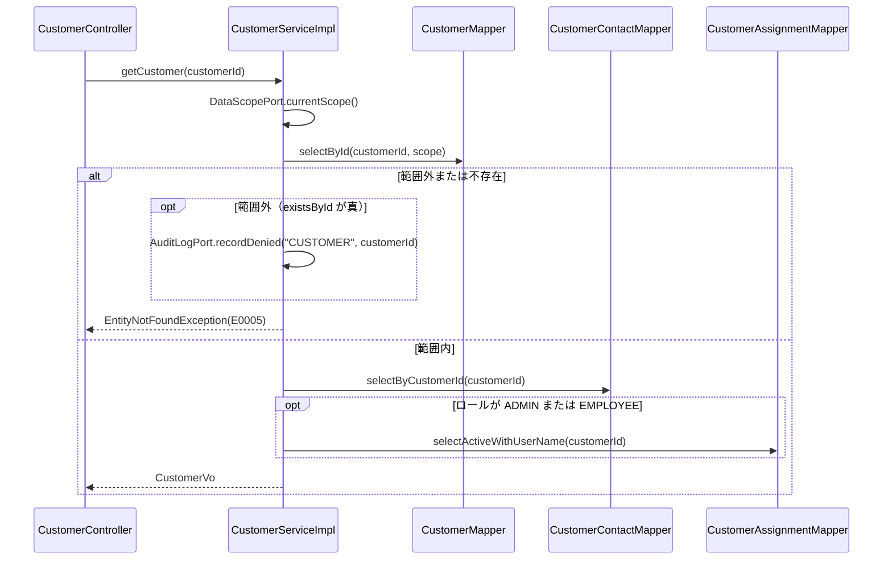
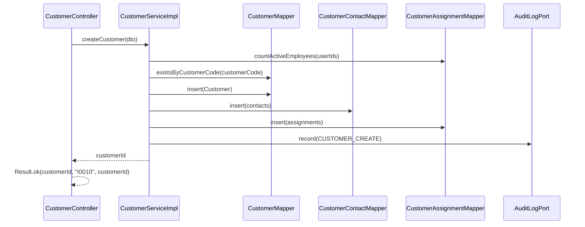
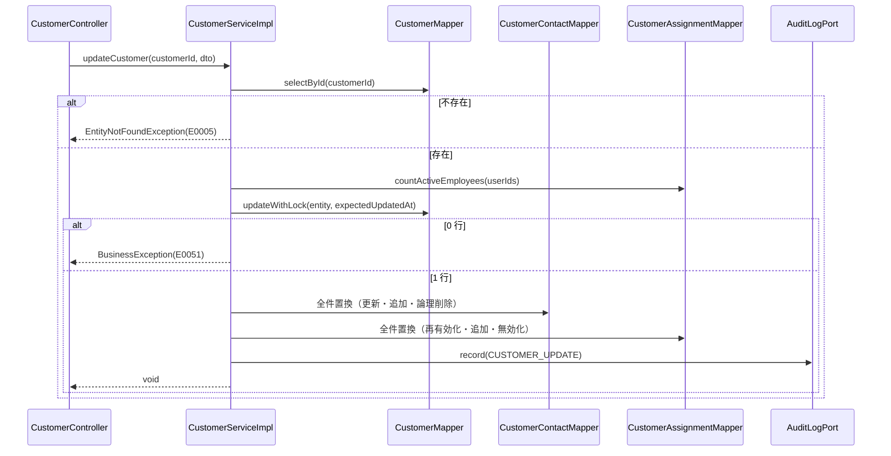

<!-- devtool:file-region id="document-header" -->
# 顧客管理 詳細設計

> 詳細設計（内部設計）。`詳細設計/spec-detail-temp.md` の構成に従う。本書は単一情報源（SSOT）を参照するのみで、項目・列挙値・メッセージを再定義しない。
> 業務ルールの番号・内容は `基本設計/共通/spec-08-business-rule-list.md` を正とし、本書は実装手順と画面（SCR-06/07/08）を定める。
> 顧客に紐付く利用者の登録（`createUser` の `customerId` 検証）は `詳細設計/業務/user/spec-user-detail-sd.md`、注文側の顧客状態・担当割当の判定（BR-CUS-001/002、BR-ORD-010）は `詳細設計/業務/order/spec-order-detail-sd.md` で扱う。

<!-- devtool:end-file-region -->
<!-- devtool:block id="detail.customer.detail-sd.s01" -->
## 文書情報

| 項目 | 内容 |
|------|------|
| システム名称 | DDMSAA 販売システム |
| 文書名称 | 顧客管理 詳細設計 |
| 文書バージョン | V1.0 |
| ステータス | 草案 |
| 作成者 | TBD |
| 作成日 | 2026-10-21 |
| レビュー担当 | TBD |

<!-- devtool:endblock -->
<!-- devtool:block id="detail.customer.detail-sd.s02" -->
## 改訂履歴

| バージョン | 改訂日 | 改訂者 | 改訂内容 |
|------|--------|--------|---------|
| V0.1 | 2026-10-20 | — | 簡易版（データ・API・処理・テスト・BR） |
| V1.0 | 2026-10-21 | — | `spec-detail-temp.md` の構成へ展開（§0〜§6.1）。テスト表を §5.1 へ移し UT-ID を `UT-CUS-NNN`（3 桁）に統一（簡易版の 001〜006 は番号を変えずに維持し、007 以降を追加） |
| V1.2 | 2026-10-21 | — | `CustomerLookupPort` に第 3 メソッド `findNotificationEmails(customerId)` を追加（通知先メールの取得を Mapper 級の跨モジュール取得から Port へ変更。approval の `NotificationPort` 実装はこの Port 経由で読み、customer_contacts を直接読まない）。旧「`selectNotificationRecipients` と規約の衝突」の TBD を決定済みへ。UT-CUS-042〜045 を追加、UT-CUS-034 の被テストを更新 |
| V1.1 | 2026-10-21 | — | 決定反映：Service 層 400 は `InvalidRequestException`、`DataScopePort` 実装、`CustomerLookupPort`（order への顧客参照）実装、列挙は `core.shared.enums`、請求形式不正は一律 400 `E0008`、範囲外 404 の前に `AuditLogPort.recordDenied`。旧 TBD-CUS-01／02／10(a)／11／12 を解消。UT-CUS-036〜041 を追加 |

---

<!-- devtool:endblock -->
<!-- devtool:block id="detail.customer.detail-sd.s03" -->
## 0. 対象と根拠

| 項目 | 内容 |
|------|------|
| 関連機能 | F-CUS-01〜05（顧客一覧・詳細・登録・更新・有効化/無効化）。F-AUD-02 の記録（`CUSTOMER_*`）は本機能の各更新 API が行う |
| 関連画面 | SCR-06 顧客一覧、SCR-07 顧客詳細、SCR-08 顧客登録/編集（`spec-05-screen-list-ui.md`） |
| 関連 API | `pageCustomers`、`getCustomer`、`createCustomer`、`updateCustomer`、`activateCustomer`、`deactivateCustomer`（`spec-07-api-list.yaml`）。SCR-08 が呼ぶ `pageUsers`（担当社員の選択肢）は user 機能の API |
| 関連バッチ | なし（通知先の連絡先を BAT-01 が参照する側は `詳細設計/業務/approval/spec-approval-detail-sd.md`。本書は §1.2 末尾で `CustomerLookupPort.findNotificationEmails` を提供するのみ） |
| 関連テーブル | TBL-customers、TBL-customer-contacts、TBL-customer-assignments、TBL-audit-logs（書込）、TBL-users（担当社員の検証・表示名の読取）、TBL-customer-status-codes（`spec-06-db-physical.yaml`） |
| 業務ルール | BR-CUS-001〜003、BR-AUTH-003、BR-AUTH-006、BR-ORD-006、BR-NTF-003、BR-AUD-001（BR-USR-003 は user 機能。BR-ORD-010 は order 機能で判定する） |
| 上流根拠 | `要件定義/requirements.md`（FR-04）；`基本設計/業務設計/customer/spec-customer-business-ui.md`、`spec-customer-screen-ui.md`；`基本設計/共通/spec-03-auth-ui.md` §2〜§4 |

### 0.1 コード生成時のロード一覧（AI コンテキスト組み立て）

```
- 本ファイル
- 基本設計/共通/spec-06-db-physical.yaml      ← TBL-customers / customer_contacts / customer_assignments / audit_logs / users（読取）/ customer_status_codes
- 基本設計/共通/spec-07-api-list.yaml          ← 上記 operationId と CustomerStatus / CustomerSummaryVO / CustomerVO / CustomerContactDTO / AssignedEmployeeVO / CustomerSaveDTO / PageResult
- 基本設計/共通/spec-09-message-list.yaml      ← I0010 I0011 I0034 I0035 W0011 W0025 E0001 E0002 E0005 E0006 E0007 E0008 E0012 E0030〜E0032 E0040〜E0043 E0051 E0054
- 基本設計/共通/spec-08-business-rule-list.md  ← BR-CUS / BR-AUTH-003・006 / BR-ORD-006 / BR-NTF-003 / BR-AUD-001
- 基本設計/共通/spec-02-function-list-ui.md、spec-03-auth-ui.md、spec-05 / spec-10 / spec-12、基本設計/業務設計/customer/spec-customer-screen-ui.md
- 基本設計/基盤/インタフェース仕様/spec-10-business-core.yaml・spec-07-infrastructure.yaml・spec-05-trace-message.yaml・spec-project-structure.yaml
- 開発規約/spec-naming-rule.md / spec-database-rule.md / spec-data-dictionary-project-temp.md（T07-3 顧客状態）
- 開発規約/spec-backend-coding-rule.md / spec-frontend-coding-rule.md / spec-test-rule.md
```

### 0.2 マイクロサービス帰属

| 項目 | 内容 |
|------|------|
| 所属サービス | `business-service-core`（`auth-service` は関与しない） |
| パッケージ接頭辞 | `com.example.ddmsaa.core.customer` |
| 基盤依存 | common（`Result`・`PageResult`・`BusinessException`・`InvalidRequestException`・`EntityNotFoundException`・`MaskingService`）、infrastructure（`UserContext`・`MetaObjectHandler`・DB）。`UserContext` は `getUserId()` / `getRole()`（文字列 `ADMIN` / `EMPLOYEE` / `CUSTOMER`）だけを提供する（`spec-08-security-util.yaml`）。跨モジュール Port（`core.shared.port`。定義は order 詳細設計 §1.1.1）：本機能は `DataScopePort` と `CustomerLookupPort`（3 メソッド）を**実装**し、`AuditLogPort`（`record`・`recordDenied`。実装は user 機能）に**依存**する。`CustomerStatus` は `com.example.ddmsaa.core.shared.enums`（`spec-backend-coding-rule.md` §2） |
| DB アクセス権限 | business-service-core は全表の CRUD。本機能は customers・customer_contacts・customer_assignments を読み書きし、users は読取のみ（担当社員の検証・表示名・CUSTOMER 利用者の `customer_id` の照会）。audit_logs は INSERT のみ |

---

<!-- devtool:endblock -->
<!-- devtool:block id="detail.customer.detail-sd.s04" -->
## 1. バックエンド詳細設計

### 1.1 クラス一覧

| 層 | クラス名 | パッケージ | 責務 | 対応 |
|----|------|----|------|------|
| Controller | `CustomerController` | `com.example.ddmsaa.core.customer.controller` | `/api/v1/customers/**` の受付。`@PreAuthorize` と `@Valid`、`Result` ラップのみ。メソッド名は operationId | `pageCustomers`、`getCustomer`、`createCustomer`、`updateCustomer`、`activateCustomer`、`deactivateCustomer` |
| Service | `CustomerService` / `CustomerServiceImpl` | `…core.customer.service` / `…service.impl` | データ範囲の強制（`DataScopePort.currentScope()` の結果を Mapper 条件へ渡す）、検証、連絡先・担当割当の全件置換、有効化/無効化、監査記録（`AuditLogPort.record`） | F-CUS-01〜05 |
| Service | `DataScopeServiceImpl`（`DataScopePort` の実装） | `…core.customer.service.impl` | `currentScope()`：`UserContext` から呼び出し者のデータ範囲を求める。ADMIN＝全件、EMPLOYEE＝有効な担当割当（`customer_assignments.is_active=TRUE`、`deleted_at IS NULL`）の顧客 ID 集合、CUSTOMER＝自社 `customer_id`（`users.customer_id`）。order・report・attachment・customer が利用（order 詳細設計 §1.1.1）。`UserContext` に `customerId` がないため users を読取専用で照会する | F-CUS-01、02（BR-AUTH-003／006） |
| Service | `CustomerLookupServiceImpl`（`CustomerLookupPort` の実装） | `…core.customer.service.impl` | `CustomerInfo findForOrder(String customerId)`：未削除の顧客の `id`・`name`・`status` を返す（該当なしは null。`CustomerInfo` は `core.shared.port` の値型）。`boolean isActiveAssignee(String customerId, String userId)`：有効な担当割当（`is_active=TRUE`、`deleted_at IS NULL`）があるか。order が注文作成・申請時の顧客有効性（BR-CUS-002）と EMPLOYEE の担当（BR-CUS-001、BR-ORD-010）の判定に使う（order 詳細設計 §1.1.1）。`List<String> findNotificationEmails(String customerId)`：`customer_contacts` のうち `is_active=TRUE` かつ `is_notification_recipient=TRUE` かつ未削除の連絡先のメールを重複排除して返す（順序は不問。顧客が不存在・論理削除済み、または通知先がない場合は空リスト。例外にしない）。approval 機能の `NotificationPort` 実装が通知の宛先解決（BR-NTF-003）に使う（Port 定義は order 詳細設計 §1.1.1 参照）。いずれも読取専用・呼び出し側の事務に参加 | F-CUS-02、BR-CUS-001／002、BR-NTF-003 |
| Mapper | `CustomerMapper` | `…core.customer.mapper` | customers の検索・取得・登録・楽観ロック付き更新・状態更新、`selectInfoForOrder`（`CustomerLookupServiceImpl` 用）、`existsById`（範囲外判定用。範囲条件なしで未削除の存在を確認） | TBL-customers |
| Mapper | `CustomerContactMapper` | `…core.customer.mapper` | customer_contacts の取得・登録・更新・論理削除と、`CustomerLookupServiceImpl.findNotificationEmails` 用の通知先メール取得（`selectNotificationEmails(customerId)`。`customers` と結合し顧客が未削除のときだけ返す） | TBL-customer-contacts |
| Mapper | `CustomerAssignmentMapper` | `…core.customer.mapper` | customer_assignments の取得・登録・有効フラグ更新と、担当社員の有効性確認（users の読取カウント。TBD-CUS-09）、`DataScopeServiceImpl` 用の `selectActiveCustomerIds(userId)`（EMPLOYEE の担当顧客 ID 集合）・`selectCustomerIdOfUser(userId)`（CUSTOMER の `users.customer_id`。読取専用）、`CustomerLookupServiceImpl` 用の `existsActiveAssignee(customerId, userId)` | TBL-customer-assignments |
| Entity | `Customer`、`CustomerContact`、`CustomerAssignment` | `…core.customer.entity` | テーブルマッピング（監査列を含む） | 各 TBL |
| DTO | `CustomerSummaryVo`（`CustomerSummaryVO`）、`CustomerVo`（`CustomerVO`）、`CustomerContactDto`（`CustomerContactDTO`）、`AssignedEmployeeVo`（`AssignedEmployeeVO`）、`CustomerSaveDto`（`CustomerSaveDTO`）、`CustomerSearchCondition` | `…core.customer.dto` | 項目は `spec-07-api-list.yaml` の schema に準拠。`CustomerSearchCondition` は一覧のクエリ（`pageNum`・`pageSize`・`keyword`・`status`）と、Service が付与するデータ範囲条件（`DataScope`：全件／顧客 ID 集合／自社 ID） | — |
| 列挙 | `CustomerStatus`（T07-3） | `com.example.ddmsaa.core.shared.enums` | `int code` + `fromCode`（`assets/enum.java.tmpl`）。order 等も参照するため `shared.enums` に置く（`spec-backend-coding-rule.md` §2。決定済み。feature の `dto` 配下には置かない） | — |
| 変換 | `CustomerConverter` | `…core.customer.convert` | Entity ↔ DTO（MapStruct） | — |

> 監査の記録（`audit_logs` への INSERT）は `AuditLogPort.record(auditAction, targetType, targetId, detail)`（`core.shared.port`。実装は user 機能の `AuditLogServiceImpl`。order 詳細設計 §1.1.1 参照）を呼ぶ。本書では `detail` を設定しない（null）。範囲外の単件参照を 404 `E0005` にする直前には `AuditLogPort.recordDenied("CUSTOMER", customerId)` を呼ぶ（`PERMISSION_DENIED`。`REQUIRES_NEW` の新事務で記録され、呼び出し側が巻き戻っても残る。`spec-backend-coding-rule.md` §8）。403 は core の `PermissionDeniedAuditListener`（user 機能）が記録するため本機能では呼ばない。一覧の自動除外は記録しない。

> 400 `E0008` の送出方法（決定済み）：DTO 項目の必須・長さ・形式は Bean Validation（`MethodArgumentNotValidException`）。Service 内の業務検証（担当社員が有効な EMPLOYEE でない等）は `InvalidRequestException`（HTTP 400、messageId 既定 `E0008`、`details[]` に FieldError。`spec-backend-coding-rule.md` §4）。`BusinessException` は 409 のみ。請求形式不正（非法な列挙値のクエリ／パス／本文、不正 JSON、必須クエリ欠落）は `MethodArgumentTypeMismatchException`／`HttpMessageNotReadableException`／`MissingServletRequestParameterException` を `GlobalExceptionHandler` が一律 400 `E0008`（`details[]`。解析器のメッセージは返さない）に変換する（`spec-03-exception-handler.yaml` RequestBinding。500 にならない）。

### 1.2 API 別詳細設計

> 以下のすべての API で、成功は HTTP 200 + `Result`、権限不足は 403 `E0002`、未認証・JWT 期限切れは 401 `E0001`（Gateway 起因は `E0040`〜`E0043`）、想定外のシステム例外は 500 `E0012`。`@PreAuthorize` は `x-roles` に一致させる。`updatedAt` はマイクロ秒 6 桁の文字列で入出力する（BR-ORD-006）。
> データ範囲（BR-AUTH-003 / 006）：ADMIN は全件、EMPLOYEE は有効な担当割当（`customer_assignments.is_active = TRUE`）がある顧客、CUSTOMER は自分の `users.customer_id` の顧客。範囲外の 1 件参照は 404 `E0005`（存在を開示しない）、一覧は範囲外を自動除外する。範囲の解決は `DataScopePort.currentScope()`（本機能の `DataScopeServiceImpl`）に統一し、各 Mapper の `cond` に渡す。

#### `pageCustomers` 顧客一覧（`GET /api/v1/customers`）

| 項目 | 内容 |
|------|------|
| operationId | `pageCustomers` |
| 対応機能 | F-CUS-01 |
| ロール・権限 | `@PreAuthorize("hasAnyRole('ADMIN','EMPLOYEE')")`（CUSTOMER は 403 `E0002`） |
| リクエスト | クエリ `pageNum`（既定 1・最小 1）、`pageSize`（既定 20・1〜100）、`keyword`（顧客コード・顧客名の部分一致）、`status`（`CustomerStatus`） |
| レスポンス | `Result<PageResult<CustomerSummaryVO>>`（顧客コード昇順の固定順） |

**入力検証**

| 項目 | ルール | 違反時 messageId | HTTP |
|------|------|--------------|------|
| `pageNum` | 1 以上 | `E0008` | 400 |
| `pageSize` | 1〜100 | `E0008` | 400 |
| `status` | `ACTIVE` / `INACTIVE` のいずれか。非法な値は `MethodArgumentTypeMismatchException` として 400 | `E0008` | 400 |

**処理ロジック**

```
1. `DataScopePort.currentScope()` でデータ範囲（`DataScope`）を取得し、CustomerSearchCondition に含める
2. 範囲条件を SQL に必ず付与する（BR-AUTH-003）：ADMIN＝条件なし、EMPLOYEE＝`customers.id IN (有効な担当割当の顧客 ID 集合)`（集合が空なら 0 件）。pageCustomers は CUSTOMER が 403 のため CUSTOMER 条件は通らない
3. keyword は customer_code と customer_name への部分一致（LIKE のワイルドカード文字はエスケープする）。status は status 列の一致（コード値へ変換）
4. PageHelper.startPage(pageNum, pageSize) → CustomerMapper.search（customer_code 昇順固定。deleted_at IS NULL）
5. PageResult.of(records, total, pageNum, pageSize) を Result.ok で返す。範囲外の顧客は出ない（範囲外を指定した検索条件は 0 件。BR-AUTH-006）
```

**トランザクション**：`@Transactional(readOnly = true)`（クラス既定）。

**DB アクセス**

| Mapper メソッド | 操作 | 対象テーブル.カラム | 主要条件 |
|------------|------|----------|---------|
| `CustomerMapper.search` | SELECT | `customers.id/customer_code/customer_name/email/phone_number/status` | `deleted_at IS NULL`、keyword・status、EMPLOYEE のとき `id IN (DataScope の顧客 ID 集合)` |

**利用する共通コンポーネント**：`PageHelper`、`PageResult`、`DataScopePort`（`UserContext` を内部で参照）。

**例外 → messageId → HTTP**

| シナリオ | 例外 | messageId | HTTP |
|------|------|-----------|------|
| 検証失敗（`pageNum`・`pageSize` の範囲等） | `MethodArgumentNotValidException`（クエリ DTO の Bean Validation） | `E0008` | 400 |
| 非法な `status`（列挙値） | `MethodArgumentTypeMismatchException` | `E0008` | 400 |
| CUSTOMER が呼ぶ | `AccessDeniedException` | `E0002` | 403 |

**正常レスポンス**：`Result<PageResult<CustomerSummaryVO>>`（messageId なし）。

#### `getCustomer` 顧客詳細（`GET /api/v1/customers/{customerId}`）

| 項目 | 内容 |
|------|------|
| operationId | `getCustomer` |
| 対応機能 | F-CUS-02 |
| ロール・権限 | `@PreAuthorize("hasAnyRole('ADMIN','EMPLOYEE','CUSTOMER')")`＋データ範囲（Service） |
| リクエスト | パス `customerId`（`CS` + 8 桁） |
| レスポンス | `Result<CustomerVO>`（`contacts`、`assignedEmployees`（CUSTOMER には返さない）、`updatedAt` を含む） |

**シーケンス**



**処理ロジック**

```
1. customers を customerId（deleted_at IS NULL）とデータ範囲条件で取得する
   範囲は `DataScopePort.currentScope()` の結果を条件にする：
   - ADMIN：条件なし
   - EMPLOYEE：`customers.id` が有効な担当割当の顧客 ID 集合に含まれること（pageCustomers と同じ）
   - CUSTOMER：`customers.id` が自社 `customer_id`（`users.customer_id`、deleted_at IS NULL）と一致すること
   取得できなければ、`CustomerMapper.existsById`（範囲条件なし・未削除）で存在を確認し、存在する（＝範囲外）場合は `AuditLogPort.recordDenied("CUSTOMER", customerId)` を呼んでから EntityNotFoundException（404 E0005）を投げる。不存在の場合は記録せず同じ 404 を投げる。応答上は不存在と範囲外を区別しない（BR-AUTH-006）
2. customer_contacts を customer_id で取得（deleted_at IS NULL。有効・無効の両方を返し、isActive で区別する。id 昇順）
3. ロール（`DataScope` の種別）が ADMIN / EMPLOYEE のときだけ customer_assignments（is_active = TRUE、deleted_at IS NULL）と users.user_name を結合して assignedEmployees を取得する（user_id 昇順）。CUSTOMER のときは Mapper を呼ばず、assignedEmployees は null（SELECT 自体をしない。spec-03 §3 の「顧客の担当社員」は CUSTOMER に非表示）
4. CustomerConverter で CustomerVo を組み立てる。status は CustomerStatus へ変換、updatedAt は customers.updated_at（マイクロ秒 6 桁）
5. MaskingService.maskByRole(vo, role, false) を適用して返す（基盤の既定実装は no-op。マスク対象項目はなく、3 は SQL 取得段階で分離済み）
```

**トランザクション**：`readOnly`。

**DB アクセス**

| Mapper メソッド | 操作 | 対象テーブル.カラム | 主要条件 |
|------------|------|----------|---------|
| `CustomerMapper.selectById` | SELECT | `customers.*` | `id = #{customerId} AND deleted_at IS NULL` ＋範囲条件 |
| `CustomerMapper.existsById` | SELECT | `customers.id` | `id = #{customerId} AND deleted_at IS NULL`（範囲条件なし。範囲外か不存在かの判定のみ。応答には使わない） |
| `CustomerContactMapper.selectByCustomerId` | SELECT | `customer_contacts.id/contact_name/email/is_notification_recipient/is_active` | `customer_id = #{customerId} AND deleted_at IS NULL` |
| `CustomerAssignmentMapper.selectActiveWithUserName` | SELECT | `customer_assignments.user_id/assigned_date`、`users.user_name` | `customer_id = #{customerId} AND is_active = TRUE AND deleted_at IS NULL`（users も `deleted_at IS NULL`） |

**例外 → messageId → HTTP**

| シナリオ | 例外 | messageId | HTTP |
|------|------|-----------|------|
| 不存在・範囲外（担当外 EMPLOYEE、他社 CUSTOMER） | `EntityNotFoundException` | `E0005` | 404 |

> 範囲外 404 の `PERMISSION_DENIED` 監査（BR-AUD-001）は、本 Service が `AuditLogPort.recordDenied`（`REQUIRES_NEW`）を `E0005` を投げる直前に呼んで記録する（決定済み。`spec-backend-coding-rule.md` §8）。不存在は記録しない。

**正常レスポンス**：`Result<CustomerVO>`。

#### `createCustomer` 顧客登録（`POST /api/v1/customers`）

| 項目 | 内容 |
|------|------|
| operationId | `createCustomer` |
| 対応機能 | F-CUS-03 |
| ロール・権限 | `@PreAuthorize("hasRole('ADMIN')")` |
| リクエストスキーマ | `CustomerSaveDTO`（`customerCode`・`customerName` 必須、`email`、`phoneNumber`、`contacts[]`、`assignedEmployeeUserIds[]`。`updatedAt` は登録では無視する） |
| レスポンス | `Result<String>`（採番した顧客 ID。`messageId=I0010`、`messageArgs=[顧客 ID]`） |

**シーケンス**



**入力検証**

| 項目 | ルール | 違反時 messageId | HTTP |
|------|------|--------------|------|
| `customerCode` | 必須・1〜30 文字・`^[A-Za-z0-9-]+$` | `E0008` | 400 |
| `customerName` | 必須・1〜200 文字 | `E0008` | 400 |
| `email` | 任意・255 文字以内・メール形式 | `E0008` | 400 |
| `phoneNumber` | 任意・50 文字以内 | `E0008` | 400 |
| `contacts[].contactName` | 必須・1〜100 文字 | `E0008` | 400 |
| `contacts[].email` | 必須・255 文字以内・メール形式 | `E0008` | 400 |
| `contacts[].isNotificationRecipient` / `isActive` | 省略時はそれぞれ false / true | — | — |
| `assignedEmployeeUserIds[]` | 各要素 `^[AEC][0-9]{4}$`（07）。重複は 1 件として扱う | `E0008` | 400 |
| `assignedEmployeeUserIds[]` | すべて「有効な EMPLOYEE」（users.role=EMPLOYEE、status=ACTIVE、未削除）であること（BR-CUS-003） | `E0008` | 400 |
| `customerCode` | 未削除行に同じ顧客コードが存在（`uq_customers_customer_code`） | `E0007` | 409 |

**処理ロジック**

```
1. 上の項目検証（Bean Validation）を行う。違反は `MethodArgumentNotValidException`（400 E0008、details[] に項目）
2. 担当社員の有効性を確認する：assignedEmployeeUserIds（重複排除）の件数と CustomerAssignmentMapper.countActiveEmployees の結果が一致しなければ `InvalidRequestException`（400 `E0008`、field=`assignedEmployeeUserIds`。BR-CUS-003）。「有効」の定義は TBD-CUS-07
3. 顧客コードの重複を確認する：existsByCustomerCode（deleted_at IS NULL）が真なら BusinessException("E0007")（409）
4. customers を INSERT（status=ACTIVE(1)。id は DB の next_business_id('CS', 8) の DEFAULT。useGeneratedKeys で取得）。created_by / updated_by 等の監査列は MetaObjectHandler が自動設定
   - 同時登録で uq_customers_customer_code が衝突した場合（DuplicateKeyException）も BusinessException("E0007")
5. contacts を 1 件ずつ INSERT（id は next_business_id('CC', 8)。customer_id は 4 の id）
6. assignedEmployeeUserIds を 1 件ずつ customer_assignments へ INSERT（id は next_business_id('AS', 8)。is_active=TRUE、assigned_date=当日（DB 既定の CURRENT_DATE））
7. AuditLogPort.record("CUSTOMER_CREATE", "CUSTOMER", customerId, null)
8. customerId を返す
```

**トランザクション**

| 項目 | 内容 |
|------|------|
| 範囲 | `@Transactional` を `CustomerServiceImpl.createCustomer()` に付与（`AuditLogPort.record` は同一トランザクションに参加） |
| 関連テーブル | TBL-customers・TBL-customer-contacts・TBL-customer-assignments・TBL-audit-logs（書込）、TBL-users（読取） |
| ロールバック条件 | いずれかで `BusinessException`（`E0007`）・`InvalidRequestException`（`E0008`）や DB 例外をスローした場合は全体をロールバックし、顧客・連絡先・担当割当・監査のいずれも残さない |

**DB アクセス**

| Mapper メソッド | 操作 | 対象テーブル.カラム | 主要条件 |
|------------|------|----------|---------|
| `CustomerAssignmentMapper.countActiveEmployees` | SELECT | `users.user_id/role/status` | `user_id IN (…) AND role = 2 AND status = 1 AND deleted_at IS NULL` |
| `CustomerMapper.existsByCustomerCode` | SELECT | `customers.customer_code` | `customer_code = #{customerCode} AND deleted_at IS NULL` |
| `CustomerMapper.insert` | INSERT | `customers`（`customer_code/customer_name/email/phone_number/status`） | `uq_customers_customer_code` |
| `CustomerContactMapper.insert` | INSERT | `customer_contacts`（`customer_id/contact_name/email/is_notification_recipient/is_active`） | — |
| `CustomerAssignmentMapper.insert` | INSERT | `customer_assignments`（`customer_id/user_id/is_active/assigned_date`） | `uq_cus_asg_cus_id_user_id` |
| `AuditLogPort.record` | INSERT | `audit_logs` | — |

**利用する共通コンポーネント**

| コンポーネント | 用途 |
|------|------|
| `MetaObjectHandler`（MyBatis Interceptor） | 監査列（`created_at/created_by/updated_at/updated_by`）の自動設定。Service は設定しない |
| `UserContext` | 操作者（`UserContext.getUserId()`）。監査の `actor_user_id`（`AuditLogPort` が取得） |
| `AuditLogPort` | 監査記録（`core.shared.port`。実装＝user 機能。order 詳細設計 §1.1.1） |

**例外 → messageId → HTTP**

| シナリオ | 例外 | messageId | HTTP |
|------|------|-----------|------|
| DTO 検証失敗（必須・長さ・形式） | `MethodArgumentNotValidException` | `E0008` | 400 |
| 担当社員が有効な EMPLOYEE でない | `InvalidRequestException` | `E0008` | 400 |
| 顧客コード重複 | `BusinessException`（`DuplicateKeyException` を変換） | `E0007` | 409 |
| 不正 JSON・`contacts` 等の型不一致 | `HttpMessageNotReadableException` | `E0008` | 400 |
| 権限不足 | `AccessDeniedException` | `E0002` | 403 |

**正常レスポンス**：`Result<String>`、`I0010`（`{0}`＝顧客 ID）。

#### `updateCustomer` 顧客更新（`PUT /api/v1/customers/{customerId}`）

| 項目 | 内容 |
|------|------|
| operationId | `updateCustomer` |
| 対応機能 | F-CUS-04 |
| ロール・権限 | `@PreAuthorize("hasRole('ADMIN')")` |
| リクエストスキーマ | `CustomerSaveDTO`（`updatedAt` 必須。`customerCode` は変更不可）。`contacts`・`assignedEmployeeUserIds` は全件置換 |
| レスポンス | `Result<Void>`（`messageId=I0011`） |

**シーケンス**



**入力検証**：`createCustomer` と同じ項目規則。加えて次を適用する。

| 項目 | ルール | 違反時 messageId | HTTP |
|------|------|--------------|------|
| `updatedAt` | 必須・日時形式（欠落は不可） | `E0008` | 400 |
| `customerCode` | 更新では変更できない。値が既存と異なる場合の扱いは TBD-CUS-04（本書は既存値を更新対象に含めない） | — | — |

**処理ロジック**

```
1. 対象 customers を customerId（deleted_at IS NULL）で取得する。不存在は EntityNotFoundException（404 E0005）。更新対象の範囲は ADMIN のみのため範囲条件は付けない
2. 担当社員の有効性を確認する（createCustomer の 2 と同じ。違反は `InvalidRequestException`＝400 E0008）
3. 無効（INACTIVE）の顧客に対して、現在有効でない社員を新たに有効化・追加する要求（再割当・新規割当）が含まれる場合は BusinessException("E0006")（409）（簡易版 V0.1「無効顧客は担当割当の対象にできない」。範囲は TBD-CUS-06）
4. 楽観ロック：UPDATE customers SET customer_name, email, phone_number WHERE id = ? AND deleted_at IS NULL AND updated_at = #{expectedUpdatedAt}。連絡先・担当割当だけの変更でもこの UPDATE を必ず実行して updated_at を更新する。0 行は BusinessException("E0051")（409）。customer_code・status は更新しない（状態は activate / deactivate だけが変更する）。email・phoneNumber が要求にない場合は NULL に更新する（PUT の全項目置換）
5. 連絡先の全件置換（customer_contacts）：
   a. 要求に id がある行：当該顧客の未削除行ならその項目（contact_name・email・is_notification_recipient・is_active）を UPDATE。当該顧客の行でない場合の扱いは TBD-CUS-05
   b. 要求に id がない行：INSERT（id は next_business_id('CC', 8)）
   c. 既存の未削除行のうち要求に含まれないもの：論理削除（UPDATE … SET deleted_at = now()。物理 DELETE はしない）
6. 担当割当の全件置換（BR-CUS-003）。要求の社員 ID 集合を R、現在の customer_assignments（deleted_at IS NULL）の行を E とする：
   a. R に含まれ、E に行がない社員：INSERT（is_active=TRUE、assigned_date=当日）
   b. R に含まれ、E の行が is_active=FALSE の社員：同じ行を is_active=TRUE、assigned_date=当日に UPDATE（新しい行は作らない。uq_cus_asg_cus_id_user_id と衝突させない）
   c. R に含まれ、E の行が既に is_active=TRUE の社員：変更しない（assigned_date も維持。TBD-CUS-07）
   d. R に含まれず、E の行が is_active=TRUE の社員：is_active=FALSE に UPDATE（論理削除・物理削除はしない）
7. AuditLogPort.record("CUSTOMER_UPDATE", "CUSTOMER", customerId, null)
8. 最新の updatedAt が必要な場合は画面が getCustomer で再取得する（応答は Result<Void>）
```

**トランザクション**

| 項目 | 内容 |
|------|------|
| 範囲 | `@Transactional` を `CustomerServiceImpl.updateCustomer()` に付与 |
| 関連テーブル | TBL-customers・TBL-customer-contacts・TBL-customer-assignments・TBL-audit-logs（書込）、TBL-users（読取） |
| ロールバック条件 | `E0051`（楽観ロック）、`E0006`（`BusinessException`）、`E0008`（`InvalidRequestException`）発生時は、連絡先・担当割当・監査を含めて全体をロールバックする。楽観ロック競合は監査に記録せず INFO ログ（traceId・対象 ID 付き。coding-rule §6） |

**DB アクセス**

| Mapper メソッド | 操作 | 対象テーブル.カラム | 主要条件 |
|------------|------|----------|---------|
| `CustomerMapper.selectById` | SELECT | `customers.*` | `id = #{customerId} AND deleted_at IS NULL` |
| `CustomerAssignmentMapper.countActiveEmployees` | SELECT | `users.user_id/role/status` | `createCustomer` と同じ |
| `CustomerMapper.updateWithLock` | UPDATE | `customers.customer_name/email/phone_number` | `id = #{id} AND deleted_at IS NULL AND updated_at = #{expectedUpdatedAt}` |
| `CustomerContactMapper.selectByCustomerId` | SELECT | `customer_contacts.*` | `customer_id = #{customerId} AND deleted_at IS NULL` |
| `CustomerContactMapper.insert` / `update` / `logicalDelete` | INSERT / UPDATE | `customer_contacts` | 論理削除は `SET deleted_at = now()`（`id` と `customer_id` を条件） |
| `CustomerAssignmentMapper.selectByCustomerId` | SELECT | `customer_assignments.*` | `customer_id = #{customerId} AND deleted_at IS NULL`（is_active を問わない） |
| `CustomerAssignmentMapper.insert` / `updateActive` | INSERT / UPDATE | `customer_assignments.is_active/assigned_date` | `id = #{id}` |
| `AuditLogPort.record` | INSERT | `audit_logs` | — |

**例外 → messageId → HTTP**

| シナリオ | 例外 | messageId | HTTP |
|------|------|-----------|------|
| DTO 検証失敗（必須・長さ・形式） | `MethodArgumentNotValidException` | `E0008` | 400 |
| 担当社員が有効な EMPLOYEE でない | `InvalidRequestException` | `E0008` | 400 |
| 不正 JSON・型不一致 | `HttpMessageNotReadableException` | `E0008` | 400 |
| 不存在 | `EntityNotFoundException` | `E0005` | 404 |
| 楽観ロック不一致 | `BusinessException` | `E0051` | 409 |
| 無効顧客への担当割当 | `BusinessException` | `E0006` | 409 |
| 権限不足 | `AccessDeniedException` | `E0002` | 403 |

**正常レスポンス**：`Result<Void>`、`I0011`。

#### `activateCustomer` 有効化 / `deactivateCustomer` 無効化（`POST /api/v1/customers/{customerId}/activate`・`/deactivate`）

| 項目 | 内容 |
|------|------|
| operationId | `activateCustomer`、`deactivateCustomer` |
| 対応機能 | F-CUS-05 |
| ロール・権限 | `@PreAuthorize("hasRole('ADMIN')")` |
| リクエスト | パス `customerId`（本文なし） |
| レスポンス | `Result<Void>`（`activateCustomer`＝`I0034`、`deactivateCustomer`＝`I0035`） |

**処理ロジック**

```
1. 対象 customers を行ロックで取得する（SELECT … FOR UPDATE、deleted_at IS NULL）。不存在は EntityNotFoundException（404 E0005）
2. activateCustomer：status を ACTIVE(1) に UPDATE。deactivateCustomer：status を INACTIVE(2) に UPDATE。既に目的の状態である場合の扱いは TBD-CUS-03（07 は 409 を宣言するが messageId が未定義）。updated_at は DB トリガーが更新する
3. 無効化しても、連絡先・担当割当・既存注文・履歴・監査は変更も削除もしない（BR-CUS-002）。無効顧客への新規注文作成・既存 DRAFT / RETURNED の申請の拒否（409 E0054）は order 機能が顧客状態を参照して判定する
4. AuditLogPort.record("CUSTOMER_ACTIVATE" または "CUSTOMER_DEACTIVATE", "CUSTOMER", customerId, null)
```

**トランザクション**：`@Transactional`（`CustomerServiceImpl.activateCustomer()` / `deactivateCustomer()`）。書込：customers・audit_logs。

**DB アクセス**

| Mapper メソッド | 操作 | 対象テーブル.カラム | 主要条件 |
|------------|------|----------|---------|
| `CustomerMapper.selectForUpdate` | SELECT … FOR UPDATE | `customers.*` | `id = #{customerId} AND deleted_at IS NULL` |
| `CustomerMapper.updateStatus` | UPDATE | `customers.status` | `id = #{customerId}` |
| `AuditLogPort.record` | INSERT | `audit_logs` | — |

**例外 → messageId → HTTP**

| シナリオ | 例外 | messageId | HTTP |
|------|------|-----------|------|
| 不存在 | `EntityNotFoundException` | `E0005` | 404 |
| 権限不足 | `AccessDeniedException` | `E0002` | 403 |

**正常レスポンス**：`Result<Void>`、`I0034` / `I0035`。

#### 他機能へ提供する取得（API ではない）

> 跨モジュール Port の正式定義は order 詳細設計 §1.1.1。本機能は次の 2 つの Port（`CustomerLookupPort` は 3 メソッド）を**実装**する。

| 提供する Port／メソッド | 実装クラス | 内容 | 利用側 |
|------|------|------|------|
| `DataScopePort.currentScope()` | `DataScopeServiceImpl` | 呼び出し者のデータ範囲（ADMIN＝全件、EMPLOYEE＝有効担当顧客 ID 集合、CUSTOMER＝自社 `customer_id`）。供 Mapper の `cond` | order・report・attachment・customer・user（顧客選択肢） |
| `CustomerLookupPort.findForOrder(customerId)` | `CustomerLookupServiceImpl` | `CustomerInfo`（`id`・`name`・`status`）を返す。論理削除済み・不存在は null（order が判定。BR-CUS-002）。`CustomerMapper.selectInfoForOrder` で `deleted_at IS NULL` | order（BR-CUS-002、BR-ORD-010 の顧客有効性） |
| `CustomerLookupPort.isActiveAssignee(customerId, userId)` | `CustomerLookupServiceImpl` | `customer_assignments` に `is_active=TRUE`・`deleted_at IS NULL` の行があれば true（`CustomerAssignmentMapper.existsActiveAssignee`） | order（EMPLOYEE の担当判定。BR-CUS-001、BR-ORD-010） |
| `CustomerLookupPort.findNotificationEmails(customerId)` | `CustomerLookupServiceImpl` | `customer_contacts` の `is_active=TRUE AND is_notification_recipient=TRUE AND deleted_at IS NULL` の email を重複排除して返す（`CustomerContactMapper.selectNotificationEmails`。`customers.deleted_at IS NULL` を結合条件にする）。顧客不存在・通知先なしは空リスト（例外にしない）。順序は不問 | approval（`NotificationPort` 実装。BR-NTF-003。order 詳細設計 §1.1.1） |

> 通知先メールの取得は Mapper 級の跨モジュール取得ではなく、上表の `CustomerLookupPort.findNotificationEmails` が提供する（決定済み）。approval の `NotificationPort` 実装は customer_contacts を直接読まず、この Port を呼ぶ。通知先 0 件でも本メソッドはエラーにしない（空リスト）。通知先なしの業務上の扱い（保存時に必須とするか）は TBD-CUS-08。

### 1.3 Entity / DTO / VO マッピング

| Entity 項目 | DTO 項目 | 変換 | 命名変更の登録 |
|------------|---------|------|------------|
| `Customer.id`（id） | `CustomerSummaryVO.id` / `CustomerVO.id` | 直接 | なし（業務キー `CS` + 8 桁） |
| `Customer.customerCode` / `customerName` / `email` / `phoneNumber` | 同名 | 直接 | なし |
| `Customer.status`（Integer） | `status`（`CustomerStatus`） | `CustomerStatus.fromCode` / `getCode` | なし |
| `Customer.updatedAt` | `CustomerVO.updatedAt` | マイクロ秒 6 桁の文字列。更新要求の `updatedAt` に同値を返送する | なし |
| `CustomerContact.id` / `contactName` / `email` / `isNotificationRecipient` / `isActive` | `CustomerContactDTO` の同名項目 | 直接（`id` は既存行の更新時のみ入力で使用） | なし |
| `CustomerAssignment.userId` / `assignedDate` | `AssignedEmployeeVO.userId` / `assignedDate` | 直接 | なし |
| `User.userName`（結合） | `AssignedEmployeeVO.userName` | 結合結果を設定 | `spec-data-dictionary-mapping-ui.md` に登録済み（`customer_assignments` と `users` の結合） |
| `CustomerSaveDTO.assignedEmployeeUserIds` | `customer_assignments.user_id`（複数行） | 全件置換（§1.2 `updateCustomer` 6） | なし |

> 暗号化カラムはない。`assignedEmployees` は CUSTOMER に返さない（取得しない）。`MaskingService` の既定実装は no-op であり、本機能のマスク対象項目はない。

---

<!-- devtool:endblock -->
<!-- devtool:block id="detail.customer.detail-sd.s05" -->
## 2. フロントエンド詳細設計

### 2.1 画面別コンポーネント分解

> 画面ファイルは `frontend/src/pages/customer/`、コンポーネントは `frontend/src/components/customer/`、型は `frontend/src/types/customer.ts`、API クライアントは `frontend/src/api/customer-api.ts`（関数名＝operationId）。共通の HTTP 層・i18n・ルートガードは `spec-frontend-coding-rule.md` と `spec-12-screen-common-ui.md` に従う。列挙の表示名（顧客状態 ACTIVE=有効 / INACTIVE=無効）は spec-12 §6.1、状態色は §9（有効＝緑、無効＝灰。色だけでなくテキストを併記）。

#### SCR-06 顧客一覧（`/customers`）

**コンポーネントツリー**

```
CustomerListPage (src/pages/customer/customer-list-page.tsx)
├── CustomerSearchForm (src/components/customer/customer-search-form.tsx)   キーワード・状態・検索／リセット
└── CustomerTable      (src/components/customer/customer-table.tsx)         顧客コード・顧客名・メール・電話・状態
```

**状態・データ**

| 状態 | 型 | 取得元 API | 説明 |
|------|------|---------|------|
| `query` | `{ keyword, status, pageNum, pageSize }` | — | URL クエリに保持し、詳細から戻ったときに復元（spec-12 §2） |
| `page` | `PageResult<CustomerSummaryVo>` | `pageCustomers` | 顧客コード昇順の固定順。列見出しソートなし |
| `me` | `MeVo` | `getMe`（保持済み） | 「新規登録」の表示制御（ロール判定）に使う |

**イベント → API 対応**

| イベント | operationId | 入力 | 成功時処理 | 失敗時処理 |
|------|--------|------|---------|---------|
| 初期表示／検索／ページ移動 | `pageCustomers` | `query` | 一覧更新。0 件は「該当データなし」 | `ErrorResponse.messageId` を表示（再試行導線） |
| 行クリック | — | `customerId` | SCR-07 へ遷移 | — |
| 新規登録（ADMIN のみ） | — | — | SCR-08（`/customers/new`）へ遷移 | — |

**クライアント検証**：なし（キーワード・状態の任意入力のみ）。

**ロール別表示制御**

| 要素 | ADMIN | EMPLOYEE | CUSTOMER |
|------|:-----:|:--------:|:--------:|
| 画面全体 | ○ | ○（担当顧客のみ。API が自動除外） | ×（ルートガードで SCR-19。メニューは「自社情報」） |
| 新規登録ボタン | ○ | × | — |

**メッセージ表示**：エラー `E0001`・`E0002`・`E0008`（API 失敗時）。

**画面遷移**（正本 `spec-10-screen-transition-ui.md`）

| 遷移元 | 遷移先 | トリガー |
|------|----|------|
| SCR-06 | SCR-07 | 行クリック（`customerId`） |
| SCR-06 | SCR-08 | 新規登録（ADMIN） |

#### SCR-07 顧客詳細（`/customers/:customerId`）

**コンポーネントツリー**

```
CustomerDetailPage (src/pages/customer/customer-detail-page.tsx)
├── CustomerInfoCard          (src/components/customer/customer-info-card.tsx)           顧客コード・顧客名・状態・メール・電話
├── CustomerContactTable      (src/components/customer/customer-contact-table.tsx)       連絡先名・メール・通知先・有効
└── AssignedEmployeePanel     (src/components/customer/assigned-employee-panel.tsx)      担当社員の表示名・ユーザー ID（ADMIN / EMPLOYEE のみ）
```

**状態・データ**

| 状態 | 型 | 取得元 API | 説明 |
|------|------|---------|------|
| `customer` | `CustomerVo` | `getCustomer` | `updatedAt` は文字列のまま保持（coding-rule §6） |
| `me` | `MeVo` | `getMe`（保持済み） | ロール判定。CUSTOMER は `me.customerId` の顧客として表示 |
| `busy` | `boolean` | — | 有効化/無効化の実行中（二重送信防止） |

**イベント → API 対応**

| イベント | operationId | 入力 | 成功時処理 | 失敗時処理 |
|------|--------|------|---------|---------|
| 初期表示 | `getCustomer` | `customerId`（パス） | 各領域を表示 | 404 `E0005` → SCR-20（主リソース）、403 `E0002` → SCR-19 |
| 無効化（ADMIN。`W0025` 確認後） | `deactivateCustomer` | `customerId` | `I0035` → `getCustomer` で再読込 | `E0005`・`E0002` を表示 |
| 有効化（ADMIN） | `activateCustomer` | `customerId` | `I0034` → `getCustomer` で再読込 | 同上 |
| 編集（ADMIN） | — | — | SCR-08（`/customers/:customerId/edit`）へ遷移 | — |
| この顧客の注文 | — | `customerId`（クエリ） | SCR-11 へ遷移 | — |

**クライアント検証**：なし。

**ロール別表示制御**

| 領域・操作 | ADMIN | EMPLOYEE | CUSTOMER |
|------|:-----:|:--------:|:--------:|
| 基本情報（コード・名称・状態・メール・電話） | ○ | ○（担当） | ○（自社） |
| 連絡先（通知先・有効を含む） | ○ | ○（担当） | ○（自社） |
| 担当社員パネル | ○ | ○（担当） | ×（パネルを描画しない。API も返さない） |
| 編集・有効化/無効化ボタン | ○ | × | × |
| この顧客の注文 | ○ | ○ | ○ |
| 一覧へ戻る導線 | ○ | ○ | ×（メニュー「自社情報」からのみ到達） |

> 状態ボタンは現在の `status` に応じて、ACTIVE のとき「無効化」、INACTIVE のとき「有効化」の一方だけを表示する。

**メッセージ表示**：成功 `I0034`・`I0035`、確認 `W0025`（危険操作の確認ダイアログ）、エラー `E0002`・`E0005`。

**画面遷移**

| 遷移元 | 遷移先 | トリガー |
|------|----|------|
| SCR-07 | SCR-08 | 編集（ADMIN。`customerId`） |
| SCR-07 | SCR-11 | この顧客の注文（`customerId` をクエリで渡す） |
| SCR-07 | SCR-20 / SCR-19 | 404 `E0005`（範囲外を含む）／403 `E0002` |

#### SCR-08 顧客登録/編集（`/customers/new`、`/customers/:customerId/edit`）

**コンポーネントツリー**

```
CustomerEditPage (src/pages/customer/customer-edit-page.tsx)
├── CustomerForm              (src/components/customer/customer-form.tsx)                 顧客コード・顧客名・メール・電話
├── CustomerContactForm       (src/components/customer/customer-contact-form.tsx)         連絡先の行リスト（行追加・削除）
└── AssignedEmployeePanel     (src/components/customer/assigned-employee-panel.tsx)      担当社員の複数選択（編集モード）
```

**状態・データ**

| 状態 | 型 | 取得元 API | 説明 |
|------|------|---------|------|
| `form` | `CustomerFormValues`（`customerCode`、`customerName`、`email`、`phoneNumber`、`contacts: ContactRow[]`、`assignedEmployeeUserIds: string[]`、`updatedAt`） | `getCustomer`（編集時） | `updatedAt` は文字列のまま保持（マイクロ秒を失わない） |
| `employeeOptions` | `UserVo[]` | `pageUsers`（`role=EMPLOYEE`、`status=ACTIVE`、`pageSize=100`） | 担当社員の選択肢。100 名を超える場合の扱いは TBD-CUS-10 |
| `dirty` | `boolean` | — | 入力の有無。離脱確認（`W0011`）に使う |
| `submitting` | `boolean` | — | 保存中の二重送信防止 |

**イベント → API 対応**

| イベント | operationId | 入力 | 成功時処理 | 失敗時処理 |
|------|--------|------|---------|---------|
| 初期表示（編集） | `getCustomer`、`pageUsers` | `customerId`、`role=EMPLOYEE`・`status=ACTIVE` | フォームに展開 | 404 `E0005` → SCR-20 |
| 初期表示（新規） | `pageUsers` | 同上 | 空フォーム | メッセージ表示 |
| 保存（新規） | `createCustomer` | `CustomerSaveDTO`（`updatedAt` なし） | `I0010`（`{0}`＝顧客 ID）→ SCR-07（採番された `customerId`） | `E0007`（顧客コード項目へ表示）・`E0008`（`details[]` を各項目へ割り付け） |
| 保存（編集） | `updateCustomer` | `CustomerSaveDTO`（`updatedAt` 同送。`customerCode` は変更不可の読取専用表示） | `I0011` → SCR-07 | `E0051`（最新を再読込するよう案内し `getCustomer` で再取得）・`E0006`・`E0008`・`E0005` |
| 連絡先の行追加・削除 | — | — | 行を追加／削除（削除した既存行は送信から外れ、サーバーが論理削除する） | — |
| キャンセル | — | — | 入力があれば `W0011` で確認 → 新規は SCR-06、編集は SCR-07 | — |

**クライアント検証**（サーバーの Bean Validation と一致させる。サーバーが最終権威）

| 項目 | ルール | 表示 messageId |
|------|------|--------------|
| 顧客コード | 必須（新規のみ入力可）・最大 30 文字・英数字とハイフン | `E0030`／`E0032`／`E0031` |
| 顧客名 | 必須・最大 200 文字 | `E0030`／`E0032` |
| メール | 任意・最大 255 文字・形式 | `E0032`／`E0031` |
| 電話 | 任意・最大 50 文字 | `E0032` |
| 連絡先 連絡先名 | 行ごとに必須・最大 100 文字 | `E0030`／`E0032` |
| 連絡先 メール | 行ごとに必須・最大 255 文字・形式 | `E0030`／`E0032`／`E0031` |
| 担当社員 | 選択肢は有効な EMPLOYEE のみ。入力は選択式 | — |

> 通知先連絡先が 1 件もない顧客の扱い（保存時に必須とするか）は未決（`spec-customer-screen-ui.md` TBD-C1 / TBD-CUS-08）。本書は必須チェックを置かない。

**ロール別表示制御**：ADMIN のみ（ルートガードで EMPLOYEE・CUSTOMER は SCR-19）。

**メッセージ表示**：成功 `I0010`・`I0011`、確認 `W0011`、エラー `E0005`・`E0006`・`E0007`・`E0008`・`E0030`〜`E0032`・`E0051`。

**画面遷移**

| 遷移元 | 遷移先 | トリガー |
|------|----|------|
| SCR-08 | SCR-07 | 保存成功（新規は採番された顧客）、編集のキャンセル |
| SCR-08 | SCR-06 | 新規のキャンセル |

---

<!-- devtool:endblock -->
<!-- devtool:block id="detail.customer.detail-sd.s06" -->
## 3. バッチ詳細設計

本機能にバッチなし。通知先連絡先を参照する BAT-01（通知送信）は `詳細設計/業務/approval/spec-approval-detail-sd.md` で扱い、本書は `CustomerLookupPort.findNotificationEmails`（§1.2）を提供するだけである。

---

<!-- devtool:endblock -->
<!-- devtool:block id="detail.customer.detail-sd.s07" -->
## 4. 横断設計（本機能 固有）

| 項目 | 内容 |
|------|------|
| 権限実装 | `pageCustomers`＝`hasAnyRole('ADMIN','EMPLOYEE')`、`getCustomer`＝`hasAnyRole('ADMIN','EMPLOYEE','CUSTOMER')`、`createCustomer`・`updateCustomer`・`activateCustomer`・`deactivateCustomer`＝`hasRole('ADMIN')`。データ範囲：ADMIN 全件／EMPLOYEE 有効な担当割当の顧客／CUSTOMER 自社（`users.customer_id`）。範囲外 1 件は 404 `E0005`、一覧は自動除外（BR-AUTH-003 / 006）。範囲判定は `DataScopePort.currentScope()`（本機能の `DataScopeServiceImpl`）で解決し、Service で強制する。フロントエンドに依存しない |
| 暗号化・マスキング | 暗号化カラムなし。`assignedEmployees` は CUSTOMER に対し取得自体を行わない（spec-03 §3）。`MaskingService.maskByRole` は基盤の既定実装（no-op）を呼ぶだけで、本機能のマスク対象項目はない |
| トランザクション・整合性 | 顧客登録＝customers＋customer_contacts＋customer_assignments＋audit_logs を同一トランザクション。顧客更新＝customers の楽観ロック付き UPDATE と連絡先・担当割当の全件置換＋audit_logs を同一トランザクション（競合 `E0051` 時は全体ロールバック）。連絡先の削除は論理削除、担当割当の解除は `is_active=FALSE`（行を削除しない。BR-CUS-003）。無効化では関連データを削除しない |
| 同時実行・ロック | `customers.updated_at` による楽観ロック（`updateCustomer`。不一致 `E0051`。BR-ORD-006）。`activateCustomer` / `deactivateCustomer` は行ロック（`SELECT … FOR UPDATE`）で直列化。顧客コードの同時登録は `uq_customers_customer_code` の衝突を `E0007` へ変換して防ぐ。担当割当は部分ユニーク索引 `uq_cus_asg_cus_id_user_id` に衝突しないよう、再割当は既存行を戻す |
| 監査 | `CUSTOMER_CREATE`／`CUSTOMER_UPDATE`／`CUSTOMER_ACTIVATE`／`CUSTOMER_DEACTIVATE`（`target_type=CUSTOMER`、`target_id`＝顧客 ID。BR-AUD-001）を業務更新と同一トランザクションで記録する。`audit_detail` は設定しない。記録は `AuditLogPort.record` 経由。楽観ロック競合は記録しない。範囲外 404（`getCustomer`）の `PERMISSION_DENIED` は `AuditLogPort.recordDenied`（`REQUIRES_NEW`）を `E0005` の直前に呼んで記録する（403 は `PermissionDeniedAuditListener`。決定済み）。一覧の自動除外は記録しない |
| 無効顧客の影響範囲 | 顧客の無効化は新規注文の作成・既存 DRAFT / RETURNED の申請を止める（order 機能が `E0054` で判定。BR-CUS-002）。PENDING_APPROVAL の注文は承認・差戻しできる。履歴は物理削除しない |

### 確認事項（TBD）

| # | 事項 |
|---|---|
| TBD-CUS-03 | `activateCustomer` / `deactivateCustomer` で既に目的の状態の場合の扱い。07 は 409 を宣言するが、使う messageId が未定義（案：冪等に成功、または `E0006`）。本書は状態を目的値へ更新するのみで例外にしない暫定実装 |
| TBD-CUS-04 | `updateCustomer` の要求で `customerCode` が既存値と異なる場合の扱い（無視するか 400 `E0008` とするか）。07 は「更新時は変更不可」としか記載がない |
| TBD-CUS-05 | `updateCustomer` の連絡先 `id` が当該顧客のものでない・削除済みの場合の扱い（案：400 `E0008`）。担当割当の既に有効な行を要求に含めたときの `assigned_date` は維持する暫定扱い（07・BR-CUS-003 は再割当のときだけ当日と定める） |
| TBD-CUS-06 | 無効（INACTIVE）の顧客への更新範囲。簡易版 V0.1 は「担当割当・顧客利用者の登録の対象にできない（409 `E0006`）」とするが、(a) 基本情報・連絡先の更新を許すか、(b) 顧客利用者の登録は user 機能 `createUser` が 400 `E0008` を返す（`spec-user-detail-sd.md` §1.2）ため `E0006` と食い違う。本書は担当割当の新規追加・再有効化だけを `E0006` とする |
| TBD-CUS-07 | 「有効な EMPLOYEE」の定義（本書は role=EMPLOYEE かつ status=ACTIVE かつ未削除。ロック中を含めるか）と、既に担当済みの社員が後で停用された場合に顧客を再保存すると `E0008` になる点（BR-CUS-003 は要求に含まれる全員を検証する文言。既存の担当は検証対象外にするか） |
| TBD-CUS-08 | 通知先連絡先が 0 件の顧客の注文通知の扱い（`spec-customer-screen-ui.md` TBD-C1。保存時に 1 件以上を必須とするか）。`findNotificationEmails` は 0 件でも空リストを返し、`NotificationPort` 実装は宛先なしで例外を投げず・当該通知を挿入せず warn ログ（決定済み。決定 8）。保存時必須とするかのみ未決 |
| TBD-CUS-09 | 担当社員の有効性確認が users を読む。`CustomerAssignmentMapper` の読取専用カウントとして持つか、user 機能の公開 Service を呼ぶか（coding-rule §2 は Mapper の単一集約原則） |
| TBD-CUS-10 | SCR-08 の担当社員の選択肢は `pageUsers` の `pageSize` 上限 100 のため、有効な EMPLOYEE が 100 名を超える場合の選択 UI（キーワード検索・追加読込） |

> **決定済み（旧 TBD、2026-10-21）**：CUS-01 データ範囲部品＝`DataScopePort`（本機能の `DataScopeServiceImpl`）／CUS-02 order への顧客参照口＝`CustomerLookupPort`（`findForOrder`・`isActiveAssignee`。本機能の `CustomerLookupServiceImpl`）／CUS-10(a) `CustomerStatus`＝`core.shared.enums`／CUS-11 Service 層 400＝`InvalidRequestException`／CUS-12 請求形式不正（非法列挙値・不正 JSON）＝400 `E0008`／`PERMISSION_DENIED`＝範囲外 404 は `recordDenied` を `E0005` の前に呼ぶ（403 は `PermissionDeniedAuditListener`）。**通知先メールの取得**（旧「`selectNotificationRecipients` と規約（Mapper 単一集約）の衝突」の確認）＝`CustomerLookupPort.findNotificationEmails`（`CustomerLookupServiceImpl`）で提供し、approval は Port 経由で読む。TBD-CUS-10 は旧 (b)（担当社員選択肢が 100 名超の UI）のみ残る。

---

<!-- devtool:endblock -->
<!-- devtool:block id="detail.customer.detail-sd.s08" -->
## 5. トレーサビリティマトリクス（UT / コードへの接続）

| F-ID | SCR | API（operationId） | TBL | messageId | バックエンドクラス | フロントエンドコンポーネント | UT-ID（§5.1） |
|------|-----|-----|-----|-----------|--------|---------|-------|
| F-CUS-01 | SCR-06 | `pageCustomers` | TBL-customers、customer-assignments | E0002／E0008 | `CustomerServiceImpl.pageCustomers` | `CustomerListPage`、`CustomerSearchForm`、`CustomerTable` | UT-CUS-007〜011、036 |
| F-CUS-02 | SCR-07 | `getCustomer` | TBL-customers、customer-contacts、customer-assignments、users、audit-logs（`recordDenied`） | E0005 | `CustomerServiceImpl.getCustomer` | `CustomerDetailPage`、`CustomerInfoCard`、`CustomerContactTable`、`AssignedEmployeePanel` | UT-CUS-002、003、005、012〜014、037 |
| F-CUS-03 | SCR-08 | `createCustomer` | TBL-customers、customer-contacts、customer-assignments、audit-logs | I0010／E0002／E0007／E0008 | `CustomerServiceImpl.createCustomer` | `CustomerEditPage`、`CustomerForm`、`CustomerContactForm`、`AssignedEmployeePanel` | UT-CUS-001、015〜019、038 |
| F-CUS-04 | SCR-08 | `updateCustomer` | 同上 | I0011／E0002／E0005／E0006／E0008／E0051 | `CustomerServiceImpl.updateCustomer` | `CustomerEditPage`、`CustomerForm`、`CustomerContactForm`、`AssignedEmployeePanel` | UT-CUS-006、020〜028 |
| F-CUS-05 | SCR-07 | `activateCustomer`、`deactivateCustomer` | TBL-customers、audit-logs | I0034／I0035／E0002／E0005 | `CustomerServiceImpl.activateCustomer`／`deactivateCustomer` | `CustomerDetailPage` | UT-CUS-004、029〜032 |
| F-AUD-02（記録） | — | （各更新 API、`getCustomer` の範囲外） | TBL-audit-logs | E0005 | `AuditLogPort.record`／`recordDenied` | — | UT-CUS-015、020、029、030、033、037 |
| （`DataScopePort` 提供） | — | — | TBL-customer-assignments、users | — | `DataScopeServiceImpl.currentScope` | — | UT-CUS-035 |
| （`CustomerLookupPort` 提供） | — | — | TBL-customers、customer-assignments | — | `CustomerLookupServiceImpl.findForOrder`／`isActiveAssignee` | — | UT-CUS-039〜041 |
| （BR-NTF-003 提供） | — | — | TBL-customers、customer-contacts | — | `CustomerLookupServiceImpl.findNotificationEmails` | — | UT-CUS-034、042〜045 |

### 5.1 UT 用例一覧

> テストコード生成の**唯一の入力**。期待結果は SSOT の参照のみ（messageId＝`spec-09-message-list.yaml`、HTTP＝`spec-backend-coding-rule.md` §4、ロール・範囲＝`spec-03-auth-ui.md`、BR＝`spec-08-business-rule-list.md`）。テスト階層・命名・ディレクトリは `開発規約/spec-test-rule.md` に従う。

**UT-ID 採番規則**：`UT-CUS-NNN`（`CUS`＝customer の機能略称。3 桁連番）。`@DisplayName("UT-CUS-NNN <条件→期待>")` を先頭に付与する。簡易版 V0.1 の UT-CUS-001〜006 は番号・内容を維持した。

| UT-ID | 推奨層 | 被テスト | 種別 | 前提条件 | 入力要点 | 期待結果 | 追跡 |
|-------|:------:|---------|------|---------|---------|---------|------|
| UT-CUS-001 | L1 | `createCustomer` / `CustomerServiceImpl.createCustomer` | 異常 | ADMIN、同じ顧客コードの未削除顧客が存在 | 既存と同じ `customerCode` | 409 `E0007`、顧客・連絡先・担当割当・監査が保存されない | F-CUS-03 / 手順 3、BR-CUS-001 の前提 |
| UT-CUS-002 | L1 | `getCustomer` / `CustomerServiceImpl.getCustomer` | 異常 | EMPLOYEE、有効な担当割当のない顧客 | 担当外の `customerId` | 404 `E0005`（存在を開示しない）。`AuditLogPort.recordDenied("CUSTOMER", customerId)` が `E0005` の前に 1 回呼ばれる | BR-AUTH-006 / BR-CUS-001 |
| UT-CUS-003 | L1 | `getCustomer` | 異常 | CUSTOMER（自社＝顧客 A） | 他社（顧客 B）の `customerId` | 404 `E0005`。`recordDenied` が 1 回呼ばれる | BR-AUTH-006 |
| UT-CUS-004 | L1 | `createOrder`（顧客状態の判定。order 機能の `OrderServiceImpl.createOrder`） | 異常 | 無効（INACTIVE）の顧客 | その顧客で注文を作成 | 409 `E0054`。判定の実装は order 詳細設計 §1.2 | BR-CUS-002 / `CustomerLookupPort.findForOrder` |
| UT-CUS-005 | L1 | `getCustomer` | 正常 | CUSTOMER、自社の顧客 | 自社の `customerId` | 200 `CustomerVO`、`assignedEmployees` を含まない（null）。CustomerAssignmentMapper を呼ばない | spec-03 §3 / 手順 3 |
| UT-CUS-006 | L1 | `updateCustomer` / `CustomerServiceImpl.updateCustomer` | 正常 | 担当が解除済み（`is_active=FALSE`）の社員の行が存在 | 同じ社員を `assignedEmployeeUserIds` に含めて更新 | 既存行が `is_active=TRUE`・`assigned_date=当日` になり、行は増えない（INSERT しない） | BR-CUS-003 / §1.2 手順 6b |
| UT-CUS-007 | L1 | `pageCustomers` / `CustomerServiceImpl.pageCustomers` | 正常 | ADMIN、複数顧客（有効・無効） | `pageNum=1`、`pageSize=20`、`keyword`・`status` を指定 | 200 `PageResult<CustomerSummaryVO>`、顧客コード昇順、条件に一致する行のみ | F-CUS-01 / 手順 3〜5 |
| UT-CUS-008 | L1 | `pageCustomers` | 正常 | EMPLOYEE、担当顧客 1 件と、担当を解除済み（`is_active=FALSE`）の顧客 1 件と、未割当の顧客 | 条件なし | 担当（有効な割当）の顧客だけが返る | BR-AUTH-003 / BR-CUS-001 |
| UT-CUS-009 | L2 | `pageCustomers` | 権限 | CUSTOMER の JWT | — | 403 `E0002` | spec-03 §2 |
| UT-CUS-010 | L2 | `pageCustomers` | 検証 | ADMIN の JWT | `pageSize=101`、`pageSize=0` | 400 `E0008` | 入力検証 |
| UT-CUS-011 | L1 | `pageCustomers` | 境界 | EMPLOYEE | 担当外の顧客の `keyword` | 200、0 件（エラーにしない） | BR-AUTH-006 |
| UT-CUS-012 | L1 | `getCustomer` | 正常 | ADMIN、連絡先 2 件（うち 1 件は `is_active=FALSE`）、担当社員 2 名（うち 1 名は解除済み） | 顧客 ID | 200 `CustomerVO`、`contacts` は有効・無効の両方、`assignedEmployees` は有効な割当のみ、`updatedAt` あり | F-CUS-02 / 手順 2〜4 |
| UT-CUS-013 | L1 | `getCustomer` | 正常 | EMPLOYEE、担当顧客 | 担当の顧客 ID | 200、`assignedEmployees` を含む | F-CUS-02 / BR-AUTH-003 |
| UT-CUS-014 | L1 | `getCustomer` | 異常 | ADMIN | 存在しない・論理削除済みの `customerId` | 404 `E0005`。`recordDenied` は呼ばれない（不存在は記録しない） | F-CUS-02 / 手順 1 |
| UT-CUS-015 | L1 | `createCustomer` | 正常 | ADMIN、有効な EMPLOYEE | 顧客・連絡先 2 件・担当社員 1 名 | 200 `I0010`（`messageArgs`＝顧客 ID）、`status=ACTIVE`、customers・customer_contacts・customer_assignments・`CUSTOMER_CREATE` の監査を同一トランザクションで保存 | F-CUS-03 / 手順 4〜7、BR-AUD-001 |
| UT-CUS-016 | L2 | `createCustomer` | 権限 | EMPLOYEE／CUSTOMER の JWT | — | 403 `E0002` | spec-03 §2 |
| UT-CUS-017 | L2 | `createCustomer` | 検証 | ADMIN の JWT | `customerCode` が空・31 文字・不正文字、`customerName` が空・201 文字、連絡先名欠落、連絡先メールの形式不正 | 400 `E0008` | 入力検証 |
| UT-CUS-018 | L1 | `createCustomer` | 異常 | 担当社員の ID が ADMIN・停用中・不存在・EMPLOYEE 以外 | `assignedEmployeeUserIds` に該当 ID | 400 `E0008`（`InvalidRequestException`、details に assignedEmployeeUserIds）、何も保存されない | BR-CUS-003 / 手順 2 |
| UT-CUS-019 | L3 | `createCustomer` | 境界 | 実 DB、同じ顧客コードの同時登録 | 同一 `customerCode` を 2 リクエスト | 一方のみ成功、他方は 409 `E0007`（`uq_customers_customer_code`）、失敗側は連絡先・担当割当・監査が残らない | 手順 4、同時実行・ロック |
| UT-CUS-020 | L1 | `updateCustomer` | 正常 | ADMIN、連絡先 3 件（A・B・C）が存在 | 連絡先 A を変更、B を除外、新規 D を追加 | 200 `I0011`、A は UPDATE、B は論理削除（`deleted_at` 設定。物理 DELETE なし）、D は INSERT、C は要求にないため論理削除、`CUSTOMER_UPDATE` を記録 | F-CUS-04 / 手順 5、BR-AUD-001 |
| UT-CUS-021 | L1 | `updateCustomer` | 正常 | 有効な担当社員 X・Y | 要求の担当社員が Y・Z（Z は新規） | X は `is_active=FALSE`（行は残る）、Y は変更なし、Z は新規行（`is_active=TRUE`、`assigned_date=当日`） | BR-CUS-003 / 手順 6a・6c・6d |
| UT-CUS-022 | L1 | `updateCustomer` | 異常 | 取得後に別ユーザーが更新済み | 古い `updatedAt` | 409 `E0051`、連絡先・担当割当・監査は変更されない（ロールバック） | BR-ORD-006 / 手順 4 |
| UT-CUS-023 | L1 | `updateCustomer` | 異常 | ADMIN | 存在しない `customerId` | 404 `E0005` | 手順 1 |
| UT-CUS-024 | L2 | `updateCustomer` | 権限 | EMPLOYEE／CUSTOMER の JWT | — | 403 `E0002` | spec-03 §2 |
| UT-CUS-025 | L2 | `updateCustomer` | 検証 | ADMIN の JWT | `updatedAt` 欠落、`customerName` が空 | 400 `E0008` | 入力検証 |
| UT-CUS-026 | L1 | `updateCustomer` | 異常 | 無効（INACTIVE）の顧客 | 担当社員を新規追加 | 409 `E0006` | 手順 3（簡易版 V0.1 / TBD-CUS-06） |
| UT-CUS-027 | L1 | `updateCustomer` | 異常 | 担当社員が有効な EMPLOYEE でない | `assignedEmployeeUserIds` に停用中の社員・ADMIN の ID | 400 `E0008`（`InvalidRequestException`） | BR-CUS-003 / 手順 2 |
| UT-CUS-028 | L3 | `updateCustomer` | 正常 | 実 DB、担当が解除済みの社員が存在 | 同じ社員を再割当 | `uq_cus_asg_cus_id_user_id` に衝突せず成功し、行数は増えない（`is_active=TRUE`、`assigned_date=当日`） | BR-CUS-003 |
| UT-CUS-029 | L1 | `activateCustomer` / `CustomerServiceImpl.activateCustomer` | 正常 | ADMIN、無効（INACTIVE）の顧客 | 顧客 ID | 200 `I0034`、`status=ACTIVE`、`CUSTOMER_ACTIVATE` を記録 | F-CUS-05 / 手順 2・4 |
| UT-CUS-030 | L1 | `deactivateCustomer` / `CustomerServiceImpl.deactivateCustomer` | 正常 | ADMIN、有効な顧客（連絡先・担当割当・注文あり） | 顧客 ID | 200 `I0035`、`status=INACTIVE`、`CUSTOMER_DEACTIVATE` を記録。連絡先・担当割当・注文は変更・削除されない | BR-CUS-002 / 手順 3 |
| UT-CUS-031 | L2 | `activateCustomer`／`deactivateCustomer` | 権限 | EMPLOYEE／CUSTOMER の JWT | — | 403 `E0002`（両 API） | spec-03 §2 |
| UT-CUS-032 | L1 | `activateCustomer`／`deactivateCustomer` | 異常 | ADMIN | 存在しない `customerId` | 404 `E0005`（両 API） | 手順 1 |
| UT-CUS-033 | L3 | 監査記録（顧客機能） | 正常 | 実 DB | 顧客の登録・更新・無効化・有効化 | audit_logs に `CUSTOMER_CREATE`・`CUSTOMER_UPDATE`・`CUSTOMER_DEACTIVATE`・`CUSTOMER_ACTIVATE`（`target_type=CUSTOMER`、`target_id`＝顧客 ID）が業務更新と同一トランザクションで記録され、更新が失敗したときは記録が残らない（`AuditLogPort.record` 経由） | BR-AUD-001 |
| UT-CUS-034 | L3 | `CustomerLookupPort.findNotificationEmails`（`CustomerLookupServiceImpl`／`CustomerContactMapper.selectNotificationEmails`） | 正常 | 実 DB、通知先・非通知先・無効（`is_active=FALSE`）・論理削除済みの連絡先が混在 | 顧客 ID | `is_active=TRUE` かつ `is_notification_recipient=TRUE` かつ未削除の連絡先のメールだけが返る | BR-NTF-003 |
| UT-CUS-035 | L3 | `DataScopePort.currentScope`（`DataScopeServiceImpl`） | 正常・境界 | 実 DB。ADMIN・EMPLOYEE（有効な担当 2 件と解除済み `is_active=FALSE` 1 件）・CUSTOMER（`users.customer_id` あり）の `UserContext` | 各ロールで `currentScope()` を呼ぶ | ADMIN＝全件、EMPLOYEE＝有効な担当 2 件の顧客 ID だけ（解除済みを含まない。担当なしは空集合）、CUSTOMER＝自社の `customer_id` のみ | BR-AUTH-003 / BR-AUTH-006、`DataScopePort` |
| UT-CUS-036 | L2 | `pageCustomers` | 検証 | ADMIN の JWT | `status=XXX`（非法な列挙値）／`status=999` | 400 `E0008`（`details[]` あり。解析器メッセージを含まない。500 にならない） | RequestBinding / coding-rule §4 |
| UT-CUS-037 | L1 | `getCustomer` | 異常 | EMPLOYEE。(a) 担当外だが存在する顧客 (b) 存在しない顧客 | (a)(b) それぞれの `customerId` | 両方 404 `E0005`。(a) のみ `AuditLogPort.recordDenied("CUSTOMER", customerId)` が `E0005` の前に呼ばれ、(b) は呼ばれない | BR-AUTH-006 / BR-AUD-001 `PERMISSION_DENIED` |
| UT-CUS-038 | L2 | `createCustomer` | 検証 | ADMIN の JWT | 不正 JSON／`contacts` が配列でない | 400 `E0008`（`HttpMessageNotReadableException`）。何も保存されない | RequestBinding |
| UT-CUS-039 | L1 | `CustomerLookupPort.findForOrder`（`CustomerLookupServiceImpl`） | 正常・境界 | 有効な顧客・無効（INACTIVE）の顧客・論理削除済み・不存在 | 各 `customerId` | 有効・無効は `CustomerInfo`（`id`・`name`・`status`。`status` は `CustomerStatus`）を返す。論理削除済み・不存在は null | BR-CUS-002 / BR-ORD-010 |
| UT-CUS-040 | L1 | `CustomerLookupPort.isActiveAssignee` | 正常・境界 | 有効な担当（`is_active=TRUE`）・解除済み（`is_active=FALSE`）・割当なし・論理削除済みの割当 | 各 (customerId, userId) | 有効な担当のみ true、他は false | BR-CUS-001 / BR-ORD-010 |
| UT-CUS-041 | L3 | `CustomerLookupPort`（実 DB） | 正常 | 実 DB、`deleted_at` 設定済みの顧客・割当を含む | `findForOrder`・`isActiveAssignee` | SQL が `deleted_at IS NULL` と `is_active=TRUE` を正しく適用し、UT-CUS-039・040 と同じ結果になる | BR-CUS-001／002 |
| UT-CUS-042 | L1 | `CustomerLookupPort.findNotificationEmails` | 正常 | Mapper が通知先 2 件（異なるメール）を返す | 顧客 ID | 2 件のメールを含むリスト（順序は不問） | BR-NTF-003 |
| UT-CUS-043 | L1 | `findNotificationEmails` | 境界 | Mapper が同じメールを持つ通知先 2 件（連絡先 ID は別）を返す | 顧客 ID | 同一メールは 1 件に重複排除される | BR-NTF-003 |
| UT-CUS-044 | L1 | `findNotificationEmails` | 境界 | Mapper が 0 件を返す（通知先なし） | 顧客 ID | 空リスト（例外にしない・null にしない） | BR-NTF-003 / TBD-CUS-08 |
| UT-CUS-045 | L3 | `findNotificationEmails`（実 DB） | 境界 | 実 DB、(a) 論理削除済みの顧客に通知先連絡先あり (b) 存在しない顧客 ID | (a)(b) それぞれ | どちらも空リスト（例外にしない） | BR-NTF-003 |

**カバレッジ確認**：各 operationId の正常系（`pageCustomers`＝007・008、`getCustomer`＝005・012・013、`createCustomer`＝015、`updateCustomer`＝006・020・021・028、`activateCustomer`＝029、`deactivateCustomer`＝030）、例外分岐（`E0005`＝002・003・014・023・032、`E0006`＝026、`E0007`＝001・019、`E0008`＝010・017・018・025・027・036・038、`E0051`＝022、`E0054`＝004 〔order 機能で判定〕）、`@PreAuthorize` の拒否（009・016・024・031）、検証境界（010・017・025）、BR（BR-AUTH-003＝008・013、BR-AUTH-006＝002・003・011、BR-CUS-001＝002・008、BR-CUS-002＝004・030、BR-CUS-003＝006・018・021・027・028、BR-ORD-006＝022、BR-NTF-003＝034・042〜045、BR-AUD-001＝015・020・029・030・033、`DataScopePort`＝035、`CustomerLookupPort`＝039〜045、`recordDenied`＝002・003・037）を含む。請求形式不正（`E0008`）＝036・038。禁止状態遷移はない（有効/無効の同状態への再操作は TBD-CUS-03 のため用例化しない）。暗号化・マスキングの対象はなく、CUSTOMER に担当社員を返さない用例は 005。`getCustomer` は全ロール許可のため拒否用例はない。

---

<!-- devtool:endblock -->
<!-- devtool:block id="detail.customer.detail-sd.s09" -->
## 6. 生成指示（AI 主導実行用）

**コード生成順序**

```
バックエンド: 列挙(CustomerStatus は `core.shared.enums`。既存なら再利用) → Entity → Mapper(インタフェース+XML) → DTO → Converter(MapStruct) → ServiceImpl（`CustomerServiceImpl`、`DataScopeServiceImpl`、`CustomerLookupServiceImpl`（`findForOrder`・`isActiveAssignee`・`findNotificationEmails`））→ Controller
フロントエンド: 型 → API client(customer-api.ts) → 子コンポーネント → Page → routes.tsx
```

**出力先**

| 成果物 | 配置先 |
|------|------|
| business-service-core コード | `ddmsaa-backend/business-service-core/src/main/java/com/example/ddmsaa/core/customer/…` |
| MyBatis XML | `ddmsaa-backend/business-service-core/src/main/resources/mapper/CustomerMapper.xml`・`CustomerContactMapper.xml`・`CustomerAssignmentMapper.xml`（resultMap 優先。全クエリに `deleted_at IS NULL` を明示） |
| フロントエンドコード | `frontend/src/{pages,components}/customer/…`、`frontend/src/types/customer.ts`、`frontend/src/api/customer-api.ts` |
| UT コード | §5.1 を入力に UT 工程で生成（`開発規約/spec-test-rule.md`） |

### 6.1 codegen 就緒ゲート（D1〜D11）自己検査

| ゲート | 結果 | 備考 |
|------|:----:|------|
| D1 §0 完全性 | 合格 | 機能・画面・API・テーブル・BR・所属サービスを列挙 |
| D2 表・主キー | 合格 | customers・customer_contacts・customer_assignments の主キー `id`（`CS` / `CC` / `AS` + 8 桁、DB の `next_business_id`）と `customer_id`（varchar(10)）の外部キー型が一致。users.user_id（varchar(10)）。`spec-06-db-physical.yaml` と照合 |
| D3 API | 合格 | 6 operationId を `spec-07-api-list.yaml` の path / method / schema / `x-roles` と照合済み |
| D4 メッセージ | 合格 | 使用 messageId はすべて `spec-09-message-list.yaml` に存在 |
| D5 命名・モジュール | 合格 | business-service-core の `core.customer` パッケージ、Controller / Service / Mapper / Converter の接尾辞、コンポーネント接尾辞（Page / Table / Form / Card / Panel）に従う |
| D6 権限 | 合格 | 全 API に `@PreAuthorize` とデータ範囲（ADMIN／担当 EMPLOYEE／自社 CUSTOMER）を定義。`assignedEmployees` は CUSTOMER に返さない |
| D7 共通コンポーネント | 合格 | `UserContext` に `customerId` が無い点は `DataScopePort`（本機能が実装）で解決。order への顧客参照と通知先メール取得は `CustomerLookupPort`（3 メソッド。本機能が実装。approval の `NotificationPort` 実装が `findNotificationEmails` を利用し customer_contacts を直接読まない）。`AuditLogPort.record`／`recordDenied` は user 機能が実装（決定済み）。`CustomerStatus` は `core.shared.enums`。`MaskingService` は基盤の既定 no-op を呼ぶのみ |
| D8 廃止事項 | 合格 | 旧識別子・論理削除しない担当割当の物理削除・顧客の物理削除を含まない |
| D9 追跡 | 合格 | §5 の連鎖と §5.1 の UT-ID が対応 |
| D10 改行・文字コード | 合格 | UTF-8・LF |
| D11 UT 用例完全性 | 要確認 | カバレッジ規約を満たす（上記）。同状態への再有効化/無効化（TBD-CUS-03）、連絡先 `id` 不一致（TBD-CUS-05）、`customerCode` 変更要求（TBD-CUS-04）は未決のため用例化していない。`E0008` の送出方法は `InvalidRequestException` に決定済み。請求形式不正（非法列挙値・不正 JSON）は 400 `E0008` に決定済み（036・038） |
<!-- devtool:endblock -->
