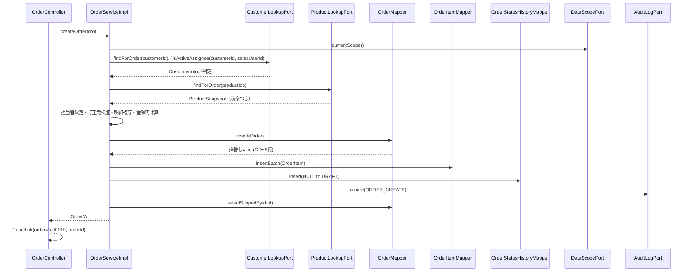
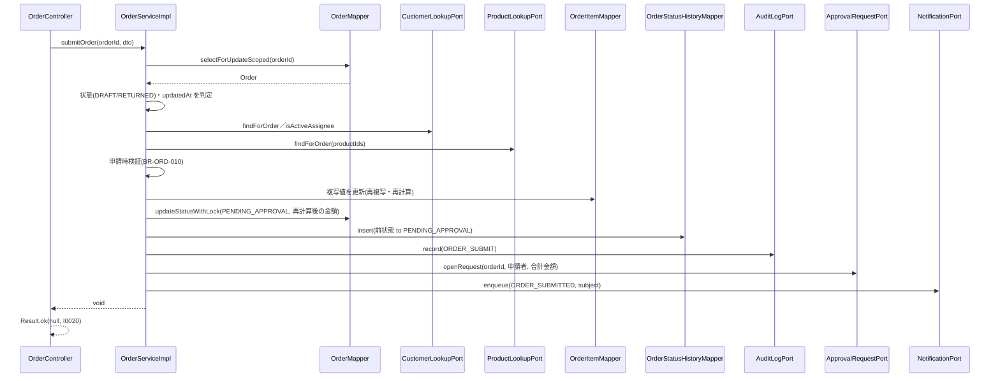
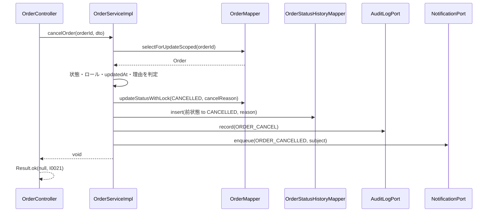

<!-- devtool:file-region id="document-header" -->
# 注文管理 詳細設計

> 詳細設計（内部設計）。`詳細設計/spec-detail-temp.md` の構成に従う。本書は単一情報源（SSOT）を参照するのみで、項目・列挙値・メッセージを再定義しない。
> 業務ルールの番号・内容は `基本設計/共通/spec-08-business-rule-list.md` を正とし、本書は実装手順を定める。
> 申請（`submitOrder`）が作成する承認依頼・通知投入の詳細は `詳細設計/業務/approval/spec-approval-detail-sd.md` を、SCR-13 の添付パネルは `詳細設計/業務/attachment/spec-attachment-detail-sd.md` を正とし、本書は注文側の処理と画面だけを定める。
> 機能（feature）をまたぐ呼び出しは中立パッケージ `com.example.ddmsaa.core.shared.port` のポート（interface）で行う。**ポート 8 本の正式な定義は本書 §1.1.1 が唯一の正**であり、他の詳細設計は本書を引用する（`spec-backend-coding-rule.md` §2）。`listApprovalHistories` の実装は `approval` の詳細設計（§1.2.11）にあり、本書は参照だけを置く。

<!-- devtool:end-file-region -->
<!-- devtool:block id="detail.order.detail-sd.s01" -->
## 文書情報

| 項目 | 内容 |
|------|------|
| システム名称 | DDMSAA 販売システム |
| 文書名称 | 注文管理 詳細設計 |
| 文書バージョン | V1.0 |
| ステータス | 草案 |
| 作成者 | TBD |
| 作成日 | 2026-10-21 |
| レビュー担当 | TBD |

<!-- devtool:endblock -->
<!-- devtool:block id="detail.order.detail-sd.s02" -->
## 改訂履歴

| バージョン | 改訂日 | 改訂者 | 改訂内容 |
|------|--------|--------|---------|
| V0.1 | 2026-10-20 | — | 簡易版（データ・API・作成更新アルゴリズム・申請時検証・状態遷移・テスト・BR） |
| V1.0 | 2026-10-21 | — | `spec-detail-temp.md` の構成へ展開（§0〜§6.1）。テスト表を §5.1 へ移し UT-ID を `UT-ORD-NNN`（3 桁）に統一（001〜014 は簡版の番号と内容を維持し、015 以降を追加） |
| V1.1 | 2026-10-21 | — | 統一修訂：(1) Service 層の 400 `E0008` を `InvalidRequestException` に統一（TBD-ORD-13・14 を閉じ、TBD-ORD-15 の空白のみ取消し理由を決定）。(2) 機能間呼び出しをポート化：新設 §1.1.1「跨モジュール ポート」（8 ポートの正式表）。`OrderStatePort`・`OrderAccessPort` を本機能が実装し、`ApprovalRequestPort`・`NotificationPort`・`AuditLogPort`・`DataScopePort` を利用。`submitOrder`・`cancelOrder` の処理順と責任分担を改訂。承認・差戻しの注文側の状態更新は `OrderStatePort.transition`。(3) `listApprovalHistories` の実装を `approval` へ移管（UT-ORD-078〜080 は UT-APR-058〜060 へ移動、旧 081・082 は 078・079 に繰上げ）。UT-ORD-080 以降を追加 |
| V1.2 | 2026-10-21 | — | 第 2 次統一修訂：(1) 列挙の置き場所を `Role`＝`common.enums`、その他 T07 列挙＝`core.shared.enums` に統一（値型は `core.shared.port`）。(2) 要求形式不正（不正な列挙値・JSON 不正・必須パラメータ欠落）を 400 `E0008` に統一し TBD-ORD-18 を閉じる。(3) `PERMISSION_DENIED`：`AuditLogPort` に `recordDenied` を追加、`OrderAccessPort` が範囲外の 404 の前に記録（TBD-ORD-02 を閉じる）。(4) `ApprovalRequestPort.findPending` を追加し `getOrder` が使用（TBD-ORD-17 を閉じる）。(5) `CustomerLookupPort`・`ProductLookupPort` を追加（ポートは 8 本。`OrderLookupMapper` を廃止。TBD-ORD-09 を閉じる）。(6) `NotificationPort` は宛先のメールが解決できない場合に例外を投げない。(7) SCR-13 の `listApprovalHistories` クライアントは `approval-api.ts`。UT-ORD-096〜103 を追加 |

---

<!-- devtool:endblock -->
<!-- devtool:block id="detail.order.detail-sd.s03" -->
## 0. 対象と根拠

| 項目 | 内容 |
|------|------|
| 関連機能 | F-ORD-01〜05（F-ORD-01 の承認履歴参照を含む。申請の承認依頼・通知は F-APR-02・F-NTF-01 と連携） |
| 関連画面 | SCR-11 注文一覧、SCR-12 注文登録/編集、SCR-13 注文詳細（SCR-13/DLG-1 取消しダイアログを本書で定義。DLG-2・DLG-3 は `approval`、DLG-4 と添付パネルは `attachment` の詳細設計を参照）。SCR-02 ホームが呼ぶ `pageOrders` の利用側は `user` の詳細設計 §2 |
| 関連 API | `pageOrders`、`createOrder`、`getOrder`、`updateOrder`、`submitOrder`、`cancelOrder`（`spec-07-api-list.yaml`）。参照のみ：`listApprovalHistories`（`orders` タグ・F-ORD-01 だが**実装は `approval`**。§1.2 `listApprovalHistories`） |
| 関連バッチ | なし（業務通知メールの送信 BAT-01 は `approval` の詳細設計を参照。本機能は `notification_logs` へ QUEUED を投入するだけ） |
| 関連テーブル | TBL-orders、TBL-order-items、TBL-order-status-histories（書込。承認・差戻しの注文側の更新も本機能が `OrderStatePort` で行う）／主データ（customers・customer_assignments・products・tax_rates・users）と承認依頼の読取は `CustomerLookupPort`・`ProductLookupPort`・`DataScopePort`・`ApprovalRequestPort.findPending` 経由（本機能の Mapper は直接読まない。一覧・詳細の表示名のための customers・users の結合 SELECT を除く）／TBL-audit-logs・TBL-approval-rules・TBL-approval-requests・TBL-notification-logs の**書込は各ポートの実装側**（`AuditLogPort`＝user、`ApprovalRequestPort`・`NotificationPort`＝approval）（`spec-06-db-physical.yaml`） |
| 業務ルール | BR-ORD-001〜011、BR-PRD-002、BR-PRD-003、BR-CUS-002、BR-AUTH-003、BR-AUTH-006、BR-APR-006（状態履歴・取消し理由の顧客への公開制限）、BR-NTF-003（通知宛先）、BR-AUD-001（監査） |
| 上流根拠 | `要件定義/requirements.md` §5.1（金額計算）・FR-05・FR-06；`基本設計/業務設計/order/spec-order-business-ui.md`、`spec-order-screen-ui.md`；`基本設計/共通/spec-02-function-list-ui.md`、`spec-03-auth-ui.md`、`spec-05-screen-list-ui.md`、`spec-10-screen-transition-ui.md`、`spec-12-screen-common-ui.md` |

### 0.1 コード生成時のロード一覧（AI コンテキスト組み立て）

```
- 本ファイル
- 基本設計/共通/spec-06-db-physical.yaml      ← TBL-orders / order_items / order_status_histories（書込）。customers / products / tax_rates / users / customer_assignments / approval_requests の読取と audit_logs・approval_requests・notification_logs の書込はポート実装側
- 基本設計/共通/spec-07-api-list.yaml          ← 上記 6 operationId と OrderStatus / TaxCategory / OrderSummaryVO / OrderVO / OrderItemVO / OrderStatusHistoryVO / OrderSaveDTO / OrderItemSaveDTO / OrderStateDTO / OrderCancelDTO
- 基本設計/共通/spec-09-message-list.yaml      ← I0010 I0011 I0020 I0021 W0011 W0020 W0022 E0001 E0002 E0005 E0006 E0008 E0012 E0030〜E0034 E0051 E0054（承認・添付パネルが表示する I0012 I0022 I0023 I0024 W0010 W0021 W0028 E0009 E0010 E0052 E0053 E0056 は各機能の詳細設計）
- 基本設計/共通/spec-08-business-rule-list.md  ← BR-ORD / BR-PRD-002・003 / BR-CUS-002 / BR-AUTH-003・006 / BR-APR-006 / BR-NTF-003 / BR-AUD-001
- 基本設計/共通/spec-02-function-list-ui.md（F-ORD の CRUD 図）、spec-03-auth-ui.md、spec-05 / spec-10 / spec-12、基本設計/業務設計/order/spec-order-screen-ui.md
- 基本設計/基盤/spec-00-architecture-ui.md、基盤/インタフェース仕様/spec-03-exception-handler.yaml・spec-04-unified-response.yaml・spec-07-infrastructure.yaml・spec-08-security-util.yaml・spec-10-business-core.yaml
- 詳細設計/業務/approval/spec-approval-detail-sd.md（`ApprovalRequestPort`・`NotificationPort` の実装、`OrderStatePort` の呼び出し元、`listApprovalHistories`）、詳細設計/業務/attachment/spec-attachment-detail-sd.md（`OrderAccessPort` の利用側。添付パネル）、詳細設計/業務/user/spec-user-detail-sd.md（`AuditLogPort` の実装・列挙の置き場所）、詳細設計/業務/customer/spec-customer-detail-sd.md（`DataScopePort` の実装）
- 開発規約/spec-naming-rule.md / spec-database-rule.md / spec-data-dictionary-project-temp.md（T07-5 税区分、T07-6 注文状態）
- 開発規約/spec-backend-coding-rule.md / spec-frontend-coding-rule.md / spec-test-rule.md
```

### 0.2 マイクロサービス帰属

| 項目 | 内容 |
|------|------|
| 所属サービス | `business-service-core` |
| パッケージ接頭辞 | `com.example.ddmsaa.core.order`（`controller`・`service`・`service.impl`・`mapper`・`entity`・`dto`・`convert`） |
| 基盤依存 | common（`Result`・`PageResult`・`BusinessException`・`EntityNotFoundException`・`MaskingService`）、infrastructure（`UserContext`・`MetaObjectHandler`・DB）。`FieldEncryptor`・`FileStorageService`・`AuthStateStore` は使用しない |
| 他機能への依存 | すべて `core.shared.port` のポート経由（§1.1.1）。依存：`ApprovalRequestPort`・`NotificationPort`（実装＝`approval`）、`AuditLogPort`（実装＝`user`）、`DataScopePort`（実装＝`customer`）。本機能が実装して他機能に提供：`OrderStatePort`（呼び出し元＝`approval`）、`OrderAccessPort`（呼び出し元＝`approval`・`attachment`・`report`）。`CustomerLookupPort`（実装＝`customer`）・`ProductLookupPort`（実装＝`product`）で顧客・商品・税率・担当割当を読取（`approval` の `ApprovalRequestPort.findPending` も読取に使う） |
| DB アクセス権限 | business-service-core は全表の CRUD。注文機能は `orders`・`order_items`・`order_status_histories` を書込、マスタ系は読取のみ |

---

<!-- devtool:endblock -->
<!-- devtool:block id="detail.order.detail-sd.s04" -->
## 1. バックエンド詳細設計

### 1.1 クラス一覧

| 層 | クラス名 | パッケージ | 責務 | 対応 |
|----|------|----|------|------|
| Controller | `OrderController` | `com.example.ddmsaa.core.order.controller` | `/api/v1/orders/**` の受付。`@PreAuthorize`、Bean Validation、`Result` ラップ | `pageOrders`、`createOrder`、`getOrder`、`updateOrder`、`submitOrder`、`cancelOrder`（`listApprovalHistories` は `/api/v1/orders/{orderId}/approval-histories` だが実装は `approval` の `ApprovalHistoryController`。本機能の Controller には置かない） |
| Service | `OrderService` / `OrderServiceImpl` | `…core.order.service` / `…service.impl` | 注文の検索・参照・作成・更新・申請・取消し。データ範囲の強制（`DataScopePort` の戻り値を Mapper 条件へ）、状態遷移判定、明細の複写・再計算、状態履歴の記録、監査・承認依頼・通知はポート呼び出し、トランザクション境界 | F-ORD-01〜05 |
| Service（ポート実装） | `OrderStatePortImpl` | `…core.order.service.impl`（`implements com.example.ddmsaa.core.shared.port.OrderStatePort`） | 承認・差戻しに伴う注文の状態更新（行ロック・状態確認・`orders.status` 更新・`order_status_histories` INSERT・`ORDER_APPROVE`／`ORDER_RETURN` 監査）。`@Transactional(propagation = MANDATORY)`。§1.1.1 | F-APR-02（呼び出し元） |
| Service（ポート実装） | `OrderAccessPortImpl` | 同上（`implements OrderAccessPort`） | 呼び出し者のデータ範囲で注文の可視性を判定し、読取専用の `OrderAccess` を返す。`lockForUpdate` は注文行を `FOR UPDATE` でロックする。§1.1.1 | F-ORD-01 他（`approval`・`attachment`・`report` が利用） |
| Service（ドメイン） | `OrderAmountCalculator` | `…core.order.service` | 明細金額・明細税額・小計・税額・合計の計算（BR-ORD-003 / BR-ORD-004）。状態を持たない純ロジック | F-ORD-02〜04 |
| Mapper | `OrderMapper` | `…core.order.mapper` | orders の検索（データ範囲条件つき）、行ロック取得、INSERT、楽観ロックつき UPDATE | TBL-orders |
| Mapper | `OrderItemMapper` | `…core.order.mapper` | order_items の取得、一括 INSERT、注文単位の論理削除、複写値の更新 | TBL-order-items |
| Mapper | `OrderStatusHistoryMapper` | `…core.order.mapper` | order_status_histories の INSERT（追加専用）と取得 | TBL-order-status-histories |
| Entity | `Order`、`OrderItem`、`OrderStatusHistory` | `…core.order.entity` | テーブルマッピング（`id` は DB の DEFAULT 採番） | 各 TBL |
| DTO | `OrderSummaryVo`（`OrderSummaryVO`）、`OrderVo`（`OrderVO`）、`OrderItemVo`（`OrderItemVO`）、`OrderStatusHistoryVo`（`OrderStatusHistoryVO`）、`OrderSaveDto`（`OrderSaveDTO`）、`OrderItemSaveDto`（`OrderItemSaveDTO`）、`OrderStateDto`（`OrderStateDTO`）、`OrderCancelDto`（`OrderCancelDTO`）、`OrderSearchCondition` | `…core.order.dto` | 項目は `spec-07-api-list.yaml` に準拠。`OrderSearchCondition` はクエリ項目と `DataScope`（`DataScopePort.currentScope()` の戻り値。`…core.shared.port`）の合成 | — |
| 列挙 | `OrderStatus`（T07-6）、`TaxCategory`（T07-5）、`CustomerStatus`・`ProductStatus`（値型に現れるもの） | `com.example.ddmsaa.core.shared.enums`（`Role` は `com.example.ddmsaa.common.enums`。`spec-backend-coding-rule.md` §2。feature は `core.shared.enums` を直接参照してよい。ポートの値型は `…core.shared.port`） | `int code` + `fromCode`（`assets/enum.java.tmpl`） | — |
| 変換 | `OrderConverter` | `…core.order.convert` | Entity ↔ DTO（MapStruct）。`OrderVo`・`OrderSummaryVo` への変換。CUSTOMER 向けの null 化は §1.3 | — |
| 連携（ポート。利用） | `ApprovalRequestPort`、`NotificationPort`、`AuditLogPort`、`DataScopePort`、`CustomerLookupPort`、`ProductLookupPort` | `…core.shared.port`（interface のみ。実装は `approval`／`approval`／`user`／`customer`／`customer`／`product`） | `submitOrder` が `ApprovalRequestPort.openRequest` で承認依頼を作成、`getOrder` が `findPending` で承認待ちの依頼を参照、`submitOrder`・`cancelOrder` が `NotificationPort.enqueue` で通知（QUEUED）を投入、全書込 API が `AuditLogPort.record` で監査を記録、全 SELECT の範囲条件を `DataScopePort.currentScope()` から作り、`createOrder`・`updateOrder`・`submitOrder` が `CustomerLookupPort`・`ProductLookupPort` で顧客・担当割当・商品（複写値・税率）を取得する。他機能の Service・Mapper は直接参照しない | F-APR-02、F-NTF-01、F-AUD-02、F-CUS、F-PRD |

#### 1.1.1 跨モジュール ポート（正式定義）

> 機能（feature）間の呼び出しは、中立パッケージ `com.example.ddmsaa.core.shared.port` の interface（ポート）で行う（`spec-backend-coding-rule.md` §2）。**呼び出し側はポートに依存し、実装は担当 feature が提供する**（feature 間の循環依存を作らない）。本節が 8 ポートの**唯一の正式定義**で、`approval`・`user`・`customer`・`attachment`・`report` の詳細設計は本節を引用し、整表を重複して持たない（各書は「実装するポート」「使うポート」だけを記す）。値型（record）は同じ `…core.shared.port` に置き、列挙は `com.example.ddmsaa.core.shared.enums`（`Role` は `com.example.ddmsaa.common.enums`）に置く（`spec-backend-coding-rule.md` §2）。

**ポート一覧**

| ポート | 所有者（実装） | 方法（シグネチャ） | 主な呼び出し元 | 用 Port とする理由 |
|------|------|------|------|------|
| `ApprovalRequestPort` | `approval`（`ApprovalRequestPortImpl`） | `void openRequest(String orderId, String submittedBy, BigDecimal totalAmount)`、`Optional<PendingApproval> findPending(String orderId)` | `order`（`submitOrder`＝`openRequest`、`getOrder`＝`findPending`） | 承認ルールの選定・`rule_snapshot`・`approval_requests` は `approval` のデータ。`order` が `ApprovalRequestMapper` を直接触ると feature 間の循環を作る |
| `OrderStatePort` | `order`（`OrderStatePortImpl`） | `OrderTransition transition(String orderId, OrderStatus expectedFrom, OrderStatus to, String reason)` | `approval`（`approveApprovalRequest`・`returnApprovalRequest`） | `orders` の状態更新・状態履歴・注文系の監査は `order` のデータと規則（BR-ORD-011）。承認側が `OrderMapper` を触らない |
| `NotificationPort` | `approval`（`NotificationPortImpl`。通知の所有者） | `void enqueue(NotificationEvent event, NotificationSubject subject)` | `order`（申請・取消し）、`approval`（承認・差戻し）、`report`（BAT-02 完了） | 宛先解決（BR-NTF-003）と `notification_logs` の INSERT を一箇所に集約する。送信は BAT-01 |
| `AuditLogPort` | `user`（`AuditLogServiceImpl`） | `void record(String auditAction, String targetType, String targetId, Map<String, Object> detail)`、`void recordDenied(String targetType, String targetId)` | 全 feature（`recordDenied` は `OrderAccessPort` など範囲判定処理と、core の `PermissionDeniedAuditListener`） | 監査ログ（`audit_logs`）は共通の記録部品。各 feature が `user` の Service を直接参照しない |
| `OrderAccessPort` | `order`（`OrderAccessPortImpl`） | `OrderAccess requireVisible(String orderId)`、`OrderAccess lockForUpdate(String orderId)` | `approval`（承認履歴）、`attachment`（一覧・登録・取得・削除）、`report`（PDF） | 「注文が呼び出し者の範囲で見えるか」の判定と注文行ロックを `order` の一箇所に集約し、他 feature が `OrderMapper` を触らない |
| `DataScopePort` | `customer`（担当割当の所有者。`DataScopePortImpl`） | `DataScope currentScope()` | `order`、`report`、`attachment`、`customer`、`user`（顧客選択肢） | データ範囲（BR-AUTH-003）の求め方を一箇所に集約する。`customer_assignments` の所有者が実装する |
| `CustomerLookupPort` | `customer`（`CustomerLookupPortImpl`） | `CustomerInfo findForOrder(String customerId)`、`boolean isActiveAssignee(String customerId, String userId)`、`List<String> findNotificationEmails(String customerId)` | `order`（`createOrder`・`updateOrder`・`submitOrder`＝前 2 つ）、`approval`（`NotificationPort` 実装＝`findNotificationEmails`） | 顧客の存在・状態、「担当者として有効か」の判定、顧客の通知先メールは `customer` のデータ（`customers`・`customer_assignments`・`customer_contacts`）。`order`・`approval` が他 feature のテーブルを直接読まない |
| `ProductLookupPort` | `product`（`ProductLookupPortImpl`） | `Map<String, ProductSnapshot> findForOrder(Collection<String> productIds)` | `order`（`createOrder`・`updateOrder`・`submitOrder`） | 商品・税区分・税率（`tax_rates`）の取得は `product` のデータ。複写値（BR-PRD-002）の元を一箇所で提供する |

**値型（`…core.shared.port`）**

| 型 | 項目 | 説明 |
|------|------|------|
| `OrderTransition` | `orderId`、`customerId`、`salesUserId`、`fromStatus`、`toStatus`（`OrderStatus`） | `OrderStatePort.transition` の戻り値。通知の件名・宛先に必要な注文情報（承認側が `NotificationSubject` を作るのに使う） |
| `NotificationSubject` | `orderId`、`customerId`、`salesUserId`、`applicantUserId`、`fromStatus`（`OrderStatus`）、`exportJobId` | 通知の対象。注文系イベントは `orderId`・`customerId`・`salesUserId` を必須とし、`applicantUserId` は申請者（`submitOrder` は操作者、承認・差戻しは `approval_requests.created_by`。`cancelOrder` は null を渡してよく、その場合 `NotificationPort` の実装が当該注文の最新の承認依頼の `created_by` を宛先の申請者とする。なければ申請者宛は作らない）、`fromStatus` は `ORDER_CANCELLED` のとき取消し前の状態（APPROVED なら顧客通知先を加える。BR-NTF-003）。`EXPORT_COMPLETED` は `exportJobId` だけ。ファクトリ：`NotificationSubject.forOrder(…)`、`forExport(exportJobId)` |
| `OrderAccess` | `id`、`customerId`、`salesUserId`、`status`（`OrderStatus`） | 読取専用の注文の可視情報（Entity を渡さない） |
| `DataScope` | `role`、`userId`、`customerIds`（`Set<String>`）、`isAll()` | ADMIN＝`isAll()`（全件）、EMPLOYEE＝`customer_assignments.is_active = TRUE` かつ `deleted_at IS NULL` の顧客 ID の集合、CUSTOMER＝自社 `customer_id` 1 件。Mapper の条件（`cond`）に使う（§1.2.0 (a)） |
| `PendingApproval` | `approvalRequestId`、`createdBy` | `ApprovalRequestPort.findPending` の戻り値（`Optional`）。PENDING の承認依頼がなければ空 |
| `CustomerInfo` | `id`、`name`、`status`（`CustomerStatus`） | `CustomerLookupPort.findForOrder` の戻り値（未削除の顧客のみ。存在しなければ null） |
| `ProductSnapshot` | `id`、`code`、`name`、`standardUnitPrice`、`taxCategory`（`TaxCategory`）、`taxRate`（`tax_rates` から求め済みの税率）、`status`（`ProductStatus`） | `ProductLookupPort.findForOrder` の戻り値 map の値（キー＝商品 ID。存在しない ID は map に含まれない。論理削除済みも含まれない） |

**メソッドの契約（全ポート共通の約束）**

| 項目 | 内容 |
|------|------|
| トランザクション | 書込を伴うポート（`openRequest`・`transition`・`enqueue`・`record`・`lockForUpdate`）は **呼び出し側のトランザクションに参加**する（実装は `@Transactional(propagation = MANDATORY)`。TX がなければ例外）。呼び出し側のメソッドが TX 境界を持ち、ポートの失敗（例外）は呼び出し側全体をロールバックする。`requireVisible`・`currentScope` は読取専用 |
| 例外 | ポートの実装が投げる例外（`BusinessException`・`EntityNotFoundException`・`InvalidRequestException`）はそのまま呼び出し側 API の応答になる（ポート内で握りつぶさない・変換しない） |
| 時刻・操作者 | 操作者は `UserContext.getUserId()`、監査列（`created_by` / `updated_by`）は `MetaObjectHandler` が設定する。ポートの引数に操作者・日時は取らない（`ApprovalRequestPort.openRequest` の `submittedBy` は `approval_requests.created_by` に明示するため例外的に渡す。値は `UserContext.getUserId()` と同じ） |

**各ポートの振る舞い**

| ポート | 振る舞い |
|------|------|
| `ApprovalRequestPort.openRequest` | 呼び出し側 TX 内で、申請日（日本時間）時点で有効な承認ルールを `totalAmount`（再計算後の合計）の金額帯で選び、`rule_snapshot` を保存して `approval_requests` を INSERT（`status = PENDING`、`approver_user_id = NULL`、`created_by` ＝ `submittedBy`）。再申請でも毎回新しい行を作る。**該当ルールなしは `BusinessException("E0006")`（409）**（呼び出し側全体がロールバックされる） |
| `OrderStatePort.transition` | 呼び出し側 TX 内で、(1) `orders` を `SELECT … FOR UPDATE`（`deleted_at IS NULL`。データ範囲は適用しない＝承認者は ADMIN）。不存在は `EntityNotFoundException("E0005")`、(2) 現在の状態が `expectedFrom` でなければ `BusinessException("E0006")`、(3) `UPDATE orders SET status = to WHERE id = ? AND status = expectedFrom`（0 行は `E0006`。`updated_at` は `MetaObjectHandler`）、(4) `order_status_histories` へ `expectedFrom → to`（`reason`）を INSERT、(5) `AuditLogPort.record`（`to = APPROVED` は `ORDER_APPROVE`、`RETURNED` は `ORDER_RETURN`。`targetType = ORDER`、`targetId` ＝注文番号）、(6) `OrderTransition` を返す。受け付ける組合せは `PENDING_APPROVAL → APPROVED` と `PENDING_APPROVAL → RETURNED` のみ（それ以外は呼び出しの誤りで `IllegalArgumentException`＝500 `E0012`）。`updatedAt` は取らない（07 の承認・差戻しに項目がない。競合は `approval` の行ロック＋状態確認で `E0006`。BR-ORD-006） |
| `NotificationPort.enqueue` | 呼び出し側 TX 内で BR-NTF-003 に従い宛先を解決し（同一メールアドレスは 1 件）、`notification_logs` に `QUEUED`（`attempt_count = 0`、`next_attempt_at` ＝現在）を宛先ごとに INSERT。宛先 0 件は何も作らない。**宛先のメールアドレスが解決できない場合（未登録・通知先なし）は例外を投げず、その宛先を挿入せず、warn ログを出す**（呼び出し側のトランザクションを巻き込まない）。メール送信は行わない（BAT-01） |
| `AuditLogPort.record` | 呼び出し側 TX 内で `audit_logs` を INSERT。`actor_user_id` は `UserContext.getUserId()`（なければ NULL・`created_by = SYSTEM`）。`auditAction` は BR-AUD-001 の操作名。`detail` は任意の補足（null 可。BR-AUD-001 は対象の種別・ID のみ規定） |
| `AuditLogPort.recordDenied` | `auditAction = PERMISSION_DENIED`、`targetType`・`targetId` を記録する。**`REQUIRES_NEW`（新しいトランザクション）**で保存し、呼び出し側が例外・ロールバックしても残る。403 は core の `PermissionDeniedAuditListener`（`com.example.ddmsaa.core.user.listener`。`AuthorizationDeniedEvent`）が、範囲外の単件 404 は範囲判定処理（`OrderAccessPort` 等）が `EntityNotFoundException("E0005")` を投げる**前**に呼ぶ。一覧の自動除外では記録しない。`spec-backend-coding-rule.md` §8 |
| `OrderAccessPort.requireVisible` | `DataScopePort.currentScope()` の範囲で注文（`deleted_at IS NULL`）を取得し `OrderAccess` を返す。**注文が存在するが範囲外**のときは `AuditLogPort.recordDenied("ORDER", orderId)` を呼んでから、**不存在**のときは記録せずに、`EntityNotFoundException("E0005")` を投げる（どちらも応答は同じで存在を開示しない。BR-AUTH-006）。ロック・更新はしない |
| `OrderAccessPort.lockForUpdate` | `requireVisible` と同じ範囲判定（範囲外は `recordDenied` → `E0005`）に加え、注文行を `SELECT … FOR UPDATE` でロックする（添付登録など、注文に紐づく書込の直列化用）。呼び出し側 TX 必須 |
| `DataScopePort.currentScope` | `UserContext` から `DataScope` を求める（§値型）。EMPLOYEE の担当顧客が 0 件なら `customerIds` は空集合（Mapper 側は「該当なし」として扱う） |
| `ApprovalRequestPort.findPending` | 読取専用。注文の `status = PENDING`・`deleted_at IS NULL` の承認依頼の `PendingApproval(approvalRequestId, createdBy)` を返す（最新 1 件）。なければ `Optional.empty()` |
| `CustomerLookupPort.findForOrder` | 未削除（`deleted_at IS NULL`）の顧客の `CustomerInfo(id, name, status)` を返す。存在しなければ null。データ範囲は判定しない（呼び出し側が `DataScope` で判定する） |
| `CustomerLookupPort.findNotificationEmails` | `customer_contacts` のうち `is_active = TRUE` かつ `is_notification_recipient = TRUE`・未削除の連絡先のメールアドレスを重複なしで返す（なければ空リスト）。`NotificationPort` 実装が `ORDER_APPROVED`、および `fromStatus = APPROVED` の `ORDER_CANCELLED` の顧客通知先に使う |
| `CustomerLookupPort.isActiveAssignee` | `customer_assignments.is_active = TRUE` かつ `deleted_at IS NULL` の割当があり、`userId` が `users.role = EMPLOYEE`・`deleted_at IS NULL` であれば true（停用・ロックの扱いは `customer` の判断。TBD-ORD-07） |
| `ProductLookupPort.findForOrder` | 未削除の商品について `ProductSnapshot` を返す（税率は `tax_rates` から求め済み）。存在しない・論理削除済みの ID は map に含めない。無効商品（`status = INACTIVE`）は含める（有効性の判定は呼び出し側。BR-PRD-003） |

**ロック順序と責任分担（デッドロックの回避）**

| 流れ | トランザクション所有者 | 処理順・ロック順 |
|------|------|------|
| 申請 `submitOrder` | `order` | `orders` を `FOR UPDATE`（先）→ … → `ApprovalRequestPort.openRequest` で `approval_requests` を **INSERT**（新規行。既存行を待たない） |
| 承認・差戻し | `approval` | `approval_requests` を `FOR UPDATE`（先）→ `OrderStatePort.transition` が `orders` を `FOR UPDATE`（後）。**ロック順序：先 `approval_requests`、後 `orders`** |
| 取消し `cancelOrder`・更新 `updateOrder` | `order` | `orders` のみロック |

> `submitOrder` は先に `orders`、後で `approval_requests` を新規 INSERT するだけで、承認・差戻しの「`approval_requests` → `orders`」と**逆向きに待ち合う行がない**ため、デッドロックしない。`PENDING_APPROVAL` の注文は `submitOrder`・`cancelOrder`・`updateOrder` が `E0006` で拒否されるため、承認・差戻しとの競合は `E0006` で決着する。

**責任分担（誰が何を更新するか）**

| 処理 | 実行する側（TX 所有者） | 状態更新・状態履歴 | 監査 | 承認依頼 | 通知 |
|------|------|------|------|------|------|
| `submitOrder` | `order` | `order`（`orders`→PENDING_APPROVAL、`order_status_histories`） | `order` → `AuditLogPort`（`ORDER_SUBMIT`） | `ApprovalRequestPort.openRequest`（`approval`） | `NotificationPort.enqueue(ORDER_SUBMITTED)` |
| `approveApprovalRequest`・`returnApprovalRequest` | `approval` | `OrderStatePort.transition`（`order`。状態・状態履歴） | `OrderStatePort` の中で `AuditLogPort`（`ORDER_APPROVE`／`ORDER_RETURN`） | `approval` 自身（`approval_histories` INSERT、`approval_requests` 更新：status・`approver_user_id`＝操作者・`acted_at`） | `NotificationPort.enqueue(ORDER_APPROVED／ORDER_RETURNED)`（自身のポート実装を同一 TX で呼ぶ） |
| `cancelOrder` | `order` | `order` | `order` → `AuditLogPort`（`ORDER_CANCEL`） | なし | `NotificationPort.enqueue(ORDER_CANCELLED)` |
| `listApprovalHistories` | `approval`（実装）。可視性は `OrderAccessPort.requireVisible` | — | — | — | — |

### 1.2 API 別詳細設計

> すべての API で、成功は HTTP 200 + `Result`、権限不足は 403 `E0002`、未認証・JWT 期限切れは 401 `E0001`（Gateway 起因は `E0040`〜`E0043`）、未捕捉のシステム例外は 500 `E0012`。`@PreAuthorize` は `x-roles` に一致させる。
> **Bean Validation（DTO の必須・長さ・形式。`MethodArgumentNotValidException`）で表せない入力不整合（Service 内の判定）による 400 は `InvalidRequestException`**（`com.example.ddmsaa.common.exception.InvalidRequestException`。HTTP 400、messageId 既定 `E0008`、`details[]` に `FieldError`。構築 `(field, reason)`／`(messageId, field, reason)`／`(List<FieldError>)`。`BusinessException`〔409 固定〕・手作りの `ConstraintViolationException` は使わない。`spec-backend-coding-rule.md` §4、`spec-03-exception-handler.yaml`）で表す。本機能の該当：担当者（`salesUserId`）の不整合、金額の桁あふれ、`pageOrders` の日付区間の逆転、`updateOrder` の `updatedAt` 欠落、`cancelOrder` の取消し理由が空白のみ。409 類（`E0006`・`E0051`・`E0054`）は従来どおり `BusinessException`。

#### 1.2.0 共通事項（全 API）

**(a) データ範囲（BR-AUTH-003 / BR-AUTH-006）**

`OrderServiceImpl` が `DataScopePort.currentScope()`（実装は `customer`。§1.1.1）で `DataScope` を取得し、すべての SELECT に必ず条件として付与する（フロントエンドに依存しない）。範囲の求め方（担当割当の読取・`users.customer_id`）は本機能では持たない。

| ロール | 範囲（`DataScope`） | SQL 条件（`OrderMapper.xml` の `<sql id="scopeCondition">`） |
|------|------|------|
| ADMIN | 全件（`scope.all`） | 条件なし |
| EMPLOYEE | 有効な担当割当のある顧客の注文（`scope.customerIds` ＝有効担当顧客の ID 集合） | `o.customer_id IN (<foreach scope.customerIds>)`（集合が空なら `1 = 0`。作成者・担当者であっても割当が外れた顧客の注文は範囲外） |
| CUSTOMER | 自社の注文（`scope.customerIds` ＝自社 `customer_id` の 1 件） | `o.customer_id IN (<foreach scope.customerIds>)`（同上） |

- 一覧・検索（`pageOrders`）は範囲外を自動的に除外する（エラーにしない。範囲外の検索条件は 0 件）。
- 1 件の参照・操作（`getOrder`・`updateOrder`・`submitOrder`・`cancelOrder`）は、範囲外・不存在とも `EntityNotFoundException`（404 `E0005`）で、存在を開示しない。範囲外（注文は存在するが範囲外）のときは、`E0005` を投げる**前**に `AuditLogPort.recordDenied("ORDER", orderId)` で `PERMISSION_DENIED` を記録する（不存在は記録しない。一覧の自動除外も記録しない）。判定は `OrderAccessPortImpl` と同じ部品（範囲条件つき取得に失敗したとき `OrderMapper.existsById` で存在を確かめて分ける）で行う。他機能からの 1 件参照は `OrderAccessPort.requireVisible`（同じ判定）。403 の `PERMISSION_DENIED` は core の `PermissionDeniedAuditListener` が記録する。
- すべての SELECT に `o.deleted_at IS NULL`（明細は `i.deleted_at IS NULL`）を明示する。

**(b) 判定の順序（`updateOrder`・`submitOrder`・`cancelOrder` 共通）**

| 順 | 判定 | 違反時 |
|---|------|--------|
| 1 | `@PreAuthorize`（ロール） | 403 `E0002` |
| 2 | Bean Validation（必須・長さ・形式・列挙） | 400 `E0008` |
| 3 | 範囲内の注文を `SELECT … FOR UPDATE`（`OrderMapper.selectForUpdateScoped`） | 404 `E0005` |
| 4 | `cancelOrder` のみ：状態が APPROVED で操作者が ADMIN 以外 | 403 `E0002`（`AccessDeniedException`。BR-ORD-007） |
| 5 | 状態が許可された前状態か（下の状態遷移表） | 409 `E0006` |
| 6 | 要求の `updatedAt` と取得した `updated_at` の一致（文字列でなくマイクロ秒精度の日時で比較） | 409 `E0051` |
| 7 | 業務検証（API ごとの入力検証・申請時検証） | 400 `E0008`（`InvalidRequestException`）/ 409 `E0054` |
| 8 | 書込。最終 UPDATE も `WHERE id = ? AND updated_at = ? AND status IN (前状態)` で保護し、0 行は 409 `E0051` | 409 `E0051` |

**(c) 注文状態遷移表（正本：`spec-order-business-ui.md` §3、`spec-10-screen-transition-ui.md` §1.1、BR-ORD-002 / 007 / 011）**

> `spec-04-business-flow-ui.md` §3 は未記入のため、遷移の根拠は上記と BR とする（本書末尾の報告事項を参照）。

| 操作 | operationId | 実行ロール | 前状態 | 後状態 | 状態履歴（from → to / reason） | 監査 `audit_action` | 通知（`notification_event`） | 成功 messageId |
|------|------|------|------|------|------|------|------|------|
| 作成 | `createOrder` | ADMIN、担当 EMPLOYEE | — | DRAFT | NULL → DRAFT / なし | `ORDER_CREATE` | なし | `I0010`（{0}＝注文番号） |
| 更新 | `updateOrder` | ADMIN、担当 EMPLOYEE | DRAFT / RETURNED | 同じ状態のまま | 記録しない（状態が変わらない） | `ORDER_UPDATE` | なし | `I0011` |
| 申請・再申請 | `submitOrder` | ADMIN、担当 EMPLOYEE | DRAFT / RETURNED | PENDING_APPROVAL | 前状態 → PENDING_APPROVAL / なし | `ORDER_SUBMIT` | `ORDER_SUBMITTED`（宛先は BR-NTF-003） | `I0020` |
| 承認 | `approveApprovalRequest`（`approval`） | 申請者以外の有効な ADMIN | PENDING_APPROVAL | APPROVED | PENDING_APPROVAL → APPROVED / なし | `ORDER_APPROVE` | `ORDER_APPROVED` | `I0022` |
| 差戻し | `returnApprovalRequest`（`approval`） | 申請者以外の有効な ADMIN | PENDING_APPROVAL | RETURNED | PENDING_APPROVAL → RETURNED / 差戻し理由 | `ORDER_RETURN` | `ORDER_RETURNED` | `I0023` |
| 取消し | `cancelOrder` | DRAFT / RETURNED は ADMIN・担当 EMPLOYEE、APPROVED は ADMIN のみ | DRAFT / RETURNED / APPROVED | CANCELLED | 前状態 → CANCELLED / 取消し理由 | `ORDER_CANCEL` | `ORDER_CANCELLED` | `I0021` |

- 承認・差戻しは `approval` が TX を持って実行し、`orders` の状態更新・`order_status_histories`・`ORDER_APPROVE` / `ORDER_RETURN` 監査は `approval` が `OrderStatePort.transition(orderId, PENDING_APPROVAL, APPROVED|RETURNED, reason)` を呼び、本機能の `OrderStatePortImpl` が同一トランザクション内で保存する（§1.1.1。「(d) 状態遷移の記録」と同じ規則）。承認・差戻しは `updatedAt` を受け取らず、競合は `approval` の行ロック＋状態確認で `E0006` となる（BR-ORD-006）。
- 作成時に `order_status_histories` へ NULL → DRAFT を記録する（`from_status` は NULL 許容）。

**禁止遷移（状態 × 操作）**

| 現状態 | `updateOrder` | `submitOrder` | `cancelOrder` |
|------|------|------|------|
| DRAFT | 可 | 可 | 可（ADMIN・担当 EMPLOYEE） |
| RETURNED | 可 | 可 | 可（ADMIN・担当 EMPLOYEE） |
| PENDING_APPROVAL | 409 `E0006` | 409 `E0006` | 409 `E0006` |
| APPROVED | 409 `E0006` | 409 `E0006` | ADMIN は可。EMPLOYEE は 403 `E0002` |
| CANCELLED | 409 `E0006` | 409 `E0006` | 409 `E0006` |

**(d) 状態遷移の記録（BR-ORD-011。`submitOrder`・`cancelOrder`、及び承認・差戻しの注文側）**

`submitOrder`・`cancelOrder` は、次を **1 つのトランザクション**（`OrderServiceImpl` のメソッド）で行う。いずれかが失敗したら全体をロールバックする。承認・差戻しの注文側（T1 の状態更新・T2・T3）は `OrderStatePortImpl.transition` が `approval` のトランザクションに参加して同じ規則で行う（T1 は `WHERE id = ? AND status = expectedFrom`、`updatedAt` は使わない）。

```
T1. orders を UPDATE（status、cancel_reason など。WHERE id = ? AND updated_at = ? AND status IN (前状態)。0 行は E0051）
T2. order_status_histories を INSERT（order_id、from_status、to_status、reason。変更者は created_by を MetaObjectHandler が、日時は created_at を DB の既定値が設定）
T3. AuditLogPort.record(ORDER_*, "ORDER", 注文 ID, detail) を呼ぶ（audit_logs の INSERT は user 側の実装。actor は UserContext。detail は任意の補足。null 可）
T4. submit のみ：ApprovalRequestPort.openRequest(orderId, 申請者, 再計算後の合計金額) を呼ぶ（approval_requests の INSERT は approval 側の実装。該当ルールなしは E0006 で全体ロールバック）
T5. submit / cancel：NotificationPort.enqueue(ORDER_SUBMITTED | ORDER_CANCELLED, subject) を呼ぶ（宛先解決と notification_logs への QUEUED の INSERT は approval 側の実装。送信は BAT-01 がコミット後に行う）
```

- メール送信などの副作用は注文のトランザクション内で行わない（QUEUED の INSERT だけを DB 操作として含め、送信は BAT-01）。
- 楽観ロックの競合（`E0051`）は利用者操作の通常結果のため監査ログには記録せず、アプリケーションログに INFO（traceId・注文 ID）で出す（`spec-backend-coding-rule.md` §6）。

**(e) 明細の複写と金額計算（BR-PRD-002 / BR-ORD-003 / BR-ORD-004。`createOrder`・`updateOrder`・`submitOrder` 共通）**

```
M1. 各明細の productId から ProductLookupPort.findForOrder(productIds) で ProductSnapshot を取得する（存在しない ID は map に含まれない）。商品コード（code）・商品名（name）・標準単価（standardUnitPrice）・税区分（taxCategory）を複写元とする
M2. ProductSnapshot.taxRate（tax_rates から求め済み）を明細の tax_rate に複写する（STANDARD 10% / REDUCED 8% / EXEMPT 0% はマスタ値。コードに直書きしない。本機能は tax_rates を読まない）
M3. unit_price は要求値を受け付けない（OrderItemSaveDTO に項目がない）。常に M1 の標準単価とする
M4. 明細ごとに lineAmount = quantity × unitPrice、taxAmount = HALF_UP(lineAmount × taxRate ÷ 100)（OrderAmountCalculator。桁数・端数処理は TBD-ORD-04）
M5. subtotal_amount = Σ lineAmount、tax_amount = Σ 明細 taxAmount、total_amount = subtotal + tax。画面から送られた集計値は存在しない・信用しない
M6. numeric(15,2) / numeric(15,3) の桁を超える場合は InvalidRequestException（400 E0008。DB エラーにしない）
M7. 行番号 line_number は要求の並び順に 1 から振り直す
```

**(f) 明細の有効性（BR-PRD-003）**

- 新規作成（`createOrder`）：すべての明細の商品が有効（`products.status = ACTIVE`）であること。無効なら 409 `E0054`。
- 更新（`updateOrder`）：その注文の既存の（未削除の）明細に含まれる `productId` の行は、無効商品でも保存を妨げない。既存明細に含まれない `productId` の行は有効商品であること（無効なら 409 `E0054`）。数量だけを変えた行の扱いと不存在商品の扱いは TBD-ORD-11。
- 申請（`submitOrder`）：残っているすべての明細が有効商品であること（BR-ORD-010）。

#### `pageOrders` 注文一覧（`GET /api/v1/orders`）

| 項目 | 内容 |
|------|------|
| operationId | `pageOrders` |
| 対応機能 | F-ORD-01 |
| ロール・権限 | `@PreAuthorize("hasAnyRole('ADMIN','EMPLOYEE','CUSTOMER')")`。データ範囲は §1.2.0 (a) |
| リクエスト | クエリ `pageNum`（既定 1）、`pageSize`（既定 20・最大 100）、`orderId`（前方一致）、`customerId`、`statuses`（複数）、`orderDateFrom`、`orderDateTo`、`sort`（`{field}:{asc\|desc}`） |
| レスポンス | `Result<PageResult<OrderSummaryVO>>` |

**入力検証**

| 項目 | ルール | 違反時 messageId | HTTP |
|------|------|--------------|------|
| `pageNum` | 1 以上 | `E0008` | 400 |
| `pageSize` | 1〜100 | `E0008` | 400 |
| `statuses` | `OrderStatus` の値（不正な列挙値は不可。変換失敗は要求形式不正として 400 `E0008`） | `E0008` | 400 |
| `sort` | `field` は `id` / `orderDate` / `totalAmount` / `status` / `updatedAt` のいずれか、方向は `asc` / `desc`（それ以外は不可。`@Pattern`） | `E0008` | 400 |
| `orderDateFrom` / `orderDateTo` | 日付形式（Bean Validation） | `E0008`（形式不正） | 400 |
| `orderDateFrom` / `orderDateTo` | 両方指定で from ≤ to。**from > to は Service で `InvalidRequestException`（400 `E0008`。決定済み）** | `E0008` | 400 |

**処理ロジック**

```
1. orderDateFrom > orderDateTo（両方指定）なら InvalidRequestException（400 E0008。field = orderDateFrom）。DataScopePort.currentScope() で DataScope を得る（§1.2.0 (a)。実装は customer）
2. OrderSearchCondition を組み立てる：orderId は前方一致（LIKE の % _ \ をエスケープし、`#{orderId} || '%'` で結合しない値バインド）、customerId は完全一致、statuses は status IN（OrderStatus.getCode）、期間は order_date の範囲、scope を必ず含める
3. sort を解釈する。許可された field をカラムに写像し（id→o.id、orderDate→o.order_date、totalAmount→o.total_amount、status→o.status、updatedAt→o.updated_at）、XML の <choose> で ORDER BY を選ぶ（`${}` による文字列連結は禁止）。未指定は updated_at DESC。同値の並びを安定させるため第二キーに o.id を用いる
4. PageHelper.startPage(pageNum, pageSize) → OrderMapper.search
   （orders o JOIN customers c ON c.id = o.customer_id JOIN users u ON u.user_id = o.sales_user_id。表示名の取得のみで、c・u 側の deleted_at は条件にしない）
5. OrderSummaryVo へ変換（status は OrderStatus.fromCode。customerName・salesUserName は結合結果）
6. PageResult.of(records, total, pageNum, pageSize) を Result.ok で返す
```

**トランザクション**：`@Transactional(readOnly = true)`（クラス既定）。書込なし。

**DB アクセス**

| Mapper メソッド | 操作 | 対象テーブル.カラム | 主要条件 |
|------------|------|----------|---------|
| `OrderMapper.search` | SELECT | `orders.id/customer_id/order_date/status/total_amount/sales_user_id/updated_at`、`customers.customer_name`、`users.user_name` | `o.deleted_at IS NULL` ＋ 範囲条件（§1.2.0 (a)）＋ 動的条件 |

**利用する共通コンポーネント**：`PageHelper`、`PageResult`、`DataScopePort`。

**例外 → messageId → HTTP**

| シナリオ | 例外 | messageId | HTTP |
|------|------|-----------|------|
| 検証失敗（形式・範囲。クエリパラメータ） | `MethodArgumentNotValidException` / `ConstraintViolationException`（Bean Validation） | `E0008` | 400 |
| 要求形式不正（不正な列挙値・JSON 不正・必須パラメータ欠落・型不一致） | `MethodArgumentTypeMismatchException`／`HttpMessageNotReadableException`／`MissingServletRequestParameterException` | `E0008` | 400 |
| 日付区間の逆転（from > to） | `InvalidRequestException` | `E0008` | 400 |
| システム例外 | `DataAccessException` / `Exception` | `E0012` | 500 |

> 範囲外の `customerId` を指定してもエラーにせず 0 件を返す（BR-AUTH-006）。

**正常レスポンス**：`Result<PageResult<OrderSummaryVO>>`（messageId なし）。

#### `createOrder` 下書き注文登録（`POST /api/v1/orders`）

| 項目 | 内容 |
|------|------|
| operationId | `createOrder` |
| 対応機能 | F-ORD-02 |
| ロール・権限 | `@PreAuthorize("hasAnyRole('ADMIN','EMPLOYEE')")`。EMPLOYEE は担当顧客のみ（BR-ORD-001） |
| リクエストスキーマ | `OrderSaveDTO`（`customerId`・`orderDate`・`items` 必須、`salesUserId`・`revisedFromOrderId` 任意。`updatedAt` は作成では不要） |
| レスポンス | `Result<OrderVO>`（`messageId=I0010`、`messageArgs=[注文番号]`。再計算後の金額・採番した注文番号・`updatedAt` を含む保存後の注文） |

**シーケンス**



**入力検証**

| 項目 | ルール | 違反時 messageId | HTTP |
|------|------|--------------|------|
| `customerId` | 必須・最大 10 文字 | `E0008` | 400 |
| `orderDate` | 必須・日付形式 | `E0008` | 400 |
| `salesUserId` | 形式 `^[AEC][0-9]{4}$`（Bean Validation）。ADMIN の必須判定（BR-ORD-008）は Service（`InvalidRequestException`） | `E0008` | 400 |
| `revisedFromOrderId` | 最大 10 文字 | `E0008` | 400 |
| `items` | 1〜999 件 | `E0008` | 400 |
| `items[].productId` | 必須・最大 10 文字 | `E0008` | 400 |
| `items[].quantity` | 必須・0 より大きい・小数 3 桁まで・最大 999999999999.999 | `E0008` | 400 |
| 金額 | 明細金額・小計・税額・合計が numeric(15,2)（整数 13 桁）を超えない（再計算後に Service が判定。`InvalidRequestException`） | `E0008` | 400 |

**処理ロジック**

```
1. 顧客の確認：DataScopePort.currentScope() の DataScope で、customerId の顧客が操作者の範囲内か判定する（ADMIN は存在する顧客、EMPLOYEE は scope.customerIds＝有効な担当割当のある顧客に含まれること）。顧客の存在・状態は CustomerLookupPort.findForOrder(customerId)（未削除。存在しなければ null）で取得する。範囲外・不存在（null）は EntityNotFoundException（404 E0005）。CUSTOMER は @PreAuthorize で 403 E0002
2. 顧客が無効（CustomerInfo.status = INACTIVE）なら BusinessException("E0054")（409。BR-CUS-002）
3. 担当者を決める（BR-ORD-008）：
   - EMPLOYEE：sales_user_id = UserContext.getUserId()。要求の salesUserId は無視する
   - ADMIN：salesUserId が未指定、又は CustomerLookupPort.isActiveAssignee(customerId, salesUserId) が false（顧客の有効な担当 EMPLOYEE でない。停用者の扱いは TBD-ORD-07）なら InvalidRequestException（400 E0008。field = salesUserId）
4. 訂正元（BR-ORD-009）：revisedFromOrderId が指定された場合、元注文を取得（不存在・範囲外の扱いは TBD-ORD-12）し、次のいずれかなら BusinessException("E0006")（409）：状態が CANCELLED でない／顧客が異なる／すでに訂正元として使われている（revised_from_order_id が同じ未削除の注文がある。DB は uq_orders_revised_from_order_id でも保証）
5. 明細の検証（§1.2.0 (f)）：ProductLookupPort.findForOrder の結果で、すべての商品が存在し有効（ProductSnapshot.status = ACTIVE）であること。無効・map にない ID（不存在）は BusinessException("E0054")（409。BR-PRD-003）。訂正モードで元注文の無効商品を含めたまま送られた場合も同じ
6. 明細の複写と金額計算（§1.2.0 (e) M1〜M7）。桁あふれは InvalidRequestException（400 E0008）
7. orders を INSERT（status = DRAFT(1)、sales_user_id、customer_id、order_date、小計・税額・合計、revised_from_order_id、cancel_reason = NULL。id 列は含めず DB の DEFAULT `next_business_id('OD', 8)` で採番し、useGeneratedKeys で受け取る。created_by/updated_by は MetaObjectHandler が自動設定）
   uq_orders_revised_from_order_id の一意制約違反（DuplicateKeyException。同時作成）は BusinessException("E0006")（409）に変換する
8. order_items を INSERT（id は DEFAULT `next_business_id('OI', 8)`。order_id、line_number、product_id、複写値、数量、金額）
9. order_status_histories を INSERT（from_status = NULL、to_status = DRAFT、reason = NULL）
10. AuditLogPort.record("ORDER_CREATE", "ORDER", 注文番号, detail) を呼ぶ（audit_logs の INSERT は user 側。§1.2.0 (d) T3）
11. 保存後の注文を再読込して OrderVo（金額・updatedAt を含む）を返す。Controller が Result.ok(vo, "I0010", orderId) で包む
```

**トランザクション**

| 項目 | 内容 |
|------|------|
| 範囲 | `@Transactional` を `OrderServiceImpl.createOrder()` に付与 |
| 関連テーブル | TBL-orders・TBL-order-items・TBL-order-status-histories（書込）、TBL-audit-logs（`AuditLogPort` 実装側が書込）、TBL-customers・TBL-customer-assignments・TBL-products・TBL-tax-rates・TBL-users（読取） |
| ロールバック条件 | 手順 2〜10 のいずれかで例外が発生した場合は全体をロールバックし、注文・明細・履歴・監査のいずれも残さない（BR-ORD-011） |

**DB アクセス**

| Mapper メソッド | 操作 | 対象テーブル.カラム | 主要条件 |
|------------|------|----------|---------|
| `CustomerLookupPort.findForOrder` / `isActiveAssignee`、`ProductLookupPort.findForOrder` | （ポート。実装は customer／product） | `customers`・`customer_assignments`・`products`・`tax_rates`（読取は実装側） | 本機能は直接読まない（§1.1.1） |
| `OrderMapper.selectRevisionSource` | SELECT | `orders.id/customer_id/status`、訂正済みの有無 | `deleted_at IS NULL` |
| `OrderMapper.insert` | INSERT | `orders`（業務列。id は DEFAULT） | — |
| `OrderItemMapper.insertBatch` | INSERT | `order_items`（業務列。id は DEFAULT） | — |
| `OrderStatusHistoryMapper.insert` | INSERT | `order_status_histories.order_id/from_status/to_status/reason` | — |
| `AuditLogPort.record` | （ポート。実装は user） | `audit_logs` | — |
| `OrderMapper.selectScopedById` | SELECT | `orders` ＋ 明細・履歴（再読込） | `deleted_at IS NULL` ＋ 範囲条件 |

**利用する共通コンポーネント**

| コンポーネント | 用途 |
|------|------|
| `OrderAmountCalculator` | 明細・集計の金額計算 |
| `MetaObjectHandler` | 監査列（created_*/updated_*）の自動設定。Service は手で設定しない |
| `UserContext` | 担当者の決定、操作者の取得 |
| `DataScopePort` / `AuditLogPort` | データ範囲の取得／`ORDER_CREATE` の記録（§1.1.1） |

**例外 → messageId → HTTP**

| シナリオ | 例外 | messageId | HTTP |
|------|------|-----------|------|
| 検証失敗（DTO の必須・長さ・形式） | `MethodArgumentNotValidException` | `E0008` | 400 |
| 要求形式不正（不正な列挙値・JSON 不正・必須パラメータ欠落・型不一致） | `MethodArgumentTypeMismatchException`／`HttpMessageNotReadableException`／`MissingServletRequestParameterException` | `E0008` | 400 |
| 担当者不正（`salesUserId` 未指定・担当外）・桁あふれ | `InvalidRequestException` | `E0008` | 400 |
| ロール不足（CUSTOMER） | `AccessDeniedException` | `E0002` | 403 |
| 顧客が範囲外・不存在 | `EntityNotFoundException` | `E0005` | 404 |
| 訂正元の状態・顧客・訂正済み不正 | `BusinessException` | `E0006` | 409 |
| 無効顧客・無効商品 | `BusinessException` | `E0054` | 409 |

**正常レスポンス**：`Result<OrderVO>`、`I0010`（`{0}`＝注文番号）。

#### `getOrder` 注文詳細（`GET /api/v1/orders/{orderId}`）

| 項目 | 内容 |
|------|------|
| operationId | `getOrder` |
| 対応機能 | F-ORD-01 |
| ロール・権限 | `@PreAuthorize("hasAnyRole('ADMIN','EMPLOYEE','CUSTOMER')")`。データ範囲は §1.2.0 (a) |
| リクエスト | パス `orderId` |
| レスポンス | `Result<OrderVO>`（明細 `items`、状態履歴 `statusHistories`、`currentApprovalRequestId`、`canApprove`、`updatedAt` を含む） |

**処理ロジック**

```
1. DataScopePort.currentScope() で DataScope を得て、範囲内の注文を取得する（selectScopedById）。範囲外・不存在・論理削除は EntityNotFoundException（404 E0005）
2. 明細を line_number 昇順で取得する（OrderItemMapper.selectByOrderId、deleted_at IS NULL）
3. 状態履歴を created_at 昇順（同値は id 昇順）で取得する（order_status_histories LEFT JOIN users ON users.user_id = created_by で changedByName を得る。changedBy = created_by、changedAt = created_at）
4. currentApprovalRequestId：注文が PENDING_APPROVAL のとき、ApprovalRequestPort.findPending(orderId)（実装は approval）の PendingApproval.approvalRequestId（空なら null）。それ以外の状態は findPending を呼ばず null
5. canApprove（BR-APR-002）：ログイン者が ADMIN かつ 注文が PENDING_APPROVAL かつ currentApprovalRequestId がある かつ ログイン者 ≠ PendingApproval.createdBy（承認依頼の申請者）のとき true（本機能が計算する）、それ以外は false
6. CUSTOMER の場合は cancelReason と、statusHistories の reason・changedBy・changedByName を null にする（BR-APR-006。状態・日時は残す。salesUserName は全ロールに返す。spec-03 §3）。実装方式は TBD-ORD-03
7. OrderVo を返す。updatedAt はマイクロ秒 6 桁の文字列（Jackson 書式 yyyy-MM-dd'T'HH:mm:ss.SSSSSSXXX）で返す
```

**トランザクション**：`@Transactional(readOnly = true)`。

**DB アクセス**

| Mapper メソッド | 操作 | 対象テーブル.カラム | 主要条件 |
|------------|------|----------|---------|
| `OrderMapper.selectScopedById` | SELECT | `orders` 全業務列、`customers.customer_name`、`users.user_name`（担当者名） | `o.id = #{orderId} AND o.deleted_at IS NULL` ＋ 範囲条件 |
| `OrderItemMapper.selectByOrderId` | SELECT | `order_items` 全業務列 | `order_id = #{orderId} AND deleted_at IS NULL ORDER BY line_number` |
| `OrderStatusHistoryMapper.selectByOrderId` | SELECT | `order_status_histories`、`users.user_name` | `order_id = #{orderId} ORDER BY created_at, id`（履歴に deleted_at はない） |
| `ApprovalRequestPort.findPending` | （ポート。実装は approval） | `approval_requests.id/created_by` | `order_id = #{orderId} AND status = PENDING AND deleted_at IS NULL`（実装側。注文が PENDING_APPROVAL のときだけ呼ぶ） |

**利用する共通コンポーネント**：`MaskingService.maskByRole`（CUSTOMER の null 化に用いるか否かは TBD-ORD-03）、`UserContext`、`DataScopePort`、`ApprovalRequestPort`。

**例外 → messageId → HTTP**

| シナリオ | 例外 | messageId | HTTP |
|------|------|-----------|------|
| 範囲外・不存在 | `EntityNotFoundException` | `E0005` | 404 |

**正常レスポンス**：`Result<OrderVO>`（messageId なし）。

#### `updateOrder` 注文更新（`PUT /api/v1/orders/{orderId}`）

| 項目 | 内容 |
|------|------|
| operationId | `updateOrder` |
| 対応機能 | F-ORD-03 |
| ロール・権限 | `@PreAuthorize("hasAnyRole('ADMIN','EMPLOYEE')")`。EMPLOYEE は範囲内（担当割当のある顧客）の注文のみ |
| リクエストスキーマ | `OrderSaveDTO`（`updatedAt` は更新では必須） |
| レスポンス | `Result<OrderVO>`（`messageId=I0011`。再計算後の金額・新しい `updatedAt` を含む） |

**入力検証**：`createOrder` と同じ。ほかに `updatedAt` 必須・日時形式（`OrderSaveDTO` は登録と共用で Bean Validation では条件付き必須にできないため、Service が判定し、欠落は `InvalidRequestException`＝400 `E0008`）。

**処理ロジック**

```
1. §1.2.0 (b) の判定 1〜6（範囲内の注文を行ロックで取得 → 状態が DRAFT / RETURNED か（それ以外は 409 E0006。BR-ORD-002 / BR-ORD-005：APPROVED は直接更新しない）→ updatedAt 一致か（409 E0051。BR-ORD-006））
2. customerId は変更できない：取得済みの customer_id を維持する。要求の customerId が異なる場合の扱いは TBD-ORD-06
3. 担当者（BR-ORD-008）：ADMIN は salesUserId を指定する（必須）。現在値と異なる場合は CustomerLookupPort.isActiveAssignee が true であること（不適合は InvalidRequestException＝400 E0008。未変更時の再検証は TBD-ORD-10）。EMPLOYEE は要求の salesUserId を無視し、現在の sales_user_id を維持する（EMPLOYEE が担当者を変更することはできない）
4. 訂正元：revisedFromOrderId は更新では無視する（変更できない。BR-ORD-009）
5. 明細の検証・複写・金額計算（§1.2.0 (e)(f)）。既存明細の無効商品は保存を妨げず、新規に追加した無効商品は 409 E0054
6. order_items を置き換える：その注文の既存明細を論理削除（deleted_at = now()）し、要求の明細を line_number 1 から INSERT する（uq_order_items_order_id_line_number は未削除行のみが対象。方式の確認は TBD-ORD-11）
7. orders を UPDATE（order_date、sales_user_id、小計・税額・合計。UPDATE … WHERE id = ? AND updated_at = ? AND status IN (DRAFT, RETURNED)。更新行数 0 は BusinessException("E0051")（409））。status は変更しない
8. AuditLogPort.record("ORDER_UPDATE", "ORDER", 注文番号, detail) を呼ぶ。状態は変わらないので order_status_histories は記録しない
9. 保存後の注文を再読込して OrderVo（再計算後の金額・新しい updatedAt）を返す。Controller が Result.ok(vo, "I0011") で包む。画面はこの updatedAt で続けて申請できる
```

**トランザクション**

| 項目 | 内容 |
|------|------|
| 範囲 | `@Transactional` を `OrderServiceImpl.updateOrder()` に付与 |
| 関連テーブル | TBL-orders・TBL-order-items（書込）、TBL-audit-logs（`AuditLogPort` 実装側が書込）、TBL-customers・TBL-customer-assignments・TBL-products・TBL-tax-rates・TBL-users（読取） |
| ロールバック条件 | いずれかの手順で例外が発生した場合は全体をロールバック（明細の論理削除・再 INSERT も元に戻る） |

**DB アクセス**

| Mapper メソッド | 操作 | 対象テーブル.カラム | 主要条件 |
|------------|------|----------|---------|
| `OrderMapper.selectForUpdateScoped` | SELECT … FOR UPDATE | `orders` | `id = #{orderId} AND deleted_at IS NULL` ＋ 範囲条件 |
| `OrderItemMapper.selectByOrderId` | SELECT | `order_items.product_id` 他 | `order_id = #{orderId} AND deleted_at IS NULL` |
| `CustomerLookupPort`・`ProductLookupPort` | （ポート。実装は customer／product） | `customers`・`customer_assignments`・`products`・`tax_rates`（読取は実装側） | `createOrder` と同じ（担当者の変更時は `isActiveAssignee`） |
| `OrderItemMapper.softDeleteByOrderId` | UPDATE | `order_items.deleted_at` | `order_id = #{orderId} AND deleted_at IS NULL` |
| `OrderItemMapper.insertBatch` | INSERT | `order_items` | — |
| `OrderMapper.updateWithLock` | UPDATE | `orders.order_date/sales_user_id/subtotal_amount/tax_amount/total_amount/updated_at/updated_by` | `id = #{id} AND updated_at = #{expectedUpdatedAt} AND status IN (1, 3) AND deleted_at IS NULL` |
| `AuditLogPort.record` | （ポート。実装は user） | `audit_logs` | — |

**例外 → messageId → HTTP**

| シナリオ | 例外 | messageId | HTTP |
|------|------|-----------|------|
| 検証失敗（DTO の必須・長さ・形式） | `MethodArgumentNotValidException` | `E0008` | 400 |
| 要求形式不正（不正な列挙値・JSON 不正・必須パラメータ欠落・型不一致） | `MethodArgumentTypeMismatchException`／`HttpMessageNotReadableException`／`MissingServletRequestParameterException` | `E0008` | 400 |
| `updatedAt` 欠落・担当者不正・桁あふれ | `InvalidRequestException` | `E0008` | 400 |
| ロール不足（CUSTOMER） | `AccessDeniedException` | `E0002` | 403 |
| 範囲外・不存在 | `EntityNotFoundException` | `E0005` | 404 |
| DRAFT / RETURNED 以外 | `BusinessException` | `E0006` | 409 |
| 楽観ロック不一致 | `BusinessException` | `E0051` | 409 |
| 新規に追加した無効商品 | `BusinessException` | `E0054` | 409 |

**正常レスポンス**：`Result<OrderVO>`、`I0011`。

#### `submitOrder` 承認依頼（申請・再申請）（`POST /api/v1/orders/{orderId}/submit`）

| 項目 | 内容 |
|------|------|
| operationId | `submitOrder` |
| 対応機能 | F-ORD-04 |
| ロール・権限 | `@PreAuthorize("hasAnyRole('ADMIN','EMPLOYEE')")`。EMPLOYEE は範囲内の注文のみ |
| リクエストスキーマ | `OrderStateDTO`（`updatedAt` 必須） |
| レスポンス | `Result<Void>`（`messageId=I0020`。画面は `getOrder` で再読込する） |

**シーケンス**



**入力検証**

| 項目 | ルール | 違反時 messageId | HTTP |
|------|------|--------------|------|
| `updatedAt` | 必須・日時形式 | `E0008` | 400 |

**処理ロジック**（1 つのトランザクション。順序は固定：注文行ロック → 注文側の更新 → 監査 → 承認依頼 → 通知）

```
1. §1.2.0 (b) の判定 1〜6：範囲内の注文を行ロックで取得（範囲外・不存在は 404 E0005）→ 状態が DRAFT / RETURNED か（それ以外は 409 E0006。BR-ORD-002）→ updatedAt 一致か（409 E0051）
2. 申請時検証（BR-ORD-010）。次のいずれかを満たさなければ BusinessException("E0054")（409）：
   a. 顧客が有効（CustomerLookupPort.findForOrder の status = ACTIVE。BR-CUS-002）
   b. 全明細の商品が有効（ProductLookupPort.findForOrder の status = ACTIVE。map にない ID も不可。BR-PRD-003）
   c. 担当者（orders.sales_user_id）が顧客の有効な担当である（CustomerLookupPort.isActiveAssignee(customerId, salesUserId) = true）
   d. 操作者が EMPLOYEE の場合は、その担当割当が有効（DataScope の範囲条件で手順 1 が先に 404 となるため、割当が外れた EMPLOYEE は 404 E0005 になる。BR-AUTH-006）
3. 複写と再計算：全明細の商品コード・名称・単価・税区分・税率を ProductLookupPort.findForOrder の最新の ProductSnapshot から再び複写し、金額を再計算して確定する（§1.2.0 (e)。BR-PRD-002）。order_items の複写値・金額を更新する。桁あふれは InvalidRequestException（400 E0008）
4. orders を PENDING_APPROVAL(2) に更新する（§1.2.0 (d) T1。status と再計算後の小計・税額・合計。WHERE id = ? AND updated_at = ? AND status IN (DRAFT, RETURNED)。0 行は 409 E0051）
5. order_status_histories へ 前状態 → PENDING_APPROVAL を INSERT（T2）
6. AuditLogPort.record("ORDER_SUBMIT", "ORDER", 注文番号, detail) を呼ぶ（T3）
7. ApprovalRequestPort.openRequest(注文番号, 申請者＝UserContext.getUserId(), 再計算後の合計金額) を呼ぶ（T4）。承認ルールの選定・rule_snapshot・approval_requests（status = PENDING、approver_user_id = NULL、created_by = 申請者）の INSERT は approval 側の実装。該当ルールなしは approval が BusinessException("E0006")（409）を投げ、全体がロールバックされる（注文は元の状態のまま）
8. NotificationPort.enqueue(ORDER_SUBMITTED, NotificationSubject.forOrder(注文番号, customerId, salesUserId, 申請者, 前状態)) を呼ぶ（T5。宛先は BR-NTF-003：申請者を除く有効な ADMIN 全員。解決と notification_logs への QUEUED の INSERT は approval 側。メール送信は行わない＝BAT-01）
9. Result.ok(null, "I0020") を返す
```

> 責任分担：注文側の保存（手順 3〜6）は `OrderServiceImpl`、承認依頼（手順 7）と通知（手順 8）は `approval` が実装するポートの呼び出し（§1.1.1）。承認・差戻しは `approval` の TX で `OrderStatePort.transition` を呼ぶ（本書は提供側）。ロック順序は「`orders`（先）→ `approval_requests` の新規 INSERT」で、承認・差戻しの「`approval_requests` → `orders`」と逆向きに待ち合う行がなくデッドロックしない（§1.1.1）。

**トランザクション**

| 項目 | 内容 |
|------|------|
| 範囲 | `@Transactional` を `OrderServiceImpl.submitOrder()` に付与（`ApprovalRequestPort`・`NotificationPort`・`AuditLogPort` の呼び出しも同じトランザクションに参加する。ポート実装は `MANDATORY`） |
| 関連テーブル | TBL-orders・TBL-order-items・TBL-order-status-histories（書込）、TBL-audit-logs（`AuditLogPort` 実装側が書込）、TBL-approval-requests（`ApprovalRequestPort` 実装側が INSERT。TBL-approval-rules を読取）、TBL-notification-logs（`NotificationPort` 実装側が INSERT。宛先解決で TBL-users・TBL-user-contacts・TBL-system-locks を読取）、TBL-customers・TBL-customer-assignments・TBL-products・TBL-tax-rates・TBL-users（読取。検証） |
| ロールバック条件 | いずれかの手順で例外（`E0054`・`E0006`・`E0051` を含む）が発生した場合は全体をロールバックする。注文は元の状態のまま、複写値・履歴・監査・承認依頼・通知が残らない |

**DB アクセス**

| Mapper メソッド / ポート | 操作 | 対象テーブル.カラム | 主要条件 |
|------------|------|----------|---------|
| `OrderMapper.selectForUpdateScoped` | SELECT … FOR UPDATE | `orders` | `id = #{orderId} AND deleted_at IS NULL` ＋ 範囲条件（`DataScope`） |
| `OrderItemMapper.selectByOrderId` | SELECT | `order_items` | `deleted_at IS NULL` |
| `CustomerLookupPort.findForOrder` / `isActiveAssignee`、`ProductLookupPort.findForOrder` | （ポート。実装は customer／product） | `customers`・`customer_assignments`・`products`・`tax_rates`（読取は実装側） | 本機能は直接読まない |
| `OrderItemMapper.updateCopiedValues` | UPDATE | `order_items.product_code/product_name/unit_price/tax_category/tax_rate/line_amount/tax_amount` | `id = #{id} AND deleted_at IS NULL` |
| `OrderMapper.updateStatusWithLock` | UPDATE | `orders.status/subtotal_amount/tax_amount/total_amount/updated_at/updated_by` | `id = #{id} AND updated_at = #{expectedUpdatedAt} AND status IN (1, 3) AND deleted_at IS NULL` |
| `OrderStatusHistoryMapper.insert` | INSERT | `order_status_histories` | — |
| `AuditLogPort.record` | （ポート。実装は user） | `audit_logs` | — |
| `ApprovalRequestPort.openRequest` | （ポート。実装は approval） | `approval_requests`（`approval_rules` を読取） | approval 詳細設計 §1.2.9 |
| `NotificationPort.enqueue` | （ポート。実装は approval） | `notification_logs` | approval 詳細設計 §1.2.10 |

**利用する共通コンポーネント**

| コンポーネント | 用途 |
|------|------|
| `OrderAmountCalculator` | 再計算 |
| `DataScopePort` / `AuditLogPort` / `ApprovalRequestPort` / `NotificationPort` / `CustomerLookupPort` / `ProductLookupPort` | データ範囲・監査・承認依頼の作成・通知の投入・顧客と担当割当・商品の取得（§1.1.1） |
| メール外部インタフェース | IF-01 / MAIL-01。注文側は呼ばない（BAT-01 が送信） |

**例外 → messageId → HTTP**

| シナリオ | 例外 | messageId | HTTP |
|------|------|-----------|------|
| 検証失敗（`updatedAt` 欠落） | `MethodArgumentNotValidException` | `E0008` | 400 |
| 要求形式不正（不正な列挙値・JSON 不正・必須パラメータ欠落・型不一致） | `MethodArgumentTypeMismatchException`／`HttpMessageNotReadableException`／`MissingServletRequestParameterException` | `E0008` | 400 |
| 桁あふれ | `InvalidRequestException` | `E0008` | 400 |
| ロール不足（CUSTOMER） | `AccessDeniedException` | `E0002` | 403 |
| 範囲外・不存在 | `EntityNotFoundException` | `E0005` | 404 |
| 申請できない状態、該当する承認ルールなし（`ApprovalRequestPort`） | `BusinessException` | `E0006` | 409 |
| 楽観ロック不一致 | `BusinessException` | `E0051` | 409 |
| 無効顧客・無効商品・担当者の割当が無効 | `BusinessException` | `E0054` | 409 |

**正常レスポンス**：`Result<Void>`、`I0020`。

#### `cancelOrder` 注文取消し（`POST /api/v1/orders/{orderId}/cancel`）

| 項目 | 内容 |
|------|------|
| operationId | `cancelOrder` |
| 対応機能 | F-ORD-05 |
| ロール・権限 | `@PreAuthorize("hasAnyRole('ADMIN','EMPLOYEE')")` ＋ 状態に応じた判定：DRAFT / RETURNED は ADMIN・範囲内の EMPLOYEE、APPROVED は ADMIN のみ（BR-ORD-007） |
| リクエストスキーマ | `OrderCancelDTO`（`cancelReason` 必須・1〜500 文字、`updatedAt` 必須） |
| レスポンス | `Result<Void>`（`messageId=I0021`） |

**シーケンス**



**入力検証**

| 項目 | ルール | 違反時 messageId | HTTP |
|------|------|--------------|------|
| `cancelReason` | 必須・1〜500 文字（Bean Validation） | `E0008` | 400 |
| `cancelReason` | 空白のみ（スペースだけ）は不可。Service が判定し `InvalidRequestException`（決定済み） | `E0008` | 400 |
| `updatedAt` | 必須・日時形式 | `E0008` | 400 |

**処理ロジック**（1 つのトランザクション。順序は固定：注文行ロック → 判定 → 状態更新 → 状態履歴 → 監査 → 通知）

```
1. §1.2.0 (b) の判定 1〜6：範囲内の注文を行ロックで取得（範囲外・不存在は 404 E0005）
2. 状態が APPROVED で操作者が ADMIN でなければ AccessDeniedException（403 E0002。BR-ORD-007）
3. 状態が DRAFT / RETURNED / APPROVED のいずれかでなければ（PENDING_APPROVAL・CANCELLED）BusinessException("E0006")（409）
4. updatedAt が一致しなければ BusinessException("E0051")（409）
5. cancelReason が空白のみなら InvalidRequestException（400 E0008。field = cancelReason）
6. orders を UPDATE（status = CANCELLED(5)、cancel_reason = 要求の理由。WHERE id = ? AND updated_at = ? AND status IN (1, 3, 4)。0 行は E0051。chk_orders_cancel_reason を満たす）
7. order_status_histories へ 前状態 → CANCELLED（reason = 取消し理由）を INSERT。AuditLogPort.record("ORDER_CANCEL", "ORDER", 注文番号, detail) を呼ぶ（§1.2.0 (d) T2・T3）
8. NotificationPort.enqueue(ORDER_CANCELLED, NotificationSubject.forOrder(注文番号, customerId, salesUserId, null, 前状態)) を呼ぶ（T5。宛先は BR-NTF-003：申請者・担当者。未申請の DRAFT は担当者のみ。APPROVED からの取消しは顧客通知先を加える。申請者は approval 側の実装が最新の承認依頼から求める。解決と notification_logs の INSERT は approval 側。メール送信は BAT-01）
9. Result.ok(null, "I0021") を返す。取消し済みの注文を訂正する場合は、新規作成（createOrder）で revisedFromOrderId を指定する（BR-ORD-005 / BR-ORD-009）
```

**トランザクション**

| 項目 | 内容 |
|------|------|
| 範囲 | `@Transactional` を `OrderServiceImpl.cancelOrder()` に付与（`AuditLogPort`・`NotificationPort` は同じトランザクションに参加） |
| 関連テーブル | TBL-orders・TBL-order-status-histories（書込）、TBL-audit-logs（`AuditLogPort` 実装側が書込）、TBL-notification-logs（`NotificationPort` 実装側が INSERT。宛先解決で TBL-approval-requests・TBL-users・TBL-user-contacts を読取。顧客の通知先は `CustomerLookupPort.findNotificationEmails` 経由） |
| ロールバック条件 | いずれかの手順で例外が発生した場合は全体をロールバック |

**DB アクセス**

| Mapper メソッド / ポート | 操作 | 対象テーブル.カラム | 主要条件 |
|------------|------|----------|---------|
| `OrderMapper.selectForUpdateScoped` | SELECT … FOR UPDATE | `orders` | `id = #{orderId} AND deleted_at IS NULL` ＋ 範囲条件（`DataScope`） |
| `OrderMapper.updateStatusWithLock` | UPDATE | `orders.status/cancel_reason/updated_at/updated_by` | `id = #{id} AND updated_at = #{expectedUpdatedAt} AND status IN (1, 3, 4) AND deleted_at IS NULL` |
| `OrderStatusHistoryMapper.insert` | INSERT | `order_status_histories` | — |
| `AuditLogPort.record` | （ポート。実装は user） | `audit_logs` | — |
| `NotificationPort.enqueue` | （ポート。実装は approval） | `notification_logs` | approval 詳細設計 §1.2.10 |

**例外 → messageId → HTTP**

| シナリオ | 例外 | messageId | HTTP |
|------|------|-----------|------|
| 検証失敗（理由の欠落・501 文字以上、`updatedAt` 欠落） | `MethodArgumentNotValidException` | `E0008` | 400 |
| 要求形式不正（不正な列挙値・JSON 不正・必須パラメータ欠落・型不一致） | `MethodArgumentTypeMismatchException`／`HttpMessageNotReadableException`／`MissingServletRequestParameterException` | `E0008` | 400 |
| 取消し理由が空白のみ | `InvalidRequestException` | `E0008` | 400 |
| ロール不足（CUSTOMER）、APPROVED を EMPLOYEE が取消し | `AccessDeniedException` | `E0002` | 403 |
| 範囲外・不存在 | `EntityNotFoundException` | `E0005` | 404 |
| PENDING_APPROVAL・CANCELLED の取消し | `BusinessException` | `E0006` | 409 |
| 楽観ロック不一致 | `BusinessException` | `E0051` | 409 |

**正常レスポンス**：`Result<Void>`、`I0021`。

#### `listApprovalHistories` 承認履歴（`GET /api/v1/orders/{orderId}/approval-histories`）— 参照のみ（実装は `approval`）

| 項目 | 内容 |
|------|------|
| operationId | `listApprovalHistories`（`spec-07-api-list.yaml` では `tags: orders`・F-ORD-01） |
| 実装の帰属 | **`approval`**（データ所有者）。Controller `ApprovalHistoryController`、Service、`ApprovalHistoryMapper`、`ApprovalHistoryVo` はすべて `…core.approval` 配下（パスが `/orders` で始まっても本機能の Controller には置かない）。実装手順・UT は `詳細設計/業務/approval/spec-approval-detail-sd.md` §1.2.11・UT-APR-058〜060 を正とする |
| 本機能との関係 | 可視性の判定は `approval` が `OrderAccessPort.requireVisible`（本機能が実装。§1.1.1）を呼んで行う（範囲外・不存在は 404 `E0005`）。CUSTOMER への項目の null 化（BR-APR-006）は `approval` が行う。SCR-13 の承認履歴タブがこの API を呼ぶ（§2.1 SCR-13） |

### 1.3 Entity / DTO / VO マッピング

| Entity 項目 | DTO 項目 | 変換 | 命名変更の登録 |
|------------|---------|------|------------|
| `Order.id`（orders.id） | `OrderVO.id` / `OrderSummaryVO.id` | 直接（注文番号。`OD` + 8 桁） | なし |
| `Order.status`（Integer） | `status`（`OrderStatus`） | `OrderStatus.fromCode` / `getCode` | なし |
| `Order.customerId` / `Order.salesUserId` | `customerId` / `salesUserId` | 直接 | なし |
| `Customer.customerName`（結合） | `customerName` | 結合結果を設定 | なし |
| `User.userName`（担当者、結合） | `salesUserName` | 結合結果を設定 | 派生項目（`spec-data-dictionary-mapping-ui.md` の登録状況は要確認） |
| `Order.subtotalAmount` / `taxAmount` / `totalAmount` | `subtotalAmount` / `taxAmount` / `totalAmount` | `BigDecimal`（scale 2）。応答は数値 | なし |
| `Order.revisedFromOrderId` / `cancelReason` | `revisedFromOrderId` / `cancelReason` | 直接。`cancelReason` は CUSTOMER に null（BR-APR-006） | なし |
| `Order.updatedAt` | `updatedAt` | マイクロ秒 6 桁の文字列で返す（楽観ロック用） | なし |
| `OrderItem.*`（product_code/product_name/quantity/unit_price/tax_category/tax_rate/line_amount/tax_amount/line_number/product_id） | `OrderItemVO.productCode/productName/quantity/unitPrice/taxCategory/taxRate/lineAmount/taxAmount/lineNumber/productId` | 直接。`taxCategory` は `TaxCategory.fromCode`。`quantity` は小数 3 桁 | なし |
| `OrderStatusHistory.fromStatus` / `toStatus` | `fromStatus` / `toStatus` | `OrderStatus.fromCode`（`fromStatus` は NULL 許容） | なし |
| `OrderStatusHistory.reason` | `reason` | 直接。CUSTOMER は null | なし |
| `OrderStatusHistory.createdBy` | `changedBy` / `changedByName` | `created_by`＝変更者 ID、`users.user_name` 結合で名称。CUSTOMER は両方 null | 名称変更あり（`created_by`→`changedBy`、`created_at`→`changedAt`）。派生項目としての登録状況は要確認 |
| `OrderStatusHistory.createdAt` | `changedAt` | 名称変更 | 同上 |
| `OrderSaveDto.items[].*` | `OrderItem.*` | `productId`・`quantity` のみ受け取り、単価・税区分・税率・金額は Service が設定（Converter に単価の写像を持たない） | なし |

> 暗号化カラムはない。CUSTOMER 向けの null 化（`cancelReason`、履歴の `reason`・`changedBy`・`changedByName`）は `spec-03-auth-ui.md` §3 のマトリクスに従い、Controller に分散させない（実現方法は TBD-ORD-03）。承認履歴（`ApprovalHistoryVO`）の null 化は `approval` が実装する（本機能の対象外）。

---

<!-- devtool:endblock -->
<!-- devtool:block id="detail.order.detail-sd.s05" -->
## 2. フロントエンド詳細設計

### 2.1 画面別コンポーネント分解

> 画面ファイルは `frontend/src/pages/order/`、コンポーネントは `frontend/src/components/order/`、型は `frontend/src/types/order.ts`、API クライアントは `frontend/src/api/order-api.ts`（関数名＝operationId：`pageOrders`・`createOrder`・`getOrder`・`updateOrder`・`submitOrder`・`cancelOrder`）。`listApprovalHistories` は実装が `approval` へ移ったため `frontend/src/api/approval-api.ts`（関数名＝operationId）、型 `ApprovalHistoryVo` は `types/approval.ts`（SCR-13 の承認履歴タブはこれを呼ぶ）。他機能の API（`pageCustomers`・`getCustomer`・`pageProducts`・`listTaxRates`・`approveApprovalRequest`・`returnApprovalRequest`・`listOrderAttachments` 等）は各機能の `api/<domain>-api.ts` を呼ぶ。共通の HTTP 層・i18n・ルートガードは `spec-frontend-coding-rule.md` と `spec-12-screen-common-ui.md` に従う。
> 型は `spec-07-api-list.yaml` の schema と一対一（`OrderStatus` は Union Type：`"DRAFT" | "PENDING_APPROVAL" | "RETURNED" | "APPROVED" | "CANCELLED"`。TypeScript の `enum` は使わない）。`updatedAt` は API の文字列のまま保持して返送する（`Date`/dayjs に変換しない。coding-rule §6）。

#### SCR-11 注文一覧（`/orders`）

**コンポーネントツリー**

```
OrderListPage (src/pages/order/order-list-page.tsx)
├── OrderSearchForm (src/components/order/order-search-form.tsx)   注文番号・顧客・状態（複数）・注文日期間・検索/リセット
├── OrderTable      (src/components/order/order-table.tsx)         列見出しソート、行操作（詳細・取消し）
└── OrderCancelModal (src/components/order/order-cancel-modal.tsx)  取消し理由入力＋確認（SCR-13 と共用。DLG-1）
```

**状態・データ**

| 状態 | 型 | 取得元 API | 説明 |
|------|------|---------|------|
| `query` | `{ orderId, customerId, statuses, orderDateFrom, orderDateTo, sort, pageNum, pageSize }` | — | URL クエリに保持（SCR-13 から戻ったとき復元。ソート条件も含む）。`sort` の既定は `updatedAt:desc` |
| `page` | `PageResult<OrderSummaryVo>` | `pageOrders` | 範囲は API が強制する |
| `customers` | `CustomerSummaryVo[]` | `pageCustomers` | ADMIN・EMPLOYEE のみ（CUSTOMER は呼ばず、顧客条件も出さない） |
| `me` | `MeVo` | `getMe`（保持済み） | ロール判定（表示制御） |
| `cancelTarget` | `OrderSummaryVo \| null` | — | 取消し対象（`updatedAt` を保持） |

**イベント → API 対応**

| イベント | operationId | 入力 | 成功時処理 | 失敗時処理 |
|------|--------|------|---------|---------|
| 初期表示／検索／ページ移動／ソート | `pageOrders` | `query` | 一覧更新。0 件は「該当データなし」 | `ErrorResponse.messageId` を表示（再試行導線） |
| 行選択（注文番号） | — | `orderId` | SCR-13 へ遷移 | — |
| 新規登録 | — | — | SCR-12（`/orders/new`）へ遷移 | — |
| 取消し（行操作） | `cancelOrder` | `OrderCancelDTO`（`cancelReason`、行の `updatedAt`） | `I0021` → 一覧を再読込 | `E0051`・`E0006` は再読込を促し最新を表示、`E0002`・`E0005` を表示（詳細は SCR-13 と同じ） |

**クライアント検証**

| 項目 | ルール | 表示 messageId |
|------|------|--------------|
| 注文日（開始・終了） | 開始 ≤ 終了（逆転は送信を抑止。API は `InvalidRequestException`＝400 `E0008`） | `E0008` 相当をクライアントで表示 |
| 取消し理由（DLG-1） | 必須 | `E0030` |
| 取消し理由 | 最大 500 文字 | `E0032` |

**ロール別表示制御**（`spec-03-auth-ui.md`、`spec-order-screen-ui.md` §1）

| 要素 | ADMIN | EMPLOYEE | CUSTOMER |
|------|:-------:|:----------:|:--------:|
| 顧客の検索条件 | ○ | ○ | ×（自社固定） |
| 新規登録ボタン | ○ | ○ | × |
| 行の「取消し」（DRAFT / RETURNED） | ○ | ○ | × |
| 行の「取消し」（APPROVED） | ○ | × | × |
| 行の「取消し」（PENDING_APPROVAL / CANCELLED） | × | × | × |
| 状態の表示 | 日本語名・状態色（`spec-12` §6.1・§9。色だけに頼らずテキスト併記） | 同左 | 同左 |

**メッセージ表示**

| タイミング | messageId | 取得元 |
|------|-----------|------|
| 取消し確認 | `W0022` | messages（フロントが ID から文言を解決） |
| 取消し成功 | `I0021` | 同上 |
| 競合・状態不可・権限・未存在 | `E0051` / `E0006` / `E0002` / `E0005` | 同上 |

**画面遷移**（正本 `spec-10-screen-transition-ui.md`）

| 遷移元 | 遷移先 | トリガー |
|------|----|------|
| SCR-11 | SCR-13 | 行クリック（`orderId`） |
| SCR-11 | SCR-12 | 新規登録（ADMIN・EMPLOYEE） |
| SCR-11 | SCR-13/DLG-1 | 取消し可能な状態かつ ADMIN / 担当 EMPLOYEE（ポップアップ） |
| SCR-02・SCR-07 | SCR-11 | 状態フィルタ（`statuses`）又は顧客（`customerId`）をクエリで受け取る |

#### SCR-12 注文登録/編集（`/orders/new`、`/orders/:orderId/edit`）

**コンポーネントツリー**

```
OrderEditPage (src/pages/order/order-edit-page.tsx)
├── OrderForm      (src/components/order/order-form.tsx)       ヘッダ（顧客・注文日・担当者・訂正元）
├── OrderItemTable (src/components/order/order-item-table.tsx) 明細（行追加・削除・商品選択・数量。単価・税・金額は表示のみ）
└── OrderTotalCard (src/components/order/order-total-card.tsx) 小計・税額・合計（表示のみ）
```

**状態・データ**

| 状態 | 型 | 取得元 API | 説明 |
|------|------|---------|------|
| `mode` | `'new' \| 'edit' \| 'revise'` | URL（`/orders/new`、`/orders/:orderId/edit`、`/orders/new?revisedFromOrderId=…`） | 新規／編集／訂正 |
| `form` | `OrderFormValues`（`customerId`・`orderDate`・`salesUserId`・`revisedFromOrderId`・`items[{ productId, quantity }]`） | `getOrder`（編集・訂正） | 単価・税率・金額・集計は送信しない |
| `updatedAt` | `string \| undefined` | `getOrder`（編集）。`createOrder` / `updateOrder` の応答 `OrderVo.updatedAt` で置き換え | 文字列のまま保持（更新・申請に返送） |
| `customers` | `CustomerSummaryVo[]` | `pageCustomers`（`status=ACTIVE`。EMPLOYEE は担当顧客のみ返る） | 顧客の選択肢 |
| `assignedEmployees` | `AssignedEmployeeVo[]` | `getCustomer`（ADMIN のみ。顧客選択後に取得） | ADMIN が選べる担当者候補（顧客の有効な担当社員） |
| `products` | `ProductSummaryVo[]` | `pageProducts`（`status=ACTIVE`） | 商品の選択肢（標準単価・税区分を表示） |
| `taxRates` | `TaxRateVo[]` | `listTaxRates` | 税率表示 |
| `me` | `MeVo` | `getMe`（保持済み） | ロール判定（EMPLOYEE は担当者を本人表示） |

**イベント → API 対応**

| イベント | operationId | 入力 | 成功時処理 | 失敗時処理 |
|------|--------|------|---------|---------|
| 初期表示（編集） | `getOrder` | `orderId` | 状態が DRAFT / RETURNED ならフォームへ。それ以外は SCR-13 へ遷移し `E0006` を表示 | `E0005` は SCR-20（主リソースの 404） |
| 初期表示（訂正） | `getOrder` | `revisedFromOrderId` | 顧客・担当者・明細（商品と数量のみ）を複写して初期化。注文日は当日、訂正元注文を表示のみで設定（§下記「訂正モード」） | `E0005` は SCR-20 |
| 顧客選択 | `getCustomer`（ADMIN のみ）／`pageCustomers` | `customerId` | ADMIN は `assignedEmployees` を取得して担当者の選択肢を更新 | `E0005` を表示 |
| 下書き保存（新規） | `createOrder` | `OrderSaveDTO` | `I0010`（{0}＝注文番号）→ SCR-13 | `E0008`・`E0054`・`E0006`（訂正元）・`E0005` を表示 |
| 下書き保存（編集） | `updateOrder` | `OrderSaveDTO`（`updatedAt` 同送） | `I0011`。応答の `updatedAt` で保持値を置き換え、金額を反映 | `E0051`・`E0006` は再読込を促す。`E0008`・`E0054` |
| 保存して申請 | `W0020` 確認 → `createOrder` / `updateOrder` → `submitOrder` | 保存の応答の `id` と `updatedAt`（`OrderStateDTO`） | 保存・申請とも成功で `I0020` → SCR-13 | 保存成功・申請失敗（`E0054` 等）：保存済み注文を SCR-12（編集）で表示したままエラーを表示し、応答の `updatedAt` を保持。申請の `E0051`・`E0006` は再読込 |
| キャンセル | — | — | 入力があれば `W0011` で確認 → SCR-11（新規・訂正）／SCR-13（編集） | — |

**クライアント検証**（API の検証が最終的な権威。UX 向け）

| 項目 | ルール | 表示 messageId |
|------|------|--------------|
| 顧客 | 必須 | `E0030` |
| 注文日 | 必須（既定は当日） | `E0030` |
| 担当者 | ADMIN は必須（候補は顧客の有効な担当社員） | `E0030` |
| 明細 | 1 行以上（0 行は保存・申請不可） | `E0030` |
| 商品 | 必須。有効商品のみ選べる | `E0030` |
| 数量 | 必須・0 より大きい・小数 3 桁まで | `E0030`／`E0033`（最小値 0.001） |
| 数量 | 最大 999999999999.999 | `E0034` |
| 明細数 | 最大 999 行 | `E0034` |

**金額の表示**：明細金額・税額・小計・税額・合計はクライアントでも参考計算し表示する（桁・端数処理は TBD-ORD-04）が、送信しない。保存・申請の応答の値で置き換える。通貨表示は 3 桁区切り＋「円」（`spec-12` §6）。

**訂正モード（「訂正して再作成」。`spec-order-screen-ui.md` §2.1）**

- 顧客は元注文の顧客に固定（変更不可）、担当者は元注文の担当者（ADMIN は変更可、EMPLOYEE は本人表示）、明細は元注文の商品と数量のみ複写し、単価・税区分・税率は複写しない。
- 元注文の明細に無効商品がある場合は、複写した名称に「無効」を付けて表示し申請前の削除を促す（無効商品かどうかの判定方法は TBD-ORD-16）。無効商品を含めたまま保存すると新規追加として `E0054`（BR-PRD-003）。
- 元注文の顧客が無効になっている場合の作成は `E0054`（BR-CUS-002）、元注文が CANCELLED でない・訂正済みの場合は `E0006`（BR-ORD-009）。

**ロール別表示制御**：ADMIN・EMPLOYEE のみ（CUSTOMER はルートガードで SCR-19）。担当者は ADMIN のみ選択、EMPLOYEE は本人を表示のみ。訂正元注文は訂正モードのときだけ表示のみ。編集モードの顧客は変更不可（読み取り表示）。

**メッセージ表示**

| タイミング | messageId | 取得元 |
|------|-----------|------|
| 作成成功 | `I0010`（{0}＝注文番号） | messages |
| 更新成功 | `I0011` | 同上 |
| 申請確認／成功 | `W0020`／`I0020` | 同上 |
| 破棄確認 | `W0011` | 同上 |
| 入力誤り・競合・申請時検証 | `E0008`・`E0030`〜`E0034`／`E0051`・`E0006`／`E0054` | 同上 |

**画面遷移**

| 遷移元 | 遷移先 | トリガー |
|------|----|------|
| SCR-12 | SCR-13 | 下書き保存（新規）成功、保存して申請の成功（`orderId`） |
| SCR-12 | SCR-12（編集） | 保存成功・申請失敗（`E0054` 等） |
| SCR-12 | SCR-11 | キャンセル（新規・訂正モード。入力があれば `W0011`） |
| SCR-12 | SCR-13 | キャンセル（編集。入力があれば `W0011`）、初期表示で DRAFT / RETURNED 以外（`E0006` を表示。リダイレクト） |

#### SCR-13 注文詳細（`/orders/:orderId`）

> 承認・差戻し（DLG-2・DLG-3）の部品・処理は `詳細設計/業務/approval/spec-approval-detail-sd.md`、添付パネル（一覧・DLG-4 アップロード・ダウンロード・削除）は `詳細設計/業務/attachment/spec-attachment-detail-sd.md`、注文書 PDF 出力（`downloadOrderPdf`）は `詳細設計/業務/report/spec-report-detail-sd.md` を正とし、本書は注文の表示・申請・取消し・履歴と、それらの組み込み方だけを定める。

**コンポーネントツリー**

```
OrderDetailPage (src/pages/order/order-detail-page.tsx)
├── OrderHeaderCard          (src/components/order/order-header-card.tsx)          注文番号・状態バッジ・顧客・注文日・担当者・訂正元・取消し理由
├── OrderActionPanel         (src/components/order/order-action-panel.tsx)         状態×ロールで出し分けるボタン群
├── OrderItemTable           (src/components/order/order-item-table.tsx)           明細（読み取り専用。SCR-12 と共用）
├── OrderTotalCard           (src/components/order/order-total-card.tsx)           小計・税額・合計
├── OrderStatusHistoryTable  (src/components/order/order-status-history-table.tsx) 状態履歴タブ
├── ApprovalHistoryTable     (src/components/order/approval-history-table.tsx)     承認履歴タブ
├── OrderCancelModal         (src/components/order/order-cancel-modal.tsx)         DLG-1 取消し
├── 承認・差戻しダイアログ（DLG-2・DLG-3。approval の詳細設計で定義）
└── 添付パネル（添付タブ。attachment の詳細設計で定義。`orderId`・注文の状態・ロールを props で渡す）
```

**状態・データ**

| 状態 | 型 | 取得元 API | 説明 |
|------|------|---------|------|
| `order` | `OrderVo` | `getOrder` | 明細・状態履歴・`currentApprovalRequestId`・`canApprove`・`updatedAt`（文字列のまま保持）を含む |
| `approvalHistories` | `ApprovalHistoryVo[]` | `listApprovalHistories`（`approval-api.ts`） | 承認履歴タブ。取得失敗は当該パネル内にエラー（画面は移動しない） |
| `activeTab` | `'status' \| 'approval' \| 'attachment'` | — | タブ |
| `dialog` | `'cancel' \| 'approve' \| 'return' \| 'upload' \| null` | — | 開いているダイアログ |
| `me` | `MeVo` | `getMe`（保持済み） | ロール判定 |

**イベント → API 対応**

| イベント | operationId | 入力 | 成功時処理 | 失敗時処理 |
|------|--------|------|---------|---------|
| 初期表示・再読込 | `getOrder`（`order-api.ts`）、`listApprovalHistories`（`approval-api.ts`） | `orderId` | 明細・金額・履歴を表示。読込中は領域ごとにスケルトン | `getOrder` の `E0005` は SCR-20。`listApprovalHistories` の `E0005` 等はパネル内に表示 |
| 編集 | — | — | SCR-12（`/orders/:orderId/edit`）へ遷移（DRAFT / RETURNED） | — |
| 申請（再申請） | `submitOrder` | `OrderStateDTO`（`order.updatedAt`） | `W0020` 確認 → `I0020` → `getOrder` で再読込（状態 PENDING_APPROVAL） | `E0054`（無効な顧客・商品・担当外。該当を示し SCR-12 での修正を促す）、`E0051`・`E0006` は再読込、`E0005`・`E0002` |
| 取消し | `cancelOrder` | `OrderCancelDTO`（理由・`order.updatedAt`） | DLG-1：理由入力＋確認 `W0022` → `I0021` → 再読込。取消し後にメール通知が送られる旨を注記 | `E0051`・`E0006` は再読込、`E0002`（APPROVED を EMPLOYEE が取消し）・`E0005` |
| 承認・差戻し | `approveApprovalRequest`、`returnApprovalRequest`（approval） | `currentApprovalRequestId` | approval の詳細設計に従う。完了後 `getOrder` で再読込 | `E0051`・`E0006`・`E0056` はメッセージ表示後に再読込 |
| 訂正して再作成 | — | — | SCR-12（`/orders/new?revisedFromOrderId=<orderId>`、訂正モード） | — |
| PDF 出力 | `downloadOrderPdf`（report） | — | report の詳細設計に従う | — |
| 一覧へ戻る | — | — | SCR-11（検索条件のクエリを復元） | — |

**操作ボタンの表示制御**（`spec-order-screen-ui.md` §3.2。表示制御のみで、最終的な可否は API が判定する）

| ボタン | 表示条件（状態） | ADMIN | EMPLOYEE（担当） | CUSTOMER |
|------|------|:---:|:---:|:---:|
| 編集 | DRAFT / RETURNED | ○ | ○ | × |
| 申請（再申請） | DRAFT / RETURNED | ○ | ○ | × |
| 承認・差戻し | PENDING_APPROVAL | ○（`order.canApprove = true` のとき） | × | × |
| 取消し | DRAFT / RETURNED | ○ | ○ | × |
| 取消し | APPROVED | ○ | ×（API は 403 `E0002`） | × |
| 訂正して再作成 | CANCELLED | ○ | ○ | × |
| PDF 出力 | APPROVED | ○ | ○ | ○ |
| 一覧へ戻る | 常時 | ○ | ○ | ○ |

- PENDING_APPROVAL では編集・取消しを出さない。CANCELLED では編集・申請・取消しを出さない。
- 自分が申請した PENDING_APPROVAL の注文（ADMIN で `canApprove = false`）は承認・差戻しを出さず「他の管理者の承認待ち」と表示する。

**表示項目のロール別制御**（`spec-03-auth-ui.md` §3、BR-APR-006）

| 領域 | 項目 | ADMIN | EMPLOYEE | CUSTOMER |
|------|------|:---:|:---:|:---:|
| ヘッダ | 注文番号・状態・顧客・注文日・担当者・訂正元注文 | ○ | ○ | ○ |
| ヘッダ | 取消し理由（取消済みのとき） | ○ | ○ | ×（API が null） |
| 明細・合計 | 商品コード・名称・数量・単価・税率・明細金額・税額、小計・税額・合計 | ○ | ○ | ○ |
| 状態履歴 | 変更日時・変更前後の状態 | ○ | ○ | ○ |
| 状態履歴 | 理由・変更者 | ○ | ○ | ×（API が null） |
| 承認履歴 | 結果（承認/差戻し）・日時 | ○ | ○ | ○ |
| 承認履歴 | 処理者・理由 | ○ | ○ | ×（API が null） |

**メッセージ表示**

| タイミング | messageId | 取得元 |
|------|-----------|------|
| 申請確認／成功 | `W0020`／`I0020` | messages |
| 取消し確認／成功 | `W0022`／`I0021` | 同上 |
| 競合・状態不可・権限・未存在 | `E0051`・`E0006`／`E0002`／`E0005` | 同上 |
| 申請時検証 | `E0054` | 同上 |
| 承認・差戻し・添付 | `approval`・`attachment` の詳細設計に従う | — |

**画面状態**（`spec-12` §5。`spec-order-screen-ui.md` §4）：読込中は明細・履歴・添付をそれぞれスケルトン表示。履歴 0 件は「なし」。明細 0 件は異常（`E0012` 相当）。`getOrder` の 404 は SCR-20、副リソース（承認履歴・添付）の 404 はパネル内に `E0005` を表示する。409（`E0051`・`E0006`）はメッセージを表示して画面を再読込する。

**画面遷移**

| 遷移元 | 遷移先 | トリガー |
|------|----|------|
| SCR-13 | SCR-12 | 編集（DRAFT / RETURNED） |
| SCR-13 | SCR-12（訂正モード） | 訂正して再作成（CANCELLED、ADMIN / 担当 EMPLOYEE。`revisedFromOrderId`） |
| SCR-13 | SCR-13/DLG-1〜4 | 取消し／承認／差戻し／添付アップロード（状態・ロールによる） |
| SCR-13 | SCR-11 | 一覧へ戻る（検索条件を復元） |
| SCR-13 | SCR-14 | 承認・差戻し完了（承認待ち一覧から開いた場合） |

---

<!-- devtool:endblock -->
<!-- devtool:block id="detail.order.detail-sd.s06" -->
## 3. バッチ詳細設計

本機能にバッチなし。`submitOrder`・`cancelOrder` は `notification_logs` へ QUEUED を投入するだけで、メール送信は BAT-01（`基本設計/共通/spec-15-batch-design-ui.md`、詳細は `詳細設計/業務/approval/spec-approval-detail-sd.md` §6）が行う。

---

<!-- devtool:endblock -->
<!-- devtool:block id="detail.order.detail-sd.s07" -->
## 4. 横断設計（本機能 固有）

| 項目 | 内容 |
|------|------|
| 権限実装 | `pageOrders`・`getOrder`＝`hasAnyRole('ADMIN','EMPLOYEE','CUSTOMER')`（`listApprovalHistories` は `approval` が実装・同じ権限）、`createOrder`・`updateOrder`・`submitOrder`・`cancelOrder`＝`hasAnyRole('ADMIN','EMPLOYEE')`（CUSTOMER は 403 `E0002`）。`cancelOrder` の APPROVED は Service で ADMIN 以外を 403 `E0002`（BR-ORD-007）。データ範囲は §1.2.0 (a)（`DataScopePort.currentScope()` から取得）：ADMIN 全件、EMPLOYEE は有効な担当割当の顧客、CUSTOMER は自社 `customer_id`。範囲外の 1 件は 404 `E0005`、一覧は自動除外（BR-AUTH-003 / BR-AUTH-006） |
| 暗号化・マスキング | 暗号化カラムなし。CUSTOMER には `cancelReason`、状態履歴の `reason`・`changedBy`・`changedByName` を null で返す（BR-APR-006。`salesUserName` は全ロールに返す。承認履歴の null 化は `approval`）。実現方法は TBD-ORD-03 |
| 注文状態遷移・履歴 | §1.2.0 (c)(d) の遷移表と禁止遷移を正とする。状態が変わるすべての遷移（作成・申請・承認・差戻し・取消し）で `order_status_histories` に from → to と理由を記録する。`updateOrder` は状態が変わらないため履歴を記録しない |
| 監査 | `ORDER_CREATE`／`ORDER_UPDATE`／`ORDER_SUBMIT`／`ORDER_APPROVE`／`ORDER_RETURN`／`ORDER_CANCEL`（`target_type=ORDER`、`target_id`＝注文番号。BR-AUD-001）を、業務データの更新と同一トランザクションで `AuditLogPort.record`（実装は `user`。§1.1.1）により `audit_logs` へ記録する（`ORDER_APPROVE`／`ORDER_RETURN` は `OrderStatePortImpl` が記録）。`PERMISSION_DENIED`：403 は core の `PermissionDeniedAuditListener`（`AuthorizationDeniedEvent`）、範囲外の単件 404 は `OrderAccessPort` 等の範囲判定処理が `E0005` を投げる前に `AuditLogPort.recordDenied`（`REQUIRES_NEW`）で記録する（一覧の自動除外は記録しない。`spec-backend-coding-rule.md` §8。決定済み） |
| トランザクション・整合性 | 作成＝orders＋order_items＋order_status_histories＋audit_logs、更新＝orders＋order_items（論理削除＋再 INSERT）＋audit_logs、申請＝orders＋order_items＋order_status_histories＋audit_logs＋approval_requests（`ApprovalRequestPort`）＋notification_logs（`NotificationPort`）、取消し＝orders＋order_status_histories＋audit_logs＋notification_logs（`NotificationPort`）を、それぞれ `OrderServiceImpl` の 1 つのトランザクションで保存し（ポート実装は参加する）、原子的にロールバックする（BR-ORD-011）。承認・差戻しの注文側（orders 状態＋order_status_histories＋audit_logs）は `OrderStatePort.transition` が `approval` のトランザクションに参加して保存する。メール送信は含めず、QUEUED の投入だけを DB 操作とする |
| 同時実行・ロック | `orders.updated_at` による楽観ロック（`updateOrder`・`submitOrder`・`cancelOrder`。不一致は 409 `E0051`。BR-ORD-006）。承認・差戻しは `updatedAt` を受け取らず、`approval` が `approval_requests` を行ロックして `PENDING` を確認し、`OrderStatePort.transition` が `orders` を `FOR UPDATE` で状態確認（`expectedFrom`）する（競合は 409 `E0006`。BR-ORD-006）。**ロック順序：承認・差戻しは先 `approval_requests`、後 `orders`。`submitOrder` は先 `orders`、後で `approval_requests` を新規 INSERT するだけ**（逆向きの待ち合いがなくデッドロックしない。§1.1.1）。取得時は `SELECT … FOR UPDATE` で注文行を直列化し、更新も `WHERE updated_at = ? AND status IN (前状態)` で保護する。`updatedAt` はマイクロ秒 6 桁の文字列で入出力する。訂正の二重作成は `uq_orders_revised_from_order_id` で防ぎ、違反は 409 `E0006` に変換する |
| 金額の整合性 | 単価は常にサーバーが商品マスタの標準単価から複写し（BR-PRD-002）、金額・税額・集計は明細からサーバーが再計算する（BR-ORD-003 / BR-ORD-004）。保存のたびと申請時に再複写し、PENDING_APPROVAL 以降はマスタが変わっても明細を変えない。numeric(15,2) / (15,3) を超える入力は 400 `E0008` |
| 通知 | 申請（`ORDER_SUBMITTED`）・承認（`ORDER_APPROVED`）・差戻し（`ORDER_RETURNED`）・取消し（`ORDER_CANCELLED`）の宛先は BR-NTF-003。投入は `NotificationPort.enqueue`（実装は `approval`。承認・差戻しは `approval` 自身が呼び、申請・取消しは本機能が呼ぶ）、送信は BAT-01 |

### 確認事項（TBD）

| # | 事項 |
|---|---|
| TBD-ORD-03 | CUSTOMER 向けの項目 null 化（`cancelReason`、履歴の `reason`・`changedBy`・`changedByName`、承認履歴の `reason`・`actedBy`・`actedByName`）の実現方法。`MaskingService.maskByRole` の基盤既定実装は何もしない（`spec-05-trace-message.yaml`）ため、項目ごとの規則を `MaskingService` に実装するか、Converter／Service で行うか |
| TBD-ORD-04 | 明細金額・税額の小数桁と端数処理。`quantity`（小数 3 桁）× `unit_price`（小数 2 桁）は小数 5 桁になり、`line_amount` は numeric(15,2)。BR-ORD-004 は税額のみ `HALF_UP` を規定し、明細金額の丸め方・税額の丸め桁（小数 2 桁か整数円か）が未定（`spec-12` §6 の TBD-S2 と関連）。確定までは §5.1 の端数用例（UT-ORD-032）の具体値を保留する |
| TBD-ORD-05 | 無効顧客の既存 DRAFT / RETURNED 注文の `updateOrder` の可否。BR-CUS-002 は「取消しだけができ、申請はできない」と読めるが、07 の `updateOrder` には無効顧客の規定がない。本書は更新を妨げない（`E0054` は申請と新規作成のみ）と暫定する |
| TBD-ORD-06 | `updateOrder` の要求 `customerId` が既存と異なる場合の扱い。07 は「更新時は変更不可」とだけ規定し、無視するか 400 `E0008` かが未定。本書は既存値を維持する（変更しない）ことだけを規定する |
| TBD-ORD-07 | 「有効な担当 EMPLOYEE」（BR-ORD-008 / BR-ORD-010）の定義。判定は `CustomerLookupPort.isActiveAssignee`（`customer` 実装。割当の有効性・`users.role = EMPLOYEE`・`users.deleted_at IS NULL`）に委ねた。`users.status = DISABLED`（停用）や `system_locks`（ロック）の EMPLOYEE を担当者として認めるかは未定（`customer` の判断と共通） |
| TBD-ORD-10 | `updateOrder` で ADMIN が `salesUserId` を未変更のまま送る場合の再検証。本書は「現在値と異なる場合のみ検証」とする暫定（申請時に BR-ORD-010 で必ず検証される）。ADMIN は更新でも `salesUserId` 必須か（07 の記述は「ADMIN は必須」）も確認 |
| TBD-ORD-11 | 明細更新の方式と BR-PRD-003 の境界。(a) `order_items` を「全件論理削除＋再 INSERT」で置き換える方式（明細 ID が変わる）が DB 規約・明細参照（添付など）に問題ないか。(b) 既存の無効商品の行を「既存のまま」と見なす条件を `productId` の一致のみとし、数量だけの変更や不存在の `productId`（`ProductLookupPort` の map にない ID。本書は暫定で 409 `E0054`）をどう扱うか。(c) 既存の無効商品の明細も BR-PRD-002 のとおり保存のたびに最新の `ProductSnapshot` から再複写するか（商品が論理削除されて map にない場合を含む） |
| TBD-ORD-12 | 訂正元注文（`revisedFromOrderId`）が不存在、又は操作者の範囲外の場合の応答（404 `E0005` か 400 `E0008` か）。07 / BR-ORD-009 は状態・顧客・訂正済みの違反（409 `E0006`）しか規定していない |
| TBD-ORD-15 | 同一商品の明細重複の扱い。上流の TBD-O3（`spec-order-screen-ui.md` §5）は未解決のまま、本書は「許可」と仮定して実装する（重複禁止なら `createOrder`・`updateOrder` に `InvalidRequestException`（400 `E0008`）の検証と用例を追加）。（取消し理由が空白のみの場合は決定済み：`InvalidRequestException` 400 `E0008`。§1.2 `cancelOrder`） |
| TBD-ORD-16 | SCR-12 で「無効商品の既存明細」を判定する方法。`OrderItemVO` に商品の状態がなく、SCR-12 の利用 API は `pageProducts`（`status=ACTIVE`）のみのため、クライアントが明細の `productId` を有効商品の選択肢と突き合わせるのか、商品の状態を取得する API（`getProduct` 等）を SCR-12 の利用 API に追加するのかが未定 |

> 既決（確認事項から除外）：TBD-ORD-01（`submitOrder`／承認の責務分担とインタフェース → §1.1.1 の 8 ポートで決定）、TBD-ORD-08（`listApprovalHistories` の帰属 → `approval` が実装）、TBD-ORD-13（`pageOrders` の日付区間の逆転 → `InvalidRequestException` 400 `E0008`）、TBD-ORD-14（Service 層の 400 の送出方式 → `InvalidRequestException`）、TBD-ORD-02（`PERMISSION_DENIED` の記録 → `AuditLogPort.recordDenied`。403 は `PermissionDeniedAuditListener`、範囲外 404 は `OrderAccessPort`）、TBD-ORD-09（主データの取得 → `CustomerLookupPort`・`ProductLookupPort`）、TBD-ORD-17（承認依頼の読取 → `ApprovalRequestPort.findPending`）、TBD-ORD-18（要求形式不正 → 400 `E0008`）。欠番は再利用しない。

---

<!-- devtool:endblock -->
<!-- devtool:block id="detail.order.detail-sd.s08" -->
## 5. トレーサビリティマトリクス（UT / コードへの接続）

| F-ID | SCR | API（operationId） | TBL | messageId | バックエンドクラス | フロントエンドコンポーネント | UT-ID（§5.1） |
|------|-----|-----|-----|-----------|--------|---------|-------|
| F-ORD-01 | SCR-11 | `pageOrders` | TBL-orders、customers、users、customer-assignments | E0008／E0002 | `OrderServiceImpl.pageOrders`、`OrderMapper.search` | `OrderListPage`、`OrderSearchForm`、`OrderTable` | UT-ORD-015〜020、078、080、081、096 |
| F-ORD-01 | SCR-13 | `getOrder` | TBL-orders、order-items、order-status-histories、approval-requests | E0005 | `OrderServiceImpl.getOrder` | `OrderDetailPage`、`OrderHeaderCard`、`OrderItemTable`、`OrderStatusHistoryTable` | UT-ORD-021〜026、078、079、099、100 |
| F-ORD-01 | SCR-13 | `listApprovalHistories`（実装は `approval`。本書は参照のみ） | TBL-approval-histories、approval-requests、users（`approval` 側） | E0005／E0002 | `ApprovalHistoryController`・`ApprovalRequestServiceImpl`（`approval`。可視性は `OrderAccessPort.requireVisible`） | `ApprovalHistoryTable` | （`approval` §5.1 UT-APR-058〜060） |
| F-ORD-02 | SCR-12 | `createOrder` | TBL-orders、order-items、order-status-histories、audit-logs | I0010／E0002／E0005／E0006／E0008／E0054 | `OrderServiceImpl.createOrder`、`OrderAmountCalculator` | `OrderEditPage`、`OrderForm`、`OrderItemTable`、`OrderTotalCard` | UT-ORD-001、002、006、007、012〜014、027〜040、096、101〜103 |
| F-ORD-03 | SCR-12 | `updateOrder` | TBL-orders、order-items、audit-logs | I0011／E0002／E0005／E0006／E0008／E0051／E0054 | `OrderServiceImpl.updateOrder` | `OrderEditPage`、`OrderForm`、`OrderItemTable` | UT-ORD-003、004、009、041〜054、096、102 |
| F-ORD-04 | SCR-12、SCR-13 | `submitOrder` | TBL-orders、order-items、order-status-histories、approval-requests、notification-logs、audit-logs | I0020／E0002／E0005／E0006／E0008／E0051／E0054 | `OrderServiceImpl.submitOrder` | `OrderEditPage`、`OrderDetailPage`、`OrderActionPanel` | UT-ORD-005、008、055〜069、082、083、096、102、103 |
| F-ORD-05 | SCR-11、SCR-13 | `cancelOrder` | TBL-orders、order-status-histories、notification-logs、audit-logs | I0021／E0002／E0005／E0006／E0008／E0051 | `OrderServiceImpl.cancelOrder` | `OrderTable`、`OrderActionPanel`、`OrderCancelModal` | UT-ORD-010、011、069〜077、084、085、096 |
| F-AUD-02 | — | （注文の `ORDER_*` 監査。`AuditLogPort.record` の呼び出し側） | TBL-audit-logs | — | `OrderServiceImpl`・`OrderStatePortImpl` → `AuditLogPort` | — | UT-ORD-040、068、078、082、084、086、087 |
| F-APR-02（提供側） | SCR-13/14 | （内部）`OrderStatePort.transition` | TBL-orders、order-status-histories、audit-logs | E0005／E0006 | `OrderStatePortImpl.transition` | — | UT-ORD-086〜090、094、095 |
| F-ORD-01（提供側） | —（`approval`・`attachment`・`report` から） | （内部）`OrderAccessPort.requireVisible`／`lockForUpdate` | TBL-orders | E0005 | `OrderAccessPortImpl` | — | UT-ORD-091〜093、097、098 |

### 5.1 UT 用例一覧

> テストコード生成の**唯一の入力**。期待結果は SSOT の参照のみ（messageId＝`spec-09-message-list.yaml`、HTTP＝`spec-backend-coding-rule.md` §4、ロール・データ範囲＝`spec-03-auth-ui.md`、状態遷移＝§1.2.0 (c)）。テスト階層・命名・ディレクトリは `開発規約/spec-test-rule.md` に従う。
> 承認・差戻しの遷移（`approveApprovalRequest`・`returnApprovalRequest`）の用例は `approval` の詳細設計（UT-APR-*）に置く。本機能は `OrderStatePort`・`OrderAccessPort` の実装側の用例（UT-ORD-086〜095）を持つ。`listApprovalHistories` の用例は `approval` へ移した（旧 UT-ORD-078〜080 → UT-APR-058〜060。内容は保持。旧 UT-ORD-081・082 は 078・079 に繰り上げ）。フロントエンドの単体テスト項目は `単体テスト/フロントエンド/` で管理する。

**UT-ID 採番規則**：`UT-ORD-NNN`（`ORD`＝order の機能略称。3 桁連番）。`@DisplayName("UT-ORD-NNN <条件→期待>")` を先頭に付与する。001〜014 は簡版の番号・内容を維持し、015 以降を追加した。V1.1 で 078〜080 を `approval` へ移管したため旧 081・082 は 078・079 となり、新規用例を 080〜095 として、第 2 次修訂で 096〜103 として末尾に追加した。

| UT-ID | 推奨層 | 被テスト | 種別 | 前提条件 | 入力要点 | 期待結果 | 追跡 |
|-------|:------:|---------|------|---------|---------|---------|------|
| UT-ORD-001 | L1 | `createOrder` / `OrderServiceImpl.createOrder` | 異常 | EMPLOYEE。対象顧客に有効な担当割当がない | 担当外顧客の `customerId` | 404 `E0005`。注文・明細は作成されない | BR-AUTH-006 / BR-ORD-001 / 手順 1 |
| UT-ORD-002 | L1 | `createOrder` | 正常 | 商品マスタの標準単価・税率が既知 | 明細に単価・税率・合計を含めて送信（DTO にない項目を含む JSON） | 商品マスタの単価・税率とサーバー再計算値を保存し、送信値は使わない | BR-PRD-002 / BR-ORD-003 / 手順 6 |
| UT-ORD-003 | L1 | `updateOrder` / `OrderServiceImpl.updateOrder` | 異常 | DRAFT。取得後に別更新済み | 古い `updatedAt` | 409 `E0051`。注文・明細は変更されない | BR-ORD-006 / 手順 1 |
| UT-ORD-004 | L1 | `updateOrder` | 異常 | 状態が APPROVED | 任意の更新 | 409 `E0006`（直接更新しない） | BR-ORD-002 / BR-ORD-005 / §1.2.0 (c) |
| UT-ORD-005 | L1 | `submitOrder` / `OrderServiceImpl.submitOrder` | 正常 | 状態が RETURNED（過去に承認依頼あり） | 一致する `updatedAt` | 200 `I0020`、PENDING_APPROVAL、`ApprovalRequestPort.openRequest` が呼ばれ、新しい承認依頼が作られる（前回の依頼は再利用しない） | BR-ORD-002 / 手順 4・7 |
| UT-ORD-006 | L2 | `createOrder` | 権限 | CUSTOMER の JWT | 任意の `OrderSaveDTO` | 403 `E0002` | `spec-03` §2 / BR-ORD-001 |
| UT-ORD-007 | L1 | `createOrder` | 正常 | EMPLOYEE（担当顧客）、有効な顧客・商品 | 明細 1 件以上 | 200 `I0010`。注文番号が `OD` + 8 桁。応答に `updatedAt` と合計（小計・税額・合計）を含む。状態 DRAFT | F-ORD-02 / BR-ORD-001 / 手順 7〜11 |
| UT-ORD-008 | L1 | `submitOrder` | 異常 | 無効商品を含む DRAFT（既存明細） | 一致する `updatedAt` | 409 `E0054`。状態は DRAFT のまま | BR-PRD-003 / BR-ORD-010 / 手順 2b |
| UT-ORD-009 | L1 | `updateOrder` | 正常 | DRAFT。保存後に商品の標準単価を変更済み | 再保存 | 明細の単価が新しい標準単価になり、金額・合計が再計算される | BR-PRD-002 / §1.2.0 (e) |
| UT-ORD-010 | L1 | `cancelOrder` / `OrderServiceImpl.cancelOrder` | 権限 | EMPLOYEE（担当）。状態 APPROVED | 取消し要求 | 403 `E0002`。状態は変わらない | BR-ORD-007 / 手順 2 |
| UT-ORD-011 | L1 | `cancelOrder` | 異常 | 状態が PENDING_APPROVAL | 取消し要求 | 409 `E0006` | BR-ORD-007 / 手順 3 |
| UT-ORD-012 | L1 | `createOrder` | 検証 | ADMIN | `salesUserId` なし | 400 `E0008`（`InvalidRequestException`） | BR-ORD-008 / 手順 3 |
| UT-ORD-013 | L1 | `createOrder` | 異常 | 訂正済みの CANCELLED 注文（すでに別の注文の訂正元） | その注文を再び `revisedFromOrderId` に指定 | 409 `E0006` | BR-ORD-009 / 手順 4 |
| UT-ORD-014 | L1 | `createOrder` | 異常 | 無効（INACTIVE）の顧客 | その顧客で作成 | 409 `E0054` | BR-CUS-002 / 手順 2 |
| UT-ORD-015 | L1 | `pageOrders` / `OrderServiceImpl.pageOrders` | 正常 | ADMIN。複数の注文 | 条件なし（`pageNum=1`、`pageSize=20`） | 範囲条件なしで検索。既定 `updatedAt` 降順。`PageResult<OrderSummaryVO>` | F-ORD-01 / 手順 1〜6 |
| UT-ORD-016 | L1 | `pageOrders` | 境界 | EMPLOYEE | 条件なし／担当外の `customerId` を指定 | `DataScopePort.currentScope()` の戻り値（EMPLOYEE＝有効な担当顧客の ID 集合）が範囲条件（`customer_id IN …`）になる。担当外の顧客指定は 0 件（エラーにならない） | BR-AUTH-003 / BR-AUTH-006 / §1.2.0 (a) |
| UT-ORD-017 | L1 | `pageOrders` | 境界 | CUSTOMER | 条件なし／他社の `customerId` を指定 | 範囲条件が `DataScope`（CUSTOMER＝自社 `customer_id`）に固定される。他社指定は 0 件 | BR-AUTH-003 / BR-AUTH-006 |
| UT-ORD-018 | L3 | `pageOrders` | 境界 | 実 DB。EMPLOYEE：担当割当 `is_active = FALSE` の顧客の注文（作成者本人を含む）、CUSTOMER：他社の注文 | 各ロールで検索 | 範囲外の注文は含まれず 200 で 0 件／範囲内のみ。範囲外の `customerId` 指定も 200・0 件 | BR-AUTH-003 / BR-AUTH-006 / `spec-03` §4 |
| UT-ORD-019 | L2 | `pageOrders` | 検証 | 認証済み | `sort` が許可外（例：`customerId:asc`）／`pageSize=101`／`statuses` に不正な値 | 400 `E0008`（`sort`・`pageSize` は Bean Validation、不正な `statuses` は要求形式不正＝`MethodArgumentTypeMismatchException`） | 入力検証 / `spec-07` `pageOrders` |
| UT-ORD-020 | L1 | `pageOrders` | 正常 | 認証済み | `orderId` 前方一致（`%` `_` を含む値）、`statuses` 複数、期間、`sort=totalAmount:asc` | 条件が値バインドで渡る（ワイルドカードはエスケープ）、ORDER BY は許可された列のみ | 手順 2〜3 |
| UT-ORD-021 | L1 | `getOrder` / `OrderServiceImpl.getOrder` | 正常 | ADMIN。PENDING_APPROVAL の注文（明細・状態履歴・承認依頼あり。申請者は別ユーザー） | 範囲内の `orderId` | 200 `OrderVO`。明細は行番号順、状態履歴は時系列、`currentApprovalRequestId` あり、`canApprove=true`、`updatedAt` はマイクロ秒 6 桁 | F-ORD-01 / 手順 1〜7 |
| UT-ORD-022 | L1 | `getOrder` | 境界 | PENDING_APPROVAL の注文 | 申請者本人の ADMIN／EMPLOYEE／CUSTOMER／状態が PENDING_APPROVAL 以外 | `canApprove=false`（それぞれ）。PENDING_APPROVAL 以外は `currentApprovalRequestId=null` | BR-APR-002 / 手順 4〜5 |
| UT-ORD-023 | L1 | `getOrder` | 境界 | CUSTOMER。自社の CANCELLED 注文（取消し理由・差戻し履歴あり） | 自社の `orderId` | `cancelReason`、状態履歴の `reason`・`changedBy`・`changedByName` が null。状態・変更日時・`salesUserName` は返る | BR-APR-006 / `spec-03` §3 / 手順 6 |
| UT-ORD-024 | L1 | `getOrder` | 異常 | EMPLOYEE。担当外顧客の注文 | その `orderId` | 404 `E0005`（存在を開示しない） | BR-AUTH-006 |
| UT-ORD-025 | L1 | `getOrder` | 異常 | CUSTOMER。他社の注文 | その `orderId` | 404 `E0005` | BR-AUTH-006 |
| UT-ORD-026 | L2 | `getOrder` | 異常 | 認証済み | 存在しない `orderId` | 404 `E0005`（`ErrorResponse` 包絡） | BR-AUTH-006 / 手順 1 |
| UT-ORD-027 | L1 | `createOrder` | 正常 | ADMIN。顧客に有効な担当 EMPLOYEE あり | `salesUserId` にその担当者を指定 | 200 `I0010`。`sales_user_id` が指定値。状態履歴が NULL → DRAFT で 1 件、`ORDER_CREATE` 監査が 1 件。`created_by` は MetaObjectHandler が設定 | BR-ORD-001 / BR-ORD-008 / BR-ORD-011 / 手順 3・9・10 |
| UT-ORD-028 | L1 | `createOrder` | 境界 | EMPLOYEE（担当顧客） | 他人の `salesUserId` を含めて送信 | `sales_user_id` は本人（要求値は無視） | BR-ORD-008 / 手順 3 |
| UT-ORD-029 | L1 | `createOrder` | 検証 | ADMIN | `salesUserId` が顧客の有効な担当 EMPLOYEE でない（割当なし／割当解除済み） | 400 `E0008`（`InvalidRequestException`） | BR-ORD-008 / 手順 3 |
| UT-ORD-030 | L1 | `createOrder` | 異常 | 有効な顧客。商品が無効（INACTIVE） | その商品を含む明細 | 409 `E0054`。注文は作成されない | BR-PRD-003 / 手順 5 |
| UT-ORD-031 | L1 | `createOrder` | 正常 | 標準単価 1000.00 の商品を STANDARD・REDUCED・EXEMPT の各税区分で用意 | 各商品の数量 2 | 明細金額 2000.00、明細税額 200.00／160.00／0.00。小計＝明細金額の合計、税額＝明細税額の合計、合計＝小計＋税額。税率は `tax_rates` の値 | BR-ORD-003 / BR-ORD-004 / §1.2.0 (e) |
| UT-ORD-032 | L1 | `OrderAmountCalculator` | 境界 | 端数が出る明細（例：明細金額に税率を乗じて小数 3 桁以下が発生） | 数量・単価・税率 | 明細税額は `HALF_UP(明細金額 × 税率 ÷ 100)`。桁数・明細金額の丸めは TBD-ORD-04 の確定値に従う（確定まで具体値は保留） | BR-ORD-004 / TBD-ORD-04 |
| UT-ORD-033 | L2 | `createOrder` | 検証 | EMPLOYEE の JWT | `items` が 0 件／`quantity` が 0・負数・小数 4 桁／`items` が 1000 件／`customerId`・`orderDate` の欠落 | 400 `E0008` | 入力検証 / `spec-07` `OrderSaveDTO` |
| UT-ORD-034 | L1 | `createOrder` | 境界 | ADMIN | 明細金額・小計・合計が numeric(15,2)（整数 13 桁）を超える | 400 `E0008`（`InvalidRequestException`。DB エラー・500 にならない） | §1.2.0 (e) M6 / `spec-07` `OrderSaveDTO.items` |
| UT-ORD-035 | L1 | `createOrder` | 正常 | CANCELLED・同一顧客・未訂正の元注文 | `revisedFromOrderId` に元注文を指定 | `revised_from_order_id` に元注文番号が保存される。元注文は変更されない | BR-ORD-005 / BR-ORD-009 / 手順 4 |
| UT-ORD-036 | L1 | `createOrder` | 異常 | 元注文の状態が CANCELLED 以外（例：APPROVED） | `revisedFromOrderId` に指定 | 409 `E0006` | BR-ORD-009 / 手順 4 |
| UT-ORD-037 | L1 | `createOrder` | 異常 | 元注文の顧客が作成対象の顧客と異なる | `revisedFromOrderId` に指定 | 409 `E0006` | BR-ORD-009 / 手順 4 |
| UT-ORD-038 | L1 | `createOrder` | 異常 | 訂正元の明細に無効商品が含まれる | 訂正元の明細をそのまま送信 | 409 `E0054`（新規追加として判定） | BR-ORD-009 / BR-PRD-003 / 手順 5 |
| UT-ORD-039 | L3 | `createOrder` | 境界 | 実 DB。同じ CANCELLED 注文 | 2 件の作成を同じ `revisedFromOrderId` で同時実行 | 一方は成功、他方は 409 `E0006`（`uq_orders_revised_from_order_id`）。ロールバックされ孤児の明細・履歴が残らない | BR-ORD-009 / 手順 7 |
| UT-ORD-040 | L3 | `createOrder` | 正常 | 実 DB | 有効な作成 | `orders`・`order_items`・`order_status_histories`（NULL → DRAFT）・`audit_logs`（`ORDER_CREATE`）が各々保存され、注文の `created_by` が操作者。`id` は `OD` + 8 桁、明細の `id` は `OI` + 8 桁 | BR-ORD-011 / BR-AUD-001 / 手順 7〜10 |
| UT-ORD-041 | L1 | `updateOrder` | 正常 | ADMIN。DRAFT の注文 | 明細（行の追加・削除・数量変更）と注文日を変更 | 200 `I0011`。明細が置き換わり金額が再計算され、`updated_at` が更新される。`ORDER_UPDATE` 監査 1 件。状態は DRAFT のまま、状態履歴は増えない | BR-ORD-002 / 手順 5〜9 |
| UT-ORD-042 | L1 | `updateOrder` | 正常 | EMPLOYEE（担当）。RETURNED の注文 | 明細を変更 | 200 `I0011`。状態は RETURNED のまま（再申請は `submitOrder`） | BR-ORD-002 / §1.2.0 (c) |
| UT-ORD-043 | L1 | `updateOrder` | 異常 | 状態が PENDING_APPROVAL | 任意の更新 | 409 `E0006` | BR-ORD-002 / §1.2.0 (c) |
| UT-ORD-044 | L1 | `updateOrder` | 異常 | 状態が CANCELLED | 任意の更新 | 409 `E0006` | BR-ORD-002 / §1.2.0 (c) |
| UT-ORD-045 | L1 | `updateOrder` | 境界 | DRAFT の注文 | 別の `customerId` を含めて送信 | 注文の `customer_id` は変更されない | BR-ORD-009 に準じる（07 `OrderSaveDTO`）/ TBD-ORD-06 |
| UT-ORD-046 | L1 | `updateOrder` | 正常 | DRAFT の注文 | ADMIN が別の有効な担当 EMPLOYEE を指定／EMPLOYEE が別の `salesUserId` を送信 | ADMIN は `sales_user_id` が変更される。EMPLOYEE の要求値は無視され現在値のまま | BR-ORD-008 / 手順 3 |
| UT-ORD-047 | L1 | `updateOrder` | 検証 | ADMIN。DRAFT の注文 | 顧客の有効な担当 EMPLOYEE でない `salesUserId` | 400 `E0008`（`InvalidRequestException`） | BR-ORD-008 / 手順 3 |
| UT-ORD-048 | L1 | `updateOrder` | 境界 | DRAFT の注文（訂正元なし） | `revisedFromOrderId` を含めて送信 | `revised_from_order_id` は変更されない（無視） | BR-ORD-009 / 手順 4 |
| UT-ORD-049 | L1 | `updateOrder` | 正常 | 既存明細に無効商品がある DRAFT | その行を残したまま他の明細を変更して保存 | 保存できる（200 `I0011`）。申請時に初めて 409 `E0054` | BR-PRD-003 / §1.2.0 (f) |
| UT-ORD-050 | L1 | `updateOrder` | 異常 | DRAFT の注文。商品が無効 | その商品を新たに明細へ追加 | 409 `E0054` | BR-PRD-003 / §1.2.0 (f) |
| UT-ORD-051 | L2 | `updateOrder` | 検証 | EMPLOYEE の JWT | `updatedAt` が欠落 | 400 `E0008`（`InvalidRequestException`。Service 判定） | 入力検証 / `spec-07` `OrderSaveDTO.updatedAt` |
| UT-ORD-052 | L2 | `updateOrder` | 権限 | CUSTOMER の JWT | 任意の更新 | 403 `E0002` | `spec-03` §2 / BR-ORD-001 |
| UT-ORD-053 | L1 | `updateOrder` | 異常 | EMPLOYEE。担当外顧客の注文 | その `orderId` | 404 `E0005` | BR-AUTH-006 |
| UT-ORD-054 | L3 | `updateOrder` | 境界 | 実 DB。DRAFT の注文 | 同じ `updatedAt` で 2 件の更新を同時実行 | 一方のみ成功、他方は 409 `E0051` | BR-ORD-006 / 手順 7 |
| UT-ORD-055 | L1 | `submitOrder` | 正常 | 状態 DRAFT。有効な顧客・商品・担当割当。有効な承認ルールあり | 一致する `updatedAt` | 200 `I0020`。明細が再複写・再計算され、承認依頼が作られ（`ApprovalRequestPort`。顧客・担当割当・商品は `CustomerLookupPort`・`ProductLookupPort` のモック）、状態が PENDING_APPROVAL。状態履歴（DRAFT → PENDING_APPROVAL）1 件、`ORDER_SUBMIT` 監査 1 件（`AuditLogPort`）、`ORDER_SUBMITTED` 通知の投入（`NotificationPort`） | F-ORD-04 / BR-ORD-010 / BR-ORD-011 / 手順 1〜9 |
| UT-ORD-056 | L1 | `submitOrder` | 異常 | 顧客が無効（INACTIVE）の DRAFT | 申請 | 409 `E0054`。状態は DRAFT のまま | BR-CUS-002 / BR-ORD-010 / 手順 2a |
| UT-ORD-057 | L1 | `submitOrder` | 異常 | ADMIN が操作。`sales_user_id` の担当割当が無効（`is_active = FALSE`） | 申請 | 409 `E0054` | BR-ORD-010 / 手順 2c |
| UT-ORD-058 | L1 | `submitOrder` | 異常 | EMPLOYEE。担当割当が解除された顧客の注文 | 申請 | 404 `E0005`（範囲外が先に判定される） | BR-AUTH-006 / BR-ORD-010 / 手順 2d |
| UT-ORD-059 | L1 | `submitOrder` | 正常 | DRAFT。保存後に商品の標準単価・税区分を変更 | 申請 | 申請時の最新マスタで明細を再複写・再計算し、その値で確定する（承認ルールの選択も再計算後の合計金額） | BR-PRD-002 / 手順 3・7 |
| UT-ORD-060 | L1 | `submitOrder` | 異常 | 状態 PENDING_APPROVAL | 申請 | 409 `E0006` | BR-ORD-002 / §1.2.0 (c) |
| UT-ORD-061 | L1 | `submitOrder` | 異常 | 状態 APPROVED | 申請 | 409 `E0006` | BR-ORD-002 / §1.2.0 (c) |
| UT-ORD-062 | L1 | `submitOrder` | 異常 | 状態 CANCELLED | 申請 | 409 `E0006` | BR-ORD-002 / §1.2.0 (c) |
| UT-ORD-063 | L1 | `submitOrder` | 異常 | DRAFT。取得後に別更新済み | 古い `updatedAt` | 409 `E0051`。状態は変わらない | BR-ORD-006 / 手順 1 |
| UT-ORD-064 | L2 | `submitOrder` | 権限 | CUSTOMER の JWT | 申請 | 403 `E0002` | `spec-03` §2 |
| UT-ORD-065 | L2 | `submitOrder` | 検証 | EMPLOYEE の JWT | `updatedAt` が欠落 | 400 `E0008` | 入力検証 / `spec-07` `OrderStateDTO` |
| UT-ORD-066 | L1 | `submitOrder` | 異常 | EMPLOYEE。担当外顧客の注文／存在しない `orderId` | 申請 | 404 `E0005` | BR-AUTH-006 |
| UT-ORD-067 | L3 | `submitOrder` | 異常 | 実 DB。申請日に有効な承認ルールが該当しない | 申請 | 409 `E0006`。注文は DRAFT のまま、明細の複写値・状態履歴・監査・承認依頼・通知がいずれも残らない（ロールバック） | BR-ORD-011 / `approval` §1.2.9 手順 2（`ApprovalRequestPort`） |
| UT-ORD-068 | L3 | `submitOrder` | 正常 | 実 DB。有効な承認ルールあり | 申請 | `orders.status`＝PENDING_APPROVAL、`approval_requests` 1 行（PENDING、`approver_user_id` NULL、`created_by`＝申請者）、状態履歴 1 行、`audit_logs`（`ORDER_SUBMIT`）、`notification_logs`（QUEUED）が同一トランザクションで存在する | BR-ORD-011 / BR-AUD-001 / BR-NTF-003 |
| UT-ORD-069 | L3 | `submitOrder` / `cancelOrder` | 境界 | 実 DB。DRAFT の注文 | 同じ `updatedAt` で申請と取消しを同時実行 | 一方のみ成功。他方は 409（`E0051` 又は `E0006`）。注文の最終状態は PENDING_APPROVAL か CANCELLED のいずれか一つで、履歴・監査が成功した遷移の分だけ | BR-ORD-006 / BR-ORD-011 |
| UT-ORD-070 | L1 | `cancelOrder` | 正常 | ADMIN。状態 DRAFT（未申請） | 理由 1〜500 文字、一致する `updatedAt` | 200 `I0021`。状態 CANCELLED、`cancel_reason` 保存、状態履歴（DRAFT → CANCELLED、reason）、`ORDER_CANCEL` 監査、`ORDER_CANCELLED` 通知の投入 | F-ORD-05 / BR-ORD-007 / BR-ORD-011 / 手順 6〜8 |
| UT-ORD-071 | L1 | `cancelOrder` | 正常 | EMPLOYEE（担当）。状態 RETURNED | 理由、一致する `updatedAt` | 200 `I0021`、CANCELLED | BR-ORD-007 / 手順 6 |
| UT-ORD-072 | L1 | `cancelOrder` | 正常 | ADMIN。状態 APPROVED | 理由、一致する `updatedAt` | 200 `I0021`、CANCELLED、状態履歴（APPROVED → CANCELLED） | BR-ORD-007 / BR-ORD-005 |
| UT-ORD-073 | L1 | `cancelOrder` | 異常 | 状態 CANCELLED | 取消し要求 | 409 `E0006` | BR-ORD-007 / 手順 3 |
| UT-ORD-074 | L2 | `cancelOrder` | 検証 | ADMIN の JWT | `cancelReason` が欠落・空・501 文字、`updatedAt` 欠落 | 400 `E0008`（Bean Validation） | BR-ORD-007 / `spec-07` `OrderCancelDTO` |
| UT-ORD-075 | L1 | `cancelOrder` | 異常 | DRAFT。取得後に別更新済み | 古い `updatedAt` | 409 `E0051` | BR-ORD-006 / 手順 4 |
| UT-ORD-076 | L2 | `cancelOrder` | 権限 | CUSTOMER の JWT | 取消し | 403 `E0002` | `spec-03` §2 |
| UT-ORD-077 | L1 | `cancelOrder` | 異常 | EMPLOYEE。担当外顧客の注文 | 取消し | 404 `E0005` | BR-AUTH-006 |
| UT-ORD-078 | L3 | `getOrder` / 範囲外アクセス | 異常 | 実 DB。EMPLOYEE（担当外）、CUSTOMER が操作者 | 範囲外の注文の取得・更新、ロール外の API | 404 `E0005`／403 `E0002`。`audit_logs` に `PERMISSION_DENIED`（`targetType`・`targetId`）が記録される（403 は `PermissionDeniedAuditListener`、範囲外の単件 404 は `AuditLogPort.recordDenied` を `E0005` の前に呼ぶ）。不存在の注文では記録されない | BR-AUD-001 / BR-AUTH-006 |
| UT-ORD-079 | L3 | `getOrder` | 境界 | 実 DB。CUSTOMER が自社の取消済み注文を取得 | 自社の `orderId` | 応答 JSON の `cancelReason`、状態履歴の `reason`・`changedBy`・`changedByName` が null（`updatedAt` は 6 桁） | BR-APR-006 / `spec-03` §3 |
| UT-ORD-080 | L1 | `pageOrders` | 検証 | 認証済み | `orderDateFrom` が `orderDateTo` より後（両方指定） | 400 `E0008`（`InvalidRequestException`。`details[]` に `orderDateFrom`）。同日は正常（200） | 入力検証 / 手順 1 |
| UT-ORD-081 | L1 | `pageOrders` | 境界 | EMPLOYEE。`DataScopePort.currentScope()` の `customerIds` が空集合（有効な担当割当なし） | 条件なし | 200・0 件（範囲条件は「該当なし」。エラーにならない） | BR-AUTH-003 / BR-AUTH-006 / §1.2.0 (a) |
| UT-ORD-082 | L1 | `submitOrder` | 正常 | DRAFT。有効な顧客・商品・担当割当。`AuditLogPort`・`ApprovalRequestPort`・`NotificationPort` はモック | 一致する `updatedAt` | 呼び出し順が「注文行ロック → `orders` 更新 → 状態履歴 INSERT → `AuditLogPort.record(ORDER_SUBMIT)` → `ApprovalRequestPort.openRequest(orderId, 操作者, 再計算後の合計金額)` → `NotificationPort.enqueue(ORDER_SUBMITTED, subject)`」の順。`subject` は `orderId`・`customerId`・`salesUserId`・申請者（操作者）・前状態を持つ | §1.1.1 / BR-ORD-011 / 手順 4〜8 |
| UT-ORD-083 | L1 | `submitOrder` | 異常 | DRAFT。`ApprovalRequestPort.openRequest` が `BusinessException("E0006")`（該当ルールなし）を投げる | 一致する `updatedAt` | 409 `E0006` が伝播し、`NotificationPort.enqueue` は呼ばれない（例外で TX 全体がロールバック） | §1.1.1 / BR-ORD-011 / 手順 7 |
| UT-ORD-084 | L1 | `cancelOrder` | 正常 | ADMIN。状態 APPROVED／DRAFT（未申請）。ポートはモック | 理由、一致する `updatedAt` | `AuditLogPort.record(ORDER_CANCEL)` が 1 回、`NotificationPort.enqueue(ORDER_CANCELLED, subject)` が 1 回（`subject.fromStatus` ＝取消し前の状態、`applicantUserId` ＝ null）。呼び出し順は状態更新 → 状態履歴 → 監査 → 通知 | §1.1.1 / BR-ORD-011 / 手順 6〜8 |
| UT-ORD-085 | L1 | `cancelOrder` | 検証 | ADMIN。状態 DRAFT | `cancelReason` が空白のみ（例：半角・全角スペースだけ）。`updatedAt` は一致 | 400 `E0008`（`InvalidRequestException`。`details[]` に `cancelReason`）。状態・履歴・監査・通知とも変更なし | 手順 5 / 入力検証 |
| UT-ORD-086 | L1 | `OrderStatePortImpl.transition` | 正常 | `orders` が PENDING_APPROVAL。呼び出し側 TX 内 | `transition(orderId, PENDING_APPROVAL, APPROVED, null)` | 注文行を `FOR UPDATE` で取得し、`orders.status` を APPROVED に更新（`WHERE status = PENDING_APPROVAL`）、状態履歴（PENDING_APPROVAL → APPROVED、reason なし）を INSERT、`AuditLogPort.record(ORDER_APPROVE, ORDER, orderId, …)`。`OrderTransition`（`customerId`・`salesUserId`・`fromStatus`・`toStatus`）を返す | §1.1.1 / BR-ORD-011 / BR-AUD-001 |
| UT-ORD-087 | L1 | `OrderStatePortImpl.transition` | 正常 | `orders` が PENDING_APPROVAL | `transition(orderId, PENDING_APPROVAL, RETURNED, reason)` | `orders.status` が RETURNED。状態履歴に `reason` が保存される。監査は `ORDER_RETURN` | §1.1.1 / BR-ORD-011 / BR-AUD-001 |
| UT-ORD-088 | L1 | `OrderStatePortImpl.transition` | 異常 | 注文の状態が `expectedFrom`（PENDING_APPROVAL）でない（例：取消し済み・承認済み） | `transition(orderId, PENDING_APPROVAL, APPROVED, null)` | 409 `E0006`。状態・履歴・監査とも変更なし | §1.1.1 / BR-APR-005 / BR-ORD-006 |
| UT-ORD-089 | L1 | `OrderStatePortImpl.transition` | 異常 | 注文が存在しない／論理削除済み | 任意の `orderId` | 404 `E0005` | §1.1.1 |
| UT-ORD-090 | L1 | `OrderStatePortImpl.transition` | 異常 | 許可されない組合せ（例：DRAFT → APPROVED、PENDING_APPROVAL → CANCELLED） | `transition(orderId, DRAFT, APPROVED, null)` | `IllegalArgumentException`（呼び出しの誤り。データ変更なし） | §1.1.1 |
| UT-ORD-091 | L1 | `OrderAccessPortImpl.requireVisible` | 正常 | ADMIN／EMPLOYEE（担当）／CUSTOMER（自社）の各 `DataScope` | 範囲内の `orderId` | `OrderAccess{id, customerId, salesUserId, status}` を返す（読取専用。更新・ロックなし） | §1.1.1 / BR-AUTH-003 |
| UT-ORD-092 | L1 | `OrderAccessPortImpl.requireVisible` | 異常 | EMPLOYEE（担当外）／CUSTOMER（他社）／存在しない・論理削除済みの注文 | その `orderId` | 404 `E0005`（存在を開示しない）。範囲外（注文は存在する）では先に `AuditLogPort.recordDenied("ORDER", orderId)` が呼ばれ、不存在では呼ばれない | §1.1.1 / BR-AUTH-006 |
| UT-ORD-093 | L1 | `OrderAccessPortImpl.lockForUpdate` | 正常・異常 | 範囲内の注文／範囲外の注文 | `lockForUpdate(orderId)` | 範囲内：`SELECT … FOR UPDATE` で注文行をロックし `OrderAccess` を返す。範囲外・不存在：404 `E0005`（ロックを取らない）。呼び出し側 TX がなければ例外 | §1.1.1 |
| UT-ORD-094 | L3 | `OrderStatePortImpl.transition` | 境界 | 実 DB。PENDING_APPROVAL の注文。呼び出し側 TX 内で、`transition` の後に `NotificationPort` が例外を投げる | 承認の流れ（`approval` の TX） | `orders.status`・`order_status_histories`・`audit_logs` の変更がすべてロールバックされ、注文は PENDING_APPROVAL のまま。成功時は 3 者が同一 TX でコミットされる | §1.1.1 / BR-ORD-011 |
| UT-ORD-095 | L3 | `OrderStatePortImpl.transition` / `cancelOrder` | 境界 | 実 DB。PENDING_APPROVAL の注文と承認依頼 | 承認（`approval_requests` → `orders` のロック順）と `cancelOrder`／`submitOrder`（`orders` ロック）を同時実行 | デッドロックが発生しない。承認は 200、`cancelOrder`・`submitOrder` は 409 `E0006`（状態確認）で決着し、最終状態は APPROVED のみ。状態履歴・監査は成功した遷移の分だけ | §1.1.1 ロック順序 / BR-ORD-006 |
| UT-ORD-096 | L2 | `pageOrders`／`createOrder`／`updateOrder`／`submitOrder`／`cancelOrder` | 検証 | 認証済み | `statuses=XXX`（不正な列挙値）、`orderDateFrom=abc`、`pageNum` の型不正／JSON 構文不正・ボディなし・`items[].quantity` が文字列 | 400 `E0008`（`details[]`。解析器のメッセージを返さない。500 にならない） | 要求形式不正（`spec-03-exception-handler.yaml` RequestBinding） |
| UT-ORD-097 | L1 | `OrderAccessPortImpl.requireVisible`／`lockForUpdate` | 異常 | EMPLOYEE（担当外）の注文が存在する／注文が存在しない。`AuditLogPort` はモック | 範囲外の `orderId`／不存在の `orderId` | 範囲外：`recordDenied("ORDER", orderId)` が 1 回呼ばれた**後**に 404 `E0005`。不存在：`recordDenied` は呼ばれず 404 `E0005` | §1.1.1 / `spec-backend-coding-rule.md` §8 |
| UT-ORD-098 | L3 | `OrderAccessPortImpl.requireVisible` + `AuditLogPort.recordDenied` | 境界 | 実 DB。範囲外アクセスを含む呼び出し側 TX が最終的にロールバックされる | 範囲外の注文を取得して 404 | 呼び出し側がロールバックしても `audit_logs` に `PERMISSION_DENIED` が 1 行残る（`REQUIRES_NEW`） | §1.1.1 / BR-AUD-001 |
| UT-ORD-099 | L1 | `getOrder`（`ApprovalRequestPort` はモック） | 正常 | PENDING_APPROVAL の注文。`findPending` が `PendingApproval(AQ…, createdBy=A)` を返す | ADMIN B／ADMIN A（申請者）が取得 | B：`currentApprovalRequestId` あり・`canApprove=true`。A：`canApprove=false`。EMPLOYEE／CUSTOMER は常に `false` | BR-APR-002 / 手順 4・5 |
| UT-ORD-100 | L1 | `getOrder` | 境界 | ①PENDING_APPROVAL だが `findPending` が空 ②状態が DRAFT／APPROVED 等 | 取得 | ①`currentApprovalRequestId=null`・`canApprove=false` ②`findPending` を呼ばず `null`／`false` | 手順 4・5 |
| UT-ORD-101 | L1 | `createOrder`（`CustomerLookupPort`・`ProductLookupPort` はモック） | 異常 | `findForOrder(customerId)` が null／status=INACTIVE／`productIds` の一部が map にない | 作成 | null：404 `E0005`。INACTIVE：409 `E0054`。map にない商品 ID：409 `E0054`。注文は作成されない | BR-CUS-002 / BR-PRD-003 / 手順 1・2・5 |
| UT-ORD-102 | L1 | `createOrder`／`updateOrder`／`submitOrder` | 異常 | `CustomerLookupPort.isActiveAssignee` が false | ADMIN の作成（担当者指定）／担当者を変更する更新／申請 | 作成・更新：400 `E0008`（`InvalidRequestException`）。申請：409 `E0054` | BR-ORD-008 / BR-ORD-010 |
| UT-ORD-103 | L1 | `createOrder`／`submitOrder` | 正常 | `ProductSnapshot`（standardUnitPrice・taxCategory・`taxRate`）をモックで返す | 明細の保存・申請 | 明細の単価・税区分・税率は `ProductSnapshot` の値を複写（要求値・DB の `tax_rates` を使わない）。税額は複写した税率で計算 | BR-PRD-002 / §1.2.0 (e) M1・M2 |

**カバレッジ確認**

- 各 operationId の正常系：`pageOrders`（015）、`getOrder`（021）、`createOrder`（007・027）、`updateOrder`（041）、`submitOrder`（005・055）、`cancelOrder`（070〜072）。`listApprovalHistories` の用例は `approval`（UT-APR-058〜060）。ポート実装：`OrderStatePort.transition`（086・087）、`OrderAccessPort`（091〜093・097・098）、`ApprovalRequestPort.findPending`（099・100）、`CustomerLookupPort`・`ProductLookupPort`（101〜103）。
- 例外分岐（messageId）：`E0002`（006・010・052・064・076）、`E0005`（001・024〜026・053・058・066・077・089・092・093）、`E0006`（004・011・013・036・037・043・044・060〜062・073・083・088・095）、`E0008`（012・019・029・033・034・047・051・065・074・080・085）、`E0051`（003・054・063・069・075）、`E0054`（008・014・030・038・050・056・057）。`E0001`・`E0012` は共通基盤（`GlobalExceptionHandler`・Gateway）の用例に置く。
- `@PreAuthorize` の拒否（CUSTOMER）：`createOrder`（006）、`updateOrder`（052）、`submitOrder`（064）、`cancelOrder`（076）。`cancelOrder` の APPROVED×EMPLOYEE の拒否（010）。`pageOrders`・`getOrder`（及び `approval` 実装の `listApprovalHistories`）は全ロール許可のためロール拒否はなく、データ範囲の拒否（404）を 016・017・018・024・025・081・092 が検証する。
- 要求形式不正（400 `E0008`）：019・096。
- 検証境界：019・033・034・047・051・065・074・080・085（`InvalidRequestException` の送出：012・029・034・047・051・080・085）。
- ポートの呼び出し契約（呼び出し順・引数・例外伝播・ロック順序）：082〜084・086〜095。
- 禁止遷移（状態 × 操作）：`updateOrder`（004 APPROVED、043 PENDING_APPROVAL、044 CANCELLED）、`submitOrder`（060 PENDING_APPROVAL、061 APPROVED、062 CANCELLED）、`cancelOrder`（011 PENDING_APPROVAL、073 CANCELLED、010 APPROVED×EMPLOYEE）。
- 業務ルール：BR-ORD-001（007・027）、BR-ORD-002（004・042〜044・060〜062）、BR-ORD-003（002・031）、BR-ORD-004（031・032）、BR-ORD-005（004・035・072）、BR-ORD-006（003・054・063・069・075・088・095）、BR-ORD-007（010・011・070〜073・084）、BR-ORD-008（012・027〜029・046・047）、BR-ORD-009（013・035〜039・048）、BR-ORD-010（008・056〜058）、BR-ORD-011（027・040・055・067〜070・082〜084・086・087・094）、BR-PRD-002（002・009・059）、BR-PRD-003（008・030・038・049・050）、BR-CUS-002（014・056）、BR-AUTH-003（016〜018・081・091）、BR-AUTH-006（001・016〜018・024・025・053・058・066・077・081・092）、BR-APR-006（023・079。`approval` 実装の承認履歴は UT-APR-058〜060）、BR-AUD-001（040・078・086・087）、BR-APR-005（088）。
- 暗号化・マスキング：暗号化カラムはない。CUSTOMER 向け null 化は 023・079（ロールごと：ADMIN／EMPLOYEE は 021 で値が返ることを確認）。

---

<!-- devtool:endblock -->
<!-- devtool:block id="detail.order.detail-sd.s09" -->
## 6. 生成指示（AI 主導実行用）

**コード生成順序**

```
バックエンド: ポート interface・値型（`…core.shared.port`：8 ポート、`OrderTransition`・`NotificationSubject`・`OrderAccess`・`DataScope`・`PendingApproval`・`CustomerInfo`・`ProductSnapshot`。§1.1.1。複数 feature が使うため最初に生成する）、列挙（`core.shared.enums`：`OrderStatus`・`TaxCategory` ほか。`Role` は `common.enums`。生成済みを使う） → Entity(Order/OrderItem/OrderStatusHistory) → Mapper(インタフェース+XML。OrderMapper/OrderItemMapper/OrderStatusHistoryMapper) → DTO → Converter(MapStruct) → OrderAmountCalculator → OrderService/OrderServiceImpl → OrderStatePortImpl／OrderAccessPortImpl → OrderController
フロントエンド: 型(order.ts) → API client(order-api.ts。`listApprovalHistories` は approval-api.ts) → 子コンポーネント(OrderSearchForm/OrderTable/OrderForm/OrderItemTable/OrderTotalCard/OrderHeaderCard/OrderActionPanel/OrderCancelModal/OrderStatusHistoryTable/ApprovalHistoryTable) → Page(OrderListPage/OrderEditPage/OrderDetailPage) → routes.tsx
```

> `approval`・`user`・`customer`・`attachment` との結合点は §1.1.1 のポート（`ApprovalRequestPort`・`NotificationPort`・`AuditLogPort`・`DataScopePort`）で結線する。ポートの interface が先に存在すれば、実装側（`approval`・`user`・`customer`）の生成を待たずに本機能を生成・単体テストできる（ポートはモック）。添付パネル・承認ダイアログは各機能の詳細設計に従う。

**出力先**

| 成果物 | 配置先 |
|------|------|
| バックエンドコード | `ddmsaa-backend/business-service-core/src/main/java/com/example/ddmsaa/core/order/…` |
| MyBatis XML | `ddmsaa-backend/business-service-core/src/main/resources/mapper/OrderMapper.xml`、`OrderItemMapper.xml`、`OrderStatusHistoryMapper.xml` |
| フロントエンドコード | `frontend/src/{pages,components}/order/…`、`frontend/src/types/order.ts`、`frontend/src/api/order-api.ts` |
| UT コード | §5.1 を入力に UT 工程で生成（`開発規約/spec-test-rule.md`。`OrderServiceImplTest` ほか） |

### 6.1 codegen 就緒ゲート（D1〜D11）自己検査

| ゲート | 結果 | 備考 |
|------|:----:|------|
| D1 §0 完全性 | 合格 | 機能・画面・6 operationId（＋参照のみ 1）・テーブル・BR・所属サービス・提供／利用ポートを列挙 |
| D2 表・主キー | 合格 | orders(`OD`+8)・order_items(`OI`+8)・order_status_histories(`OH`+8) の `id` は `VARCHAR(10)` の DEFAULT 採番（INSERT で id を省略）。外部キー型は親表と同一。`order_status_histories` は論理削除なし（追加専用）。`spec-06-db-physical.yaml` と照合要 |
| D3 API | 合格 | 本機能実装の 6 operationId の path／method／schema／列挙値を `spec-07-api-list.yaml` と照合済み。`listApprovalHistories` は `approval` が実装（`ApprovalHistoryVO` も `approval`） |
| D4 メッセージ | 合格 | 使用 messageId はすべて `spec-09-message-list.yaml` に存在（I0010・I0011・I0020・I0021・W0011・W0020・W0022・E0001〜E0012 の使用分・E0030〜E0034・E0051・E0054） |
| D5 命名・モジュール | 合格 | `business-service-core`／`com.example.ddmsaa.core.order.*`。Entity 単数形、DTO `<X>Dto`/`<X>Vo`、Converter は MapStruct |
| D6 権限 | 合格 | 全 API に `@PreAuthorize` とデータ範囲（§1.2.0 (a)）を定義。CUSTOMER 向け null 化の実現方法は TBD-ORD-03 のため一部要確認 |
| D7 共通コンポーネント | 要確認 | 機能間呼び出しは §1.1.1 の 8 ポートで確定（シグネチャ・TX・ロール順序とも本書が正）。Service 層の 400 は `InvalidRequestException` で確定。残る要確認：`MaskingService` の基盤既定は no-op（TBD-ORD-03）。主データ・承認依頼の読取は `CustomerLookupPort`・`ProductLookupPort`・`ApprovalRequestPort.findPending` で確定、要求形式不正は 400 `E0008` で確定 |
| D8 廃止事項 | 合格 | 旧 `API-0NN` 識別子・旧メッセージ ID 形式・単価の画面入力を含まない |
| D9 追跡 | 合格 | §5 の連鎖と §5.1 の UT-ID が対応（F-ORD-01〜05 の operationId ごとに UT あり） |
| D10 改行・文字コード | 合格 | UTF-8・LF |
| D11 UT 用例完全性 | 要確認 | カバレッジ規約を満たす（§5.1 末尾）。ただし UT-ORD-032（端数）・UT-ORD-078（`PERMISSION_DENIED`）の期待値は TBD-ORD-04・TBD-ORD-02 の確定に依存 |
<!-- devtool:endblock -->
