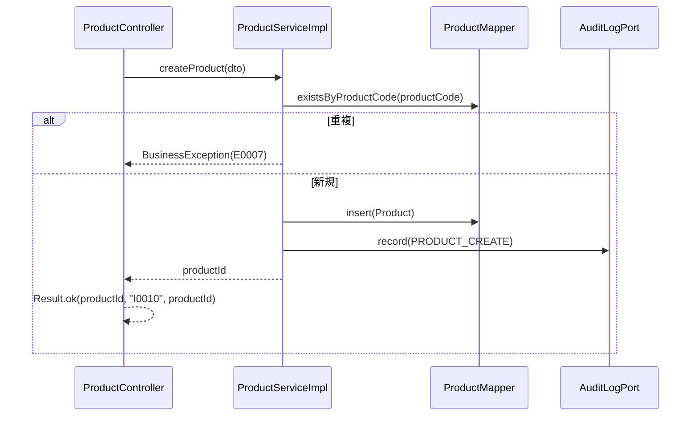

<!-- devtool:file-region id="document-header" -->
# 商品管理 詳細設計

> 詳細設計（内部設計）。`詳細設計/spec-detail-temp.md` の構成に従う。本書は単一情報源（SSOT）を参照するのみで、項目・列挙値・メッセージを再定義しない。
> 業務ルールの番号・内容は `基本設計/共通/spec-08-business-rule-list.md` を正とし、本書は実装手順と画面（SCR-09/10）を定める。税率参照 `listTaxRates` を含む。
> 注文明細への商品情報の複写（BR-PRD-002）と無効商品の追加・申請の拒否（BR-PRD-003 / BR-ORD-010）は order 機能（`詳細設計/業務/order/spec-order-detail-sd.md`）が実装し、本書は複写元（商品・税率）の提供側を定める。SCR-12 注文登録の商品選択は order 機能の画面で、本書の `pageProducts`・`listTaxRates` を呼ぶ。

<!-- devtool:end-file-region -->
<!-- devtool:block id="detail.product.detail-sd.s01" -->
## 文書情報

| 項目 | 内容 |
|------|------|
| システム名称 | DDMSAA 販売システム |
| 文書名称 | 商品管理 詳細設計 |
| 文書バージョン | V1.0 |
| ステータス | 草案 |
| 作成者 | TBD |
| 作成日 | 2026-10-21 |
| レビュー担当 | TBD |

<!-- devtool:endblock -->
<!-- devtool:block id="detail.product.detail-sd.s02" -->
## 改訂履歴

| バージョン | 改訂日 | 改訂者 | 改訂内容 |
|------|--------|--------|---------|
| V0.1 | 2026-10-20 | — | 簡易版（データ・API・処理・テスト・BR） |
| V1.0 | 2026-10-21 | — | `spec-detail-temp.md` の構成へ展開（§0〜§6.1）。テスト表を §5.1 へ移し UT-ID を `UT-PRD-NNN`（3 桁）に統一（簡易版の 001〜007 は番号を変えずに維持し、008 以降を追加） |
| V1.1 | 2026-10-21 | — | 決定反映：`ProductLookupPort`（order への商品・税率の提供）の実装、列挙は `core.shared.enums`、請求形式不正は一律 400 `E0008`、`PERMISSION_DENIED` の記録方針（403 は `PermissionDeniedAuditListener`）。旧 TBD-PRD-01／02／07 を解消。UT-PRD-035〜038 を追加 |

---

<!-- devtool:endblock -->
<!-- devtool:block id="detail.product.detail-sd.s03" -->
## 0. 対象と根拠

| 項目 | 内容 |
|------|------|
| 関連機能 | F-PRD-01〜05（商品一覧・税率参照、商品詳細、登録、更新、有効化/無効化）。F-AUD-02 の記録（`PRODUCT_*`）は本機能の各更新 API が行う |
| 関連画面 | SCR-09 商品一覧、SCR-10 商品登録/編集（`spec-05-screen-list-ui.md`）。SCR-12 は order 機能の画面（本書の `pageProducts`・`listTaxRates` を利用） |
| 関連 API | `pageProducts`、`getProduct`、`createProduct`、`updateProduct`、`activateProduct`、`deactivateProduct`、`listTaxRates`（`spec-07-api-list.yaml`） |
| 関連バッチ | なし |
| 関連テーブル | TBL-products、TBL-tax-rates、TBL-audit-logs（書込）、TBL-product-status-codes、TBL-tax-category-codes（`spec-06-db-physical.yaml`） |
| 業務ルール | BR-PRD-001〜003、BR-ORD-006、BR-AUD-001（BR-ORD-003 / 004 / 010 は order 機能が適用する） |
| 上流根拠 | `要件定義/requirements.md`（FR-03）；`基本設計/業務設計/product/spec-product-business-ui.md`、`spec-product-screen-ui.md`；`基本設計/共通/spec-03-auth-ui.md` §2〜§3 |

### 0.1 コード生成時のロード一覧（AI コンテキスト組み立て）

```
- 本ファイル
- 基本設計/共通/spec-06-db-physical.yaml      ← TBL-products / tax_rates / audit_logs / product_status_codes / tax_category_codes
- 基本設計/共通/spec-07-api-list.yaml          ← 上記 operationId と ProductStatus / TaxCategory / ProductVO / ProductSaveDTO / TaxRateVO / PageResult
- 基本設計/共通/spec-09-message-list.yaml      ← I0010 I0011 I0030 I0034 I0035 W0011 W0026 E0001 E0002 E0005 E0006 E0007 E0008 E0012 E0030〜E0034 E0040〜E0043 E0051 E0054
- 基本設計/共通/spec-08-business-rule-list.md  ← BR-PRD / BR-ORD-006 / BR-AUD-001
- 基本設計/共通/spec-02-function-list-ui.md、spec-03-auth-ui.md、spec-05 / spec-10 / spec-12、基本設計/業務設計/product/spec-product-screen-ui.md
- 基本設計/基盤/インタフェース仕様/spec-10-business-core.yaml・spec-07-infrastructure.yaml・spec-project-structure.yaml
- 開発規約/spec-naming-rule.md / spec-database-rule.md / spec-data-dictionary-project-temp.md（T07-4 商品状態、T07-5 税区分）
- 開発規約/spec-backend-coding-rule.md / spec-frontend-coding-rule.md / spec-test-rule.md
```

### 0.2 マイクロサービス帰属

| 項目 | 内容 |
|------|------|
| 所属サービス | `business-service-core`（`auth-service` は関与しない） |
| パッケージ接頭辞 | `com.example.ddmsaa.core.product` |
| 基盤依存 | common（`Result`・`PageResult`・`BusinessException`・`EntityNotFoundException`）、infrastructure（`UserContext`・`MetaObjectHandler`・DB）。`UserContext` は `getUserId()` / `getRole()` を提供する。跨モジュール Port（`core.shared.port`。定義は order 詳細設計 §1.1.1）：本機能は `ProductLookupPort` を**実装**し、`AuditLogPort`（`record`。実装は user 機能）に**依存**する。`ProductStatus`・`TaxCategory` は `com.example.ddmsaa.core.shared.enums`（`spec-backend-coding-rule.md` §2） |
| DB アクセス権限 | business-service-core は全表の CRUD。本機能は products を読み書きし、tax_rates は読取のみ（税率は R__ マスタ。API による更新はない）。audit_logs は INSERT のみ |

---

<!-- devtool:endblock -->
<!-- devtool:block id="detail.product.detail-sd.s04" -->
## 1. バックエンド詳細設計

### 1.1 クラス一覧

| 層 | クラス名 | パッケージ | 責務 | 対応 |
|----|------|----|------|------|
| Controller | `ProductController` | `com.example.ddmsaa.core.product.controller` | `/api/v1/products/**` の受付。`@PreAuthorize` と `@Valid`、`Result` ラップのみ。メソッド名は operationId | `pageProducts`、`getProduct`、`createProduct`、`updateProduct`、`activateProduct`、`deactivateProduct` |
| Controller | `TaxRateController` | `…core.product.controller` | `/api/v1/tax-rates` の受付（1 Controller 1 リソースの原則） | `listTaxRates` |
| Service | `ProductService` / `ProductServiceImpl` | `…core.product.service` / `…service.impl` | ロール別の検索範囲の強制、検証、登録・更新、有効化/無効化、税率一覧、監査記録 | F-PRD-01〜05 |
| Service | `ProductLookupServiceImpl`（`ProductLookupPort` の実装） | `…core.product.service.impl` | `Map<String, ProductSnapshot> findForOrder(Collection<String> productIds)`：指定 ID の未削除の商品について `ProductSnapshot`（`id`・`code`・`name`・`standardUnitPrice`・`taxCategory`・`taxRate`（`tax_rates` を `tax_category` で結合して求めた値）・`status`）を返す。存在しない・論理削除済みの ID は map に含めない。無効（INACTIVE）の商品は含める（`status` で order が `E0054` を判定する。BR-PRD-003 / BR-ORD-010）。空の入力は空 map。読取専用で呼び出し側の事務に参加する。order が注文明細への複写（BR-PRD-002）に使う（order 詳細設計 §1.1.1） | BR-PRD-002／003、F-PRD-02 |
| Mapper | `ProductMapper` | `…core.product.mapper` | products の検索（tax_rates を LEFT JOIN して税率を返す）・取得・登録・楽観ロック付き更新・状態更新、`selectSnapshotsForOrder(ids)`（`ProductLookupServiceImpl` 用。`products.id IN (…) AND deleted_at IS NULL`、tax_rates を結合） | TBL-products |
| Mapper | `TaxRateMapper` | `…core.product.mapper` | tax_rates の全件取得（読取のみ） | TBL-tax-rates |
| Entity | `Product`、`TaxRate` | `…core.product.entity` | テーブルマッピング（監査列を含む）。`TaxRate` の主キーは自然キー `tax_category`（§4.1-NATURAL） | 各 TBL |
| DTO | `ProductVo`（`ProductVO`）、`ProductSaveDto`（`ProductSaveDTO`）、`TaxRateVo`（`TaxRateVO`）、`ProductSearchCondition` | `…core.product.dto` | 項目は `spec-07-api-list.yaml` の schema に準拠。`ProductSearchCondition` は一覧のクエリと、Service が付与するロール条件 | — |
| 列挙 | `ProductStatus`（T07-4）、`TaxCategory`（T07-5） | `com.example.ddmsaa.core.shared.enums` | `int code` + `fromCode`（`assets/enum.java.tmpl`）。order 等も参照するため `shared.enums` に置く（`spec-backend-coding-rule.md` §2。決定済み。feature の `dto` 配下には置かない） | — |
| 変換 | `ProductConverter` | `…core.product.convert` | Entity ↔ DTO（MapStruct）。`TaxRate` → `TaxRateVo` を含む | — |

> 監査の記録（`audit_logs` への INSERT）は `AuditLogPort.record(auditAction, targetType, targetId, detail)`（`core.shared.port`。実装は user 機能の `AuditLogServiceImpl`。order 詳細設計 §1.1.1 参照）を呼ぶ。本書では `detail` を設定しない（null）。`PERMISSION_DENIED`：403 は core の `PermissionDeniedAuditListener`（user 機能。`AuditLogPort.recordDenied`）が記録するため本機能では呼ばない。本機能には顧客・担当による範囲判定がなく、範囲外 404 の `recordDenied` 呼び出しもない（`getProduct` の EMPLOYEE × 無効商品の 404 は TBD-PRD-06 で確認中のため記録しない）。

> 400 `E0008` の送出方法：本機能に Service 内の業務判定による 400 はなく、すべて DTO 項目の Bean Validation（`MethodArgumentNotValidException`）。Service 内の 400 が必要になった場合は `InvalidRequestException`（`spec-backend-coding-rule.md` §4）を使う。請求形式不正（非法な列挙値のクエリ／本文、不正 JSON、必須クエリ欠落）は `MethodArgumentTypeMismatchException`／`HttpMessageNotReadableException`／`MissingServletRequestParameterException` を `GlobalExceptionHandler` が一律 400 `E0008`（`details[]`。解析器のメッセージは返さない）に変換する（`spec-03-exception-handler.yaml` RequestBinding。500 にならない）。

### 1.2 API 別詳細設計

> 以下のすべての API で、成功は HTTP 200 + `Result`、権限不足は 403 `E0002`、未認証・JWT 期限切れは 401 `E0001`（Gateway 起因は `E0040`〜`E0043`）、想定外のシステム例外は 500 `E0012`。`@PreAuthorize` は `x-roles` に一致させる。CUSTOMER は商品 API を一切利用できない（403 `E0002`。spec-03 §2）。商品に顧客・担当による行の絞り込みはない（ADMIN と EMPLOYEE の違いは状態の可視範囲のみ。BR-PRD-003）。`updatedAt` はマイクロ秒 6 桁の文字列で入出力する（BR-ORD-006）。

#### `pageProducts` 商品一覧（`GET /api/v1/products`）

| 項目 | 内容 |
|------|------|
| operationId | `pageProducts` |
| 対応機能 | F-PRD-01 |
| ロール・権限 | `@PreAuthorize("hasAnyRole('ADMIN','EMPLOYEE')")` |
| リクエスト | クエリ `pageNum`（既定 1・最小 1）、`pageSize`（既定 20・1〜100）、`keyword`（商品コード・商品名の部分一致）、`productCategory`、`taxCategory`（`TaxCategory`）、`status`（`ProductStatus`） |
| レスポンス | `Result<PageResult<ProductVO>>`（商品コード昇順の固定順） |

**入力検証**

| 項目 | ルール | 違反時 messageId | HTTP |
|------|------|--------------|------|
| `pageNum` | 1 以上 | `E0008` | 400 |
| `pageSize` | 1〜100 | `E0008` | 400 |
| `taxCategory` | `STANDARD` / `REDUCED` / `EXEMPT` のいずれか。非法な値は `MethodArgumentTypeMismatchException` として 400 | `E0008` | 400 |
| `status` | `ACTIVE` / `INACTIVE` のいずれか。非法な値は `MethodArgumentTypeMismatchException` として 400 | `E0008` | 400 |

**処理ロジック**

```
1. ProductSearchCondition を組み立てる。UserContext.getRole() を条件に含める
2. EMPLOYEE の場合は、リクエストの status に関わらず status = ACTIVE(1) に固定する（BR-PRD-003。INACTIVE を指定しても ACTIVE だけが返り、エラーにしない）。ADMIN は status 指定があればその値、なければ全状態
3. keyword は product_code と product_name への部分一致（LIKE のワイルドカード文字はエスケープする）。productCategory は product_category の一致（方式は TBD-PRD-03）。taxCategory は tax_category の一致（コード値へ変換）
4. PageHelper.startPage(pageNum, pageSize) → ProductMapper.search（product_code 昇順固定。deleted_at IS NULL。tax_rates を tax_category で LEFT JOIN して taxRate を取得）
5. PageResult.of(records, total, pageNum, pageSize) を Result.ok で返す
```

**トランザクション**：`@Transactional(readOnly = true)`（クラス既定）。

**DB アクセス**

| Mapper メソッド | 操作 | 対象テーブル.カラム | 主要条件 |
|------------|------|----------|---------|
| `ProductMapper.search` | SELECT | `products.id/product_code/product_name/product_category/standard_unit_price/tax_category/status/updated_at`、`tax_rates.tax_rate` | `products.deleted_at IS NULL`、keyword・productCategory・taxCategory・status、EMPLOYEE のとき `status = 1` |

**利用する共通コンポーネント**：`PageHelper`、`PageResult`、`UserContext`。

**例外 → messageId → HTTP**

| シナリオ | 例外 | messageId | HTTP |
|------|------|-----------|------|
| 検証失敗（`pageNum`・`pageSize` の範囲等） | `MethodArgumentNotValidException`（クエリ DTO の Bean Validation） | `E0008` | 400 |
| 非法な `taxCategory`・`status`（列挙値） | `MethodArgumentTypeMismatchException` | `E0008` | 400 |
| CUSTOMER が呼ぶ | `AccessDeniedException` | `E0002` | 403 |

**正常レスポンス**：`Result<PageResult<ProductVO>>`（messageId なし）。

#### `getProduct` 商品詳細（`GET /api/v1/products/{productId}`）

| 項目 | 内容 |
|------|------|
| operationId | `getProduct` |
| 対応機能 | F-PRD-02 |
| ロール・権限 | `@PreAuthorize("hasAnyRole('ADMIN','EMPLOYEE')")` |
| リクエスト | パス `productId`（`PR` + 8 桁） |
| レスポンス | `Result<ProductVO>`（`taxRate`、`updatedAt` を含む） |

**処理ロジック**

```
1. products を productId（deleted_at IS NULL）で取得する（tax_rates を LEFT JOIN）。取得できなければ EntityNotFoundException（404 E0005）
2. EMPLOYEE で status が INACTIVE の商品は、存在を開示せず EntityNotFoundException（404 E0005）とする（簡易版 V0.1。一覧が ACTIVE 固定である BR-PRD-003 と整合。TBD-PRD-06）。ADMIN は状態を問わず返す
3. ProductConverter で ProductVo を組み立てる（status は ProductStatus、taxCategory は TaxCategory へ変換、standardUnitPrice は小数 2 桁、taxRate は tax_rates.tax_rate、updatedAt はマイクロ秒 6 桁）
```

**トランザクション**：`readOnly`。

**DB アクセス**

| Mapper メソッド | 操作 | 対象テーブル.カラム | 主要条件 |
|------------|------|----------|---------|
| `ProductMapper.selectById` | SELECT | `products.*`、`tax_rates.tax_rate` | `products.id = #{productId} AND products.deleted_at IS NULL` |

**例外 → messageId → HTTP**

| シナリオ | 例外 | messageId | HTTP |
|------|------|-----------|------|
| 不存在、EMPLOYEE が無効商品を指定 | `EntityNotFoundException` | `E0005` | 404 |
| CUSTOMER が呼ぶ | `AccessDeniedException` | `E0002` | 403 |

**正常レスポンス**：`Result<ProductVO>`。

#### `createProduct` 商品登録（`POST /api/v1/products`）

| 項目 | 内容 |
|------|------|
| operationId | `createProduct` |
| 対応機能 | F-PRD-03 |
| ロール・権限 | `@PreAuthorize("hasRole('ADMIN')")` |
| リクエストスキーマ | `ProductSaveDTO`（`productCode`・`productName`・`standardUnitPrice`・`taxCategory` 必須、`productCategory`。`updatedAt` は登録では無視する） |
| レスポンス | `Result<String>`（採番した商品 ID。`messageId=I0010`、`messageArgs=[商品 ID]`） |

**シーケンス**



**入力検証**

| 項目 | ルール | 違反時 messageId | HTTP |
|------|------|--------------|------|
| `productCode` | 必須・1〜50 文字 | `E0008` | 400 |
| `productName` | 必須・1〜200 文字 | `E0008` | 400 |
| `productCategory` | 任意・100 文字以内 | `E0008` | 400 |
| `standardUnitPrice` | 必須・0 以上（`chk_products_std_unit_price`）・整数部 13 桁以内・小数 2 桁以内（`numeric(15,2)`、07 の `multipleOf: 0.01`） | `E0008` | 400 |
| `taxCategory` | 必須・`STANDARD` / `REDUCED` / `EXEMPT` | `E0008` | 400 |
| `productCode` | 未削除行に同じ商品コードが存在（`uq_products_product_code`） | `E0007` | 409 |

**処理ロジック**

```
1. 上の項目検証（Bean Validation）を行う。違反は 400 E0008（details[] に項目）
2. 商品コードの重複を確認する：existsByProductCode（deleted_at IS NULL）が真なら BusinessException("E0007")（409）
3. products を INSERT（status=ACTIVE(1)、tax_category は TaxCategory.getCode()。id は DB の next_business_id('PR', 8) の DEFAULT で採番し useGeneratedKeys で取得）。監査列は MetaObjectHandler が自動設定
   - 同時登録で uq_products_product_code が衝突した場合（DuplicateKeyException）も BusinessException("E0007")
4. AuditLogPort.record("PRODUCT_CREATE", "PRODUCT", productId, null)
5. productId を返す
```

**トランザクション**

| 項目 | 内容 |
|------|------|
| 範囲 | `@Transactional` を `ProductServiceImpl.createProduct()` に付与 |
| 関連テーブル | TBL-products・TBL-audit-logs（書込） |
| ロールバック条件 | `BusinessException`（`E0007`）や DB 例外の場合は全体をロールバックし、商品・監査のいずれも残さない |

**DB アクセス**

| Mapper メソッド | 操作 | 対象テーブル.カラム | 主要条件 |
|------------|------|----------|---------|
| `ProductMapper.existsByProductCode` | SELECT | `products.product_code` | `product_code = #{productCode} AND deleted_at IS NULL` |
| `ProductMapper.insert` | INSERT | `products`（`product_code/product_name/product_category/standard_unit_price/tax_category/status`） | `uq_products_product_code`、`fk_products_tax_category_codes` |
| `AuditLogPort.record` | INSERT | `audit_logs` | — |

**利用する共通コンポーネント**

| コンポーネント | 用途 |
|------|------|
| `MetaObjectHandler`（MyBatis Interceptor） | 監査列の自動設定。Service は設定しない |
| `UserContext` | 操作者（監査の `actor_user_id`） |

**例外 → messageId → HTTP**

| シナリオ | 例外 | messageId | HTTP |
|------|------|-----------|------|
| 検証失敗（必須欠落・長さ・負の単価・小数桁） | `MethodArgumentNotValidException` | `E0008` | 400 |
| 非法な `taxCategory` の列挙値・不正 JSON | `HttpMessageNotReadableException` | `E0008` | 400 |
| 商品コード重複 | `BusinessException`（`DuplicateKeyException` を変換） | `E0007` | 409 |
| 権限不足 | `AccessDeniedException` | `E0002` | 403 |

**正常レスポンス**：`Result<String>`、`I0010`（`{0}`＝商品 ID）。

#### `updateProduct` 商品更新（`PUT /api/v1/products/{productId}`）

| 項目 | 内容 |
|------|------|
| operationId | `updateProduct` |
| 対応機能 | F-PRD-04 |
| ロール・権限 | `@PreAuthorize("hasRole('ADMIN')")`（EMPLOYEE は 403 `E0002`。参照のみ） |
| リクエストスキーマ | `ProductSaveDTO`（`updatedAt` 必須。`productCode` は変更不可） |
| レスポンス | `Result<Void>`（`messageId=I0011`） |

**入力検証**：`createProduct` と同じ項目規則。加えて次を適用する。

| 項目 | ルール | 違反時 messageId | HTTP |
|------|------|--------------|------|
| `updatedAt` | 必須・日時形式 | `E0008` | 400 |
| `productCode` | 更新では変更できない。値が既存と異なる場合の扱いは TBD-PRD-04（本書は既存値を更新対象に含めない） | — | — |

**処理ロジック**

```
1. 対象 products を productId（deleted_at IS NULL）で取得する。不存在は EntityNotFoundException（404 E0005）
2. 楽観ロック：UPDATE products SET product_name, product_category, standard_unit_price, tax_category WHERE id = ? AND deleted_at IS NULL AND updated_at = #{expectedUpdatedAt}。0 行は BusinessException("E0051")（409）。product_code・status は更新しない（状態は activate / deactivate だけが変更する）。productCategory が要求にない場合は NULL に更新する（PUT の全項目置換）
3. 注文には触れない：order_items・orders を更新しない。DRAFT / RETURNED の注文は次回の保存・申請のときに order 機能が新しい値を複写し、PENDING_APPROVAL 以降の注文は変わらない（BR-PRD-002）
4. AuditLogPort.record("PRODUCT_UPDATE", "PRODUCT", productId, null)
5. 最新の updatedAt が必要な場合は画面が getProduct で再取得する（応答は Result<Void>）
```

**トランザクション**：`@Transactional`（`ProductServiceImpl.updateProduct()`）。書込：products・audit_logs。`E0051` 時は全体をロールバックし、監査に記録しない（INFO ログ：traceId・対象 ID。coding-rule §6）。

**DB アクセス**

| Mapper メソッド | 操作 | 対象テーブル.カラム | 主要条件 |
|------------|------|----------|---------|
| `ProductMapper.selectById` | SELECT | `products.*` | `id = #{productId} AND deleted_at IS NULL` |
| `ProductMapper.updateWithLock` | UPDATE | `products.product_name/product_category/standard_unit_price/tax_category` | `id = #{id} AND deleted_at IS NULL AND updated_at = #{expectedUpdatedAt}` |
| `AuditLogPort.record` | INSERT | `audit_logs` | — |

**例外 → messageId → HTTP**

| シナリオ | 例外 | messageId | HTTP |
|------|------|-----------|------|
| 検証失敗 | `MethodArgumentNotValidException` | `E0008` | 400 |
| 非法な `taxCategory` の列挙値・不正 JSON | `HttpMessageNotReadableException` | `E0008` | 400 |
| 不存在 | `EntityNotFoundException` | `E0005` | 404 |
| 楽観ロック不一致 | `BusinessException` | `E0051` | 409 |
| 権限不足（EMPLOYEE・CUSTOMER） | `AccessDeniedException` | `E0002` | 403 |

**正常レスポンス**：`Result<Void>`、`I0011`。

#### `activateProduct` 有効化 / `deactivateProduct` 無効化（`POST /api/v1/products/{productId}/activate`・`/deactivate`）

| 項目 | 内容 |
|------|------|
| operationId | `activateProduct`、`deactivateProduct` |
| 対応機能 | F-PRD-05 |
| ロール・権限 | `@PreAuthorize("hasRole('ADMIN')")` |
| リクエスト | パス `productId`（本文なし） |
| レスポンス | `Result<Void>`（`activateProduct`＝`I0034`、`deactivateProduct`＝`I0035`） |

**処理ロジック**

```
1. 対象 products を行ロックで取得する（SELECT … FOR UPDATE、deleted_at IS NULL）。不存在は EntityNotFoundException（404 E0005）
2. activateProduct：status を ACTIVE(1) に UPDATE。deactivateProduct：status を INACTIVE(2) に UPDATE。既に目的の状態である場合の扱いは TBD-PRD-05（07 は 409 を宣言するが messageId が未定義）。updated_at は DB トリガーが更新する
3. 無効化しても既存注文の明細・金額・税額は変更しない（複写済み。BR-PRD-002 / 003）。無効商品を明細へ新しく追加する操作（409 `E0054`）と、既存明細の無効商品を含む申請（409 `E0054`。BR-ORD-010）は order 機能が商品状態を参照して判定する
4. AuditLogPort.record("PRODUCT_ACTIVATE" または "PRODUCT_DEACTIVATE", "PRODUCT", productId, null)
```

**トランザクション**：`@Transactional`（`ProductServiceImpl.activateProduct()` / `deactivateProduct()`）。書込：products・audit_logs。

**DB アクセス**

| Mapper メソッド | 操作 | 対象テーブル.カラム | 主要条件 |
|------------|------|----------|---------|
| `ProductMapper.selectForUpdate` | SELECT … FOR UPDATE | `products.*` | `id = #{productId} AND deleted_at IS NULL` |
| `ProductMapper.updateStatus` | UPDATE | `products.status` | `id = #{productId}` |
| `AuditLogPort.record` | INSERT | `audit_logs` | — |

**例外 → messageId → HTTP**

| シナリオ | 例外 | messageId | HTTP |
|------|------|-----------|------|
| 不存在 | `EntityNotFoundException` | `E0005` | 404 |
| 権限不足 | `AccessDeniedException` | `E0002` | 403 |

**正常レスポンス**：`Result<Void>`、`I0034` / `I0035`。

#### `listTaxRates` 税率一覧（`GET /api/v1/tax-rates`）

| 項目 | 内容 |
|------|------|
| operationId | `listTaxRates` |
| 対応機能 | F-PRD-01 |
| ロール・権限 | `@PreAuthorize("hasAnyRole('ADMIN','EMPLOYEE')")` |
| リクエスト | なし |
| レスポンス | `Result<List<TaxRateVO>>`（`taxCategory`・`taxRate`。税区分コード昇順の固定順） |

**処理ロジック**

```
1. TaxRateMapper.selectAll で tax_rates（deleted_at IS NULL）を tax_category 昇順に全件取得する。条件・ページングはない
2. TaxRateVo へ変換する：taxCategory は TaxCategory（1=STANDARD、2=REDUCED、3=EXEMPT）、taxRate は numeric(5,2) の値（STANDARD=10.00、REDUCED=8.00、EXEMPT=0.00。初期値は spec-06 master_data）
3. Result.ok(list) を返す（messageId なし）
```

**トランザクション**：`readOnly`。

**DB アクセス**

| Mapper メソッド | 操作 | 対象テーブル.カラム | 主要条件 |
|------------|------|----------|---------|
| `TaxRateMapper.selectAll` | SELECT | `tax_rates.tax_category/tax_rate` | `deleted_at IS NULL`、`ORDER BY tax_category` |

**例外 → messageId → HTTP**

| シナリオ | 例外 | messageId | HTTP |
|------|------|-----------|------|
| CUSTOMER が呼ぶ | `AccessDeniedException` | `E0002` | 403 |

**正常レスポンス**：`Result<List<TaxRateVO>>`。

#### 他機能へ提供する参照（API ではない）

> 跨モジュール Port の正式定義は order 詳細設計 §1.1.1。本機能は次の Port を**実装**する。

| 提供する Port／メソッド | 実装クラス | 内容 | 利用側 |
|------|------|------|------|
| `ProductLookupPort.findForOrder(Collection<String> productIds)` | `ProductLookupServiceImpl` | `Map<String, ProductSnapshot>`（キー＝商品 ID。`ProductSnapshot`＝`id`・`code`・`name`・`standardUnitPrice`・`taxCategory`・`taxRate`（`tax_rates` を結合して求めた値）・`status`）。存在しない・論理削除済みの ID は map に含めない。無効（INACTIVE）は含め、order が `status` で `E0054` を判定する。`ProductMapper.selectSnapshotsForOrder`（`deleted_at IS NULL`） | order（注文の保存・申請時の複写。BR-PRD-002、無効商品の判定。BR-PRD-003 / BR-ORD-010） |

### 1.3 Entity / DTO / VO マッピング

| Entity 項目 | DTO 項目 | 変換 | 命名変更の登録 |
|------------|---------|------|------------|
| `Product.id`（id） | `ProductVO.id` | 直接 | なし（業務キー `PR` + 8 桁） |
| `Product.productCode` / `productName` / `productCategory` | 同名 | 直接 | なし |
| `Product.standardUnitPrice`（`BigDecimal`、scale 2） | `ProductVO.standardUnitPrice` / `ProductSaveDTO.standardUnitPrice` | 直接（浮動小数点型を使わない） | なし |
| `Product.taxCategory`（Integer） | `taxCategory`（`TaxCategory`） | `TaxCategory.fromCode` / `getCode` | なし |
| `TaxRate.taxRate`（結合） | `ProductVO.taxRate` | `tax_rates` を `tax_category` で結合した結果を設定 | `spec-data-dictionary-mapping-ui.md` に登録済み（`taxRate（ProductVO）` ← `tax_rates.tax_rate`） |
| `Product.status`（Integer） | `status`（`ProductStatus`） | `ProductStatus.fromCode` / `getCode` | なし |
| `Product.updatedAt` | `ProductVO.updatedAt` | マイクロ秒 6 桁の文字列。更新要求の `updatedAt` に同値を返送する | なし |
| `TaxRate.taxCategory` / `taxRate` | `TaxRateVO.taxCategory` / `taxRate` | `TaxCategory` / 直接 | なし |

> 暗号化カラムはない。マスキング対象項目もない（商品は ADMIN / EMPLOYEE のみが参照し、CUSTOMER は 403）。

---

<!-- devtool:endblock -->
<!-- devtool:block id="detail.product.detail-sd.s05" -->
## 2. フロントエンド詳細設計

### 2.1 画面別コンポーネント分解

> 画面ファイルは `frontend/src/pages/product/`、コンポーネントは `frontend/src/components/product/`、型は `frontend/src/types/product.ts`、API クライアントは `frontend/src/api/product-api.ts`（関数名＝operationId。`listTaxRates` を含む）。共通の HTTP 層・i18n・ルートガードは `spec-frontend-coding-rule.md` と `spec-12-screen-common-ui.md` に従う。列挙の表示名（商品状態 ACTIVE=有効 / INACTIVE=無効、税区分 STANDARD=標準税率（10%） / REDUCED=軽減税率（8%） / EXEMPT=非課税（0%））は spec-12 §6.1、状態色は §9（有効＝緑、無効＝灰。テキストを併記）。金額は 3 桁区切り＋「円」（spec-12 §6。小数の表示桁は TBD-S2）。

#### SCR-09 商品一覧（`/products`）

**コンポーネントツリー**

```
ProductListPage (src/pages/product/product-list-page.tsx)
├── ProductSearchForm (src/components/product/product-search-form.tsx)   キーワード・カテゴリ・税区分・状態・検索／リセット
└── ProductTable      (src/components/product/product-table.tsx)         商品コード・商品名・カテゴリ・標準単価・税区分・状態・操作（有効化/無効化）
```

**状態・データ**

| 状態 | 型 | 取得元 API | 説明 |
|------|------|---------|------|
| `query` | `{ keyword, productCategory, taxCategory, status, pageNum, pageSize }` | — | URL クエリに保持し、詳細から戻ったときに復元（spec-12 §2） |
| `page` | `PageResult<ProductVo>` | `pageProducts` | 商品コード昇順の固定順。列見出しソートなし |
| `me` | `MeVo` | `getMe`（保持済み） | ADMIN 専用要素の表示制御（ロール判定）に使う |

**イベント → API 対応**

| イベント | operationId | 入力 | 成功時処理 | 失敗時処理 |
|------|--------|------|---------|---------|
| 初期表示／検索／ページ移動 | `pageProducts` | `query` | 一覧更新。0 件は「該当データなし」 | `ErrorResponse.messageId` を表示（再試行導線） |
| 行クリック | — | `productId` | SCR-10（`/products/:productId/edit`）へ遷移 | — |
| 新規登録（ADMIN のみ） | — | — | SCR-10（`/products/new`）へ遷移 | — |
| 無効化（ADMIN。`W0026` 確認後） | `deactivateProduct` | `productId` | `I0035` → 再読込 | `E0005`・`E0002` を表示 |
| 有効化（ADMIN） | `activateProduct` | `productId` | `I0034` → 再読込 | 同上 |

**クライアント検証**：なし（任意入力の検索条件のみ）。

**ロール別表示制御**

| 要素 | ADMIN | EMPLOYEE | CUSTOMER |
|------|:-----:|:--------:|:--------:|
| 画面全体 | ○ | ○（参照のみ） | ×（メニューに出さない。ルートガードで SCR-19） |
| 状態の検索条件・状態列・有効化/無効化の行操作 | ○ | ×（状態列と状態切替を出さない。API が ACTIVE に固定） | — |
| 新規登録ボタン | ○ | × | — |

> 状態の行操作は現在の `status` に応じて、ACTIVE のとき「無効化」、INACTIVE のとき「有効化」の一方だけを表示する。EMPLOYEE の「状態」検索条件の扱い（非表示）は `spec-product-screen-ui.md` §1 の「状態切替を表示しない」に合わせた本書の判断であり、API は status 指定を無視して ACTIVE に固定する。

**メッセージ表示**：成功 `I0034`・`I0035`、確認 `W0026`（危険操作の確認ダイアログ）、エラー `E0001`・`E0002`・`E0005`・`E0008`。

**画面遷移**（正本 `spec-10-screen-transition-ui.md`）

| 遷移元 | 遷移先 | トリガー |
|------|----|------|
| SCR-09 | SCR-10 | 新規登録（ADMIN）／行選択（`productId`。EMPLOYEE は参照のみ） |

#### SCR-10 商品登録/編集（`/products/new`、`/products/:productId/edit`）

**コンポーネントツリー**

```
ProductEditPage (src/pages/product/product-edit-page.tsx)
└── ProductForm (src/components/product/product-form.tsx)   商品コード・商品名・カテゴリ・標準単価・税区分（税率表示）・状態（表示のみ）・I0030 の注記。readOnly プロパティで EMPLOYEE の参照表示に切り替える
```

**状態・データ**

| 状態 | 型 | 取得元 API | 説明 |
|------|------|---------|------|
| `form` | `ProductFormValues`（`productCode`、`productName`、`productCategory`、`standardUnitPrice`、`taxCategory`、`updatedAt`） | `getProduct`（編集・参照時） | `updatedAt` は文字列のまま保持（マイクロ秒を失わない。coding-rule §6）。`standardUnitPrice` は入力中は文字列で保持し、送信時に数値へ変換する |
| `taxRates` | `TaxRateVo[]` | `listTaxRates` | 税区分の選択肢と税率（10% / 8% / 0%）の表示のみ |
| `status` | `ProductStatus` | `getProduct` | 状態の表示のみ（変更は SCR-09 の行操作） |
| `me` | `MeVo` | `getMe`（保持済み） | `readOnly`（EMPLOYEE は true）の判定 |
| `dirty` / `submitting` | `boolean` | — | 離脱確認（`W0011`）と二重送信防止 |

**イベント → API 対応**

| イベント | operationId | 入力 | 成功時処理 | 失敗時処理 |
|------|--------|------|---------|---------|
| 初期表示（編集・参照） | `getProduct`、`listTaxRates` | `productId` | フォームに展開。EMPLOYEE は全項目を読取専用にし、保存ボタンを出さない | 404 `E0005`（EMPLOYEE が無効商品を指定した場合を含む）→ SCR-20 |
| 初期表示（新規） | `listTaxRates` | — | 空フォーム | メッセージ表示 |
| 保存（新規） | `createProduct` | `ProductSaveDTO`（`updatedAt` なし） | `I0010`（`{0}`＝商品 ID）→ SCR-09 | `E0007`（商品コード項目へ表示）・`E0008`（`details[]` を各項目へ割り付け） |
| 保存（編集） | `updateProduct` | `ProductSaveDTO`（`updatedAt` 同送。`productCode` は変更不可の読取専用表示） | `I0011` → SCR-09 | `E0051`（最新を再読込するよう案内し `getProduct` で再取得）・`E0008`・`E0005` |
| キャンセル | — | — | 入力があれば `W0011` で確認 → SCR-09 | — |

**クライアント検証**（サーバーの Bean Validation と一致させる。サーバーが最終権威）

| 項目 | ルール | 表示 messageId |
|------|------|--------------|
| 商品コード | 必須（新規のみ入力可）・最大 50 文字 | `E0030`／`E0032` |
| 商品名 | 必須・最大 200 文字 | `E0030`／`E0032` |
| カテゴリ | 任意・最大 100 文字 | `E0032` |
| 標準単価 | 必須・数値・0 以上・小数 2 桁以内・整数部 13 桁以内 | `E0030`／`E0031`／`E0033`／`E0034` |
| 税区分 | 必須（`listTaxRates` の値から選択） | `E0030` |

**ロール別表示制御**

| 要素 | ADMIN | EMPLOYEE | CUSTOMER |
|------|:-----:|:--------:|:--------:|
| `/products/:productId/edit` の表示 | ○（編集可） | ○（全項目を読取専用。保存ボタンなし） | ×（SCR-19） |
| `/products/new` | ○ | ×（ルートガードで SCR-19。新規は ADMIN のみ。spec-10） | × |

**メッセージ表示**：成功 `I0010`・`I0011`、情報（画面内の固定注記）`I0030`（既存注文の内容と税額は変わらない）、確認 `W0011`、エラー `E0005`・`E0007`・`E0008`・`E0030`〜`E0034`・`E0051`。

**画面遷移**

| 遷移元 | 遷移先 | トリガー |
|------|----|------|
| SCR-10 | SCR-09 | 保存成功、キャンセル |
| SCR-10 | SCR-20 / SCR-19 | 404 `E0005`／403 `E0002` |

---

<!-- devtool:endblock -->
<!-- devtool:block id="detail.product.detail-sd.s06" -->
## 3. バッチ詳細設計

本機能にバッチなし。

---

<!-- devtool:endblock -->
<!-- devtool:block id="detail.product.detail-sd.s07" -->
## 4. 横断設計（本機能 固有）

| 項目 | 内容 |
|------|------|
| 権限実装 | `pageProducts`・`getProduct`・`listTaxRates`＝`hasAnyRole('ADMIN','EMPLOYEE')`、`createProduct`・`updateProduct`・`activateProduct`・`deactivateProduct`＝`hasRole('ADMIN')`。CUSTOMER は全 API で 403 `E0002`。行の絞り込みはない。EMPLOYEE は一覧を ACTIVE に固定し、詳細は ACTIVE のみ（無効商品は 404 `E0005`）（BR-PRD-003） |
| 暗号化・マスキング | 暗号化カラム・マスキング対象項目なし。標準単価は `BigDecimal`（scale 2）で扱い、浮動小数点型を使わない |
| トランザクション・整合性 | 商品登録・更新・有効化/無効化＝products の更新＋audit_logs を同一トランザクション。商品の変更は order_items・orders を更新しない（複写は order 機能が保存・申請時に行う。BR-PRD-002）。税率（tax_rates）は API で更新しない |
| 同時実行・ロック | `products.updated_at` による楽観ロック（`updateProduct`。不一致 `E0051`。BR-ORD-006）。`activateProduct` / `deactivateProduct` は行ロック（`SELECT … FOR UPDATE`）で直列化。商品コードの同時登録は `uq_products_product_code` の衝突を `E0007` へ変換して防ぐ |
| 監査 | `PRODUCT_CREATE`／`PRODUCT_UPDATE`／`PRODUCT_ACTIVATE`／`PRODUCT_DEACTIVATE`（`target_type=PRODUCT`、`target_id`＝商品 ID。BR-AUD-001）を業務更新と同一トランザクションで記録する。`audit_detail` は設定しない。記録は `AuditLogPort.record` 経由。楽観ロック競合は記録しない。`PERMISSION_DENIED`（403）は `PermissionDeniedAuditListener` が `AuditLogPort.recordDenied`（`REQUIRES_NEW`）で記録する（決定済み。本機能の Service は呼ばない） |
| 無効商品・改定の影響範囲 | 商品の無効化・改定は、DRAFT / RETURNED の注文の次回保存（再複写）と、新規の明細追加・申請の可否（`E0054`）に影響し、PENDING_APPROVAL 以降の注文には影響しない（BR-PRD-002 / 003）。判定・複写は order 機能の責務 |

### 確認事項（TBD）

| # | 事項 |
|---|---|
| TBD-PRD-03 | `pageProducts` の `productCategory` の一致方式（完全一致か部分一致か。07 に説明がない）。カテゴリを自由入力とするかマスタ化するか（`spec-product-screen-ui.md` TBD-P1）にも依存する。本書は 07 の型（string）のみを前提とし一致方式は決めない |
| TBD-PRD-04 | `updateProduct` の要求で `productCode` が既存値と異なる場合の扱い（無視するか 400 `E0008` とするか）。07 は「更新時は変更不可」としか記載がない |
| TBD-PRD-05 | `activateProduct` / `deactivateProduct` で既に目的の状態の場合の扱い。07 は 409 を宣言するが、使う messageId が未定義（案：冪等に成功、または `E0006`）。本書は状態を目的値へ更新するのみで例外にしない暫定実装 |
| TBD-PRD-06 | `getProduct` で EMPLOYEE が無効商品を指定した場合の 404 `E0005`（範囲外参照ではなく状態による不可視として扱い、`recordDenied` は呼ばない暫定）。簡易版 V0.1 の記載であり、BR-PRD-003 は EMPLOYEE の「商品検索」を有効商品に固定するとのみ定める。注文済みの無効商品を EMPLOYEE が確認する手段（明細の複写値で足りるか）も含めて確認が必要 |
| TBD-S2／TBD-P2 | 金額の小数表示（spec-12 TBD-S2）、標準単価の変更履歴の表示（`spec-product-screen-ui.md` TBD-P2。初版は表示しない）は上流の未決事項であり、本書は初版の前提に従う |

> **決定済み（旧 TBD、2026-10-21）**：PRD-01 order への商品・税率の提供＝`ProductLookupPort.findForOrder`（本機能の `ProductLookupServiceImpl`）／PRD-02 `ProductStatus`・`TaxCategory`＝`core.shared.enums`／PRD-07 請求形式不正（非法列挙値・不正 JSON）＝400 `E0008`／`PERMISSION_DENIED`＝403 は `PermissionDeniedAuditListener`（本機能は呼ばない）。

---

<!-- devtool:endblock -->
<!-- devtool:block id="detail.product.detail-sd.s08" -->
## 5. トレーサビリティマトリクス（UT / コードへの接続）

| F-ID | SCR | API（operationId） | TBL | messageId | バックエンドクラス | フロントエンドコンポーネント | UT-ID（§5.1） |
|------|-----|-----|-----|-----------|--------|---------|-------|
| F-PRD-01 | SCR-09 | `pageProducts` | TBL-products、tax-rates | E0002／E0008 | `ProductServiceImpl.pageProducts` | `ProductListPage`、`ProductSearchForm`、`ProductTable` | UT-PRD-007〜011、035 |
| F-PRD-01 | SCR-10、SCR-12 | `listTaxRates` | TBL-tax-rates | E0002 | `ProductServiceImpl.listTaxRates` | `ProductForm`（SCR-12 は order 機能） | UT-PRD-029、030、034 |
| F-PRD-02 | SCR-10 | `getProduct` | TBL-products、tax-rates | E0002／E0005 | `ProductServiceImpl.getProduct` | `ProductEditPage`、`ProductForm` | UT-PRD-012〜016 |
| F-PRD-03 | SCR-10 | `createProduct` | TBL-products、audit-logs | I0010／E0002／E0007／E0008 | `ProductServiceImpl.createProduct` | `ProductEditPage`、`ProductForm` | UT-PRD-001、002、017〜020、031、036 |
| F-PRD-04 | SCR-10 | `updateProduct` | 同上 | I0011／E0002／E0005／E0008／E0051 | `ProductServiceImpl.updateProduct` | `ProductEditPage`、`ProductForm` | UT-PRD-003、005、006、021〜024、032 |
| F-PRD-05 | SCR-09 | `activateProduct`、`deactivateProduct` | TBL-products、audit-logs | I0034／I0035／E0002／E0005 | `ProductServiceImpl.activateProduct`／`deactivateProduct` | `ProductListPage`、`ProductTable` | UT-PRD-004、025〜028 |
| F-AUD-02（記録） | — | （各更新 API） | TBL-audit-logs | — | `AuditLogPort.record` | — | UT-PRD-017、021、025、026、033 |
| （`ProductLookupPort` 提供） | — | — | TBL-products、tax-rates | — | `ProductLookupServiceImpl.findForOrder` | — | UT-PRD-037、038 |

### 5.1 UT 用例一覧

> テストコード生成の**唯一の入力**。期待結果は SSOT の参照のみ（messageId＝`spec-09-message-list.yaml`、HTTP＝`spec-backend-coding-rule.md` §4、ロール＝`spec-03-auth-ui.md`、BR＝`spec-08-business-rule-list.md`）。テスト階層・命名・ディレクトリは `開発規約/spec-test-rule.md` に従う。

**UT-ID 採番規則**：`UT-PRD-NNN`（`PRD`＝product の機能略称。3 桁連番）。`@DisplayName("UT-PRD-NNN <条件→期待>")` を先頭に付与する。簡易版 V0.1 の UT-PRD-001〜007 は番号・内容を維持した（004〜006 は order 機能の API を被テストとする商品起点の用例）。

| UT-ID | 推奨層 | 被テスト | 種別 | 前提条件 | 入力要点 | 期待結果 | 追跡 |
|-------|:------:|---------|------|---------|---------|---------|------|
| UT-PRD-001 | L1 | `createProduct` / `ProductServiceImpl.createProduct` | 異常 | ADMIN、同じ商品コードの未削除商品が存在 | 既存と同じ `productCode` | 409 `E0007`、商品・監査が保存されない | F-PRD-03 / 手順 2 |
| UT-PRD-002 | L2 | `createProduct` | 検証 | ADMIN の JWT | `standardUnitPrice` が負の値 | 400 `E0008` | 入力検証、`chk_products_std_unit_price` |
| UT-PRD-003 | L2 | `updateProduct` | 権限 | EMPLOYEE の JWT | — | 403 `E0002` | BR-PRD-001 / spec-03 §2 |
| UT-PRD-004 | L1 | `createOrder`（商品状態の判定。order 機能の `OrderServiceImpl.createOrder`） | 異常 | 無効（INACTIVE）の商品 | その商品を明細に含めて注文を作成 | 409 `E0054`。判定の実装は order 詳細設計 §1.2 | BR-PRD-003 / `ProductLookupPort.findForOrder` |
| UT-PRD-005 | L3 | `updateProduct`＋`updateOrder`／`submitOrder`（order 機能） | 正常 | 実 DB、申請済み（PENDING_APPROVAL）の注文 | 注文の商品の単価・名称・税区分を `updateProduct` で改定 | 申請済み注文の明細（`order_items`）の複写値・金額・税額は変わらない | BR-PRD-002 |
| UT-PRD-006 | L3 | `updateProduct`＋`updateOrder`（order 機能） | 正常 | 実 DB、DRAFT の注文（商品を複写済み） | 商品を改定してから DRAFT を再保存 | 明細の単価・名称・税区分・税率が改定後の値になる（再複写） | BR-PRD-002 |
| UT-PRD-007 | L1 | `pageProducts` / `ProductServiceImpl.pageProducts` | 権限 | EMPLOYEE、ACTIVE と INACTIVE の商品が存在 | `status=INACTIVE` を指定 | ACTIVE の商品だけが返る（エラーにしない） | BR-PRD-003 / 手順 2 |
| UT-PRD-008 | L1 | `pageProducts` | 正常 | ADMIN、複数商品（有効・無効、複数の税区分・カテゴリ） | `keyword`・`taxCategory` を指定 | 200 `PageResult<ProductVO>`、商品コード昇順、条件に一致する行のみ、`taxRate` を含む | F-PRD-01 / 手順 3〜5 |
| UT-PRD-009 | L1 | `pageProducts` | 正常 | ADMIN、ACTIVE と INACTIVE の商品が存在 | `status=INACTIVE` | INACTIVE の商品だけが返る。`status` 未指定は両方 | F-PRD-01 / 手順 2 |
| UT-PRD-010 | L2 | `pageProducts` | 検証 | ADMIN の JWT | `pageSize=101`、`pageSize=0` | 400 `E0008` | 入力検証 |
| UT-PRD-011 | L2 | `pageProducts` | 権限 | CUSTOMER の JWT | — | 403 `E0002` | spec-03 §2 |
| UT-PRD-012 | L1 | `getProduct` / `ProductServiceImpl.getProduct` | 正常 | ADMIN、INACTIVE の商品 | 商品 ID | 200 `ProductVO`（状態を問わず返る）、`taxRate`・`updatedAt` あり | F-PRD-02 / 手順 1〜3 |
| UT-PRD-013 | L1 | `getProduct` | 正常 | EMPLOYEE、ACTIVE の商品 | 商品 ID | 200 `ProductVO` | F-PRD-02 |
| UT-PRD-014 | L1 | `getProduct` | 異常 | EMPLOYEE、INACTIVE の商品 | 商品 ID | 404 `E0005` | BR-PRD-003 / 手順 2（TBD-PRD-06） |
| UT-PRD-015 | L1 | `getProduct` | 異常 | ADMIN | 存在しない・論理削除済みの `productId` | 404 `E0005` | 手順 1 |
| UT-PRD-016 | L2 | `getProduct` | 権限 | CUSTOMER の JWT | — | 403 `E0002` | spec-03 §2 |
| UT-PRD-017 | L1 | `createProduct` | 正常 | ADMIN | 有効な `ProductSaveDTO` | 200 `I0010`（`messageArgs`＝商品 ID）、`status=ACTIVE`、products と `PRODUCT_CREATE` の監査を同一トランザクションで保存 | F-PRD-03 / 手順 3〜4、BR-AUD-001 |
| UT-PRD-018 | L2 | `createProduct` | 権限 | EMPLOYEE／CUSTOMER の JWT | — | 403 `E0002` | BR-PRD-001 / spec-03 §2 |
| UT-PRD-019 | L2 | `createProduct` | 検証 | ADMIN の JWT | 必須項目の欠落、`productCode` 51 文字、`productName` 201 文字、`productCategory` 101 文字、単価の小数 3 桁 | 400 `E0008` | 入力検証 |
| UT-PRD-020 | L1 | `createProduct` | 境界 | ADMIN | `standardUnitPrice` が 0 | 200 `I0010`（0 は許容）。負の値は UT-PRD-002 | 入力検証（0 以上） |
| UT-PRD-021 | L1 | `updateProduct` / `ProductServiceImpl.updateProduct` | 正常 | ADMIN、商品が存在 | 商品名・単価・税区分を変更 | 200 `I0011`、`PRODUCT_UPDATE` を記録、`product_code`・`status` は不変、`order_items`・`orders` は更新されない | F-PRD-04 / 手順 2〜4、BR-PRD-002 |
| UT-PRD-022 | L1 | `updateProduct` | 異常 | 取得後に別ユーザーが更新済み | 古い `updatedAt` | 409 `E0051`、商品・監査は変更されない | BR-ORD-006 / 手順 2 |
| UT-PRD-023 | L1 | `updateProduct` | 異常 | ADMIN | 存在しない `productId` | 404 `E0005` | 手順 1 |
| UT-PRD-024 | L2 | `updateProduct` | 検証 | ADMIN の JWT | `updatedAt` 欠落、`standardUnitPrice` が負の値 | 400 `E0008` | 入力検証 |
| UT-PRD-025 | L1 | `activateProduct` / `ProductServiceImpl.activateProduct` | 正常 | ADMIN、INACTIVE の商品 | 商品 ID | 200 `I0034`、`status=ACTIVE`、`PRODUCT_ACTIVATE` を記録 | F-PRD-05 / 手順 2・4 |
| UT-PRD-026 | L1 | `deactivateProduct` / `ProductServiceImpl.deactivateProduct` | 正常 | ADMIN、ACTIVE の商品（既存注文の明細に使用中） | 商品 ID | 200 `I0035`、`status=INACTIVE`、`PRODUCT_DEACTIVATE` を記録、既存注文の明細・金額は変更されない | BR-PRD-003 / 手順 3 |
| UT-PRD-027 | L2 | `activateProduct`／`deactivateProduct` | 権限 | EMPLOYEE／CUSTOMER の JWT | — | 403 `E0002`（両 API） | BR-PRD-001 / spec-03 §2 |
| UT-PRD-028 | L1 | `activateProduct`／`deactivateProduct` | 異常 | ADMIN | 存在しない `productId` | 404 `E0005`（両 API） | 手順 1 |
| UT-PRD-029 | L2 | `listTaxRates` | 正常 | ADMIN／EMPLOYEE の JWT | — | 200 `Result<List<TaxRateVO>>`、STANDARD=10.00・REDUCED=8.00・EXEMPT=0.00 の 3 件（`taxCategory` 昇順） | F-PRD-01 / 手順 1〜3 |
| UT-PRD-030 | L2 | `listTaxRates` | 権限 | CUSTOMER の JWT | — | 403 `E0002` | spec-03 §2 |
| UT-PRD-031 | L3 | `createProduct` | 境界 | 実 DB、同じ商品コードの同時登録 | 同一 `productCode` を 2 リクエスト | 一方のみ成功、他方は 409 `E0007`（`uq_products_product_code`）、失敗側は商品・監査が残らない | 手順 3、同時実行・ロック |
| UT-PRD-032 | L3 | `updateProduct` | 境界 | 実 DB、2 つの更新が同じ `updatedAt` で競合 | 同一 `updatedAt` の更新を順に 2 回 | 先の更新のみ成功、後は 409 `E0051`、後の更新の監査は残らない | BR-ORD-006 / 手順 2 |
| UT-PRD-033 | L3 | 監査記録（商品機能） | 正常 | 実 DB | 商品の登録・更新・無効化・有効化 | audit_logs に `PRODUCT_CREATE`・`PRODUCT_UPDATE`・`PRODUCT_DEACTIVATE`・`PRODUCT_ACTIVATE`（`target_type=PRODUCT`、`target_id`＝商品 ID）が業務更新と同一トランザクションで `AuditLogPort.record` 経由で記録される | BR-AUD-001 |
| UT-PRD-034 | L3 | `listTaxRates` | 正常 | 実 DB（R__ マスタ投入済み） | ADMIN の JWT | tax_rates の 3 行（`tax_category` 1・2・3）が STANDARD=10.00・REDUCED=8.00・EXEMPT=0.00 で返り、products の `taxRate` と一致する | F-PRD-01 / spec-06 master_data |
| UT-PRD-035 | L2 | `pageProducts` | 検証 | ADMIN の JWT | `taxCategory=XXX`、`status=999`（非法な列挙値） | 400 `E0008`（`details[]` あり。解析器メッセージを含まない。500 にならない） | RequestBinding / coding-rule §4 |
| UT-PRD-036 | L2 | `createProduct`／`updateProduct` | 検証 | ADMIN の JWT | 本文の `taxCategory` が非法な値、不正 JSON | 400 `E0008`（`HttpMessageNotReadableException`）。商品が保存・更新されない | RequestBinding |
| UT-PRD-037 | L1 | `ProductLookupPort.findForOrder`（`ProductLookupServiceImpl`） | 正常・境界 | 有効な商品・無効（INACTIVE）の商品・論理削除済み商品。税区分 STANDARD／REDUCED／EXEMPT | 上記 ID と存在しない ID を混ぜて渡す。空の Collection も | 有効・無効の商品は `ProductSnapshot`（`id`・`code`・`name`・`standardUnitPrice`・`taxCategory`・`taxRate`（STANDARD=10.00・REDUCED=8.00・EXEMPT=0.00）・`status`）として map に入る。論理削除済み・不存在の ID は map に含まれない。空入力は空 map | BR-PRD-002 / BR-PRD-003 / BR-ORD-010 |
| UT-PRD-038 | L3 | `ProductLookupPort.findForOrder`（実 DB） | 正常 | 実 DB（R__ マスタ投入済み）。商品の単価・税区分を `updateProduct` で改定済み | 改定後に `findForOrder` | 最新の単価・名称・税区分・`tax_rates` の税率が返る（キャッシュなし）。`deleted_at IS NOT NULL` の商品は含まれない | BR-PRD-002 |

**カバレッジ確認**：各 operationId の正常系（`pageProducts`＝007〜009、`getProduct`＝012・013、`createProduct`＝017・020、`updateProduct`＝021、`activateProduct`＝025、`deactivateProduct`＝026、`listTaxRates`＝029、`ProductLookupPort`＝037・038）、例外分岐（`E0005`＝014・015・023・028、`E0007`＝001・031、`E0008`＝002・010・019・024・035・036、`E0051`＝022・032、`E0054`＝004 〔order 機能で判定〕）、`@PreAuthorize` の拒否（003・011・016・018・027・030）、検証境界（002・010・019・020・024）、BR（BR-PRD-001＝003・018・027、BR-PRD-002＝005・006・021、BR-PRD-003＝004・007・014・026、BR-ORD-006＝022・032、BR-AUD-001＝017・021・025・026・033）を含む。禁止状態遷移はない（有効/無効の同状態への再操作は TBD-PRD-05 のため用例化しない）。暗号化・マスキングの対象はない。商品コード変更要求（TBD-PRD-04）は未決のため用例化していない。

---

<!-- devtool:endblock -->
<!-- devtool:block id="detail.product.detail-sd.s09" -->
## 6. 生成指示（AI 主導実行用）

**コード生成順序**

```
バックエンド: 列挙(ProductStatus/TaxCategory は `core.shared.enums`。既存なら再利用) → Entity → Mapper(インタフェース+XML) → DTO → Converter(MapStruct) → ServiceImpl → Controller（ProductController / TaxRateController）
フロントエンド: 型 → API client(product-api.ts) → 子コンポーネント → Page → routes.tsx
```

**出力先**

| 成果物 | 配置先 |
|------|------|
| business-service-core コード | `ddmsaa-backend/business-service-core/src/main/java/com/example/ddmsaa/core/product/…` |
| MyBatis XML | `ddmsaa-backend/business-service-core/src/main/resources/mapper/ProductMapper.xml`・`TaxRateMapper.xml`（resultMap 優先。全クエリに `deleted_at IS NULL` を明示） |
| フロントエンドコード | `frontend/src/{pages,components}/product/…`、`frontend/src/types/product.ts`、`frontend/src/api/product-api.ts` |
| UT コード | §5.1 を入力に UT 工程で生成（`開発規約/spec-test-rule.md`） |

### 6.1 codegen 就緒ゲート（D1〜D11）自己検査

| ゲート | 結果 | 備考 |
|------|:----:|------|
| D1 §0 完全性 | 合格 | 機能・画面・API・テーブル・BR・所属サービスを列挙 |
| D2 表・主キー | 合格 | products の主キー `id`（`PR` + 8 桁、DB の `next_business_id`）、tax_rates は自然キー `tax_category`（int）、products.tax_category の外部キー型が一致。`spec-06-db-physical.yaml` と照合 |
| D3 API | 合格 | 7 operationId を `spec-07-api-list.yaml` の path / method / schema / `x-roles` と照合済み |
| D4 メッセージ | 合格 | 使用 messageId はすべて `spec-09-message-list.yaml` に存在 |
| D5 命名・モジュール | 合格 | business-service-core の `core.product` パッケージ、Controller / Service / Mapper / Converter の接尾辞、コンポーネント接尾辞（Page / Table / Form）に従う |
| D6 権限 | 合格 | 全 API に `@PreAuthorize` を定義。CUSTOMER は 403。EMPLOYEE の可視範囲（ACTIVE のみ）を Service で強制 |
| D7 共通コンポーネント | 合格 | `AuditLogPort.record` は user 機能が実装、`ProductLookupPort` は本機能が実装、列挙は `core.shared.enums`、請求形式不正は 400 `E0008`（いずれも決定済み） |
| D8 廃止事項 | 合格 | 旧識別子・商品の物理削除・値引き単価の画面入力を含まない |
| D9 追跡 | 合格 | §5 の連鎖と §5.1 の UT-ID が対応 |
| D10 改行・文字コード | 合格 | UTF-8・LF |
| D11 UT 用例完全性 | 要確認 | カバレッジ規約を満たす（上記）。同状態への再有効化/無効化（TBD-PRD-05）、商品コード変更要求（TBD-PRD-04）、`productCategory` 一致方式（TBD-PRD-03）は未決のため用例化していない |
<!-- devtool:endblock -->
