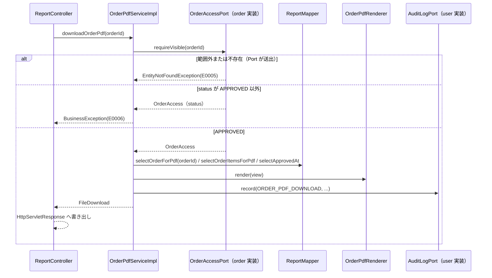
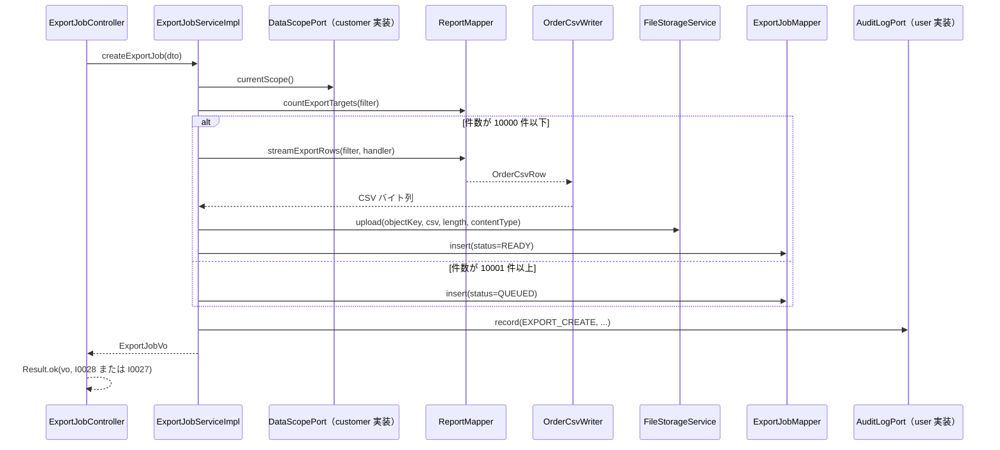

<!-- devtool:file-region id="document-header" -->
# 帳票・集計 詳細設計

> 詳細設計（内部設計）。`詳細設計/spec-detail-temp.md` の構成に従う。本書は単一情報源（SSOT）を参照するのみで、項目・列挙値・メッセージを再定義しない。
> 業務ルールの番号・内容は `基本設計/共通/spec-08-business-rule-list.md` を正とし、本書は実装手順を定める。
> 対象は注文 PDF（F-RPT-01）、集計（F-RPT-02）、CSV 出力（F-RPT-03）、画面 SCR-16、バッチ BAT-02（CSV 非同期出力）・BAT-03（出力ファイル失効）。SCR-13 の PDF 出力ボタンは `詳細設計/業務/order/spec-order-detail-sd.md` の所掌であり、本書は API 連携のみを参照として記す。

<!-- devtool:end-file-region -->
<!-- devtool:block id="detail.report.detail-sd.s01" -->
## 文書情報

| 項目 | 内容 |
|------|------|
| システム名称 | DDMSAA 販売システム |
| 文書名称 | 帳票・集計 詳細設計 |
| 文書バージョン | V1.0 |
| ステータス | 草案 |
| 作成者 | TBD |
| 作成日 | 2026-10-21 |
| レビュー担当 | TBD |

<!-- devtool:endblock -->
<!-- devtool:block id="detail.report.detail-sd.s02" -->
## 改訂履歴

| バージョン | 改訂日 | 改訂者 | 改訂内容 |
|------|--------|--------|---------|
| V0.1 | 2026-10-20 | — | 簡易版（API・PDF・CSV・集計整合性・テスト・BR） |
| V1.0 | 2026-10-21 | — | `spec-detail-temp.md` の構成へ展開（§0〜§6.1）。テスト表を §5.1 へ移し、UT-ID を `UT-RPT-NNN`（3 桁）に統一。既存 UT-RPT-001〜010 は番号・内容とも変更なし |
| V1.1 | 2026-10-21 | — | 統一修訂：Service 判定の 400（from＞to）を `InvalidRequestException` に変更。`OrderAccessPort`（PDF）・`DataScopePort`（集計・CSV）・`AuditLogPort`・`NotificationPort`（BAT-02 完了通知）を使用し、`selectAssignedCustomerIds`／`selectCustomerIdOfUser`／`ExportNotificationMapper` を廃止（TBD-RPT-02・04 解決、TBD-RPT-03 は記録部品の位置を解決）。UT-RPT-081〜084 を追加、006・007・014〜016・020・038・065 ほかを修正（番号不変）。TBD-RPT-12・13 を追加 |
| V1.2 | 2026-10-21 | — | 第 2 回統一修訂：(1) PDF を Apache PDFBox 3.0.3＋内蔵 IPAex ゴシックで確定し `PdfBoxOrderPdfRenderer implements OrderPdfRenderer` を定義（フォント欠落は起動失敗。TBD-RPT-01 解決）。(2) 出力ファイル有効期限を `app.export.file-expiry-hours`（既定 24。旧 `app.export.file-expiry-days` は廃止）から算出と明記。(3) `NotificationSubject` に `exportJobId`（`orderId`・`actorUserId` は null）を使用、宛先解決不能は例外なし・投入なし・warn ログ（TBD-RPT-13 解決）。(4) 請求形式不正（不正な列挙値・JSON 不正・必須クエリ欠落）を 400 `E0008`（`RequestBinding`）に確定（TBD-RPT-12 解決）。(5) `PERMISSION_DENIED` を `AuditLogPort.recordDenied` で記録（403＝`PermissionDeniedAuditListener`、他人の出力ジョブの 404＝本機能、範囲外注文の 404＝`OrderAccessPort`。TBD-RPT-03 解決）。(6) スケジューリング有効化を共通の `SchedulingConfig` に確定（TBD-RPT-05 を縮小）。(7) 列挙の置き場を `core.shared.enums` に確定。UT-RPT-085〜091 を追加、008・009・024・041・056・064・065・080 ほかを修正（番号不変） |

---

<!-- devtool:endblock -->
<!-- devtool:block id="detail.report.detail-sd.s03" -->
## 0. 対象と根拠

| 項目 | 内容 |
|------|------|
| 関連機能 | F-RPT-01（注文書 PDF）、F-RPT-02（集計）、F-RPT-03（CSV 出力）。通知投入（BR-NTF-001。`NotificationPort`）と監査記録（F-AUD-02。`AuditLogPort`）は本書の処理から呼び出す |
| 関連画面 | SCR-16（本書 §2 で展開）。SCR-13 の「PDF 出力」ボタンは `order` の帰属で、本書は `downloadOrderPdf` の仕様のみ提供する（§2.1 末尾に参照を記す） |
| 関連 API | `downloadOrderPdf`、`getOrderSummary`、`getCustomerSummary`、`getProductSummary`、`createExportJob`、`pageExportJobs`、`getExportJob`、`downloadExportJob`（`spec-07-api-list.yaml`）。画面が呼ぶ `pageCustomers` は `customer` の API |
| 関連バッチ | BAT-02（CSV 非同期出力）、BAT-03（出力ファイル失効）（`spec-15-batch-design-ui.md`）。通知メールの実送信（BAT-01）は `approval` の詳細設計を参照。スケジューリング有効化は共通の `SchedulingConfig`（`@EnableScheduling`。`core.shared.config`）に依存する |
| 関連テーブル | TBL-export-jobs（読書）、TBL-orders・TBL-order-items・TBL-customers・TBL-users・TBL-approval-requests・TBL-products（読取）、TBL-notification-logs（BAT-02 が `NotificationPort` 経由で投入）、TBL-audit-logs（`AuditLogPort` 経由で INSERT）（`spec-06-db-physical.yaml`）。TBL-customer-assignments・TBL-user-contacts は Port の実装側（customer・approval）が参照し、本機能は直接読まない |
| 業務ルール | BR-RPT-001〜003、BR-AUTH-003、BR-AUTH-004、BR-AUTH-006、BR-NTF-001、BR-NTF-003、BR-AUD-001 |
| 上流根拠 | `要件定義/requirements.md` §5.4（CSV の同期・非同期）、FR-09；`基本設計/業務設計/report/spec-report-business-ui.md`、`spec-report-screen-ui.md`；`基本設計/共通/spec-03-auth-ui.md`、`spec-08-external-interface-ui.md`（IF-02／IF-03／MAIL-06）、`spec-15-batch-design-ui.md` |

### 0.1 コード生成時のロード一覧（AI コンテキスト組み立て）

```
- 本ファイル
- 基本設計/共通/spec-06-db-physical.yaml      ← TBL-export-jobs（書込）、orders / order-items / customers / users / approval-requests / products（読取）。notification-logs・audit-logs は Port の実装側が書込、customer-assignments・user-contacts も Port の実装側が参照
- 基本設計/共通/spec-07-api-list.yaml          ← 上記 8 operationId と OrderStatus / ExportStatus / ExportJobCreateDTO / ExportJobVO / OrderSummaryReportVO / CustomerSummaryReportVO / ProductSummaryReportVO / PageResult
- 基本設計/共通/spec-09-message-list.yaml      ← I0027 I0028 E0001 E0002 E0005 E0006 E0008 E0012 E0030 E0031 E0050
- 基本設計/共通/spec-08-business-rule-list.md  ← BR-RPT / BR-AUTH-003・004・006 / BR-NTF-001・003 / BR-AUD-001
- 基本設計/共通/spec-03-auth-ui.md、spec-05 / spec-10 / spec-12、spec-15-batch-design-ui.md、spec-08-external-interface-ui.md（IF-02 / IF-03 / MAIL-06）
- 基本設計/業務設計/report/spec-report-business-ui.md、spec-report-screen-ui.md
- 基本設計/基盤/インタフェース仕様/spec-10-business-core.yaml・spec-07-infrastructure.yaml（FileStorageService・MetaObjectHandler）・spec-project-structure.yaml
- 開発規約/spec-naming-rule.md / spec-database-rule.md / spec-data-dictionary-project-temp.md（T07-13 出力状態、T07-6 注文状態）
- 開発規約/spec-backend-coding-rule.md / spec-frontend-coding-rule.md / spec-test-rule.md
- 詳細設計/業務/order/spec-order-detail-sd.md §1.1.1（跨モジュール ポート：OrderAccessPort・DataScopePort・AuditLogPort・NotificationPort の定義）
```

### 0.2 マイクロサービス帰属

| 項目 | 内容 |
|------|------|
| 所属サービス | `business-service-core`（API・Scheduler とも。バッチは Spring Scheduler で同一プロセスに同居。`spec-15-batch-design-ui.md` §3） |
| パッケージ接頭辞 | `com.example.ddmsaa.core.report`（`controller`・`service`・`service.impl`・`mapper`・`entity`・`dto`・`convert`。バッチ用の `batch` は各 feature の標準置き場。`OrderCsvWriter` の `support` は TBD-RPT-05 の残課題） |
| 基盤依存 | common（`Result`・`PageResult`・`BusinessException`・`EntityNotFoundException`・`InvalidRequestException`）、infrastructure（`FileStorageService`・`UserContext`・`MetaObjectHandler`・DB）、外部ライブラリ Apache PDFBox 3.0.3（`spec-project-structure.yaml` の `pdfbox.version`）、設定 `app.export.file-expiry-hours` |
| 他機能への依存（ポート） | 中立パッケージ `com.example.ddmsaa.core.shared.port` の `OrderAccessPort`（PDF の可視性判定。order 実装）、`DataScopePort`（集計・CSV のデータ範囲。customer 実装）、`AuditLogPort`（監査記録 `record` と権限拒否記録 `recordDenied`。user の `AuditLogServiceImpl` 実装）、`NotificationPort`（BAT-02 完了通知の投入。approval 実装）を利用する。定義は order 詳細設計 §1.1.1 を参照。本機能が実装するポートはない。他機能の Service／Mapper は直接参照しない（`spec-backend-coding-rule.md` §2） |
| DB アクセス権限 | 全表の CRUD 権限があるが、本機能は業務表（orders 等）を読取のみとし、書込は `export_jobs` に限る（`notification_logs`・`audit_logs` は Port の実装側が INSERT する） |

---

<!-- devtool:endblock -->
<!-- devtool:block id="detail.report.detail-sd.s04" -->
## 1. バックエンド詳細設計

### 1.1 クラス一覧

| 層 | クラス名 | パッケージ | 責務 | 対応 |
|----|------|----|------|------|
| Controller | `ReportController` | `com.example.ddmsaa.core.report.controller` | `@RequestMapping("/api/v1")`。集計 3 API と注文 PDF の受付。PDF は `Result` で包まず `HttpServletResponse` へ直接書き出す | `getOrderSummary`、`getCustomerSummary`、`getProductSummary`、`downloadOrderPdf` |
| Controller | `ExportJobController` | `…report.controller` | `/api/v1/export-jobs/**` の受付。CSV は `Result` で包まず直接書き出す。`createExportJob` は `Result.ok(vo, messageId)`（READY＝`I0028`、QUEUED＝`I0027`） | `createExportJob`、`pageExportJobs`、`getExportJob`、`downloadExportJob` |
| Service | `ReportService` / `ReportServiceImpl` | `…report.service` / `…service.impl` | 集計 3 種（データ範囲・状態条件の適用） | F-RPT-02 |
| Service | `OrderPdfService` / `OrderPdfServiceImpl` | 同上 | 注文 PDF の可否判定・データ収集・描画呼出し・監査 | F-RPT-01 |
| Service | `OrderPdfRenderer`（interface） | `…report.service` | 注文データ（`OrderPdfView`）から PDF のバイト列を作る（`byte[] render(OrderPdfView view)`） | F-RPT-01 |
| Service | `PdfBoxOrderPdfRenderer`（`implements OrderPdfRenderer`） | `…report.service.impl` | Apache PDFBox 3.0.3 による A4 帳票の描画。日本語は内蔵の IPAex ゴシック（`business-service-core/src/main/resources/fonts/ipaexg.ttf`。IPA フォントライセンス 1.0 により再配布可で、ライセンス文書を同梱する）を埋め込む。起動時にフォントを読み込み、欠落・破損なら `IllegalStateException` で起動を失敗させる（fail fast） | F-RPT-01 |
| Service | `ExportJobService` / `ExportJobServiceImpl` | `…report.service` / `…service.impl` | CSV 出力依頼（同期生成／QUEUED 登録）・一覧・状態・ダウンロード・監査 | F-RPT-03 |
| Service | `ExportJobBatchService` / `ExportJobBatchServiceImpl` | 同上 | BAT-02 / BAT-03 の 1 件単位の処理とトランザクション境界（クラス名は TBD-RPT-05 の残課題） | F-RPT-03 |
| 補助 | `OrderCsvWriter` | `…report.support`（置き場は TBD-RPT-05） | `OrderCsvRow` を UTF-8 BOM の CSV として `OutputStream` へ書き出す。同期生成・BAT-02 の共通部品 | F-RPT-03 |
| バッチ | `ExportJobScheduler` | `…report.batch` | `@Scheduled` で BAT-02（`fixedDelay` 1 分）・BAT-03（`fixedDelay` 1 時間）を起動（スケジューリングの有効化は共通の `SchedulingConfig`） | BAT-02、BAT-03 |
| Mapper | `ReportMapper` | `…report.mapper` | 集計 SQL、PDF 用の注文・明細・承認日時の取得、CSV 対象の件数・抽出（読取のみ。データ範囲は `DataScopePort` の値を条件に渡す） | TBL-orders ほか |
| Mapper | `ExportJobMapper` | `…report.mapper` | export_jobs の INSERT／検索／状態更新／バッチ用の取得（`FOR UPDATE SKIP LOCKED`） | TBL-export-jobs |
| Entity | `ExportJob` | `…report.entity` | export_jobs のマッピング。`filterCondition` は JSON 文字列（MyBatis の jsonb TypeHandler は使わず、SQL で `CAST(#{filterCondition} AS jsonb)` ／ `filter_condition::text` とする） | TBL-export-jobs |
| DTO | `ExportJobCreateDto`（`ExportJobCreateDTO`）、`ExportJobVo`（`ExportJobVO`）、`OrderSummaryReportVo`、`CustomerSummaryReportVo`、`ProductSummaryReportVo`、`ReportSearchCondition`、`ExportJobSearchCondition` | `…report.dto` | `spec-07-api-list.yaml` の schema に準拠 | — |
| DTO（内部） | `ExportFilterCondition`、`OrderCsvRow`、`OrderPdfView`、`OrderPdfItemView`、`FileDownload`（ファイル名・内容種別・`InputStream`・長さ） | `…report.dto` | 内部の受け渡し用。API には出さない（構造は TBD-RPT-07） | — |
| 列挙（参照のみ） | `ExportStatus`（T07-13）、`OrderStatus`（T07-6） | `com.example.ddmsaa.core.shared.enums` | `int code` + `fromCode`（`ExportStatus`：QUEUED=1、RUNNING=2、READY=3、FAILED=4、EXPIRED=5）。置き場は `spec-backend-coding-rule.md` §2。feature 配下には置かない。`Role` は `com.example.ddmsaa.common.enums` | — |
| 変換 | `ExportJobConverter` | `…report.convert` | `ExportJob` → `ExportJobVo`（MapStruct。`status` は `ExportStatus.fromCode`、`filterCondition` は JSON 文字列 → オブジェクト） | — |

> **ポート利用**（定義は order 詳細設計 §1.1.1）：`OrderAccessPort.requireVisible`（`OrderPdfServiceImpl`）、`DataScopePort.currentScope`（`ReportServiceImpl`・`ExportJobServiceImpl`。戻り値 `DataScope` は ADMIN＝全件／EMPLOYEE＝有効担当顧客の ID 集合／CUSTOMER＝自社 `customer_id`）、`AuditLogPort.record`（`OrderPdfServiceImpl`・`ExportJobServiceImpl`）、`AuditLogPort.recordDenied`（`ExportJobServiceImpl`。他人の出力ジョブの 404 の直前。注文の範囲外は `OrderAccessPort` が記録）、`NotificationPort.enqueue`（`ExportJobBatchServiceImpl`。BAT-02。`NotificationEvent.EXPORT_COMPLETED`、`NotificationSubject{orderId=null, exportJobId, actorUserId=null}`）。他機能の Service／Mapper は直接参照しない。

### 1.2 API 別詳細設計

> すべての API で、成功は HTTP 200（ファイル応答は 200 + `Content-Disposition`）、権限不足は 403 `E0002`、未認証・JWT 期限切れは 401 `E0001`（Gateway 起因は `E0040`〜`E0043`）、未捕捉のシステム例外は 500 `E0012`。`@PreAuthorize` は `x-roles` に一致させる。
> 利用者 ID は `UserContext.getUserId()`、ロールは `UserContext.getRole()`（`Role` は `com.example.ddmsaa.common.enums`、`OrderStatus`・`ExportStatus` は `com.example.ddmsaa.core.shared.enums`）。
> **データ範囲**（BR-AUTH-003）：集計・CSV は `DataScopePort.currentScope()` が返す範囲（ADMIN＝全件、EMPLOYEE＝有効な担当顧客〔`customer_assignments.is_active = TRUE`〕、CUSTOMER は対象 API なし）、PDF は `OrderAccessPort.requireVisible(orderId)` の可視性判定（CUSTOMER＝自社）による。範囲外の 1 件は 404 `E0005`（BR-AUTH-006）、一覧・集計・CSV は範囲外を自動除外し、範囲外の `customerId` 指定は 0 件とする。`PERMISSION_DENIED` の記録（規約 §8）：403 は core の `PermissionDeniedAuditListener` が `AuditLogPort.recordDenied` で記録、範囲外注文の 404 は `OrderAccessPort` が `EntityNotFoundException` の直前に記録、他人の出力ジョブの 404 は本機能（`ExportJobServiceImpl`）が同じ `recordDenied` を直前に呼ぶ（`REQUIRES_NEW` のため業務側がロールバックしても残る）。一覧・集計・CSV の自動除外は記録しない。
> **400 の送出**：DTO／クエリの必須・形式・長さは Bean Validation（`MethodArgumentNotValidException`／`ConstraintViolationException`）。Service 判定の 400（`orderDateFrom`＞`orderDateTo` 等）は `InvalidRequestException`（HTTP 400、messageId `E0008`）。409 は `BusinessException`。請求形式の不正（不正な列挙値〔クエリ・パス・本文〕・JSON 不正・必須クエリ欠落）は `RequestBinding`（`MethodArgumentTypeMismatchException`／`HttpMessageNotReadableException`／`MissingServletRequestParameterException`／`MissingServletRequestPartException`／`MissingPathVariableException`）で一律 400 `E0008`（`details[]`。解析器のメッセージは返さない。500 にならない）。

#### `downloadOrderPdf` 注文書 PDF（`GET /api/v1/orders/{orderId}/pdf`）

| 項目 | 内容 |
|------|------|
| operationId | `downloadOrderPdf` |
| 対応機能 | F-RPT-01 |
| ロール・権限 | `@PreAuthorize("hasAnyRole('ADMIN','EMPLOYEE','CUSTOMER')")`。ロール内の範囲は Service でデータ範囲を判定 |
| リクエスト | パス `orderId`（例 `OD00000001`） |
| レスポンス | ファイル（`Result` で包まない）。`Content-Disposition: attachment; filename=order_<注文番号>.pdf`。Content-Type は 07 の `application/octet-stream` に従う |

**シーケンス**



**入力検証**

| 項目 | ルール | 違反時 messageId | HTTP |
|------|------|--------------|------|
| `orderId` | 空白不可（形式不一致は不存在として 404 に帰着） | `E0005` | 404 |

**処理ロジック**

```
1. OrderAccessPort.requireVisible(orderId) で注文の可視性（呼出者のデータ範囲）を検査する。範囲外（EMPLOYEE の担当外・担当割当解除済み、CUSTOMER の他社注文）・不存在・論理削除は Port が EntityNotFoundException("E0005")（404）を送出する。存在の有無を区別しない（BR-AUTH-006）。戻り値は OrderAccess{id, customerId, salesUserId, status}
2. OrderAccess.status ≠ APPROVED(4) なら BusinessException("E0006")（409。BR-RPT-001）。可視性の検査（手順 1）を先に行う（範囲外に状態を漏らさない）
3. selectOrderForPdf(orderId) で注文ヘッダ（orders JOIN customers LEFT JOIN users[担当者]）を取得する。条件は orders.deleted_at IS NULL のみ（範囲は手順 1 で判定済みのため SQL に範囲条件を持たない）。結果が null（検査後の競合削除）なら EntityNotFoundException("E0005")
4. 明細を取得する（order_items。deleted_at IS NULL、line_number 昇順）。承認日時は approval_requests（order_id 一致・status=APPROVED(2)・deleted_at IS NULL）の acted_at の最新 1 件
5. OrderPdfRenderer.render(view)（実装 PdfBoxOrderPdfRenderer。Apache PDFBox 3.0.3、IPAex ゴシックを PDType0Font で埋め込む）で PDF を生成する。A4・日本語。表示項目：注文番号・顧客（コード・名称）・注文日・明細（行番号・商品コード・商品名・数量・単価・税率・明細金額・明細税額）・小計・税額・合計・状態・承認日時
   （金額は DB の値をそのまま出す。再計算しない）
6. AuditLogPort.record("ORDER_PDF_DOWNLOAD", "ORDER", orderId, detail) を呼ぶ（actor＝呼出者は Port が UserContext から取得。audit_logs への INSERT は user 側の実装。BR-AUD-001）。手順 1〜3 の失敗では記録しない
7. FileDownload（ファイル名 order_<注文番号>.pdf、バイト列）を返す。Controller が Content-Disposition を付けて直接書き出す。ストレージの保存先は公開しない（PDF は保存しない）
```

**トランザクション**

| 項目 | 内容 |
|------|------|
| 範囲 | `@Transactional` を `OrderPdfServiceImpl.downloadOrderPdf()` に付与（audit_logs への書込があるためクラス既定の `readOnly` を上書き） |
| 関連テーブル | TBL-audit-logs（`AuditLogPort` 経由で書込）、TBL-orders・order-items・customers・users・approval-requests（読取。可視性判定は `OrderAccessPort`） |
| ロールバック条件 | `render` の失敗（500 `E0012`）では監査も戻す。ファイル応答の書き出しはコミット後に Controller が行う |

**DB アクセス**

| Mapper メソッド | 操作 | 対象テーブル.カラム | 主要条件 |
|------------|------|----------|---------|
| `ReportMapper.selectOrderForPdf` | SELECT | `orders.id/customer_id/order_date/status/subtotal_amount/tax_amount/total_amount`、`customers.customer_code/customer_name`、`users.user_name` | `orders.id = #{orderId} AND orders.deleted_at IS NULL`（範囲は `OrderAccessPort` で判定済み） |
| `ReportMapper.selectOrderItemsForPdf` | SELECT | `order_items.line_number/product_code/product_name/quantity/unit_price/tax_rate/line_amount/tax_amount` | `order_id = #{orderId} AND deleted_at IS NULL ORDER BY line_number` |
| `ReportMapper.selectApprovedAt` | SELECT | `approval_requests.acted_at` | `order_id = #{orderId} AND status = 2 AND deleted_at IS NULL ORDER BY acted_at DESC LIMIT 1` |
| （`AuditLogPort.record` の内部。user 側の実装） | INSERT | `audit_logs` | — |

**利用する共通コンポーネント**

| コンポーネント | 用途 |
|------|------|
| `OrderPdfRenderer`（`PdfBoxOrderPdfRenderer`） | PDF 描画。Apache PDFBox 3.0.3＋内蔵 IPAex ゴシック（`fonts/ipaexg.ttf`。起動時に読込み、欠落・破損は起動失敗）。保存はしない（要求ごとに生成） |
| `OrderAccessPort.requireVisible` | 注文の可視性判定と状態（`OrderAccess.status`）の取得（order 詳細設計 §1.1.1） |
| `AuditLogPort.record` | 監査記録（user の `AuditLogServiceImpl` が実装）。範囲外 404 の `recordDenied` は `OrderAccessPort` が行う |
| API Gateway | バイナリを `Content-Disposition`・`Content-Type` を保持してストリーム転送（`spec-01-api-gateway-ui.md`） |

**例外 → messageId → HTTP**

| シナリオ | 例外 | messageId | HTTP |
|------|------|-----------|------|
| 不存在・範囲外（顧客の他社注文・営業担当の担当外を含む） | `EntityNotFoundException`（`OrderAccessPort` が送出） | `E0005` | 404 |
| 注文が APPROVED 以外（DRAFT・PENDING_APPROVAL・RETURNED・CANCELLED） | `BusinessException` | `E0006` | 409 |
| PDF 描画失敗 | `Exception` | `E0012` | 500 |

**正常レスポンス**：ファイル（PDF）。`Result` は使わない。

#### `getOrderSummary` 注文集計・月別（`GET /api/v1/reports/order-summary`）

| 項目 | 内容 |
|------|------|
| operationId | `getOrderSummary` |
| 対応機能 | F-RPT-02 |
| ロール・権限 | `@PreAuthorize("hasAnyRole('ADMIN','EMPLOYEE')")`（CUSTOMER は 403 `E0002`。BR-RPT-001・BR-AUTH-004） |
| リクエスト | クエリ `orderDateFrom`・`orderDateTo`（必須・日付）、`customerId`（任意）、`statuses`（任意・`OrderStatus` の配列。既定 APPROVED） |
| レスポンス | `Result<List<OrderSummaryReportVO>>`（`yearMonth`・`orderCount`・`subtotalAmount`・`taxAmount`・`totalAmount`）。ページングなし |

**入力検証**

| 項目 | ルール | 違反時 messageId | HTTP |
|------|------|--------------|------|
| `orderDateFrom` / `orderDateTo` | 必須・日付形式。`from ≤ to`。期間の上限は TBD-R1（画面設計）の確定まで設けない | `E0008` | 400 |
| `customerId` | 最大 10 文字 | `E0008` | 400 |
| `statuses` | `OrderStatus` の値のみ（不正値は拒否） | `E0008` | 400 |

**処理ロジック**

```
1. 検証（上表。必須・形式・長さは Bean Validation で済んでいる。from＞to は Service が InvalidRequestException("E0008", "orderDateTo", 理由)＝400 を送出する）。statuses が未指定・空なら [APPROVED] とする（状態条件を結果と一緒に明示するため、確定値を ReportSearchCondition に保持する。BR-RPT-002 と同じ既定）
2. DataScopePort.currentScope() で DataScope を求める（ADMIN＝全件、EMPLOYEE＝有効担当顧客の ID 集合）。EMPLOYEE で集合が空なら空配列を返す
3. customerId 指定があり範囲外なら、検索条件に付与するだけで 0 件（空配列、エラーにしない。BR-AUTH-006）
4. ReportMapper.selectOrderSummary を実行する：orders（deleted_at IS NULL）を order_date の範囲・status IN statuses・範囲条件・（任意）customer_id で絞り、to_char(order_date, 'YYYY-MM') ごとに件数・小計・税額・合計を集計。yearMonth 昇順
5. 件数が 0 の月は行を出さない。Result.ok(list) で返す（messageId なし）
```

**トランザクション**：`@Transactional(readOnly = true)`（`ReportServiceImpl` のクラス既定）。**DB アクセス**：`ReportMapper.selectOrderSummary`（データ範囲は `DataScopePort.currentScope()` の値を条件に渡す。SELECT。`orders.order_date/status/customer_id/subtotal_amount/tax_amount/total_amount`、条件に `deleted_at IS NULL`）。

**例外 → messageId → HTTP**

| シナリオ | 例外 | messageId | HTTP |
|------|------|-----------|------|
| 検証失敗（必須欠落・形式・長さ） | `MethodArgumentNotValidException` / `ConstraintViolationException`（Bean Validation） | `E0008` | 400 |
| 検証失敗（from＞to） | `InvalidRequestException` | `E0008` | 400 |
| 請求形式不正（`statuses` の不正な列挙値・日付形式不正・必須クエリ欠落） | `MethodArgumentTypeMismatchException`／`MissingServletRequestParameterException`（`RequestBinding`） | `E0008` | 400 |
| 権限不足（CUSTOMER） | `AccessDeniedException`（`PermissionDeniedAuditListener` が `recordDenied`） | `E0002` | 403 |

**正常レスポンス**：`Result<List<OrderSummaryReportVO>>`。

#### `getCustomerSummary` 顧客別集計（`GET /api/v1/reports/customer-summary`）

`getOrderSummary` と同じ権限・リクエスト・入力検証・データ範囲・状態条件・トランザクション・例外。差分のみ記す。

| 項目 | 内容 |
|------|------|
| operationId／対応機能 | `getCustomerSummary`／F-RPT-02 |
| レスポンス | `Result<List<CustomerSummaryReportVO>>`（`customerId`・`customerCode`・`customerName`・`orderCount`・`totalAmount`） |
| 集計 | `ReportMapper.selectCustomerSummary`：条件に合う orders を `customers`（id・customer_code・customer_name）と結合し、顧客ごとに件数・合計（`total_amount`）を集計。`customer_code` 昇順。customers は集計対象の注文が参照する顧客なので `deleted_at` を条件にしない |

#### `getProductSummary` 商品別集計（`GET /api/v1/reports/product-summary`）

`getOrderSummary` と同じ権限・リクエスト・入力検証・データ範囲・状態条件・トランザクション・例外。差分のみ記す。

| 項目 | 内容 |
|------|------|
| operationId／対応機能 | `getProductSummary`／F-RPT-02 |
| レスポンス | `Result<List<ProductSummaryReportVO>>`（`productId`・`productCode`・`productName`・`quantity`・`lineAmount`） |
| 集計 | `ReportMapper.selectProductSummary`：条件に合う orders に `order_items`（`deleted_at IS NULL`）を結合し、`product_id` ごとに `SUM(quantity)`・`SUM(line_amount)`。`product_code` 昇順。商品コード・商品名の取得元（注文時複写か現在のマスタか）は TBD-RPT-09（暫定は `products` から取得し `deleted_at` を条件にしない） |

#### `createExportJob` CSV 出力依頼（`POST /api/v1/export-jobs`）

| 項目 | 内容 |
|------|------|
| operationId | `createExportJob` |
| 対応機能 | F-RPT-03 |
| ロール・権限 | `@PreAuthorize("hasAnyRole('ADMIN','EMPLOYEE')")`（CUSTOMER は 403 `E0002`。BR-RPT-001・BR-AUTH-004） |
| リクエストスキーマ | `ExportJobCreateDTO`（`orderDateFrom`・`orderDateTo` 必須、`customerId` 最大 10 文字、`statuses` 任意） |
| レスポンス | `Result<ExportJobVO>`。**READY（同期生成）は `messageId=I0028`、QUEUED（非同期生成）は `messageId=I0027`**（07 の description。BR-RPT-002） |

**シーケンス**



**入力検証**

| 項目 | ルール | 違反時 messageId | HTTP |
|------|------|--------------|------|
| `orderDateFrom` / `orderDateTo` | 必須・日付形式。`from ≤ to`。期間上限は TBD-R1 の確定まで設けない | `E0008` | 400 |
| `customerId` | 最大 10 文字。範囲外の顧客を指定した場合はエラーにせず 0 件（BR-AUTH-006） | `E0008`（長さ超過のみ） | 400 |
| `statuses` | `OrderStatus` の値のみ。未指定・空は APPROVED のみ（BR-RPT-002） | `E0008` | 400 |

**処理ロジック**

```
1. 検証（上表。必須・形式・長さは Bean Validation で済んでいる。from＞to は Service が InvalidRequestException("E0008", "orderDateTo", 理由)＝400 を送出する）。statuses が未指定・空なら [APPROVED] に確定する
2. DataScopePort.currentScope() で DataScope を求める（ADMIN＝全件、EMPLOYEE＝有効担当顧客の ID 集合。担当割当を解除した顧客は含まれない）。呼出者のデータスコープをサーバー側で合成し、リクエストの customerId があれば AND で重ねる
3. ExportFilterCondition（orderDateFrom・orderDateTo・customerId・statuses・scope）を組み立て、JSON 化して export_jobs.filter_condition に保存する（BAT-02 は依頼者のスコープを合成済みのこの値で抽出する。構造は TBD-RPT-07）
4. 件数を数える：ReportMapper.countExportTargets（orders を order_date 範囲・status IN statuses・scope・customerId で COUNT。deleted_at IS NULL）
5. 件数 ≤ 10,000 の場合（同期生成。件数 0 を含む）：
   a. objectKey をランダムに発行する（例 export/<UUID>.csv。利用者に URL を返さない。IF-02）
   b. ReportMapper.streamExportRows（ResultHandler）で行を取り出し、OrderCsvWriter で UTF-8 BOM の CSV をメモリ上に作る。書き出した行数を recordCount とする
   c. FileStorageService.upload(objectKey, csv, length, "text/csv; charset=UTF-8")
   d. export_jobs を INSERT：status=READY(3)、storage_path=objectKey、record_count、completed_at=現在、expires_at=completed_at + `app.export.file-expiry-hours` 時間（既定 24。BR-RPT-002。`spec-09-resource-file.yaml`。ハードコードしない。旧 `app.export.file-expiry-days` は廃止）
   e. トランザクションがロールバックされた場合に備え、afterCompletion でロールバック時は upload 済みのファイルを best-effort で delete する
   f. 完了通知（EXPORT_COMPLETED）は投入しない（BR-NTF-003。同期生成は応答で完了を伝える）
6. 件数 ≥ 10,001 の場合（非同期生成）：export_jobs を INSERT：status=QUEUED(1)、record_count=手順 4 の件数、storage_path・completed_at・expires_at は NULL。CSV はここでは作らない（BAT-02 が作る）
7. AuditLogPort.record("EXPORT_CREATE", "EXPORT_JOB", export_jobs.id, detail{recordCount, status}) を呼ぶ（audit_logs への INSERT は user 側の実装。detail は recordCount・status のみ。BR-AUD-001）
8. ExportJobVo を返す。Controller が status が READY なら I0028、QUEUED なら I0027 を付けて Result.ok する
```

**トランザクション**

| 項目 | 内容 |
|------|------|
| 範囲 | `@Transactional` を `ExportJobServiceImpl.createExportJob()` に付与 |
| 関連テーブル | TBL-export-jobs（書込）、TBL-audit-logs（`AuditLogPort` 経由で書込）、TBL-orders・customers・users（読取。担当割当は `DataScopePort`） |
| ロールバック条件 | いずれかの手順で例外が出た場合は全体をロールバックし、upload 済みファイルは削除する。ストレージ保存失敗は 500 `E0012`（IF-02）。BR-RPT-002「すべて記録」との関係は TBD-RPT-08 |

**DB アクセス**

| Mapper メソッド | 操作 | 対象テーブル.カラム | 主要条件 |
|------------|------|----------|---------|
| `ReportMapper.countExportTargets` | SELECT | `orders` | `deleted_at IS NULL`、`order_date BETWEEN`、`status IN`、スコープ（空集合は `1 = 0`）、`customer_id`（任意） |
| `ReportMapper.streamExportRows` | SELECT（ストリーム） | `orders.id/order_date/status/subtotal_amount/tax_amount/total_amount`、`customers.customer_code/customer_name`、`users.user_name` | 同上。`ORDER BY orders.order_date, orders.id`。`fetchSize` を指定し全件をメモリに載せない |
| `ExportJobMapper.insert` | INSERT | `export_jobs`（`id` は DB の `next_business_id('EJ', 8)`、`filter_condition`・`status`・`storage_path`・`record_count`・`expires_at`・`completed_at`。`created_by` は `MetaObjectHandler` が `UserContext.getUserId()` で設定＝依頼者） | — |
| （`AuditLogPort.record` の内部。user 側の実装） | INSERT | `audit_logs` | — |

**利用する共通コンポーネント**

| コンポーネント | 用途 |
|------|------|
| `FileStorageService`（`upload`／`delete`） | CSV の保管（`app.file.storage-type` が local／s3。IF-02） |
| `OrderCsvWriter` | CSV 生成（BOM・列順・エスケープは TBD-RPT-06 の確定値に従う） |
| `MetaObjectHandler` | `created_by`（依頼者）・`updated_by` の自動設定 |
| `DataScopePort.currentScope` | データ範囲の取得（customer が実装。order 詳細設計 §1.1.1） |
| `AuditLogPort.record` | `EXPORT_CREATE` の記録（user の `AuditLogServiceImpl` が実装） |

**CSV 仕様**（BR-RPT-002）：UTF-8 BOM。1 行＝1 注文。列は次の順（9 列）。値の書式（状態の表記・日付・金額・改行・先頭文字のエスケープ）は SSOT に定義がないため TBD-RPT-06 とし、暫定値で実装する。

| 列 | 項目 | 取得元 | 暫定の書式 |
|---:|------|------|------|
| 1 | 注文番号 | `orders.id` | そのまま |
| 2 | 注文日 | `orders.order_date` | `YYYY-MM-DD` |
| 3 | 顧客コード | `customers.customer_code` | そのまま |
| 4 | 顧客名 | `customers.customer_name` | そのまま |
| 5 | 状態 | `orders.status` | `OrderStatus` の名称（例 `APPROVED`） |
| 6 | 担当者 | `users.user_name`（`orders.sales_user_id`） | そのまま |
| 7 | 小計 | `orders.subtotal_amount` | 小数 2 桁・桁区切りなし |
| 8 | 税額 | `orders.tax_amount` | 同上 |
| 9 | 合計 | `orders.total_amount` | 同上 |

**例外 → messageId → HTTP**

| シナリオ | 例外 | messageId | HTTP |
|------|------|-----------|------|
| 検証失敗（必須欠落・customerId 長さ超過） | `MethodArgumentNotValidException`（Bean Validation） | `E0008` | 400 |
| 検証失敗（from＞to） | `InvalidRequestException` | `E0008` | 400 |
| 請求形式不正（`statuses` の不正な列挙値・JSON 不正・日付形式不正） | `HttpMessageNotReadableException`（`RequestBinding`） | `E0008` | 400 |
| 権限不足（CUSTOMER） | `AccessDeniedException`（`PermissionDeniedAuditListener` が `recordDenied`） | `E0002` | 403 |
| ストレージ保存・CSV 生成の失敗 | `Exception` | `E0012` | 500 |

**正常レスポンス**：`Result<ExportJobVO>`。READY は `I0028`、QUEUED は `I0027`。

#### `pageExportJobs` 出力ジョブ一覧（`GET /api/v1/export-jobs`）

| 項目 | 内容 |
|------|------|
| operationId | `pageExportJobs` |
| 対応機能 | F-RPT-03 |
| ロール・権限 | `@PreAuthorize("hasAnyRole('ADMIN','EMPLOYEE')")`。ADMIN は全員分、EMPLOYEE は自分が依頼した分だけ（BR-RPT-003） |
| リクエスト | クエリ `pageNum`（既定 1）、`pageSize`（既定 20・1〜100）、`requestedBy`（依頼者のユーザー ID・最大 10 文字・完全一致。ADMIN のみ有効） |
| レスポンス | `Result<PageResult<ExportJobVO>>`（依頼日時の新しい順の固定順） |

**入力検証**：`pageSize` が 1〜100 の範囲外、`pageNum` が 1 未満、数値でない `pageNum`／`pageSize`（`MethodArgumentTypeMismatchException`。`RequestBinding`）は `E0008` / 400。

**処理ロジック**

```
1. ExportJobSearchCondition を組み立てる：ADMIN は requestedBy があれば created_by = requestedBy（完全一致）、なければ条件なし。EMPLOYEE は requestedBy を無視して created_by = 呼出者に固定する（BR-RPT-003）
2. PageHelper.startPage(pageNum, pageSize) → ExportJobMapper.search（export_jobs LEFT JOIN users[依頼者名]。ORDER BY export_jobs.created_at DESC, export_jobs.id DESC）
3. ExportJobConverter で ExportJobVo にする。requestedBy＝created_by、requestedByName＝users.user_name。storage_path・storage_purged_at は返さない
4. PageResult.of(records, total, pageNum, pageSize) を Result.ok（messageId なし）で返す
```

**トランザクション**：`@Transactional(readOnly = true)`。**DB アクセス**：`ExportJobMapper.search`（SELECT。`export_jobs.*`、`users.user_name`。条件 `export_jobs.deleted_at IS NULL`、任意 `created_by`）。

**例外**：検証失敗・請求形式不正 `E0008` / 400、権限不足（CUSTOMER）`E0002` / 403（`recordDenied` は `PermissionDeniedAuditListener`）。

#### `getExportJob` 出力ジョブ状態（`GET /api/v1/export-jobs/{exportJobId}`）

| 項目 | 内容 |
|------|------|
| operationId | `getExportJob` |
| 対応機能 | F-RPT-03 |
| ロール・権限 | `@PreAuthorize("hasAnyRole('ADMIN','EMPLOYEE')")`。ADMIN、又は依頼者本人（BR-RPT-003） |
| レスポンス | `Result<ExportJobVO>` |

**処理ロジック**

```
1. ExportJobMapper.selectById(exportJobId)（deleted_at IS NULL）。不存在は EntityNotFoundException（E0005）
2. ADMIN 以外で created_by が呼出者でない場合は、存在を開示しないため AuditLogPort.recordDenied("EXPORT_JOB", exportJobId) を呼んでから EntityNotFoundException（E0005 / 404。BR-RPT-003・BR-AUTH-006。範囲外の 1 件参照。不存在は記録しない）
3. ExportJobVo を Result.ok で返す（画面は QUEUED／RUNNING の間、本 API を一定間隔で呼ぶ。間隔は TBD-R4）
```

**トランザクション**：`readOnly`。**DB アクセス**：`ExportJobMapper.selectById`。**例外**：不存在・他人のジョブ `E0005` / 404（他人のジョブは事前に `recordDenied`）、権限不足（CUSTOMER）`E0002` / 403。

#### `downloadExportJob` CSV ダウンロード（`GET /api/v1/export-jobs/{exportJobId}/download`）

| 項目 | 内容 |
|------|------|
| operationId | `downloadExportJob` |
| 対応機能 | F-RPT-03 |
| ロール・権限 | `@PreAuthorize("hasAnyRole('ADMIN','EMPLOYEE')")`。ADMIN、又は依頼者本人。ダウンロードのたびに再認可する（`spec-03-auth-ui.md` §5-4） |
| レスポンス | ファイル（`Result` で包まない）。`Content-Disposition: attachment; filename=orders_YYYYMMDD.csv`。YYYYMMDD は完了日時（`completed_at`）の日本時間の日付 |

**処理ロジック**

```
1. ExportJobMapper.selectById(exportJobId)（deleted_at IS NULL）。不存在は EntityNotFoundException（E0005）
2. ADMIN 以外で created_by が呼出者でない場合は AuditLogPort.recordDenied("EXPORT_JOB", exportJobId) を呼んでから EntityNotFoundException（E0005 / 404。BR-RPT-003。不存在は記録しない）
3. 状態判定：status ≠ READY(3) なら BusinessException("E0006")（409。QUEUED・RUNNING・FAILED・EXPIRED）
4. 期限判定：expires_at ≤ 現在、又は storage_purged_at が NULL でない、又は storage_path が NULL なら BusinessException("E0006")。BAT-03 の実行前でも expires_at で判定する（BR-RPT-002）
5. FileStorageService.download(storage_path) で InputStream を取得する（ファイルなしは基盤が EntityNotFoundException E0005 を送出）
6. AuditLogPort.record("EXPORT_DOWNLOAD", "EXPORT_JOB", exportJobId, detail) を呼ぶ（audit_logs への INSERT は user 側の実装。BR-AUD-001）。手順 1〜5 の失敗では記録しない
7. FileDownload（ファイル名 orders_<completed_at の JST 日付>.csv、InputStream）を返し、Controller が ストリーム配信する。ストレージの URL・presigned URL は返さない（IF-02）
```

**トランザクション**：`@Transactional`（`ExportJobServiceImpl.downloadExportJob()`。audit_logs への書込のため `readOnly` を上書き）。ストリームの書き出しはコミット後に Controller が行い、完了後に `InputStream` を閉じる。**DB アクセス**：`ExportJobMapper.selectById`、`AuditLogPort.record`（user 側の実装）。

**例外 → messageId → HTTP**

| シナリオ | 例外 | messageId | HTTP |
|------|------|-----------|------|
| 不存在・他人のジョブ（事前に `recordDenied`）・ストレージにファイルなし | `EntityNotFoundException` | `E0005` | 404 |
| `exportJobId` の形式不正など請求形式不正 | `MethodArgumentTypeMismatchException`（`RequestBinding`） | `E0008` | 400 |
| READY 以外・期限切れ・ファイル削除済み | `BusinessException` | `E0006` | 409 |
| 権限不足（CUSTOMER） | `AccessDeniedException` | `E0002` | 403 |

**正常レスポンス**：ファイル（CSV、UTF-8 BOM）。

### 1.3 Entity / DTO / VO マッピング

| Entity 項目 | DTO 項目 | 変換 | 命名変更の登録 |
|------------|---------|------|------------|
| `ExportJob.id`（id） | `ExportJobVO.id` | 直接 | なし |
| `ExportJob.status`（Integer） | `status`（`ExportStatus`） | `ExportStatus.fromCode` | なし |
| `ExportJob.recordCount` | `recordCount` | 整数に変換 | なし |
| `ExportJob.filterCondition`（JSON 文字列） | `filterCondition`（object） | JSON を解析してオブジェクト化（構造は TBD-RPT-07） | なし |
| `ExportJob.expiresAt` / `completedAt` | `expiresAt` / `completedAt` | `+09:00` 付き ISO 8601 | なし |
| `ExportJob.errorMessage` | `errorMessage` | 直接（FAILED のとき） | なし |
| `ExportJob.createdAt`（created_at） | `createdAt` | 直接 | なし |
| `ExportJob.createdBy`（created_by） | `requestedBy` | 名称変更（依頼者） | 07 で `requestedBy`（依頼者＝created_by）と明記済み。マッピング表への登録の要否は確認（レビュー時） |
| `User.userName`（結合） | `requestedByName` | 結合結果を設定 | なし |
| `ExportJob.storagePath` / `storagePurgedAt` | （返さない） | API に出さない | — |
| 集計行（`SUM`・`COUNT`） | `OrderSummaryReportVO` ほか | Mapper の resultMap で直接受ける（Entity なし） | 集計用の派生項目（`yearMonth` 等）。データ辞書の登録要否は確認 |

> 暗号化・マスキング対象の項目はない。CSV の「担当者」は `users.user_name` を出す（`spec-03-auth-ui.md` §3 で注文の担当者は全ロール参照可）。メール・ロック理由等の ADMIN 専用項目は本機能の出力に含めない。

---

<!-- devtool:endblock -->
<!-- devtool:block id="detail.report.detail-sd.s05" -->
## 2. フロントエンド詳細設計

### 2.1 画面別コンポーネント分解

> 画面ファイルは `frontend/src/pages/report/`、コンポーネントは `frontend/src/components/report/`、型は `frontend/src/types/report.ts`、API クライアントは `frontend/src/api/report-api.ts`（関数名＝operationId。`downloadOrderPdf`・`downloadExportJob` は `Blob` とファイル名を返す。共通ダウンロード部品の所在は TBD-RPT-10）。共通の HTTP 層・i18n・ルートガードは `spec-frontend-coding-rule.md` と `spec-12-screen-common-ui.md` に従う。

#### SCR-16 集計・CSV 出力（`/reports`）

**コンポーネントツリー**

```
ReportPage (src/pages/report/report-page.tsx)
├── ReportSearchForm   (src/components/report/report-search-form.tsx)   期間・顧客・状態・適用範囲表示・「集計する」「CSV 出力」
├── ReportSummaryTabs  (src/components/report/report-summary-tabs.tsx)  注文集計／顧客別／商品別のタブ
│   ├── OrderSummaryTable    (src/components/report/order-summary-table.tsx)
│   ├── CustomerSummaryTable (src/components/report/customer-summary-table.tsx)
│   └── ProductSummaryTable  (src/components/report/product-summary-table.tsx)
└── ExportJobPanel     (src/components/report/export-job-panel.tsx)     出力ジョブ状態（依頼者絞り込みは ADMIN のみ）
    └── ExportJobTable (src/components/report/export-job-table.tsx)     行操作「ダウンロード」
```

**状態・データ**

| 状態 | 型 | 取得元 API | 説明 |
|------|------|---------|------|
| `me` | `MeVo` | `getMe`（保持済み） | ロール判定（依頼者列・絞り込み・適用範囲表示） |
| `criteria` | `{ orderDateFrom, orderDateTo, customerId?, statuses: OrderStatus[] }` | — | 入力中の共通の絞り込み条件。`statuses` の既定は `['APPROVED']` |
| `appliedCriteria` | 同上 | — | 「集計する」で確定した条件。結果と一緒に表示する（状態条件を明示。`spec-report-business-ui.md` §3） |
| `activeTab` | `'order' \| 'customer' \| 'product'`（Union Type） | — | 表示中タブ。「集計する」では表示中タブの API のみ呼ぶ（タブ切替時に未取得なら取得） |
| `orderSummary` / `customerSummary` / `productSummary` | `OrderSummaryReportVo[]` / `CustomerSummaryReportVo[]` / `ProductSummaryReportVo[]` | `getOrderSummary` / `getCustomerSummary` / `getProductSummary` | 集計結果 |
| `customers` | `CustomerSummaryVo[]` | `pageCustomers`（EMPLOYEE は担当顧客のみ返る） | 顧客の選択肢 |
| `jobs` | `PageResult<ExportJobVo>` | `pageExportJobs` | 出力ジョブ一覧（API の固定順＝依頼日時降順。列見出しソートなし） |
| `jobQuery` | `{ requestedBy?, pageNum, pageSize }` | — | ADMIN のみ `requestedBy` を入力できる |
| `pollingJobIds` | `string[]` | `getExportJob` | QUEUED／RUNNING のジョブ。READY／FAILED／EXPIRED になったら除外 |

**イベント → API 対応**

| イベント | operationId | 入力 | 成功時処理 | 失敗時処理 |
|------|--------|------|---------|---------|
| 初期表示 | `pageCustomers`、`pageExportJobs` | — | 顧客選択肢・ジョブ一覧を表示。QUEUED／RUNNING があれば `pollingJobIds` に登録 | `ErrorResponse.messageId` を該当領域に表示（再試行の導線） |
| 集計する／タブ切替 | `getOrderSummary`／`getCustomerSummary`／`getProductSummary`（表示中タブのみ） | `appliedCriteria` | 結果テーブル更新。適用条件と適用範囲（ADMIN＝全件、EMPLOYEE＝担当顧客）を表示 | `E0008`（条件誤り）を表示 |
| CSV 出力 | `createExportJob` | `ExportJobCreateDTO`（共通の絞り込み条件。集計タブの選択には依存しない） | READY：`I0028` を Toast、ジョブ一覧を更新（ダウンロード可）。QUEUED：`I0027` を Toast、一覧を更新して `pollingJobIds` に登録 | `E0008`／`E0002`／`E0012` を表示。二重送信を防ぐためボタンを無効化 |
| ジョブ状態の自動更新 | `getExportJob` | `exportJobId` | READY になったら `I0028` を Toast して一覧を更新・ポーリング停止。FAILED は `errorMessage` と `E0050` を行に表示・停止 | `E0005` など。ポーリングを止めて表示 |
| ダウンロード | `downloadExportJob` | `exportJobId` | Blob をブラウザへ保存（ファイル名はレスポンスの Content-Disposition、無ければ `orders_YYYYMMDD.csv`） | `E0006`（期限切れ等）・`E0005` を表示し一覧を再読込。無言で終わらせない（spec-12 §8） |
| 依頼者で絞り込み（ADMIN） | `pageExportJobs` | `requestedBy` | 一覧更新 | `E0008` |
| ページ移動 | `pageExportJobs` | `pageNum` | 一覧更新 | メッセージ表示 |

> ポーリング間隔・最大待機時間は TBD-R4（`spec-report-screen-ui.md`）。確定までは実装側の定数とし、画面アンマウントで必ず停止する。

**クライアント検証**（UX 向け。API の検証の代替ではない）

| 項目 | ルール | 表示 messageId |
|------|------|--------------|
| 期間 | 必須（from・to の両方） | `E0030` |
| 期間 | 日付形式 | `E0031` |
| 期間 | from ≤ to（違反時は送信しない） | `E0008` 相当（クライアント側でも抑止） |
| 状態 | 未選択のときは API の既定（承認済みのみ）になることを条件表示に明示する | — |

**出力ジョブ状態の表示**

| 列 | 内容 |
|------|------|
| 依頼日時 | `createdAt`（日本時間 `YYYY-MM-DD HH:mm`。共通ユーティリティで整形） |
| 依頼者 | `requestedByName`（`requestedBy`）。**ADMIN のみ表示** |
| 条件の要約 | `filterCondition`（期間・顧客・状態）から要約を作る |
| 件数 | `recordCount`（注文件数） |
| 状態 | `status`：QUEUED＝待機中／RUNNING＝生成中／READY＝ダウンロード可／FAILED＝失敗／EXPIRED＝期限切れ（`spec-12` §6.1） |
| 有効期限 | `expiresAt`。期限切れ（`status=EXPIRED`、又は `expiresAt` が現在以前）の行は「ダウンロード」を無効化し理由を表示する |
| 操作 | `status=READY` かつ未失効のときだけ「ダウンロード」を有効にする。FAILED は `errorMessage` を表示（再実行は条件を再指定して新規依頼） |

**ロール別表示制御**

| 要素 | ADMIN | EMPLOYEE | CUSTOMER |
|------|:-------:|:----------:|:--------:|
| SCR-16 のメニュー・ルート | ○ | ○ | ×（メニューに出さない。URL 直打ちはルートガードで SCR-19） |
| 集計 3 タブ・「集計する」 | ○（全件） | ○（担当顧客） | × |
| 「CSV 出力」ボタン | ○ | ○ | × |
| 顧客の選択肢 | 全顧客 | 担当顧客のみ | — |
| 出力ジョブ一覧 | 全員分 | 自分の依頼分のみ | — |
| 依頼者列・依頼者絞り込み | ○ | ×（表示しない） | — |
| 適用範囲の表示 | 全件 | 担当顧客 | — |

> 表示制御は操作性のみで、最終的な可否は API が判定する（403 `E0002`、他人のジョブは 404 `E0005`）。

**メッセージ表示**

| タイミング | messageId | 取得元 |
|------|-----------|------|
| CSV 出力（同期生成・READY） | `I0028` | messages（フロントが ID から文言を解決。Toast） |
| CSV 出力（非同期生成・QUEUED） | `I0027` | 同上（Toast） |
| 非同期生成の完了 | `I0028` | 同上（Toast） |
| 非同期生成の失敗 | `E0050` | 同上（行内に表示） |
| 期間の必須・形式 | `E0030`／`E0031` | 同上（行内） |
| 条件誤り（API） | `E0008` | `ErrorResponse`（該当項目へ割り付け） |
| 権限・不存在・状態不正 | `E0002`／`E0005`／`E0006` | `ErrorResponse`（SCR-19／Toast／行内。spec-12 §3） |

**画面遷移**（正本 `spec-10-screen-transition-ui.md`）

| 遷移元 | 遷移先 | トリガー |
|------|----|------|
| SCR-02 | SCR-16 | グローバルメニュー（ADMIN・EMPLOYEE のみ） |
| SCR-16 | SCR-19 | ロール外（CUSTOMER）の直打ち・API の 403 |
| SCR-16 | （遷移なし） | 集計結果に注文番号を含まないため、SCR-13 への遷移は設けない |

#### SCR-13 の「PDF 出力」ボタン（参照のみ・`order` の帰属）

SCR-13（注文詳細）の「PDF 出力」ボタンの表示・コンポーネント構成は `詳細設計/業務/order/spec-order-detail-sd.md` が定める。本書は API 契約のみを提供する。

| 項目 | 内容 |
|------|------|
| 呼び出す API | `downloadOrderPdf`（`report-api.ts`。戻り値は `Blob` とファイル名 `order_<注文番号>.pdf`） |
| 表示条件 | 注文が APPROVED のときだけ有効（ADMIN・EMPLOYEE〔担当〕・CUSTOMER〔自社〕。`spec-order-screen-ui.md` §3.2） |
| 失敗時 | `E0006`（APPROVED 以外）、`E0005`（範囲外・不存在）を表示し、無言で終わらせない |

---

<!-- devtool:endblock -->
<!-- devtool:block id="detail.report.detail-sd.s06" -->
## 3. バッチ詳細設計

> 実行基盤は business-service-core 内の Spring Scheduler。共通方針（排他制御は `SELECT … FOR UPDATE SKIP LOCKED`、1 件ごとにコミット、1 件のエラーは記録してスキップ、すべて冪等、実行ユーザは `SYSTEM`）は `spec-15-batch-design-ui.md` §2〜§3 に従う。バッチ内では `UserContext.getUserId()` が NULL のため、`MetaObjectHandler` が `created_by`／`updated_by` に `SYSTEM` を設定する。

#### BAT-02 CSV 非同期出力

| 項目 | 内容 |
|------|------|
| スケジュール | 1 分ごと（`ExportJobScheduler` の `@Scheduled(fixedDelay = 60_000)`。前回終了から 1 分後に起動。スケジューリングは共通の `SchedulingConfig` が有効化。外部化する設定キーはない） |
| 処理概要 | QUEUED の出力ジョブ（10,001 件以上）を 1 回 1 ジョブ処理し、UTF-8 BOM の CSV を生成してストレージへ保存、READY にして完了通知を投入する（BR-RPT-002） |
| 関連テーブル | TBL-export-jobs（U）、TBL-orders・customers・users（読取）、TBL-notification-logs（C。`NotificationPort` 経由）、IF-02（ストレージ） |

**処理フロー**

```
0. 滞留ジョブの回収：status=RUNNING(2) かつ updated_at が「現在 − 10 分」以前のジョブを FAILED(4) に更新（error_message に中断理由、completed_at は設定しない）。基準時刻は updated_at（RUNNING に更新した時刻。TBD-RPT-11）
1. 取得（TX-1・独立コミット）：SELECT … FROM export_jobs WHERE status = 1 AND deleted_at IS NULL ORDER BY created_at, id LIMIT 1 FOR UPDATE SKIP LOCKED。なければ終了。あれば status=RUNNING(2) に UPDATE してコミットする
2. 抽出：filter_condition（依頼者のスコープ合成済み。依頼時点の値で再評価しない）を ExportFilterCondition に復元し、ReportMapper.streamExportRows で注文を order_date, id 昇順に取り出す（読取専用トランザクション、fetchSize 指定）
3. 生成：OrderCsvWriter で一時ファイルへ書き出す（メモリに全件を載せない）。1 ジョブ 10 分の上限を行処理ごとに確認し、超えたら中断して FAILED とする（error_message に「タイムアウト」。画面は E0050）
4. 保存：FileStorageService.upload(objectKey, 一時ファイル, length, "text/csv; charset=UTF-8")。objectKey はランダム（export/<UUID>.csv）。一時ファイルは finally で削除する
5. 確定（TX-2）：UPDATE export_jobs SET status=READY(3), storage_path, record_count=実際の書き出し件数, completed_at=現在, expires_at=現在 + `app.export.file-expiry-hours` 時間（既定 24）WHERE id=? AND status=2。同一 TX で NotificationPort.enqueue(EXPORT_COMPLETED, subject) を呼ぶ（subject＝`NotificationSubject{orderId=null, exportJobId=export_jobs.id, actorUserId=null}`（バッチは UserContext が空のため null）。宛先は Port が export_jobs.created_by の利用者から解決〔user_contacts.email。同一メールは 1 件〕し、notification_logs へ INSERT〔status=QUEUED(1)、attempt_count=0、next_attempt_at=現在〕する（Port の実装＝approval 側。BR-NTF-001・BR-NTF-003。定義は order 詳細設計 §1.1.1）。宛先を解決できない場合（メール未登録・notification 連絡先なし）は Port が例外を送出せず、投入せず、warn ログを出して正常復帰する（本 TX を戻さない。ジョブは READY のまま））
   UPDATE が 0 行（滞留回収で FAILED 済み）の場合は、手順 4 で保存したファイルを delete して終了する
6. 失敗時（手順 2〜5 の例外）：TX-3 で status=FAILED(4)、error_message（概要。スタックトレース・個人情報を入れない）に UPDATE（WHERE status=2）。保存済みのファイルは delete する。通知は投入しない。WARN ログを出す。自動再試行はしない（依頼者が条件を再指定して新規依頼）
```

| 項目 | 内容 |
|------|------|
| 冪等性 | 取得時に `status=QUEUED` のみ対象とし、RUNNING 更新と確定 UPDATE を `WHERE status=…` で保護する。`SKIP LOCKED` により複数インスタンスでも同じジョブを二重処理しない。重複実行で READY の再生成や通知の二重投入は起きない |
| 異常・リトライ | 1 ジョブの失敗は FAILED として記録し次の周期へ（自動再試行なし）。RUNNING のまま 10 分超は次回起動の手順 0 で FAILED。FAILED の画面表示は `E0050` |
| 通知 | READY 時に `NotificationPort.enqueue(EXPORT_COMPLETED, …)` で投入（宛先＝依頼者。MAIL-06。`notification_logs` への QUEUED 登録とメール送信〔BAT-01〕は approval 側）。依頼者のメールが未登録で宛先を解決できない場合は、Port が例外を送出せず投入もしない（warn ログ）ためジョブは READY のままとなる（決定 8） |
| ログ | 開始・終了・処理件数・エラー件数を INFO、失敗を WARN（`spec-15` §3） |

#### BAT-03 出力ファイル失効

| 項目 | 内容 |
|------|------|
| スケジュール | 1 時間ごと（`ExportJobScheduler` の `@Scheduled(fixedDelay = 3_600_000)`。`SchedulingConfig` が有効化） |
| 処理概要 | 有効期限を過ぎた出力ジョブを EXPIRED にし、ストレージのファイルを削除して `storage_purged_at` を記録する（BR-RPT-002） |
| 関連テーブル | TBL-export-jobs（U）、IF-02（削除） |

**処理フロー**

```
1. 失効：UPDATE export_jobs SET status=EXPIRED(5) WHERE status=READY(3) AND expires_at <= 現在 AND deleted_at IS NULL
2. 削除対象の取得：SELECT … WHERE status IN (EXPIRED(5), FAILED(4)) AND storage_path IS NOT NULL AND storage_purged_at IS NULL AND deleted_at IS NULL FOR UPDATE SKIP LOCKED（数十件）
3. 1 件ごとに（独立コミット）：FileStorageService.delete(storage_path) → 成功したら storage_purged_at=現在 に UPDATE
   delete はファイルなしでも正常終了（冪等。基盤の契約）。例外が出た場合は storage_purged_at を更新せずスキップして次の件へ進む
```

| 項目 | 内容 |
|------|------|
| 冪等性 | 手順 1 は `status=READY` のみ、手順 2 は `storage_purged_at IS NULL` のみ対象。再実行しても副作用なし。処理済み（EXPIRED かつ削除済み）は対象外 |
| 異常・リトライ | 削除失敗は `storage_purged_at` を NULL のまま残し、次回起動で再処理する。ダウンロード API は `expires_at` で拒否するため、利用者への影響はない |
| 通知 | なし |
| ログ | 開始・終了・失効件数・削除件数・エラー件数を INFO、削除失敗を WARN |

---

<!-- devtool:endblock -->
<!-- devtool:block id="detail.report.detail-sd.s07" -->
## 4. 横断設計（本機能 固有）

| 項目 | 内容 |
|------|------|
| 権限実装 | `downloadOrderPdf`＝`hasAnyRole('ADMIN','EMPLOYEE','CUSTOMER')`。`getOrderSummary`・`getCustomerSummary`・`getProductSummary`・`createExportJob`・`pageExportJobs`・`getExportJob`・`downloadExportJob`＝`hasAnyRole('ADMIN','EMPLOYEE')`（CUSTOMER は 403 `E0002`）。データ範囲：集計・CSV は `DataScopePort.currentScope()`（ADMIN 全件／EMPLOYEE は有効な担当割当の顧客）、PDF は `OrderAccessPort.requireVisible`（CUSTOMER は自社）で判定する。集計・CSV では SQL の条件に必ず付与し、フロントエンドに依存しない。出力ジョブは ADMIN が全員分、EMPLOYEE が依頼者本人の分（BR-RPT-003）、範囲外・他人のジョブの 1 件は 404 `E0005` |
| 暗号化・マスキング | 暗号化カラムなし。ストレージの保存先（`storage_path`）・URL・presigned URL を API に出さない（IF-02）。CSV・PDF に ADMIN 専用項目（利用者メール等）を含めない。CSV の依頼条件（`filter_condition`）に個人情報を含めない |
| トランザクション・整合性 | 同期生成の CSV は「ファイル保存 → export_jobs INSERT → 監査」を 1 トランザクションとし、ロールバック時は保存済みファイルを削除する。BAT-02 は「RUNNING 化（独立コミット）→ 生成・保存 → 確定（READY＋通知投入を同一 TX）」。外部副作用（メール送信）は BAT-01 が `notification_logs` から行い、本機能は `NotificationPort.enqueue` による投入のみ（宛先解決不能でも例外にならないため確定 TX は戻らない） |
| 同時実行・ロック | export_jobs に楽観ロック用の API 項目はない。BAT-02／BAT-03 は `FOR UPDATE SKIP LOCKED` と `WHERE status=…` の条件付き UPDATE で二重処理を防ぐ。状態遷移：QUEUED→RUNNING→READY／FAILED、READY→EXPIRED（BAT-03）。同期生成は READY で新規登録する。QUEUED→READY の直接遷移、FAILED／EXPIRED からの復帰は行わない（再依頼は新規ジョブ） |
| データ範囲の固定 | `createExportJob` は依頼時のデータスコープを `filter_condition` に保存し、BAT-02 はそれを用いる（依頼後に担当割当が変わっても依頼時点の範囲で生成する）。ダウンロード時は依頼者本人（又は ADMIN）であることのみ再検証する |
| 集計整合性 | 集計・CSV・PDF のすべてにデータ範囲を適用する。状態条件は `statuses` で明示し、既定は APPROVED のみ。条件（期間・顧客・状態）は結果画面に表示し、出力ジョブには `filter_condition`・`record_count`・`completed_at`・依頼者（`created_by`）として保持する（BR-RPT-002） |
| 監査 | `ORDER_PDF_DOWNLOAD`（ORDER／注文 ID）、`EXPORT_CREATE`（EXPORT_JOB／ジョブ ID）、`EXPORT_DOWNLOAD`（EXPORT_JOB／ジョブ ID）を `AuditLogPort.record` により業務データの更新と同一トランザクションで記録する（BR-AUD-001）。失敗した要求では記録しない。`PERMISSION_DENIED`（決定済み。規約 §8）は `AuditLogPort.recordDenied` により別事務（`REQUIRES_NEW`）で記録する：403＝`PermissionDeniedAuditListener`、範囲外注文の 404＝`OrderAccessPort`、他人の出力ジョブの 404＝`ExportJobServiceImpl`（`targetType=EXPORT_JOB`）。自動除外（一覧・集計・CSV の範囲外）は記録しない。メール本文・ファイル本体は `audit_detail` に含めない |
| 性能・容量 | CSV は 10,000 件以下を要求内で同期生成（メモリ上）、10,001 件以上は BAT-02 が一時ファイルへストリーム生成する（1 ジョブ 10 分以内）。抽出は `fetchSize` 付きのストリームとし、全件をメモリに載せない |
| 時刻・タイムゾーン | `completed_at`・`expires_at`・`created_at` は `timestamptz`（+09:00 付き ISO 8601 で返す）。ファイル名の `YYYYMMDD` は `completed_at` の日本時間の日付 |

### 確認事項（TBD）

| # | 事項 |
|---|---|
| TBD-RPT-01 | 【解決済み：決定 5】Apache PDFBox 3.0.3＋内蔵 IPAex ゴシック（`business-service-core/src/main/resources/fonts/ipaexg.ttf`。IPA フォントライセンス 1.0。ライセンス文書同梱）。実装クラス `PdfBoxOrderPdfRenderer implements OrderPdfRenderer`。フォントが無い・読めない場合は起動失敗（fail fast）。残課題：帳票レイアウト（罫線・列幅・ヘッダ文言）は実装時にデザイン確認 |
| TBD-RPT-02 | 【解決済み】集計・CSV のデータ範囲は `DataScopePort.currentScope()`（customer が実装）、PDF の可視性は `OrderAccessPort.requireVisible`（order が実装）を使う（order 詳細設計 §1.1.1）。`ReportMapper.selectAssignedCustomerIds`／`selectCustomerIdOfUser` は廃止。残課題なし |
| TBD-RPT-03 | 【解決済み：決定 3】記録部品は `AuditLogPort.record`／`recordDenied`。`PERMISSION_DENIED` は 403＝`PermissionDeniedAuditListener`、範囲外注文の 404＝`OrderAccessPort`、他人の出力ジョブの 404＝`ExportJobServiceImpl` が `recordDenied` で記録する。残課題なし |
| TBD-RPT-04 | 【解決済み】EXPORT_COMPLETED の投入は `NotificationPort.enqueue`（approval が実装）を使う。`ExportNotificationMapper` は廃止。残る細目は TBD-RPT-13 |
| TBD-RPT-05 | 【大半解決：決定 7】スケジューリング有効化は共通の `SchedulingConfig`、バッチ起動クラスは `…core.report.batch`、`@Scheduled` は固定値（BAT-02＝`fixedDelay` 1 分、BAT-03＝`fixedDelay` 1 時間。外部化しない）、有効期限は `app.export.file-expiry-hours`。残課題：`OrderCsvWriter` を置く `…core.report.support` と `ExportJobBatchService` のクラス名がテンプレートのパッケージ構成・命名規約にない追加である点の確認 |
| TBD-RPT-06 | CSV の書式詳細：「状態」列の値（コードか日本語名か）、日付・金額の書式、改行コード、ヘッダ行の有無と文言、先頭が `=` `+` `-` `@` の文字列（数式として解釈される）のエスケープ方針。`spec-report-screen-ui.md` §1.3／BR-RPT-002 は列名と順序のみを定める。本書は暫定値（ヘッダ行あり＝列名、状態＝`OrderStatus` 名、日付 `YYYY-MM-DD`、金額 小数 2 桁）で実装する |
| TBD-RPT-07 | `export_jobs.filter_condition`（jsonb）／`ExportJobVO.filterCondition`（object）の JSON 構造。06・07 は型のみ。本書は暫定で `orderDateFrom`・`orderDateTo`・`customerId`・`statuses`・`scope`（`type`＝ALL／CUSTOMERS、`customerIds`）を想定する |
| TBD-RPT-08 | 同期生成中の失敗の扱い。IF-02 は「保存失敗は 500 `E0012` としてトランザクションを戻す」、BR-RPT-002 は「すべての出力を記録」。本書は IF-02 に従いロールバック（export_jobs に残さない）とした。FAILED として記録する必要があるか確認 |
| TBD-RPT-09 | 商品別集計の商品コード・商品名の取得元（`order_items` の注文時複写か、現在の `products` マスタか）。複写値でグルーピングすると改名時に同一商品が分かれる。本書は暫定でマスタから取得 |
| TBD-RPT-10 | フロントエンドのファイルダウンロード共通部品（Blob 取得、`Content-Disposition` 解析、Blob 応答のエラー本文を `ErrorResponse` に変換）の所在。`spec-frontend-coding-rule.md` に定義がない |
| TBD-RPT-11 | BAT-02 の滞留（RUNNING）判定の基準時刻。`export_jobs` に開始日時の列がないため、本書は暫定で `updated_at`（RUNNING 更新時刻）を使う。専用列が必要か確認 |
| TBD-RPT-12 | 【解決済み：決定 2】`statuses` の不正な列挙値・JSON 不正・必須クエリ欠落は `RequestBinding`（`MethodArgumentTypeMismatchException`／`HttpMessageNotReadableException`／`MissingServletRequestParameterException` ほか）が 400 `E0008`（`details[]`）に変換する。残課題なし（UT-RPT-087） |
| TBD-RPT-13 | 【解決済み：決定 8】`NotificationEvent` は T07-11（`EXPORT_COMPLETED` を含む）、`NotificationSubject{orderId（可空）, exportJobId（可空）, actorUserId（可空。バッチは null）}`。宛先解決不能（メール未登録・notification 連絡先なし）は例外なし・投入なし・warn ログ（呼出側 TX を戻さない）。正式定義は order 詳細設計 §1.1.1。残課題なし |
| TBD-R1 / TBD-R2 / TBD-R4 | 画面設計（`spec-report-screen-ui.md` §2）の未決：集計期間の上限、集計の既定の状態条件、ジョブ状態の自動更新間隔・最大待機時間（本書はこれらの確定に従う） |

---

<!-- devtool:endblock -->
<!-- devtool:block id="detail.report.detail-sd.s08" -->
## 5. トレーサビリティマトリクス（UT / コードへの接続）

| F-ID | SCR | API（operationId） | TBL | messageId | バックエンドクラス | フロントエンドコンポーネント | UT-ID（§5.1） |
|------|-----|-----|-----|-----------|--------|---------|-------|
| F-RPT-01 | SCR-13（参照） | `downloadOrderPdf` | TBL-orders、order-items、customers、users、approval-requests、audit-logs | E0005／E0006／E0002 | `OrderPdfServiceImpl.downloadOrderPdf`（`OrderAccessPort.requireVisible`・`AuditLogPort.record`）、`OrderPdfRenderer`（`PdfBoxOrderPdfRenderer`） | （`order` の注文詳細ページ。API 連携のみ） | UT-RPT-006、007、011〜018、080、083、088、089 |
| F-RPT-02 | SCR-16 | `getOrderSummary` | TBL-orders、customer-assignments | E0008／E0002 | `ReportServiceImpl.getOrderSummary` | `ReportPage`、`ReportSearchForm`、`ReportSummaryTabs`、`OrderSummaryTable` | UT-RPT-019〜024、081、084、087 |
| F-RPT-02 | SCR-16 | `getCustomerSummary` | TBL-orders、customers | E0008／E0002 | `ReportServiceImpl.getCustomerSummary` | `CustomerSummaryTable` | UT-RPT-025〜028、081 |
| F-RPT-02 | SCR-16 | `getProductSummary` | TBL-orders、order-items、products | E0008／E0002 | `ReportServiceImpl.getProductSummary` | `ProductSummaryTable` | UT-RPT-029〜032、081 |
| F-RPT-03 | SCR-16 | `createExportJob` | TBL-export-jobs、orders、audit-logs | I0027／I0028／E0008／E0002／E0012 | `ExportJobServiceImpl.createExportJob`、`OrderCsvWriter` | `ReportSearchForm`、`ExportJobPanel` | UT-RPT-001〜004、008、033〜044、078、082、084、086、087、090 |
| F-RPT-03 | SCR-16 | `pageExportJobs` | TBL-export-jobs、users | E0008／E0002 | `ExportJobServiceImpl.pageExportJobs` | `ExportJobPanel`、`ExportJobTable` | UT-RPT-010、045〜049 |
| F-RPT-03 | SCR-16 | `getExportJob` | TBL-export-jobs | E0005／E0002 | `ExportJobServiceImpl.getExportJob` | `ExportJobPanel`（ポーリング） | UT-RPT-009、050〜053、085 |
| F-RPT-03 | SCR-16 | `downloadExportJob` | TBL-export-jobs、audit-logs | E0005／E0006／E0002 | `ExportJobServiceImpl.downloadExportJob` | `ExportJobTable` | UT-RPT-005、010、054〜063、079、085 |
| F-RPT-03 | — | （BAT-02） | TBL-export-jobs、orders、notification-logs（`NotificationPort` 経由） | E0050 | `ExportJobBatchServiceImpl`（`NotificationPort.enqueue`）、`ExportJobScheduler` | — | UT-RPT-064〜072、090、091 |
| F-RPT-03 | — | （BAT-03） | TBL-export-jobs | — | `ExportJobBatchServiceImpl`、`ExportJobScheduler` | — | UT-RPT-073〜077 |

### 5.1 UT 用例一覧

> テストコード生成の**唯一の入力**。期待結果は SSOT の参照のみ（messageId＝`spec-09-message-list.yaml`、HTTP＝`spec-backend-coding-rule.md` §4、ロール・範囲＝`spec-03-auth-ui.md`、バッチ＝`spec-15-batch-design-ui.md`）。テスト階層・命名・ディレクトリは `開発規約/spec-test-rule.md` に従う。フロントエンドの単体テスト項目は `単体テスト/フロントエンド/` で管理する。

**UT-ID 採番規則**：`UT-RPT-NNN`（`RPT`＝report の機能略称。3 桁連番）。`@DisplayName("UT-RPT-NNN <条件→期待>")` を先頭に付与する。UT-RPT-001〜010 は簡易版（V0.1）から番号・内容とも変更しない。

| UT-ID | 推奨層 | 被テスト | 種別 | 前提条件 | 入力要点 | 期待結果 | 追跡 |
|-------|:------:|---------|------|---------|---------|---------|------|
| UT-RPT-001 | L2 | `createExportJob` | 権限 | CUSTOMER の JWT | CSV を依頼 | 403 `E0002` | BR-RPT-001・BR-AUTH-004 / §4 権限実装 |
| UT-RPT-002 | L1 | `createExportJob` / `ExportJobServiceImpl.createExportJob()` | 境界 | EMPLOYEE。担当割当のない顧客がある | 担当外の `customerId` を条件に指定 | 対象に含まれない（`recordCount=0`、READY、エラーにしない） | BR-AUTH-006 / §1.2 手順 2〜4 |
| UT-RPT-003 | L1 | `createExportJob` | 正常 | 対象が 10,000 件 | 有効な期間 | 同期生成、`status=READY`、`I0028` | BR-RPT-002 / 手順 5 |
| UT-RPT-004 | L1 | `createExportJob` | 境界 | 対象が 10,001 件 | 有効な期間 | `status=QUEUED`、`I0027`、ワーカー（BAT-02）で生成 | BR-RPT-002 / 手順 6 |
| UT-RPT-005 | L1 | `downloadExportJob` / `ExportJobServiceImpl.downloadExportJob()` | 異常 | 期限切れのジョブ（`expires_at` 経過。BAT-03 実行前で `status=READY` のまま） | 依頼者本人がダウンロード | 409 `E0006` | BR-RPT-002 / 手順 4 |
| UT-RPT-006 | L1 | `downloadOrderPdf` / `OrderPdfServiceImpl.downloadOrderPdf()` | 異常 | CUSTOMER。他社の APPROVED 注文 | 他社の `orderId`（`OrderAccessPort.requireVisible` をモックし `EntityNotFoundException("E0005")` を送出） | 404 `E0005` | BR-AUTH-006・BR-RPT-001 / 手順 1 |
| UT-RPT-007 | L1 | `downloadOrderPdf` | 異常 | 状態が DRAFT の注文（`OrderAccessPort` が `status=DRAFT` の `OrderAccess` を返す） | `orderId` | 409 `E0006` | BR-RPT-001 / 手順 2 |
| UT-RPT-008 | L1 | `createExportJob` | 正常 | 対象が 10,000 件以下 | 有効な期間 | export_jobs に READY で 1 行記録される（`record_count`・`completed_at`・`expires_at`＝完了＋`app.export.file-expiry-hours`〔既定 24 時間〕・`storage_path`） | BR-RPT-002 / 手順 5 |
| UT-RPT-009 | L1 | `getExportJob` / `ExportJobServiceImpl.getExportJob()` | 異常 | EMPLOYEE。他の利用者が依頼したジョブ | 他人の `exportJobId` | 404 `E0005`（事前に `AuditLogPort.recordDenied("EXPORT_JOB", exportJobId)` を 1 回。UT-RPT-085） | BR-RPT-003 / 手順 2 |
| UT-RPT-010 | L1 | `pageExportJobs`／`downloadExportJob` | 正常 | ADMIN。他の利用者のジョブがある | 一覧・ダウンロード | 取得できる（一覧に他人のジョブが含まれる。ダウンロードは 200） | BR-RPT-003 |
| UT-RPT-011 | L1 | `downloadOrderPdf` | 正常 | ADMIN。APPROVED の注文 | `orderId` | `FileDownload`（ファイル名 `order_<注文番号>.pdf`）、`AuditLogPort.record(ORDER_PDF_DOWNLOAD)` を 1 回呼ぶ | F-RPT-01 / 手順 1〜7 |
| UT-RPT-012 | L1 | `downloadOrderPdf` | 正常 | EMPLOYEE。担当顧客の APPROVED 注文 | `orderId` | PDF を返す | BR-AUTH-003 / 手順 1〜2 |
| UT-RPT-013 | L1 | `downloadOrderPdf` | 正常 | CUSTOMER。自社の APPROVED 注文 | `orderId` | PDF を返す | BR-RPT-001 / 手順 1〜2 |
| UT-RPT-014 | L1 | `downloadOrderPdf` | 異常 | PENDING_APPROVAL／RETURNED／CANCELLED の各注文 | 各 `orderId` | いずれも 409 `E0006` | BR-RPT-001 / 手順 2 |
| UT-RPT-015 | L1 | `downloadOrderPdf` | 異常 | EMPLOYEE。担当外顧客の APPROVED 注文／担当割当解除済みの顧客（`OrderAccessPort` が `EntityNotFoundException("E0005")` を送出） | `orderId` | 404 `E0005` | BR-AUTH-006 / 手順 1 |
| UT-RPT-016 | L1 | `downloadOrderPdf` | 異常 | 存在しない `orderId`、及び論理削除済みの注文（`OrderAccessPort` が `EntityNotFoundException("E0005")` を送出） | `orderId` | 404 `E0005` | 手順 1 |
| UT-RPT-017 | L1 | `downloadOrderPdf` | 異常 | 404／409 になる要求 | 範囲外・DRAFT | `ORDER_PDF_DOWNLOAD` を記録しない | BR-AUD-001 / 手順 6 |
| UT-RPT-018 | L2 | `downloadOrderPdf` | 正常 | ADMIN の JWT。Service をモック | `orderId` | 200、`Content-Disposition: attachment; filename=order_<注文番号>.pdf`、本文は `Result` で包まない | IF-03 / コーディング規約 §3 |
| UT-RPT-019 | L1 | `getOrderSummary` / `ReportServiceImpl.getOrderSummary()` | 正常 | ADMIN。複数月の APPROVED／DRAFT 注文 | 期間のみ（`statuses` 未指定） | 月別（`yearMonth` 昇順）の件数・小計・税額・合計。APPROVED のみ集計 | F-RPT-02 / 手順 1・4 |
| UT-RPT-020 | L1 | `getOrderSummary` | 境界 | EMPLOYEE。担当顧客と担当外顧客の注文（`DataScopePort.currentScope()` が担当顧客の集合を返す） | 期間 | 担当顧客の注文のみ集計（担当外は除外） | BR-AUTH-003・BR-RPT-001 / 手順 2 |
| UT-RPT-021 | L1 | `getOrderSummary` | 境界 | ADMIN。APPROVED と CANCELLED の注文 | `statuses=[APPROVED, CANCELLED]` | 明示した状態を含めて集計 | BR-RPT-002（状態条件の明示）/ 手順 1 |
| UT-RPT-022 | L1 | `getOrderSummary` | 境界 | EMPLOYEE。担当外顧客がある | 担当外の `customerId` | 空配列で 200（エラーにしない） | BR-AUTH-006 / 手順 3 |
| UT-RPT-023 | L2 | `getOrderSummary` | 権限 | CUSTOMER の JWT | 有効な期間 | 403 `E0002` | BR-RPT-001・BR-AUTH-004 |
| UT-RPT-024 | L2 | `getOrderSummary` | 検証 | ADMIN の JWT | `orderDateFrom` 欠落／`from`＞`to`／不正な `statuses` 値 | 400 `E0008`（`from`＞`to` は `InvalidRequestException`、不正な `statuses` 値は `MethodArgumentTypeMismatchException`。UT-RPT-087） | 入力検証 |
| UT-RPT-025 | L1 | `getCustomerSummary` / `ReportServiceImpl.getCustomerSummary()` | 正常 | ADMIN。複数顧客の注文 | 期間 | 顧客ごとの件数・合計（`customerCode` 昇順） | F-RPT-02 |
| UT-RPT-026 | L1 | `getCustomerSummary` | 境界 | EMPLOYEE | 期間 | 担当顧客の行のみ | BR-AUTH-003 |
| UT-RPT-027 | L2 | `getCustomerSummary` | 権限 | CUSTOMER の JWT | 有効な期間 | 403 `E0002` | BR-AUTH-004 |
| UT-RPT-028 | L2 | `getCustomerSummary` | 検証 | ADMIN の JWT | `from`＞`to`／必須欠落 | 400 `E0008` | 入力検証 |
| UT-RPT-029 | L1 | `getProductSummary` / `ReportServiceImpl.getProductSummary()` | 正常 | ADMIN。複数商品の明細 | 期間 | 商品ごとの数量合計・明細金額合計（`productCode` 昇順）。論理削除済みの明細を含めない | F-RPT-02 |
| UT-RPT-030 | L1 | `getProductSummary` | 境界 | EMPLOYEE | 期間 | 担当顧客の注文の明細のみ | BR-AUTH-003 |
| UT-RPT-031 | L2 | `getProductSummary` | 権限 | CUSTOMER の JWT | 有効な期間 | 403 `E0002` | BR-AUTH-004 |
| UT-RPT-032 | L2 | `getProductSummary` | 検証 | ADMIN の JWT | `from`＞`to`／必須欠落 | 400 `E0008` | 入力検証 |
| UT-RPT-033 | L1 | `createExportJob` | 正常 | ADMIN。APPROVED 以外の注文もある | `statuses` 未指定 | `filter_condition.statuses=[APPROVED]`、CSV は APPROVED のみ | BR-RPT-002 / 手順 1 |
| UT-RPT-034 | L1 | `createExportJob` / `OrderCsvWriter` | 正常 | 複数注文 | 有効な期間 | 先頭が UTF-8 BOM、列が 9 列（注文番号・注文日・顧客コード・顧客名・状態・担当者・小計・税額・合計）の順、1 行＝1 注文（行数＝`recordCount`） | BR-RPT-002（書式は TBD-RPT-06）/ 手順 5b |
| UT-RPT-035 | L1 | `createExportJob` | 境界 | 条件に合う注文が 0 件 | 有効な期間 | `status=READY`、`recordCount=0`、CSV はヘッダ行のみ、`I0028` | BR-RPT-002 / 手順 5 |
| UT-RPT-036 | L1 | `createExportJob` | 正常 | EMPLOYEE。担当顧客あり | 有効な期間 | `filter_condition.scope` に担当顧客 ID が保存され、CSV は担当顧客の注文のみ | BR-AUTH-003 / 手順 2〜3 |
| UT-RPT-037 | L1 | `createExportJob` | 正常 | ADMIN | 有効な期間 | `filter_condition.scope` が全件（ALL）、全顧客の注文が対象 | BR-AUTH-003 / 手順 2 |
| UT-RPT-038 | L1 | `createExportJob` | 境界 | EMPLOYEE。担当割当を解除した（`is_active=FALSE`）顧客の注文がある（有効担当の判定は `DataScopePort` の責務。ここでは `currentScope()` が返した集合に解除済み顧客を含めない） | 有効な期間 | 解除済み顧客の注文は対象に含まれない | `spec-03` §4 / 手順 2 |
| UT-RPT-039 | L1 | `createExportJob` | 正常 | 同期（READY）／非同期（QUEUED）の 2 ケース | 有効な期間 | いずれも `EXPORT_CREATE`（EXPORT_JOB／ジョブ ID）を同一トランザクションで記録 | BR-AUD-001 / 手順 7 |
| UT-RPT-040 | L1 | `createExportJob` | 異常 | ストレージの保存が例外を送出 | 有効な期間（10,000 件以下） | 500 `E0012`、export_jobs・監査の INSERT がロールバック、保存済みファイルは削除（TBD-RPT-08） | IF-02 / トランザクション |
| UT-RPT-041 | L2 | `createExportJob` | 検証 | ADMIN の JWT | `orderDateFrom`／`orderDateTo` 欠落、`from`＞`to`、不正な `statuses` 値、`customerId` が 11 文字 | いずれも 400 `E0008`（不正な `statuses` 値は `HttpMessageNotReadableException`／`MethodArgumentTypeMismatchException`、`from`＞`to` は `InvalidRequestException`、欠落・長さ超過は Bean Validation。UT-RPT-087） | 入力検証 |
| UT-RPT-042 | L1 | `createExportJob` | 正常 | 10,000 件以下（同期生成） | 有効な期間 | `notification_logs` に EXPORT_COMPLETED を投入しない | BR-NTF-003 / 手順 5f |
| UT-RPT-043 | L1 | `createExportJob` | 正常 | 10,001 件以上 | 有効な期間 | `storage_path`・`completed_at`・`expires_at` が NULL、`record_count`＝依頼時の件数、CSV はまだ作らない（`FileStorageService.upload` を呼ばない） | 手順 6 |
| UT-RPT-044 | L2 | `createExportJob` | 正常 | ADMIN の JWT。Service が READY／QUEUED を返すようモック | 有効な依頼 | READY は `messageId=I0028`、QUEUED は `messageId=I0027` の `Result` | BR-RPT-002 / 手順 8 |
| UT-RPT-045 | L2 | `pageExportJobs` | 権限 | CUSTOMER の JWT | — | 403 `E0002` | BR-AUTH-004 |
| UT-RPT-046 | L1 | `pageExportJobs` / `ExportJobServiceImpl.pageExportJobs()` | 正常 | ADMIN。複数の依頼者のジョブ | `pageNum=1`、`pageSize=20` | 全員分、依頼日時の新しい順、`requestedBy`・`requestedByName` を含む | BR-RPT-003 / 手順 1〜3 |
| UT-RPT-047 | L1 | `pageExportJobs` | 正常 | ADMIN | `requestedBy` に特定ユーザー ID | その依頼者のジョブのみ（完全一致） | BR-RPT-003 / 手順 1 |
| UT-RPT-048 | L1 | `pageExportJobs` | 境界 | EMPLOYEE。他人のジョブもある | `requestedBy` に他人の ID を指定 | 指定を無視し自分の依頼分のみ | BR-RPT-003 / 手順 1 |
| UT-RPT-049 | L2 | `pageExportJobs` | 検証 | ADMIN の JWT | `pageSize=101`／`pageSize=0` | 400 `E0008` | 入力検証 |
| UT-RPT-050 | L2 | `getExportJob` | 権限 | CUSTOMER の JWT | — | 403 `E0002` | BR-AUTH-004 |
| UT-RPT-051 | L1 | `getExportJob` | 正常 | EMPLOYEE。自分が依頼したジョブ | `exportJobId` | `ExportJobVO`（`status`・`recordCount`・`expiresAt`・`errorMessage`）。`storage_path` は含まない | BR-RPT-003 / 手順 3 |
| UT-RPT-052 | L1 | `getExportJob` | 正常 | ADMIN。他人のジョブ | `exportJobId` | 取得できる | BR-RPT-003 / 手順 2 |
| UT-RPT-053 | L1 | `getExportJob` | 異常 | ADMIN。存在しない `exportJobId` | `exportJobId` | 404 `E0005` | 手順 1 |
| UT-RPT-054 | L1 | `downloadExportJob` | 正常 | EMPLOYEE。自分が依頼した READY のジョブ（未失効） | `exportJobId` | ファイル名 `orders_YYYYMMDD.csv`（`completed_at` の日本時間の日付）、`EXPORT_DOWNLOAD` を記録 | BR-RPT-002 / 手順 5〜7 |
| UT-RPT-055 | L1 | `downloadExportJob` | 正常 | ADMIN。他人の READY のジョブ | `exportJobId` | ダウンロードできる | BR-RPT-003 |
| UT-RPT-056 | L1 | `downloadExportJob` | 異常 | EMPLOYEE。他人のジョブ | `exportJobId` | 404 `E0005`（事前に `recordDenied` を 1 回。UT-RPT-085） | BR-RPT-003 / 手順 2 |
| UT-RPT-057 | L1 | `downloadExportJob` | 異常 | `status` が QUEUED／RUNNING／FAILED の各ジョブ | `exportJobId` | いずれも 409 `E0006` | BR-RPT-002 / 手順 3 |
| UT-RPT-058 | L1 | `downloadExportJob` | 異常 | `status=EXPIRED`（BAT-03 実行後） | `exportJobId` | 409 `E0006` | BR-RPT-002 / 手順 3 |
| UT-RPT-059 | L1 | `downloadExportJob` | 異常 | `storage_purged_at` が設定済み、又は `storage_path` が NULL の READY | `exportJobId` | 409 `E0006` | 手順 4 |
| UT-RPT-060 | L1 | `downloadExportJob` | 異常 | READY だがストレージにファイルがない（`FileStorageService.download` が `E0005` を送出） | `exportJobId` | 404 `E0005`、`EXPORT_DOWNLOAD` を記録しない | IF-02 / 手順 5 |
| UT-RPT-061 | L2 | `downloadExportJob` | 権限 | CUSTOMER の JWT | — | 403 `E0002` | BR-AUTH-004 |
| UT-RPT-062 | L1 | `downloadExportJob` | 異常 | 存在しない／論理削除済みの `exportJobId` | `exportJobId` | 404 `E0005` | 手順 1 |
| UT-RPT-063 | L1 | `downloadExportJob` | 異常 | 404／409 になる要求 | 他人・期限切れ | `EXPORT_DOWNLOAD` を記録しない | BR-AUD-001 / 手順 6 |
| UT-RPT-064 | L1 | BAT-02 / `ExportJobBatchServiceImpl` | 正常 | QUEUED のジョブ 1 件（10,001 件以上） | スケジュール起動 | QUEUED→RUNNING→READY。`storage_path`・`record_count`（書き出し件数）・`completed_at`・`expires_at`＝完了＋`app.export.file-expiry-hours`（既定 24 時間）を設定、CSV は UTF-8 BOM | BR-RPT-002 / BAT-02 手順 1〜5 |
| UT-RPT-065 | L1 | BAT-02 | 正常 | `NotificationPort` をモック | 完了 | READY 確定と同一トランザクションで `NotificationPort.enqueue(EXPORT_COMPLETED, subject)` が 1 回（subject＝`orderId=null`・`exportJobId`＝ジョブ ID・`actorUserId=null`）。READY の UPDATE が 0 行のときは呼ばない（宛先解決・`notification_logs` の内容は approval 側の UT） | BR-NTF-001・BR-NTF-003 / 手順 5 |
| UT-RPT-066 | L1 | BAT-02 | 異常 | 抽出・生成・保存のいずれかが例外 | — | FAILED、`error_message` を記録、通知を投入しない、保存済みファイルを削除、自動再試行しない | BR-RPT-002 / 手順 6 |
| UT-RPT-067 | L1 | BAT-02 | 異常 | 1 ジョブの処理が 10 分を超える | — | 中断して FAILED（画面は `E0050`） | `spec-15` §3 タイムアウト / 手順 3 |
| UT-RPT-068 | L1 | BAT-02 | 異常 | RUNNING のまま `updated_at` から 10 分超のジョブ | 次回起動 | FAILED に更新される（TBD-RPT-11） | `spec-15` BAT-02 / 手順 0 |
| UT-RPT-069 | L1 | BAT-02 | 境界 | QUEUED のジョブが複数 | 1 回の起動 | 作成日時の古い 1 件のみ処理 | `spec-15` §1（1 回 1 ジョブ）/ 手順 1 |
| UT-RPT-070 | L1 | BAT-02 | 境界 | QUEUED のジョブがない | 起動 | 何も更新せず正常終了 | 手順 1 |
| UT-RPT-071 | L3 | BAT-02 | 境界 | 実 DB。QUEUED のジョブ 1 件に 2 インスタンスが同時に起動 | 並行起動 | 一方のみ処理（`SKIP LOCKED`）。READY のジョブに対し通知は 1 件 | `spec-15` §2 排他制御 / 冪等性 |
| UT-RPT-072 | L3 | BAT-02 | 正常 | 実 DB。10,001 件の注文、EMPLOYEE の依頼 | 起動 | 依頼時のスコープ（担当顧客）の注文だけが CSV に含まれ、行数＝`record_count` | BR-AUTH-003・BR-RPT-002 / 手順 2 |
| UT-RPT-073 | L1 | BAT-03 / `ExportJobBatchServiceImpl` | 正常 | `status=READY` で `expires_at` が過去のジョブ | スケジュール起動 | EXPIRED に更新、ファイルを削除し `storage_purged_at` を設定 | BR-RPT-002 / BAT-03 手順 1〜3 |
| UT-RPT-074 | L1 | BAT-03 | 境界 | `status=READY` で `expires_at` が未来のジョブ | 起動 | 更新・削除の対象外 | 手順 1 |
| UT-RPT-075 | L1 | BAT-03 | 正常 | `status=FAILED` で `storage_path` が残っているジョブ | 起動 | ファイルを削除し `storage_purged_at` を設定（状態は FAILED のまま） | `spec-15` BAT-03 / 手順 2〜3 |
| UT-RPT-076 | L1 | BAT-03 | 異常 | ストレージ削除が例外を送出（複数件のうち 1 件） | 起動 | その件の `storage_purged_at` は NULL のまま、他の件は処理を継続、次回起動で再処理 | `spec-15` §3 エラー処理 / 手順 3 |
| UT-RPT-077 | L1 | BAT-03 | 境界 | 同じ状態で 2 回連続して起動 | 2 回目 | EXPIRED かつ削除済みのジョブは対象外で副作用なし（冪等） | `spec-15` §3 冪等 |
| UT-RPT-078 | L3 | `createExportJob` | 境界 | 実 DB・ストレージ（local）。10,000 件／10,001 件の注文を用意 | それぞれ依頼 | 10,000 件＝READY（`I0028`）、10,001 件＝QUEUED（`I0027`）。いずれも export_jobs に 1 行記録、`created_by`＝依頼者 | BR-RPT-002 / 手順 4〜6 |
| UT-RPT-079 | L3 | `downloadExportJob` | 正常 | 実 DB・ストレージ。同期生成した READY のジョブ | 依頼者がダウンロード | 200、本文の先頭 3 バイトが `EF BB BF`、`Content-Disposition` が `orders_YYYYMMDD.csv`、`EXPORT_DOWNLOAD` が audit_logs に記録される | BR-RPT-002・BR-AUD-001 |
| UT-RPT-080 | L3 | `downloadOrderPdf` | 正常 | 実 DB。APPROVED の注文と明細 | ADMIN がダウンロード | 200、本文が PDF（先頭が `%PDF`）、`ORDER_PDF_DOWNLOAD` が audit_logs に記録される（描画は `PdfBoxOrderPdfRenderer`。日本語が文字化けしない） | F-RPT-01 / 手順 5〜6 |
| UT-RPT-081 | L1 | `getOrderSummary`／`getCustomerSummary`／`getProductSummary` | 異常 | ADMIN | `orderDateFrom` ＞ `orderDateTo` | `InvalidRequestException`（messageId `E0008`、HTTP 400。`BusinessException` ではない）。Mapper を呼ばない | 入力検証 / 手順 1 |
| UT-RPT-082 | L1 | `createExportJob` | 異常 | ADMIN | `orderDateFrom` ＞ `orderDateTo` | `InvalidRequestException`（`E0008`、400）。`DataScopePort`・Mapper・`FileStorageService` を呼ばず、export_jobs・監査を記録しない | 入力検証 / 手順 1 |
| UT-RPT-083 | L1 | `OrderPdfServiceImpl`（ポート呼び出しの契約） | 正常・異常 | `OrderAccessPort`・`AuditLogPort` をモック | APPROVED の可視な注文／Port が `EntityNotFoundException` を送出 | 正常：`requireVisible(orderId)` を 1 回、`selectOrderForPdf` は範囲条件なしの `orderId` のみ、`AuditLogPort.record("ORDER_PDF_DOWNLOAD", "ORDER", orderId, …)` を 1 回。Port の例外時：例外をそのまま伝播し Mapper・`render`・監査を呼ばない | order 詳細設計 §1.1.1 / 手順 1・6 |
| UT-RPT-084 | L1 | `ReportServiceImpl`／`ExportJobServiceImpl`（ポート呼び出しの契約） | 正常 | `DataScopePort` をモック（ADMIN＝全件、EMPLOYEE＝顧客集合、EMPLOYEE＝空集合） | 集計 3 種・CSV 依頼 | `currentScope()` を 1 回呼び、その値を Mapper の条件に渡す（CSV は `filter_condition.scope` に保存）。空集合は集計＝空配列、CSV＝0 件。本機能は `customer_assignments`・`users.customer_id` を直接参照しない | order 詳細設計 §1.1.1 / 各 API 手順 2 |
| UT-RPT-085 | L1 | `getExportJob`／`downloadExportJob`（`AuditLogPort.recordDenied`） | 異常（範囲外の記録） | `AuditLogPort` をモック。ケース①EMPLOYEE が他人のジョブ、②存在しない／論理削除済みのジョブ、③ADMIN が他人のジョブ、④EMPLOYEE が自分のジョブ | 各 API を呼ぶ | ①は `recordDenied("EXPORT_JOB", exportJobId)` が 1 回呼ばれた後に 404 `E0005`（`recordDenied` は別事務〔`REQUIRES_NEW`〕のため 404 でも残る）。②は `recordDenied` を呼ばず 404 `E0005`。③④は呼ばず正常（`downloadExportJob` の `record(EXPORT_DOWNLOAD)` は正常時のみ） | 規約 §8、BR-RPT-003、BR-AUTH-006 / 手順 2 |
| UT-RPT-086 | L2 | 7 API（`getOrderSummary`・`getCustomerSummary`・`getProductSummary`・`createExportJob`・`pageExportJobs`・`getExportJob`・`downloadExportJob`）（`PermissionDeniedAuditListener`） | 権限 | CUSTOMER の JWT。`AuditLogPort` をモック | 各 API を呼ぶ | 403 `E0002`。`AuthorizationDeniedEvent` を受けた `PermissionDeniedAuditListener` が `AuditLogPort.recordDenied` を 1 回呼ぶ（Service は呼ばれず、`record` は呼ばれない） | 規約 §8、BR-AUTH-004 |
| UT-RPT-087 | L2 | `getOrderSummary`／`getCustomerSummary`／`getProductSummary`／`createExportJob`（`GlobalExceptionHandler`／`RequestBinding`） | 異常 | ADMIN の JWT | ①GET の `statuses=XXX`（不正な列挙値）、②GET の必須クエリ `orderDateFrom` 欠落、③`createExportJob` の JSON 不正（閉じ括弧欠落）、④`createExportJob` の本文 `statuses:["XXX"]`、⑤`pageExportJobs` の `pageNum=abc` | いずれも 400 `E0008`（`details[]` に該当項目。型変換・JSON 解析器のメッセージを返さない）。500 にならない。①②⑤は `MethodArgumentTypeMismatchException`／`MissingServletRequestParameterException`、③④は `HttpMessageNotReadableException` | 決定 2、`spec-03-exception-handler.yaml` RequestBinding |
| UT-RPT-088 | L1 | `PdfBoxOrderPdfRenderer.render` | 正常 | 実 PDFBox・実フォント（`fonts/ipaexg.ttf`）。日本語の顧客名・商品名を含む `OrderPdfView`。明細 3 行／明細 100 行の 2 ケース | `render(view)` | 先頭が `%PDF` の `byte[]`。PDFBox で再読込でき、A4（595×842pt）、フォントが埋め込み済み（`PDFont.isEmbedded()`）。例外なし（日本語で `IllegalArgumentException` が出ない）。100 行は複数ページになり、全行が出力される | F-RPT-01 / 手順 5、決定 5 |
| UT-RPT-089 | L1 | `PdfBoxOrderPdfRenderer`（起動時のフォント検査） | 異常 | ①クラスパスに `fonts/ipaexg.ttf` あり、②リソースなし（テスト用に別パスを指定）、③ファイルが破損（TrueType として読めない） | Bean 生成（`@PostConstruct`／コンストラクタ） | ①は正常に生成。②③は `IllegalStateException` で生成に失敗する（アプリケーション起動が失敗する。fail fast）。`render` 時の遅延失敗にしない | 決定 5 |
| UT-RPT-090 | L1 | `ExportJobServiceImpl.createExportJob`／BAT-02 `ExportJobBatchServiceImpl`（有効期限の設定） | 境界 | ①`app.export.file-expiry-hours` 未指定（既定）、②`app.export.file-expiry-hours=48` を指定 | 同期生成（READY）と BAT-02 の確定 | ①`expires_at = completed_at + 24 時間`。②`expires_at = completed_at + 48 時間`（ハードコードされていない）。旧キー `app.export.file-expiry-days` は参照しない | BR-RPT-002、決定 7 / 手順 5d、BAT-02 手順 5 |
| UT-RPT-091 | L1 | BAT-02 `ExportJobBatchServiceImpl` | 境界 | `NotificationPort` をモック。依頼者のメール未登録のため Port が何も投入せず正常復帰する（例外を送出しない） | 完了 | ジョブは READY で確定したままコミットされ、ロールバックされない。`NotificationPort.enqueue` は 1 回呼ばれ、BAT-02 は WARN／FAILED にしない（warn ログは Port 側）。Port が例外を送出する異常系は本機能の契約外（`approval` の UT） | BR-NTF-003、決定 8 / BAT-02 手順 5 |

**カバレッジ確認**：各 operationId の正常系（`downloadOrderPdf`＝011〜013・018・080、`getOrderSummary`＝019、`getCustomerSummary`＝025、`getProductSummary`＝029、`createExportJob`＝003・008・033〜037、`pageExportJobs`＝010・046、`getExportJob`＝051・052、`downloadExportJob`＝010・054・055）、バッチ（BAT-02＝064〜072、BAT-03＝073〜077）。例外分岐の messageId：`E0002`（001・023・027・031・045・050・061・086）、`E0005`（006・009・015・016・053・056・060・062・085）、`E0006`（005・007・014・057〜059）、`E0008`（024・028・032・041・049・081・082・087）、`E0012`（040）、`E0050`（067）、`I0027`／`I0028`（003・004・044）。`@PreAuthorize` の拒否（CUSTOMER の 8 API 中 7 API：`getOrderSummary`・`getCustomerSummary`・`getProductSummary`・`createExportJob`・`pageExportJobs`・`getExportJob`・`downloadExportJob`。`downloadOrderPdf` は全ロール許可のため拒否ケースなし）。検証境界（024・028・032・041・049）。禁止遷移・状態条件（007・014＝APPROVED 以外の PDF、057〜059＝READY 以外・失効後のダウンロード、074＝期限前の失効なし）。相関する BR：BR-RPT-001（006・007・014・023）、BR-RPT-002（003・004・005・008・033〜035・078・079）、BR-RPT-003（009・010・046〜048・052・055・056）、BR-AUTH-003/004/006（002・015・020〜022・026・030・036・038・072）、BR-NTF-001/003（042・065・091）、BR-AUD-001（017・039・063・079・080・083）。ポート契約（OrderAccessPort＝083、DataScopePort＝084、NotificationPort＝065・091、AuditLogPort.recordDenied＝085・086）。PDF（088・089）、有効期限の設定（090）。暗号化・マスキングの対象はない。

---

<!-- devtool:endblock -->
<!-- devtool:block id="detail.report.detail-sd.s09" -->
## 6. 生成指示（AI 主導実行用）

**コード生成順序**

```
バックエンド: （前提：`core.shared.port` の `OrderAccessPort`・`DataScopePort`・`AuditLogPort`〔`record`／`recordDenied`〕・`NotificationPort` を order 詳細設計 §1.1.1 に従って用意。`core.shared.enums` の `ExportStatus`・`OrderStatus`、`SchedulingConfig`、`pdfbox` 依存、`fonts/ipaexg.ttf` とライセンス文書、`app.export.file-expiry-hours` を確認） Entity(ExportJob) → Mapper(インタフェース+XML。ReportMapper / ExportJobMapper) → DTO（API 用・内部用）→ Converter(MapStruct) → OrderCsvWriter → OrderPdfRenderer／PdfBoxOrderPdfRenderer → ServiceImpl（Report / OrderPdf / ExportJob / ExportJobBatch）→ Controller（ReportController / ExportJobController）→ ExportJobScheduler
フロントエンド: 型(report.ts) → API client(report-api.ts) → 子コンポーネント(Table / Form) → ExportJobPanel / ReportSummaryTabs → Page(ReportPage) → routes.tsx（SCR-16 は ADMIN・EMPLOYEE のみ）
```

**出力先**

| 成果物 | 配置先 |
|------|------|
| business-service-core コード | `ddmsaa-backend/business-service-core/src/main/java/com/example/ddmsaa/core/report/…` |
| MyBatis XML | `ddmsaa-backend/business-service-core/src/main/resources/mapper/ReportMapper.xml`、`ExportJobMapper.xml` |
| フロントエンドコード | `frontend/src/{pages,components}/report/…`、`frontend/src/types/report.ts`、`frontend/src/api/report-api.ts` |
| UT コード | §5.1 を入力に UT 工程で生成（`開発規約/spec-test-rule.md`） |

### 6.1 codegen 就緒ゲート（D1〜D11）自己検査

| ゲート | 結果 | 備考 |
|------|:----:|------|
| D1 §0 完全性 | 合格 | 機能・画面・API・バッチ・テーブル・BR を列挙 |
| D2 表・主キー | 合格 | export_jobs の主キー `id`（EJ+8 桁、`varchar(10)`）、`notification_logs.export_job_id`（`varchar(10)`）は親表と同型。`spec-06-db-physical.yaml` と照合要 |
| D3 API | 合格 | 8 operationId を `spec-07-api-list.yaml` と照合済み。`filterCondition` の構造は TBD-RPT-07、ファイル応答の Content-Type は 07 が `application/octet-stream` のみ |
| D4 メッセージ | 合格 | 使用 messageId はすべて `spec-09-message-list.yaml` に存在 |
| D5 命名・モジュール | 要確認 | `support` パッケージと `ExportJobBatchService` の命名は TBD-RPT-05 の残課題。他は `core.report` の標準構成（`batch` は標準置き場、列挙は `core.shared.enums`） |
| D6 権限 | 合格 | 全 API に `@PreAuthorize` とデータ範囲を定義。範囲は `DataScopePort`／`OrderAccessPort` で判定（TBD-RPT-02 解決） |
| D7 共通コンポーネント | 要確認 | `FileStorageService`・`MetaObjectHandler`・`UserContext` は `spec-07-infrastructure.yaml` 等と一致。`OrderAccessPort`・`DataScopePort`・`AuditLogPort`・`NotificationPort` は order 詳細設計 §1.1.1 で定義済み（TBD-RPT-02・04 解決）。PDF 生成（`PdfBoxOrderPdfRenderer`。TBD-RPT-01 解決）、`NotificationPort` の細目（TBD-RPT-13 解決）、`SchedulingConfig`・`app.export.file-expiry-hours` は基盤規格で確定。フロントのダウンロード部品（TBD-RPT-10）は未確定 |
| D8 廃止事項 | 合格 | 旧 `API-0NN`、旧メッセージ ID 形式、集計外の CSV 形式（明細単位・Excel）を含まない |
| D9 追跡 | 合格 | §5 の連鎖と §5.1 の UT-ID が対応 |
| D10 改行・文字コード | 合格 | UTF-8・LF |
| D11 UT 用例完全性 | 合格 | カバレッジ規約を満たす（§5.1 末尾）。期待値の一部（CSV 書式）は TBD-RPT-06 に依存（PDF 描画は `PdfBoxOrderPdfRenderer` で確定。帳票レイアウトの細部は実装時に確認） |
<!-- devtool:endblock -->
