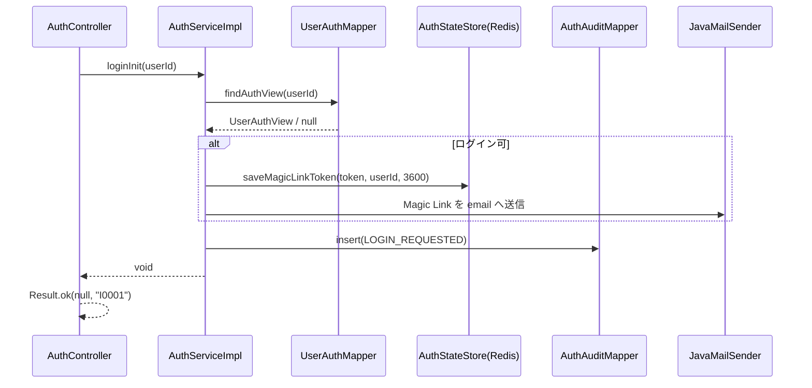
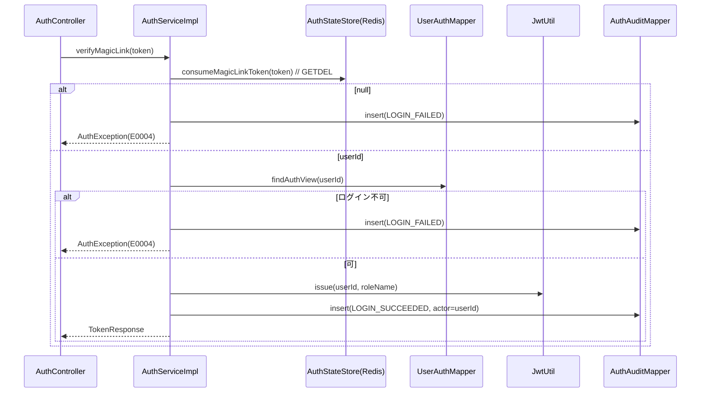
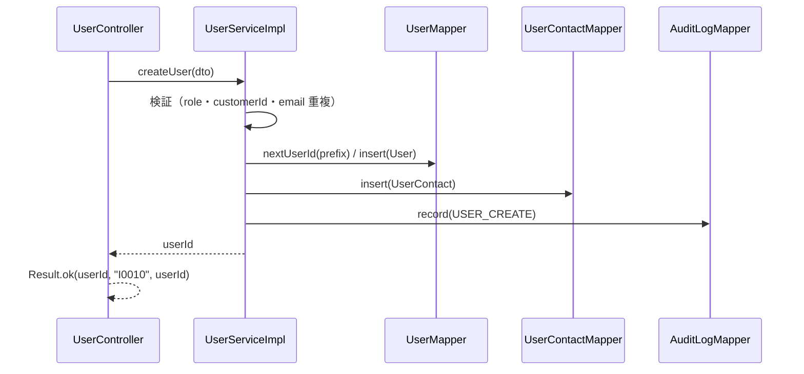

<!-- devtool:file-region id="document-header" -->
# ユーザー・認証 詳細設計

> 詳細設計（内部設計）。`詳細設計/spec-detail-temp.md` の構成に従う。本書は単一情報源（SSOT）を参照するのみで、項目・列挙値・メッセージを再定義しない。
> 認証フロー（Magic Link・JWT・Redis 一時状態）の実装は `基本設計/基盤/spec-02-auth-service-ui.md` を正とし、本書は業務側（ユーザー管理・ロール・停用/ロック・監査参照）と画面（SCR-01/02/04/05/17/19/20/21）を定める。
> 業務ルールの番号・内容は `基本設計/共通/spec-08-business-rule-list.md` を正とする。

<!-- devtool:end-file-region -->
<!-- devtool:block id="detail.user.detail-sd.s01" -->
## 文書情報

| 項目 | 内容 |
|------|------|
| システム名称 | DDMSAA 販売システム |
| 文書名称 | ユーザー・認証 詳細設計 |
| 文書バージョン | V1.0 |
| ステータス | 草案 |
| 作成者 | TBD |
| 作成日 | 2026-10-21 |
| レビュー担当 | TBD |

<!-- devtool:endblock -->
<!-- devtool:block id="detail.user.detail-sd.s02" -->
## 改訂履歴

| バージョン | 改訂日 | 改訂者 | 改訂内容 |
|------|--------|--------|---------|
| V0.1 | 2026-10-20 | — | 簡易版（データ・API・処理・テスト・BR） |
| V1.0 | 2026-10-21 | — | `spec-detail-temp.md` の構成へ展開（§0〜§6.1）。テスト表を §5.1 へ移し UT-ID を `UT-USR-NNN`（3 桁）に統一 |
| V1.2 | 2026-10-21 | — | TBD-USR-07 を解消：`PERMISSION_DENIED` は BR-AUD-001 に定義済み。403 は `target_type=API`・`target_id`＝「HTTP メソッド + パステンプレート」（例 `POST /users`。100 文字で切り詰め。パスは `HandlerMapping.BEST_MATCHING_PATTERN_ATTRIBUTE`、取れなければ requestURI）、範囲外 1 件は資源種別／ID。`PermissionDeniedAuditListener` の手順を更新。UT-USR-053・054 を追加、UT-USR-051 を更新 |
| V1.1 | 2026-10-21 | — | 決定反映：Service 層 400 は `InvalidRequestException`、`AuditLogPort`（`record`／`recordDenied`）実装、列挙の置き場所（`Role`＝`common.enums`、`UserStatus`＝`core.shared.enums`）、請求形式不正は一律 400 `E0008`、`PERMISSION_DENIED` は `PermissionDeniedAuditListener` で記録、Magic Link 再送時に旧リンクを失効（逆引きキー）。旧 TBD-USR-01／02／03／06 を解消。UT-USR-046〜052 を追加 |

---

<!-- devtool:endblock -->
<!-- devtool:block id="detail.user.detail-sd.s03" -->
## 0. 対象と根拠

| 項目 | 内容 |
|------|------|
| 関連機能 | F-AUTH-01、F-AUTH-02、F-USR-01〜05、F-AUD-01（F-AUD-02 の記録は各機能が行う。ログイン系の記録は本書 §1.2 `loginInit` / `verifyMagicLink`） |
| 関連画面 | SCR-01、SCR-02、SCR-04、SCR-05、SCR-17、SCR-19、SCR-20、SCR-21（SCR-18 通知履歴は API が承認・通知機能に属するため `詳細設計/業務/approval/spec-approval-detail-sd.md` §2 で扱う） |
| 関連 API | `loginInit`、`verifyMagicLink`、`resendMagicLink`、`getMe`、`pageUsers`、`getUser`、`createUser`、`updateUser`、`disableUser`、`enableUser`、`lockUser`、`unlockUser`、`pageAuditLogs`（`spec-07-api-list.yaml`） |
| 関連バッチ | なし（Magic Link メールは auth-service が同期送信。業務通知の BAT-01 は `approval` を参照） |
| 関連テーブル | TBL-users、TBL-user-contacts、TBL-system-locks、TBL-audit-logs（参照：TBL-customers、TBL-customer-assignments、TBL-orders）（`spec-06-db-physical.yaml`） |
| 業務ルール | BR-AUTH-001〜006、BR-USR-001〜005、BR-AUD-001 |
| 上流根拠 | `要件定義/requirements.md` §2、§5.5；`基本設計/業務設計/user/spec-user-business-ui.md`、`spec-user-screen-ui.md`；`基本設計/共通/spec-03-auth-ui.md` |

### 0.1 コード生成時のロード一覧（AI コンテキスト組み立て）

```
- 本ファイル
- 基本設計/共通/spec-06-db-physical.yaml      ← TBL-users / user_contacts / system_locks / audit_logs / customers / customer_assignments / orders（読取）
- 基本設計/共通/spec-07-api-list.yaml          ← 上記 operationId と Role / UserStatus / UserVO / UserCreateDTO / UserUpdateDTO / UserLockDTO / MeVO / AuditLogVO / TokenResponse
- 基本設計/共通/spec-09-message-list.yaml      ← I0001 I0003 I0010 I0011 I0025 I0029 I0032 I0033 W0011 W0023 W0027 E0001 E0002 E0004 E0005 E0006 E0007 E0008 E0030〜E0034 E0040〜E0043 E0051 E0055
- 基本設計/共通/spec-08-business-rule-list.md  ← BR-AUTH / BR-USR / BR-AUD
- 基本設計/共通/spec-03-auth-ui.md、spec-05 / spec-10 / spec-12、基本設計/業務設計/user/spec-user-screen-ui.md
- 基本設計/基盤/spec-02-auth-service-ui.md、基盤/インタフェース仕様/spec-01-auth.yaml・spec-07-infrastructure.yaml・spec-08-security-util.yaml・spec-10-business-core.yaml
- 開発規約/spec-naming-rule.md / spec-database-rule.md / spec-data-dictionary-project-temp.md（T07-1 ロール、T07-2 利用者状態）
- 開発規約/spec-backend-coding-rule.md / spec-frontend-coding-rule.md / spec-test-rule.md
```

### 0.2 マイクロサービス帰属

| 項目 | 内容 |
|------|------|
| 所属サービス | `auth-service`（`/api/v1/auth/**` の 3 API）／ `business-service-core`（その他すべて） |
| パッケージ接頭辞 | `com.example.ddmsaa.auth`（auth-service）／ `com.example.ddmsaa.core.user`（business-service-core） |
| 基盤依存 | common（`Result`・`PageResult`・`BusinessException`・`InvalidRequestException`・`EntityNotFoundException`・`AuthException`・`MaskingService`・`Role`＝`com.example.ddmsaa.common.enums`）、infrastructure（`JwtUtil`・`AuthStateStore`・`UserContext`・`MetaObjectHandler`・DB・Redis） |
| DB アクセス権限 | auth-service は `users`・`user_contacts`・`system_locks` を READ ONLY、`audit_logs` を INSERT のみ（`spec-02-auth-service-ui.md` §6.4）。business-service-core は全表の CRUD |

---

<!-- devtool:endblock -->
<!-- devtool:block id="detail.user.detail-sd.s04" -->
## 1. バックエンド詳細設計

### 1.1 クラス一覧

| 層 | クラス名 | パッケージ | 責務 | 対応 |
|----|------|----|------|------|
| Controller | `AuthController` | `com.example.ddmsaa.auth.controller` | `/api/v1/auth/**` の受付 | `loginInit`、`verifyMagicLink`、`resendMagicLink` |
| Service | `AuthService` / `AuthServiceImpl` | `…auth.service` / `…service.impl` | ログイン可否判定、Magic Link 発行・消費、JWT 発行 | F-AUTH-01 |
| Mapper | `UserAuthMapper`（`UserAuthView` を返す） | `…auth.mapper` | users + user_contacts + system_locks の LEFT JOIN（READ ONLY） | TBL-users 他 |
| Mapper | `AuthAuditMapper` | `…auth.mapper` | `audit_logs` への INSERT のみ（ログイン監査） | TBL-audit-logs |
| DTO | `LoginInitRequest`、`VerifyMagicLinkRequest`（07 の `MagicLinkVerifyRequest`）、`ResendMagicLinkRequest`（07 では `LoginInitRequest` を共用）、`TokenResponse` | `…auth.dto` | クラス名は `spec-01-auth.yaml`、項目は `spec-07-api-list.yaml` の schema に準拠（07 と名称が異なる 2 件は TBD-USR-04） | — |
| Controller | `UserController` | `com.example.ddmsaa.core.user.controller` | `/api/v1/users/**`、`/api/v1/me`、`/api/v1/audit-logs` の受付 | `getMe`、`pageUsers`、`getUser`、`createUser`、`updateUser`、`disableUser`、`enableUser`、`lockUser`、`unlockUser`、`pageAuditLogs` |
| Service | `UserService` / `UserServiceImpl` | `…core.user.service` / `…service.impl` | ユーザー管理、停用・ロック、ロール変更、`getMe` | F-AUTH-02、F-USR-01〜05 |
| Service | `AuditLogService` / `AuditLogServiceImpl` | `…core.user.service` / `…service.impl` | 監査ログの検索（`pageAuditLogs`）と、`AuditLogPort`（`core.shared.port`）の実装（`record`・`recordDenied`。全 feature の Service が呼ぶ。`order` 詳細設計 §1.1.1 参照） | F-AUD-01、F-AUD-02 |
| Listener | `PermissionDeniedAuditListener` | `…core.user.listener` | Spring Security の `AuthorizationDeniedEvent` を受け、現在の要求（`RequestContextHolder`）から `targetType`・`targetId` を導出して `AuditLogPort.recordDenied(targetType, targetId)` を呼ぶ（403 の `PERMISSION_DENIED` 記録。`spec-backend-coding-rule.md` §8）。導出手順：(1) `targetType` は固定で `API`（403 は `@PreAuthorize` で拒否され資源を特定できないため）。(2) `targetId` ＝「HTTP メソッド + 半角スペース + パステンプレート」（例 `POST /users`、`GET /users/{userId}`）。パステンプレートは要求属性 `HandlerMapping.BEST_MATCHING_PATTERN_ATTRIBUTE`（Spring の最良一致パターン）から取り、取得できない（null）場合は `requestURI` を用いる。(3) 100 文字を超える場合は 100 文字に切り詰める。要求が取得できない場合（`RequestContextHolder` が空）は記録をスキップして warn ログ。リスナー内の例外は握りつぶして 403 応答に影響させない | F-AUD-02 |
| Mapper | `UserMapper` | `…core.user.mapper` | users の CRUD・検索・ADMIN の件数・担当残り確認 | TBL-users |
| Mapper | `UserContactMapper` | `…core.user.mapper` | user_contacts の登録・更新（物理 DELETE・論理削除なし） | TBL-user-contacts |
| Mapper | `SystemLockMapper` | `…core.user.mapper` | system_locks の登録・更新 | TBL-system-locks |
| Mapper | `AuditLogMapper` | `…core.user.mapper` | audit_logs の INSERT と検索 | TBL-audit-logs |
| Entity | `User`、`UserContact`、`SystemLock`、`AuditLog` | `…core.user.entity` | テーブルマッピング | 各 TBL |
| DTO | `UserVo`（`UserVO`）、`UserCreateDto`（`UserCreateDTO`）、`UserUpdateDto`（`UserUpdateDTO`）、`UserLockDto`（`UserLockDTO`）、`MeVo`（`MeVO`）、`AuditLogVo`（`AuditLogVO`）、`UserSearchCondition`、`AuditLogSearchCondition` | `…core.user.dto` | `spec-07-api-list.yaml` に準拠 | — |
| 列挙 | `Role`（T07-1）、`UserStatus`（T07-2） | `Role`＝`com.example.ddmsaa.common.enums`（auth-service と core 共用）、`UserStatus`＝`com.example.ddmsaa.core.shared.enums` | `int code` + `fromCode`（`assets/enum.java.tmpl`）。置き場所は `spec-backend-coding-rule.md` §2 で決定済み。auth-service は `Role` を JWT の `role` claim に使う | — |
| 変換 | `UserConverter` | `…core.user.convert` | Entity ↔ DTO（MapStruct） | — |

### 1.2 API 別詳細設計

> **400 `E0008` の送出方法（決定済み）**：DTO の項目上の必須・長さ・形式は Bean Validation（`MethodArgumentNotValidException`）。Bean Validation で表せない入力不整合（Service 内の判定。例：ロールと顧客の組合せ、CUSTOMER との相互変更、無効な顧客、日付区間の逆転）は `InvalidRequestException`（`com.example.ddmsaa.common.exception`。HTTP 400、messageId 既定 `E0008`、`details[]` に `FieldError`。コンストラクタ `(field, reason)`）で送出する。`BusinessException`（409 固定）や `ConstraintViolationException` の手動構築は使わない（`spec-backend-coding-rule.md` §4、`spec-03-exception-handler.yaml`）。

> **`AuditLogPort` の実装**：`AuditLogServiceImpl` が `AuditLogPort`（`com.example.ddmsaa.core.shared.port`。定義は `order` 詳細設計 §1.1.1）の 2 メソッドを実装する。(1) `record(auditAction, targetType, targetId, detail)` は呼び出し側の事務内で `audit_logs` に INSERT し、actor は `UserContext.getUserId()`（無ければ NULL・`created_by=SYSTEM`）。(2) `recordDenied(targetType, targetId)` は `auditAction=PERMISSION_DENIED` を `@Transactional(propagation = REQUIRES_NEW)` の新事務で INSERT する（呼び出し元がロールバックしても残る。`spec-backend-coding-rule.md` §8）。`recordDenied` の呼び出し元は、403 は `PermissionDeniedAuditListener`（`AuthorizationDeniedEvent`。`target_type=API`、`target_id`＝「HTTP メソッド + パステンプレート」。導出は §1.1 の Listener 行）、範囲外の単件 404 は範囲判定部（`OrderAccessPort` 等）が `EntityNotFoundException("E0005")` を投げる直前。一覧の自動除外は記録しない。本機能の `createUser` 等も `AuditLogPort.record` 経由で記録する。auth-service のログイン監査は別サービスのため `AuthAuditMapper` で直接 INSERT する（Port 対象外）。

> 以下のすべての API で、成功は HTTP 200 + `Result`、権限不足は 403 `E0002`、未認証・JWT 期限切れは 401 `E0001`（Gateway 起因は `E0040`〜`E0043`）。`@PreAuthorize` は `x-roles` に一致させる。

#### `loginInit` ログイン開始（`POST /api/v1/auth/login-init`）

| 項目 | 内容 |
|------|------|
| operationId | `loginInit` |
| 対応機能 | F-AUTH-01 |
| ロール・権限 | 公開（permit-all） |
| リクエストスキーマ | `LoginInitRequest`（`userId` 必須・最大 10 文字） |
| レスポンス | `Result<Void>`（`messageId=I0001`。可否・存在に関わらず常に同一。BR-AUTH-001） |

**シーケンス**



**入力検証**

| 項目 | ルール | 違反時 messageId | HTTP |
|------|------|--------------|------|
| `userId` | 必須・最大 10 文字 | `E0008`（`details[]` に項目） | 400 |

**処理ロジック**

```
1. userId で findAuthView を実行（users のみ deleted_at IS NULL。user_contacts・system_locks は論理削除なし。spec-01-auth.yaml sql_contracts）
2. ログイン不可を判定する（BR-AUTH-001）。次のいずれかなら token を作らずメールも送らない：
   - 結果が null（不存在・論理削除）
   - users.status = DISABLED（UserAuthView.disabled = true）
   - system_locks.lock_started_at が NULL でない（ロック中）
   - role が 1/2/3 以外（error ログ。JWT 発行不可と同じ扱い）
3. ログイン可なら token = SecureRandom 32 byte → Base64 URL エンコード（パディングなし）。token を API 応答・ログに出さない
4. AuthStateStore.saveMagicLinkToken(token, userId, app.auth.magic-link.ttl-seconds=3600)（内部で逆引きキー `auth:magic-link:user:{userId}` により旧 token を削除し、新 token と逆引きキーを同じ TTL で保存する。`spec-08-security-util.yaml`）
5. メール（MAIL-01）を user_contacts.email へ送信。リンクは app.auth.magic-link.base-url?token=<token>（既定 http://localhost:3000/auth/verify）
   JavaMailSender 未構成・送信失敗は warn ログのみ（token を出さない）。応答は変えない
6. 監査 LOGIN_REQUESTED を audit_logs へ INSERT（actor_user_id=NULL、target_type=USER、target_id=入力 userId を 10 文字に切り詰め、audit_detail に token を含めない）。不存在の ID も記録する（BR-AUD-001）
7. どの経路でも 200 / I0001 を返す
```

**トランザクション**

| 項目 | 内容 |
|------|------|
| 範囲 | トランザクションは使わない（DB は READ ONLY の照会 1 回と audit_logs の単独 INSERT） |
| 関連テーブル | TBL-users・TBL-user-contacts・TBL-system-locks（読取）、TBL-audit-logs（書込） |
| ロールバック条件 | なし。audit_logs の INSERT 失敗は error ログとし、応答は I0001 のまま |

**DB アクセス**

| Mapper メソッド | 操作 | 対象テーブル.カラム | 主要条件 |
|------------|------|----------|---------|
| `UserAuthMapper.findAuthView` | SELECT | `users.user_id/role/status`、`user_contacts.email`、`system_locks.lock_started_at` | `users.user_id = #{userId} AND users.deleted_at IS NULL`。`user_contacts`・`system_locks` は論理削除しないため JOIN 側に `deleted_at` 条件なし |
| `AuthAuditMapper.insert` | INSERT | `audit_logs`（id は DB の `next_business_id('AL', 8)`、`created_by`＝`SYSTEM`） | — |

**利用する共通コンポーネント**

| コンポーネント | 用途 |
|------|------|
| `AuthStateStore` | Magic Link token を TTL 付きで保存（業務テーブルへは保存しない） |
| メール外部インタフェース | IF-01 / MAIL-01（`spec-08-external-interface-ui.md`） |

**例外 → messageId → HTTP**

| シナリオ | 例外 | messageId | HTTP |
|------|------|-----------|------|
| 検証失敗 | `MethodArgumentNotValidException` | `E0008` | 400 |
| その他システム例外 | `Exception` | `E0012` | 500 |

> 存在・停用・ロックを区別する例外は存在しない（列挙攻撃対策）。

**正常レスポンス**：`Result<Void>`、`messageId=I0001`。

#### `verifyMagicLink` Magic Link 検証・JWT 発行（`POST /api/v1/auth/magic-link/verify`）

| 項目 | 内容 |
|------|------|
| operationId | `verifyMagicLink` |
| 対応機能 | F-AUTH-01 |
| ロール・権限 | 公開（permit-all） |
| リクエストスキーマ | `MagicLinkVerifyRequest`（Java 名 `VerifyMagicLinkRequest`。`token` 必須） |
| レスポンス | `Result<TokenResponse>`（`{accessToken, tokenType="Bearer"}`。リフレッシュトークンなし） |

**シーケンス**



**入力検証**

| 項目 | ルール | 違反時 messageId | HTTP |
|------|------|--------------|------|
| `token` | 必須（空白不可） | `E0008` | 400 |

**処理ロジック**

```
1. AuthStateStore.consumeMagicLinkToken(token)（Redis GETDEL。1 回限り・原子的。逆引きキー `auth:magic-link:user:{userId}` も値が当該 token のときだけ削除する）。null なら無効・期限切れ・使用済み
2. null の場合：監査 LOGIN_FAILED（actor=NULL、target_id=NULL）を INSERT し、AuthException("E0004")（401）
3. userId が取れたら findAuthView(userId)。BR-AUTH-001 と同じ判定でログイン不可なら LOGIN_FAILED（actor=NULL、target_id=userId）を INSERT し AuthException("E0004")。無効・期限切れ・使用済み・停用・ロックは区別しない
4. role（INT）→ 文字列：1→ADMIN、2→EMPLOYEE、3→CUSTOMER。それ以外は既定ロールに置き換えず発行しない（E0004、error ログ）
5. JwtUtil.issue(userId, roleName)（sub=userId、claim role、iss=ddmsaa、exp=60 分、HS256）
6. 監査 LOGIN_SUCCEEDED（actor_user_id=userId）を INSERT
7. TokenResponse を返す。成功メッセージはフロントエンドが SCR-21 で I0003 を表示する（API は messageId を付けない）
```

**トランザクション**：使用しない（`loginInit` と同じ）。

**DB アクセス**：`loginInit` と同じ 2 メソッド。

**例外 → messageId → HTTP**

| シナリオ | 例外 | messageId | HTTP |
|------|------|-----------|------|
| 検証失敗 | `MethodArgumentNotValidException` | `E0008` | 400 |
| 無効・期限切れ・使用済み・停用・ロック・不存在 | `AuthException` | `E0004` | 401 |

**正常レスポンス**：`Result<TokenResponse>`（messageId なし）。

#### `resendMagicLink` Magic Link 再送（`POST /api/v1/auth/magic-link/resend`）

| 項目 | 内容 |
|------|------|
| operationId | `resendMagicLink` |
| 対応機能 | F-AUTH-01 |
| ロール・権限 | 公開（permit-all） |
| リクエストスキーマ | 07 は `LoginInitRequest`（`userId` 必須・最大 10 文字）。Java 名は `ResendMagicLinkRequest`（`spec-01-auth.yaml`。項目は同じ） |
| レスポンス | `Result<Void>`（`messageId=I0001`） |

**処理ロジック**

```
1. 入力検証は loginInit と同じ（E0008 / 400）
2. loginInit と同じ処理を実行する（ログイン可否判定 → token 生成 → 保存 → メール送信）。応答は常に I0001。再送回数に上限はない（要件 §5.5）
3. 旧 token の失効（決定済み）：`AuthStateStore.saveMagicLinkToken` が逆引きキー `auth:magic-link:user:{userId}`（最新 token）で旧 token を特定して DEL し、新 token と逆引きキーを同じ TTL で保存する（`spec-08-security-util.yaml`、`spec-02-auth-service-ui.md` §6.3）。再送後は旧リンクで `verifyMagicLink` を呼ぶと 401 `E0004`。`consumeMagicLinkToken` は消費時に逆引きキーも削除する（値が当該 token のときのみ）。本 API 側に追加の処理はない
4. 監査は LOGIN_REQUESTED（loginInit と同じ）
```

**トランザクション・DB アクセス・例外**：`loginInit` と同じ。

#### `getMe` ログイン利用者情報（`GET /api/v1/me`）

| 項目 | 内容 |
|------|------|
| operationId | `getMe` |
| 対応機能 | F-AUTH-02 |
| ロール・権限 | `@PreAuthorize("hasAnyRole('ADMIN','EMPLOYEE','CUSTOMER')")` |
| レスポンス | `Result<MeVO>`（`userId`・`userName`・`role`・`customerId`・`customerName`） |

**処理ロジック**

```
1. UserContext.getUserId() で users を取得（deleted_at IS NULL）。存在しなければ EntityNotFoundException（404 E0005）
2. role（INT）→ Role。CUSTOMER のとき customers から customerName を取得（customerId は users.customer_id）。ADMIN / EMPLOYEE は customerId・customerName を null
3. MeVo を返す。status・ロックは判定しない（JWT の有効期限内は利用できる。BR-AUTH-005）
```

**トランザクション**：`@Transactional(readOnly = true)`。**DB アクセス**：`UserMapper.selectById`（users LEFT JOIN customers）。

**例外**：未存在 `EntityNotFoundException` `E0005` / 404。

#### `pageUsers` ユーザ一覧（`GET /api/v1/users`）

| 項目 | 内容 |
|------|------|
| operationId | `pageUsers` |
| 対応機能 | F-USR-01 |
| ロール・権限 | `@PreAuthorize("hasRole('ADMIN')")` |
| リクエスト | クエリ `pageNum`（既定 1）、`pageSize`（既定 20・最大 100）、`keyword`、`role`、`status`、`isLocked` |
| レスポンス | `Result<PageResult<UserVO>>` |

**入力検証**：`pageSize` 1〜100（DTO／クエリの Bean Validation、`E0008` / 400）、`role`・`status` は列挙値。非法な列挙値（`MethodArgumentTypeMismatchException`）・不正 JSON（`HttpMessageNotReadableException`）・必須クエリ欠落は一律 400 `E0008`（`details[]`。解析器のメッセージは返さない。`spec-backend-coding-rule.md` §4、`spec-03-exception-handler.yaml` RequestBinding）。

**処理ロジック**

```
1. UserSearchCondition を組み立てる（keyword は user_id・user_name・email の部分一致。email は user_contacts）
2. PageHelper.startPage(pageNum, pageSize) → UserMapper.search（user_id 昇順固定。users LEFT JOIN user_contacts LEFT JOIN system_locks LEFT JOIN customers）
3. isLocked=true は system_locks.lock_started_at IS NOT NULL。ロック理由 lockReason も返す（ADMIN のみの API）
4. PageResult.of(records, total, pageNum, pageSize) を Result.ok で返す
```

**DB アクセス**：`UserMapper.search`（SELECT）。**トランザクション**：`readOnly`。

**例外 → messageId → HTTP**

| シナリオ | 例外 | messageId | HTTP |
|------|------|-----------|------|
| `pageSize` 範囲外 | Bean Validation（`MethodArgumentNotValidException`／`HandlerMethodValidationException` 等） | `E0008` | 400 |
| 非法な列挙値（`role`・`status`・`isLocked`） | `MethodArgumentTypeMismatchException` | `E0008` | 400 |
| 権限不足 | `AccessDeniedException` | `E0002` | 403 |

#### `getUser` ユーザ詳細（`GET /api/v1/users/{userId}`）

`pageUsers` と同じ権限（ADMIN）。`UserMapper.selectById` の結果を `UserVO`（`updatedAt` を含む）にして返す。不存在・論理削除済みは 404 `E0005`。

#### `createUser` ユーザ登録（`POST /api/v1/users`）

| 項目 | 内容 |
|------|------|
| operationId | `createUser` |
| 対応機能 | F-USR-02 |
| ロール・権限 | `@PreAuthorize("hasRole('ADMIN')")` |
| リクエストスキーマ | `UserCreateDTO`（`userName` 必須・最大 100、`email` 必須・最大 255・形式、`role` 必須、`customerId` 最大 10） |
| レスポンス | `Result<String>`（採番した `userId`。`messageId=I0010`、`messageArgs=[userId]`） |

**シーケンス**



**入力検証**

| 項目 | ルール | 違反時 messageId | HTTP |
|------|------|--------------|------|
| `userName` | 必須・1〜100 文字 | `E0008` | 400 |
| `email` | 必須・形式・255 文字以内 | `E0008` | 400 |
| `role` | 必須・ADMIN / EMPLOYEE / CUSTOMER | `E0008` | 400 |
| `customerId` | role=CUSTOMER は必須で有効な顧客（status=ACTIVE・未削除）。ADMIN / EMPLOYEE は指定不可（BR-USR-003） | `E0008` | 400 |
| `email` | `user_contacts` に同じメールが存在（全行で一意） | `E0007` | 409 |

**処理ロジック**

```
1. 上の検証を行う（DTO 項目は Bean Validation。ロールと顧客の組合せ・無効な顧客は `InvalidRequestException`（400 `E0008`、field=`customerId`））
2. ユーザー ID を採番する：prefix＝ADMIN→A、EMPLOYEE→E、CUSTOMER→C。SELECT public.next_business_id(prefix, 4)（アプリケーション層が prefix を渡す。spec-database-rule §4.1-SEQ）
3. users を INSERT（status=ACTIVE(1)、customer_id は CUSTOMER のみ）。created_by/updated_by は MetaObjectHandler が自動設定
4. user_contacts を INSERT（user_id は users と共有主キー）。email の一意制約違反（DuplicateKey）は BusinessException("E0007")
5. `AuditLogPort.record` で USER_CREATE（target_type=USER、target_id=userId）を audit_logs へ INSERT
6. userId を返す
```

**トランザクション**

| 項目 | 内容 |
|------|------|
| 範囲 | `@Transactional` を `UserServiceImpl.createUser()` に付与 |
| 関連テーブル | TBL-users・TBL-user-contacts・TBL-audit-logs（書込）、TBL-customers（読取） |
| ロールバック条件 | いずれかで `BusinessException`／`InvalidRequestException` をスローした場合は全体をロールバック |

**DB アクセス**

| Mapper メソッド | 操作 | 対象テーブル.カラム | 主要条件 |
|------------|------|----------|---------|
| `UserMapper.nextUserId` | SELECT | `public.next_business_id(#{prefix}, 4)` | — |
| `UserMapper.insert` | INSERT | `users` | — |
| `UserContactMapper.insert` | INSERT | `user_contacts` | `uq_user_contacts_email` |
| `UserMapper.countActiveCustomer` | SELECT | `customers.id/status` | `deleted_at IS NULL` |
| `AuditLogMapper.insert`（`AuditLogPort.record` 経由） | INSERT | `audit_logs` | — |

**例外 → messageId → HTTP**

| シナリオ | 例外 | messageId | HTTP |
|------|------|-----------|------|
| DTO 検証失敗（必須・長さ・形式） | `MethodArgumentNotValidException` | `E0008` | 400 |
| ロールと顧客の不整合・無効な顧客 | `InvalidRequestException` | `E0008` | 400 |
| 非法な `role` 値・不正 JSON | `HttpMessageNotReadableException` | `E0008` | 400 |
| メール重複 | `BusinessException` | `E0007` | 409 |
| 権限不足 | `AccessDeniedException` | `E0002` | 403 |

**正常レスポンス**：`Result<String>`、`I0010`（`{0}`＝ユーザー ID）。

#### `updateUser` ユーザ更新（`PUT /api/v1/users/{userId}`）

| 項目 | 内容 |
|------|------|
| operationId | `updateUser` |
| 対応機能 | F-USR-03 |
| ロール・権限 | `@PreAuthorize("hasRole('ADMIN')")` |
| リクエストスキーマ | `UserUpdateDTO`（`userName`・`email`・`role`・`updatedAt` 必須、`customerId`） |
| レスポンス | `Result<Void>`（`messageId=I0011`。07 の応答に合わせる） |

**入力検証**：`createUser` と同じ（`updatedAt` 必須・日時形式。欠落は `E0008`）。

**処理ロジック**

```
1. 対象 users を取得（deleted_at IS NULL）。不存在は EntityNotFoundException（404 E0005）
2. 楽観ロック：UPDATE … WHERE user_id=? AND updated_at=#{expectedUpdatedAt}。0 行は BusinessException("E0051")（409）
3. ロール変更（role が現在と異なる場合）— BR-USR-004 / BR-USR-005：
   a. 変更は ADMIN ⇔ EMPLOYEE のみ。CUSTOMER から／への変更は `InvalidRequestException`（400 `E0008`、field=`role`）。ユーザー ID は変えない
   b. 自分自身のロール変更は BusinessException("E0006")（409）
   c. ADMIN → EMPLOYEE：対象 ADMIN と有効 ADMIN 行を SELECT … FOR UPDATE でロックし、変更後の有効（ACTIVE かつ未ロック）な ADMIN が 0 名になるなら BusinessException("E0055")（409）
   d. EMPLOYEE → ADMIN：有効な customer_assignments（is_active=TRUE）、または未完了（DRAFT/RETURNED/PENDING_APPROVAL）の orders.sales_user_id が残っていれば BusinessException("E0006")（409）
4. customerId：role=CUSTOMER は必須、ADMIN / EMPLOYEE は指定不可（`InvalidRequestException`、400 E0008、field=`customerId`）。CUSTOMER の customerId 変更は許可する（有効な顧客であること）
5. email が変わる場合は user_contacts を UPDATE（他ユーザーと重複なら E0007 / 409）
6. users・user_contacts を更新し、`AuditLogPort.record`（USER_UPDATE）を同一トランザクションで記録
7. 返却時の最新 updatedAt が必要な場合は画面が getUser で再取得する
```

**トランザクション**：`@Transactional`（`UserServiceImpl.updateUser()`）。書込：users・user_contacts・audit_logs。

**DB アクセス**：`UserMapper.selectForUpdate`、`UserMapper.updateWithLock`、`UserMapper.countActiveAdmins`、`UserMapper.countAssignmentsAndOpenOrders`、`UserContactMapper.update`、`AuditLogPort.record`（`AuditLogMapper.insert`）。

**例外 → messageId → HTTP**

| シナリオ | 例外 | messageId | HTTP |
|------|------|-----------|------|
| DTO 検証失敗（必須・長さ・形式・`updatedAt` 欠落） | `MethodArgumentNotValidException` | `E0008` | 400 |
| CUSTOMER との相互変更・customerId の不整合 | `InvalidRequestException` | `E0008` | 400 |
| 非法な `role` 値・不正 JSON | `HttpMessageNotReadableException` | `E0008` | 400 |
| 不存在 | `EntityNotFoundException` | `E0005` | 404 |
| 楽観ロック不一致 | `BusinessException` | `E0051` | 409 |
| 自分自身のロール変更・担当が残る EMPLOYEE の変更 | `BusinessException` | `E0006` | 409 |
| 最後の有効な ADMIN | `BusinessException` | `E0055` | 409 |
| メール重複 | `BusinessException` | `E0007` | 409 |

#### `disableUser` 停用 / `enableUser` 停用解除（`POST /api/v1/users/{userId}/disable`・`/enable`）

| 項目 | 内容 |
|------|------|
| 対応機能 | F-USR-04 |
| ロール・権限 | `@PreAuthorize("hasRole('ADMIN')")` |
| レスポンス | `Result<Void>`（`disableUser`＝`I0032`、`enableUser`＝`I0033`） |

**処理ロジック**

```
1. 対象 users を行ロックで取得（不存在 404 E0005）
2. disableUser：対象が自分自身なら BusinessException("E0006")。対象が ADMIN で、停用後に有効な ADMIN が 0 名になるなら BusinessException("E0055")（BR-USR-005）。status を DISABLED(2) に更新
3. enableUser：status を ACTIVE(1) に更新（既に ACTIVE でも成功とする。冪等）
4. `AuditLogPort.record` で USER_DISABLE / USER_ENABLE を記録（同一トランザクション）
5. 発行済み JWT は有効期限（最長 60 分）まで有効（BR-AUTH-005）。業務 API はリクエストごとの状態照会をしない
```

**トランザクション**：`@Transactional`。**DB アクセス**：`UserMapper.selectForUpdate`、`UserMapper.updateStatus`、`UserMapper.countActiveAdmins`、`AuditLogPort.record`。

**例外**：不存在 `E0005` / 404、自分自身 `E0006` / 409、最後の ADMIN `E0055` / 409。

#### `lockUser` ロック / `unlockUser` ロック解除（`POST /api/v1/users/{userId}/lock`・`/unlock`）

| 項目 | 内容 |
|------|------|
| 対応機能 | F-USR-05 |
| ロール・権限 | `@PreAuthorize("hasRole('ADMIN')")` |
| リクエストスキーマ | `lockUser`：`UserLockDTO`（`lockReason` 任意・最大 500）。`unlockUser`：なし |
| レスポンス | `Result<Void>`（`lockUser`＝`I0025`、`unlockUser`＝`I0029`） |

**処理ロジック**

```
1. 対象 users を行ロックで取得（不存在 404 E0005）
2. lockUser：自分自身は E0006。ADMIN で、ロック後に有効な ADMIN が 0 名になるなら E0055（BR-USR-005）。system_locks が無ければ INSERT、あれば lock_started_at を現在時刻（未来時刻は設定しない）、lock_reason を UPDATE
3. unlockUser：lock_started_at を NULL、lock_reason を NULL に UPDATE（行は削除しない。system_locks は論理削除なし）
4. `AuditLogPort.record` で USER_LOCK / USER_UNLOCK を記録
5. 失敗回数によるロックはない（BR-AUTH-005）
```

**トランザクション**：`@Transactional`。書込：system_locks・audit_logs。**DB アクセス**：`SystemLockMapper.selectForUpdate`・`insert`・`update`、`UserMapper.countActiveAdmins`。

**例外**：検証失敗（500 文字超。DTO の Bean Validation）`E0008` / 400、不正 JSON（`HttpMessageNotReadableException`）`E0008` / 400、不存在 `E0005` / 404、自分自身 `E0006` / 409、最後の ADMIN `E0055` / 409。

#### `pageAuditLogs` 監査ログ参照（`GET /api/v1/audit-logs`）

| 項目 | 内容 |
|------|------|
| operationId | `pageAuditLogs` |
| 対応機能 | F-AUD-01 |
| ロール・権限 | `@PreAuthorize("hasRole('ADMIN')")` |
| リクエスト | `pageNum`、`pageSize`、`actorUserId`（完全一致）、`auditAction`、`targetType`、`targetId`、`occurredDateFrom`、`occurredDateTo` |
| レスポンス | `Result<PageResult<AuditLogVO>>`（発生日時降順の固定順） |

**処理ロジック**

```
1. 期間は日本時間の日付範囲（from 00:00:00 〜 to 23:59:59.999999）で created_at に適用。from > to は `InvalidRequestException`（400 `E0008`、field=`occurredDateFrom`）
2. auditAction・targetType は BR-AUD-001 の一覧にある値以外でも前方一致なしの完全一致で検索する（不明な値は 0 件。文字列項目のため型変換エラーにならない）。日付の形式不正（`MethodArgumentTypeMismatchException`）は 400 `E0008`
3. actorUserName は users との LEFT JOIN。occurredAt は audit_logs.created_at
4. メール本文・トークン・ファイル本体は audit_detail に含まれない（記録側で除外済み）
```

**DB アクセス**：`AuditLogMapper.search`（`audit_logs` LEFT JOIN `users`）。**トランザクション**：`readOnly`。

### 1.3 Entity / DTO / VO マッピング

| Entity 項目 | DTO 項目 | 変換 | 命名変更の登録 |
|------------|---------|------|------------|
| `User.userId`（user_id） | `UserVO.userId` / `MeVO.userId` | 直接 | なし（業務キー） |
| `User.role`（Integer） | `role`（`Role`） | `Role.fromCode` / `getCode` | なし |
| `User.status`（Integer） | `status`（`UserStatus`） | `UserStatus.fromCode` | なし |
| `UserContact.email` | `UserVO.email` | 結合結果を設定 | なし |
| `SystemLock.lockStartedAt` | `UserVO.lockStartedAt`、`isLocked`（lockStartedAt が NULL でなければ true） | 導出 | なし |
| `SystemLock.lockReason` | `UserVO.lockReason` | 直接（ADMIN のみの API） | なし |
| `Customer.customerName`（結合） | `UserVO.customerName` / `MeVO.customerName` | 結合結果を設定 | なし |
| `User.updatedAt` | `UserVO.updatedAt` | マイクロ秒 6 桁で返す | なし |
| `AuditLog.createdAt` | `AuditLogVO.occurredAt` | 名称変更 | 派生項目としてマッピング表（`spec-data-dictionary-mapping-ui.md` §4.20）に登録済み |

> 暗号化・マスキング対象の項目はない。`UserVO.email`・`lockReason` は ADMIN だけが呼べる API にのみ含める（`spec-03-auth-ui.md` §3）。

---

<!-- devtool:endblock -->
<!-- devtool:block id="detail.user.detail-sd.s05" -->
## 2. フロントエンド詳細設計

### 2.1 画面別コンポーネント分解

> 画面ファイルは `frontend/src/pages/user/`、コンポーネントは `frontend/src/components/user/`、型は `frontend/src/types/user.ts`、API クライアントは `frontend/src/api/user-api.ts`（関数名＝operationId）。共通の HTTP 層・i18n・ルートガードは `spec-frontend-coding-rule.md` と `spec-12-screen-common-ui.md` に従う。

#### SCR-01 ログイン（`/login`）／ SCR-21 ログイン認証（`/auth/verify`）

**コンポーネントツリー**

```
LoginPage (src/pages/user/login-page.tsx)
└── LoginForm (src/components/user/login-form.tsx)       ユーザー ID 入力・送信・再送ボタン・案内領域
VerifyPage (src/pages/user/verify-page.tsx)             自動検証・結果表示（子コンポーネントなし）
```

**状態・データ**

| 状態 | 型 | 取得元 API | 説明 |
|------|------|---------|------|
| `userId` | `string` | — | 入力値（最大 10 文字） |
| `sent` | `boolean` | `loginInit` | 送信後に案内（I0001）と再送ボタンを表示 |
| `verifyState` | `'verifying' \| 'failed'` | `verifyMagicLink` | 成功時は遷移するため保持しない |
| JWT | `string` | `verifyMagicLink` | 保存場所は TBD-U4（`spec-user-screen-ui.md` §11）。確定までは React Context 内（メモリ）に保持 |

**イベント → API 対応**

| イベント | operationId | 入力 | 成功時処理 | 失敗時処理 |
|------|--------|------|---------|---------|
| 送信／Enter | `loginInit` | `LoginInitRequest` | `I0001` を表示（存否を区別しない） | 400 の `E0008`（空欄は先にクライアント検証 `E0030`） |
| 再送 | `resendMagicLink` | `LoginInitRequest`（07。`userId`） | `I0001` | 同上 |
| SCR-21 初期表示 | `verifyMagicLink`、続いて `getMe` | `token`（URL から取得後すぐ URL から消去） | JWT 保持 → `I0003` → `ddmsaa.returnTo` 判定 → 遷移（SCR-02 または保存先） | `E0004` と「ログイン画面へ」ボタン（SCR-01）。理由は区別しない |

**クライアント検証**

| 項目 | ルール | 表示 messageId |
|------|------|--------------|
| ユーザー ID | 必須 | `E0030` |
| ユーザー ID | 最大 10 文字 | `E0032` |

**ロール別表示制御**：全ロール共通（未認証）。共通ヘッダ・ナビゲーションは表示しない（spec-12 §1）。

**メッセージ表示**

| タイミング | messageId | 取得元 |
|------|-----------|------|
| 送信・再送後 | `I0001` | messages（フロントが ID から文言を解決） |
| JWT 失効で戻った場合 | `E0001` | 同上 |
| 検証成功 | `I0003` | 同上 |
| 検証失敗 | `E0004` | 同上 |

**画面遷移**（正本 `spec-10-screen-transition-ui.md`）

| 遷移元 | 遷移先 | トリガー |
|------|----|------|
| 任意画面（未ログイン） | SCR-01 | ルートガード。`ddmsaa.returnTo`（パス＋保存時刻）を localStorage に保存してから遷移 |
| SCR-21 | SCR-02 又は `ddmsaa.returnTo` の画面 | 検証成功。保存から 60 分以内かつ `getMe` のロールに許可されたパスのときだけ保存先へ。読み込んだ値は必ず削除 |
| SCR-21 | SCR-01 | 検証失敗 |

#### SCR-02 ホーム（`/`）

**コンポーネントツリー**

```
HomePage (src/pages/user/home-page.tsx)
├── SummaryCards (src/components/user/summary-cards.tsx)         承認待ち／下書き・差戻し／承認済み件数
├── RecentOrdersTable (src/components/user/recent-orders-table.tsx)
└── PendingApprovalsTable (src/components/user/pending-approvals-table.tsx)   ADMIN のみ
```

**状態・データ**

| 状態 | 型 | 取得元 API | 説明 |
|------|------|---------|------|
| `me` | `MeVo` | `getMe` | ロール判定（表示制御）に使う |
| `pendingCount` / `pendingTop5` | `number` / `ApprovalRequestVo[]` | `pageApprovalRequests`（`pageSize=5`、ADMIN のみ） | 総件数は `PageResult.total` |
| `draftReturnedCount` / `approvedCount` | `number` | `pageOrders`（`statuses=DRAFT,RETURNED` ／ `APPROVED`、`pageSize=1`） | 範囲は API が強制 |
| `recentOrders` | `OrderSummaryVo[]` | `pageOrders`（`pageSize=10`、既定順） | 更新日時降順 |

**イベント → API 対応**

| イベント | operationId | 成功時処理 | 失敗時処理 |
|------|--------|---------|---------|
| 初期表示 | `getMe`、`pageOrders`、`pageApprovalRequests`（ADMIN のみ） | カード・テーブルを表示 | `ErrorResponse.messageId` を該当領域に表示 |
| カードクリック | — | SCR-14 又は SCR-11（状態フィルタ付き）へ遷移 | — |
| 注文番号クリック | — | SCR-13 へ遷移 | — |

**ロール別表示制御**

| 要素 | ADMIN | EMPLOYEE | CUSTOMER |
|------|:-------:|:----------:|:--------:|
| 承認待ち件数・承認待ち上位 | ○ | × | × |
| 下書き・差戻し件数 | ○ | ○ | × |
| 承認済み件数・最近の注文 | ○ | ○ | ○（自社） |

**画面遷移**：SCR-02 → SCR-14（承認待ちカード）、SCR-02 → SCR-11（件数カード）、SCR-02 → SCR-13（注文番号）。

#### SCR-04 ユーザー一覧（`/users`）

**コンポーネントツリー**

```
UserListPage (src/pages/user/user-list-page.tsx)
├── UserSearchForm (src/components/user/user-search-form.tsx)
├── UserTable      (src/components/user/user-table.tsx)       行操作ボタン（編集・停用/解除・ロック/解除）
└── LockReasonModal (src/components/user/lock-reason-modal.tsx)   ロック理由入力（任意・500 文字）
```

**状態・データ**

| 状態 | 型 | 取得元 API | 説明 |
|------|------|---------|------|
| `query` | `{ keyword, role, status, isLocked, pageNum, pageSize }` | — | URL クエリに保持 |
| `page` | `PageResult<UserVo>` | `pageUsers` | API の固定順（ユーザー ID 昇順）。列見出しソートなし |

**イベント → API 対応**

| イベント | operationId | 入力 | 成功時処理 | 失敗時処理 |
|------|--------|------|---------|---------|
| 検索／ページ移動 | `pageUsers` | `query` | 一覧更新 | メッセージ表示 |
| 停用（W0023 確認後） | `disableUser` | `userId` | `I0032` → 再読込 | `E0006`（自分自身）・`E0055`・`E0005` を表示 |
| 停用解除 | `enableUser` | `userId` | `I0033` → 再読込 | 同上 |
| ロック（理由入力・W0027 確認後） | `lockUser` | `UserLockDTO` | `I0025` → 再読込 | 同上 |
| ロック解除 | `unlockUser` | `userId` | `I0029` → 再読込 | 同上 |

**クライアント検証**：ロック理由 最大 500 文字（`E0032`）。

**ロール別表示制御**：ADMIN のみ（ルートガードで SCR-19）。自分自身の行は停用・ロックを表示しない（`me.userId` と比較）。

**メッセージ表示**：成功 `I0032`・`I0033`・`I0025`・`I0029`、確認 `W0023`・`W0027`。

**画面遷移**：SCR-04 → SCR-05（新規／編集）。

#### SCR-05 ユーザー登録/編集（`/users/new`、`/users/:userId/edit`）

**コンポーネントツリー**

```
UserEditPage (src/pages/user/user-edit-page.tsx)
└── UserForm (src/components/user/user-form.tsx)     表示名・メール・ロール・顧客・状態/ロック（表示のみ）
```

**状態・データ**

| 状態 | 型 | 取得元 API | 説明 |
|------|------|---------|------|
| `form` | `UserFormValues` | `getUser`（編集時） | `updatedAt` は文字列のまま保持（マイクロ秒を失わない。coding-rule §6） |
| `customers` | `CustomerSummaryVo[]` | `pageCustomers`（`status=ACTIVE`） | role=CUSTOMER のときだけ選択肢を表示 |
| `me` | `MeVo` | `getMe`（保持済み） | 自分自身のロール変更を不可にする |

**イベント → API 対応**

| イベント | operationId | 入力 | 成功時処理 | 失敗時処理 |
|------|--------|------|---------|---------|
| 保存（新規） | `createUser` | `UserCreateDTO` | `I0010`（{0}＝userId）→ SCR-04 | `E0007`（メール重複）・`E0008` |
| 保存（編集） | `updateUser` | `UserUpdateDTO`（`updatedAt` 同送） | `I0011` → SCR-04 | `E0051`（再読込を促す）・`E0006`・`E0055`・`E0008` |
| キャンセル | — | — | 入力があれば `W0011` で確認 → SCR-04 | — |

**クライアント検証**

| 項目 | ルール | 表示 messageId |
|------|------|--------------|
| 表示名 | 必須・最大 100 | `E0030`／`E0032` |
| メール | 必須・形式・最大 255 | `E0030`／`E0031`／`E0032` |
| ロール | 必須。編集時は ADMIN ⇔ EMPLOYEE のみ選択可、CUSTOMER は変更不可、自分自身は変更不可 | `E0030` |
| 顧客 | role=CUSTOMER のとき必須。それ以外は非表示・送信しない | `E0030` |

**ロール別表示制御**：ADMIN のみ。

**画面遷移**：SCR-05 → SCR-04（保存・キャンセル）。

#### SCR-17 監査ログ（`/audit-logs`）

**コンポーネントツリー**

```
AuditLogListPage (src/pages/user/audit-log-list-page.tsx)
├── AuditLogSearchForm (src/components/user/audit-log-search-form.tsx)   期間・操作者（ID 入力）・操作・対象種別・対象 ID
└── AuditLogTable      (src/components/user/audit-log-table.tsx)         行展開で auditDetail を JSON 表示
```

**状態・データ**：`query`（URL クエリ保持）、`page: PageResult<AuditLogVo>`（`pageAuditLogs`。発生日時降順の固定順）。「操作」「対象種別」の選択肢は BR-AUD-001 の一覧（フロントの定数）。

**イベント → API 対応**：検索・ページ移動 → `pageAuditLogs` → 一覧更新（失敗時はメッセージ表示）。対象種別が `ORDER` の行は SCR-13 へのリンク。

**クライアント検証**：期間の from ≤ to（`E0008` 相当をクライアントでも抑止）。**ロール別表示制御**：ADMIN のみ。読み取り専用（編集・削除操作を出さない）。

#### SCR-19 権限エラー／SCR-20 未存在エラー（`/403`、`/404`）

**コンポーネントツリー**：`ForbiddenPage`（`forbidden-page.tsx`）、`NotFoundPage`（`not-found-page.tsx`）。共通ヘッダ付き、メッセージ `E0002` / `E0005`、「ホームへ戻る」で SCR-02。

**遷移ルール**：API 403 とロール外 URL → SCR-19。主リソースの 404（`E0005`、Gateway `E0042`）と未定義パス → SCR-20。副リソースの 404 はパネル内に `E0005` を表示するだけ。未認証で到達した場合は `ddmsaa.returnTo` を保存して SCR-01（spec-12 §3、§7）。

---

<!-- devtool:endblock -->
<!-- devtool:block id="detail.user.detail-sd.s06" -->
## 3. バッチ詳細設計

本機能にバッチなし。Magic Link メールは auth-service が要求内で同期送信する（失敗は warn ログのみ）。業務通知メールの送信（BAT-01）は `詳細設計/業務/approval/spec-approval-detail-sd.md` で扱う。

---

<!-- devtool:endblock -->
<!-- devtool:block id="detail.user.detail-sd.s07" -->
## 4. 横断設計（本機能 固有）

| 項目 | 内容 |
|------|------|
| 権限実装 | auth-service：`/api/v1/auth/**` は permit-all。business-service-core：`getMe`＝`hasAnyRole('ADMIN','EMPLOYEE','CUSTOMER')`、その他（`pageUsers`・`getUser`・`createUser`・`updateUser`・`disableUser`・`enableUser`・`lockUser`・`unlockUser`・`pageAuditLogs`）＝`hasRole('ADMIN')`。データ範囲は ADMIN 専用 API のため行絞り込みなし。EMPLOYEE・CUSTOMER が users API を呼ぶと 403 `E0002` |
| 暗号化・マスキング | 暗号化カラムなし。Magic Link トークンと JWT を DB・監査・ログに保存しない（BR-USR-002）。メール・ロック理由は ADMIN 専用 API だけが返す |
| トランザクション・整合性 | ユーザー登録＝users＋user_contacts＋audit_logs を同一トランザクション。ロール変更・停用・ロックは「有効な ADMIN の最後の 1 人」判定を `SELECT … FOR UPDATE` で ADMIN 行をロックしてから行い、同時操作で 0 名にならないようにする（BR-USR-005）。ログイン系（auth-service）は DB を READ ONLY で照会し audit_logs へ単独 INSERT |
| 同時実行・ロック | `users.updated_at` による楽観ロック（`updateUser`。不一致 `E0051`）。停用・ロックは行ロックで直列化。`updatedAt` はマイクロ秒 6 桁で入出力 |
| 監査 | 操作名は `spec-08-business-rule-list.md` BR-AUD-001：`LOGIN_REQUESTED`／`LOGIN_SUCCEEDED`／`LOGIN_FAILED`（auth-service。`AuthAuditMapper` で直接 INSERT）、`USER_CREATE`／`USER_UPDATE`／`USER_DISABLE`／`USER_ENABLE`／`USER_LOCK`／`USER_UNLOCK`（core。`AuditLogPort.record` 経由）。記録部品は `AuditLogPort`（実装＝`AuditLogServiceImpl`。決定 2026-10-21、`order` 詳細設計 §1.1.1）。`PERMISSION_DENIED`（決定済み。`spec-backend-coding-rule.md` §8）：403 は `PermissionDeniedAuditListener`（`AuthorizationDeniedEvent`）、範囲外の単件 404 は範囲判定部が `E0005` を投げる直前に、いずれも `AuditLogPort.recordDenied`（`REQUIRES_NEW`）で記録。`PERMISSION_DENIED` は BR-AUD-001 に定義済み。対象の規則（決定済み）：範囲外の 1 件参照は資源種別／ID、403 は `target_type=API`・`target_id`＝「HTTP メソッド + パステンプレート」（例 `POST /users`。100 文字で切り詰め）。一覧の自動除外は記録しない |
| JWT の反映遅延 | 停用・ロック・ロール変更は新しいログインから反映される。発行済み JWT は有効期限（最長 60 分）まで有効（`spec-03-auth-ui.md` §5-2） |

### 確認事項（TBD）

| # | 事項 |
|---|---|
| TBD-USR-04 | 07 の schema 名と Java クラス名の不一致（`MagicLinkVerifyRequest`↔`VerifyMagicLinkRequest`、resend が 07 では `LoginInitRequest` 共用で `spec-01-auth.yaml` は `ResendMagicLinkRequest`）。07 に `ResendMagicLinkRequest` を追加するか、名称対応表に登録するか |
| TBD-U4 | JWT のブラウザ内保存場所（`spec-user-screen-ui.md` §11） |

> **決定済み（旧 TBD、2026-10-21）**：USR-01 Magic Link 旧 token 失効＝逆引きキー方式（`spec-08-security-util.yaml`）／USR-02 列挙の置き場所＝`spec-backend-coding-rule.md` §2／USR-03 `PERMISSION_DENIED` 記録点＝`PermissionDeniedAuditListener`＋`recordDenied`／USR-05 Service 層 400＝`InvalidRequestException`／USR-06 請求形式不正＝400 `E0008`／USR-07 `PERMISSION_DENIED` は BR-AUD-001 に定義済み、403 の対象＝`target_type=API`・`target_id`＝「HTTP メソッド + パステンプレート」（`BEST_MATCHING_PATTERN_ATTRIBUTE`、取れなければ requestURI、100 文字切り詰め）。

---

<!-- devtool:endblock -->
<!-- devtool:block id="detail.user.detail-sd.s08" -->
## 5. トレーサビリティマトリクス（UT / コードへの接続）

| F-ID | SCR | API（operationId） | TBL | messageId | バックエンドクラス | フロントエンドコンポーネント | UT-ID（§5.1） |
|------|-----|-----|-----|-----------|--------|---------|-------|
| F-AUTH-01 | SCR-01、SCR-21 | `loginInit` | TBL-users、user-contacts、system-locks、audit-logs | I0001／E0008 | `AuthServiceImpl.loginInit` | `LoginPage`、`LoginForm`、`VerifyPage` | UT-USR-001〜004、020、021 |
| F-AUTH-01 | SCR-21 | `verifyMagicLink` | 同上 | E0004／E0008 | `AuthServiceImpl.verifyMagicLink` | `VerifyPage` | UT-USR-005〜008、022 |
| F-AUTH-01 | SCR-01 | `resendMagicLink` | 同上 | I0001／E0004／E0008 | `AuthServiceImpl.resendMagicLink` | `LoginForm` | UT-USR-009、046 |
| F-AUTH-02 | SCR-02 | `getMe` | TBL-users、customers | E0001／E0005 | `UserServiceImpl.getMe` | `HomePage` | UT-USR-010、011 |
| F-USR-01 | SCR-04 | `pageUsers` | TBL-users、user-contacts、system-locks、customers | E0002／E0008 | `UserServiceImpl.pageUsers` | `UserListPage`、`UserTable` | UT-USR-012、013、047 |
| F-USR-03 | SCR-05 | `getUser` | 同上 | E0002／E0005 | `UserServiceImpl.getUser` | `UserEditPage` | UT-USR-014 |
| F-USR-02 | SCR-05 | `createUser` | TBL-users、user-contacts、audit-logs | I0010／E0007／E0008／E0002 | `UserServiceImpl.createUser` | `UserEditPage`、`UserForm` | UT-USR-015〜019、048 |
| F-USR-03 | SCR-05 | `updateUser` | 同上 | I0011／E0051／E0006／E0055／E0007／E0008 | `UserServiceImpl.updateUser` | `UserEditPage`、`UserForm` | UT-USR-023〜030 |
| F-USR-04 | SCR-04 | `disableUser`、`enableUser` | TBL-users、audit-logs | I0032／I0033／E0006／E0055 | `UserServiceImpl.disableUser`／`enableUser` | `UserTable` | UT-USR-031〜035 |
| F-USR-05 | SCR-04 | `lockUser`、`unlockUser` | TBL-system-locks、audit-logs | I0025／I0029／E0006／E0055 | `UserServiceImpl.lockUser`／`unlockUser` | `UserTable`、`LockReasonModal` | UT-USR-036〜040 |
| F-AUD-01 | SCR-17 | `pageAuditLogs` | TBL-audit-logs | E0002／E0008 | `AuditLogServiceImpl.pageAuditLogs` | `AuditLogListPage` | UT-USR-041〜043 |
| F-AUD-02 | — | （横断記録。`AuditLogPort`） | TBL-audit-logs | E0002／E0005 | `AuditLogServiceImpl.record`／`recordDenied`、`PermissionDeniedAuditListener`、`AuthAuditMapper` | — | UT-USR-044、045、049〜054 |

### 5.1 UT 用例一覧

> テストコード生成の**唯一の入力**。期待結果は SSOT の参照のみ（messageId＝`spec-09-message-list.yaml`、HTTP＝`spec-backend-coding-rule.md` §4、ロール＝`spec-03-auth-ui.md`）。テスト階層・命名・ディレクトリは `開発規約/spec-test-rule.md` に従う。

**UT-ID 採番規則**：`UT-USR-NNN`（`USR`＝user の機能略称。3 桁連番）。`@DisplayName("UT-USR-NNN <条件→期待>")` を先頭に付与する。

| UT-ID | 推奨層 | 被テスト | 種別 | 前提条件 | 入力要点 | 期待結果 | 追跡 |
|-------|:------:|---------|------|---------|---------|---------|------|
| UT-USR-001 | L1 | `loginInit` / `AuthServiceImpl.loginInit` | 正常 | 有効なユーザー（停用・ロックなし） | 登録済みの userId | 200 `I0001`、Redis に token 保存・メール送信、LOGIN_REQUESTED を記録 | F-AUTH-01 / 手順 1〜7 |
| UT-USR-002 | L1 | `loginInit` | 境界 | 存在しない userId | 未登録 ID | 200 `I0001`、token・メールなし、LOGIN_REQUESTED（actor=NULL）を記録（応答で区別できない） | BR-AUTH-001 |
| UT-USR-003 | L1 | `loginInit` | 境界 | status=DISABLED のユーザー | 停用中の userId | 200 `I0001`、token・メールなし | BR-AUTH-001 |
| UT-USR-004 | L1 | `loginInit` | 境界 | system_locks.lock_started_at が設定済み | ロック中の userId | 200 `I0001`、token・メールなし | BR-AUTH-001 |
| UT-USR-005 | L1 | `verifyMagicLink` | 正常 | 有効な token | 発行済み token | 200 `TokenResponse`（`tokenType=Bearer`）、LOGIN_SUCCEEDED を記録、`role` claim が ADMIN／EMPLOYEE／CUSTOMER | F-AUTH-01 / 手順 4〜6 |
| UT-USR-006 | L1 | `verifyMagicLink` | 異常 | 期限切れ・存在しない token | 無効 token | 401 `E0004`、LOGIN_FAILED を記録 | 手順 2 |
| UT-USR-007 | L1 | `verifyMagicLink` | 異常 | 同じ token を 2 回 | 2 回目 | 2 回目は 401 `E0004`（1 回限り） | BR-AUTH-002 |
| UT-USR-008 | L1 | `verifyMagicLink` | 異常 | 発行後に停用・ロック | 有効 token | 401 `E0004`（状態再確認） | BR-AUTH-002 |
| UT-USR-009 | L1 | `resendMagicLink` | 正常 | 有効なユーザー | 登録済みの userId | 200 `I0001`、新しい token でメール送信。旧 token は失効する（逆引きキーで旧 token を削除し、逆引きキーを新 token に更新） | F-AUTH-01 / 手順 2〜3 |
| UT-USR-010 | L2 | `getMe` | 正常 | ADMIN／EMPLOYEE／CUSTOMER の JWT | — | 200 `MeVO`。CUSTOMER は customerId・customerName あり、他は null | F-AUTH-02 |
| UT-USR-011 | L2 | `getMe` | 異常 | JWT なし／期限切れ | — | 401（`E0001`／Gateway `E0040`・`E0041`） | F-AUTH-02 |
| UT-USR-012 | L2 | `pageUsers` | 正常 | ADMIN の JWT、複数ユーザー | `pageNum=1`、`pageSize=20` | 200 `PageResult<UserVO>`、userId 昇順 | F-USR-01 |
| UT-USR-013 | L2 | `pageUsers` | 権限 | EMPLOYEE／CUSTOMER の JWT | — | 403 `E0002` | `spec-03` §2 |
| UT-USR-014 | L2 | `getUser` | 異常 | ADMIN の JWT | 存在しない userId | 404 `E0005` | F-USR-03 |
| UT-USR-015 | L1 | `createUser` | 正常 | ADMIN | role=EMPLOYEE | 200 `I0010`、userId が `E` + 4 桁、users・user_contacts・USER_CREATE を同一 TX で保存 | F-USR-02 / 手順 2〜5 |
| UT-USR-016 | L1 | `createUser` | 正常 | ADMIN、有効な顧客 | role=CUSTOMER、customerId あり | userId が `C` + 4 桁 | BR-USR-003 |
| UT-USR-017 | L1 | `createUser` | 検証 | ADMIN | role=CUSTOMER、customerId なし／ADMIN で customerId あり | 400 `E0008`（`InvalidRequestException`） | BR-USR-003 |
| UT-USR-018 | L1 | `createUser` | 異常 | 既存メール | 同じメール | 409 `E0007`、ロールバック（users 行なし） | 手順 4 |
| UT-USR-019 | L2 | `createUser` | 権限・検証 | EMPLOYEE の JWT／必須欠落 | — | 403 `E0002`／400 `E0008` | `spec-03`、coding-rule §10 |
| UT-USR-020 | L2 | `loginInit` | 検証 | 公開 API | userId 欠落・11 文字以上 | 400 `E0008` | 入力検証 |
| UT-USR-021 | L3 | `loginInit` | 正常 | 実 DB・実 Redis | 有効な userId | 200 `I0001`、`auth:magic-link:*` が TTL 3600 秒で存在、audit_logs に LOGIN_REQUESTED、token が DB・ログにない | BR-USR-002 |
| UT-USR-022 | L3 | `verifyMagicLink` | 正常 | 実 DB・実 Redis | 実際の token | 200、JWT の sub・role・exp(60 分)・iss(ddmsaa) が正しい | F-AUTH-01 |
| UT-USR-023 | L1 | `updateUser` | 正常 | ADMIN | 表示名・メール変更 | 200 `I0011`、USER_UPDATE を記録、`updated_at` 更新 | F-USR-03 |
| UT-USR-024 | L1 | `updateUser` | 異常 | 古い `updatedAt` | 取得後に別更新済み | 409 `E0051` | 手順 2、BR-ORD-006 |
| UT-USR-025 | L1 | `updateUser` | 異常 | ADMIN | EMPLOYEE を CUSTOMER／CUSTOMER を ADMIN に変更 | 400 `E0008`（`InvalidRequestException`） | BR-USR-004 |
| UT-USR-026 | L1 | `updateUser` | 異常 | 担当割当または未完了注文の担当が残る EMPLOYEE | ADMIN へ変更 | 409 `E0006` | BR-USR-004 |
| UT-USR-027 | L1 | `updateUser` | 異常 | 有効な ADMIN が 1 名 | その ADMIN を EMPLOYEE に変更 | 409 `E0055` | BR-USR-005 |
| UT-USR-028 | L1 | `updateUser` | 異常 | ログイン中の ADMIN | 自分のロールを変更 | 409 `E0006` | BR-USR-005 |
| UT-USR-029 | L1 | `updateUser` | 異常 | メールが他ユーザーと重複 | 重複メール | 409 `E0007` | 手順 5 |
| UT-USR-030 | L3 | `updateUser` | 境界 | 実 DB、ADMIN 2 名 | 2 名を同時に EMPLOYEE へ変更 | 一方のみ成功、他方は 409 `E0055`（有効な ADMIN は 0 名にならない） | BR-USR-005 / 行ロック |
| UT-USR-031 | L1 | `disableUser` | 正常 | ADMIN、対象は有効 | 他ユーザー | 200 `I0032`、status=DISABLED、USER_DISABLE を記録 | F-USR-04 |
| UT-USR-032 | L1 | `enableUser` | 正常 | 停用中 | 他ユーザー | 200 `I0033`、status=ACTIVE。既に ACTIVE でも 200 | F-USR-04 |
| UT-USR-033 | L1 | `disableUser` | 異常 | ログイン中の ADMIN | 自分自身 | 409 `E0006` | BR-USR-005 |
| UT-USR-034 | L1 | `disableUser` | 異常 | 有効な ADMIN が 1 名 | その ADMIN を停用 | 409 `E0055` | BR-USR-005 |
| UT-USR-035 | L2 | `disableUser`／`enableUser` | 権限・異常 | EMPLOYEE の JWT／存在しない ID | — | 403 `E0002`／404 `E0005` | `spec-03` |
| UT-USR-036 | L1 | `lockUser` | 正常 | ADMIN、system_locks なし | `lockReason` あり | 200 `I0025`、system_locks を新規作成（lock_started_at＝現在時刻）、USER_LOCK を記録 | F-USR-05 |
| UT-USR-037 | L1 | `lockUser` | 正常 | system_locks あり（解除済み） | 再ロック | 既存行を更新（行は増えない） | 手順 2 |
| UT-USR-038 | L1 | `unlockUser` | 正常 | ロック中 | — | 200 `I0029`、lock_started_at・lock_reason が NULL、行は残る | 手順 3 |
| UT-USR-039 | L1 | `lockUser` | 異常 | 自分自身／最後の有効な ADMIN | — | 409 `E0006`／409 `E0055` | BR-USR-005 |
| UT-USR-040 | L2 | `lockUser` | 検証 | ADMIN | `lockReason` が 501 文字 | 400 `E0008` | 入力検証 |
| UT-USR-041 | L2 | `pageAuditLogs` | 正常 | ADMIN、複数の audit_logs | 期間・操作者で検索 | 200、発生日時降順、条件に一致する行のみ | F-AUD-01 |
| UT-USR-042 | L2 | `pageAuditLogs` | 権限 | EMPLOYEE の JWT | — | 403 `E0002` | `spec-03` §2 |
| UT-USR-043 | L2 | `pageAuditLogs` | 検証 | ADMIN | `occurredDateFrom` が `occurredDateTo` より後 | 400 `E0008`（`InvalidRequestException`） | 手順 1 |
| UT-USR-044 | L3 | 監査記録（横断） | 正常 | 実 DB | ログイン成功・ユーザー登録・停用 | audit_logs に LOGIN_SUCCEEDED・USER_CREATE・USER_DISABLE が記録され、audit_detail に token・メール本文がない | BR-AUD-001 |
| UT-USR-045 | L1 | `AuditLogPort.record`（`AuditLogServiceImpl`） | 正常・境界 | 呼び出し側の事務内。(a) `UserContext` に userId あり (b) userId なし | `record("USER_CREATE", "USER", "E0001", detail)` | (a) actor_user_id＝UserContext の userId、(b) actor_user_id＝NULL かつ created_by＝`SYSTEM`。target_type・target_id・audit_detail を保存。呼び出し側がロールバックすれば audit_logs 行も残らない | F-AUD-02 / BR-AUD-001 |
| UT-USR-046 | L3 | `resendMagicLink` → `verifyMagicLink` | 異常 | 実 DB・実 Redis。有効なユーザーが `loginInit` で token A を取得済み | `resendMagicLink` で token B を発行後、token A で verify | token A は 401 `E0004`（旧リンク失効）、逆引きキーは token B。token B で verify は 200、消費後に逆引きキーが削除される | 決定 4 / `AuthStateStore.saveMagicLinkToken`・`consumeMagicLinkToken` |
| UT-USR-047 | L2 | `pageUsers` | 検証 | ADMIN | `role=XXX`（非法な列挙値）／`status=999` | 400 `E0008`（`details[]` あり。解析器メッセージを含まない。500 にならない） | RequestBinding / coding-rule §4 |
| UT-USR-048 | L2 | `createUser` | 検証 | ADMIN | 不正 JSON／`role` が非法な列挙値 | 400 `E0008`（`HttpMessageNotReadableException`）。users 行なし | RequestBinding |
| UT-USR-049 | L1 | `AuditLogPort.recordDenied`（`AuditLogServiceImpl`） | 正常 | `UserContext` に userId あり | `recordDenied("ORDER", "O00000001")` | `auditAction=PERMISSION_DENIED`、target_type・target_id、actor_user_id＝UserContext の userId で audit_logs に INSERT。`REQUIRES_NEW` で実行される | F-AUD-02 / coding-rule §8 |
| UT-USR-050 | L3 | `AuditLogPort.recordDenied` | 境界 | 実 DB。呼び出し側の事務が後でロールバックされる | 呼び出し側が `recordDenied` の後に例外でロールバック | 呼び出し側の変更は巻き戻るが `PERMISSION_DENIED` の audit_logs 行は残る（別事務） | `REQUIRES_NEW` |
| UT-USR-051 | L2 | `PermissionDeniedAuditListener` | 権限 | EMPLOYEE の JWT で ADMIN 専用 API（例：`pageUsers`）を呼ぶ | `AuthorizationDeniedEvent` 発生 | 403 `E0002`、`AuditLogPort.recordDenied` が 1 回呼ばれ `PERMISSION_DENIED`（`target_type=API`、`target_id=GET /users`）が記録される | F-AUD-02 / BR-AUD-001 |
| UT-USR-052 | L1 | `PermissionDeniedAuditListener` | 境界 | 許可された呼び出し（`AuthorizationDeniedEvent` 不発）／一覧の自動除外 | — | `recordDenied` は呼ばれない（一覧での自動除外は記録しない） | coding-rule §8 |
| UT-USR-053 | L1 | `PermissionDeniedAuditListener` | 正常 | モック要求。`BEST_MATCHING_PATTERN_ATTRIBUTE` が (a) `/users`（メソッド POST、requestURI `/users`）(b) `/users/{userId}`（メソッド GET、requestURI `/users/U0001`）(c) 100 文字を超えるパターン | `AuthorizationDeniedEvent` 発生 | `recordDenied` が 1 回呼ばれ、(a) `targetType=API`・`targetId=POST /users`、(b) `targetId=GET /users/{userId}`（実 ID を含まない）、(c) `targetId` は 100 文字に切り詰められる | F-AUD-02 / BR-AUD-001 |
| UT-USR-054 | L1 | `PermissionDeniedAuditListener` | 境界 | モック要求。`BEST_MATCHING_PATTERN_ATTRIBUTE` が未設定（null）、メソッド GET、requestURI `/api/v1/unknown` | `AuthorizationDeniedEvent` 発生 | `recordDenied("API", "GET /api/v1/unknown")`（パターンが取れないときは requestURI へ回退）が呼ばれる | F-AUD-02 / BR-AUD-001 |

**カバレッジ確認**：各 operationId の正常系（001・005・009・010・012・014・015・023・031・032・036・038・041）、例外分岐（`E0004`・`E0005`・`E0006`・`E0007`・`E0008`・`E0051`・`E0055`）、`@PreAuthorize` の拒否（013・019・035・042・051）、検証境界（017・020・040・043・047・048）、Magic Link 旧 token 失効（046）、監査 Port（044・045・049〜054。403 の `target_type`／`target_id`＝053・054）、禁止遷移・制約（025〜028・033・034・039）を含む。暗号化・マスキングの対象はない。

---

<!-- devtool:endblock -->
<!-- devtool:block id="detail.user.detail-sd.s09" -->
## 6. 生成指示（AI 主導実行用）

**コード生成順序**

```
バックエンド: 列挙(Role は `common.enums`、UserStatus は `core.shared.enums`。既存なら再利用) → Entity → Mapper(インタフェース+XML) → DTO → Converter(MapStruct) → ServiceImpl（`AuditLogServiceImpl` は `AuditLogPort` を実装）→ `PermissionDeniedAuditListener` → Controller（auth-service → business-service-core の順）
フロントエンド: 型 → API client(user-api.ts) → 子コンポーネント → Page → routes.tsx
```

**出力先**

| 成果物 | 配置先 |
|------|------|
| auth-service コード | `ddmsaa-backend/auth-service/src/main/java/com/example/ddmsaa/auth/…` |
| business-service-core コード | `ddmsaa-backend/business-service-core/src/main/java/com/example/ddmsaa/core/user/…` |
| MyBatis XML | `ddmsaa-backend/business-service-core/src/main/resources/mapper/UserMapper.xml` 他、auth-service は `…/auth-service/src/main/resources/mapper/` |
| フロントエンドコード | `frontend/src/{pages,components}/user/…`、`frontend/src/types/user.ts`、`frontend/src/api/user-api.ts` |
| UT コード | §5.1 を入力に UT 工程で生成（`開発規約/spec-test-rule.md`） |

### 6.1 codegen 就緒ゲート（D1〜D11）自己検査

| ゲート | 結果 | 備考 |
|------|:----:|------|
| D1 §0 完全性 | 合格 | 機能・画面・API・テーブル・BR を列挙 |
| D2 表・主キー | 合格 | users の主キー `user_id`（A/E/C+4 桁）、user_contacts・system_locks は共有主キー、audit_logs は `id`（AL+8 桁）。`spec-06-db-physical.yaml` と照合要 |
| D3 API | 合格 | 13 operationId を `spec-07-api-list.yaml` と照合済み。schema 名の差異は TBD-USR-04 |
| D4 メッセージ | 合格 | 使用 messageId はすべて `spec-09-message-list.yaml` に存在 |
| D5 命名・モジュール | 合格 | auth／core のサービス帰属・パッケージを明記 |
| D6 権限 | 合格 | 全 API に `@PreAuthorize`／permit-all を定義 |
| D7 共通コンポーネント | 要確認 | `AuthStateStore`（逆引きキー対応済み）、`InvalidRequestException`、列挙の置き場所、`AuditLogPort`（`record`／`recordDenied`）、RequestBinding の 400 は規約・基盤規格に照合済み。`PermissionDeniedAuditListener` の `targetType`・`targetId` 導出規則も決定済み（TBD-USR-07 解消）。残る確認事項は TBD 表を参照 |
| D8 廃止事項 | 合格 | パスワード・失敗回数ロック・リフレッシュトークンを含まない |
| D9 追跡 | 合格 | §5 の連鎖と §5.1 の UT-ID が対応 |
| D10 改行・文字コード | 合格 | UTF-8・LF |
| D11 UT 用例完全性 | 合格 | カバレッジ規約を満たす（上記） |
<!-- devtool:endblock -->
